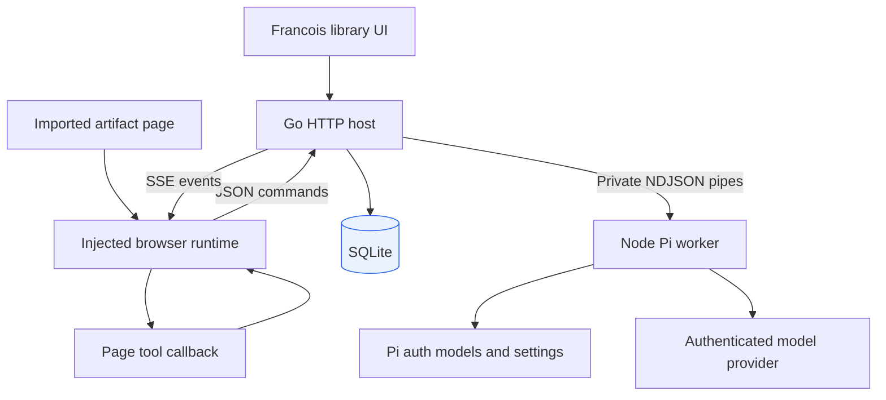
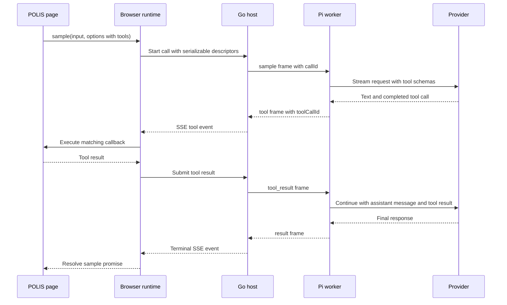
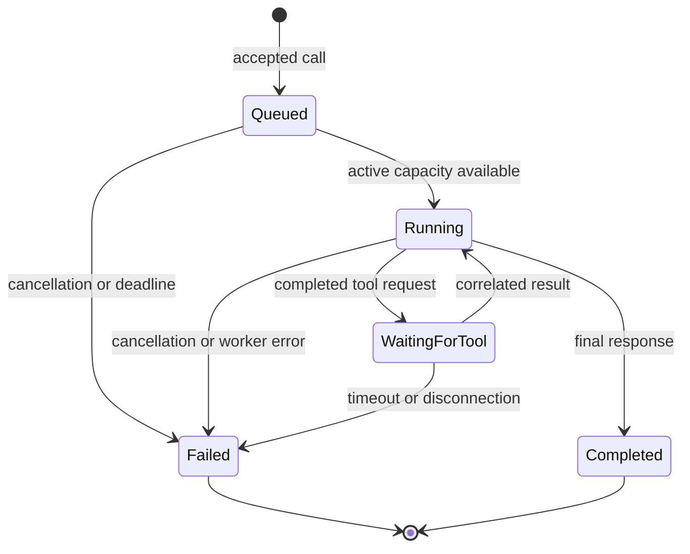
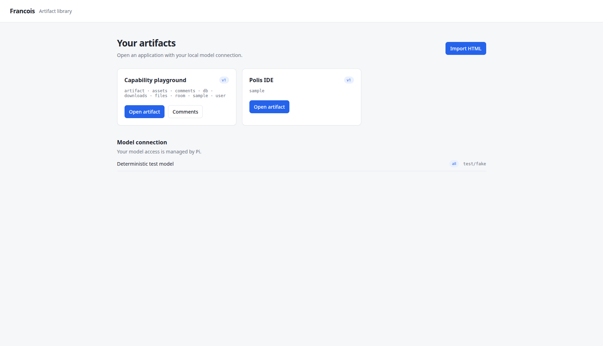

# Francois: Hosting Claude Artifacts with Go and a Pi Model Runtime

Francois runs saved HTML applications that expect Claude's artifact browser APIs. It serves the original application, installs a local implementation of `window.claude`, stores application data in SQLite, and sends model requests through Pi's authenticated provider runtime. This report explains the implementation at commit `e81c037`, including the decisions needed to preserve browser tool execution, select models, and maintain state across page reloads and server restarts.

A saved HTML file can contain its entire interface and still depend on services supplied by its original host. POLIS IDE is the concrete application used here: its editor and scene renderer are present in the downloaded HTML, but its assistant expects a sampling API capable of calling JavaScript functions defined inside that page. Serving the file is therefore only the first operation. The host must also provide the execution and data contracts that its JavaScript expects.

> [!summary]
> Francois implements a local, single-owner artifact service with separate browser origins, durable application state, and browser-executed model tools. Go owns hosting and persistence; a Node worker uses Pi's model runtime; imported pages retain their existing code and styling. Real Pi requests were verified against POLIS, including a model-directed scene edit.

## 1. The concepts needed to understand the system

An **artifact** is an imported HTML application plus its stored metadata, capability manifest, and page versions. A **capability** is an API namespace made available to that application, such as model sampling or document storage. The manifest records which capabilities the imported application may use. A **view** is one live page instance connected to the service; two tabs displaying the same artifact have different view identifiers.

A **sample** is one model operation with explicitly supplied input, options, and optional tools. It is memoryless between calls: previous requests do not become conversation history automatically. During one sample, however, the worker retains model messages and tool results so that several provider requests can form one complete operation. A **tool** is a named operation described to the model by a schema and implemented by a JavaScript callback in the artifact page.

These definitions establish the central execution constraint. The model runtime can request a tool, but the callback belongs to a particular browser view. Go and Node cannot reconstruct that callback from JSON. They transport the tool's name and arguments back to the page, wait for its result, and then continue the model operation.

The report follows those dependencies in order: hosting establishes an artifact origin; connection establishes a view; sampling establishes a call; tool messages return to the owning view; durable capabilities operate on artifact-scoped records. The implementation details below explain these operations separately because they have different ownership and lifetime rules.

## 2. Project status and evidence

The repository was initialized from `go-go-golems/go-template` revision `5bf14bfd4a7b13124dbe9f2c3078c29a33627a11`. The module is `github.com/go-go-golems/francois`. Four local commits record the completed progression:

| Commit | Result |
|---|---|
| `ccde05d` | Template initialization, imported sources, and research ticket. |
| `0085786` | Local host, browser runtime, and Pi tool execution. |
| `263c006` | Expanded local capabilities, validation, and packaging. |
| `e81c037` | Failed-worker readiness correction and final handoff. |

The implementation supports sampling, streaming, JSON parsing, browser tools, model selection, document storage, page publication, local profiles, multi-tab presence, assets, rooted project-file reads, browser downloads, and persisted comments. The library interface follows the downloaded Factory Twin trailer's compact light styling. Imported applications retain their original CSS.

The original intern guide is a historical design document written before implementation. The README and source code describe the delivered behavior. This distinction matters when reading the ticket: a proposed feature in the guide is not proof that the current service implements it.

The project sources are preserved under docmgr ticket `FRANCOIS-001`. Its `sources/` directory contains the downloaded sampling specification, state-storage guide, people-and-collaboration guide, files guide, and `Polis IDE.html`. A manifest records original paths and SHA-256 hashes, which were checked against all five snapshots. The design guide was uploaded to reMarkable; that delivery covers the original guide rather than this later project report.

## 3. Architecture and responsibility boundaries

The browser has two distinct applications. Francois's library interface handles import and navigation. The imported artifact contains its own interface, stateful JavaScript, and tool callbacks. Both use assets embedded in the Go binary where appropriate, but imported HTML is stored in SQLite and receives the runtime at response time.



Go owns listener lifecycle, routing, view identity, capability checks, database operations, and call admission. The Node worker owns provider-facing model configuration and request execution. The browser owns callbacks, abort signals, subscription delivery, optimistic state, and image preparation. SQLite holds records that must survive process termination. Presence and active calls remain in memory because their meaning depends on a currently connected view.

The service uses `net/http` and `http.ServeMux`. There is no separate routing framework, message broker, or independently deployed database. The private worker protocol uses newline-delimited JSON over subprocess stdin and stdout. This gives the Go process a bounded integration with the existing Pi SDK while keeping provider credentials out of browser traffic.

| Source location | Primary responsibility |
|---|---|
| `cmd/francois/main.go` | Cobra root, Glazed logging/help, process signals. |
| `cmd/francois/cmds/commands.go` | `serve`, `import`, and structured model listing. |
| `pkg/host/server.go` | Listeners, views, calls, shutdown, request checks. |
| `pkg/host/routes.go` | HTTP endpoints and HTML runtime injection. |
| `pkg/host/rpc.go` | Artifact capability operations. |
| `pkg/store/store.go`, `documents.go` | Durable records, publication, document semantics. |
| `pkg/piworker/client.go` | Subprocess framing, dispatch, cancellation, readiness. |
| `worker/src/main.ts` | Pi initialization, model resolution, streaming tool rounds. |
| `ui/src/runtime.ts` | Public browser API and sample coordination. |
| `ui/src/runtime-db.ts`, `runtime-rooms.ts` | Documents, subscriptions, and presence. |
| `ui/src/runtime-files.ts`, `runtime-images.ts` | File/download and image handling. |
| `ui/src/app.tsx` | React library and comments shell. |

All paths in this table are relative to `/home/manuel/code/wesen/go-go-golems/francois`.

## 4. Hosting the original application

The import operation stores the original HTML bytes, an artifact identifier, title, manifest, and initial version. It accepts a complete HTML application rather than a multi-file website bundle. The original document remains separate from the injected response, so publication history describes authored application content rather than accumulated runtime insertions.

When serving a page, the host inserts bootstrap information and the browser runtime after the first HTML `head` opening, before authored scripts execute. This ordering lets an application access `window.claude` during initialization. If a suitable head element is absent, the injection is prepended. Bootstrap data uses Go's JSON encoding, including escaping characters that could terminate a script context.

The main listener serves the library. Each artifact receives its own loopback listener and a port persisted in SQLite. This is a browser-origin decision: browser storage belongs to an origin composed of scheme, host, and port. Hosting two applications under different paths on one origin would make their `localStorage` share the same namespace. Separate ports isolate that storage while leaving the native storage API intact.

Persisting the port preserves that origin across restarts. It also creates an operational constraint: if another process occupies a previously assigned port, mounting the artifact fails instead of silently moving it and losing access to its existing origin storage. The service is deliberately local; `serve` requires a loopback IP address. Requests must carry the expected Host value, and an Origin header, when present, must match the listener.

Static host files are served below `/static/` and embedded with Go's `embed` support. POLIS itself still references external CDN resources. Importing its HTML does not convert those fonts and JavaScript dependencies into offline resources.

## 5. A complete POLIS sampling operation

The verified operation asked the assistant to modify a scene property through the page's existing `eval` tool. The model selected a tool expression equivalent to:

```javascript
return ide.patch('height: 6', 'height: 7');
```

The browser executed the tool once; the editor and rendered scene changed; the returned result became input to the following provider request. The final model response confirmed the edit. The actual named model used for this smoke check was `openai-codex/gpt-6-luna`.

The following sequence describes the implementation's message flow. Labels identify operations rather than reproducing a captured wire log.



Callbacks and `AbortSignal` objects stay in browser memory. The request contains only copied input, scalar options, image data, and tool descriptions. Copying at invocation prevents later mutation of the caller's input object from changing an operation already admitted by the host.

A tool result is correlated with both the sample call and the provider's tool-call identifier. The host also checks that the requested tool name was declared for that call. This prevents a result from one operation satisfying another operation's waiter. It does not turn arbitrary page JavaScript into isolated execution: the callback still runs with the page's ordinary browser privileges.

### The worker's continuation algorithm

The worker preserves the provider's full assistant message, including non-visible content needed by provider continuation semantics. Reconstructing that message using only the displayed text would discard tool blocks, reasoning content, or signatures that a subsequent provider request may require.

The algorithm below is explanatory pseudocode derived from `worker/src/main.ts`:

```text
context = supplied turns + declared tools
visibleText = ""
for round in 0..4:
    if round == 4:
        context.tools = []
    enforce local context byte budget
    stream = Pi.streamSimple(selectedModel, context, options)
    append visible text deltas to visibleText
    message = await stream.result()
    reject aborted, failed, or unsupported deferred response
    context.messages.append(message)  # preserve complete provider message
    calls = completed toolCall blocks in message
    if calls is empty:
        return visibleText, thisRoundText, truncation, model metadata
    results = execute declared browser tools and await results
    context.messages.append(toolResult messages)
fail if no terminal response was produced
```

The limit is five provider rounds, with tools removed for the last round. Output tokens are clamped to the smaller of the model limit and 8,192. The local conversation budget is 512 KiB of serialized message content excluding image blocks. These are explicit resource bounds, not estimates of token usage.

The worker emits only text deltas as visible output. Partial tool argument fragments are not executable input. Browser execution begins after the SDK has produced a completed tool call. Independent completed tools are awaited with `Promise.all`; authors should therefore avoid expressing dependencies between tools that the provider emits in the same round.

## 6. Transport, lifetime, and cancellation

A page registers a view and opens a streaming fetch connection carrying server-sent events, or SSE. SSE represents each event as a text frame on one long-lived HTTP response. The runtime uses HTTP requests for commands in the other direction. One event connection multiplexes sampling events, document changes, and presence notifications.

View identity is opaque and bound to an artifact and the page version loaded by that view. View-owned command endpoints require the matching `X-Francois-View` header. Unconnected registrations expire after 15 seconds. Connected streams receive heartbeats every 15 seconds, and each view has a bounded event queue of 128 entries.

The host admits two active model calls and eight waiting calls. Its total admission capacity is ten. Each operation has a five-minute context deadline; tool work has a shorter 150-second deadline. Go's contexts connect call cancellation to worker cancellation and tool waiters. `errgroup` coordinates process-level concurrent work and shutdown.



The browser can share one in-flight, tool-free sample among equivalent subscribers. Canceling one subscriber detaches that subscriber; it does not stop the shared provider request while another subscriber still needs it. Calls containing tools are neither shared nor cached, because repeating or merging them could alter page state incorrectly. Successful cache entries live in browser memory, with supported lifetimes of five minutes or 24 hours and a maximum of 100 entries. Reloading the page clears this cache.

On event-stream loss, the runtime fails pending calls and establishes a new view. It refreshes document subscriptions and restores room participation and presence. It does not replay sampling tools or writes. Re-executing a tool after reconnect could perform the same scene edit or other mutation twice.

Timeouts bound asynchronous waiting. They cannot interrupt a synchronous JavaScript callback that blocks the browser's event loop. This is a concrete limit of the current callback execution model, not a missing cancellation frame.

### Worker failure changes advertised capability

The Go client serializes writes to the subprocess and continuously reads framed output. Its scanner permits frames up to 16 MiB. Initialization waits for a `ready` frame with a bounded deadline. Invalid protocol data or process failure terminates pending requests.

Final review found a separate correctness issue: a failed worker could still expose the model list received at startup. Commit `e81c037` makes `Models()` return an empty list after failure. New sample requests then receive `sampling_disabled` instead of attempting a broken pipe. Availability metadata must describe current execution capability, not merely successful initialization at some earlier time.

## 7. Pi configuration and richer model selection

The worker uses `@earendil-works/pi-coding-agent` and `@earendil-works/pi-ai`, pinned to version `0.85.1`. It creates a `ModelRuntime` with explicit paths to `auth.json`, `models.json`, and `models-store.json` beneath `~/.pi/agent`, then loads Pi settings through `SettingsManager`. Network model discovery is disabled during runtime creation. Authentication and model behavior remain SDK responsibilities, including supported OAuth and configured credential resolution.

This integration does not create a Pi coding-agent session. It does not load coding-agent extensions, skills, existing conversations, or built-in shell and filesystem tools. The tools available to a sample come from the artifact's descriptors. This keeps the browser tool contract independent of a terminal coding-agent workflow.

The sample API already has room for richer selection. An artifact can specify a concrete authenticated model instead of relying solely on a tier:

```javascript
const sample = await window.claude.use('sample');
const result = await sample('Describe the current scene.', {
  model: 'provider/model',
  effort: 'high'
});
```

The provider/model value in this example is a placeholder and must be replaced with an available Pi selector. Supported selectors can also include a thinking suffix such as `provider/model:xhigh`. The separate `effort` field supports the sample API's `low`, `medium`, and `high` values and takes precedence over the suffix. Supported thinking levels are included in `/api/models`, so an application can populate a selector from the actual configured catalog.

The host maps `quick`, `default`, and `complex` tiers through command flags. These names do not force three different models. Without explicit flags, the worker selects the authenticated configured default if it belongs to Pi's enabled scope, otherwise the first scoped model. All three tiers can therefore resolve to one model.

```sh
go run ./cmd/francois serve \
  --model-quick openai-codex/gpt-6-luna \
  --model-default openai-codex/gpt-6-sol \
  --model-complex openai-codex/gpt-6-astra

go run ./cmd/francois models list --format json
```

An explicit tier mapping that cannot resolve to an authenticated model prevents successful initialization. An unavailable model requested by an individual sample falls back to its selected tier. `modelApplied` identifies a successful explicit selection, while `modelTierApplied` records the requested tier. Applications that require exact-model execution should inspect the result rather than assuming the requested name was honored.

Public model metadata contains provider, identifier, display name, reasoning support, image support, tier, and supported thinking levels. It does not expose auth keys, provider headers, or credential-bearing configuration. The local owner's Pi account supplies authentication for every call; the service does not reproduce viewer-specific billing.

## 8. Durable document state and browser subscriptions

SQLite stores artifacts, immutable page versions, JSON documents, leases, assets, settings, threads, and comments. The store uses one database connection, WAL mode, and a five-second busy timeout. This is sufficient for the current single-process service and simplifies transactional mutations.

The document API treats paths as logical identifiers. Document paths have an even number of segments and collection paths an odd number. Dots are valid identifier characters; these paths are not filesystem paths. Confusing those two domains led to an early test correction: document path validation should enforce document structure, while file access needs filesystem traversal containment.

`set` replaces a document body. `update` recursively merges object fields; scalar and array values replace their previous values. Updating a missing document fails. Deleting a document is idempotent and does not remove nested documents. Each document body is bounded to 256 KiB and a nesting depth of 32.

A concrete merge illustrates the contract:

```text
existing = {scene: {height: 6, width: 10}, selected: ["wall"]}
patch    = {scene: {height: 7}, selected: []}
result   = {scene: {height: 7, width: 10}, selected: []}
```

Collection queries inspect immediate children. Filters, ordering, and limit are applied to those records, with stable document identifiers used as tie breakers. Missing ordering fields sort last. Limits are bounded to 1–1,000, the scan policy to 5,000 candidates, and filters to ten. Private `data/users/<uid>` records are filtered using the trusted local owner before the query window is computed. Filtering after a limit would return an incorrectly shortened result and make query behavior depend on inaccessible records.

The browser constructs immutable snapshots and maintains local pending-write overlays. An optimistic write appears immediately to its issuing page, then is reconciled with the server response. Rejected writes roll back. Query overlays also preserve ordering so that an optimistic rank change can move an item before acknowledgement. The Node contract tests include rejected-write rollback.

Subscriptions use invalidation and refresh. A server-side change tells affected views to obtain current results; the browser serializes and coalesces refresh work and computes document-change indexes from snapshots. The client permits up to 64 subscriptions. This approach keeps the database authoritative while giving consumers a stable snapshot interface.

Cooperative leases store holder identity, expiry, and data in a transaction. Their default duration is 30 seconds, with supported durations from one second to ten minutes. They coordinate participating clients; they are not authorization controls and do not prevent ordinary writes by a client that ignores the lease.

## 9. Page publication and version ownership

`artifact.publish(html)` creates an immutable next page version. Publication uses compare-and-set: the writer's expected version must still equal the current version. If two views publish from the same starting version, one wins and the other receives a conflict. A page should not overwrite a more recent revision merely because it finished generating HTML later.

The transaction can be understood through this pseudocode, which summarizes the store algorithm rather than reproducing its exact SQL:

```text
begin transaction
    advance artifact version only if currentVersion == expectedVersion
    if no row changed:
        fail version conflict
    insert immutable HTML version at expectedVersion + 1
commit
broadcast reload to connected artifact views
```

Binding each view to its loaded version supplies the expected version for operations performed by that page. Store tests verify that concurrent publication attempts cannot both succeed and that stored state survives reopening the database. Files-form publishing from the original platform guide remains outside the implemented surface.

## 10. Collaboration, identity, and comments

The user capability exposes one stable local owner identifier persisted in SQLite. Two tabs share that owner identity but have separate view identities. The service supports local profile data and private owner-scoped documents. It does not implement account login, multiple principals, or the original platform's organization roles.

Rooms are artifact-scoped, named in-memory membership groups. Presence belongs to a view within a specific room; joining two rooms does not combine their presence values. Patches merge fields, and null removes a field. Presence transmission is coalesced at approximately 33 milliseconds. Broadcast events identify peers and distinguish the sending tab from other tabs, including tabs with the same owner.

This state disappears when its corresponding connection or process ends. Durable shared application data belongs in the document store. Browser validation opened two page instances, observed two peers with the same owner, verified `sameTab` behavior, and confirmed that a shared document update reached the other page. A separate check kept lobby and named-room presence values independent.

Comments are persisted as threads and replies. The optional `/shell` route renders the artifact in an iframe alongside the host's comments panel. Composer requests from the child are checked against both the source window and origin. A real browser interaction opened the composer, entered text, posted it, and confirmed that the thread survived a server restart.

Supported anchors are basic DOM identifiers, text, or tag information. Custom comment anchors and conversation/session handoff remain separate follow-up work. The local comments implementation provides an application annotation workflow; it does not provide Claude conversation integration.

## 11. Assets, files, downloads, and images

These APIs operate on different kinds of data and therefore use different storage and access rules. Assets are uploaded, durable artifact-owned objects. Files are read-only entries beneath an explicitly configured project root. Downloads ask the browser to save bytes. Images supplied to sampling are prepared in the browser for a model request.

### Durable assets

The asset store records bytes, MIME type, owner, and stable identifiers in SQLite. It enforces accepted types, UTF-8 validation for text, per-object bounds, and local quotas of 1,000 files and 512 MiB. Ordinary assets have a 20 MiB limit; CSS and JavaScript are bounded to 16 MiB. Data and non-media responses use attachment handling, and responses set `nosniff`.

SVG upload is explicitly unsupported. Accepting SVG would require an implemented sanitization policy; treating it as ordinary raster content would give the API a false safety property. Supported uploaded text assets were listed and fetched in browser validation.

### Rooted file access

`serve --project-root /path/to/project` grants file access to a specific directory, and the artifact manifest must declare the files capability. Go's `os.OpenRoot` supplies rooted operations. File tests cover path traversal and symlinks that lead outside that root.

Reads support ranges up to 25 MiB. Revision metadata hashes the opened complete file, followed by checks for changes to size and modification time. A file can be larger than the read window: the maximum supported file size is 512 MiB. Listing is sorted, paginated up to 500 entries, and bounded by a 10,000-entry scan policy. Continuation cursors are bound to the listing path and recursive option.

Full download is a distinct operation. The browser first obtains metadata, asks for confirmation, and then opens a streaming download endpoint. The host copies the complete file to the response rather than reusing the limited read operation. A test used a file of 25 MiB plus three bytes to prove that download did not silently truncate at the read bound. Program-related extensions including executable and script types are blocked by this local download path.

### Browser image preparation

Image sampling must be declared with `{"sample":{"images":true}}`. The browser accepts up to four JPEG, PNG, WebP, or GIF inputs with an 8 MiB total input bound. It decodes the image, resizes to approximately 1.2 megapixels, paints onto a white canvas, and encodes JPEG at quality 0.85. Re-encoding removes the original file metadata. The runtime hashes the original input bytes for request identity and sends prepared image blocks in the final user turn.

A browser check converted a 1,800 × 1,200 PNG to a 1,342 × 894 JPEG, or 1,199,748 pixels. Model metadata must report image support, and the worker rejects images for a selected model that cannot accept them. This separates capability declaration from actual provider capability.

## 12. HTTP and public API reference

The endpoint table identifies the important internal transport surface. Artifacts normally use `window.claude` rather than constructing these requests themselves.

| Endpoint family | Meaning |
|---|---|
| `/` | Library on the main listener; injected HTML on an artifact listener. |
| `/static/…` | Embedded host JavaScript, CSS, and icon. |
| `/api/artifacts` | Catalog and main-listener imports. |
| `/api/models` | Safe model capability metadata. |
| `/api/views` | Register a view associated with loaded artifact/version. |
| `/api/views/{view}/events` | Streaming SSE delivery. |
| View call and RPC endpoints | Start/cancel samples, submit tool results, operate on capabilities. |
| `/api/assets`, `/_blob/{id}` | Asset operations and durable content. |
| `/api/files` | Rooted listing, reads, metadata, and downloads. |
| `/shell`, `/api/threads` | Host comments interface and thread reads. |

`window.claude.use(...)` is asynchronous and returns declared capability namespaces. The sampling function has associated JSON and limits behavior. Failures use plain objects with `code`, `message`, and optional partial `text`, allowing the application to distinguish cancellation, invalid input, provider failure, and unavailable capabilities.

Input normalization accepts a string or user/assistant turns, merges adjacent turns with the same role, and requires user turns at both ends. Total textual input is bounded to 256 KiB in UTF-8 bytes. JSON sampling tries the whole final text, a fenced block, and an object/array candidate. It rejects truncated responses. It parses the final round's text rather than concatenated commentary from earlier tool rounds, which could otherwise invalidate an otherwise complete JSON result.

## 13. Build, packaging, and interface design

The host library uses React, TypeScript, Redux Toolkit, and RTK Query. Its visual reference supplied a gray `#f6f7f9` canvas, white panels, `#e3e6ea` borders, and `#2563eb` accents. These styles apply to Francois-owned surfaces. POLIS's imported interface remains authored by POLIS.



The validated library screenshot shows the artifact catalog and the configured model tiers.

The build uses pnpm 10.13.1 and requires Node 24 or newer. Esbuild produces the browser runtime and library bundles as IIFEs and the worker as an ESM entry point with external dependencies. Browser assets are tracked under `pkg/web/static` so a Go build can embed them without a separate frontend build at compile time. Generation refreshes those assets; CI checks that rebuilding does not produce an uncommitted generated diff.

`make package-local` produces a local archive containing the Go executable, worker entry point, examples, dependency manifest, lockfile, and README. After unpacking, runtime Node dependencies still need installation:

```sh
pnpm install --prod --frozen-lockfile
./francois serve
```

Embedding the web assets does not remove the Node worker dependency. The template's production release machinery remains unconfigured. No remote release or deployment was performed during this implementation.

## 14. Verification and what the evidence establishes

Validation combines deterministic tests with real browser/provider checks. Deterministic tests reproduce protocol and storage edge cases without requiring an authenticated provider. Live checks establish that the actual Pi integration and the downloaded application's JavaScript work together.

| Verification | Observed result and scope |
|---|---|
| Go suite with race detector | Passed across host, store, worker client, and commands. |
| Go build, vet, generation, logcopter check | Passed after generated logger correction. |
| TypeScript check and Node contracts | Passed; four contract cases, including optimistic rollback. |
| Lint | Zero issues with installed golangci-lint 2.4.0; template-pinned 2.12.2 was not run. |
| Host integration | Injection ordering, SSE/tool exchange, Origin checks, file containment, full download. |
| Store tests | Merge behavior, query windows, leases, publication conflicts, reopen persistence. |
| Worker tests | Tool/result correlation, cancellation, protocol failure, failed-worker model readiness. |
| Fake-backend browser run | POLIS tool execution, streaming fixtures, JSON, shared cancellation, local capabilities. |
| Real Pi browser run | Text streaming and exactly one scene-edit tool execution using `openai-codex/gpt-6-luna`. |
| Packaging and docmgr validation | Local archive built; ticket validation passed. |

The fake backend has deterministic streaming and JSON prompts and a POLIS fixture that saves a preset named `Francois test`. It supports repeatable application checks without provider cost. Worker pipe tests use a Go test subprocess rather than requiring Node credentials or a live provider.

Browser checks also covered frozen database snapshots, pending writes, multi-view presence, comment persistence, assets, file metadata, image re-encoding, and subscriber-specific cancellation. A library screenshot was saved and visually reviewed against the requested style. These checks support the documented local workflow. They do not establish behavior under large multi-user load, remote access, or every model/provider combination.

### Failures that changed the implementation process

Generation introduced a host package logger that conflicted with an existing `log` import. The initial milestone was amended after the affected build and tests passed. The lesson is procedural and concrete: generation must run before final source validation because generated declarations can change compilation.

An optimistic-query test initially expected a rank reorder without declaring an ordering field. The corrected fixture specified `orderBy`, matching the query contract. Tests must state the semantics they are checking; incidental expectations can otherwise appear to reveal implementation defects.

A broad text replacement intended to strengthen tool-schema validation also changed an unrelated call-registry expression and produced invalid Go. A focused patch repaired it, followed by build and test checks. Changes to repeated source patterns need bounded context, particularly when the same identifiers occur in validation and execution paths.

Some failures came from the execution environment rather than application behavior: restricted home cache writes, denied loopback sockets, and blocked DNS. Checks were rerun using a writable temporary cache or authorized network/socket access. Those retries are recorded in the diary and should not be reported as application fixes.

## 15. Extension points and unresolved platform semantics

The service's current boundary is one owner on localhost. Extending it to genuine multi-user operation requires explicit principal authentication, authorization checks based on the requesting principal, and a decision about which account supplies model credentials. The existing stable owner UUID is insufficient for that change.

Other remaining gaps are narrower: files-form publishing, SVG sanitization, custom comment anchors, the original permissions namespace, conversation/session handoff, and MCP connectors. These are tracked as follow-up work rather than represented by speculative interfaces. A new capability should define its browser contract, server authorization, persistence requirements, and lifecycle before it is advertised in `window.claude`.

For model selection, the next interface improvement can remain small: use `/api/models` to populate a provider/model selector and expose the selected model's supported thinking levels. Keep tier selection as a convenient default and show whether the explicit model was applied. Adding arbitrary provider request options is a separate design decision because their names and semantics vary across providers; the existing catalog and Pi resolver already cover richer model and thinking selection.

A useful implementation order for further work is:

1. Select one missing capability and write concrete behavior examples using the preserved source guide.
2. Add durable storage only for records whose meaning survives disconnect or restart.
3. Define the browser/runtime and Go/worker messages before adding transport code.
4. Add a deterministic contract or integration test for the distinguishing behavior.
5. Exercise the real artifact page and record the observed output in the ticket diary.

The compositional property of this design comes from ownership: browser callbacks remain browser callbacks, provider configuration remains Pi configuration, persistent data remains SQLite records, and Go coordinates the lifetimes between them. Each extension can be evaluated against those existing responsibilities.

## 16. Reading and reproducing the project

Start with `README.md`, then read `pkg/host/routes.go` alongside `ui/src/runtime.ts` to follow API installation and the first connected view. Continue with `pkg/piworker/client.go` and `worker/src/main.ts` for model execution. Read `pkg/store/documents.go` with `ui/src/runtime-db.ts` when investigating data behavior. The tests beside each package document edge cases that a successful browser demonstration alone would not reveal.

The repository is `/home/manuel/code/wesen/go-go-golems/francois`. Its ticket directory is:

```text
ttmp/2026/10/11/FRANCOIS-001--host-claude-artifacts-with-glazed-and-pi-model-runtime/
```

Important ticket references are `design-doc/01-claude-artifact-host-analysis-design-and-intern-implementation-guide.md`, `working-note/01-investigation-diary.md`, `sources/manifest.json`, the four imported Markdown guides, and `sources/Polis IDE.html`. The diary preserves commands, failures, decisions, and validation by implementation step. The original design preserves the preimplementation reasoning and API source analysis.

To reproduce a basic run from the repository:

```sh
pnpm install --frozen-lockfile
pnpm build
go run ./cmd/francois import \
  --file '/path/to/Polis IDE.html' --id polis --title 'Polis IDE'
go run ./cmd/francois serve --log-level info
```

Use a configured Pi model or supply explicit tier mappings. For offline contract work, use `serve --backend fake`. Run long-lived test servers in tmux and stop their listeners with `lsof-who -p <port> -k`. Keep `var/francois/francois.db` across restarts: it contains the durable identity, artifact origin assignments, documents, page versions, assets, and comments described in this report.
