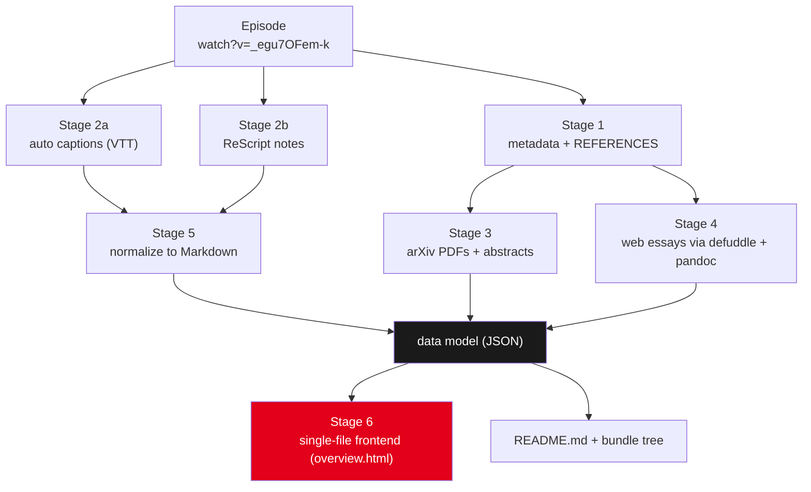
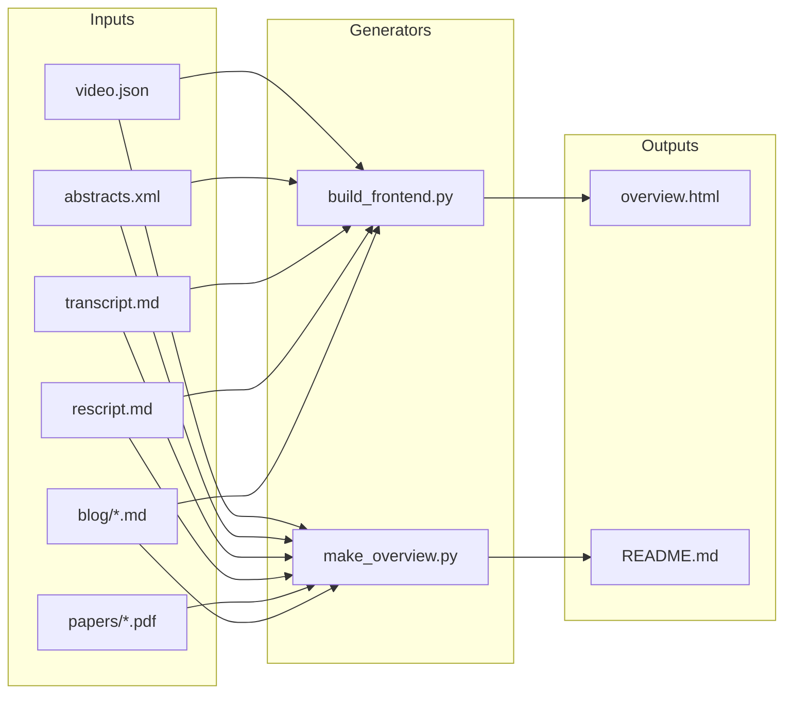
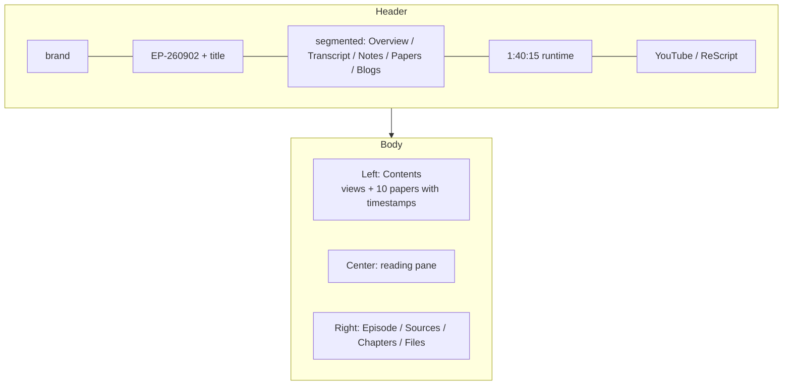
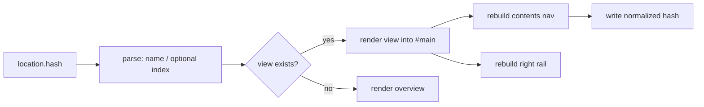
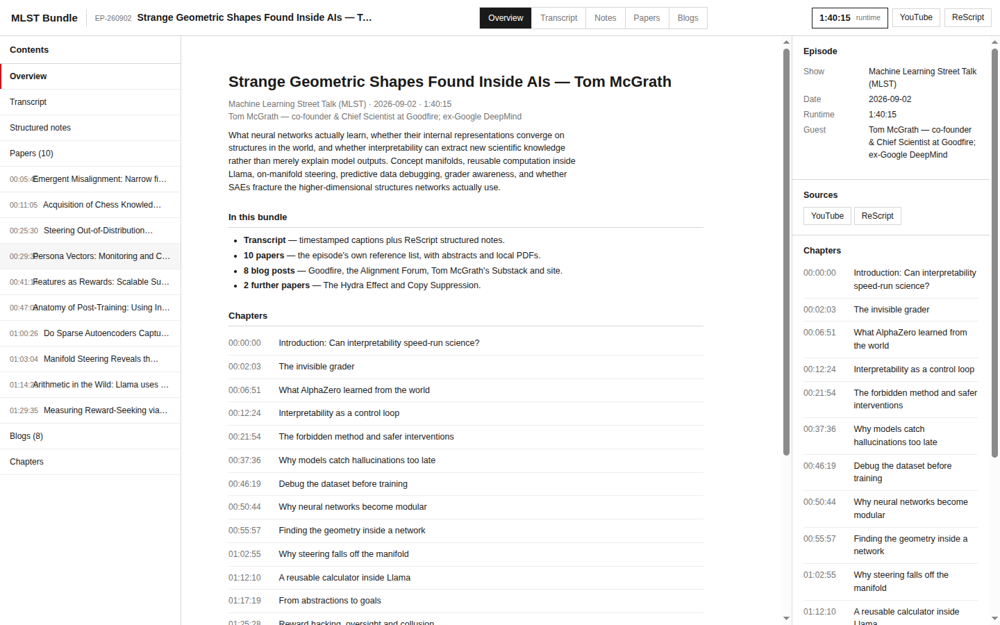
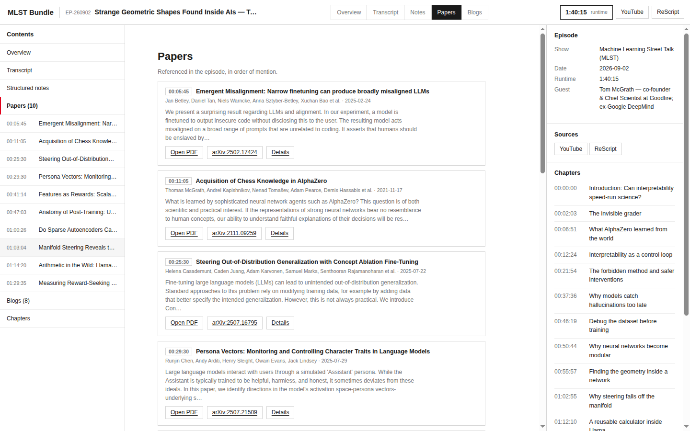
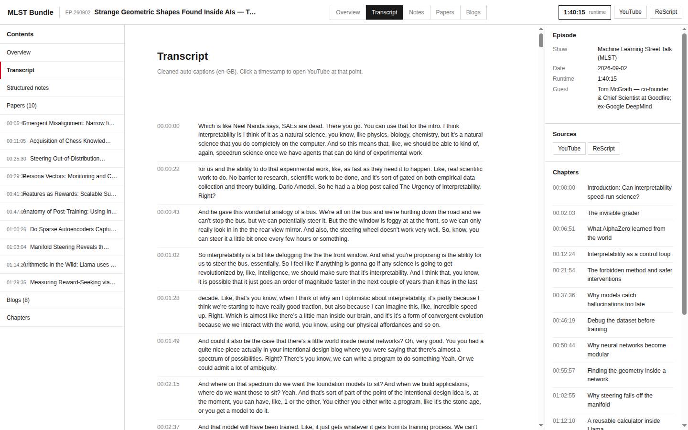

# MLST Tom McGrath Research Bundle — A Technical Deep Dive

This report documents a reproducible pipeline that converts one long-form podcast episode into a self-contained, offline study bundle, together with the day-mode reading frontend that presents it. The triggering artifact is episode 1:40:15 of *Machine Learning Street Talk* titled *Strange Geometric Shapes Found Inside AIs*, an interview with Tom McGrath, co-founder and Chief Scientist at Goodfire and a former Google DeepMind researcher. The episode is a discussion of what neural networks learn, whether their internal representations converge on structure that exists in the world, and whether interpretability can extract scientific knowledge rather than only explain model outputs. The episode description alone names ten arXiv papers and three web essays, and the video carries a machine-generated transcript. Neither the papers, the essays, nor a readable transcript exist in one place after listening, so the work described here assembles them into a bounded directory with a stable interface.

The bundle is produced by a sequence of acquisition stages followed by a normalization stage and a presentation stage. Each acquisition stage converts one external source format into a local file with a fixed name; the normalization stage turns those files into the data model that the frontend consumes; the presentation stage serializes the data model into a single HTML document with no network dependency. The pipeline is deterministic given its inputs, and every stage records the exact command and tool version that produced its output. The bundle lives at `/home/manuel/code/wesen/claw-stuff/scripts/2026/10/11/mlst-tom-mcgrath-bundle` and contains 36 files totaling 137 MB, of which 135 MB is the paper set.

The decisive design constraint is that the finished bundle must open from a `file://` URL with no server and no network access. Every acquisition step therefore terminates in a local artifact rather than a link, and the frontend embeds the normalized content directly in the document rather than fetching it. A second constraint is that the bundle must remain inspectable without the frontend: the papers are ordinary PDFs, the transcript and essays are ordinary Markdown files, and the episode metadata is ordinary JSON. The frontend is an additive view over files that stand on their own.

> [!summary]
> 1. A podcast episode is treated as a **source with a machine-readable reference list**. The episode description contains a `REFERENCES` block that pairs each paper and essay with the timestamp at which it is discussed; harvesting that block first converts an unstructured listening task into a finite, enumerable acquisition plan.
> 2. Acquisition is **one stage per external format**: YouTube metadata and captions (`yt-dlp`), arXiv PDFs and abstracts (HTTP plus the arXiv API), and web essays (`defuddle` piped to `pandoc`). Each stage is independently re-runnable and each failure is localized to one source.
> 3. The frontend is a **single self-contained HTML file** produced by a generator that embeds the normalized content as one JSON value. It has five views (Overview, Transcript, Notes, Papers, Blogs), hash-based routing, and zero network requests, so it renders identically from `file://` and from an HTTP server.
> 4. The visual language is the **Swiss specification of the Blueprint House document**: white ground, `#1a1a1a` as the darkest ink, greys between, Arial at two weights, 1 px rules, no tinted panels, and red reserved for the active item and error states. Dark mode is deliberately absent.
> 5. The two recurring failure modes are **silent content loss** — an API that returns an empty body with HTTP 200, or a transcript locale that does not exist — and **JS-rendered sources**, which require the browser and a second decoding step before `pandoc` can consume them.

## The problem this work addresses

A long-form interview makes reference to a set of primary sources. In this episode those sources are ten papers and three essays. The listener hears each source summarized in a few minutes of speech, and the summary is a lossy projection of the source: it selects the claims the host and guest consider central and omits the method, the sample sizes, the ablations, and the qualifications. A listener who wants to evaluate a claim must leave the audio, search for the paper, and re-establish the context that the episode supplied. The friction is proportional to the number of sources, and the context that the episode supplied is not recorded anywhere machine-readable.

The episode description is the one place where the mapping from discussion to source is written down. YouTube exposes the description through its metadata interfaces, and this particular description contains a section that names the source, gives its identifier, and records the timestamp at which the guest referred to it. The format is regular enough to parse:

```text
REFERENCES:
paper:
[00:05:45] Emergent Misalignment: Narrow finetuning can produce broadly misaligned LLMs
https://arxiv.org/abs/2502.17424v7
[00:11:05] Acquisition of Chess Knowledge in AlphaZero
https://arxiv.org/abs/2111.09259
...
other:
[00:15:44] Intentional Design
https://www.goodfire.com/blog/intentional-design
```

Three properties of this block determine the pipeline. First, it is finite and enumerable, so acquisition can be planned in advance and verified by count. Second, each entry carries a timestamp, so the bundle can cross-reference a document with the moment it was discussed, and the frontend can offer a link that opens the video at that moment. Third, the entries are heterogeneous — the same block mixes arXiv identifiers, blog URLs, an Alignment Forum post, and a ReScript share link — so the acquisition stage must branch on the URL form rather than assume a single provider.

The transcript introduces a second and independent problem. The video carries captions, but captions are stored as a timed cue list rather than as prose. The WebVTT format is a sequence of blocks, each with a timestamp range and one or more lines of text, and machine-generated captions repeat and fragment text across cues:

```text
00:00:00.000 --> 00:00:02.720 align:start position:0%
 Which is like Neel Nanda says, SAEs are dead.

00:00:02.720 --> 00:00:02.730 align:start position:0%
 Which is like Neel Nanda says, SAEs are dead.
 There you go.
```

The first cue and the second cue share a line, which is how the captioning system keeps text on screen across a cue boundary. A naive concatenation of all cues therefore duplicates text. The normalization stage must remove repeated leading lines before joining cues into paragraphs.

## The pipeline as a data model

The pipeline has six stages. Four acquire content, one normalizes it into a data model, and one serializes that model into the frontend. Each stage is a pure transformation from a named input to a named output, which is what makes the pipeline re-runnable when one source changes.



The normalized data model is a single JSON object with seven fields. Its shape is fixed by the frontend's requirements and not by any provider's API:

```json
{
  "app": "MLST Bundle",
  "episode": { "title": "...", "channel": "...", "date": "...", "duration": "...", "guest": "...", "blurb": "...", "rescript": "..." },
  "yt": "https://www.youtube.com/watch?v=_egu7OFem-k",
  "chapters": [ { "sec": 0, "t": "00:00:00", "title": "..." } ],
  "transcript": [ { "t": "00:00:00", "sec": 0, "text": "..." } ],
  "rescript_html": "<p>...</p>",
  "papers": [ { "i": 0, "ts": "00:05:45", "title": "...", "arxiv": "...", "pdf": "...", "authors": [], "published": "...", "abstract": "..." } ],
  "extra": [ { "i": 0, "title": "...", "arxiv": "...", "pdf": "...", "abstract": "..." } ],
  "blogs": [ { "i": 0, "title": "...", "url": "...", "path": "...", "html": "..." } ]
}
```

Two decisions in this schema matter. The `sec` field is stored alongside the human-readable timestamp so that the frontend can build a deep link without re-parsing the timestamp string. The `html` field for each blog post is pre-rendered at build time, so the browser needs no Markdown library and performs no conversion.

## Stage 1 — Episode metadata and reference harvesting

The metadata stage uses `yt-dlp` in its no-download mode. Two invocations are useful. The first captures the full metadata object, which contains the description, the chapter list, the upload date, and the format inventory:

```bash
yt-dlp --skip-download --dump-json "https://www.youtube.com/watch?v=_egu7OFem-k" \
  > metadata/video.json
```

The raw object is 11 MB because it enumerates every available format with every codec parameter. The bundle keeps a projection that retains only the fields the pipeline and the reader need:

```python
keep = {k: d.get(k) for k in [
    "id", "title", "uploader", "channel", "upload_date", "duration",
    "duration_string", "webpage_url", "description", "chapters", "tags",
    "categories", "view_count", "like_count", "channel_url"]}
```

The projected file is 5,591 bytes. The second invocation prints only the fields needed for display, which is also the fastest way to inspect a description before deciding whether a bundle is worth building:

```bash
yt-dlp --skip-download \
  --print "TITLE: %(title)s\nCHAPTERS: %(chapters)s\nDESCRIPTION:\n%(description)s" \
  "https://www.youtube.com/watch?v=_egu7OFem-k"
```

The description yields three distinct structures that the pipeline consumes. The chapter list is a machine-readable array of `{start_time, title, end_time}` objects and becomes the `chapters` field directly. The reference block is parsed with a regular expression that pairs a bracketed timestamp with the following title line and URL line. The ReScript share link is a single URL that the transcript stage treats as a fourth acquisition target.

The reference block schema, as observed in this episode, is a two-level list:

| Level | Token | Example | Meaning |
|---|---|---|---|
| Group | `paper:` / `other:` | `paper:` | category of the entries that follow |
| Time | `[HH:MM:SS]` | `[00:05:45]` | when the guest referred to the source |
| Title | free text | `Acquisition of Chess Knowledge in AlphaZero` | the source's title |
| URL | absolute URL | `https://arxiv.org/abs/2111.09259` | the canonical location |

The parser tolerates a version suffix on the identifier (`2502.17424v7`) and normalizes it to the bare identifier for the abstract lookup while preserving the full identifier for the link.

## Stage 2 — Transcript acquisition and normalization

The caption stage requests automatic subtitles in every English locale and converts them to a single subtitle format:

```bash
yt-dlp --skip-download --write-auto-subs --write-subs --sub-langs "en.*" \
  --convert-subs srt -o "transcript/%(id)s.%(ext)s" \
  "https://www.youtube.com/watch?v=_egu7OFem-k"
```

The command produced `_egu7OFem-k.en-GB.vtt` and then failed on the `en` locale with `HTTP Error 429: Too Many Requests`. The failure is informational: the `en-GB` track is a complete translation-free transcript of the same audio, and the pipeline proceeds with the one track that was written. The lesson recorded in the failure table below is that a caption request can succeed for one locale and fail for another within the same command, so the stage must check which files exist rather than assume the command's overall success determines the outcome.

The WebVTT file is 148,985 bytes. Normalization converts it to timestamped paragraphs in three operations. The first operation extracts cue blocks: for each line containing `-->`, a new block begins; subsequent non-empty lines are the block's text. The second operation strips inline tags, collapses runs of whitespace, and drops a block whose text equals the text of the previously emitted block. This is the step that removes the repeated leading line at cue boundaries. The third operation groups every six consecutive surviving cues into one paragraph and prepends the first cue's start time in `HH:MM:SS` form.

```python
blocks = []
for line in vtt.splitlines():
    if "-->" in line:
        start, end = [x.strip() for x in line.split("-->")]
        blocks.append([start, end, []])
    elif line and not line.startswith(("WEBVTT", "Kind:", "Language:", "NOTE")):
        if not re.fullmatch(r"\d+", line) and blocks:
            blocks[-1][2].append(line)

seen, paragraphs, buf = "", [], []
for start, end, lines in blocks:
    txt = re.sub(r"\s+", " ", re.sub(r"<[^>]+>", "", " ".join(lines))).strip()
    if not txt or txt == seen:
        continue
    seen = txt
    buf.append(txt)
    if len(buf) >= 6:
        paragraphs.append((hhmmss(start), " ".join(buf)))
        buf = []
```

The result is 280 paragraphs in a 101,539-byte Markdown file. Each paragraph is emitted as a bold timestamp followed by its text, so the file remains readable as plain Markdown while remaining machine-parseable. The parser used by the frontend is the same regular expression that the generator uses, which means the transcript file has exactly one consumer and one grammar.

```markdown
**[00:00:00]** Which is like Neel Nanda says, SAEs are dead. There you go. You can use that
for the intro. I think interpretability is I think of it as a natural science, you know,
like physics, biology, chemistry, but it's a natural science that you do completely on
the computer.
```

The ReScript share is a second, independently produced representation of the same episode. ReScript renders a transcript into a structured document with a topics map, a per-topic question list, and a description, and it preserves speaker attribution. The extraction is a single browser evaluation that reads the rendered text of the main element:

```javascript
() => {
  const title = document.querySelector('h1')?.textContent?.trim() || document.title;
  const main = document.querySelector('main') || document.body;
  return JSON.stringify({ title, lis: document.querySelectorAll('main li').length, text: main.innerText });
}
```

The browser tooling saves the evaluation result as a JSON-encoded string rather than as raw text, so the pipeline decodes it with `json.loads` before writing Markdown. The ReScript capture is 104,820 characters, slightly longer than the cleaned caption transcript, because it retains structure that the caption stream does not. Keeping both representations is deliberate: the caption transcript is the verbatim record and the ReScript document is the navigable one.

## Stage 3 — Paper acquisition

The paper stage consumes the arXiv entries of the reference block. The PDF for an arXiv identifier is available at a stable URL of the form `https://arxiv.org/pdf/<id>`, and the bundle writes each PDF to a descriptive name that sorts in discussion order:

```bash
curl -sS -L -A "Mozilla/5.0" -o "papers/01-emergent-misalignment.pdf" \
  "https://arxiv.org/pdf/2502.17424v7"
```

Ten papers were downloaded, ranging from 2.6 MB to 40.8 MB. The `file` command confirmed every result is a PDF with a version and a page count rather than an HTML error page. The inventory, in the order the guest discussed the sources, is:

| Order | Reference time | Paper | arXiv | Local file |
|---|---|---|---|---|
| 1 | 00:05:45 | Emergent Misalignment | 2502.17424 | `papers/01-emergent-misalignment.pdf` |
| 2 | 00:11:05 | Acquisition of Chess Knowledge in AlphaZero | 2111.09259 | `papers/02-acquisition-of-chess-knowledge-alphazero.pdf` |
| 3 | 00:25:30 | Concept Ablation Fine-Tuning | 2507.16795 | `papers/03-concept-ablation-fine-tuning.pdf` |
| 4 | 00:29:30 | Persona Vectors | 2507.21509 | `papers/04-persona-vectors.pdf` |
| 5 | 00:41:14 | Features as Rewards | 2602.10067 | `papers/05-features-as-rewards.pdf` |
| 6 | 00:47:03 | Anatomy of Post-Training | 2606.12360 | `papers/06-anatomy-of-post-training.pdf` |
| 7 | 01:00:26 | Do Sparse Autoencoders Capture Concept Manifolds? | 2604.28119 | `papers/07-do-saes-capture-concept-manifolds.pdf` |
| 8 | 01:03:04 | Manifold Steering | 2605.05115 | `papers/08-manifold-steering.pdf` |
| 9 | 01:14:20 | Arithmetic in the Wild | 2605.01148 | `papers/09-arithmetic-in-the-wild.pdf` |
| 10 | 01:29:35 | Measuring Reward-Seeking via Contrastive Belief Updates | 2607.18966 | `papers/10-measuring-reward-seeking.pdf` |

Two further papers were added because the alignment-forum essay discusses self-repair directly and both are the guest's own earlier work: `The Hydra Effect` (`2307.15771`) and `Copy Suppression` (`2310.04625`), stored under `papers/extra/`.

Abstracts are retrieved separately, because the PDF is not a convenient source for the text that the frontend displays. The arXiv API returns an Atom feed for a list of identifiers:

```bash
curl -sS "https://export.arxiv.org/api/query?id_list=2502.17424,2111.09259,...&max_results=20" \
  -o metadata/abstracts.xml
```

The first attempt used the `http://` scheme and produced a zero-byte file with a successful exit status. The same request over `https://` returned 27,991 bytes and ten entries. This is the silent-content-loss failure mode in its purest form: the transport reported success and the body was empty. The pipeline therefore checks the byte count and the entry count after every API call rather than trusting the exit status.

Parsing uses the Atom namespace and tolerates the version suffix on the identifier:

```python
ns = {"a": "http://www.w3.org/2005/Atom"}
for e in ET.parse("metadata/abstracts.xml").getroot().findall("a:entry", ns):
    aid = e.find("a:id", ns).text.split("/abs/")[-1]      # 2502.17424v7
    base = aid.split("v")[0]                               # 2502.17424
    authors = [a.find("a:name", ns).text for a in e.findall("a:author", ns)]
    summary = " ".join(e.find("a:summary", ns).text.split())
```

The abstract lookup is keyed by the bare identifier so that a versioned PDF and an unversioned identifier resolve to the same record. The frontend displays the first 300 characters of each abstract as a summary and the full abstract on the paper's detail view.

## Stage 4 — Blog and essay acquisition

The essay stage consumes the `other:` entries of the reference block plus three links discovered by following the neural-geometry series from the first Goodfire post. The extraction tool is `defuddle`, which fetches a URL, removes navigation and boilerplate, and emits an HTML body; `pandoc` then converts that body to GitHub-Flavored Markdown:

```bash
defuddle parse "https://www.goodfire.com/blog/intentional-design" \
  | pandoc -f html -t gfm --wrap=none -o "blog/intentional-design.md"
```

This two-tool composition handles server-rendered articles and produces clean Markdown with headings, lists, links, and figures. It handled two of the three sources named in the episode. The third source, the Alignment Forum post, is a client-rendered application: `defuddle` returned a 136-byte shell consisting of `<body><p>x</p><title>...</title></body>`, which is the server's empty document before the JavaScript application runs. The acquisition stage branches on this outcome by checking the byte count of the extraction; a body below a small threshold is treated as a client-rendered source and routed to the browser.

Extracting a client-rendered source requires three steps and one non-obvious decode. The browser navigates to the post, evaluates an expression that returns the `innerHTML` of the post container, and the tooling writes the returned string to a file. That write is JSON-encoded, so the file on disk is a quoted string with escaped quotes and escaped newlines rather than raw HTML. The decode step is explicit:

```python
raw = open("blog/af.raw.json", encoding="utf-8").read()
html = json.loads(raw)                       # unescape the JSON string
open("blog/af.html", "w", encoding="utf-8").write(html)
# then: pandoc -f html -t gfm --wrap=none blog/af.html -o a-pragmatic-vision-for-interpretability.md
```

The decoded document is 120,729 bytes and converts to an 807-line Markdown file. A follow-up pass removes the standalone span wrappers that the site uses for per-block anchors and inserts the correct title, because the page's first `h1` element was a comment counter rather than the title. The lesson is general: when a saved evaluation result is a JSON string, the file content is one level of encoding removed from the document, and the decode must happen before any HTML tool runs.

The essay inventory, with the extraction path that produced each file:

| Essay | Source | Extraction |
|---|---|---|
| Intentional Design | `goodfire.com/blog/intentional-design` | `defuddle` → `pandoc` |
| The World Inside Neural Networks | `goodfire.com/research/the-world-inside-neural-networks` | `defuddle` → `pandoc` |
| A Pragmatic Vision for Interpretability | `alignmentforum.org/posts/StENzDcD3kpfGJssR/...` | browser → JSON decode → `pandoc` |
| Neural Geometry series (index) | `goodfire.ai/research/neural-geometry` | `defuddle` → `pandoc` |
| Manifold Steering (companion) | `goodfire.ai/research/manifold-steering` | `defuddle` → `pandoc` |
| Can SAEs Capture Neural Geometry? | `goodfire.ai/research/can-saes-capture-neural-geometry` | `defuddle` → `pandoc` |
| Safety as a Scientific Pursuit (Substack) | `banburismus.substack.com/p/safety-as-a-scientific-pursuit` | `defuddle` → `pandoc` |
| Research projects (personal site) | `tommcgrath.github.io/research-projects` | `defuddle` → `pandoc` |

The guest's personal site and Substack were not in the episode description. They were found by searching for the guest's name and organization and following the links from the personal site's landing page. This discovery step is part of the pipeline and not an accident: the description enumerates the sources the editor chose to cite, which is a subset of the sources that define the guest's work.

## Stage 5 — Bundle layout and metadata

The bundle has a fixed directory layout. Fixed names are what allow the frontend generator to be written once and re-run against any episode.

```text
mlst-tom-mcgrath-bundle/
├── overview.html                 # single-file day-mode frontend
├── overview-dark.html            # prior dark overview, retained
├── overview-preview.png          # full-page render of the first overview
├── frontend-overview.png         # verification screenshots
├── frontend-papers.png
├── frontend-transcript.png
├── README.md                     # manifest and contents table
├── make_overview.py              # data model + overview generator
├── build_frontend.py             # frontend generator
├── metadata/
│   ├── video.json                # projected episode metadata
│   └── abstracts.xml             # arXiv Atom feed
├── transcript/
│   ├── transcript.md             # 280 timestamped paragraphs
│   ├── rescript.md               # structured notes
│   └── _egu7OFem-k.en-GB.vtt     # raw captions
├── papers/
│   ├── 01-emergent-misalignment.pdf
│   ├── ... (10 files)
│   └── extra/
│       ├── hydra-effect.pdf
│       └── copy-suppression.pdf
└── blog/
    ├── intentional-design.md
    ├── ... (9 Markdown files)
```

The manifest is `README.md`, generated by the same script that generates the overview. It contains a path table, the paper inventory with arXiv links, and the chapter list. Generating the manifest rather than writing it by hand guarantees that the manifest cannot drift from the data model.



The two generators share the episode constants. `make_overview.py` declares `EPISODE`, `CHAPTERS`, `PAPERS`, `EXTRA_PAPERS`, and `BLOG`, and `build_frontend.py` imports them. A second episode is therefore a matter of replacing those constants and re-running both scripts.

## Stage 6 — The reading frontend

The frontend is a single HTML file of 477,507 bytes. It contains the stylesheet, the markup, the script, and the entire data model as one embedded JSON value. It issues no network requests, which is the property that makes it open correctly from `file://`. Relative links to PDFs and Markdown files still work from `file://` because navigation to a local file is not a fetch.

### Visual specification

The visual language is taken from `~/Downloads/Blueprint House3.html`, which states its specification in a header comment: white ground, `#1a1a1a` as the darkest black, greys between, Arial in two weights, 1 px rules, no tinted panels, red only to mark errors, selection, and permits. The tokens the frontend reuses are:

| Token | Value | Role |
|---|---|---|
| `--bg` | `#ffffff` | page ground |
| `--ink` | `#1a1a1a` | primary text, active state fill |
| `--ink-2` | `#737373` | secondary text, metadata |
| `--hair` | `#d6d6d6` | borders and rules |
| `--rule` | `#ededed` | lighter internal separators |
| `--fill` | `#f6f6f6` | hover background |
| `--accent` | `#e2001a` | active-item marker, errors |
| `--fs-xs` … `--fs-xl` | 10.5 / 12 / 13 / 18 / 30 px | type scale |
| `--mono`, `--display` | Arial, Helvetica Neue, Helvetica | type families |

Dark mode is absent by construction. The reference document contains a `prefers-color-scheme: dark` block and a `[data-theme="dark"]` block; the frontend omits both and sets `color-scheme: light` on the root, so a dark-preferring user agent receives the light palette unmodified.

### Layout

The chrome is a three-column grid with a fixed 52 px header. The header holds the brand, the episode code and title, a segmented navigation bar, a runtime pill, and two external links. The left column is a contents list that enumerates the views and every paper with its reference timestamp. The center column is the reading pane. The right column is a rail with the episode facts, the source links, the chapter list, and a file list.



### Routing

Views are selected by URL fragment. The router maps a fragment to a view function, renders the view's HTML into the main pane, rebuilds the contents list to mark the active entry, rebuilds the rail, and writes the normalized fragment back. Because the fragment is the only state, every view is addressable and the browser's back button works without additional code.



| Fragment | View | Argument |
|---|---|---|
| `#overview` | episode summary, chapter list | none |
| `#transcript` | 280 timestamped paragraphs | none |
| `#rescript` | structured notes | none |
| `#papers` | paper cards with abstracts | none |
| `#paper/7` | one paper with full abstract | paper index |
| `#blogs` | essay cards | none |
| `#blog/2` | one essay rendered inline | essay index |

The transcript view renders each paragraph as a two-column row whose first column is a link to `https://www.youtube.com/watch?v=_egu7OFem-k&t=<seconds>s`. The `sec` field in the data model exists for this link; without it the frontend would parse the `HH:MM:SS` string at render time.

### Two defects found during verification

Verification was performed against a local `python3 -m http.server` instance and captured as screenshots. Two defects appeared and both required a code change rather than a data change.

The first defect was a collision between the reference timestamp and the paper title in the contents list. The `.idx` span had `min-width: 2.4em`, which at the 10.5 px font resolved to 25.2 px, less than the rendered width of `00:05:45`. The measured value confirmed the diagnosis:

```text
idx: { w: 25.1875, minW: '25.2px', fs: '10.5px' }
idxText: "00:05:45"
```

Raising the minimum width to `5.6em` and adding `flex: none` removed the collision.

The second defect was that an on-load fragment was ignored. The initialization code called `setView('overview')` unconditionally, so a document opened at `#transcript` rendered the overview. The fix was to call the router during initialization and to write the fragment only when it differs from the current value, which prevents the write from re-entering the router:

```javascript
const target = '#' + name + (LOC.arg != null ? ('/' + LOC.arg) : '');
if (location.hash !== target) location.hash = target;
```

During verification the browser served a cached copy of the stylesheet, so the corrected `min-width` did not appear in the rendered page until the URL was changed with a cache-busting query parameter. This is a test-environment artifact rather than a bundle defect, but it is recorded because it produced a false negative in the first verification pass.

### Screenshots

The three verification screenshots show the overview, the papers view, and the transcript view.







## Failure modes and diagnostics

Every failure below was observed during the production of this bundle. The table records the exact symptom, the cause, and the resolution, because the symptom alone does not identify the cause.

| Symptom | Cause | Resolution |
|---|---|---|
| `HTTP Error 429` on `en` captions after `en-GB` succeeded | per-locale rate limiting within one request | proceed with the locale that was written; check which files exist |
| arXiv API returns exit 0 and a 0-byte body | `http://` scheme is not served | use `https://export.arxiv.org`; assert byte count and entry count |
| `defuddle` returns a ~136-byte shell | client-rendered page; content is not in the server response | route to the browser, extract `innerHTML`, decode the saved JSON string, then `pandoc` |
| Saved evaluation result is one `\n`-escaped line | the browser tooling JSON-encodes the returned string | `json.loads` before writing HTML; never feed the encoded file to `pandoc` |
| Document title renders as a number | the page's first `h1` is a counter, not the title | read the title from the document title or an explicit selector |
| Contents list timestamp overlaps the title | `min-width` smaller than the rendered timestamp | set `min-width: 5.6em` and `flex: none` |
| Deep link opens the default view | initialization ignored `location.hash` | route on load; write the fragment only when it changes |
| Corrected CSS not visible in verification | HTTP cache | reload with a cache-busting query parameter |
| Frontend fails to load content from `file://` | a `fetch()` of a sibling file is blocked by the origin policy | embed all content in the document; use navigation links, not fetches |

The two failure modes with the highest cost are the silent ones. A transport that reports success with an empty body, and an extraction that returns the shell of a document rather than its content, both pass a naive exit-status check. The pipeline's rule is to assert a positive property of every artifact — a byte count above a threshold, an entry count, a page count from `file` — rather than to assert that the command completed.

## Evidence and verification

The bundle's claims are backed by files that can be re-inspected. The transcript was verified by paragraph count, the paper set by `file` output and page count, the abstract set by Atom entry count, and the frontend by screenshot and by reading the playlist state back from the browser.

| Claim | Evidence |
|---|---|
| 10 papers downloaded and valid | `file` reports `PDF document` with page counts; sizes 2.6–40.8 MB |
| 10 abstracts retrieved | `abstracts.xml` is 27,991 bytes with 10 `<entry>` elements |
| 15 chapters captured | projected `video.json` contains the chapter array |
| 280 transcript paragraphs | `transcript.md` is 101,539 bytes; generator reports 280 segments |
| 8 blog posts retrieved | `blog/` holds 9 Markdown files, 8 of which are in the model |
| frontend renders with no network | screenshots at the three views; console shows no errors other than a favicon 404 under the test server |
| bundle is self-describing | `README.md` generated from the same constants as the frontend |

The bundle totals 36 files and 137 MB. The paper set dominates at 135 MB; the transcript, metadata, blog set, and both generators together are under 1 MB.

## Working rules

The pipeline is governed by a small set of rules that keep it reproducible and keep failures localized.

- Harvest the reference list before acquiring anything. It converts an open-ended research task into a countable plan, and it is the only record of why each source is in the bundle.
- Assert a positive property of every artifact. A byte count, an entry count, or a page count catches silent content loss that an exit status does not.
- One stage per external format. YouTube, arXiv, and the open web fail in different ways; keeping the stages separate keeps a failure from propagating.
- Normalize to a single data model that the generator owns. The frontend never parses a provider's format.
- Embed content in the frontend; never fetch. This is the property that makes the bundle usable offline and from `file://`.
- Keep the raw acquisition output. The VTT file, the metadata JSON, and the arXiv feed are retained so that a normalization change can be re-applied without re-downloading.
- Retain the previous presentation. The superseded dark overview is kept as `overview-dark.html` rather than deleted.
- Defer to the source's own identifiers. The local paper filenames are stable, but the arXiv identifier is the canonical key used for lookups and links.

## Reuse and next steps

The pipeline generalizes to any episode whose description carries a reference block. The parameters that change between episodes are the video identifier, the guest, the reference list, and the discovery seed for the guest's personal site. The parameters that remain fixed are the stage boundaries, the directory layout, the data model, and the frontend.

Open questions are recorded here rather than resolved, because each is a decision that affects how the pipeline evolves.

- Should the description's `REFERENCES` block be treated as a required input, and should the pipeline fail loudly when it is absent, or fall back to a search-based discovery mode?
- Should the ReScript capture be treated as an optional enrichment, given that it requires a browser session, or should it be a required stage?
- Should the frontend be a single file per episode, or one shared application that loads a per-episode data model? The current choice favors offline portability over deduplication.
- Should the paper list be verified against the recorded timestamps by checking that each timestamp falls within the chapter that discusses the paper?
- Should the bundle ship a machine-readable manifest in addition to the generated `README.md`, so that other tools can consume the inventory without parsing Markdown?

## Related notes

- [[PROJ - Video Observatory - Technical Deep Dive Series]] — a long-form treatment of video-derived corpora.
- [[ARTICLE - Session Context Audits - Evidence Models Timelines and Reusable HTML Reports]] — the evidence-model and self-contained HTML report patterns reused by the frontend.
- [[PROJECT REPORT - Devmesh - Stable Local Endpoints for Ephemeral Backends - A Technical Deep Dive]] — the reference shape for this report.
