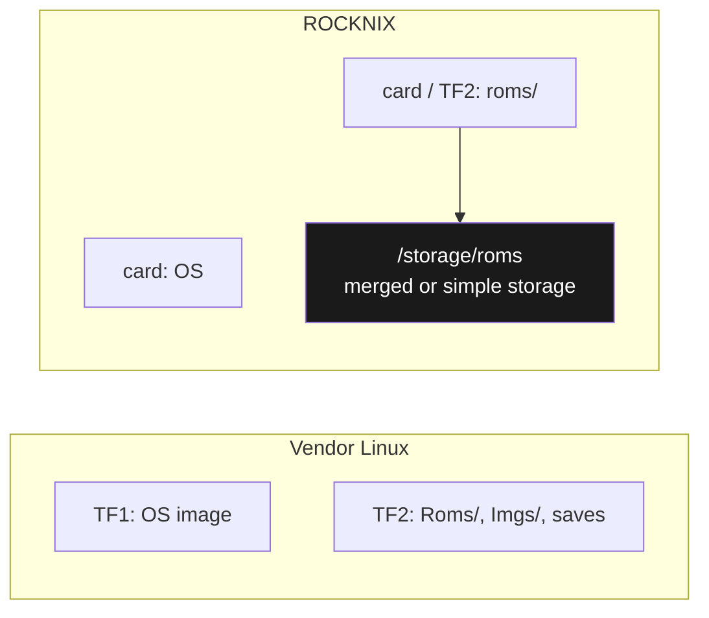
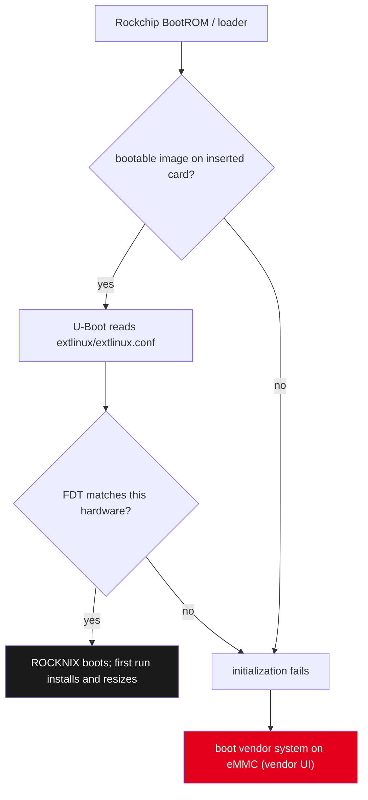
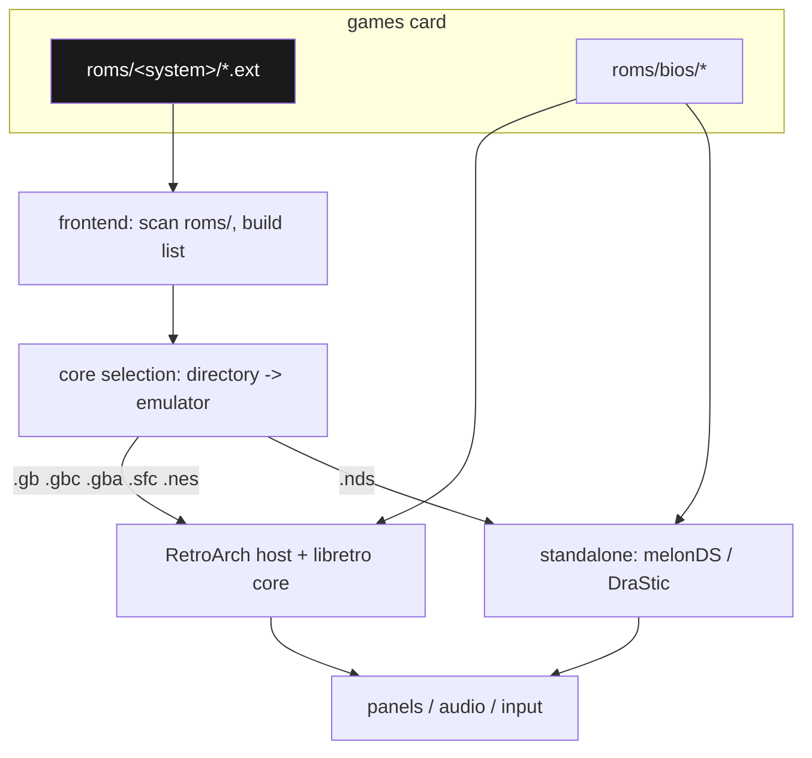

# Anbernic RG DS Plus: ROMs, Emulation, OS Replacement, and the Device-Tree Boot Failure — A Technical Deep Dive

The Anbernic RG DS Plus is a dual-screen Linux handheld built on a Rockchip RK3568. It ships with a vendor Linux build on a microSD card, it holds a fallback copy of that system on internal eMMC, and it can run one of several replacement operating systems written to a card. This report documents the complete path from a stock device to a device running ROCKNIX with a game library: the storage model, the boot chain, the per-system ROM and BIOS conventions, the image acquisition and write procedure, the verification method, and the single defect that dominated the work — a replacement image whose boot configuration named a different device's hardware description, causing the device to silently boot the vendor system instead of the card.

The work is recorded in ticket `ANBERNIC-RGDS-2026-10-12`, which contains an intern-facing design guide (468 lines), a flashing and dump playbook (366 lines), a source inventory, an investigation diary, a cartridge inventory, and two scripts. It draws on 26 captured sources, of which the decisive ones are the per-system pages of the ROCKNIX wiki, the vendor firmware listing, the GammaOS release notes, a community installation gist for the RG DS family, and documentation of the ROCKNIX ABL boot flow on a different Anbernic device.

The most transferable result is a diagnostic rule about this device class. A card that has been written correctly, verified byte-for-byte, and inserted into the boot slot can still boot the vendor system. When that happens, the fault is neither the card, nor the write, nor the slot: it is the device tree named in the card's boot configuration. This report explains how that value is used, why the wrong value produces a fallback rather than an error, and how to verify and correct it.

> [!summary]
> 1. **The card carries the operating system.** The RG DS Plus boots a complete OS from the microSD card in TF1, so replacing the operating system is writing an image to a card. There is no user-facing USB flashing path; USB-C is charging, plus ADB on Android-derived systems.
> 2. **The device always has a fallback.** An eMMC copy of the vendor system means a card that fails to boot does not brick the device — it silently boots the vendor UI. This converts a boot fault into a misleading symptom.
> 3. **The boot decision is a device tree match.** The image's `extlinux/extlinux.conf` names exactly one `.dtb`. The multi-device ROCKNIX nightly shipped with `FDT /device_trees/rk3566-powkiddy-x55.dtb`; with that value the RG DS Plus hardware cannot initialize and the eMMC system boots instead.
> 4. **Verification is byte-level and independent of the device.** The card's boot partition was confirmed identical to the image with `diff -r` (24 of 24 files) before the device was blamed, which isolated the fault to configuration rather than transfer.
> 5. **ROM placement is per-system and shared across operating systems.** `roms/gb`, `roms/snes`, `roms/nds` and the rest use the same names on ROCKNIX, the vendor Linux build, and GammaOS, so one ROM library survives an OS change.

## The device and its software stack

The hardware is a Rockchip RK3568 with four 64-bit Cortex-A55 cores at up to 2.0 GHz, a Mali-G52 2EE GPU, and 1 GB of RAM. The defining feature is a pair of 4.3-inch 1024×768 IPS panels, the lower one multi-touch and stylus-capable, which lets a Nintendo DS emulator present the DS's two screens on two physical screens rather than stacked on one. Networking is 2.4/5 GHz Wi-Fi and Bluetooth 4.2; storage expansion is quoted to 2 TB; the battery is 4000 mAh.

The vendor software is a Linux system. The product listing states the system as "Linux 16GB TF", meaning the operating system is delivered on a 16 GB microSD card, and Anbernic publishes a firmware image identified as `RG-DS-PLUS-EN16GB-20260915`. The device also carries an eMMC with a system image, which is what makes the fallback behavior in section 8 possible.

Three replacement operating systems are available, and they differ in runtime rather than in emulation cores.

| Operating system | Base | Home interface | Acquisition |
|---|---|---|---|
| Anbernic Linux (vendor) | Linux | vendor launcher | free, from the Anbernic firmware listing |
| GammaOS Nano | Android core, no Google apps | GammaOS console home | Patreon-gated release; archive password from the supporter Discord |
| ROCKNIX | Linux (buildroot) | EmulationStation | free nightly from ROCKNIX/GitHub |
| KNULLI | Linux (Batocera-derived) | Batocera-style | alpha, distributed to supporters |

For the work described here ROCKNIX was selected because it is free, needs no password, and because its source tree demonstrably contains the RG DS Plus hardware description even though the project's published device list does not enumerate it.

## Storage model and boot chain

The device has two microSD slots. In the vendor naming used across Anbernic documentation, TF1 holds the operating system and TF2 holds games. A two-card configuration is preferable because a firmware reflash rewrites TF1, and the games card is never touched by a system update.

On the games card the vendor system exposes a small set of top-level directories. The directory names are an interface: the frontend resolves a game to an emulator through the directory the file is in.

```text
<games card>/
├── Roms/
│   ├── nes/    snes/    gb/    gbc/    gba/    nds/    ...
│   ├── APPS/     # executable .sh scripts surfaced as "Applications > Apps"
│   └── bios/     # shared BIOS files, resolved by filename
├── Imgs/         # scraped box art
├── save/         # standalone-emulator saves
├── saves_RA/     # RetroArch battery saves
└── states_RA/    # RetroArch save states
```

ROCKNIX presents the same concept at a Linux path. Its games live in a `roms` directory on the games card, exposed at `/storage/roms`, and it offers merged storage that joins internal and external storage into one tree.



The boot chain determines which of these is visible, and it is the subject of the central finding. The device has no user-facing boot-order setting. The loader validates the inserted card, and the card's boot configuration names one hardware description; if that description does not match the hardware, initialization fails and the device boots the eMMC system.



## The ROM, emulator, and frontend model

Three components cooperate, and separating their responsibilities is the fastest way to diagnose a missing game.

A **ROM** is a binary image of a cartridge, disc, or board. For cartridge systems it is a single file whose extension identifies the console, such as `.gb`, `.gba`, `.nes`, or `.sfc`. It contains no knowledge of the software that will execute it.

An **emulator** reproduces the hardware. On this device most systems are emulated through **RetroArch** running a **libretro core**, where RetroArch is the host and the core is the per-system implementation, such as Gambatte for the Game Boy or Snes9x for the Super Nintendo. A few systems use a standalone emulator instead; the Nintendo DS uses melonDS or DraStic.

A **frontend** enumerates ROM directories, presents a list, and starts the correct emulator. On ROCKNIX the frontend is EmulationStation; on the vendor Linux build it is the vendor launcher; on GammaOS it is a console home built on the ES-DE theme engine.



The division yields three distinct failure signatures. A game that does not appear at all means the frontend found no file at a path it scans, which is a directory or extension problem. A game that appears and fails to start means the emulator resolved but the file is unsupported or corrupt. A game that starts with no audio, or that refuses a save, points at a BIOS or save-path problem.

## Per-system formats and BIOS files

The directory decides the console and the extension must be one the mapped emulator accepts. The table below is drawn from the ROCKNIX per-system pages, whose directory and extension conventions match the vendor frontend's.

| Console | Directory | Extensions | Default core | BIOS |
|---|---|---|---|---|
| Game Boy | `roms/gb` | `.gb` `.gbc` `.zip` `.7z` | Gambatte | optional `gb_bios.bin` |
| Game Boy Color | `roms/gbc` | `.gb` `.gbc` `.zip` `.7z` | Gambatte | optional `gbc_bios.bin` |
| Game Boy Advance | `roms/gba` | `.gba` `.zip` `.7z` | mGBA | optional `gba_bios.bin` |
| NES / Famicom | `roms/nes`, `roms/famicom` | `.nes` `.unif` `.unf` | Nestopia | none |
| Super Nintendo | `roms/snes`, `roms/sfc` | `.smc` `.fig` `.sfc` `.swc` | Snes9x | none |
| Sega Genesis | `roms/genesis` | `.md` `.gen` `.bin` | Genesis Plus GX | region files for Sega CD |
| Nintendo DS | `roms/nds` | `.nds` `.zip` `.7z` | melonDS / DraStic | `bios7.bin`, `bios9.bin`, `firmware.bin` |
| PlayStation | `roms/psx` | `.chd` `.cue` `.bin` `.iso` `.pbp` | Beetle PSX | region BIOS depending on core |

Two conventions are easy to get wrong. The Super Nintendo directory is named `snes` while the most common dump extension is `.sfc`, so the folder name and the extension are independent facts. And Game Boy and Game Boy Color share a core and a set of extensions, so a `.gbc` file placed in `roms/gb` still runs; the directory only selects the system definition and its artwork.

BIOS files are resolved by exact filename from `roms/bios`. The DS set is mandatory for melonDS and is listed with its known-good hashes.

| System | File | Known-good MD5 |
|---|---|---|
| Game Boy | `gb_bios.bin` (optional) | `32fbbd84168d3482956eb3c5051637f5` |
| Game Boy Color | `gbc_bios.bin` (optional) | `dbfce9db9deaa2567f6a84fde55f9680` |
| Game Boy Advance | `gba_bios.bin` (optional) | `a860e8c0b6d573d191e4ec7db1b1e4f6` |
| Nintendo DS | `bios7.bin` | `df692a80a5b1bc90728bc3dfc76cd948` |
| Nintendo DS | `bios9.bin` | `a392174eb3e572fed6447e956bde4b25` |
| Nintendo DS | `firmware.bin` | — |

## Operating-system selection and acquisition constraints

The choice between replacement systems is a choice of runtime, not of emulation quality, because the cartridge systems run the same libretro cores on either. GammaOS Nano is Android-derived and provides the strongest Nintendo DS path through DraStic-nano, at the cost of a gated release. ROCKNIX is a Linux distribution with EmulationStation and network-first game transfer.

The acquisition constraint is concrete and was the reason ROCKNIX was chosen. Every GammaOS release for the RG DS Plus is marked as a Patreon-exclusive release, and its archive password is not published in the release text; the releases state that the password is posted in the GammaOS Discord supporter channel and is available to supporters of a specific Patreon tier. The downloaded archive is a split `.7z` and is useless without that password. Publicly documented passwords exist for the base RG DS builds, but those archives do not run on the Plus.

| Release | Device | Assets | Password |
|---|---|---|---|
| `v1.4.4-ANBERNICRGDSPLUS` | RG DS Plus | `...Core_v1.4.4.7z.001` (2096.1 MB), `.002` (476.2 MB), boot-fix OTA (12.8 MB) | supporter channel only |
| `v1.4.3-ANBERNICRGDSPLUS` | RG DS Plus | `.001` (2096.1 MB), `.002` (521.3 MB) | supporter channel only |
| `v1.4.2-ANBERNICRGDSPLUS` | RG DS Plus | none | — |
| `v1.2.2-ANBERNICRGDS` | base RG DS | published | `b2fc6ffcb76fabc91024563a0b94f83be089c60aac4aa8f1a540a11d463d6bfc` |

ROCKNIX, by contrast, publishes nightly images without authentication. Its project device list does not name the RG DS Plus, so support was established from the source tree rather than from the list. The repository `ROCKNIX/distribution`, on branch `next`, contains the hardware description and the device-specific configuration:

```text
projects/ROCKNIX/devices/RK3566/linux/dts/rockchip/rk3568-anbernic-rg-ds-plus.dts
projects/ROCKNIX/devices/RK3566/linux/dts/rockchip/rk3568-anbernic-rg-ds.dts
projects/ROCKNIX/devices/RK3566/filesystem/usr/share/alsa/ucm2/Anbernic/RG-DS-Plus/*
projects/ROCKNIX/devices/RK3566/filesystem/usr/share/inputplumber/devices/01-rg-ds.yaml
projects/ROCKNIX/devices/RK3566/filesystem/usr/share/wireplumber/wireplumber.conf.d/51-anbernic-rg-ds-plus.conf
```

The same description is present in the released image, which is the stronger evidence: the image's FAT boot partition contains `device_trees/rk3568-anbernic-rg-ds-plus.dtb`, 137,824 bytes.

## Image acquisition and the write procedure

The selected artifact is the device-specific RK3566 nightly:

```text
ROCKNIX-RK3566.aarch64-20261010-Specific.img.gz   1,426,593,678 bytes
sha256  a755086e9c324cd3ae44b321153376be99013fc04a3b71953f0d7cbe5e26e431   (verified OK)
uncompressed                                        2,198,863,872 bytes
GPT disk identifier                                 770C6514-6013-41B4-8AF8-333388FD63D7
p1  32768–4227071   (4,194,304 sectors, 2 GB, FAT32, label ROCKNIX)
p2  4227072–4292607 (65,536 sectors, 32 MB, ext4, label STORAGE)
```

"Specific" is the multi-device handheld image; "Generic" is the single-board-computer image. The compressed artifact is verified against its published `.sha256` before extraction, and the extracted image's partition table is inspected before the write, because an image that does not match the device class is indistinguishable from a bad card once it is on the card.

The write is a whole-disk operation. The target is identified by removal capability and size rather than by a remembered device letter, and the write is flushed before the card is released.

```bash
lsblk -o NAME,SIZE,TYPE,TRAN,RM,MODEL          # identify by RM=1 and size, never by letter
udisksctl unmount -b /dev/sda1                 # release any auto-mounted partition
sudo dd if=<image>.img of=/dev/sda bs=4M status=progress conv=fsync
sync
```

`conv=fsync` and the trailing `sync` are required. Without them the card can be removed before the write drains, and the first boot reads corrupted data — the failure mode that produces an apparently valid card that does not boot.

A guarded wrapper, `scripts/01-flash-sdcard.sh`, implements the same procedure with refusals rather than instructions:

```text
flash(image, device):
    assert device is not the internal NVMe disk
    assert device is removable (RM = 1)
    assert size(image) <= size(device)
    require the operator to type FLASH
    unmount every partition of the device
    dd if=image of=device bs=4M conv=fsync
    sync
    assert cmp -n 100MiB image device      # verify the first 100 MiB
```

## The device-tree boot failure

This section documents the defect that consumed the investigation, because the symptom it produces points away from its cause.

### 8.1 The observed behavior

After a write that was verified byte-identical, the device powered on with the card in TF1 and displayed the vendor interface. This is consistent with three hypotheses: the card is in the wrong slot, the write failed, or the card is not a boot target. Two of the three were eliminated by evidence, and the third was eliminated by reading the card's boot configuration.

### 8.2 The boot configuration

The multi-device image names exactly one hardware description in `extlinux/extlinux.conf` on the FAT boot partition. As shipped by the nightly for this device class, that value names a different handheld.

```text
LABEL ROCKNIX
  LINUX /KERNEL
  FDT /device_trees/rk3566-powkiddy-x55.dtb          <-- shipped default, wrong device
  APPEND boot=LABEL=ROCKNIX disk=LABEL=STORAGE quiet console=ttyS2,1500000 console=tty0 systemd.debug_shell=ttyS2
```

The image carries a `.dtb` for every device it supports, so the correct description is already on the card and the repair is a one-line substitution.

### 8.3 The repair

The FAT boot partition mounts as a normal writable filesystem, so the correction requires no elevation.

```bash
udisksctl mount -b /dev/sda1
MP=$(lsblk -no MOUNTPOINT /dev/sda1)
cp "$MP/extlinux/extlinux.conf" "$MP/extlinux/extlinux.conf.bak-$(date +%Y%m%d-%H%M%S)"
sed -i 's|FDT /device_trees/.*\.dtb|FDT /device_trees/rk3568-anbernic-rg-ds-plus.dtb|' \
    "$MP/extlinux/extlinux.conf"
ls -l "$MP/device_trees/rk3568-anbernic-rg-ds-plus.dtb"    # confirm the target exists
sync
udisksctl unmount -b /dev/sda1
```

The corrected file:

```text
LABEL ROCKNIX
  LINUX /KERNEL
  FDT /device_trees/rk3568-anbernic-rg-ds-plus.dtb
  APPEND boot=LABEL=ROCKNIX disk=LABEL=STORAGE quiet console=ttyS2,1500000 console=tty0 systemd.debug_shell=ttyS2
```

### 8.4 Why the symptom is a fallback and not an error

The device carries a vendor system on eMMC. When card initialization fails, the loader falls through to eMMC and boots the vendor system, so the failure is presented as a normal interface rather than as a boot error. The same page of community documentation records the identical symptom for this device family: a flash that "boots into a black screen, recovery mode, or the stock OS" is a flash whose boot configuration does not match the hardware.

The practical rule this yields is precise: **a card that lands on the vendor interface is either not in the boot slot or is booting with the wrong device tree.** On this platform the device tree is the common cause.

### 8.5 The boot-order question

Because the fallback is invisible, the problem is easily misattributed to boot order. The device has no user-facing boot-order setting. Two mechanisms that resemble one are unrelated to it:

- The **ROCKNIX ABL** flow (`rocknix_abl`, `backup_abl.sh`, `flash_abl.sh` run from an Android settings application, followed by a Vol-/Vol+ menu) is documented for the Anbernic RG 55G1, a Qualcomm device, and switches between Android and Linux on that hardware.
- A community project provides an **Android entry inside ROCKNIX** on the RG DS family, which selects the eMMC Android from within ROCKNIX; it does not change which medium the loader prefers.

Changing the primary boot medium requires installing the operating system to the eMMC, which first requires wiping `mmcblk0`. That is an unofficial procedure with brick risk, and it is not necessary for the card-based configuration.

## Verification methodology

The investigation depended on establishing, with evidence, that the card was correct before the device was blamed. Three independent checks were used, none of which requires the device.

**Transfer integrity.** The card's FAT boot partition was mounted read-only and compared against the same partition of the source image with `diff -r`. The result was identical content across 24 files. This is stronger than a size or hash comparison of the whole device because it compares the files the bootloader actually reads.

```text
udisksctl mount -b /dev/sda1 -o ro
udisksctl loop-setup -f image.img --read-only && udisksctl mount -b <loop>p1 -o ro
diff -r --brief <image-mount> <card-mount>          # -> IDENTICAL (24/24 files)
```

**Partition geometry.** The card's GPT was compared against the image's: `sda1` at sectors 32768–4227071 and `sda2` at 4227072–4292607, matching the image exactly. The kernel's message `GPT:Primary header thinks Alt. header is not at the end of the disk` and the specific mismatch `4294655 != 61132799` are expected and harmless: they record that the image's backup GPT sits at the image's end (2.2 GB) while the card is 29.2 GiB. ROCKNIX repairs this and resizes on first boot.

**Enumeration timeline.** The kernel log ordered the events and distinguished a write from a failed enumeration:

```text
16:24:14  sda: GPT detected, sda1 sda2          <- card enumerated with the image's layout
16:29:51  sda: capacity change from 61132800 to 0   <- card removed from reader
16:34:32  sda: capacity change from 0 to 61132800   <- card reinserted
```

An earlier reader session had failed with repeated `device descriptor read/64, error -71` and a final `unable to enumerate USB device`, which is a transport fault rather than a card fault and was resolved by moving the reader to a different port.

## Games placement across operating systems

The three systems use the same per-system directory names, which is what makes one ROM library portable across them.

| Console | Vendor Linux | ROCKNIX | GammaOS |
|---|---|---|---|
| Root | `Roms/` on the games card | `/storage/roms` | ES-DE ROM tree on the removable card |
| Game Boy | `Roms/gb` | `roms/gb` | `gb/` |
| Game Boy Color | `Roms/gbc` | `roms/gbc` | `gbc/` |
| Game Boy Advance | `Roms/gba` | `roms/gba` | `gba/` |
| NES | `Roms/nes` | `roms/nes` | `nes/` |
| SNES | `Roms/snes` | `roms/snes` | `snes/` |
| Nintendo DS | `Roms/nds` | `roms/nds` | `nds/` |
| BIOS | `Roms/bios` | `roms/bios` | with the game tree |

For dual boot the decisive fact is that the boot target is chosen by the card's contents rather than by a menu. A card formatted as a plain data volume is not a boot target, so the device ignores it as a system and boots the internal one; a card written with a system image is a boot target. Two cards therefore give a switchable configuration: a data-only card carrying the games, and a system card carrying the alternative operating system.

```text
want vendor system + games  -> insert the data-only card   (boots internal, sees the games)
want ROCKNIX + games        -> insert the ROCKNIX card     (boots Linux, sees roms/)
```

One caveat applies to GammaOS specifically: because it is Android-derived, it mounts removable volumes by identifier rather than at a fixed path, so the ROM root it reports should be read from the running system once rather than assumed.

## ROM sourcing and the dump plan

The only lawful source of a commercial ROM is a copy made from a cartridge the owner possesses. Redistribution sites are not a source this work uses. The practical consequence is that a title list becomes a dumping and verification plan rather than a download list.

The inventory for the requested titles maps each game to its console, and therefore to its directory and extension.

| Title | Console | Directory | Extension |
|---|---|---|---|
| The Legend of Zelda; Zelda II | NES | `roms/nes` | `.nes` |
| A Link to the Past; Super Metroid | SNES | `roms/snes` | `.sfc` |
| Link's Awakening; Metroid II | Game Boy | `roms/gb` | `.gb` |
| Link's Awakening DX; Oracle of Ages, Seasons | Game Boy Color | `roms/gbc` | `.gbc` |
| ALTTP/Four Swords; The Minish Cap; Metroid Fusion; Zero Mission | Game Boy Advance | `roms/gba` | `.gba` |
| Ocarina of Time; Majora's Mask | Nintendo 64 | `roms/n64` | `.z64` |
| Phantom Hourglass; Spirit Tracks; Metroid Prime Hunters | Nintendo DS | `roms/nds` | `.nds` |

Reader coverage determines how many consoles a single purchase unlocks. The Open Source Cartridge Reader covers Game Boy, Game Boy Advance, NES, SNES, and N64; the GB Operator and GBxCart RW cover the Game Boy family; the Retrode 2 covers SNES directly. Nintendo DS titles require a DS cartridge reader or a console running a homebrew dumper.

Verification has two cheap independent checks. The dump's size and internal header must match the title, and its hash must match a No-Intro DAT for the console; an unmatched dump is re-dumped before it is trusted, because the common causes are a dirty connector and an interrupted read. Placement is by console, never by title.

## Tooling

Two scripts were written for the ticket and tested before use.

`scripts/01-flash-sdcard.sh` is the guarded writer described in section 7. Its value is that the destructive step is surrounded by refusals: it will not write to the internal disk, it will not write to a non-removable device, it will not write an image larger than the target, it requires a typed confirmation, and it verifies the first 100 MiB afterwards.

`scripts/02-organize-roms.sh` converts a directory of mixed ROM files into the per-system tree and emits a manifest. Classification is by extension, and for archives it inspects the first member's extension so that a zip containing a `.sfc` is placed in `snes/`.

```text
organize(source, dest):
    for each file under source:
        system = classify(file)         # by extension, or by archive member extension
        if system is unknown: report and skip
        copy or move file into dest/<system>/
        append (system, name, bytes, sha256) to dest/manifest.csv
    print per-system counts from the manifest
```

The script was exercised against a synthetic set covering `.nes`, `.sfc`, `.gb`, `.gbc`, `.gba`, `.z64`, `.nds`, and a `.zip` containing a `.sfc`; every file landed in the correct directory, and the manifest recorded the hashes. Its default is to copy, so the source set is never modified by an organizing pass.

## Failure-mode catalogue

| Symptom | Cause | Resolution |
|---|---|---|
| Reader shows repeated `error -71`, then `unable to enumerate` | transport fault on the USB port | move the reader to another port; reseat |
| Device boots the vendor UI with a freshly written card | card not in the boot slot, or wrong device tree in `extlinux.conf` | put it in TF1; set `FDT` to the device's `.dtb` |
| `GPT:Primary … Alt. header is not at the end of the disk` | image written to a larger card | expected; ROCKNIX repairs and resizes on first boot |
| First boot appears to hang for minutes | first-run install and filesystem resize | wait; do not interrupt power |
| Game does not appear in the list | wrong directory or unaccepted extension | place by system; check the extension table |
| Core reports a missing BIOS | BIOS filename or location wrong | place the exact filename in `roms/bios` |
| DS title will not boot under melonDS | DS BIOS set missing | add `bios7.bin`, `bios9.bin`, `firmware.bin` |
| GammaOS archive will not extract | release is Patreon-gated | obtain the password from the supporter channel, or use ROCKNIX |

## Working rules

- Verify the write before blaming the device. A byte-level comparison of the boot partition is cheap and eliminates the largest class of hypotheses.
- Treat the boot configuration as part of the image. A multi-device image names one device tree; that name is a required post-write edit, not an optional one.
- Read the fallback as a symptom. A system that always has a second bootable copy turns failures into silent successes, so the absence of an error is not evidence of success.
- Never identify the target by a remembered device letter. Identify by removal capability, size, and model.
- Flush and verify writes. `conv=fsync`, a trailing `sync`, and a read-back are the difference between a card that boots and a card that appears to.
- Keep the storage roles separate. System on one card, games on another, so that an update cannot destroy the library.
- Prefer the vendor's own identifiers. Local filenames are convenience; the device tree name and the image hash are canonical.
- Keep the previous state. The stock card and a timestamped `extlinux.conf` backup are the rollback path.

## Open questions

- The ROCKNIX project's published device list still omits the RG DS Plus even though the image and source both support it; whether the omission is an oversight or a statement about support maturity is unresolved.
- The exact emulator versions in the vendor `RG-DS-PLUS-EN16GB-20260915` image are not documented publicly and should be read from the device.
- Whether the RG DS Plus and the base RG DS can share a single card image without per-device editing beyond the `FDT` line is untested on both.
- The GammaOS mount path for its ROM tree under Android should be read from the running system, because Android does not use a fixed removable-media path.
- A scripted games-card verifier — BIOS hashes, per-system counts, zero-byte and duplicate detection — would turn the manual checks in this report into one command.

## Related notes

- [[PROJ - PULP OS on X4 Classic - Native ESP-IDF Port and Display Qualification]] — a second handheld device worked on in the same period, with a comparable pattern of device-specific hardware facts being the deciding constraint.
- [[PROJECT REPORT - MLST Tom McGrath Research Bundle - Transcript, Papers, Blogs and a Day-Mode Reading Frontend - A Technical Deep Dive]] — the source of the report structure used here, and the same approach of capturing primary sources into a ticket before synthesis.
- [[rg-ds-plus]] — map of all RG DS Plus projects: the platform, how the projects built on each other, and the shared toolchain, threading, twin and parity patterns.
