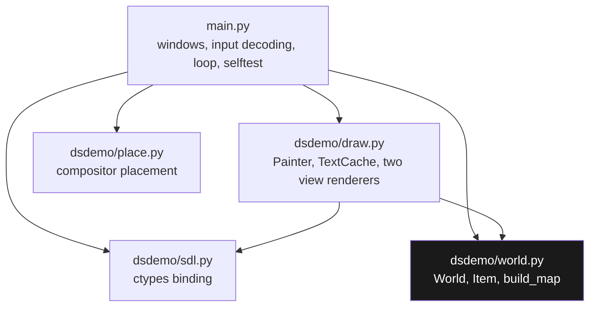
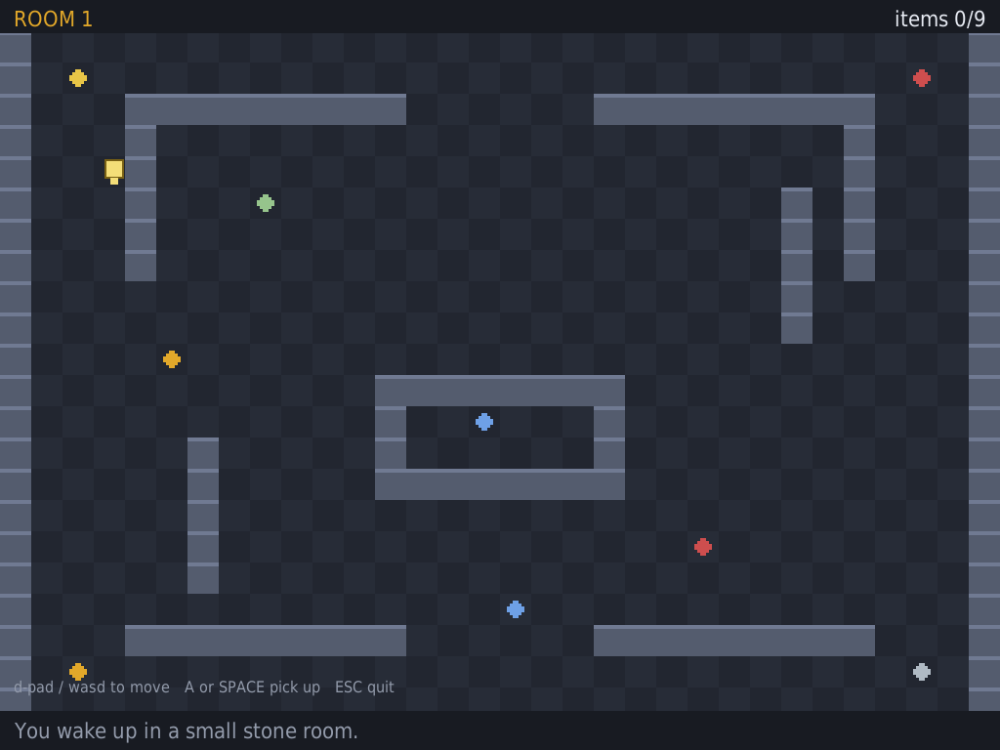
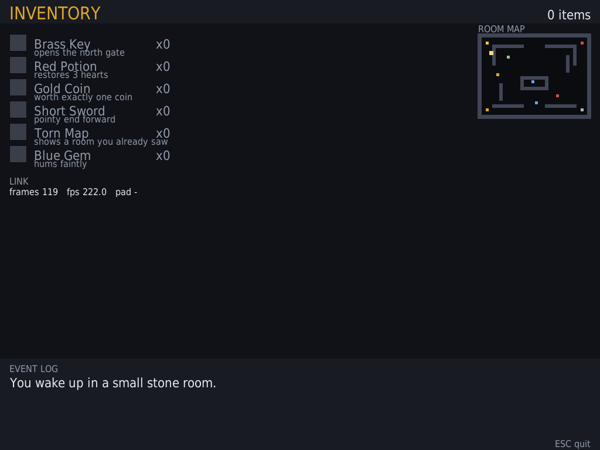
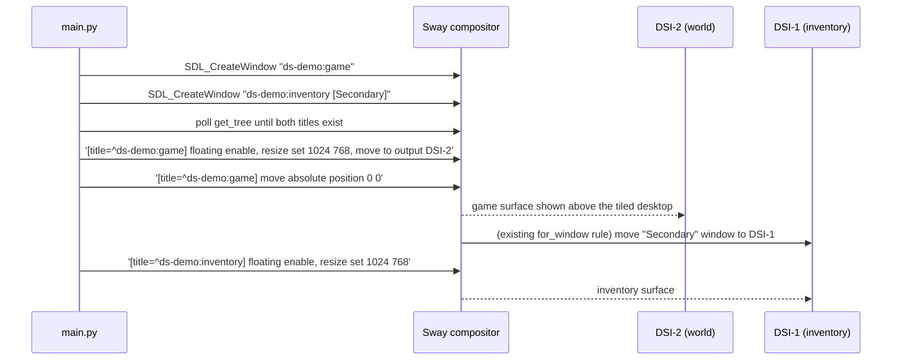

# DS Demo Game: Anatomy of a Dual-Screen SDL2 Application and the Compositor Placement Problem

This report documents a small application written to establish, on real hardware, how a program drives **both panels** of an Anbernic RG DS Plus at once and how it reads the built-in controller. The application is a top-down game of roughly 700 lines of Python: a tiled room with a movable player and nine collectable items is drawn on one panel, and an inventory with item counts, a scaled minimap, a live status line and a rolling event log is drawn on the other. The game is deliberately trivial. What was being investigated is the layer beneath it, and the investigation is the subject of this report.

The project produced three distinct kinds of result, and all three are useful to a future engineer. First, a working demonstration that a single process can hold two independent Wayland surfaces, one per panel, and keep them coherent from one world state. Second, a set of portable engineering techniques for a machine with no package manager and no compiler: binding to the system SDL2 through `ctypes`, decoding the event queue by hand, and rendering frames back to files so that graphics can be inspected without a display. Third, and most instructive, a **placement failure on real hardware that took two iterations to characterise**, together with three defects it exposed that the software-only test tiers could not have found.

Three on-device blockers remain at the time of writing. They are documented in full in section 9, with their causes and the specific changes that should resolve them, because the value of a handoff document is proportional to how precisely it describes the unfinished part.

> [!summary]
> 1. **One process, two windows, one state.** Each panel receives its own SDL window and renderer; both are drawn in the same loop from the same world object, and the game rules live in a module that imports nothing graphical, which is what makes them testable without a display.
> 2. **Wayland forbids client-side placement,** so the application states an intention (this window belongs on DSI-2) and the compositor satisfies it. Every placement defect in this project came from misunderstanding that interface, not from graphics code.
> 3. **`swaymsg` treats each argument as a separate command.** Passing criteria and action as separate arguments sends a bare criteria line (an error) and then runs the action against whatever is focused. This single misunderstanding floated the desktop and left both demo windows unsized.
> 4. **Sway learns about new windows asynchronously,** so placement commands issued immediately after `SDL_CreateWindow` can match nothing and fail silently. Placement must wait for the view to exist.
> 5. **The platform already has a convention for the second screen.** `/storage/.config/sway/config` contains a `for_window` rule that moves any window whose title contains `Secondary` to DSI-1 and powers that output on; naming the inventory window accordingly removed the need for hand-rolled placement on that panel.

## 1. The target platform, measured

The device runs ROCKNIX on a Rockchip RK3568. Every constraint below was read from the device rather than assumed, and each one shaped the implementation.

| Property | Measured value | Consequence |
|---|---|---|
| Root filesystem | `/` is **squashfs, read-only**; `/storage` is ext4 with ~26 GB free | all code, config and saves live under `/storage` |
| Interpreter | **Python 3.14.7**, complete standard library, **no pip** | no `pygame`, no `pysdl2`; pure Python or nothing |
| Compiler | **absent** | C/C++ requires a separate cross toolchain |
| Graphics libraries | **SDL2** `libSDL2-2.0.so.0.3200.10` plus `SDL2_gfx/image/mixer/net/ttf`; `libdrm`, `libgbm`, `libwayland-client`, GLESv2, Vulkan via panfrost | SDL2 is the practical target for a Python application |
| Display server | **Sway** (Wayland); session unit `essway.service`, with EmulationStation as the session application | the application is a Wayland client and cannot position itself |
| Outputs | **DSI-1** and **DSI-2**, 1024×768 each, at `0,0` and `1024,0`; separate backlights (`backlight0`, `backlight1`, range 0–1666, `bl_power` to blank) | two windows, one per output; power state is a separate concern from geometry |
| Input | `retrogame_joypad` = `js0`/`event6`; Goodix touchscreen = `event1`; `gpio-keys-hall` = `event4`; `gpio-keys-volume` = `event5`; `rk805 pwrkey` = `event0` | SDL enumerates the pad as a joystick; the compositor classifies the same device as `tablet_pad` |
| Existing second-screen precedent | `/usr/share/lowerdeck` (Python + SDL2), `/usr/bin/vertical-check` (layout), `/usr/bin/dsperate` (NDS frontend) | the platform's own components can be read and imitated |

The arithmetic that determined the visual design: 1024 divides by 32 to give exactly 32 tiles, and 768 divides to give exactly 24, so a 32-pixel tile grid produces a 32×24 play field that fills one panel with no scrolling and no scaling.

## 2. Why the binding is written by hand

Two options exist for graphics on this machine. The first is to call the installed SDL2 shared library through `ctypes`, keeping the application in Python and the deployment loop to a file copy. The second is to ship a compiled binary, which requires owning a cross-compilation toolchain and a sysroot and gives up the fast iteration that Python over SSH provides. The demo takes the first option, and this is also what the device's own second-screen UI does: `/usr/share/lowerdeck` ships its own `sdl2.py`.

`dsdemo/sdl.py` is therefore a hand-written binding of about thirty functions, each declared with explicit `argtypes` and `restype`. The library loader tries the device's soname, then the generic name, then the platform finder:

```python
def _load_sdl():
    for name in ("libSDL2-2.0.so.0", "libSDL2.so", "SDL2"):
        try:
            return ctypes.CDLL(name)
        except OSError:
            continue
    found = ctypes.util.find_library("SDL2")
    if found:
        return ctypes.CDLL(found)
    raise RuntimeError("libSDL2 not found")
```

Two habits are load-bearing. **Declare `argtypes` for every call**: an undeclared pointer argument is passed as a truncated 32-bit integer on a 64-bit target, and the resulting crash presents as a bug in your own logic. **Check the exported symbols rather than the header names** — a lesson learned the hard way in section 7.

The API surface actually used:

| SDL2 / TTF symbol | Purpose |
|---|---|
| `SDL_Init`, `SDL_Quit` | bring up video, events and joystick subsystems |
| `SDL_CreateWindow`, `SDL_SetWindowTitle`, `SDL_SetWindowFullscreen` | one window per panel; the title becomes the compositor match key |
| `SDL_CreateRenderer`, `SDL_SetRenderDrawColor`, `SDL_RenderFillRect`, `SDL_RenderDrawRect`, `SDL_RenderPresent` | all drawing, using rectangles only |
| `SDL_RenderSetScale` | window scaling for desktop testing without changing layout coordinates |
| `SDL_CreateTextureFromSurface`, `SDL_QueryTexture`, `SDL_RenderCopy`, `SDL_FreeSurface` | text rendered once and reused as a texture |
| `SDL_PollEvent` | the event queue, decoded by hand |
| `SDL_NumJoysticks`, `SDL_JoystickOpen`, `SDL_JoystickName` | controller discovery and status display |
| `SDL_RenderReadPixels`, `SDL_CreateRGBSurfaceWithFormatFrom`, `SDL_SaveBMP_RW`, `SDL_RWFromFile` | frame readback for headless verification |
| `TTF_Init`, `TTF_OpenFont`, `TTF_RenderUTF8_Blended`, `TTF_CloseFont` | font rasterisation; `SDL_Color` is passed **by value** |
| `SDL_GetTicks`, `SDL_Delay` | frame pacing |

## 3. Layer structure

Five modules with one direction of dependency. Nothing below the rendering layer knows that SDL exists.



| Module | Responsibility | Key symbols |
|---|---|---|
| `main.py` | process lifetime: create windows, decode input, run the loop, tear down | `InputState`, `hat_vector`, `QUIT_BUTTONS`, `main` |
| `dsdemo/sdl.py` | the only module aware of C | `SDL`, `Rect`, `Color`, event constants |
| `dsdemo/world.py` | game rules with no rendering dependency | `World`, `Item`, `build_map` |
| `dsdemo/draw.py` | pixels for both screens, palette, text cache | `Painter`, `TextCache`, `draw_game`, `draw_inventory` |
| `dsdemo/place.py` | compositor integration and environment discovery | `outputs`, `wait_for_view`, `layout`, `place_windows` |
| `ports/ds-demo-game.sh` | how the operating system launches it | one `exec python3 -u main.py --place` |

The separation has a concrete payoff rather than merely being tidy: because `world.py` imports nothing graphical, ten unit tests cover the map, collision, pickup and inventory accounting while running on the workstation and on the device with no display attached.

## 4. Game state

```python
TILE = 32
COLS, ROWS = 32, 24
WIDTH, HEIGHT = COLS * TILE, ROWS * TILE      # 1024 x 768, exactly one panel

class World:
    def __init__(self):
        self.grid = build_map()
        self.player = [2.5, 4.5]                # x, y in tiles, floats
        self.items = [Item(k, x, y) for k, x, y in SPAWNS]
        self.inventory = {}                     # kind -> count
        self.log = []                           # newest last, bounded to six
```

Movement is resolved **per axis**, which is what allows a player to slide along a wall instead of stopping:

```python
def move(self, dx, dy, dt):
    nx = self.player[0] + dx * SPEED * dt
    if not self.blocked(nx, self.player[1]):     # try x alone
        self.player[0] = nx
    ny = self.player[1] + dy * SPEED * dt
    if not self.blocked(self.player[0], ny):     # then y alone
        self.player[1] = ny
```

Collision samples the four corners of a 0.6-tile box, so a 32-pixel tile grid cannot be crossed diagonally through a seam:

```python
def blocked(self, x, y):
    r = 0.30
    return any(self.is_wall(math.floor(x + dx), math.floor(y + dy))
               for dx, dy in ((-r, -r), (r, -r), (-r, r), (r, r)))
```

Pickup is a radius test that also writes to the event log, because the second screen's usefulness depends on that log being real rather than decorative.

## 5. Input: decoding a C union by hand

`SDL_PollEvent` fills a union. The binding treats it as 56 raw bytes and unpacks fields at fixed offsets, which makes the offset table the most fragile part of the project and therefore worth recording.

| Event | Type value | Fields | Offset | Notes |
|---|---|---|---|---|
| `SDL_QUIT` | `0x100` | — | — | window closed |
| `SDL_KEYDOWN` / `SDL_KEYUP` | `0x300` / `0x301` | `state`, `keysym.sym` | 12, 20 | key code as `i32` |
| `SDL_JOYAXISMOTION` | `0x600` | `axis`, `value` | 12, 16 | `i16`, range −32768..32767 |
| `SDL_JOYHATMOTION` | `0x602` | `hat`, `value` | 12, 13 | `value` is a bitmask |
| `SDL_JOYBUTTONDOWN` / `UP` | `0x603` / `0x604` | `button`, `state` | 12, 13 | button index and flag |
| `SDL_JOYDEVICEADDED` | `0x605` | `which` | 12 | a controller appeared |

```python
def poll(self):
    buf = (ctypes.c_uint8 * EVENT_SIZE)()        # EVENT_SIZE == 56
    out = []
    while self.sdl.SDL_PollEvent(buf) == 1:
        etype = struct.unpack_from("<I", buf, 0)[0]
        ev = {"type": etype}
        if etype in (SDL_KEYDOWN, SDL_KEYUP):
            ev["state"] = buf[12]
            ev["key"] = struct.unpack_from("<i", buf, 20)[0]
        elif etype == SDL_JOYAXISMOTION:
            ev["axis"] = buf[12]
            ev["value"] = struct.unpack_from("<h", buf, 16)[0]
        ...
```

Three input sources fold into one movement vector. Keyboard directions are summed directly; the d-pad is a bitmask, so diagonals require bit tests rather than a lookup table; analog axes contribute only beyond a deadzone:

```python
def hat_vector(value):                           # 1=up 2=right 4=down 8=left
    dx = (1 if value & 2 else 0) - (1 if value & 8 else 0)
    dy = (1 if value & 4 else 0) - (1 if value & 1 else 0)
    return float(dx), float(dy)
```

Actions are edge-triggered and consumed exactly once per frame, which prevents a single press from collecting several items on consecutive frames. Because the device has no keyboard, quitting is bound to the controller: `QUIT_BUTTONS = (6, 7)` is SELECT+START, using the button indices from the device's own EmulationStation input configuration (`select=6`, `start=7`).

Worth noting for a future implementer: SDL enumerates this device's controller as `retrogame_joypad`, while `swaymsg -t get_inputs` reports the same device as `tablet_pad`. The demo reads input through SDL and does not consult the compositor for input at all, which removes that discrepancy from the design.

## 6. Rendering both screens

A `Painter` wraps one window's renderer and owns three text caches (16, 22 and 30 pixels). Everything except text is drawn with rectangles. Text is rasterised into textures keyed by message and colour, because rasterising a string every frame for every label dominates the frame budget on this class of hardware:

```python
def get(self, painter, msg, color=C_TEXT):
    key = (msg, color)
    hit = self._cache.get(key)
    if hit is not None:
        return hit
    surf = self.sdl.text_surface(self.font, msg, self.sdl.color_struct(color))
    tex, w, h = self.sdl.texture_from_surface(painter.rnd, surf)
    self.sdl.free_surface(surf)
    self._cache[key] = (tex, w, h)
```

The cache is bounded at 900 textures with oldest-first eviction, so a long session with a growing event log cannot exhaust GPU memory. The font is discovered from a candidate list and its absence is non-fatal: the application draws shapes and no text rather than refusing to start.

The two views, as rendered:





## 7. Verification tiers, and the three defects they found

The project has four test tiers. Each covers something the previous one cannot, which is the only reason to have four.

| Tier | Command | Establishes |
|---|---|---|
| Logic | `make test` | map geometry, spawns on floor, border collision, per-axis movement, pickup, inventory counts, bounded log — ten tests, no display |
| Whole program, headless | `make selftest` | SDL2 loads, windows and renderers are created, events poll, both painters draw, TTF is present |
| Rendered output | `make capture` | the actual pixels of both screens, written to `out/*.bmp`, still with no display |
| Interactive | `make run-small` | real windows, keyboard input, the same layout at a comfortable size |

The capture tier is the one that paid for itself. It runs headless under the dummy video driver, reads each renderer back before `SDL_RenderPresent` (the back buffer is undefined after present), and writes both frames:

```python
def save_frame(self, rnd, path, w, h):
    buf = (ctypes.c_uint8 * (w * h * 4))()
    SDL_RenderReadPixels(rnd, None, SDL_PIXELFORMAT_ARGB8888, buf, w * 4)
    surf = SDL_CreateRGBSurfaceWithFormatFrom(buf, w, h, 32, w * 4, SDL_PIXELFORMAT_ARGB8888)
    SDL_SaveBMP_RW(surf, SDL_RWFromFile(path.encode(), b"wb"), 1)
```

Reviewing those two images found three defects that neither the unit tests nor the headless run had surfaced:

1. **`SDL_SaveBMP` is a header macro, not an exported symbol.** The binding raised `undefined symbol: SDL_SaveBMP`. `nm -D libSDL2-2.0.so.0` showed the real exports are `SDL_SaveBMP_RW` and `SDL_RWFromFile`, and the call became `SDL_SaveBMP_RW(surf, SDL_RWFromFile(path, "wb"), 1)`. The general rule: verify exported symbols for any library you bind by hand.
2. **The inventory screen had an overlapping block.** The live status line was positioned relative to the minimap, which placed it underneath the last two rows of the item list. It is now positioned below whichever of the two columns ends lower.
3. **The player spawned on top of an item.** The starting tile coincided with the brass key, so the first pickup happened before the player moved. The start moved two tiles down.

A fourth, cosmetic correction: the player was drawn 24 pixels wide against a 19.2-pixel (0.6-tile) collision box, so it visibly overlapped walls. Drawing it at 20 pixels makes the sprite an honest depiction of the collision volume.

## 8. Two windows on two panels, and the placement problem

### 8.1 The constraint

On Wayland a client cannot place its own windows. There is no `SDL_SetWindowPosition` the compositor must honour; the protocol leaves placement to the compositor. The application therefore separates an intention (this window belongs on DSI-2) from its satisfaction (the compositor performs the move).

### 8.2 The first failure: argument semantics

The original implementation issued three arguments per placement:

```python
swaymsg(criteria, "floating", "enable")      # WRONG
```

`swaymsg` treats **every argument as a separate command**. This sends a bare `[title="..."]` line, which is an error, and then `floating` and `enable` against whatever container currently has focus. On the device that container was EmulationStation, which became floating; both demo windows were never floated, never moved and never sized, and the session tree showed EmulationStation with `output=None` — the signature of a floating container — while the demo windows sat tiled behind it. The correct form joins criteria and action into one string:

```python
swaymsg('[title="^ds-demo:game"] floating enable, resize set 1024 768')
```

This is the single highest-value lesson of the project, because it produced a symptom (a desktop that appeared to move on its own) that pointed nowhere near the cause.

### 8.3 The second failure: a race with view creation

Even with correct command syntax, placement issued immediately after `SDL_CreateWindow` can match nothing, because the compositor learns about a view asynchronously. The failure is silent: the criteria matches no container and the command has no effect. Placement therefore polls the session tree until the window exists:

```python
def wait_for_view(title_re, timeout=12.0, log=print):
    pattern = re.compile(title_re)
    deadline = time.monotonic() + timeout
    while time.monotonic() < deadline:
        tree = _query("get_tree")
        if tree and any(pattern.search(t) for t in _titles(tree)):
            return True
        time.sleep(0.2)
    log("  warning: no window matching %r appeared" % title_re)
    return False
```

### 8.4 The platform's own conventions

Reading `/usr/bin/vertical-check` and `/storage/.config/sway/config` showed that the operating system already solves this problem, and that imitating it is better than inventing a scheme.

`vertical-check` states the sequencing rule explicitly and performs output geometry and window geometry as two calls:

```sh
# Needs two separate swaymsg calls. Screen cannot move and have windows moved to it in the same line.
swaymsg '[title="RetroArch.*"] output DSI-2 pos 0 0, output DSI-1 power on pos 0 768'
swaymsg "[title=\"RetroArch.*\"] floating enable, fullscreen disable, resize set 1024 1536, move to output DSI-2, move absolute position 0 0"
```

The sway configuration contains a naming convention for second-screen windows:

```text
for_window [title=".*(Secondary|\[w2\]|Sub|Bottom|Screen 2|GamePad).*"] move window to output DSI-1
for_window [app_id="lowerdeck"] floating enable, fullscreen enable, move window to output DSI-1
for_window [title=".*(Secondary|\[w2\]|Sub|Bottom|Screen 2|GamePad).*"] output DSI-1 power on
```

Consequently the inventory window is titled `ds-demo:inventory [Secondary]`, which makes the existing rule move it to DSI-1 without any change to the user's configuration, and `place.py` only has to float and size it. The game window is floated, sized and positioned at DSI-2's origin but deliberately **not** fullscreened, because EmulationStation is a tiled view and a floating window is drawn above it.



## 9. Remaining blockers on real hardware

The second on-device launch produced windows that exist and are visible, but not in the intended arrangement, and with input that does not reach the application. All three causes are identified; none is a mystery.

**Blocker 1 — the view-wait timeout is too short.** `wait_for_view` times out after 12 seconds and therefore never issues the layout commands, so neither window is floated or sized. The session tree then shows `ds-demo:game` tiled beside EmulationStation at `x=512, width=512`, which is exactly the half-width window observed on the panel. The first window mapping on this device is slower than 12 seconds while the Mali driver (`bifrost_kbase`) finishes initialising, as the log ordering shows. The fix is to raise the timeout to at least 30 seconds and, more importantly, to retry the layout until it verifies rather than attempting it once.

**Blocker 2 — DSI-1 is left unpowered.** The output reports `active=True dpms=False power=False`, so the inventory window occupies an output that is not lit. The compositor rule that powers the output on fires on window match and evidently did not take effect in this configuration. The fix is for `place.py` to issue `swaymsg "output DSI-1 power on"` explicitly in addition to relying on the rule, and to verify the power state afterwards.

**Blocker 3 — SDL suppresses joystick events for unfocused windows.** SDL2 ignores joystick input from background applications unless `SDL_HINT_JOYSTICK_ALLOW_BACKGROUND_EVENTS` is set. The demo window is not the focused window, because EmulationStation holds focus, so the controller is enumerated and produces no events — which matches the observation exactly: `joysticks: retrogame_joypad` in the log, and no response to the d-pad. The fix is to call `SDL_SetHint("SDL_JOYSTICK_ALLOW_BACKGROUND_EVENTS", "1")` before `SDL_Init`, or to set `SDL_JOYSTICK_ALLOW_BACKGROUND_EVENTS=1` in the launcher.

**The structural conclusion.** Every defect in these two on-device attempts came from reconstructing, by hand over SSH, an environment that the platform already provides. EmulationStation launches "ports" through `/usr/bin/runemu.sh`, which owns the session and the frontend lifecycle; the correct test is to launch from the **Ports** menu, where the frontend is not a live competitor for focus and fullscreen. The manual SSH launch remains useful for headless verification (`--selftest`, `--capture`), which is exactly what it was used for successfully.

## 10. Failure modes observed

| Symptom | Cause | Remedy |
|---|---|---|
| desktop appears to move or float on its own | `swaymsg` arguments are separate commands, so the action applied to the focused container | join criteria and action into one command string |
| placement commands have no effect | issued before the compositor knew the view existed | poll `swaymsg -t get_tree` for the title first |
| second panel black, window present in the tree | output unpowered (`power=False`) | `swaymsg "output DSI-1 power on"` and verify |
| controller enumerated but unresponsive | SDL suppresses joystick events for unfocused windows | set the background-events hint before `SDL_Init` |
| `undefined symbol: SDL_SaveBMP` | header macro, not an export | bind `SDL_SaveBMP_RW` + `SDL_RWFromFile` |
| log file empty after redirect | stdout block-buffered when not a terminal | `python3 -u`, or `sys.stdout.reconfigure(line_buffering=True)` |
| `rsync ... mkdir failed` | intermediate directory missing | `ssh mkdir -p` the target directory first |
| `ssh`/`rsync` hang forever | host-key prompt with no terminal | pass `-o StrictHostKeyChecking=accept-new`, and export `SSH_ASKPASS` for non-interactive runs |
| player crosses a wall after a stall | unclamped `dt` | clamp `dt` below one tile of travel |

## 11. Working rules for this device

- **Treat the compositor as an actor, not a helper.** State an intention, then verify the resulting session tree.
- **Never assume argument semantics.** `swaymsg` reads a command list; quoting and joining are correctness, not style.
- **Wait for observability before acting.** A compositor that has not yet learned about a window will silently ignore commands addressed to it.
- **Read the platform's own scripts first.** `vertical-check` and the sway configuration encode the sequencing rules and the naming conventions that the operating system itself relies on.
- **Keep input independent of the compositor.** SDL enumerates the pad directly; the compositor's `tablet_pad` classification is irrelevant to a program that uses SDL.
- **Make output observable.** Line-buffered stdout and an unbuffered interpreter flag convert a silent failure into a diagnostic.
- **Verify graphics with pixels.** Frame readback found three defects that logic tests could not.
- **Test in the environment the software will actually run in.** A hand-built SSH environment is a different environment.

## 12. Handoff: state and next steps

Repository `../2026-10-12--ds-demo-game`, at commit `02716d6`. Ticket `DS-DEMO-001` in the same repository contains the intern guide (`design-doc/01-...`) and the investigation diary (`reference/01-...`).

| Item | State |
|---|---|
| Logic, rendering, input decoding | complete and verified (10 tests, headless selftest, reviewed captures) |
| Desktop testing | complete (`--scale`, `--windowed`, `--capture`) |
| EmulationStation port entry | installed at `/storage/roms/ports/ds-demo-game.sh` |
| Device deployment | complete: `/storage/apps/ds-demo-game` |
| Two windows on two panels | **not yet achieved on hardware** — three blockers in section 9 |
| On-device visual evidence | not captured; `grim -o DSI-2` / `grim -o DSI-1` is the intended method |

The recommended order of work for the next engineer is narrow and mechanical: raise and retry the view-wait; power DSI-1 explicitly and assert it; set the SDL background-events hint; then launch from the EmulationStation Ports menu and capture both panels as evidence. If the Ports path alone resolves the focus problem, blockers 1 and 2 may collapse to a single fix, because the frontend will not be holding the workspace when the application starts.

## 13. Related notes

- [[PROJECT REPORT FOLLOW-UP - Anbernic RG DS Plus - First Boot on ROCKNIX, the Dual-Screen Stack, and a Black-Screen Diagnosis]] — the operating-system side of the same hardware: `vertical-check`, `lowerdeck`, `dsperate`, and the `grim`-based diagnostic method reused here.
- [[PROJECT REPORT - Anbernic RG DS Plus - ROMs, Emulation, OS Replacement, and the Device-Tree Boot Failure - A Technical Deep Dive]] — storage model, image writing and verification.
- [[PROJ - PULP OS on X4 Classic - Native ESP-IDF Port and Display Qualification]] — a second handheld where panel init and display qualification were the first gate.
