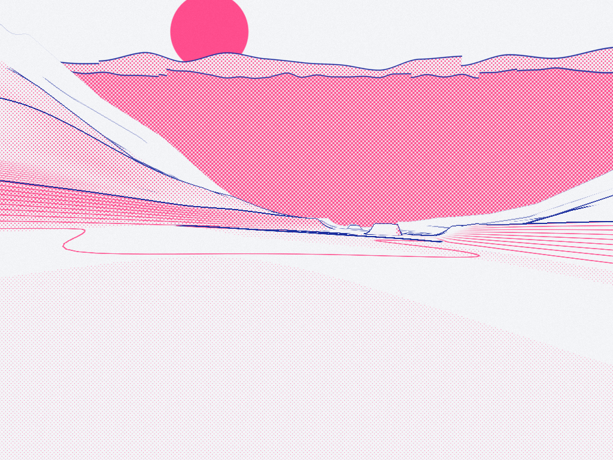
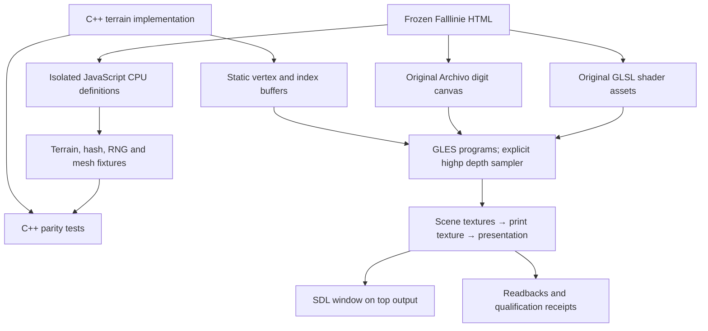
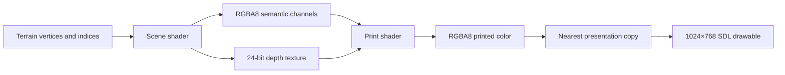
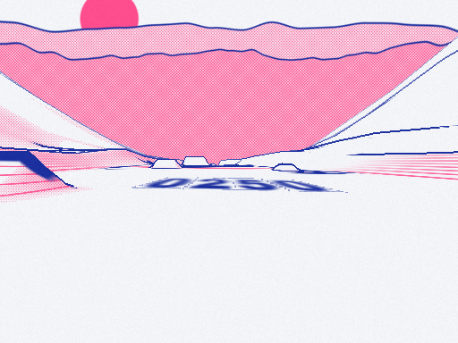
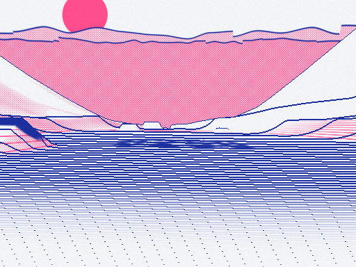
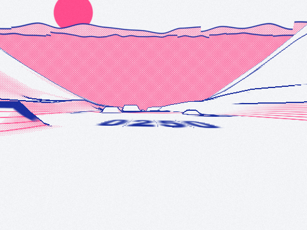
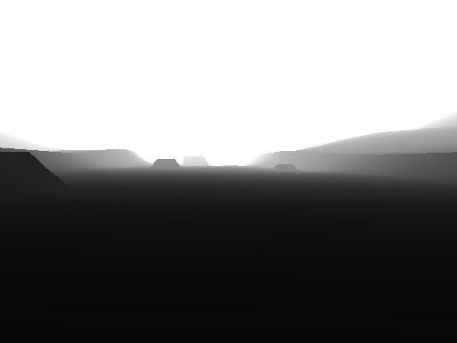
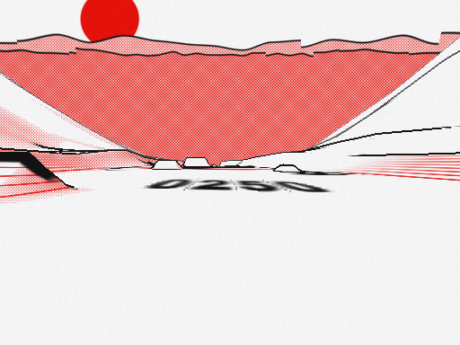

# Falllinie Native GLES Spike

Falllinie is a browser snowboarding game whose appearance depends on procedural terrain and a two-stage graphics pipeline. Its scene shader records lighting and ink-related information; its print shader converts that information into paper, colored ink, contours, halftone coverage and depth-sensitive outlines. This project moves that terrain and rendering path into a native C++17 executable on an Anbernic RG DS Plus without attempting to migrate the entire game at once.

The result is a fixed-camera graphics spike running on the handheld's Mali-G52 GPU. It reproduces the original terrain mathematics, uses the original shader algorithms and digit typography, and establishes a measured basis for deciding whether to continue with the native game port. One small but consequential GLES precision correction was required: the print shader's depth sampler must explicitly use `highp` on this device.

> [!summary]
> - The native executable creates a measured OpenGL ES 3.2 context and presents the terrain on the top screen.
> - All 268 terrain/normal/metadata cases pass on ARM64; original integer hash and RNG cases also pass.
> - Three-cell frame-interval p95 is 18.08 ms at 512×384 and 29.17 ms at 1024×768, including CPU submission and swap.
> - Explicit depth-sampler precision removes severe false outlines; whole-image bit identity across Intel and Mali is not claimed.
> - Rider physics, streaming, reactive music, menus and second-screen gameplay remain outside this spike.



*Native 1024×768 print-target readback, fixed seed 42 and three terrain cells. This is a framebuffer capture from the actual handheld executable, not a photograph or a compositor screenshot.*

## 1. What the spike is meant to establish

A native migration should first establish whether the parts that define the game's appearance can be preserved. Reimplementing the entire game before testing its graphics would couple several unrelated sources of failure: terrain arithmetic, shader behavior, input, physics, audio scheduling and platform integration. This spike narrows the question to terrain generation, shader execution, presentation and bounded performance.

A *terrain function* returns an elevation for a horizontal position. A *mesh* samples that function into vertices and triangles. Each vertex also carries a normal and several semantic attributes. A *shader program* transforms those vertices and computes per-pixel output on the GPU. A *framebuffer object*, or FBO, selects textures into which that output is rendered instead of immediately displaying it. A *sampler* is the shader variable used to retrieve values from a texture. These distinctions are necessary to understand the central failure: allocating a sufficiently precise depth texture does not, by itself, guarantee sufficiently precise sampled values.

The completed executable can generate one to seven fixed cells, choose a seed and starting cell, render at configurable resolution, inspect intermediate channels, switch between three source palettes, save captures and emit timing receipts. It has a fixed camera. Keyboard/controller exit and inspection bindings exist, but physical controller actions have not been separately confirmed for this native spike.

The report describes code checkpoint `5a68fa7`. The source implementation is at:

```text
/home/manuel/code/wesen/2026-10-12--falllinie-spike
```

The investigation, initial guide, source archive and detailed chronological diary are in the sibling `claw-stuff` ticket:

```text
ttmp/2026/10/12/
  FALLLINIE-GLES-001--falllinie-native-terrain-and-print-shader-spike-on-rg-ds-plus/
```

## 2. Preserve source semantics before changing the host environment

The original input was `/home/manuel/Downloads/falllinie.html`, approximately 307 KB and 1,956 lines. It combines procedural terrain, a fixed-step rider simulation, pose calculations, WebGL2 shaders, WebAudio composition, DOM interface code and embedded fonts. The frozen copy in `fixtures/falllinie.html` has SHA256:

```text
cb9b4befd0252859d9c45246f94fbd7dd1662c6d034c6ccb95fbe16947e8b556
```

The key distinction is between algorithms and browser services. Height generation and mesh construction are ordinary CPU calculations. The scene and print programs already use GLSL ES `#version 300 es`. Conversely, DOM layout, browser event delivery, localStorage and WebAudio cannot simply be executed as native C++ functions.

C++17 provides the compiled ARM64 host for this spike. SDL2 supplies the window, event loop, joystick access and GL context creation. OpenGL ES executes the rendering programs. SDL2 is therefore a platform layer, not the definition of the terrain algorithm or an obligation to implement the full game through a particular high-level engine.

There are two explicit preservation rules:

1. Keep the source's arithmetic, random-call ordering, mesh layout and shader algorithms recognizable until parity is established.
2. Record deliberate portability changes separately rather than presenting them as unchanged source behavior.

The four shader assets remain unchanged copies of the original extraction. The depth sampler adjustment occurs in the string supplied to the compiler and has a command-line control that disables it. This makes the compatibility decision visible and reproducible.

### Architecture at the completed checkpoint



The fixtures are independently generated from the frozen JavaScript. They are not produced by the C++ implementation they test. That independence matters when a superficially plausible terrain differs only at a kicker lip, cliff or negative coordinate.

## 3. Native execution: cross-compilation and runtime function loading

The handheld is an ARM64 machine running ROCKNIX. It has SDL, EGL/GLES and the necessary runtime libraries but no discovered on-device C++ compiler. The build therefore runs in an isolated Debian container with `g++-aarch64-linux-gnu` and ARM64 development headers. The base container is digest-pinned; package/compiler information and target library hashes are retained in the evidence directory. This records the observed build configuration, but does not turn every package repository dependency into an immutable distribution snapshot.

The first build failed at the header boundary. SDL's architecture-specific generated configuration was not available through the initial include arrangement. Installing the ARM64 SDL/GLES development packages and including `/usr/include/aarch64-linux-gnu` fixed that compilation problem. The inner build shell also needed `bash -euo pipefail` so a later successful command could not conceal compiler failure.

Linking exposed a different issue. The device's `libGLESv2.so.2` did not export the `gl*` functions expected by ordinary direct linkage. Inspection showed a dependency on `libmali-hook.so.1`: the installed library acts as part of the Mali runtime integration rather than as the simple symbol-exporting library assumed by the first link command.

The solution was not to copy an unrelated GLES implementation onto the device. The executable links the installed target SDL library and obtains GL entry points through `SDL_GL_GetProcAddress` after creating the context. The generated loader uses typed pointers derived from the GLES declarations and checks each required entry point.

```cpp
// Representative structure of the generated loader.
inline decltype(&::glCreateShader) glCreateShader_fn = nullptr;

glCreateShader_fn = reinterpret_cast<decltype(glCreateShader_fn)>(
    SDL_GL_GetProcAddress("glCreateShader"));
if (!glCreateShader_fn)
    throw std::runtime_error("missing GL entry: glCreateShader");
```

The ordering is essential: function loading occurs after context creation, not during global initialization. The first native triangle run reported:

```text
GL_VERSION=OpenGL ES 3.2 v1.g29p1-12eac0.d6e9c0f8499d70cc285f3f0ca2ede780
GL_RENDERER=Mali-G52
GL_VENDOR=ARM
GLSL=OpenGL ES GLSL ES 3.20
frames=298 GL_error=0
```

This is actual target execution, not an inference from installed library names. It demonstrates that the tested compiler/runtime combination can create the required context and execute the requested functions. It is not a complete ABI proof for all future application dependencies.

Primary files: `scripts/toolchain.Dockerfile`, `scripts/build-device.sh`, `scripts/generate-gl-loader.cjs`, `src/gl_api.hpp` and `src/main.cpp`.

## 4. Deterministic terrain requires an explicit integer contract

Terrain geometry depends on seeded hash functions and a pseudo-random generator. JavaScript bitwise operations and `Math.imul` operate on 32-bit integer representations. An apparently equivalent C++ implementation can diverge if it uses signed overflow, wider multiplication or a different conversion order.

The port represents wrapping arithmetic with `uint32_t`. Multiplication and addition therefore wrap modulo \(2^{32}\), and right shifts are unsigned. Only the final normalized random value is converted to `double` by dividing by \(2^{32}\).

The source RNG's state transition is preserved in `fl::Rng::next()`:

```text
a ← a + 0x6D2B79F5 modulo 2^32
t ← (a XOR (a >> 15)) × (1 OR a) modulo 2^32
t ← (t + (t XOR (t >> 7)) × (61 OR t)) XOR t
return unsigned(t XOR (t >> 14)) / 4294967296
```

Matching the generator is necessary but insufficient. Feature generation also depends on how many times the generator is called. A branch that decides whether a cell is a halfpipe must consume exactly the same draws as the source. Generating an unused second kicker still advances state even if that kicker is subsequently rejected. Reordering those operations changes all later features in the cell.

Negative coordinates require a second explicit contract. Cell selection uses:

\[
 c = \left\lfloor z/110 \right\rfloor.
\]

For a small negative `z`, this selects cell −1. Truncation toward zero would select cell 0 and change the interpolated terrain parameters and feature lookup. The same floor requirement applies to lattice coordinates inside the noise calculation.

The final oracle covers 268 height, normal and metadata cases over seeds 1, 42 and 12345. It includes the initial 90 cases and 178 additional samples near generated kicker/cliff features. Five hash cases and twelve RNG values check the integer path directly. The ARM64 result is:

```text
PASS 268 terrain cases; 5 hash cases; 12 RNG values;
6 mesh samples; topology/layout/matrix checks.
max_height_error=1.13687e-13 min_normal_dot=1
```

The reported dot product is rounded by the test's normal output formatting. The assertion checks angular agreement rather than assuming that printed `1` proves every intermediate operation is bit-identical.

## 5. Constructing the terrain surface

The terrain height is a combination of downhill base elevation, cumulative cliff drops, lateral wall shape, low-frequency variation and local features. A representative evaluation starts with world coordinates `(x,z)`, computes the centerline `center(z)` and obtains the lateral offset `u = x − center(z)`. Cell parameters supply width, wall radius and cap height. These determine how the surface rises outside the central corridor.

The structure in `Terrain::height()` is:

```text
u ← x − center(z)
P ← interpolated cell parameters at z
relative ← lateral wall height using P
relative ← relative + low-frequency terrain variation

for features in cells c−1, c, c+1:
    if feature is a kicker and covers (u,z):
        relative ← relative + kicker profile × lateral weight
        optionally mark its lip
    if feature is a cliff and this point is in its stripe region:
        optionally mark its stripe

return base(z) + cumulative_drop(z) + relative
```

The neighboring-cell lookup is intentional: a feature can affect positions near a cell boundary. Eliminating it because the renderer draws a fixed patch would change the terrain itself.

Cliff drops require cumulative state. `Terrain::drop()` extends a cache of drops from earlier cells and then applies the current cell's transition. This produces descending terraces without inserting an uphill discontinuity at each cell boundary. The cache belongs to a seeded terrain instance, not to arbitrary shared state across different seeds.

That distinction caught a bug in the expanded *test generator*. The JavaScript reference harness initially assigned `cum=[0]`, but the original source's cache is named `CUM`. Later seeds inherited earlier cliff drops and the test reported a height mismatch. Resetting `CUM.length=1` and `CUM[0]=0` corrected the oracle. The C++ terrain code did not need a compensating change. A failing parity test must therefore be investigated on both sides of the comparison; the reference harness is executable code and can be wrong.

### Mesh sampling and the 0.4-metre overlap

Each cell uses 107 lateral columns. The center corridor samples at one-metre intervals, while the distant edges use progressively wider spacing. Downhill rows are 0.8 m apart. The source computes `ROWS = round(110/0.8) = 138` and draws rows 0 through 138, yielding a final sample at 110.4 m.

The 0.4 m overlap with the next cell is preserved. It is not silently corrected to make the nominal cell extent and sampled extent agree.

Per cell:

| Quantity | Value |
|---|---:|
| Drawn rows | 139 |
| Columns | 107 |
| Vertices | 14,873 |
| Triangles | 29,256 |
| `uint32` indices | 87,768 |
| Vertex stride | 44 bytes |

Mesh normals and query normals are different computations. `Terrain::normal()` uses finite differences around an arbitrary point with an offset of 0.08 m. `build_terrain()` uses the neighboring sampled rows and columns, computes their cross product and ensures that the resulting normal points upward. Replacing one with the other would change shading even if height samples remained correct.

The test suite checks six original mesh vertex/normal samples in addition to scalar terrain cases, index bounds, counts, attribute offsets, finite values, upward normals and the sampled extent.

## 6. Vertex attributes encode more than geometry

The renderer uploads an interleaved `Vertex` structure. Its layout is part of the shader interface, not an incidental C++ representation:

| Shader location | Data | Byte offset |
|---|---|---:|
| 0 | Position: x, y, z | 0 |
| 1 | Normal: x, y, z | 12 |
| 2 | Albedo scalar | 24 |
| 3 | Lip and stripe masks | 28 |
| 4 | Lateral offset and relative elevation | 36 |

The last two attributes allow the fragment shader to print terrain-specific information. Relative elevation determines contour coverage. Lateral position and downhill distance locate survey digits. Lip and stripe masks identify feature regions without reconstructing every CPU-side feature inside the shader.

A compile-time size assertion enforces the 44-byte stride, and tests verify important field offsets. These checks address an error class that a height oracle cannot detect: correct numbers uploaded at incorrect byte offsets.

The spike builds the configured cells before entering the measured frame loop and merges them into static buffers. For seven cells, terrain construction takes approximately 151.5 ms on the device. That is acceptable for a bounded startup experiment, but not evidence that a future moving game can generate that patch synchronously inside a 33.3 ms frame. The original source's incremental generation strategy remains relevant to the future streaming port.

## 7. The first rendering pass stores semantic channels

The scene pass writes an RGBA8 color texture and a DEPTH_COMPONENT24 depth texture. The color texture is not the final visible RGB image. Its components mean:

| Component | Meaning |
|---|---|
| R | Lighting-adjusted brightness |
| G | Key-ink coverage, including markers and feature masks |
| B | Material ID divided by 255 |
| A | Spot-ink coverage, including contours |

Depth records projected surface depth independently of those semantic channels. The renderer uses nearest filtering and clamp-to-edge behavior, verifies framebuffer completeness, clears the scene, uploads camera/model/normal matrices and draws the terrain indices.

Matrix storage is column-major and uploads use `transpose=false`. Perspective projection uses a 62-degree field of view, near plane 0.1 m and far plane 900 m. The inverse view-projection matrix lets the print shader reconstruct viewing directions for background rendering. The C++ matrix product accumulates in `double` before storing a float, matching the source's Float32Array output structure more closely than repeated float accumulation.

The spike deliberately excludes the rider and its shadows, props, trails and particles. Nondegenerate shadow segments are placed far outside the tested patches so the original scene program can still execute without undefined geometry from zero-length segments.

## 8. The print pass reconstructs the appearance

The print shader reads scene channels and depth, then combines paper, key ink and spot ink. Brightness determines halftone coverage. Explicit masks supply contours, survey digits and feature ink. Neighboring depth samples supply outlines. Background rays produce the original procedural sky and sun.

The depth reconstruction uses the standard perspective relationship. If `d` is sampled depth and `z = 2d − 1`, the reconstructed distance is:

\[
 z_c = \frac{2nf}{f+n-z(f-n)},
\]

where `n=0.1` and `f=900`. Neighbor differences are normalized by the center distance:

\[
 L = \frac{|z_l+z_r-2z_c|+|z_u+z_d-2z_c|}{z_c}.
\]

The source converts this value into edge coverage using thresholds 0.018 and 0.045. Material discontinuities provide another edge signal. This is why inaccurate sampled depth becomes a visible ink defect rather than merely a small numerical discrepancy.

The native renderer gives the print pass its own RGBA8 output target. A third, simple presentation program copies that texture into the SDL drawable. Scene and print targets always have the same configured dimensions. At 512×384, the result is presented at 1024×768 through nearest sampling; at 1024×768, presentation is one-to-one.

Halftone pitch scales as `4.4 * render_width / 1024`. Thus the half-resolution experiment does not accidentally double the final displayed spacing of the print dots. The shader's `uRes` remains the actual common scene/print resolution, so texture-neighbor offsets are meaningful.



## 9. The Mali precision defect: complete FBOs, incorrect image

The first native renderer linked both original programs, completed its framebuffers and reported GL error 0. Nevertheless, it produced strong horizontal blue bands across the terrain. Successful API calls had not established correct image semantics.

The comparison below uses the source's fixed camera near the 250-metre survey marker. The browser reference ran through ANGLE on Intel graphics; the native version ran on Mali-G52.

### Source-browser reference



### Native implicit depth-sampler precision



### Native explicit highp depth sampler



The original print program declares:

```glsl
uniform sampler2D uC, uD;
```

The native compiler input separates the two declarations:

```glsl
uniform sampler2D uC;
uniform highp sampler2D uD;
```

A high-precision destination variable cannot recover information already lost when a texture sample is evaluated with insufficient precision. The original shader's float precision declaration does not substitute for an explicit precision contract on its sampler. On this Mali path, the unqualified depth sampling generated values unsuitable for the edge reconstruction. The resulting false differences became key-ink bands.

The explicit declaration removes those bands and restores the readable `0250` marker. The same final executable supports `--source-sampler-precision`, which compiles the original declaration and reproduces the defective result. This is stronger evidence than comparing two screenshots while changing several unrelated rendering settings.

The correction is intentionally narrow. It does not rewrite edge thresholds, suppress outlines or replace the print algorithm. The archived original shader remains available for inspection.



*Diagnostic grayscale distance scaled by 150 m, generated with an explicitly high-precision depth sampler. This visualization is not the stored nonlinear depth texture itself.*

## 10. Typography is part of the terrain's appearance

The survey digits are sampled from an atlas produced by the original `makeGlyphs()` function. That function creates a 1600×320 canvas, draws digits 0–9 using Archivo at weight 900 and 330 px, fits each digit into a 160-pixel cell, and uploads the canvas as a texture.

The reference export waited for the source font to load before calling that function. Its PNG was converted to an RGBA BMP so the native executable could use SDL's built-in image loader without introducing another runtime decoder. The GL upload preserves the source's orientation and filtering: linear magnification, mipmapped linear minification and clamp-to-edge wrapping.

The marker test is consequently more than a terrain silhouette check. It exercises the source's lateral-coordinate attribute, world-z marker selection, digit lookup, atlas alpha, texture orientation and print-key-ink path. A substitute system font or a manually drawn marker would not establish the same property.

The completed application requires the atlas rather than quietly claiming marker fidelity with a transparent placeholder.

## 11. Presentation belongs to the compositor

The console's two outputs are arranged as DSI-2 at `(0,0,1024,768)` for the top screen and DSI-1 at `(1024,0,1024,768)` for the bottom screen. A Wayland application's requested position is not sufficient to guarantee physical output placement; the compositor owns that decision.

The native app retains the startup ordering established in the earlier dual-screen demo:

1. Create the SDL window and GLES context.
2. Initialize and render a frame.
3. Swap that frame so the surface can become mapped.
4. Start a worker that queries Sway IPC for the title `falllinie:spike`.
5. Move the matching window to DSI-2, remove borders, enable fullscreen and focus it.
6. Continue event processing and rendering on the main thread throughout.

The worker performs IPC only. It does not issue SDL or GL calls. Its lifetime ends before shutdown proceeds to window/context destruction. Placement commands target the application's exact title and do not modify global compositor configuration.

The graphics spike uses only the top window. It does not implement a second native game view; the existing dual-screen work provides relevant platform experience, not an already completed two-screen Falllinie port.

## 12. Measure distinct quantities rather than a single “performance” number

Qualification receipts distinguish terrain construction time, render-loop frame intervals, swap intervals and resident memory. These measure different operations.

The frame interval starts before event processing and rendering, and ends after `SDL_GL_SwapWindow`. Sixty initial frames are excluded. It therefore measures CPU submission plus swap behavior under the observed device workload. It is not a timer query reporting isolated GPU execution time.

| Hardware case | Render size | Cells | p95 interval | p99 interval |
|---|---|---:|---:|---:|
| Baseline | 512×384 | 3 | 18.08 ms | 18.65 ms |
| Baseline | 1024×768 | 3 | 29.17 ms | 29.97 ms |
| Marker at 250 m | 512×384 | 3 | 18.13 ms | 18.61 ms |
| Negative starting cell | 512×384 | 3 | 18.00 ms | 18.56 ms |
| Seven-cell patch | 512×384 | 7 | 17.84 ms | 18.51 ms |
| Alternating target recreation | 512↔1024 width | 3 | 28.75 ms | 29.75 ms |

The seven-cell run begins at another location with another seed. Its slightly lower interval does not prove that additional cells are free; these runs are qualification cases, not a controlled scaling experiment.

All normal cases meet the chosen 33.3 ms p95 bound. Full-resolution rendering has substantially less timing margin than half-resolution rendering. Future rider drawing, dynamic buffers, audio and streaming must fit into the remaining budget rather than assuming this measurement applies unchanged to a full game.

Periodic RSS samples make the memory observation more useful than a single terminal value. The resize run renders 721 frames and recreates targets twelve times. After initial allocation, later samples alternate around 69,996 and 70,508 KiB. That does not show repeated monotonic growth in this bounded test. It is not a long-duration leak proof or a complete measurement of GPU memory.

End RSS is recorded after image readback and can be higher because captures allocate pixel buffers and driver resources. It should not be confused with steady rendering RSS. The recorded runtime context showed EmulationStation, no matching competing demo/RetroArch process, and initial thermal readings around 36.7 and 37.2 °C.

## 13. What visual parity means here

The comparison script measures a fixed 512×384 marker scene. It computes mean absolute RGB channel error, the fraction of pixels whose largest channel difference exceeds 16, and intersection-over-union of a bounded blue-key-ink mask. The lower-half region isolates the terrain and marker from most of the procedural sky.

| Lower-half measurement | Original implicit depth precision | Explicit highp depth precision |
|---|---:|---:|
| Mean absolute channel error, 0–255 | 50.48 | 2.55 |
| Pixels with max channel error >16 | 41.90% | 0.353% |
| Key-ink intersection-over-union | 0.0386 | 0.9689 |

Those numbers establish a substantial correction to the sampled scene. They do not establish exact whole-image parity. The full corrected image still has approximately 6.71% large-error pixels in the original comparison, largely associated with differing sky/noise detail. The source's `sin`-based pseudo-random hashes are sensitive to floating-point evaluation on different GPU/compiler paths.

The images visibly confirm that the sky profiles differ between ANGLE/Intel and Mali. The implementation has not replaced those source functions to force a match. The correct conclusion is that CPU terrain parity is very close, the demonstrated marker/terrain print path is visually close after the precision fix, and cross-GPU stochastic background identity remains unresolved.



*Another original palette changes paper and ink colors without changing the terrain algorithm or print-program structure.*

## 14. Build, run and inspect the result

Desktop prerequisites include CMake, a C++17 compiler, SDL2 development files and GLES3 headers. The generated loader is recreated before compilation:

```bash
node scripts/generate-gl-loader.cjs
cmake -S . -B build
cmake --build build
ctest --test-dir build --output-on-failure
./build/falllinie-spike --seconds 10
```

The ARM64 path uses Docker and existing SSH authentication. No password is embedded in the scripts:

```bash
bash scripts/build-device.sh
bash scripts/deploy-device.sh
```

Deployment installs the dedicated app under `/storage/apps/falllinie-spike` and its port launcher at `/storage/roms/ports/falllinie-spike.sh`. The launcher sets the known Wayland/Sway environment and writes a separate runtime log. It does not replace the earlier demo application.

A bounded native inspection run is:

```bash
cd /storage/apps/falllinie-spike
./falllinie-spike --place --seconds 12 --cell 2 \
  --render-size 512x384 \
  --capture-dir captures/marker --receipt marker.json
```

Without `--seconds` or `--frames`, the fixed scene remains open. `--debug-view` selects final color, luminance, key ink, material ID, spot ink or depth. `--palette` selects Riso, Signal or Print. ESC quits; the controller exit check uses SELECT+START indices 8 and 9. The actual opened joystick name is logged, and physical binding confirmation remains a follow-up rather than an assumed result.

Each capture directory contains printed color, raw semantic scene data, a depth diagnostic and a JSON receipt. Raw scene RGBA should not be read as display color: its alpha is spot-ink data, and its blue component is a material identifier.

The existing hardware matrix can be reproduced with `scripts/qualify-device.sh`, but another run is not needed to understand this checkpoint. Its source, receipts and images are already committed.

## 15. Project shape and review map

| File or directory | Responsibility |
|---|---|
| `src/main.cpp` | Configuration, context, event loop, placement worker, timing/RSS receipt and shutdown |
| `src/terrain.hpp`, `src/terrain.cpp` | Seeded terrain, features, drops, normals and mesh construction |
| `src/math.hpp` | Vector operations and column-major camera matrices |
| `src/renderer.hpp`, `src/renderer.cpp` | GL resources, source programs, explicit depth precision, targets, rendering and capture |
| `src/gl_api.hpp` | Generated typed GL entry-point loader |
| `assets/shaders/` | Original extracted scene/print shader text |
| `assets/glyphs.*` | Original source-generated digit atlas |
| `fixtures/` | Frozen HTML and scalar/feature/mesh oracle data |
| `tests/test_terrain.cpp` | CPU, integer, metadata, layout, mesh and matrix assertions |
| `scripts/` | Build, deployment, fixture generation, image comparison and qualification tools |
| `evidence/` | Failures, environment/build facts, reference comparison and final device runs |

For review, start with `Terrain::height()` and `build_terrain()`, then inspect the attribute upload in `Renderer::initialize()`. Follow `Renderer::render()` through scene, print and presentation. Finally, inspect the `highp` override and compare the legacy and corrected images. This sequence keeps geometry, shader input, texture semantics and portability decisions distinct.

The source-browser harness lives under `claw-stuff/scripts/2026/10/12/falllinie-gles-spike/03-browser-reference.js`. Its location respects the browser tool's allowed file roots. It fixes seed/camera/cells, excludes non-spike drawing and exports immediate readback. The corresponding local page preparation script strips the external analytics script and disables animation scheduling.

## 16. Milestones, stopping point and next implementation boundary

The implementation was committed at coherent boundaries:

| Commit | Boundary |
|---|---|
| `ed4fa2c` | Native ARM64 host and actual Mali GLES context/triangle |
| `bfd915c` | Deterministic terrain with source CPU/RNG/mesh checks |
| `89b1647` | Scene/print pipeline, source atlas and Mali precision correction |
| `5a68fa7` | Final hardware timing, capture, diagnostic and resize qualification |

The early checks were necessary because they found actual header/linkage problems, an oracle reset defect and a visible sampler-precision failure. Once the final bounded matrix passed, more permutations would have added little evidence about the next real problem: implementing a moving game. Testing stopped at that boundary rather than expanding into unrelated device configuration work.

The next useful milestone is not another static graphics experiment. It is a small playable integration that preserves the original game contracts:

- Port the fixed-step rider simulation and its terrain queries before altering physics behavior.
- Translate pose/quaternion/IK logic and draw the original rider forms.
- Generate and retire cells incrementally so construction does not block a frame.
- Recreate the original reactive soundtrack and its event/state relationships, not a generic music loop.
- Define the controller/touch and two-screen interface explicitly, then confirm physical input behavior.

Those are future work items, not implied capabilities of this executable. The completed spike answers the narrower question: the target hardware can run the preserved terrain and print pipeline with useful performance, provided the GLES depth-sampling precision is made explicit.

## Evidence and related material

The authoritative final run index is `evidence/qualification-summary.json`; individual captures and receipts are in `evidence/qualification/`. The original A/B measurements are in `evidence/image-comparison.json`. Cross-build failures and the fixture failure remain archived rather than being removed after success.

The detailed docmgr guide and diary are:

```text
/home/manuel/code/wesen/claw-stuff/ttmp/2026/10/12/
FALLLINIE-GLES-001--falllinie-native-terrain-and-print-shader-spike-on-rg-ds-plus/
  design-doc/01-intern-guide-native-terrain-and-print-shader-qualification.md
  reference/01-investigation-diary.md
  sources/README.md
```

The ticket's source archive includes readable SDL2/GLES API references, Sway manuals and the OpenGL ES 3.0 / GLSL ES 3.00 specifications. Those references explain contracts; the native execution receipts establish what actually ran on this handheld.

Related platform work: [[PROJECT REPORT - DS Demo Game - Dual-Screen SDL2 App Anatomy and the Compositor Placement Problem - A Technical Deep Dive]]. That report explains the earlier compositor mapping and controller evidence. This report records the separate native graphics migration and does not imply that the earlier SDL demo's audio or touch work constitutes a Falllinie gameplay port.


## Falllinie optimization report network

Navigation addendum: [[MOC - Falllinie Optimization Reports|series index, reading routes and evidence boundaries]]. The original report above remains a historical checkpoint; these cross-links do not revise its measurements.

This is the graphics foundation, not the final integrated performance result. Continue with the playable port and integrated game, then the measured rendering and GPU investigations.

- [[PROJECT REPORT - Falllinie Playable Port - Dual Views, Frame Profiling and Cooperative Terrain Streaming|Playable port and streaming]] — Shared dual views, frame pacing and cooperative terrain generation; an earlier, smaller workload.
- [[PROJECT REPORT - Falllinie Integrated Native Game - Precision, Real-Time Audio, Developer Telemetry and JavaScript Embedding|Integrated workload and precision]] — Camera-relative projection, source DSP optimizations, telemetry and the initial embedding investigation.
- [[PROJECT REPORT - Falllinie Buffered Audio - PCM Ownership, Callback Deadlines and Measured Producer Scheduling|Buffered audio qualification]] — Producer-owned DSP, SPSC PCM transport, copy-only callbacks and finite target deadline results.
- [[PROJECT REPORT - Falllinie JavaScript Embedding - ARM64 Qualification, V8 Ownership and Bounded Rules|ARM64 JavaScript experiments]] — Actual QuickJS, QuickJS-ng and V8 embeddings, ownership contracts and isolated workload measurements.
- [[PROJECT REPORT - Falllinie Tracing - CPU Execution, Driver Waits and GPU Attribution|Tracing concepts and investigation plan]] — Wall versus CPU time, scheduler-state interpretation and proposed perf/ftrace/eBPF investigation.
- [[PROJECT REPORT - Falllinie Rendering Measurements - CPU Execution, Mali Driver Work and GPU Timer Limits|Measured CPU and driver attribution]] — Actual paired clocks and perf samples, driver execution, non-running time and unresolved GPU elapsed-query anomalies.
- [[PROJECT REPORT - Falllinie GPU Profiling - Hardware Counters, Shader Compilation and a Rejected Optimization|Hardware counters and rejected shader candidate]] — Actual G52 counters, exact-input offline compilation, non-parity post bypass and a null-result ABBA shader experiment.
