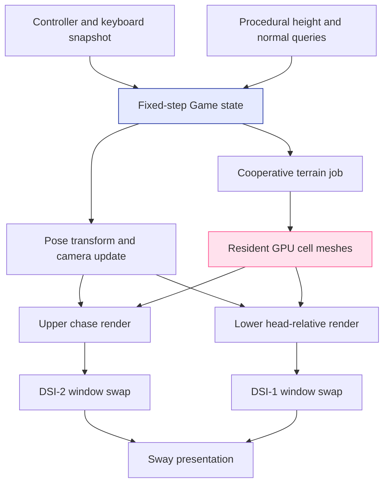
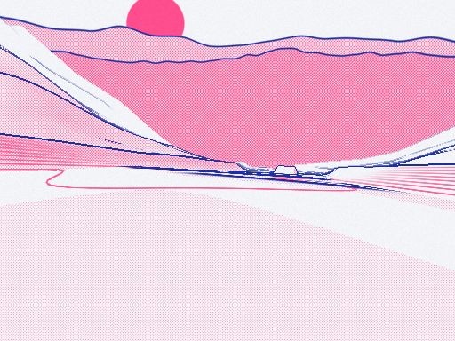
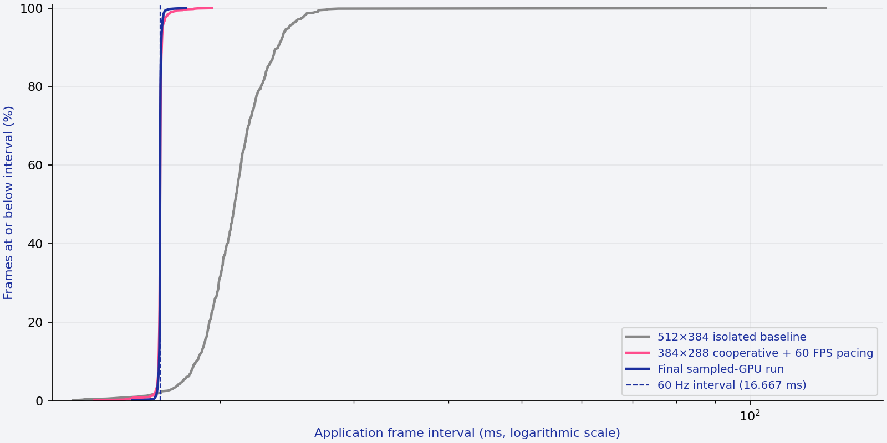
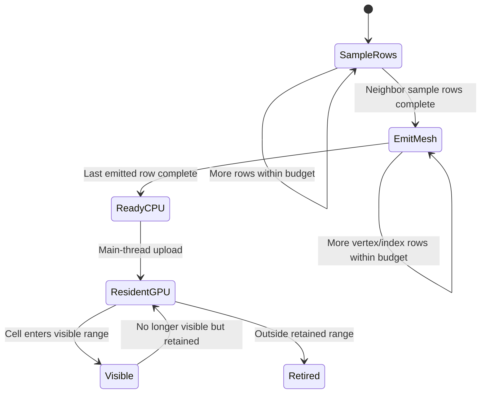
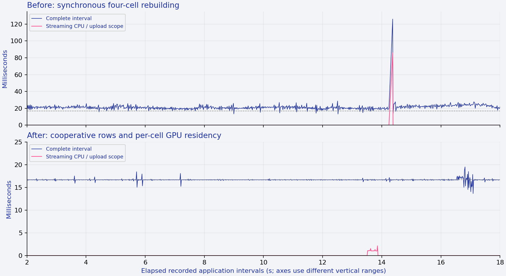

# Falllinie: From a Native Graphics Spike to a Measured Dual-Screen Ride

Falllinie is a procedural downhill snowboarding game originally supplied as a single HTML document. This project ports its terrain, print-style rendering and gameplay into a native SDL2/OpenGL ES application on the Anbernic RG DS Plus. The latest implementation renders a chase camera on the upper display and a rider-relative first-person camera on the lower display. It also contains the instrumentation needed to distinguish expensive simulation, terrain construction, graphics submission, buffer swaps and deliberate frame pacing.

The central result is not simply that the prototype reached 60 FPS. The investigation established why earlier measurements were misleading, identified a separate terrain-generation stall, and changed resource ownership so that crossing a cell boundary no longer reconstructs the visible world in one frame. This report develops those results from the underlying concepts, explains the actual implementation, and states the limits of the evidence.

> [!summary]
> - One simulation and one GLES context supply both physical displays; the lower view does not duplicate physics, scoring or terrain generation.
> - Three old background rendering processes contaminated early measurements. A single-instance lock and explicit signal handling now prevent that failure mode.
> - Cooperative row generation and individual GPU cell buffers replaced an approximately 86 ms synchronous rebuild. The measured streaming scope fell to about 2.14 ms maximum in a 25-second run.
> - The current performance-oriented launch mode renders each view at 384×288 and produces approximately 60 application frames per second. This is a quality/performance choice, not proof of zero physical dropped frames or completion of the original game.

## 1. Scope, provenance and the meaning of completion

The repository was created on October 12, 2026; the final profiling checkpoint belongs to the October 13 session. This is a new report rather than a replacement for [[PROJECT REPORT - Falllinie Native GLES Spike - Deterministic Terrain, Print Shaders and Mali Depth Precision]]. That earlier report covers cross-compilation, the Mali GLES loader, deterministic terrain qualification and the explicit depth-sampler precision correction. Here the emphasis is the playable state machine, shared dual-view presentation and the performance work that followed.

The source of behavioral and visual intent remains `fixtures/falllinie.html`, with SHA-256:

```text
cb9b4befd0252859d9c45246f94fbd7dd1662c6d034c6ccb95fbe16947e8b556
```

Preserving source intent is different from claiming a completed source port. Steering, projected ground forces, tuck/brake input, charged jumps, airborne spins/flips and principal landing alignment checks exist. The character retains source-generated geometry, but uses three baked crouch poses rather than the complete runtime pose/IK/grab system. Scoring is a direct subset, bail recovery is simplified, and the original reactive soundtrack is not yet implemented. Rails, trees and their gameplay interactions are also unfinished.

The principal code checkpoints are:

| Revision | Responsibility |
|---|---|
| `10a87f0` | First native playable slice and source-derived rider geometry |
| `e68c9cb` | Airborne rotation, landing checks and native font/HUD feedback |
| `cec4fcd` | Lower first-person view and wrapped sky-contour correction |
| `a7cee69` | CPU/GPU profiling, single-instance locking and explicit termination handling |
| `56d7d9c` | Cooperative terrain jobs, per-cell GPU residency, batched HUD and measured 60 FPS launch mode |

The final sampled-GPU telemetry and expanded load summaries were collected after `56d7d9c`. Some of those measurement artifacts and analysis refinements remained uncommitted in the native working tree at this report's checkpoint. The runtime changes and their main performance milestone are committed; the report does not imply that every latest measurement file is contained in that revision.

## 2. Establishing the technical model

A **simulation step** advances position, velocity and gameplay state by a chosen time increment. A **render pass** projects that state through a camera and writes pixels into a render target. A **buffer swap** hands a completed window image to the windowing system. The compositor then selects images for the physical displays. These operations are related, but they are not equivalent measurements of one event.

An OpenGL ES **context** owns graphics state and resources such as buffers, textures and shader programs. SDL makes that context current to a window before commands affecting that window's default framebuffer are issued. A framebuffer object, or **FBO**, is an offscreen target owned by the context rather than a physical display. Falllinie first renders scene information into an FBO, runs the print shader into another FBO, and finally copies the printed image into the selected window.

A terrain **cell** is a 110 m longitudinal region of the procedural course. The visible cell set is a rendering decision; terrain height queries used by physics remain procedural and do not require every queried position to have a resident GPU mesh. This distinction permits generating graphics ahead of the rider without changing the physics function.

Consider one concrete input: the player releases the jump button after charging. The simulation detects the transition from held to released, adds an impulse along the terrain normal, and enters airborne state. The next render uses the resulting position and quaternion to place the source-derived rider. Both cameras consume that same transformed state. The upper view displays the rider and HUD; the lower view uses a head-relative eye position and suppresses the rider's own geometry. There is no second takeoff event or second scoring path.



The diagram separates ownership from presentation. The same resources are used by both render passes, but the two windows do not have an implemented atomic presentation transaction. Shared simulation state must not be mistaken for guaranteed simultaneous scanout.

## 3. Native simulation: fixed time, projected forces and landing orientation

### Fixed simulation steps

`src/main.cpp` accumulates elapsed wall time and calls `Game::step` with a constant `1/120` second increment. At approximately 60 rendered frames per second, a normal frame advances roughly two simulation ticks. This decouples control and integration frequency from the number of camera passes.

The current implementation caps a frame's accumulated elapsed contribution at 0.1 seconds. It therefore limits catch-up work after a long delay, but can lose correspondence with wall time during a sufficiently severe stall. The completed integration guide proposes reviewing this policy against the original source's frame cap. It is not already a fully source-equivalent scheduler.

```text
elapsed = min(0.1 seconds, now - previous_frame_start)
accumulator += elapsed

while accumulator >= 1/120 second:
    game.step(input_snapshot, 1/120 second)
    accumulator -= 1/120 second

update_player_geometry_and_cameras(game)
render_upper_view(game)
render_lower_view(game)
```

This is a structural sketch of the implemented loop. Input is sampled once per application frame and reused for its fixed ticks; the code does not poll a new controller state separately for every 120 Hz step.

### Ground motion as a tangent-plane calculation

The ground solver obtains a terrain normal `n` and projects the heading vector into the terrain's tangent plane. If `f` is the normalized projected forward vector, the lateral vector is `s = cross(n, f)`. Gravity and velocity are also projected into that plane:

```text
ground_gravity = gravity - n * dot(gravity, n)
velocity += ground_gravity * dt
velocity -= n * dot(velocity, n)

forward_speed = dot(velocity, f)
lateral_speed = dot(velocity, s)
```

This representation distinguishes longitudinal momentum from lateral slip. The source-shaped grip calculation exponentially damps lateral speed, then adjusts the retained speed according to braking. Tuck and brake inputs affect drag, while steering changes yaw. The board quaternion is constructed from forward direction and surface normal, so its orientation follows the terrain rather than remaining horizontal.

Jump charge grows over 0.45 seconds. On release, the native slice adds a normal-direction impulse of `4.2 + 3.6 * charge`. Geometry can also cause an uncharged takeoff when the predicted ballistic position lies above the next ground sample. Charged jumps and leaving a lip therefore share airborne integration without requiring identical causes.

### Airborne rotation and completion

Airborne orientation is composed from a preserved takeoff quaternion, a gradually leveled base orientation, a world-up spin and a flip around the captured flip axis. Spin/flip controls accelerate angular velocity while held. When the input falls below its activation threshold, the code selects a nearby completion goal: multiples of π for spins and multiples of 2π for flips.

The reason for storing the takeoff orientation is continuity. Reconstructing the entire board orientation from horizontal travel every tick would discard the initial surface tilt. The current code instead blends that tilt toward an orientation aligned with a predicted landing normal, then applies trick rotations.

Landing evaluates two different quantities. `dot(board_up, terrain_normal)` describes how upright the board is; the projected board nose compared with projected velocity describes longitudinal alignment. A board can be upright but sideways to motion, so one test cannot replace the other. The native slice bails below the principal upright/alignment thresholds and applies a speed correction for sketchy landings.

These checks do not make the score model complete. The current implementation rounds spin counts, adds a subset of spin/flip/airtime bonuses, and increments the score directly. The original combo lifecycle, repetition effects, grabs, uber actions and complete feedback state are still absent.

## 4. Rendering one ride onto two displays

### One context, two compatible windows

The main thread creates `falllinie:spike` and `falllinie:firstperson`. A single GLES context is made current to each compatible SDL window in sequence. This worked on the installed Wayland/Mali path; it is an observed target configuration, not a guarantee for every SDL backend.

The context contains the shared terrain buffers, rider buffers, font/digit textures, shader programs and offscreen scene/print targets. Rendering the second view changes camera matrices and rewrites the shared offscreen targets. It does not allocate an independent copy of the world.

The ordering is important:

```mermaid
sequenceDiagram
    participant Main as Main thread
    participant GL as Shared GLES context
    participant Top as Upper window
    participant Lower as Lower window
    Main->>GL: Make current to upper window
    Main->>GL: Scene, print, presentation and HUD passes
    Main->>Top: Swap
    Main->>GL: Make current to lower window
    Main->>GL: Save primary camera; install head camera
    Main->>GL: Scene, print and presentation passes
    Main->>Lower: Swap
    Main->>GL: Restore primary camera and rider/HUD flags
```

Because the print texture contains the most recently rendered view, requesting an upper-camera capture after a lower pass requires rerendering the upper view first. Restoring the camera struct alone does not restore the texture's pixels. `src/main.cpp` explicitly selects the upper window and redraws before capture.

### Main-thread graphics and IPC-only placement

SDL event handling and GL commands stay on the main thread. The placement worker only runs Sway IPC commands. It starts after the first application frame has swapped both windows, searches for their exact titles, moves the chase window to DSI-2 and the first-person window to DSI-1, and enables fullscreen placement.

First presentation precedes compositor discovery because an unpresented Wayland window may not yet be available as the expected mapped surface. Moving graphics initialization into the placement worker would violate the ownership model and would not solve that mapping dependency.

### Camera construction

The chase camera blends its direction toward horizontal velocity while retaining a forward-course bias. Its offset increases with speed, its vertical position is constrained above terrain, and damped springs smooth position and look target independently. The code retains the source-shaped speed-dependent field of view.

The lower eye is derived from the transformed bounds of source rider material group 23. Its position is the bounds' center plus a small board-up offset. Forward is the transformed board x-axis, up is the transformed board y-axis, and the field of view is 78 degrees. The first-person pass temporarily disables the rider and HUD, then restores the primary state even if rendering throws.

This is a deliberate native extension: the original HTML did not contain this lower-display camera. A head-relative view during flips can rotate strongly; a travel-stabilized view would be a different design. Neither comfort nor the preferred orientation policy has been qualified by the final human playtest.


*Actual upper-display capture from the earlier dual-view build. It illustrates the camera and source-derived rider, not the final 384×288 performance configuration.*


*Actual lower-display capture from that same development stage. Both pictures are historical compositor captures, not evidence of synchronized presentation.*

## 5. Background contours: precision, periodicity and precomputation

The reported disconnected mountain segments belonged to the procedural sky portion of the print shader, not to gaps between terrain meshes. The original shader used a large sine-based hash as a random basis. That basis was suspected of producing unstable contour values on Mali; the exact compiler transformation responsible was not established.

The compatibility change replaces four sky-noise expressions with an angular lattice whose endpoints wrap. Let `az` be the viewing azimuth and `N` an integer number of lattice intervals around a full turn. The shader computes a lattice position, wraps the adjacent indices modulo `N`, and interpolates their random values with a cubic smoothing weight:

```text
N = round(2π * frequency)
x = (az + π) / (2π) * N + offset
i = floor(x)
f = fract(x)
w = f*f*(3 - 2*f)
value = mix(hash(i mod N), hash((i+1) mod N), w)
```

An integer number of intervals gives the same random values at corresponding directions across the atan boundary. This matters more with a first-person camera that can face backward. The layers retain their source-shaped amplitudes and colors, but their angular realization changes; this is not bit-identical original sky noise.

The first integer implementation introduced another portability problem. Fragment integer arithmetic inherited a precision unsuitable for the intended 32-bit mixing, and the resulting mountain variation nearly flattened. Explicit `highp uint` corrected the shader calculation.




*The first image records the precision failure; the second shows the corrected contour realization. It does not establish the original sine-hash failure's exact low-level cause.*

The final implementation avoids recomputing the integer mixing per sky fragment. The largest wrapped lattice has 170 samples. The CPU computes those 170 values once using 32-bit unsigned arithmetic, extracts the upper 24 bits and uploads a high-precision float uniform array. Those 24-bit integers and power-of-two scaling are exactly representable in the intended float format. The fragment shader performs indexed reads and interpolation instead of repeated integer multiplication and shifts.

The static image comparison between the highp integer shader and this precomputed-table version reported zero differing pixels. That is a narrowly scoped result for the compared static print image. It does not establish universal cross-GPU image identity or equivalence to the original sine realization. `--source-sky-hash` preserves an explicit comparison path, and the archived source shader assets remain unchanged.

## 6. Define a frame metric before optimizing it

A 60 Hz application production target corresponds to approximately 16.667 ms between complete application frames. Average FPS alone cannot characterize stutter: a run can contain mostly short intervals and a small number of 100 ms pauses. A percentile reports the interval at or below which a specified fraction of measured samples falls. p95 and p99 expose more of the distribution than its mean, while the maximum identifies the worst observed pause.

The CSV profiler records end-to-end application intervals, including previous-loop bookkeeping and deliberate pacing. It also records separate wall-clock scopes for event/query polling, simulation, player update, streaming, upper/lower submission, upper/lower swaps and pacing wait. Streaming is a subset of player update; adding both would double-count that work.

Wall-clock submission is not pure CPU arithmetic. A GL entry point can wait because the driver cannot accept more queued work or needs a buffer. Conversely, a short submission scope can enqueue substantial GPU work. A swap call is also a presentation request rather than a direct measurement of completed physical scanout.

The legacy console/receipt frame metric measures loop work from frame start to frame end. The dated CSV analyzer uses consecutive frame-end intervals. These closely related scopes produce slightly different percentile values. This report uses the CSV analyzer for comparisons rather than silently combining both definitions.

### Nonblocking GPU queries

`Profiler` checks for `GL_EXT_disjoint_timer_query`, resolves extension entry points through SDL, and maintains eight slots for two view queries each. It samples every 60 application frames. A query is read only when `GL_QUERY_RESULT_AVAILABLE_EXT` says its result is ready; a busy slot is skipped rather than waited on. No `glFinish` is inserted to manufacture a synchronous duration.

A disjoint indication invalidates pending results. The code also rejects results above 500 ms as a sanity policy because startup returned approximately `1.84467441e+13` ms without the disjoint flag. That enormous value is not a GPU workload observation. The sanity cutoff is not a physical theorem that GPUs cannot stall for half a second.

The final run contained 32 returned view samples, two invalid, with 15 post-warmup valid samples per view. Reported GPU elapsed p50 was 9.03 ms for the upper scope and 9.05 ms for the lower scope. These are sparse instrumented observations, not GPU active-cycle utilization. They must not be summed as though every tiler/compositor interval were known to be nonoverlapping.

### Hardware and system counters

`perf stat` collected CPU cycles, instructions, cache misses, task clock, context switches, migrations and page faults. CPU-clock sampling collected about one thousand samples with zero reported lost samples. Several prominent samples were inside `libmali`; its unsymbolized addresses cannot be assigned to named driver functions. Native player update accounted for 1.70% of that particular sampled CPU profile, which supports investigating graphics/driver paths rather than assuming physics was dominant.

The device also reported an unsupported `rockchip_ddr/cycles/` event. No DDR-counter coverage is claimed. A bpftrace executable and readable kernel BTF were not discovered during this investigation; no arbitrary memory-mapped performance registers, driver serialization settings or governors were changed.

The read-only sampler records `/proc/stat`, process CPU ticks, CPU/GPU clocks and thermal values. Its later version also records available memory, swap counters and pressure information. The target's `getconf CLK_TCK` value was verified as 100, allowing process CPU ticks to be interpreted as utilization relative to one core.

In the final short sampled-GPU run, median process utilization was 44% of one core, while aggregate system busy fraction was about 31.93% across the CPU set. Observed CPU frequency remained 1.992 GHz and GPU frequency 800 MHz. Maximum observed CPU/GPU temperatures were approximately 46.67/49.44 °C. The summaries include startup samples and the test was short: this is not a sustained thermal qualification. GPU frequency is not GPU utilization, and a GPU utilization percentage was not exposed by the sampled attributes.

## 7. The first major correction was process ownership

Before optimization, three older native Falllinie processes were still alive. Each had its own rendering loop, context and resources. An early profiler run therefore competed with hidden copies of the application rather than measuring one dual-screen ride.

The shutdown command had sent SIGINT. Background shell launches can inherit SIGINT as ignored, and those launches did not terminate as expected. SIGTERM removed the old processes. The failure was operational but directly affected graphics throughput: rendering an obscured window can still consume driver/GPU resources, so lack of a visible old image does not establish lack of old work.

The native program now opens `/tmp/falllinie-spike.lock` and acquires a nonblocking exclusive `flock` before SDL initialization. Failure prevents another renderer from starting. The descriptor has close-on-exec and no-follow flags, and remains open for the application's lifetime. Explicit SIGINT and SIGTERM handlers write only a `sig_atomic_t`; the main loop notices that flag and performs ordinary cleanup. The signal handler itself does not run SDL, GL or stream I/O.

An attempted second launch produced the expected diagnostic:

```text
fatal: another Falllinie instance is running, or the instance lock is unavailable
```

With accidental background contention, the measured application rate was approximately 14.13 FPS with p95 interval 90.29 ms. Once isolated, the 512×384-per-view baseline measured 47.33 FPS and p95 24.66 ms. That is a large observed improvement after removing interference, although the tests are not a deterministic replay with every other variable fixed. It also establishes that removing old copies was insufficient to reach a 60 Hz production budget.

## 8. Controlled changes: draw batching, swap waits and pixel work

The upper view includes the rider and native HUD, while the lower view omits both. The earlier HUD issued per-character uniforms and draw calls. Its rectangles were already bounded to glyph coverage—an earlier full-screen-per-glyph mistake had been fixed—but bounded coverage did not eliminate command overhead.

The new implementation builds six vertices per glyph with pixel position and atlas UV attributes, uploads the complete HUD vertex array once, and submits three color batches. Background quads use a negative UV sentinel to select paper output. Font, paper opacity, glyph placement and ink colors remain source-derived/native-HUD consistent. Constant rider indices are uploaded once rather than on every pose update.

This reduced upper submission p50 from approximately 6.62 ms in the isolated baseline to 2.69 ms in the batched run. Total rate nevertheless remained around 49.4 FPS. The swap wait increased, demonstrating why a reduction in CPU submission duration cannot be equated automatically with a throughput gain.

Turning vsync off at 512×384 produced about 49.63 FPS. Upper swap p50 fell to approximately 0.274 ms, but upper submission p50 increased to about 9.32 ms. Waiting had moved; it had not disappeared. The simple hypothesis that the swap interval alone caused the rate limit was contradicted by the control.

A 384×288 unpaced run produced 68.06 FPS, p50 interval 14.68 ms and p95 16.85 ms. That render size contains 110,592 pixels per view rather than 196,608—56.25% as many. The substantial rate change demonstrates sensitivity to pixel-dependent graphics work. It does not identify one shader instruction, exclude all bandwidth or compositor effects, or justify calling the problem exclusively fragment ALU saturation.

| Recorded case | FPS after warmup | Interval p95 | Interpretation |
|---|---:|---:|---|
| Background contention | 14.13 | 90.29 ms | Invalid as an isolated application baseline |
| Isolated 512×384 baseline | 47.33 | 24.66 ms | Real residual production deficit |
| Batched HUD, 512×384 | 49.39 | 23.55 ms | Lower CPU submission cost; limited total gain |
| Vsync disabled, 512×384 | 49.63 | 22.66 ms | Waits migrate into submission |
| Unpaced 384×288 | 68.06 | 16.85 ms | Pixel-work reduction creates pacing headroom |
| Cooperative terrain, paced 384×288 | 60.00 | 16.80 ms | Large terrain hitch removed |
| Final sampled-GPU run, same mode | 60.00 | 16.76 ms | Sparse GPU/load observations also collected |

These are bounded sequential experiments, not an exhaustive controlled benchmark campaign. Autoplay depends on simulation time, operating-system scheduling varies, and graphics state changes with the ride. The table supports the specific decisions above without claiming a universal speedup factor.



*Empirical cumulative distributions from the copied CSVs, excluding the first 60 frames. The horizontal scale is logarithmic. The old isolated baseline includes a cell-transition outlier near 126 ms; the paced runs concentrate near 16.667 ms.*

## 9. Cooperative terrain generation and bounded GPU residency

The isolated baseline revealed a different problem from ordinary rendering cost. At frame 679, the complete interval was 125.99 ms. Player update consumed 93.92 ms, including 85.92 ms in the terrain rebuild/upload scope. The implementation reconstructed all four visible cells when the rider entered a new cell, then uploaded one merged mesh. Most of the geometry had already been constructed for the previous frame.

The replacement separates generation, residency and visibility. `TerrainJob` owns a cell's partially completed CPU samples and mesh. `Renderer` owns a map of uploaded cell meshes, each with its own vertex array, vertex buffer and index buffer. The visible range is four cells, `current-1` through `current+2`; the additional forward candidate is `current+3`. Both views draw the same visible set.

### Row-level state transitions

The source mesh has 107 columns and 139 emitted rows. At 0.8 m spacing, the emitted extent is 110.4 m, intentionally overlapping a 110 m cell boundary. Height sampling includes extra rows before and after the emitted rows because computing mesh normals requires neighboring samples.

`TerrainJob::step` first samples rows, then emits vertex/normal rows and their triangle indices. It checks elapsed time after each complete row. The nominal budget is 1 ms per application frame, but a row may extend it, and the final upload can add work beyond that nominal budget. This is a cooperative budget, not preemptive execution.



The mesh computation itself remains source-shaped. Each normal is obtained from neighboring sampled positions, corrected to point upward. Vertex records retain the 44-byte layout with position, normal, albedo, lip/stripe metadata and lateral/relative-height attributes. Each cell still contains 14,873 vertices and 87,768 indices. Four visible cells contain 59,492 vertices and 351,072 indices.

A targeted test constructs the same cell synchronously and in 0.05 ms slices, then compares all vertex bytes and the complete index array. The existing 268 terrain cases, five hash cases, 12 RNG values and six mesh reference samples also pass. This validates that yielding between rows did not change the mesh data; it does not validate every future world/object integration feature.

### Residency and same-seed restart

The renderer prioritizes missing current/behind cells, then forward cells, and keeps at most one active CPU job. Completed cells are uploaded once. Each frame draws only the four visible entries rather than every retained entry.

Initial cells -1 through 2 are pinned to make the existing same-seed restart immediately reusable. Other cells are retained only in the current working range, through the one-cell lookahead. During ordinary forward progress this bounds the GPU map to at most nine cells: four pinned startup cells plus up to five distinct active/lookahead cells. That bound does not mean the procedural terrain parameter/feature caches have a universal constant-memory bound.

This implementation is not the entire planned streaming subsystem. The source-complete guide proposes a larger visibility window and object integration. New-run seed changes must invalidate jobs and resident GPU cells using explicit generation identity. Reusing the current same-seed cache for a new seed would display stale geometry even if physics used the new terrain.



*Both panels show complete intervals and the streaming sub-scope from recorded CSVs. The vertical ranges differ. The old boundary reconstruction is replaced by short row-generation periods and individual uploads; elapsed time is reconstructed from recorded intervals, not independent scanout timestamps.*

## 10. Pacing and the final measured operating point

The performance-oriented port launcher selects:

```sh
./falllinie-spike \
  --place --play --dual-screen \
  --render-size 384x288 --no-vsync --fps 60
```

The window drawables remain 1024×768; 384×288 describes the shared offscreen render resolution used for each camera pass. Native HUD glyphs are drawn at window resolution after the printed image is copied. Print pitch is scaled with render width, preserving its intended physical relationship under presentation scaling, but lower resolution still changes fine edge and raster detail. It is an explicit quality tradeoff.

The standalone executable retains 512×384 defaults for graphics investigation. Launcher arguments appear before user arguments, allowing a later render-size or FPS argument to override them. The current code's `--no-vsync` selection is applied per loop in the dual-window path; it should not be assumed to behave identically in every single-window diagnostic configuration.

An absolute-deadline pacer increments its deadline by one target period each frame. If rendering finishes early, the main thread sleeps until that deadline. If work falls more than one period behind, the deadline is reset rather than allowing an unbounded catch-up sequence. Pacing sleep has its own CSV column and is not labeled graphics computation.

The 25-second cooperative run recorded 1,496 frames, with 1,436 measured after warmup:

| Complete application interval | Recorded value |
|---|---:|
| Mean-derived FPS | 59.99995 |
| p50 | 16.66660 ms |
| p95 | 16.79785 ms |
| p99 | 17.31642 ms |
| Maximum | 19.51303 ms |
| Intervals over 18.33 ms | 4 |
| Maximum streaming scope | 2.14224 ms |

Cells 3, 4 and 5 completed during this run, including an actual cell transition. Reported GL error was zero. The previous approximately 126 ms hitch was not observed in this bounded case.

A separate 16-second sampled-GPU run measured 898 post-warmup frames at 59.99988 FPS, p95 16.76143 ms and p99 16.89238 ms. Its maximum interval was 18.02486 ms, with no intervals above 18.33 ms. This is additional short-run evidence, not permission to erase the four late intervals in the longer run.

The final summary also reports 464 intervals strictly above the mathematical `1000/60` ms threshold. Small scheduler and timing variation around an absolute deadline can produce many strict-budget exceedances while the mean remains approximately 60 FPS. Those exceedances, the larger lateness threshold, and physical compositor drops are three different quantities.

No presentation-feedback protocol has been integrated to confirm when each image was scanned out. Therefore the supported conclusion is **approximately 60 application frames per second with tightly bounded intervals in the measured partial-game workloads**, not zero physical dropped frames. The completed audio, object and full-pose workloads require another measurement boundary and the planned final physical playtest.

## 11. Reproduction, evidence and remaining integration work

The native project is at `/home/manuel/code/wesen/2026-10-12--falllinie-spike`. Important implementation locations are:

| File | Responsibility |
|---|---|
| `src/main.cpp` | SDL/context lifecycle, fixed stepping, two-window ordering, locking/signals, pacing and timing scopes |
| `src/game.hpp` | Ground/air/landing mechanics and the current simplified recovery/scoring |
| `src/game_renderer.cpp` | Rider transform, camera update, cooperative job scheduling and GPU residency |
| `src/terrain.cpp` | Source terrain functions and resumable mesh construction |
| `src/renderer.cpp` | Scene/print/presentation passes, compatibility shader input and batched HUD |
| `src/profiler.cpp` | Buffered CPU records and nonblocking sampled GPU queries |
| `tests/test_terrain.cpp` | Source oracle and sliced-versus-synchronous mesh identity check |

The dated investigation directory is `scripts/2026/10/13/falllinie-performance/`. Its analyzer is reproducible without rerunning the device:

```sh
cd /home/manuel/code/wesen/2026-10-12--falllinie-spike
node scripts/2026/10/13/falllinie-performance/analyze-profile.cjs \
  scripts/2026/10/13/falllinie-performance/profile-cooperative.csv
```

On the target, a bounded diagnostic run adds CPU records; `--gpu-profile` opts into the sparse GPU measurements:

```sh
cd /storage/apps/falllinie-spike
./falllinie-spike --place --dual-screen --autoplay \
  --render-size 384x288 --no-vsync --fps 60 \
  --seconds 25 --profile /tmp/frames.csv
```

Do not launch that command alongside an interactive instance. The lock is intended to reject it. End the owned interactive process gracefully first; inspect process state rather than assuming a sent signal proves termination. CPU/GPU collection should remain bounded: current CSV logging has no automatic rotation, and recording a long interactive session can grow its files continuously.

### Self-contained report evidence

The figures and selected raw data are copied into this note's `_assets/` directory, so reading the vault does not require the native checkout:

- [Isolated baseline CSV](_assets/falllinie-playable-profile-isolated-cpu.csv) and [summary](_assets/falllinie-playable-profile-isolated-cpu-summary.json).
- [Cooperative paced CSV](_assets/falllinie-playable-profile-cooperative.csv) and [summary](_assets/falllinie-playable-profile-cooperative-summary.json).
- [Final sampled-GPU CPU CSV](_assets/falllinie-playable-profile-final-gpu.csv), [GPU results](_assets/falllinie-playable-final-gpu-timers.csv), and [summary](_assets/falllinie-playable-profile-final-gpu-summary.json).

Plot generation is preserved in `/home/manuel/code/wesen/claw-stuff/scripts/2026/10/13/falllinie-project-report/01-build-figures.py`, with copied inputs beside it. The full implementation diary is under `ttmp/2026/10/12/FALLLINIE-GAME-002--source-faithful-falllinie-gameplay-integration-and-final-playtest/reference/01-investigation-diary.md` in the native repository.

### What remains before a source-complete game

The next integration work concerns behavior, not another broad graphics qualification matrix. The original runtime pose, inverse kinematics, grabs and uber actions must replace the baked pose approximation. Scoring needs its complete combo lifecycle, repetition rules, persistent best state and feedback transitions. Rails, trees, collisions, trails and source-shaped world objects need shared definitions so physics and rendered placement cannot diverge.

Reactive audio is a distinct substantial subsystem. The original arrangement is 86 BPM, organized around sixteenth-note scheduling and changing musical sections, with gameplay-sensitive drums, filters, voices and effects. Replacing it with a generic loop would not preserve source intent. The intern guide proposes a native sample-clock audio engine, preallocated voices and bounded control transfer to an SDL callback; that remains a design, not shipped audio. In particular, source airborne music suppression starts after sustained air, not on every short takeoff, and pause/restart/music-clock semantics must be handled deliberately.

The guide exists at `FALLLINIE-GAME-002/design-doc/01-intern-guide-source-faithful-gameplay-audio-objects-and-incremental-streaming.md` within the ticket workspace. At this checkpoint it is drafted, but its requested reMarkable delivery remains pending. That publication task is separate from this completed vault report.

The final physical session should evaluate source gameplay, head-camera comfort, legibility at the lower render resolution, reactive audio timing and sustained load after those integrations. The current short autoplay runs do not substitute for that session.

## 12. Engineering conclusions

Performance analysis begins with ownership and measurement definitions. A hidden old process can invalidate an otherwise carefully instrumented experiment. A GL submission scope can contain waiting. A swap setting can relocate that wait rather than remove its cause. A GPU timer can return invalid data without a convenient disjoint flag. Each of those cases occurred in this port, and each required a different correction.

The most consequential structural change was separating procedural terrain generation from visible GPU residency. Height and normal functions continue to define gameplay, row jobs construct graphics incrementally, and resident cells are reused by both cameras. That separation removed redundant boundary work without introducing a terrain thread pool or a second simulation.

The current 60 FPS mode is a measured operating point for a partial game at an explicit render resolution. It provides a useful baseline for completing Falllinie, but it should remain an evidence-backed baseline rather than a permanent performance promise. The remaining source systems must be integrated under the same ownership model, measured at their meaningful boundaries, and evaluated together in the final human playtest.

### Related material and API references

- [[PROJECT REPORT - Falllinie Native GLES Spike - Deterministic Terrain, Print Shaders and Mali Depth Precision]] — graphics fidelity, CPU oracle and the earlier sampler fix.
- [[PROJECT REPORT - DS Demo Game - Dual-Screen SDL2 App Anatomy and the Compositor Placement Problem - A Technical Deep Dive]] — earlier SDL/Sway lifecycle investigation.
- [SDL_GL_MakeCurrent](https://wiki.libsdl.org/SDL2/SDL_GL_MakeCurrent) and [SDL_GL_SetSwapInterval](https://wiki.libsdl.org/SDL2/SDL_GL_SetSwapInterval).
- [EXT_disjoint_timer_query specification](https://registry.khronos.org/OpenGL/extensions/EXT/EXT_disjoint_timer_query.txt).
- [flock(2)](https://man7.org/linux/man-pages/man2/flock.2.html), [signal(7)](https://man7.org/linux/man-pages/man7/signal.7.html), and [perf-stat(1)](https://man7.org/linux/man-pages/man1/perf-stat.1.html).

The external references identify the relevant API contracts. The measurements and implementation claims in this report are grounded in the local code and recorded artifacts, not inferred from those general API pages.


## Falllinie optimization report network

Navigation addendum: [[MOC - Falllinie Optimization Reports|series index, reading routes and evidence boundaries]]. The original report above remains a historical checkpoint; these cross-links do not revise its measurements.

The earlier operating point applies to this smaller workload. Read the integrated-game report before carrying its frame-rate result forward; later rendering reports qualify the measurement tools.

- [[PROJECT REPORT - Falllinie Native GLES Spike - Deterministic Terrain, Print Shaders and Mali Depth Precision|Graphics foundations]] — Deterministic terrain, encoded scene/print passes and Mali depth-sampler precision; establishes the fidelity constraints for later tuning.
- [[PROJECT REPORT - Falllinie Integrated Native Game - Precision, Real-Time Audio, Developer Telemetry and JavaScript Embedding|Integrated workload and precision]] — Camera-relative projection, source DSP optimizations, telemetry and the initial embedding investigation.
- [[PROJECT REPORT - Falllinie Buffered Audio - PCM Ownership, Callback Deadlines and Measured Producer Scheduling|Buffered audio qualification]] — Producer-owned DSP, SPSC PCM transport, copy-only callbacks and finite target deadline results.
- [[PROJECT REPORT - Falllinie JavaScript Embedding - ARM64 Qualification, V8 Ownership and Bounded Rules|ARM64 JavaScript experiments]] — Actual QuickJS, QuickJS-ng and V8 embeddings, ownership contracts and isolated workload measurements.
- [[PROJECT REPORT - Falllinie Tracing - CPU Execution, Driver Waits and GPU Attribution|Tracing concepts and investigation plan]] — Wall versus CPU time, scheduler-state interpretation and proposed perf/ftrace/eBPF investigation.
- [[PROJECT REPORT - Falllinie Rendering Measurements - CPU Execution, Mali Driver Work and GPU Timer Limits|Measured CPU and driver attribution]] — Actual paired clocks and perf samples, driver execution, non-running time and unresolved GPU elapsed-query anomalies.
- [[PROJECT REPORT - Falllinie GPU Profiling - Hardware Counters, Shader Compilation and a Rejected Optimization|Hardware counters and rejected shader candidate]] — Actual G52 counters, exact-input offline compilation, non-parity post bypass and a null-result ABBA shader experiment.
