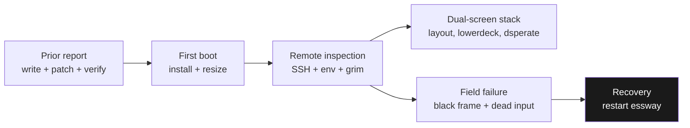
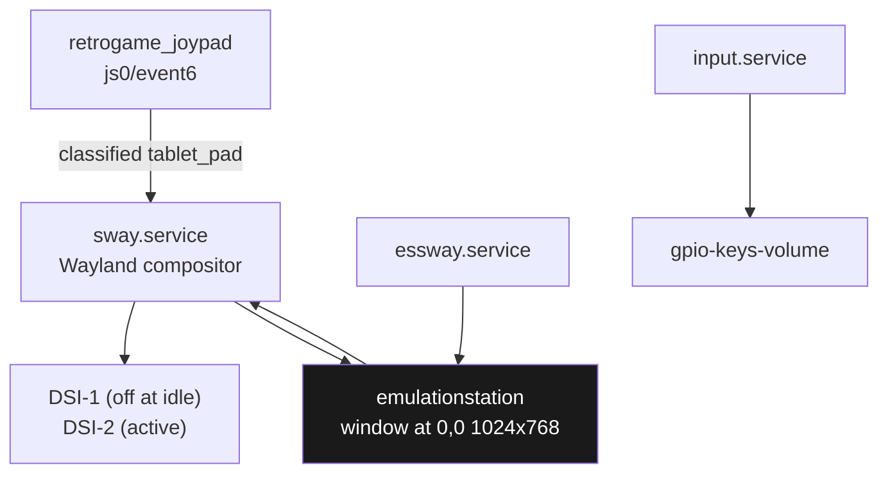
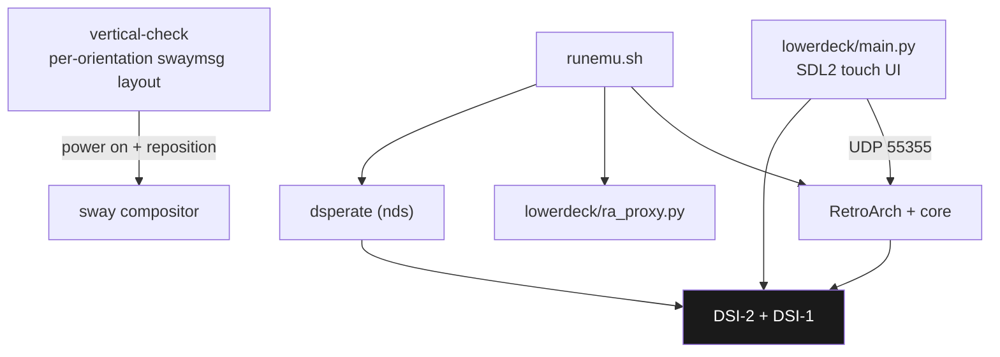
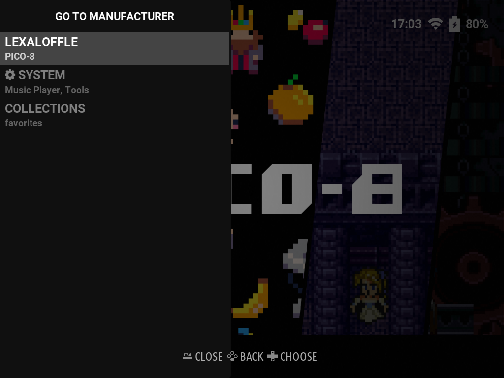
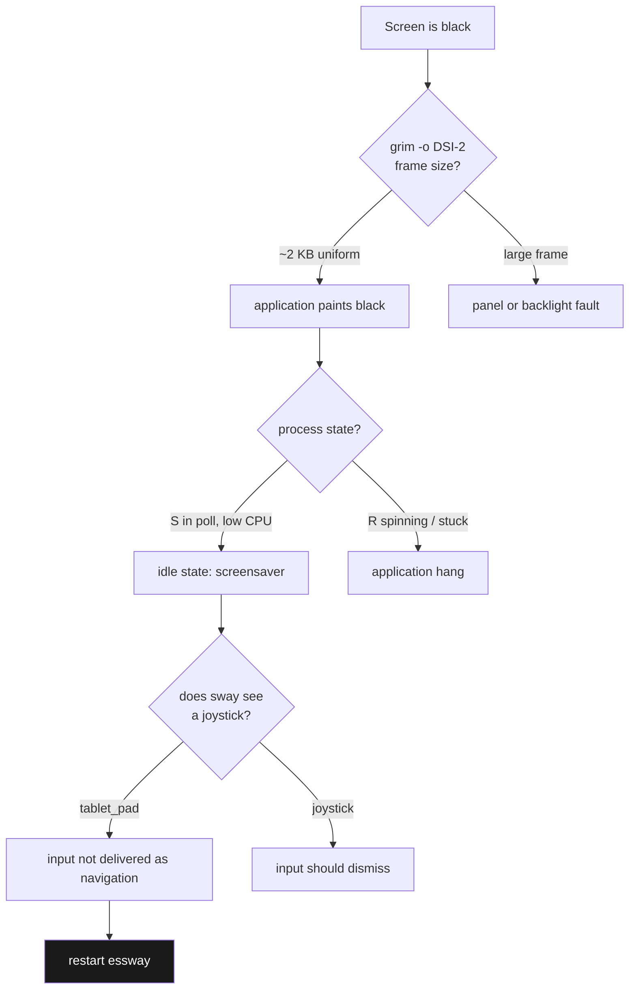

# Anbernic RG DS Plus Follow-Up: First Boot on ROCKNIX, the Dual-Screen Stack, and a Black-Screen Diagnosis

The preceding report ended with a written ROCKNIX card that had been verified byte-for-byte and patched to the RG DS Plus device tree, but no evidence that the device had booted it. This follow-up begins at that point. It covers the first successful boot, the state the system installs itself into, the method used to inspect a running handheld without touching it, the software stack that drives both panels, and one field failure — a display that went fully black and did not respond to its own controller — that was diagnosed and recovered over SSH.

The work is part of ticket `ANBERNIC-RGDS-2026-10-12` and is recorded in the investigation diary (steps 10 and 11) and a dedicated reference document on the dual-screen stack. It adds two scripts, `02-organize-roms.sh` and `03-push-roms-to-device.sh`, to the flash tooling already described, and it records the exact environment variables and command invocations that make remote inspection possible on this device.

Two results are worth stating directly. First, **dual-screen support is not a setting; it is three cooperating components**: a shell script that computes and applies the compositor layout per orientation, a Python touch UI that runs on the second panel during emulation, and a frontend that treats the lower touch panel as the DS stylus. Second, **a black screen on this device is not necessarily a display fault**: a framebuffer capture proved the application was healthy and deliberately painting black, which redirected the investigation from the panel to the screensaver and then to input routing.

> [!summary]
> 1. **First boot expands the card.** The writable partition moves onto `/storage` at `/dev/mmcblk1p2`, grows to fill the card, and the per-system `roms/` tree is created there. The device reported `ROCKNIX 20261010`, kernel 7.2.7, and `/proc/device-tree/model` of `Anbernic RG DS Plus`, confirming the device-tree patch from the prior report.
> 2. **A framebuffer capture is the ground truth for "is the screen black".** `grim -o DSI-2` returned 2,367 bytes for a 1024×768 frame while the failure was active, and 165,474 bytes after recovery — a ratio that distinguishes a uniform-black frame from rendered content without looking at the panel.
> 3. **EmulationStation has a screensaver with a 300-second default.** The user configuration contained only two `pico-8.*` keys and the shipped defaults file was empty, so EmulationStation was running its compiled-in `dim` behaviour. Idle time, not a fault, produced the black frame.
> 4. **Input routing is the open anomaly.** The controller is present as `retrogame_joypad` on `js0` and `event6`, but the compositor classifies it as `"type": "tablet_pad"` rather than a joystick. That is consistent with navigation events not reaching the application, which explains why button presses did not dismiss the screensaver.
> 5. **Restart the smallest unit.** `systemctl restart essway` restarted EmulationStation while leaving Sway in place, and the display returned. The measured evidence separates the three states — healthy application, black output, and misrouted input — and each has a different remedy.

## Scope: what the prior report established and what this one adds

The prior report documented the storage and boot model, the per-system ROM and BIOS conventions, the operating-system options, the guarded image-write procedure, the device-tree boot failure and its repair, and a byte-level verification method. It closed with the device about to boot the patched card.

This follow-up adds the part that can only be observed on a running system:



## First boot and the state it installs

The device booted into EmulationStation. The observable state after installation:

| Property | Observed value |
|---|---|
| Distribution | `ROCKNIX`, `OS_VERSION=20261010`, `OS_BUILD=nightly` |
| Kernel | `7.2.7`, `aarch64` |
| Device tree model | `Anbernic RG DS Plus` |
| Kernel command line | `boot=LABEL=ROCKNIX disk=LABEL=STORAGE quiet console=ttyS2,1500000 console=tty0 systemd.debug_shell=ttyS2` |
| Writable storage | `/storage` on `/dev/mmcblk1p2`, 27.0 G, 26.8 G free |
| Games tree | `/storage/roms/` present with one directory per system |
| Populated systems | only `pico-8` (2 files); all cartridge systems empty |

Two consequences follow. The image's small `STORAGE` partition is expanded on first boot to consume the card, which is why `/storage` reports 27.0 G rather than the 32 MB written in section 7 of the prior report. And the games tree is created by the system rather than shipped populated, so the directory names are authoritative and a library is added by writing into them.

The `/proc/device-tree/model` value is the terminating check on the prior report's repair: it reports the RG DS Plus, not the handheld whose device tree the image shipped with.

## Remote inspection method

The device exposes SSH, and all inspection was read-only. Three details make this work and are worth recording because they are not obvious.

**Authentication without an interactive terminal.** No `sshpass` was available on the workstation, and `sudo -n` was not available either. The session used the askpass mechanism with forced prompting, which lets a non-interactive process supply the password from the environment rather than from a typed line:

```bash
printf '#!/bin/sh\necho "$ROCKNIX_PW"\n' > /tmp/askpass.sh && chmod +x /tmp/askpass.sh
export ROCKNIX_PW=rocknix                     # ROCKNIX default for root
SSH_ASKPASS=/tmp/askpass.sh SSH_ASKPASS_REQUIRE=force DISPLAY=:0 setsid -w \
  ssh -o StrictHostKeyChecking=no -o UserKnownHostsFile=/tmp/rn_known_hosts \
      root@192.168.0.202 '<command>'
```

`SSH_ASKPASS_REQUIRE=force` is what makes ssh consult the helper even when a terminal is present, and `setsid -w` detaches it from the controlling terminal so ssh does not fall back to a prompt. The password is read from the environment by the helper, so no credential is written into the script itself.

**Sway's environment.** Querying or capturing the compositor requires its runtime directory and socket, and the socket directory is not the default per-user path:

```bash
export XDG_RUNTIME_DIR=/run/0-runtime-dir
export WAYLAND_DISPLAY=wayland-1
export SWAYSOCK=$XDG_RUNTIME_DIR/sway-ipc.0.sock
```

Sway itself reports `XDG_RUNTIME_DIR=/var/run/0-runtime-dir`, which is the same directory through a symlink. `SWAYSOCK` alone is sufficient for `swaymsg`, but the capture tool additionally needs `XDG_RUNTIME_DIR` and `WAYLAND_DISPLAY`.

**Capture as an oracle.** `grim` is present at `/usr/bin/grim`. It is the only reliable way to answer "what is the compositor actually drawing" without looking at the hardware:

```bash
grim -o DSI-2 /tmp/frame.png        # one output
grim /tmp/frame.png                 # all outputs -- fails here, see below
```

The unrestricted form fails on this device with `failed to copy output DSI-1`, because the second output is powered off and cannot be captured. Naming the output explicitly is therefore required, not optional.

No input-injection tool exists on the device: `wtype`, `ydotool`, and `evemu-event` are all absent, so synthetic input could not be used to test-wake the interface. That limitation is why recovery was performed by restarting a service rather than by synthesising a button press.

## Display, compositor, and input as observed

The display surfaces are two DRM connectors with independent backlights, and the compositor holds them in different power states depending on the session.

| Layer | DSI-1 | DSI-2 |
|---|---|---|
| DRM status | `connected` | `connected` |
| DRM mode | 1024×768 | 1024×768 |
| DRM enabled | `disabled` | `enabled` |
| Backlight | `backlight0` 833, `bl_power=4` (off) | `backlight1` 833, `bl_power=0` (on) |
| Sway output | `active=True dpms=False power=False`, position 1024,0 | `active=True dpms=True power=True`, position 0,0 |
| Window assignment | — | `emulationstation` at 0,0 1024×768 |

The EmulationStation window occupies the powered output at the origin. The second output is positioned beside it and powered off during desktop use; the layout script powers it on for an emulation session, which is the subject of the next section.

The input inventory is larger than the two visible controls, which matters when reasoning about which device an event should arrive from:

```text
rk805 pwrkey              kbd   event0     power key
Goodix Capacitive Touch   kbd   event1     lower-panel touch, multi-touch
adc-keys-back             —     event2     back/menu keys
rk817_hp Headphones       —     event3     jack detect (switch)
gpio-keys-hall            —     event4     lid magnet (switch)
gpio-keys-volume          kbd   event5     volume keys
retrogame_joypad          js0   event6     D-pad, face buttons, shoulders, start/select
```

`retrogame_joypad` is registered by the `rocknix-singleadc-joypad` platform driver at 10.33 s into boot. The compositor enumerates it, but with a classification that is the subject of section 6:

```text
identifier: 18507:4353:retrogame_joypad
name:       retrogame_joypad
type:       tablet_pad          <- not "pointer" and not a joystick class
libinput:   send_events = enabled
```

The session is composed of several independent units, and knowing which one owns which layer is what makes a targeted restart possible:

| Unit | State | Owns |
|---|---|---|
| `sway.service` | active running | the Wayland compositor |
| `essway.service` | active running | EmulationStation-with-Sway session |
| `emustation.service` | inactive dead | alternate EmulationStation frontend |
| `input.service` | active running | volume button service |
| `sway-touch.service` | inactive dead | touchscreen setup task |



## The dual-screen stack

Dual-screen behaviour is implemented by three components that act at different times. None of them is a user-facing toggle.

**`/usr/bin/vertical-check` computes the layout.** It reads the running emulator's command line to learn the core, platform, and ROM path, then applies a geometry with `swaymsg`, branching on the device and orientation:

```sh
BOTTOM_SCREEN_UI_DIR="/usr/share/lowerdeck"
BOTTOM_SCREEN_PID_FILE="/run/lowerdeck.pid"

swaymsg '[title="RetroArch.*"] output DSI-2 pos 0 0, output DSI-1 power on pos 0 768'
swaymsg '[title="RetroArch.*"] floating enable, fullscreen disable, resize set 1024 1536, move to output DSI-2, move absolute position 0 0'

swaymsg output DSI-1 scale 1.40
swaymsg output DSI-2 transform 270
swaymsg '[title="RetroArch.*"] output DSI-1 pos 0 0, output DSI-2 power on pos 160 776'
```

Three properties are visible in those lines: the second output is explicitly powered on as part of the layout, RetroArch is resized and repositioned rather than mirrored, and the arrangement depends on orientation. A powered-off second panel at idle is therefore the designed state, and the constants it exports name the second-screen UI.

**`/usr/share/lowerdeck` is the second-screen touch UI.** It is a Python application, and its README states its scope: a touch UI for the second screen of dual-screen handhelds, described as a companion panel for RetroArch on devices with a secondary touchscreen, listing the Anbernic RG DS among others. It exposes a resume action, save and load restore points with a slot picker and live savestate thumbnails, a RetroAchievements browser, and brightness control.

Its two channels of interaction are the important part of the design:

```text
RetroArch  <--UDP 55355, network commands-->  lowerdeck/main.py (SDL2 UI)
RetroArch  <--HTTP /dorequest.php--           ra_proxy.py  --> retroachievements.org
main.py    <--HTTP /_ui/state--               ra_proxy.py
```

Because control travels over **RetroArch's Network Control Interface** rather than through a linking library, the second-screen UI is a separate process that can be added to without rebuilding the emulator. `ra_proxy.py` is launched around the emulation session and self-terminates after RetroArch exits; `/usr/bin/runemu.sh` contains the guard that prevents a duplicate proxy. This is why `lowerdeck` is absent from the process list while the desktop is idle: it belongs to the emulation session.

**`dsperate` is the Nintendo DS frontend.** `/usr/bin/start_dsperate.sh` seeds `/storage/.config/dsperate/dsperate.ini` from `/usr/config/dsperate/dsperate.ini`. The configuration names the device and its paths:

```ini
# Anbernic RG DS / RG DS Plus: the touch panel is the pen.

[paths]
bios9    = /storage/roms/bios/bios9.bin
bios7    = /storage/roms/bios/bios7.bin
firmware = /storage/roms/bios/firmware.bin
games    = /storage/roms/nds
saves    = /storage/roms/nds
states   = /storage/roms/savestates/nds
cache    = /storage/.cache/dsperate
```

The DS BIOS files are expected at fixed names in `roms/bios`, DS titles are read from `roms/nds`, and the lower touch panel is treated as the DS stylus — which is the hardware feature the second panel exists to provide.



## The black-screen incident

A working system went black while the PICO-8 system was open, and the controller did not restore it. The investigation is worth recording in full because the symptom pointed at the panel and the cause was elsewhere.

### Sequence and measurements

| Step | Command | Result |
|---|---|---|
| Is the application alive? | `ps`, `/proc/<pid>/status`, `/proc/<pid>/wchan` | ES running, 19 threads, state `S`, blocked in `do_sys_poll`, ~8% of one core over a 3 s sample |
| Is the compositor alive? | `swaymsg -t get_outputs` | Sway running; `DSI-2` active/`dpms=true`/`power=true`; ES window at 0,0 1024×768 |
| What is being drawn? | `grim -o DSI-2 /tmp/before.png` | **2,367 bytes** for 1024×768; viewing it confirmed uniform black |
| Is input arriving? | `/proc/bus/input/devices`, `swaymsg -t get_inputs` | joypad present on `js0`/`event6`; compositor classifies it as `tablet_pad` |
| Why idle? | `es_settings.cfg`, `/usr/config/emulationstation/es_settings.cfg` | user file holds only `pico-8.ShowFlags`/`pico-8.ShowTags`; shipped defaults empty |
| Does the feature exist? | `strings /usr/bin/emulationstation` | screensaver classes and the labels `SCREENSAVER SETTINGS`, `SCREENSAVER TYPE`, `START SCREENSAVER AFTER` |

The capture sizes are the decisive evidence. A healthy EmulationStation frame on this panel is **165,474 bytes**; the failing frame was **2,367 bytes**. A uniform-colour image compresses to almost nothing, so the difference of two orders of magnitude identifies the failing state as "the application is painting black" rather than "the display is not receiving content".


After recovery, the same command produced the rendered desktop:



### Reasoning

The blank state has three distinguishable causes, and the measurements separate them.

The display path was healthy: the output was powered, the backlight was on at half brightness, and the compositor held a window at the correct geometry. A fault in the panel, the backlight, or the output power would have shown a powered-off output or a disabled connector. Neither was present.

The application was healthy: it was sleeping in `poll` and consuming periodic CPU, which is the shape of an event-driven render loop waiting for input, not of a hung or crashed process. Combined with a uniform-black frame, this is the signature of a deliberate black state — the screensaver.

The remaining question was why input did not dismiss it. The distribution ships an empty defaults file, so EmulationStation was using its compiled-in behaviour of type `dim` with a 300-second timeout, which matches the reported timeline of a few idle minutes. The controller was present at the kernel and device level, but the compositor classifies it as `tablet_pad`, a class that does not carry joystick navigation semantics. That misclassification is consistent with navigation events never reaching the application, and it is the only explanation found that accounts for both the black frame and the unresponsive controller.

The causal link between the classification and the missed input is **consistent but not proven**. Proving it would require injecting input through a correctly classified device and observing the screensaver dismiss, and no injection tool is installed on the device. The observation is recorded as the leading hypothesis with that limitation stated.

### Recovery

The recovery replaced the smallest unit that owned the broken state. EmulationStation was restarted without restarting the compositor:

```bash
systemctl restart essway
```

The effect is measurable in process ages: EmulationStation was replaced (new pid, 16 s old), Sway retained its original pid and uptime, and `swaybg` was replaced along with the session. A subsequent capture produced a 165,474-byte frame showing the system list, the PICO-8 wallpaper, and the ROCKNIX status bar.

Three escalating remedies exist, and the ordering matters because each is more disruptive than the last:

```text
1. press the power key, or open and close the lid      (no process restarted)
2. systemctl restart essway                            (EmulationStation + swaybg)
3. hold power ~10 s to force off, then power on         (full reboot)
```

A secondary anomaly appeared in the same window: `dmesg` recorded `aw88166 ... check pll lock fail` and `aw88166 device start failed`, meaning the audio amplifier did not start during that session. It is unrelated to the display and is recorded so that a later sound fault is not attributed to the wrong cause.



## Failure-mode catalogue (updated)

| Symptom | Measured signal | Cause | Remedy |
|---|---|---|---|
| Screen black, application running | `grim` frame of ~2 KB | screensaver after 300 s idle | any input; else restart `essway` |
| Buttons do nothing | `swaymsg -t get_inputs` shows `tablet_pad` | controller misclassified, navigation events not delivered | restart `essway`; revisit input routing |
| `grim` reports `failed to copy output DSI-1` | second output powered off | capture of an inactive output | pass `-o DSI-2` |
| `grim` reports `failed to create display` | `XDG_RUNTIME_DIR`/`WAYLAND_DISPLAY` unset | missing compositor environment | export both, plus `SWAYSOCK` |
| ssh prompts despite `SSH_ASKPASS` | terminal present | ssh prefers the terminal | add `SSH_ASKPASS_REQUIRE=force` and `setsid -w` |
| EmulationStation report of a device named in `es_input.cfg` | config lists many known devices | shipped input database, not proof of a live device | check `/proc/bus/input/devices` instead |
| No sound in a session | `aw88166 ... pll lock fail` | audio amplifier failed to start | restart the session; note for later |

## Working rules carried forward

- **Capture before concluding.** A framebuffer capture distinguishes "nothing is drawn" from "black is drawn", and those have different causes and different remedies.
- **Assert a positive property.** Frame size, process state, and `wchan` are cheap assertions that rule out whole classes of cause. Exit status alone does not.
- **Separate the layers before touching them.** Output, application, and input are three layers; the evidence identified which one was wrong, and only that layer's unit was restarted.
- **Restart the smallest owning unit.** `essway` restarted the frontend without disturbing the compositor. The full reboot was the last resort.
- **Record environment prerequisites with the command.** A capture tool, a compositor query, and a remote shell each needed different variables; a command without them reports a fault that does not exist.
- **State the limit of a hypothesis.** The `tablet_pad` explanation accounts for the observations but was not confirmed by injection, and the report says so.

## Open questions

- Is the `tablet_pad` classification of `retrogame_joypad` specific to this build, and does it prevent navigation in every application or only while the screensaver is active?
- Would raising `ScreenSaverTime` in `es_settings.cfg` be loaded and retained across an EmulationStation write-back, given that the application owns that file while running?
- Does `vertical-check` restore the desktop layout after a game exits, or can it leave an output powered on or repositioned, and is that reachable from the failure seen here?
- Why did the audio amplifier fail to acquire its PLL in this session, and is it correlated with the display failure or independent?
- Can the second screen be exercised without launching an emulator, in order to validate `lowerdeck` independently of the DS frontend?

## Related notes

- [[PROJECT REPORT - Anbernic RG DS Plus - ROMs, Emulation, OS Replacement, and the Device-Tree Boot Failure - A Technical Deep Dive]] — the prior report that established the storage model, the write procedure, the device-tree repair, and the verification method used here.
- [[PROJ - PULP OS on X4 Classic - Native ESP-IDF Port and Display Qualification]] — a second handheld device where board-specific hardware facts were the deciding constraint, and where display qualification was also the first gate.
