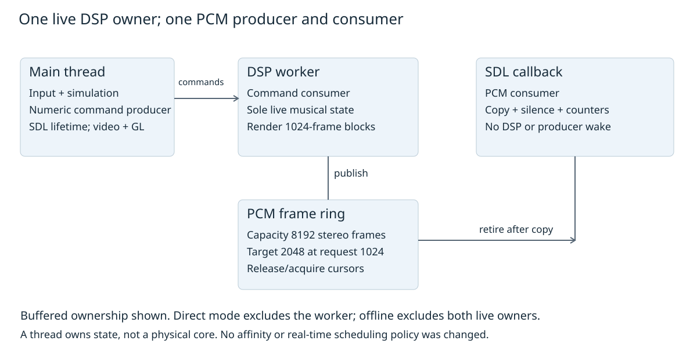
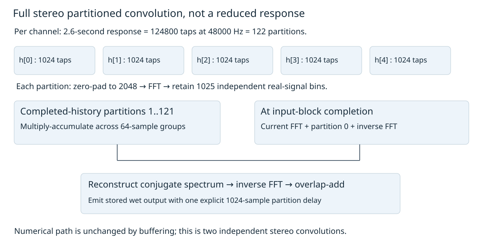
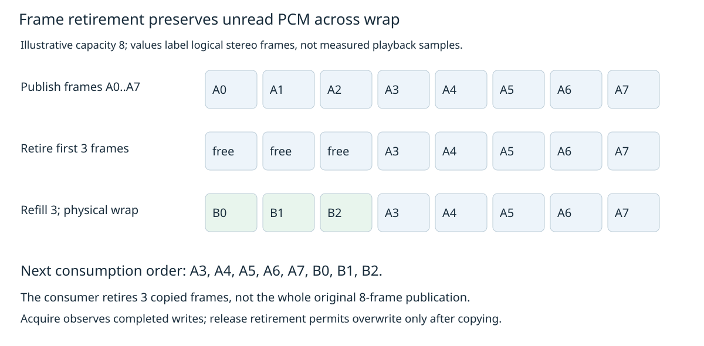
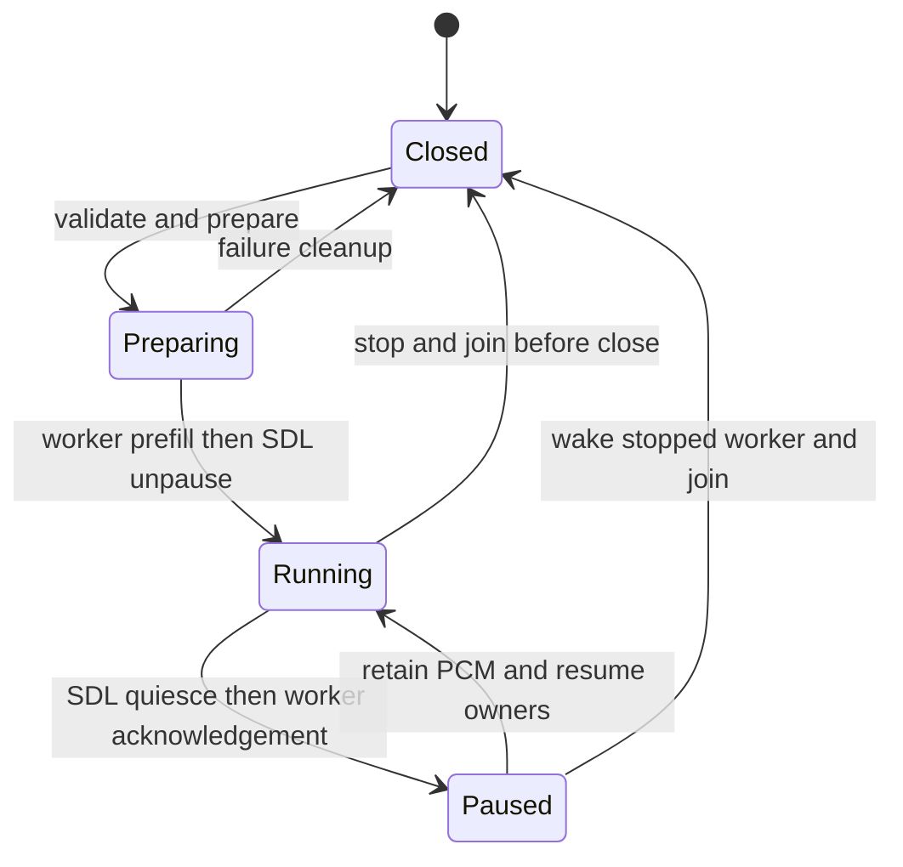
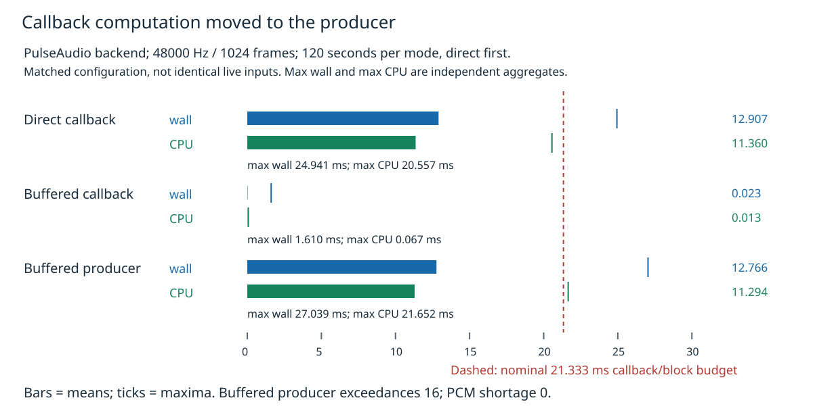
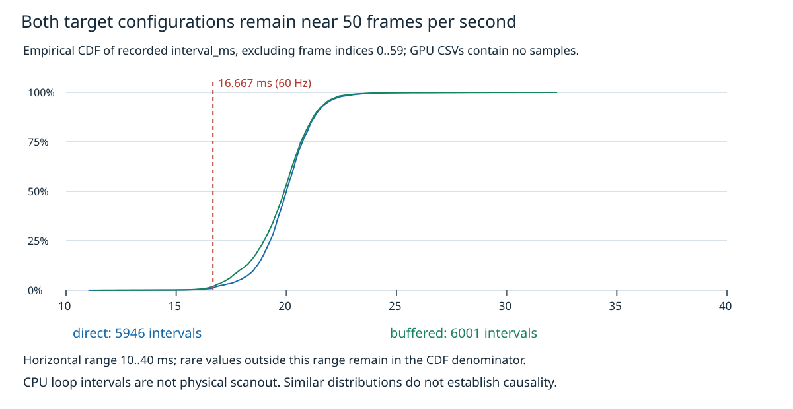

# Falllinie buffered audio: ownership before deadline claims

Falllinie generates its soundtrack numerically while the native game runs. A sample is one channel's amplitude at one instant; a stereo frame contains left and right samples for that instant. The engine stores these frames as interleaved floating-point pulse-code modulation, or PCM: `L0, R0, L1, R1, ...`. SDL requests output memory through an audio callback, a function the application must complete promptly. The original native callback generated that PCM itself. The revised implementation generates it in a separate producer thread and lets the callback consume only completed frames.

This report explains why that separation helps, how memory and musical time remain correctly owned, and what the measured results establish. Digital signal processing, abbreviated DSP, is the numerical computation that produces the amplitudes: voices, filters, convolution, compression and saturation. Moving DSP to a worker changes where that computation occurs; it does not eliminate its cost. A finite PCM queue provides advance output, not a guarantee that the operating system will schedule the producer in time indefinitely.

> [!summary]
> The native live default now has one DSP producer and a copy-only SDL consumer. Exact source-output tests and independent review support the ownership design. A 120-second real PulseAudio-backend run recorded zero application starvation and zero callback budget misses; an earlier 60-second software-rendered host run recorded one shortage at the same lead. Live no-vinyl listening, physical event-to-speaker latency and 60 FPS presentation are not established.

The source checkpoint is `686872c1d68776924b94dbf9a684eae174c1573e` in the repository named in the frontmatter. This is a new dated report, not a replacement of the earlier [[PROJECT REPORT - Falllinie Integrated Native Game - Precision, Real-Time Audio, Developer Telemetry and JavaScript Embedding|integrated native-game report]]. It describes the audio transport implemented and reviewed under FALLLINIE-AUDIO-003, including the subsequent parent-owned handheld qualification. It does not claim complete parity with the browser game.

## 1. Frames, requests and the meaning of a deadline

A sample rate describes frames per second, not individual stereo values per second. At 48,000 frames per second, a 1,024-frame request contains 2,048 float values. With four-byte floats, that is 8,192 bytes. The nominal duration represented by the request is `1024 / 48000 = 0.0213333` seconds. The application compares callback wall time with this duration to count budget misses. That comparison is useful even though SDL and the downstream backend may have additional buffering whose scheduling rules are not visible in the engine.

Wall time is elapsed time between two measurements. It includes periods when the executing thread is descheduled. Calling-thread CPU time measures execution attributed to that thread. The distinction is necessary before interpreting an expensive block: a long wall interval does not show that the thread spent that entire interval performing numerical work. Neither clock by itself measures a speaker's physical output, a display's scanout or device utilization.

The implementation distinguishes four observations that can otherwise be confused. A callback budget miss means the measured application callback took longer than its request's nominal duration. A producer block-budget exceedance means generating and publishing a 1,024-frame block took longer than that block's duration. A PCM shortage means the callback requested more complete frames than the application ring contained. A driver XRUN is an underrun or overrun reported by a backend or device; this project did not measure those reports in the quoted runs.

These observations are related but not interchangeable. A producer may exceed one block's nominal duration while queued frames cover the delay. A callback can finish quickly by supplying silence for missing frames, which is still a playback failure. Conversely, a counted application callback overrun does not by itself demonstrate an audible hardware underrun. Qualification therefore needs callback timing, producer timing and explicit shortage counters rather than one average-cost number.

The obtained device request matters more than the desired request. SDL opens with a requested sample count, frequency and format, then returns the actual specification. This engine accepts float stereo, validates the obtained request range and prepares DSP at the obtained rate. It cannot assume every later callback has exactly that request size: copying must also work for partial blocks, larger requests and byte counts that end before a complete stereo frame. Every requested byte is initialized; incomplete trailing bytes are not counted as musical frames.

## 2. Follow one pop from the game to delivered PCM

The main thread owns input, authoritative simulation, SDL video and GL calls. When simulation emits a `Pop` event, `src/runtime.cpp::publish_feedback` passes numeric feedback to `AudioEngine::trigger`. The audio command contains the event kind and bounded numerical parameters, not a UI string. The main thread is the command producer; in buffered mode the DSP worker is the command consumer. A single-producer/single-consumer structure, abbreviated SPSC, is safe here because each side has exactly one owner.

The command queue already existed before this change. Its capacity is 256 commands and its overflow policy is drop-newest with a numeric diagnostic. The worker drains a snapshot of its write cursor at the beginning of a render call, so continuing main-thread publication cannot extend that drain without bound. Ride updates are quantized and unchanged snapshots are suppressed on the main-producer side. This prevents repeated identical feedback during a pause from needlessly exhausting the suspended command queue.

On receiving `Pop`, the DSP owner adds the source noise-based pop voice at the current produced sample time. The voice has its own envelope and low-pass filtering; it is not an invented new sound. The owner renders the next 1,024 stereo frames into preallocated scratch storage, then publishes the complete block into the PCM ring. Publication means making finished PCM visible through a release store to the write cursor. The SDL callback observes that store through an acquire load and copies the available frames into its output memory.

The observable consequence is an event that becomes part of future generated PCM. PCM already queued before the command cannot be retroactively changed. The pop therefore waits behind any retained lead and additional backend buffering. The example defines a causal sequence, not a measured event-to-speaker latency trace. Exact numerical tests cover matched sample and command sequences; the live game trajectories used in device comparisons were not identical.



*Figure 1. Current buffered ownership. A worker thread is dedicated to DSP responsibilities, not pinned to a dedicated physical CPU core. No affinity, FIFO or system scheduling-policy change was made.*

```mermaid
flowchart LR
    Main["Main: input and simulation"] --> Commands["Numeric command SPSC"]
    Commands --> Worker["Worker: sole live DSP state"]
    Worker --> PCM["Frame-addressed PCM SPSC"]
    PCM --> Callback["SDL: copy and initialized shortage"]
    Callback --> Backend["Audio backend; physical output unmeasured"]
    Worker --> Numbers["Atomic numeric diagnostics"]
    Callback --> Numbers
    Numbers --> Panel["Main: 4 Hz formatting"]
    style PCM fill:#e6f3eb,stroke:#16835c
    style Callback fill:#edf4fa,stroke:#1769aa
```

## 3. Preserve the musical clock before changing transport

The soundtrack's primary time is the integer number of synthesized frames. Dividing that count by the obtained sample rate gives produced musical time. It is distinct from physics ticks, wall elapsed time and the number of frames delivered to SDL. This distinction permits a reproducible offline renderer: the same initial state and numerical commands can advance the synthesizer independently of a real device's callback schedule.

The tempo is 86 beats per minute. `AudioEngine::sixteenth` is `60 / 86 / 4`, approximately 0.174419 seconds. Sixteen steps form a bar; eight bars form a 128-step section. The scheduler keeps a floating-point next-step time and schedules while that time is within 140 milliseconds of produced time. Its initial nominal step time is 100 milliseconds. Rounding every step into an integer frame interval would accumulate tempo error; retaining the fractional deadline and converting scheduled starts to sample counts avoids that particular drift.

The arrangement begins Intro, Verse and Hook. Later sections choose from weighted Verse, Hook, Break and Glitch choices while excluding the current section. Chord progressions, vowel sequences and chop patterns are selected using the existing pseudo-random generator. Offbeat steps receive 16 percent of a sixteenth's duration as swing, and timing includes up to roughly three milliseconds of signed jitter. These are authored musical choices, not symptoms to remove when improving transport.

The worker must consequently own more than oscillator phases. It owns the section, step index, next deadline, random states, voice ages, envelopes, delay positions, reverb history and gain smoothing. Two render owners advancing the same state would duplicate or skip time even if their output buffers never overlapped. Buffered live, direct live and offline rendering are mutually exclusive modes because each must have exactly one synthesizer owner.

A gameplay restart does not restart the song. The event switch intentionally ignores Restart, ComboAdded, ComboBanked and Recovery as musical-jingle triggers. Mute also does not stop the clock: it changes a smoothed output-gain target while synthesis continues. Pause is different; after acknowledgement, it stops generation and delivery without resetting the sample count. These distinctions preserve source behavior and make restart, mute and pause tests more than checks that an API returns.

## 4. Voices, deterministic mixing and the unchanged bus graph

A voice is a bounded instance of an instrument or sound effect with a scheduled start, age, duration and numerical state. The fixed pool contains 128 slots. Source kinds include kick and kick click, noise and tone components of snare, hats, Rhodes, bass, pad, formant chop, blip, acid and ride-event effects. Their synthesis differs: a kick sweeps pitch, a Rhodes voice combines detuned frequency-modulated components, and chop voices shape oscillator input through vowel-related band-pass filters. The transport change does not replace these with prerecorded audio.

Envelopes contain bounded automation knots converted to sample positions when voices are created. Between knots, processing advances exponential or linear coefficients rather than building dynamic automation objects. Oscillators use a sine table or waveform-specific arithmetic, including discontinuity corrections for saw and pulse shapes. The filter implementation keeps numerical state in biquads. These structures are initialized before live processing and reused without render-time allocation.

When the pool is full, the existing stealing rule chooses the voice with the earliest scheduled end, with stable behavior from ascending slot traversal. Active-slot indices are maintained in sorted order. Rendering only occupied slots reduces work while preserving the original summation order of those slots. Floating-point addition is order-sensitive, so an unordered active set or parallel reduction would be a numerical adaptation even if every individual voice remained unchanged.

Voices contribute to separate buses before final mixing. Drums and crushed glitch components share a drum attenuation path; bass has its own gain; keys and chops participate in pumping; acid uses its authored waveshaping. The reverb send is stereo, and the delay send uses a filtered feedback delay. Continuous carve, wind and grind effects filter generated noise with different characteristics and gains. Sound effects and vinyl bypass the music-master branch before compression and final saturation, which is why a simple master gain substitution would not preserve the source graph.

Gain changes use sample-wise smoothing. For example, a first-order move toward a target can use a coefficient `1 - exp(-1 / (tau * rate))`, where `tau` is a time constant in seconds. This keeps the response tied to musical frames rather than callback count. Airborne state reduces drums and lowers music cutoff; landing restores that state. GROTESK is event-latched rather than owned by each ride snapshot. These contracts are exercised by source reactivity tests, not reinterpreted by the worker.

The final stereo mix passes through a shared envelope-based compressor and independent channel saturation state. Peak detection uses the larger absolute channel amplitude; attack and release coefficients differ. Final output is guarded for finite values and bounded amplitude. A no-vinyl preference changes input to this downstream processing, so its resulting waveform is intentionally different, but it does not justify bypassing compressor, reverb or saturation processing.

## 5. Why the full reverb uses partitioned FFT convolution

Convolution computes the response of a signal to an impulse response. For input `x[n]` and response `h[k]`, the direct expression is:

$$
y[n] = \sum_{k=0}^{M-1} h[k]x[n-k].
$$

The native response lasts 2.6 seconds. At 48 kHz, that is 124,800 taps per channel. Applying every tap at every output sample would require approximately 5.99 billion multiply contributions per second per channel before other DSP work. The engine therefore computes the same long response using partitions, rather than shortening the response to make the callback appear cheaper.

A discrete Fourier transform represents a finite block as complex frequency values. The fast Fourier transform, or FFT, is an algorithm for computing that transform efficiently. Multiplication of compatible transformed input and response corresponds to convolution; an inverse transform returns the result to sample values. Finite FFT multiplication gives circular convolution unless padding and block-combination rules account for boundaries. The native implementation uses zero padding and overlap-add to produce the intended blockwise linear convolution.

Each response partition contains 1,024 taps and is zero-padded to a 2,048-point FFT. The 48 kHz response needs `ceil(124800 / 1024) = 122` partitions. The final partition is padded rather than omitted. For one channel, the conceptual block spectrum sum is:

$$
Y_b[k] = \sum_{p=0}^{121} H_p[k]X_{b-p}[k].
$$

Here `b` is the current input block, `p` identifies a response partition, and `k` is a frequency bin. This formula explains why completed input history matters: partitions after zero multiply older, already completed input transforms. The left input uses the left response and the right input uses the right response. The implementation is two independent channel convolutions, not an undocumented four-path stereo crossfeed matrix.

Real-valued input and response have conjugate symmetry in their spectra. In a 2,048-point transform, only 1,025 independent bins need be stored. `Reverb` keeps real and imaginary planes for those bins, accumulates their products, reconstructs the conjugate half, and then performs the inverse FFT. Separate planes permit vectorizable arithmetic without changing summation order through fast-math reassociation. The FFT plan's bit-reversal indices and roots are prepared before processing.



*Figure 2. All 122 response partitions remain present. The first five partitions are schematic, not a truncated implemented response or a measured trace.*

`Reverb::process` spreads contributions from completed-history partitions over 64-sample groups. With 1,024 samples per block, there are sixteen such groups. Its due count advances according to `(pos / 64) * (partitions - 1) / 16`, and older partitions are accumulated as they become due. This reduces how much older-history multiplication remains concentrated at block completion. Partition zero still requires the current input FFT; the inverse transform and overlap-add also occur when the block completes. Distributed history work does not eliminate that completion-dependent computation.

Output has an explicit one-partition wet delay: 1,024 samples, or 21.3333 milliseconds at 48 kHz. That delay is part of the preexisting numerical reverb implementation. PCM lead is an additional transport quantity, not a replacement for it. The full-response regression at 8 kHz checks 20,800 taps per channel, including late energy beyond two seconds. Recorded maximum impulse-response error is `9.28995e-09`; a non-impulse stereo comparison records `3.17755e-08`. These checks reject an implementation that preserves a plausible early reflection but silently deletes the response tail.

## 6. Oversampling preserves a different numerical constraint

The final source WaveShaper uses two-times oversampling. Nonlinear shaping generates harmonics, some of which can alias when evaluated directly at the base sample rate. The native `Saturation2x` reconstructs a twice-rate sequence, applies the original clamped normalized hyperbolic-tangent curve, filters the result and decimates back to the original rate. Interpolation and decimation each use a 49-tap Blackman half-band FIR with fixed history.

The half-band structure has exact zero taps, symmetry and a 0.5 center coefficient. Its implementation exploits paired symmetric terms rather than treating every tap as an independent multiply. The combined group delay is 24 base-rate samples. At 48 kHz, that is 0.5 milliseconds. This is a separate numerical delay from the wet reverb partition and the queued PCM; a meaningful physical-latency measurement must identify the actual signal path rather than indiscriminately add every delay in the engine.

Tests verify unity DC behavior against the original curve, odd symmetry, reset/block independence, finite startup and an impulse peak at sample 24. A selected sinusoidal test checks suppression of a folded nonlinear third harmonic; its recorded attenuation is approximately -103.314 dB relative to the one-times reference for that test. This is not a universal aliasing guarantee for every input, but it constrains a concrete failure mode. Moving DSP to a worker must preserve this state and processing order, not omit oversampling because the output looks bounded without it.

## 7. Frame-addressed SPSC ownership and the memory model

The PCM helper, `src/audio_pcm.hpp::PcmRing<Capacity>`, uses a fixed array and two monotonically advancing 64-bit cursors. `written` identifies the logical end of published frames; `retired` identifies the logical end of frames already copied by the consumer. In a quiescent valid state, ready depth is `written - retired`, bounded by capacity. Physical indices are derived using `cursor & (Capacity - 1)`, so capacity must be a nonzero power of two. Stereo values are addressed as twice the frame index.

The producer owns writes to PCM that has been retired or has never been published. It acquire-loads the consumer cursor before deciding whether enough storage is free. A publication is all-or-nothing: if a requested block does not fit, `push` returns false without publishing a prefix. Otherwise it copies the tail segment and any wrapped prefix, then release-stores the advanced write cursor. The consumer cannot observe that cursor advance before the corresponding writes are made visible by the synchronization relationship.

The consumer owns reading published PCM and changing retirement. It acquire-loads the write cursor, computes the smaller of available frames and complete frames requested, and copies at most two physical segments. Only after both copies does it release-store the advanced retirement cursor. A producer that observes that retirement may overwrite those frames. It may not overwrite the unread remainder of an earlier publication, even if the consumer has already copied a prefix of the same DSP block.

The relevant relationship is happens-before, not merely that a cursor contains the right integer. A release store paired with an acquire observation makes prior ordinary PCM writes visible to subsequent consumer reads. Consumer retirement performs the reverse ownership transfer for storage reuse. Changing these operations to relaxed synchronization while retaining plain shared PCM would remove the ordering guarantee. Merely making the array elements atomic would not fix the higher-level error of retiring unread frames.

```text
producer push(stereo, frames):
    w = producer cursor
    r = acquire consumer retirement
    reject if frames > capacity - (w - r)
    copy first segment to physical tail
    copy remaining segment to physical prefix
    release publish w + frames

consumer consume(destination, bytes):
    initialize every requested byte to zero
    r = consumer cursor
    w = acquire producer publication
    n = min(floor(bytes / stereo_frame_bytes), w - r)
    copy first published segment
    copy wrapped published segment
    release retire r + n
    return n
```

This is the implemented frame-addressed contract. The initial guide sketched block-slot retirement; finalized API reference03 supersedes that sketch. Frame retirement provides the same safety property with more direct support for arbitrary partial requests. Consider eight published frames, followed by consumption of three. Five frames remain unread. Refilling the three retired physical positions must produce a future logical sequence after those five frames, not replace them. The deterministic transport test checks exactly that ordering with distinguishable stereo values.



*Figure 3. An illustrative eight-frame ring. Actual production capacity is 8,192 stereo frames. Frames A3 through A7 remain unread after the first three retire; new B frames follow them logically even though they occupy the wrapped prefix physically.*

The helper statically requires lock-free cursor atomics. The engine also requires lock-free numeric types used by commands and diagnostics. A lock-free requirement avoids implementations that quietly turn the callback's numeric operations into blocking library locks. It does not mean a callback has a mathematically fixed execution time on a preemptive operating system. Copies, timing calls and atomics still execute on a thread subject to scheduling and memory-system delays.

`depth()` is advisory during concurrent sampling. It loads cursors separately and clamps the resulting depth to capacity rather than reporting a fabricated enormous unsigned underflow if observations straddle a transfer. Running diagnostic fields likewise do not form a transactional snapshot. Exact queue equations should be checked after owners are quiescent, not inferred from arbitrary mixed live counter reads.

## 8. The callback boundary and bounded failure behavior

In buffered mode, `Impl::callback` dispatches to `PcmConsumer::callback` and returns without invoking `render`. The shared consumer path performs output initialization, up to two copies, numeric shortage/depth/timing accounting and clock reads. It does not notify the producer. This is the deadline-sensitive boundary that the architecture change is intended to simplify.

The forbidden work is explicit: no synthesis, dynamic allocation, mutex acquisition, condition-variable wait or notification, strings, logging, files, GL, JavaScript or waiting for ready PCM. Bounded work means its copy work is bounded by the supplied output size, not that callback duration can never exceed a deadline. The independent reviewer checked the actual call path, not just the callback's short outer function.

Shortage handling supplies initialized silence for any missing remainder. If a callback asks for 1,024 frames but only 768 are published, it copies those 768, increments the starved-callback counter once and adds 256 to missing frames. Retirement advances by 768, not 1,024. Produced musical time is not advanced by silence, and old PCM is not replayed to conceal the gap. Subsequent generation continues the unheard source sequence, although physical playback has already contained a discontinuity.

This policy is damage containment, not successful playback. A silence-filled callback can have excellent timing statistics while sounding wrong. Separating `starved_callbacks` and `missing_frames` preserves both incident count and duration information: two callbacks can have very different shortage totals. Malformed incomplete stereo bytes are initialized but do not invent a frame. Nonpositive byte requests return at the outer callback boundary.

Direct mode is intentionally different. `AudioRenderMode::DirectCallback` invokes the same synthesizer from SDL and records its timing, without a worker. It is available to compare architecture and retain a diagnostic reference. It is never chosen automatically if buffered preparation fails. A hidden fallback would both weaken callback-safety claims and make measured mode ambiguous.

## 9. Producer lead, storage capacity and separate frontiers

The worker has a preallocated 1,024-frame stereo scratch block and an 8,192-frame PCM ring. Storage capacity is the maximum number of frames that can be retained safely; target lead is the amount the producer attempts to keep ready. They are deliberately different. Filling every available frame would add unnecessary control delay, and a larger capacity alone would not repair a producer that remains slower than consumption over a sustained interval.

The actual target is derived from the obtained request:

$$
T = \left(\left\lceil R/1024 \right\rceil + 1\right)1024,
$$

where `R` is obtained callback frames and `T` is target ready frames. A 1,024-frame device targets 2,048 frames. A 4,096-frame device targets 5,120 frames. Requests of 256 or 512 still use a 2,048-frame target because generation occurs in 1,024-frame blocks. Before rendering another block, the worker checks whether current depth plus 1,024 would exceed target. It does not use the entire capacity as an implicit latency target.

| Obtained request | Nominal request duration at 48 kHz | Target frames | Full target's PCM duration |
|---|---:|---:|---:|
| 256 | 5.3333 ms | 2,048 | 42.6667 ms |
| 512 | 10.6667 ms | 2,048 | 42.6667 ms |
| 1,024 | 21.3333 ms | 2,048 | 42.6667 ms |
| 2,048 | 42.6667 ms | 3,072 | 64.0000 ms |
| 4,096 | 85.3333 ms | 5,120 | 106.6667 ms |

These durations describe PCM already prepared when the queue is full to its selected target. They are not measurements of event-to-speaker latency. Actual depth changes as requests consume data; commands may arrive at different phases of a producer block; wet and dry signal paths have different numerical delays; the backend adds buffering not measured here. Calling the 42.6667-millisecond target an end-to-end response time would omit those distinctions.

The produced frontier is `AudioDiagnostics::frames`. The delivered frontier is `delivered_frames`, counting only generated frames copied for SDL consumption, not confirmed speaker output. In an acknowledged pause, the exact buffered identity is produced equals delivered plus queued frames. The target run ended with `5,763,072 = 5,761,024 + 2,048`. The two extra producer blocks relative to complete callback requests therefore describe retained output, not skipped music.

`pcm_low` samples minimum observed post-callback depth; `pcm_high` samples maximum producer-observed post-publication depth. A low of zero is not itself starvation. A callback can consume all published PCM successfully, leaving depth zero, and the worker can refill before the next request. Starvation is counted only when the current request lacks frames. The real target's low zero and shortage zero are consistent; conflating them would incorrectly reject that run or hide the meaning of the counter.

## 10. Startup, acknowledged pause and ownership-safe teardown

`open` is a main-thread lifetime operation. For a closed engine, it validates requested power-of-two buffers between 256 and 4,096 and a valid render-mode enum. It determines whether the application already initialized SDL audio, opens a paused float-stereo device, checks the obtained specification and prepares all DSP state. The existing accepted sample-rate range is 8,000 through 192,000. Preparation allocates noise, vinyl, delay and reverb buffers before the live owners are enabled.

Buffered startup assigns the immutable live configuration, creates the worker and waits up to five seconds for target prefill while SDL remains paused. Only after ready PCM exists does it unpause the device. Allocation failure, thread-creation failure, invalid preparation or prefill timeout follows cleanup and returns false rather than choosing direct mode. The tests inject preparation allocation failure and verify retry/SDL cleanup. Thread-creation failure and prefill timeout were reviewed in code, not independently exercised by those test cases; that evidence boundary matters.

The worker uses a mutex and condition variable outside the callback. It checks stop and pause state, renders outside that mutex, publishes its block and reacquires the lifecycle mutex. When sufficiently ahead, it performs an interruptible one-millisecond timed wait. This allows refill without any callback-side condition-variable notification. Main-thread notifications request pause, resume or stop; worker notifications support startup and pause acknowledgement. No promise of immediate refill is inferred from the timed wait.

Pause first uses SDL to quiesce the consumer. The main thread then requests worker pause and waits for acknowledgement. If a block is already being rendered, the worker completes and publishes it before acknowledging. Only then does the main thread set the source pause flag. Setting that flag earlier could cause an in-flight render to output silence without advancing musical time and then publish it as if it were valid future PCM. The ordering prevents that inconsistency.

Queued frames remain intact through pause. Discarding them while leaving the produced clock advanced would skip unheard samples on resume. Resume clears the source pause flag before waking the worker and unpausing SDL. It neither resets the source song nor creates another render owner. Rapid pause/resume ordering was included in review; deterministic worker tests pause around partial retirement and compare the complete delivered sequence to the offline reference.



Close quiesces SDL, requests worker stop, wakes any wait, joins the worker, then closes the audio device. Destruction calls close, and repeated close is idempotent. Tests deliberately cover empty storage, full storage, paused-full storage and refill stop; the full-storage fixture is an internal test condition, not a production lead option. Storage remains valid until both owners can no longer access it. The engine quits SDL's audio subsystem only if it initialized that subsystem itself, preserving caller-owned initialization.

Active `open` is idempotent before option validation. A second call does not restart or reconfigure an already open engine, even if its supplied options differ or would be invalid for a new open. Close/reopen is the explicit configuration boundary. Offline preparation rejects a device or joinable worker, offline rendering is guarded against live ownership, and offline trace extraction is similarly excluded. Those restrictions enforce the unique DSP owner instead of relying on callers to avoid an accidental concurrent render.

## 11. Public configuration, vinyl preference and developer formatting

The finalized public API is in `src/audio.hpp` and ticket `reference/03-finalized-audio-api.md`. That reference names the implemented interface and supersedes sketches in the previously uploaded guide:

```cpp
enum class AudioRenderMode : uint8_t { BufferedWorker, DirectCallback };
struct AudioOpenOptions {
    int buffer_frames = 512;
    AudioRenderMode mode = AudioRenderMode::BufferedWorker;
    bool source_vinyl = true;
};
bool AudioEngine::open(int buffer_frames = 512);
bool AudioEngine::open(const AudioOpenOptions&);
bool AudioEngine::prepare_offline(int sample_rate = 48000,
                                 uint32_t seed = 1,
                                 bool source_vinyl = true);
```

The old integer `open` remains source-compatible and selects buffered playback with vinyl enabled. Library, executable and offline defaults preserve the source mix. CLI options are `--audio-buffer`, `--audio-mode buffered|direct`, `--no-vinyl` and `--source-vinyl`. The last vinyl option wins. The handset launcher explicitly requests 1,024 frames and no-vinyl; appending `--source-vinyl` restores the source mix because launcher arguments precede caller arguments.

Vinyl is an authored noise layer, not a diagnosis of timing failure. Preparation generates both small continuous noise and occasional transients, then live processing advances its filter and position. The preference zeros the filtered contribution after that processing. It does not stop generation, omit the filter or change RNG advancement. The source waveform and no-vinyl waveform intentionally differ before downstream compression and saturation, while arrangement and source state remain reproducible.

The historical listening experiment used two matched offline excerpts, not live DSP: fifteen seconds of source mix, one second silence and fifteen seconds of no-vinyl from the same sequence. The user's tentative report of clean second playback supported making the contribution optional. It did not show that callback deadlines were solved. The migrated reproduction helper uses `prepare_offline` options rather than editing copied C++ coefficients, preserves original logs and manifest, and recreates both historical WAV hashes exactly. Human live buffered/no-vinyl listening remains pending.

Developer formatting remains on the main thread. The panel has eighteen ASCII rows bounded to 82 columns, refreshed approximately four times per second by the existing cache. Audio owners publish numeric atomics; they never construct panel strings. Buffered rows report actual mode/vinyl, callback wall/CPU timing, depth/target and sampled extrema, frontiers, separate shortage counts and producer block-budget exceedances. Direct mode retains legacy callback/command/voice rows. Existing controller chords and simulation ownership were not changed.

On Linux, CPU measurements use `CLOCK_THREAD_CPUTIME_ID`. Unsupported or failed readings increment an unavailable counter; CPU means use valid CPU sample counts, not wall-time counts. The final exit snapshot follows acknowledged pause, so frontier arithmetic is exact there. The panel's running snapshot remains advisory. GPU elapsed time and utilization were not measured in the quoted target comparisons: both GPU CSV files contain only their header because queries were disabled to avoid perturbing CPU timing.

## 12. Why one same-process worker is the selected architecture

The original SDL callback already executed on an audio thread. The change is not from a completely single-threaded application to a threaded one; it separates synthesis from deadline-sensitive delivery. A worker can prepare samples before the request arrives while the callback performs bounded consumption. The worker is dedicated in responsibility, but neither it nor SDL was pinned to a physical core. The operating system may schedule them on available cores under existing policy.

A separate process would require shared-memory or serialized PCM transport, process lifetime rules and failure recovery. Those mechanisms could provide isolation but would not reduce the numerical cost of the same voice and convolution graph. The first implementation reuses the existing command queue and synthesizer in one process, keeping ownership inspectable without introducing another interprocess protocol. That is a deliberate scope decision, not evidence that process isolation can never be useful.

Multiple voice-producing threads would require deterministic combining of partial buses, synchronization around effects and a decision about floating-point reduction order. Delay, reverb, compressor and saturation also retain history that must advance once per sample sequence. Parallelizing voice calculation could change the sorted-slot mixing contract or require more infrastructure than the immediate callback problem demands. The chosen worker preserves one render function and one musical state rather than distributing source behavior among loosely synchronized producers.

Affinity or real-time scheduling is also a separate decision. Pinning can change contention and migration, but it does not remove arithmetic. An inappropriate priority policy can affect other system services, including output handling. This work gathered wall and calling-thread CPU evidence without changing affinity, FIFO or system policy. Any later experiment must record and restore the policy, compare workloads and evaluate starvation and responsiveness, rather than treat a scheduler setting as a substitute for transport correctness.

## 13. Numerical identity, allocation safety and evidence boundaries

Tests are strongest when their rejected failure mechanism is explicit. `tests/test_audio_pcm.cpp` checks distinguishable stereo frames, empty/full behavior, partial retirement, wrap order, oversized publication rejection, malformed byte requests and initialized shortage. A concurrent 500,000-frame producer/consumer test checks FIFO identity. Allocation watching covers the shared consumer path, including clocks and numeric accounting, rather than only a simplified copy function.

`tests/test_audio_worker.cpp` compiles the actual implementation in a separate test executable and uses a narrow friend fixture to control ownership without a physical device. It checks 32,768 frames against an offline reference through varying requests and repeated pause. It also withholds production to check the actual callback's silence and counters, and covers empty/full/paused-full/refill teardown. Its zero-allocation watch is thread-local, avoiding confusion with unrelated thread-runtime allocation. This is actual worker/callback transport identity over a bounded sequence, not a universal race proof.

The separate ninety-second source comparison is offline evidence. It compiles the exact base revision `0ff0876ef3e0bafbad9a04c3c34b08f76aacc1f8` and the candidate using a common numerical-command harness at 48 kHz with seed 19. It compares raw float PCM rather than only 16-bit WAV quantization, plus the scheduled voice trace. The sequence exercises ride state, pop, landing, bail, uber, GROTESK and restart. Both render 34,560,000 bytes with identical hashes:

| Artifact | SHA256, identical base and candidate |
|---|---|
| Raw float PCM | `09894bf1acfcb0cfe11e37345cab8dde710beee06a751046e532fb4a9cbd59ac` |
| Source trace | `71c882e340c52ee96946ec31a1fe8a4024db02deec8d7be7fc6c47d5efec731c` |

The source manifest names candidate source commit `32fe75c`; later worker commit `c6e4624` adds qualification documentation/evidence rather than changing the reviewed audio math. The exact comparison does not establish that separate live input trajectories produce identical output, nor that every compiler and architecture will have identical floating-point results. It establishes preservation for the specific matched host sequence and build represented by the manifest.

The full source suite also checks arrangement over twenty sections, reactive events, voice/queue bounds, block independence, full stereo convolution and two-times saturation. Dummy SDL lifecycle tests exercise buffers from 256 through 4,096, direct mode, offline exclusion, frozen/retained pause, mute, repeated open, reopen, destruction, injected preparation failure and SDL ownership. The parent reran all twelve CTests after integration; all passed in 5.99 seconds. The existing offline ARM64 compile/link also passed without warnings.

ASan and UBSan passed all five audio targets; repeated transport/worker/lifecycle execution passed thirty of thirty runs. Address and undefined-behavior checks do not establish absence of races. ThreadSanitizer built, but all three attempted tests aborted before execution with `FATAL: ThreadSanitizer: unexpected memory mapping ...`. Consequently there is no TSan pass. The exact failures remain recorded rather than being discarded or worked around through a system-policy change.

The independent reviewer read the full candidate, patch, design, API, tests and evidence without rerunning tests or touching the device. The merge verdict was **OK with notes**, with no identified source transport/lifecycle correctness defect. Its P1 finding was incomplete playback qualification after the host shortage, not a demonstrated ownership defect. The parent then verified the clean candidate and patch hash, integrated four milestones and performed target comparisons. Review and target evidence address different questions and neither should be described as replacing the other.

## 14. Host shortage and real-backend target results

The first sustained integration gate ran sixty seconds on host llvmpipe software GLES with SDL's dummy audio backend, obtained 48 kHz/1,024 frames, buffered mode, no-vinyl, autoplay and overlay. It completed with GL error zero and zero callback budget misses, but recorded one starved callback and 1,024 missing frames. Its producer wall maximum was 48.956 milliseconds, versus a CPU maximum of 4.36897 milliseconds. Those maxima need not identify the same block; subtracting them would not reconstruct a scheduling trace.

The host target lead was 2,048 frames, exactly the later handheld target lead. The shortage shows that finite advance PCM did not cover every delay in that host configuration. It remains a failed zero-starvation qualification result. It is not erased by later tests, and the implementation did not silently enlarge lead or switch render mode to hide it. Software-rendered host frame timing also differed substantially from hardware-rendered target timing, so the backend and workload labels belong beside the result.

Parent target qualification used the real SDL PulseAudio backend on the ROCKNIX handheld, with Mali-G52 rendering. Direct ran first, buffered second, each for 120 seconds. Both used autoplay, dual 384×288 rendering, no-vsync, a 60 FPS cap, muted output with full DSP computation, developer overlay and source vinyl enabled. The obtained rate and request were 48 kHz and 1,024 frames. These are matched configurations, not identical live commands: differing frame timing caused different trajectories, reactions and eventual scores.

| Target measurement | Direct callback | Buffered callback / producer |
|---|---:|---:|
| Callback count | 5,574 | 5,626 |
| Callback wall mean | 12.907375 ms | 0.022966 ms |
| Callback wall maximum | 24.9405 ms | 1.6100 ms |
| Callback CPU mean | 11.360292 ms | 0.013177 ms |
| Callback CPU maximum | 20.557331 ms | 0.066500 ms |
| Callback budget misses | 18 | 0 |
| Producer blocks | Not applicable | 5,628 |
| Producer wall mean / maximum | Not applicable | 12.765847 / 27.0392 ms |
| Producer CPU mean / maximum | Not applicable | 11.293611 / 21.651957 ms |
| Producer block-budget exceedances | Not applicable | 16 |
| Buffered application starvation / missing frames | Not applicable | 0 / 0 |



*Figure 4. Bars show means and ticks show maxima on a shared millisecond scale. Max wall and max CPU are independent aggregates, not paired measurements of one block. All target CPU clock readings were available. Producer deliberate waits are outside its measured render/publication block.*

The substantial DSP CPU cost remains: about 11.3 milliseconds per producer block, similar in scale to direct callback DSP CPU. What changes is the deadline path. Buffered callbacks no longer pay that synthesis cost and the queue covered the measured producer variations. Sixteen producer exceedances coexisted with zero shortages and zero callback overruns. This supports the intended separation for that finite run without claiming that every future scheduling tail is covered.

The buffered run's final acknowledged pause showed produced 5,763,072, delivered 5,761,024 and queued 2,048. Capacity remained 8,192, sampled low/high were 0/2,048, command high-water was three, and command drops, stolen voices and nonfinite samples were zero. A sampled low of zero therefore did not correspond to a failed request in this run. No actual backend XRUN counter or physical output capture accompanied these measurements.

The logs include an ARM driver warning that a module parameter file could not be opened, followed by successful initialization and complete runs. GPU queries were explicitly disabled; the GPU CSVs are header-only. Both logs end with normal complete AUDIO/frame records and GL error zero. The parent deployment helper initially encountered unsupported BusyBox `flock -w`; its corrected helper uses a bounded `timeout ... flock` form and failure guards. The warning and helper issue do not justify discarding completed run records or inventing an additional unrecorded test.

## 15. Rendering, latency and listening remain separate qualification work

The target renderer remains near fifty frames per second, not sixty. Direct terminal frame cost percentiles were 19.8539, 21.7346 and 23.0284 milliseconds at p50, p95 and p99. Buffered values were 19.7586, 21.6821 and 22.8927 milliseconds. Direct produced 6,006 frames with 5,946 measured after warmup; buffered produced 6,061 with 6,001 measured. Peak resident memory was 115,988 and 115,692 KiB respectively; both had GL error zero.

These small frame-statistic differences are descriptive, not causal proof that buffering accelerated the renderer. There was no randomized repeated trial, identical input replay or controlled isolation of every scheduling and scene-load difference. The CSV records completed-frame intervals, including inter-frame overhead, whereas terminal percentiles measure frame-start-to-end cost. Both are CPU-loop observations, not physical scanout rates. The figures and table retain that measurement distinction rather than presenting one as a GPU timing result.



*Figure 5. Empirical cumulative distributions of CSV `interval_ms`, excluding frame indices 0–59. The plotted range is 10–40 milliseconds, with rare outside values retained in the denominator. The dashed 16.667-millisecond line indicates a nominal 60 Hz period, not a measured display deadline. Similar distributions do not establish causal equivalence or improvement.*

The parent restored an interactive buffered/no-vinyl title with the panel after tests, recorded as PID 419350 at restoration. That historical process identifier is not a claim about what is running when this report is read. The timing comparison used muted source-vinyl-on computation; the restored preference differs intentionally for human listening. The finite target run establishes useful application timing and transport evidence, but it cannot substitute for the pending live no-vinyl listening task.

Physical event-to-speaker latency remains unmeasured. The application can compute queued duration from depth and rate, but delivery to SDL is not confirmation of speaker presentation. A latency experiment needs a defined input event, a recognizable output signal and synchronized physical or backend observation. Dry sound-effect onset and reverb wet onset should be treated as different outputs. Reporting the full 42.6667-millisecond application lead as measured physical latency would overstate what the counter means.

The listening acceptance task `r35o` remains open. The historical offline A/B response was tentative and limited to those precomputed excerpts. The target buffered run's zero shortage does not prove absence of all audible defects, while vinyl-off alone does not prove scheduling reliability. Longer and varied playback phases, suspend/focus transitions, real control interaction and a human assessment of the clean-mix preference are still necessary before a broader playback claim.

## 16. Maintenance, reproduction and the next experiments

A maintainer should start at `src/audio.hpp` for configuration and counters, `src/audio_pcm.hpp` for transfer ownership, `src/audio_timing.hpp` for callback work and clock semantics, and `src/audio.cpp` for prepare/render/produce/open/pause/close. `src/audio_dsp.hpp` defines the unchanged numerical graph. Main-thread plumbing is in `src/main.cpp`, with bounded formatting in `src/developer_overlay.cpp`; `scripts/falllinie-spike.sh` makes the handset preference explicit. These paths separate state ownership, numerical processing and presentation so changes can be reviewed at the relevant boundary.

The ticket root is `/home/manuel/code/wesen/2026-10-12--falllinie-spike/ttmp/2026/10/13/FALLLINIE-AUDIO-003--buffered-native-audio-worker-and-callback-deadline-qualification`. Its design guide explains the original direction; reference03 is the implemented API; reference02 records worker implementation/tests; reference01 Step4 records parent integration and target qualification. `scripts/independent-review.txt` preserves the original read-only reviewer receipt. `scripts/target/{direct,buffered}` contains the original logs and CPU/GPU CSVs, not copies embedded into this vault.

The worker's immutable reviewed sequence ends at `c6e4624ef50365b3fd28445bff4bde58cb17fc53`. Its four milestones map to parent commits `f1781ed`, `9780e3f`, `a8894cc` and `36879ae`. Parent qualification/documentation commits are `2d7cd4a` and `686872c`. The original 139,691-byte base-to-worker patch has SHA256 `69e69d4518871fa0220bcd6a9e701c2c939813bd95a92432e39727df3227a2d1`; the parent confirmed it before integration. Publication helpers added later are not new audio implementation commits.

The following are reproducible host checks, not commands executed anew during report publication:

```bash
cmake -S . -B build-audio -DCMAKE_BUILD_TYPE=Release
cmake --build build-audio -j4
ctest --test-dir build-audio --output-on-failure

python3 ttmp/2026/10/13/FALLLINIE-AUDIO-003--buffered-native-audio-worker-and-callback-deadline-qualification/scripts/verify-source-identity.py
python3 scripts/2026/10/13/audio-crackle-isolation/01-build-matched-probes.py
```

The strict source script is `scripts/2026/10/13/full-gameplay-integration/check-audio.sh`. Sanitizer flags and exact unsupported TSan diagnostics are retained in reference02 and bounded ticket logs. Generated binaries, source copies, float captures and WAVs remain ignored. Their hashes and metadata are evidence; copying their large generated outputs into the vault would not make this report more precise.

The figures are self-contained local SVGs generated by `scripts/2026/10/13/buffered-audio-report/generate_figures.py` in the original isolated native worktree. Their colocated [provenance record](_assets/falllinie-buffered-audio-20261013/provenance.json) includes the source revision, extracted aggregates, row counts and source-log/CSV hashes. Figures 1–3 explain structure and an illustrative partial-read sequence; Figures 4–5 derive data from committed target evidence. Structural report validation checks asset resolution, SVG XML, absence of external figure dependencies, balanced fences, substantive word count and intended publication scope.

Near-term experiments should answer specific unresolved questions rather than simply extend a mean benchmark. A longer real-backend run should cover additional song phases and record shortages and producer tails without silently increasing lead. Matched replayed command sequences could separate workload variation from architecture timing more strongly than live autoplay. A supported race-sanitizer environment should run the concurrency tests rather than reinterpret the current startup failures as success. Physical latency measurement and live no-vinyl listening should complete the unmeasured output side.

The maintenance invariants are concrete:

- Publish completed PCM only after both physical copy segments finish; retire only frames that have actually been copied. Cursor arithmetic without that ordering does not transfer ownership safely.
- Treat pause acknowledgement as the boundary for exact musical-frontier assertions. A request to pause is not evidence that an in-flight producer block has stopped.
- Keep shortage counters separate from wall-budget counters and backend reports. A fast silent callback cannot establish successful delivery, and an empty post-callback ring need not mean shortage.
- Reconfigure at close/reopen, preserving explicit mode and vinyl preference. Never hide a preparation or throughput problem by silently changing the selected render path.

The working rule is to preserve one spelling and one owner for each relevant state, keep callback work bounded, and change lead or scheduling policy only with explicit evidence and responsiveness assessment. Source numerical identity, ownership review and finite playback qualification are complementary requirements. The implemented transport has passed the reviewed source boundary and one real target timing configuration; the remaining limits stay visible so a future maintainer can improve the system without replacing measured facts with broader claims.


## Falllinie optimization report network

Navigation addendum: [[MOC - Falllinie Optimization Reports|series index, reading routes and evidence boundaries]]. The original report above remains a historical checkpoint; these cross-links do not revise its measurements.

This is implemented audio transport with measured target evidence. The rendering report separates producer CPU work from driver CPU work; the JavaScript report does not integrate JavaScript into this audio callback.

- [[PROJECT REPORT - Falllinie Native GLES Spike - Deterministic Terrain, Print Shaders and Mali Depth Precision|Graphics foundations]] — Deterministic terrain, encoded scene/print passes and Mali depth-sampler precision; establishes the fidelity constraints for later tuning.
- [[PROJECT REPORT - Falllinie Playable Port - Dual Views, Frame Profiling and Cooperative Terrain Streaming|Playable port and streaming]] — Shared dual views, frame pacing and cooperative terrain generation; an earlier, smaller workload.
- [[PROJECT REPORT - Falllinie Integrated Native Game - Precision, Real-Time Audio, Developer Telemetry and JavaScript Embedding|Integrated workload and precision]] — Camera-relative projection, source DSP optimizations, telemetry and the initial embedding investigation.
- [[PROJECT REPORT - Falllinie JavaScript Embedding - ARM64 Qualification, V8 Ownership and Bounded Rules|ARM64 JavaScript experiments]] — Actual QuickJS, QuickJS-ng and V8 embeddings, ownership contracts and isolated workload measurements.
- [[PROJECT REPORT - Falllinie Tracing - CPU Execution, Driver Waits and GPU Attribution|Tracing concepts and investigation plan]] — Wall versus CPU time, scheduler-state interpretation and proposed perf/ftrace/eBPF investigation.
- [[PROJECT REPORT - Falllinie Rendering Measurements - CPU Execution, Mali Driver Work and GPU Timer Limits|Measured CPU and driver attribution]] — Actual paired clocks and perf samples, driver execution, non-running time and unresolved GPU elapsed-query anomalies.
- [[PROJECT REPORT - Falllinie GPU Profiling - Hardware Counters, Shader Compilation and a Rejected Optimization|Hardware counters and rejected shader candidate]] — Actual G52 counters, exact-input offline compilation, non-parity post bypass and a null-result ABBA shader experiment.
