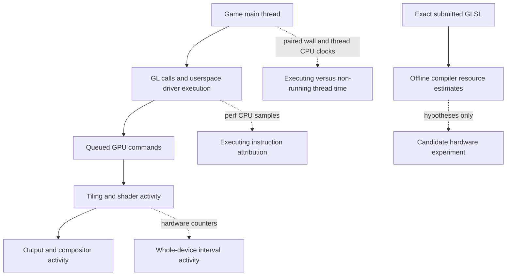
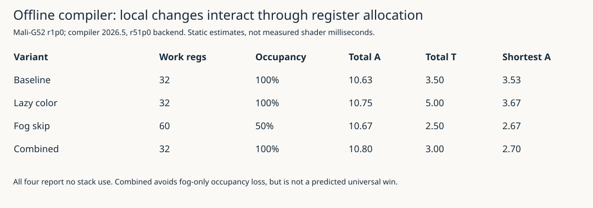
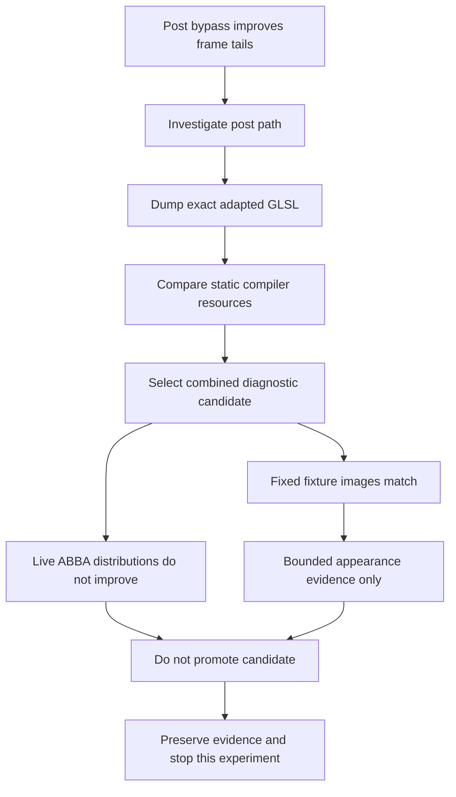

# Falllinie GPU Profiling: Hardware Counters, Shader Compilation and a Rejected Optimization

## What this investigation established

Falllinie's native port runs two sequential views through a shared OpenGL ES context on an RG DS Plus. Earlier measurements separated main-thread CPU execution from elapsed rendering time, and found substantial executing CPU work in the Mali userspace driver. They did not establish what the GPU was doing. The available OpenGL elapsed-query results were unsuitable for that conclusion: pass totals were nonadditive, and several startup values were physically impossible despite being marked valid by the API.

This investigation obtained a different source of evidence: actual Mali-G52 hardware counters through Arm's libGPUCounters. It then used Mali Offline Compiler on the exact adapted GLSL submitted by the application, constructed a narrowly scoped post-processing candidate, and measured that candidate on the handheld.

Three results matter. First, hardware counter access works on this device without changing the kernel, installing system packages, or replacing the production game. Second, omitting post-processing substantially improved frame-time tails, but changed the image and therefore was not a source-faithful optimization. Third, a compiler-guided rewrite preserved the captured fixed-scene image but did **not** produce a convincing live performance improvement. That candidate was not promoted.

The useful outcome is consequently not a faster released shader. It is a much better qualified measurement path, a concrete demonstration of how static compiler evidence can guide—but not decide—optimization, and a documented negative result that prevents an unsupported change from entering the canonical renderer.

The account below develops the measurement concepts before interpreting the results. All charts use recorded data or explicitly identified static compiler output. No scheduler trace, simulated hardware sample, or inferred successful optimization is presented as an observation.

> [!summary]
> Hardware counters are working, but their clock domains and denominators require explicit treatment. Static compiler reports exposed resource tradeoffs; the resulting image-matching candidate showed no convincing live speedup and was not promoted.

## 1. Begin with the execution model

A rendering function executes CPU instructions, submits commands, and may spend time not running. Submitted commands then execute through GPU stages whose work can overlap. Presentation and display composition add further activity. These are related processes, but their durations and counters do not form one interchangeable quantity.

The preceding investigation measured the same main-thread scope with a monotonic wall clock and a thread CPU clock. For one scope:

\[
T_{\mathrm{residual}}=T_{\mathrm{wall}}-T_{\mathrm{threadCPU}}.
\]

The residual estimates time in which that thread was not executing. It does not identify whether the thread was blocked on a driver dependency, ready but unscheduled, or delayed for another reason. Likewise, a CPU sample whose instruction pointer lies in `libmali` establishes execution in driver code, not GPU execution.

For context, an earlier selected top-view sample set averaged approximately 7.645 ms wall and 4.522 ms thread CPU. The selected lower view averaged 7.031 ms wall and 2.774 ms thread CPU. In a separate all-thread CPU sampling run, driver samples accounted for approximately 71.44% of the **main thread's executing CPU samples**. None of those values is a percentage of frame time spent productively shading pixels.

Hardware counters answer another class of questions: which device activities accumulated during a sampling interval, and how much associated traffic or instruction activity was counted? They do not automatically explain the CPU residual or isolate one application's draw calls. On this tile-based GPU, tiling organizes geometry by screen region, while fragment processing executes shader work for covered image samples. Their activity can overlap with other submitted work.



The earlier report, [[PROJECT REPORT - Falllinie Rendering Measurements - CPU Execution, Mali Driver Work and GPU Timer Limits]], remains the reference for those CPU and elapsed-query measurements. This report adds counter access and an actual compiler-guided experiment; it does not reinterpret questionable timer results as valid after the fact.

## 2. Identify the device and the supported interface

The handheld uses an RK3568 with Cortex-A55 CPUs and a Mali-G52. The counter library identified one shader core, revision r1p0, GPU ID `0x07040002`, shader-core mask `0x1`, and a 128-bit bus-width property. These details matter because counter availability, event definitions and derived formulas vary across Mali products.

The running kernel module reported `mali_kbase r54p2-02eac0`, with userspace/kernel interface version 11.46. The installed `libmali.so.1.10.0` had SHA-256:

```text
605e3a5caf1be62bb48d97b1168434257355d56db5e3be9b515cfa742c173118
```

An installed filename containing `g29p1` is not the kernel driver's version. The offline compiler later reported a third identity, its r51p0 compiler backend. Keeping these identities separate prevents an unjustified claim that an offline report exactly reproduces the installed userspace compiler.

The device exposed `/dev/mali0`. Arm's libGPUCounters, formerly HWCPipe, supports counter collection through the commercial Mali driver and includes Bifrost-era products. The investigation pinned upstream revision `378c7b59e2dae87cbbffb0ac9cf96ed13c939823`, preserved relevant documentation, counter definitions, formulas and licensing material, and built a separate ARM64 probe with the existing offline toolchain.

This was a direct counter-library experiment, not a Streamline installation. `gatord` was absent from the device path. `renderdoccmd` was present but was not qualified or used. No permission policy, kernel configuration, governor, affinity setting or production launcher was changed.

Those choices kept the experimental boundary clear. The question was whether the existing device and commercial driver could provide useful counter data. It was unnecessary to introduce a replacement kernel or a full remote-profiler deployment to answer that first question.

## 3. Construct a counter capture that exposes its limitations

### 3.1 A separate bounded sampler

The probe is a small C++14 program using the pinned library. It discovers the GPU, enumerates available counters, selects thirteen metrics and polls at approximately 10 Hz. Duration is bounded. It explicitly records unsupported metrics, sampling errors, nonfinite values, final row counts and successful stop status.

For each sampled metric, the CSV includes a sequence number, counter name, status, value, host request time, host completion time, backend sample timestamp and a GPU frequency snapshot. A failed sample is not represented by reusing the previous buffer. A derived ratio that is not finite is left without a numeric value and marked accordingly.

The driver advertised 240 available counters. The selected set covered GPU, core, fragment, non-fragment and tiler active cycles; external read and write bytes; and fragment, non-fragment, texture, arithmetic and external-stall ratios. This was deliberately a focused set rather than an attempt to explain every hardware event at once.

The first campaign recorded 15,600 rows: an idle capture and two longer captures surrounding normal and post-bypass gameplay. There were no collection errors and every sampler stopped successfully. There were 591 nonfinite derived-ratio rows across the complete captures, principally where little or no corresponding activity was present. None occurred inside the selected gameplay windows used for the published aggregates.

A nonfinite idle ratio is not equivalent to a missing active-cycle sample. For a formula with a zero denominator, there may simply be no meaningful percentage for that interval. Recording that fact is preferable to converting it into a false zero utilization value.

### 3.2 Activity categories are not a partition

The GPU-active counter can accumulate while queued work is pending, including periods of dependency-related inactivity within that work. It therefore does not mean that useful arithmetic is occurring on every counted cycle. Fragment, tiler and non-fragment activity can overlap. Their totals must not be added and interpreted as mutually exclusive portions of elapsed time.

Derived ratios also have different denominators. The pinned G52 definitions express fragment utilization using fragment-active cycles divided by GPU-active cycles and the shader-core count. With one core, the relevant ratio is:

\[
U_{\mathrm{fragment}}=100\frac{C_{\mathrm{fragment}}}{C_{\mathrm{GPU}}}.
\]

The G52 arithmetic ratio instead uses `MaliEngInstr / MaliCoreActiveCy`, multiplied by 100. The texture ratio uses `MaliTexFiltIssueCy / MaliCoreActiveCy`. A fragment ratio near 100%, an arithmetic ratio near 70% and a texture ratio near 13% do not describe three disjoint slices that should sum to 100%.

External read and write bytes describe the GPU's observed external traffic under these counter definitions. They are not measurements of all system DRAM traffic, nor do they identify which render pass generated each byte.

### 3.3 Clock domains prevent a direct timestamp join

The backend timestamps were approximately 1.262–1.268 seconds **ahead** of the host monotonic completion times. Subtracting the two as though they shared a clock domain would be invalid. The library has a timestamp helper that can use `CLOCK_MONOTONIC_RAW`, but that source observation alone does not establish the clock selected by this backend.

The analysis therefore did not silently subtract a fitted offset. Instead, it used adjacent host completion times to approximate each sampling interval and retained only intervals wholly within the paired-clock gameplay extent after frame 60. If consecutive completion times are \(h_{i-1}\) and \(h_i\), the interval approximation is:

\[
\Delta t_i=\frac{h_i-h_{i-1}}{10^9}.
\]

For an accumulated event count \(C_i\), the reported campaign rate is:

\[
R=\frac{\sum_i C_i}{\sum_i \Delta t_i}.
\]

This produces a useful approximate rate under a declared host-window convention. It does not make the backend and host clocks identical, and it does not support frame-exact or pass-exact attribution.

### 3.4 Work through one actual sample

The report includes the [actual counter record](./_assets/falllinie-gpu-shader-investigation/actual-counter-example.json) for sequence 20 of the first normal live capture. Its adjacent host completion interval was 100,156,942 ns, or 0.100156942 seconds. The recorded GPU-active count was 80,566,124 cycles and the fragment-active count was 80,291,828 cycles.

Under the declared host interval approximation:

\[
R_{\mathrm{GPU}}=\frac{80,566,124}{0.100156942}
\approx 804.40\text{ million cycles/s}.
\]

The fragment/GPU-active ratio was:

\[
100\frac{80,291,828}{80,566,124}\approx99.6595\%.
\]

The frequency snapshot was 800 MHz. Dividing 804.40 by 800 and reporting a calibrated GPU-busy percentage would produce an impossible-looking value above 100%. The correct response is not to clamp it. A point frequency sample, approximate host interval and backend event interval are not a calibrated time-integrated frequency measurement.

That same record's backend timestamp was 1.264146008 seconds ahead of host completion. Preserving both values makes the clock-domain problem inspectable. Reporting only a rounded utilization percentage would conceal it.

## 4. Omit post-processing to identify a promising subsystem

The first hardware-counter campaign compared normal rendering with an existing diagnostic post-bypass option. Normal rendering produces an encoded scene buffer, then applies the source print-style post shader before output. Bypass omits that post pass and presents the raw encoded scene instead.

This is an intentionally non-parity experiment. It removes work and changes the image. Its purpose is to determine whether the post path is worth investigating, not to propose bypass as a release setting.

The workload used two sequential views, 384×288 internal rendering, no-vsync, a 60-FPS application target, autoplay, the overlay and buffered source DSP. Audio output was muted, but source vinyl synthesis remained enabled in the workload. The production game and launcher were untouched. The same qualified game binary was used throughout, with GPU elapsed queries disabled and paired clocks sampled at cadence 60.

Two no-counter normal runs bracketed the instrumented comparisons. They help expose gross drift or observer effects, but do not prove zero counter overhead. The clocks and trajectories were not controlled experimentally.

| Recorded metric | Normal live | Diagnostic post bypass |
|---|---:|---:|
| Mean frame interval | 18.171 ms | 16.666 ms |
| p95 frame interval | 32.754 ms | 16.818 ms |
| p99 frame interval | 34.095 ms | 17.392 ms |
| GPU-active rate | 803.27 Mcycles/s | 788.42 Mcycles/s |
| Fragment-active rate | 798.42 Mcycles/s | 704.93 Mcycles/s |
| External reads | 1431.82 MB/s | 1528.29 MB/s |
| External writes | 747.53 MB/s | 570.46 MB/s |
| Fragment/GPU-active ratio | 99.40% | 89.41% |
| Mean arithmetic ratio | 70.66% | 64.62% |
| Mean texture ratio | 13.12% | 7.89% |

MB/s here uses decimal millions of bytes per second. These are whole-device interval observations, including possible compositor work, not counters attributed exclusively to Falllinie.


*The two sampled gameplay windows use the declared host-poll interval convention. Activity rates, traffic rates and derived ratios have different meanings and denominators.*


*Removing post-processing improved this finite experiment's frame tails. It also changed the output and workload, so this is not a source-faithful optimization result.*

The interesting observation is not merely that one mean decreased. The normal run had a substantial tail around 33 ms; bypass brought the p95 close to the 16.667 ms application target. Fragment activity and external writes decreased, while external reads increased. That last change is important: removing a pass does not guarantee every whole-device rate declines. Scheduling, output behavior, image contents and live trajectories can all affect the result.

The no-counter baseline means were 18.034 and 18.295 ms. The instrumented normal mean lies between them. That is consistent with the counter run not causing an obvious large slowdown, but it does not resolve small overheads. The probe's own sample-call wall time was approximately 0.18 ms per 100 ms in the live case; that is not a measurement of the total observer effect.

The supported conclusion is narrow but useful: the post-processing path merits closer examination. The data does not identify the shader's isolated execution time, establish that a particular texture fetch causes the tail, or show that changing only shader arithmetic will recover the bypass result.

## 5. Analyze the shader that the renderer actually submits

### 5.1 The asset file is not the final compiler input

Falllinie's post shader has several responsibilities. It reads encoded scene color and depth, renders a procedural sky for background pixels, detects depth/material edges for scene pixels, and converts tonal values into the source's print-style output. On the non-sky path, the source includes ten color/depth reads in total. On the sky path, it reconstructs direction and evaluates the mountain/sky contour logic.

The native renderer adapts the asset before compilation. Relevant adaptations include an explicit high-precision depth sampler, stable wrapped sky hashing through a 170-entry uniform array, and the established camera-relative projection handling. Compiling only `assets/shaders/post_fs.glsl` would miss part of the actual workload.

To avoid that discrepancy, a small diagnostic was added at the `glShaderSource` boundary. When `FALLLINIE_SHADER_DUMP_DIR` is explicitly set, the renderer writes the exact submitted source bytes before passing them to GL. With the variable absent, no files are written and there is no per-frame diagnostic work.

One host fixture frame collected all eight submitted shader sources: vertex and fragment inputs for the scene, print pass, presentation diagnostic and native HUD. The purpose was input acquisition, not host performance measurement. Hashes identify the exact inputs used by the offline compiler.

The dump is a useful development feature because it makes source provenance explicit. It does not capture installed-driver machine code, link-time specialization or the whole application state. Those remain outside the claim.

### 5.2 Acquire and qualify the actual compiler

Arm currently distributed the compiler inside the Performance Studio archive used here. The Linux x86-64 2026.5 archive was downloaded from Arm's official artifact host, its published SHA-256 was verified, and only the compiler subtree was extracted into ignored local storage. No system installation was performed.

The executable reported **Mali Offline Compiler 2026.5.0, build 922df8**. Reports targeted **Mali-G52 r1p0**, Bifrost, OpenGL ES, with compiler backend **r51p0-00rel0**. The archive SHA-256 was:

```text
f9a776cdabdeb56a228c1d2f153eac6067a38a55d7330d6ac8de84824bcd6c3f
```

A representative command was:

```sh
malioc --core Mali-G52 --opengles inputs/runtime/3.frag
```

Text and JSON reports were retained. The actual compiler execution is a change from the preceding research checkpoint, when the compiler had only been proposed and a product-page extraction had failed.

### 5.3 Interpret the baseline report correctly

Work registers hold temporary values for shader execution. Allocating more of them per invocation can reduce how much shader work can be resident concurrently; the compiler expresses that resource constraint through its estimated occupancy. Uniform registers hold uniform values rather than per-invocation temporaries. Stack use can indicate additional storage needs, but no such use was reported for these candidates.

The baseline post shader reported 32 work registers, 126 uniform registers, no stack use and 0% 16-bit arithmetic. Its estimated occupancy was 100%. The reported total pipeline estimates were A=10.63, LS=8.00, V=0.00 and T=3.50, with arithmetic identified as the bound pipeline.

A denotes arithmetic, LS load/store, V varying and T texture. These are static compiler estimates for hardware pipeline work, not milliseconds measured on the handheld. They are not four serial durations to add into one shader latency. The total estimate can also include work from mutually exclusive branches, so it need not equal a particular shortest or longest execution path. Branch coverage, execution dependencies, resource contention and actual driver code generation remain relevant.

The reported longest path was A=9.13, LS=8.00, T=0.50; the shortest path was A=3.53, LS=0.00, T=3.50. The scene fragment shader was also estimated arithmetic-bound. Neither statement proves that arithmetic is the only runtime constraint.

Two practical conclusions follow. There was no baseline spill problem in this report to solve by reflexively reducing precision. And merely counting texture calls in the source was insufficient: the compiler's resource and path information had to be considered alongside the measured workload.

Estimated occupancy is a resource-based capacity statement. It is not a measurement that all possible shader work was resident or productively executing throughout the frame. A register allocation that reduces estimated occupancy can still be useful in some workloads, but it should not be mistaken for a free transformation.

## 6. Construct three small variants, then choose one hardware candidate

The investigation kept the canonical shader unchanged and generated diagnostic asset folders under the performance ticket. Each variant preserved the source's arithmetic expressions in the paths where they contributed, rather than changing rendering precision or replacing its visual formulas.

### 6.1 Move the unused sky color fetch

The original main function samples both depth and scene color before deciding whether the pixel is sky:

```glsl
float d=texture(uD,uv).r;
vec4 s=texture(uC,uv);
if(d>=0.99999){
    // Sky path does not use s.
}else{
    float lum=s.r;
    // Scene-pixel processing.
}
```

The lazy-color variant moves the color fetch into the non-sky branch. At source level, this appears to remove unnecessary work for sky pixels. That observation does not determine the resulting instruction schedule or allocation.

The compiler estimate became worse in relevant respects: total arithmetic rose from 10.63 to 10.75 and total texture estimate from 3.50 to 5.00. Work registers remained 32. The source edit therefore could not be accepted on the argument that one visibly unused sample had moved.

The lesson is specific: source-level operation placement is an input to compilation, not a reliable measurement of compiled cost.

### 6.2 Skip edge-neighborhood work after full fog

The original non-sky path computes a depth/material edge and multiplies it by:

```glsl
1.-smoothstep(uFogP.x,uFogP.y,zc)
```

For valid finite depth and the normal ordered fog endpoints, that multiplier is zero at or beyond `uFogP.y`. The fog-skip variant initializes the edge to zero and evaluates the unchanged neighborhood expressions only when the center depth is below the full-fog endpoint:

```glsl
float zc=lin(d);
float edge=0.;
if(zc<uFogP.y){
    // Original neighboring samples and edge formulas.
    edge*=1.-smoothstep(uFogP.x,uFogP.y,zc);
}
black=max(black,edge);
```

This removes work that contributes zero in that region. It does not change the near-path thresholds, edge equations, depth linearization, fog constants or sky sequence. The reasoning assumes the renderer's actual depth and sampler setup, not arbitrary invalid uniforms or mipmapped sampling configurations.

The isolated fog-skip report reduced the shortest arithmetic path to 2.67, but work registers rose to 60 and estimated occupancy fell to 50%. That is exactly the kind of tradeoff a source-only review can miss.

### 6.3 Combine them and inspect the complete result

Combining lazy color with fog skipping restored 32 work registers and 100% estimated occupancy. Its shortest arithmetic estimate was 2.70. Total arithmetic was slightly higher than baseline at 10.80, while total texture estimate was lower at 3.00. All four versions reported no stack use.

| Variant | Work registers | Estimated occupancy | Total A | Total T | Shortest A |
|---|---:|---:|---:|---:|---:|
| Baseline | 32 | 100% | 10.63 | 3.50 | 3.53 |
| Lazy color | 32 | 100% | 10.75 | 5.00 | 3.67 |
| Fog skip | 60 | 50% | 10.67 | 2.50 | 2.67 |
| Combined | 32 | 100% | 10.80 | 3.00 | 2.70 |



*The compiler helped select a complete candidate rather than predict a guaranteed speedup. The combined longest path remained close to baseline, and actual path coverage was not measured.*

This result justified trying the combined candidate, not shipping it. It avoided the conspicuous occupancy loss of fog-skip alone and retained a potentially cheaper path. Whether enough pixels took that path, and whether its cost affected the live frame distribution, remained empirical questions.

## 7. Run the complete candidate on the handheld

### 7.1 Hold the executable fixed

The hardware experiment used the existing qualified game binary with SHA-256:

```text
2872ede7219ccd91890de4c0d47d5af8fab687f2b5b2cf9605e25ecb1dfcb1d2
```

That binary came from runtime revision `209a6d0`. The newly added source-dump hook was used for host input acquisition; it was not a new device runtime introduced into the timing comparison. Only the selected post-shader asset differed between baseline and candidate. The original font and number atlases were shared unchanged.

The first private deployment exposed a packaging dependency: the renderer resolves `../hud-font.bmp` and `../glyphs.bmp` relative to the shader directory. Copying only the GLSL directory caused initialization to fail with `fatal: missing source HUD font atlas`, after the shader programs had already linked. The failure log was retained. Adding the original shared assets fixed the package; it was not a shader compiler failure.

This distinction belongs in the report because it preserves the actual debugging sequence. The initial attempt did not produce a valid timing case and was not mixed into the successful campaign.

### 7.2 Establish one bounded image result

The baseline and candidate were captured on the device with the same frozen, seven-cell, seed-42 fixture at 384×288. Seven cells were selected to include farther terrain rather than only a short near region. The captured encoded scene, depth and final print BMP files were byte-identical.

The final print BMP's SHA-256 was identical in both cases:

```text
360a0b856157478e030a43a8c8c264bdb2300273c471c3efe0799c6635d809e8
```

A decoded RGB comparison also found zero changed pixels. The report carries lossless PNG versions of both final captures: [baseline](./_assets/falllinie-gpu-shader-investigation/fixture-baseline.png) and [combined](./_assets/falllinie-gpu-shader-investigation/fixture-combined.png).


*This is the actual bounded static fixture, not a live gameplay capture. Equality here does not prove universal parity across all geometry, camera positions or driver optimizations.*

The mathematical argument for skipping a zero-contributing edge and the matching image result support the candidate's intent. They do not remove floating-point code-generation concerns for every possible scene. Compiler scheduling can change even when visible formulas remain unchanged.

### 7.3 Use a baseline/candidate/candidate/baseline sequence

The live sequence contained four 30-second cases, each surrounded by a 45-second counter capture. The order was baseline, combined, combined, baseline. The closing baseline helps expose temporal drift; the two candidate cases prevent the conclusion from depending on one favorable sample.

The campaign retained 6,308 postwarmup frames: 3,156 baseline and 3,152 candidate. Every sampler produced 450 sequences with thirteen metric rows, for 23,400 rows across the four runs. Collection errors were zero, sampler stops succeeded, paired-clock counts reconciled, and selected central counter windows contained no nonfinite rows.

All four game runs reported `GL_error=0`. Audio callback over-budget counts, starvation and missing frames were zero. These are finite-run health observations, not a physical audio-latency or backend-XRUN qualification.

| Live case | Frames after warmup | Mean ms | p95 ms | p99 ms |
|---|---:|---:|---:|---:|
| Baseline 01 | 1,581 | 18.217710 | 32.837417 | 33.893343 |
| Combined 02 | 1,576 | 18.306310 | 33.054196 | 34.086162 |
| Combined 03 | 1,576 | 18.327795 | 33.111946 | 34.087039 |
| Baseline 04 | 1,575 | 18.307947 | 33.077488 | 34.046289 |

These statistics use the CSV `interval_ms` values for `frame >= 60`; percentiles are linearly interpolated between adjacent sorted observations. They are recomputed from the raw records rather than copied from the application's rounded summary line.

The pooled baseline mean was **18.262742 ms**. The pooled candidate mean was **18.317052 ms**. The descriptive difference is +0.054310 ms, approximately 0.30%, in the slower direction.

That small difference is not a proven regression under uncontrolled sequential live conditions. The opening and closing baselines themselves differ. It is, however, clearly insufficient evidence for a speedup. The candidate did not remove the approximately 33 ms frame tail observed in the baseline.


*The curves are generated from recorded postwarmup intervals, not from compiler predictions. They show no compelling distributional improvement for the combined candidate.*

Hardware rates were similarly close. GPU-active rates were approximately 805.55, 804.11, 803.66 and 803.25 Mcycles/s in run order. Fragment-active rates were 801.04, 799.29, 798.65 and 798.50 Mcycles/s. These remain approximate host-window activity rates, not calibrated busy percentages.

External reads were approximately 1433.27, 1419.75, 1419.22 and 1422.13 MB/s; writes were 747.69, 741.46, 740.61 and 743.02 MB/s. The candidate values are not radically different from the closing baseline. No per-pass attribution follows from those whole-device values.

### 7.4 Make the decision supported by the experiment

The candidate remains diagnostic-only. The canonical shader is unchanged. The correct conclusion is **no convincing benefit in this finite workload**, not “the compiler was wrong” and not “the shader is universally slower.”

Several explanations remain possible. The cheaper path may cover too few pixels. Its saved work may not constrain this workload. Other shader paths, driver submission or output dependencies may dominate the observed tail. The installed driver may generate code different from the offline backend. This experiment did not measure path coverage or identify which explanation is causal.

The result also does not contradict the earlier bypass improvement. Bypass removes the entire post pass and changes the output. The candidate skips a limited zero-contributing region while retaining the overall pass, targets, output path and most shader work. Those are different interventions.

## 8. What the combined evidence permits us to say

The investigation now has three independent but complementary forms of evidence. Paired clocks and CPU samples identify substantial executing driver work and non-running render-scope time. Hardware counters establish substantial fragment-related device activity under the measured workload. The offline compiler identifies static shader resource tradeoffs and arithmetic-heavy paths.

These observations make rendering a justified optimization target. They do not collapse into a proof that one particular shader instruction, synchronization point or cache transaction is the bottleneck. A stronger causal experiment would change one relevant behavior and observe a reproducible improvement under a sufficiently comparable workload.

This session performed exactly such a bounded attempt and did not obtain that improvement. Keeping the result is valuable: future work can start from the measured failure rather than repeat a plausible-looking source rewrite and assume it worked.



Several questions remain open for a future session: actual branch coverage, more specific queue/dependency counters, calibration of counter and host timing, and CPU-side submission reductions such as uniform-location caching. None of those was implemented merely to continue searching after the null result. No additional experiment is implied by this report's publication.

## 9. Reproduction, provenance and the stopping point

The native evidence checkpoint for this report is `70c164a18ee10a6c321c767ea00e64e3faa8dc7e`. Earlier commits introduced the direct counter probe (`7b22f7d`), the first counter campaign (`b509c1b`) and the exact-input compiler/variant tooling (`837bb32`). The measured runtime stayed at `209a6d0`.

The native ticket is:

```text
ttmp/2026/10/13/FALLLINIE-PERF-004--gl-pass-measurement-and-evidence-driven-native-optimization
```

Within it, `scripts/03-mali-counters/` contains the pinned-library acquisition/build helpers, probe, bounded target runner, first campaign and analysis. `scripts/04-shader-analysis/` contains the compiler acquisition receipt, exact shader dumps, variant generator, all text/JSON compiler reports, the fixed captures, the successful ABBA campaign and its analyzer. The complete campaigns are `target-20261014T024712Z` and `target-20261014T032113Z`; the failed asset deployment is retained separately as `target-20261014T031958Z`.

The chronological reasoning is in `reference/04-mali-counter-investigation-diary.md` and `reference/05-post-shader-compiler-and-experiment-diary.md`. Those diaries record the authored requests, source decisions, exact failures, recovery, limitations and rejection decision. This report is the explanatory synthesis, not a replacement for those records.

The vault keeps a self-contained subset alongside the article:

- [Hardware campaign summary](./_assets/falllinie-gpu-shader-investigation/hardware-summary.json) and [input provenance](./_assets/falllinie-gpu-shader-investigation/hardware-provenance.json).
- [Shader experiment summary](./_assets/falllinie-gpu-shader-investigation/shader-summary.json) and [input provenance](./_assets/falllinie-gpu-shader-investigation/shader-provenance.json).
- The actual worked counter record, four reproducible figures, two lossless fixture images and [report asset hashes](./_assets/falllinie-gpu-shader-investigation/report-provenance.json).

Primary external references are Arm's [libGPUCounters repository](https://github.com/ARM-software/libGPUCounters), the [pinned G52 counter reference](https://github.com/ARM-software/libGPUCounters/blob/378c7b59e2dae87cbbffb0ac9cf96ed13c939823/docs/mali-g52_counter_reference.html), the pinned source's G52 counter mapping and derived functions, Arm's [Mali Offline Compiler page](https://developer.arm.com/tools-and-software/mali-offline-compiler), and the [official archive actually used](https://artifacts.tools.arm.com/arm-performance-studio/2026.5/Arm_Performance_Studio_2026.5_linux_x86-64.tgz). Useful local copies and checksums are preserved under the ticket's `sources/` directory.

The experiment ends with working hardware-counter tooling, actual G52 compiler reports, an image-matching but unhelpful candidate, and no canonical shader change. That is the documented stopping point. Publication concludes the night's work; the unresolved questions remain explicitly unresolved.
