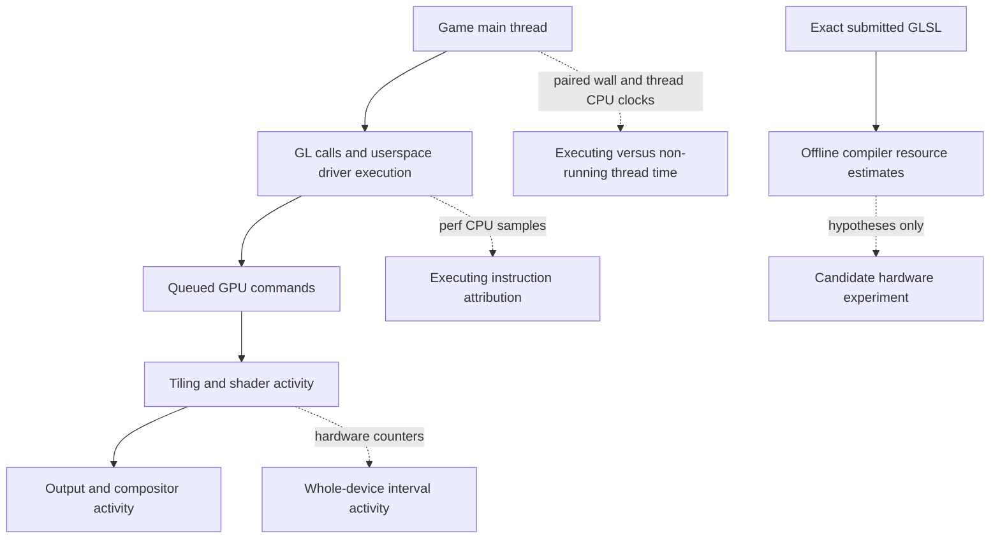
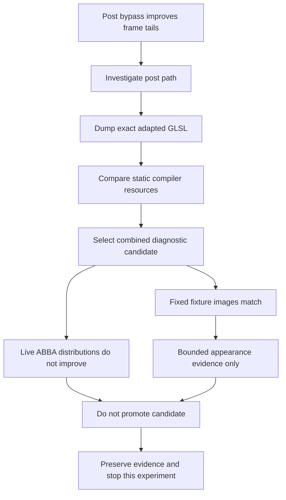
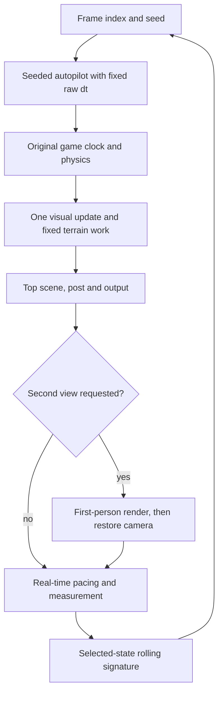
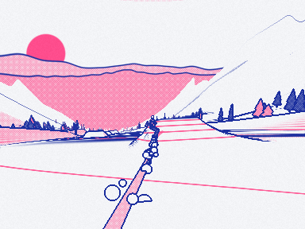
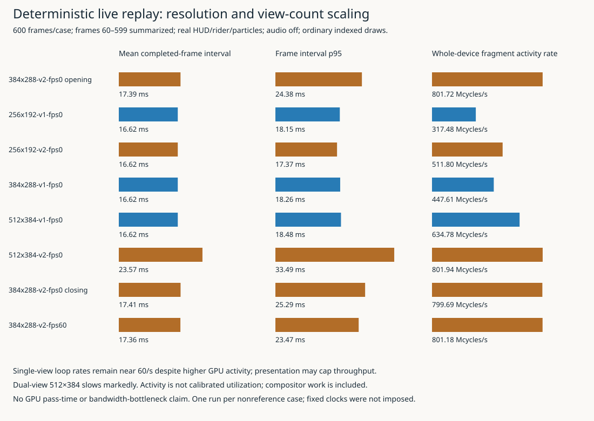
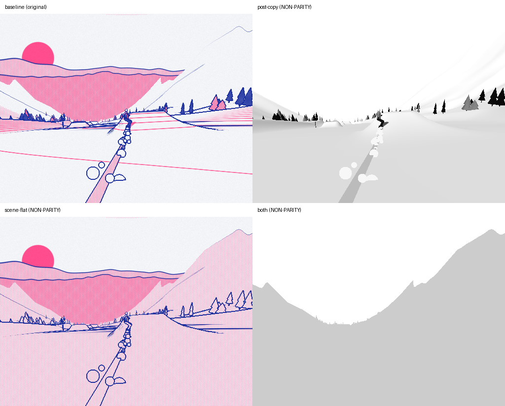

# Falllinie GPU Profiling: Hardware Counters, Shader Compilation and a Rejected Optimization

> [!summary] Latest checkpoint — repeated scene/post sensitivity
> At dual 512×384, pooled means are 23.575 ms baseline, 19.305 ms cheap post, 16.733 ms flat scene and 16.621 ms both. These deliberate non-parity substitutions preserve tracked replay state, not the final image. Combined shading reductions lower hardware activity without much further mean-time gain; no production optimization is promoted. Section 17 contains the measured follow-up.

**Reading boundary:** The original investigation below, including Sections 1–9, is preserved as a historical checkpoint. Sections 10–16 add the later CPU-to-GPU reasoning, replay design and implementation, actual scaling matrix, failures and remaining hypotheses. Section 17 records the subsequently completed scene/post experiment; earlier future-work statements remain historical. The original runtime/evidence metadata remains historical; `latest_*` identifies the current follow-up.

## What this investigation established

Falllinie's native port runs two sequential views through a shared OpenGL ES context on an RG DS Plus. Earlier measurements separated main-thread CPU execution from elapsed rendering time, and found substantial executing CPU work in the Mali userspace driver. They did not establish what the GPU was doing. The available OpenGL elapsed-query results were unsuitable for that conclusion: pass totals were nonadditive, and several startup values were physically impossible despite being marked valid by the API.

This investigation obtained a different source of evidence: actual Mali-G52 hardware counters through Arm's libGPUCounters. It then used Mali Offline Compiler on the exact adapted GLSL submitted by the application, constructed a narrowly scoped post-processing candidate, and measured that candidate on the handheld.

Three results matter. First, hardware counter access works on this device without changing the kernel, installing system packages, or replacing the production game. Second, omitting post-processing substantially improved frame-time tails, but changed the image and therefore was not a source-faithful optimization. Third, a compiler-guided rewrite preserved the captured fixed-scene image but did **not** produce a convincing live performance improvement. That candidate was not promoted.

The useful outcome is consequently not a faster released shader. It is a much better qualified measurement path, a concrete demonstration of how static compiler evidence can guide—but not decide—optimization, and a documented negative result that prevents an unsupported change from entering the canonical renderer.

The account below develops the measurement concepts before interpreting the results. All charts use recorded data or explicitly identified static compiler output. No scheduler trace, simulated hardware sample, or inferred successful optimization is presented as an observation.

> [!summary]
> Hardware counters are working, but their clock domains and denominators require explicit treatment. Static compiler reports exposed resource tradeoffs; the resulting image-matching candidate showed no convincing live speedup and was not promoted.

## 1. Begin with the execution model

A rendering function executes CPU instructions, submits commands, and may spend time not running. Submitted commands then execute through GPU stages whose work can overlap. Presentation and display composition add further activity. These are related processes, but their durations and counters do not form one interchangeable quantity.

The preceding investigation measured the same main-thread scope with a monotonic wall clock and a thread CPU clock. For one scope:

\[
T_{\mathrm{residual}}=T_{\mathrm{wall}}-T_{\mathrm{threadCPU}}.
\]

The residual estimates time in which that thread was not executing. It does not identify whether the thread was blocked on a driver dependency, ready but unscheduled, or delayed for another reason. Likewise, a CPU sample whose instruction pointer lies in `libmali` establishes execution in driver code, not GPU execution.

For context, an earlier selected top-view sample set averaged approximately 7.645 ms wall and 4.522 ms thread CPU. The selected lower view averaged 7.031 ms wall and 2.774 ms thread CPU. In a separate all-thread CPU sampling run, driver samples accounted for approximately 71.44% of the **main thread's executing CPU samples**. None of those values is a percentage of frame time spent productively shading pixels.

Hardware counters answer another class of questions: which device activities accumulated during a sampling interval, and how much associated traffic or instruction activity was counted? They do not automatically explain the CPU residual or isolate one application's draw calls. On this tile-based GPU, tiling organizes geometry by screen region, while fragment processing executes shader work for covered image samples. Their activity can overlap with other submitted work.



The earlier report, [[PROJECT REPORT - Falllinie Rendering Measurements - CPU Execution, Mali Driver Work and GPU Timer Limits]], remains the reference for those CPU and elapsed-query measurements. This report adds counter access and an actual compiler-guided experiment; it does not reinterpret questionable timer results as valid after the fact.

## 2. Identify the device and the supported interface

The handheld uses an RK3568 with Cortex-A55 CPUs and a Mali-G52. The counter library identified one shader core, revision r1p0, GPU ID `0x07040002`, shader-core mask `0x1`, and a 128-bit bus-width property. These details matter because counter availability, event definitions and derived formulas vary across Mali products.

The running kernel module reported `mali_kbase r54p2-02eac0`, with userspace/kernel interface version 11.46. The installed `libmali.so.1.10.0` had SHA-256:

```text
605e3a5caf1be62bb48d97b1168434257355d56db5e3be9b515cfa742c173118
```

An installed filename containing `g29p1` is not the kernel driver's version. The offline compiler later reported a third identity, its r51p0 compiler backend. Keeping these identities separate prevents an unjustified claim that an offline report exactly reproduces the installed userspace compiler.

The device exposed `/dev/mali0`. Arm's libGPUCounters, formerly HWCPipe, supports counter collection through the commercial Mali driver and includes Bifrost-era products. The investigation pinned upstream revision `378c7b59e2dae87cbbffb0ac9cf96ed13c939823`, preserved relevant documentation, counter definitions, formulas and licensing material, and built a separate ARM64 probe with the existing offline toolchain.

This was a direct counter-library experiment, not a Streamline installation. `gatord` was absent from the device path. `renderdoccmd` was present but was not qualified or used. No permission policy, kernel configuration, governor, affinity setting or production launcher was changed.

Those choices kept the experimental boundary clear. The question was whether the existing device and commercial driver could provide useful counter data. It was unnecessary to introduce a replacement kernel or a full remote-profiler deployment to answer that first question.

## 3. Construct a counter capture that exposes its limitations

### 3.1 A separate bounded sampler

The probe is a small C++14 program using the pinned library. It discovers the GPU, enumerates available counters, selects thirteen metrics and polls at approximately 10 Hz. Duration is bounded. It explicitly records unsupported metrics, sampling errors, nonfinite values, final row counts and successful stop status.

For each sampled metric, the CSV includes a sequence number, counter name, status, value, host request time, host completion time, backend sample timestamp and a GPU frequency snapshot. A failed sample is not represented by reusing the previous buffer. A derived ratio that is not finite is left without a numeric value and marked accordingly.

The driver advertised 240 available counters. The selected set covered GPU, core, fragment, non-fragment and tiler active cycles; external read and write bytes; and fragment, non-fragment, texture, arithmetic and external-stall ratios. This was deliberately a focused set rather than an attempt to explain every hardware event at once.

The first campaign recorded 15,600 rows: an idle capture and two longer captures surrounding normal and post-bypass gameplay. There were no collection errors and every sampler stopped successfully. There were 591 nonfinite derived-ratio rows across the complete captures, principally where little or no corresponding activity was present. None occurred inside the selected gameplay windows used for the published aggregates.

A nonfinite idle ratio is not equivalent to a missing active-cycle sample. For a formula with a zero denominator, there may simply be no meaningful percentage for that interval. Recording that fact is preferable to converting it into a false zero utilization value.

### 3.2 Activity categories are not a partition

The GPU-active counter can accumulate while queued work is pending, including periods of dependency-related inactivity within that work. It therefore does not mean that useful arithmetic is occurring on every counted cycle. Fragment, tiler and non-fragment activity can overlap. Their totals must not be added and interpreted as mutually exclusive portions of elapsed time.

Derived ratios also have different denominators. The pinned G52 definitions express fragment utilization using fragment-active cycles divided by GPU-active cycles and the shader-core count. With one core, the relevant ratio is:

\[
U_{\mathrm{fragment}}=100\frac{C_{\mathrm{fragment}}}{C_{\mathrm{GPU}}}.
\]

The G52 arithmetic ratio instead uses `MaliEngInstr / MaliCoreActiveCy`, multiplied by 100. The texture ratio uses `MaliTexFiltIssueCy / MaliCoreActiveCy`. A fragment ratio near 100%, an arithmetic ratio near 70% and a texture ratio near 13% do not describe three disjoint slices that should sum to 100%.

External read and write bytes describe the GPU's observed external traffic under these counter definitions. They are not measurements of all system DRAM traffic, nor do they identify which render pass generated each byte.

### 3.3 Clock domains prevent a direct timestamp join

The backend timestamps were approximately 1.262–1.268 seconds **ahead** of the host monotonic completion times. Subtracting the two as though they shared a clock domain would be invalid. The library has a timestamp helper that can use `CLOCK_MONOTONIC_RAW`, but that source observation alone does not establish the clock selected by this backend.

The analysis therefore did not silently subtract a fitted offset. Instead, it used adjacent host completion times to approximate each sampling interval and retained only intervals wholly within the paired-clock gameplay extent after frame 60. If consecutive completion times are \(h_{i-1}\) and \(h_i\), the interval approximation is:

\[
\Delta t_i=\frac{h_i-h_{i-1}}{10^9}.
\]

For an accumulated event count \(C_i\), the reported campaign rate is:

\[
R=\frac{\sum_i C_i}{\sum_i \Delta t_i}.
\]

This produces a useful approximate rate under a declared host-window convention. It does not make the backend and host clocks identical, and it does not support frame-exact or pass-exact attribution.

### 3.4 Work through one actual sample

The report includes the [actual counter record](./_assets/falllinie-gpu-shader-investigation/actual-counter-example.json) for sequence 20 of the first normal live capture. Its adjacent host completion interval was 100,156,942 ns, or 0.100156942 seconds. The recorded GPU-active count was 80,566,124 cycles and the fragment-active count was 80,291,828 cycles.

Under the declared host interval approximation:

\[
R_{\mathrm{GPU}}=\frac{80,566,124}{0.100156942}
\approx 804.40\text{ million cycles/s}.
\]

The fragment/GPU-active ratio was:

\[
100\frac{80,291,828}{80,566,124}\approx99.6595\%.
\]

The frequency snapshot was 800 MHz. Dividing 804.40 by 800 and reporting a calibrated GPU-busy percentage would produce an impossible-looking value above 100%. The correct response is not to clamp it. A point frequency sample, approximate host interval and backend event interval are not a calibrated time-integrated frequency measurement.

That same record's backend timestamp was 1.264146008 seconds ahead of host completion. Preserving both values makes the clock-domain problem inspectable. Reporting only a rounded utilization percentage would conceal it.

## 4. Omit post-processing to identify a promising subsystem

The first hardware-counter campaign compared normal rendering with an existing diagnostic post-bypass option. Normal rendering produces an encoded scene buffer, then applies the source print-style post shader before output. Bypass omits that post pass and presents the raw encoded scene instead.

This is an intentionally non-parity experiment. It removes work and changes the image. Its purpose is to determine whether the post path is worth investigating, not to propose bypass as a release setting.

The workload used two sequential views, 384×288 internal rendering, no-vsync, a 60-FPS application target, autoplay, the overlay and buffered source DSP. Audio output was muted, but source vinyl synthesis remained enabled in the workload. The production game and launcher were untouched. The same qualified game binary was used throughout, with GPU elapsed queries disabled and paired clocks sampled at cadence 60.

Two no-counter normal runs bracketed the instrumented comparisons. They help expose gross drift or observer effects, but do not prove zero counter overhead. The clocks and trajectories were not controlled experimentally.

| Recorded metric | Normal live | Diagnostic post bypass |
|---|---:|---:|
| Mean frame interval | 18.171 ms | 16.666 ms |
| p95 frame interval | 32.754 ms | 16.818 ms |
| p99 frame interval | 34.095 ms | 17.392 ms |
| GPU-active rate | 803.27 Mcycles/s | 788.42 Mcycles/s |
| Fragment-active rate | 798.42 Mcycles/s | 704.93 Mcycles/s |
| External reads | 1431.82 MB/s | 1528.29 MB/s |
| External writes | 747.53 MB/s | 570.46 MB/s |
| Fragment/GPU-active ratio | 99.40% | 89.41% |
| Mean arithmetic ratio | 70.66% | 64.62% |
| Mean texture ratio | 13.12% | 7.89% |

MB/s here uses decimal millions of bytes per second. These are whole-device interval observations, including possible compositor work, not counters attributed exclusively to Falllinie.


*The two sampled gameplay windows use the declared host-poll interval convention. Activity rates, traffic rates and derived ratios have different meanings and denominators.*


*Removing post-processing improved this finite experiment's frame tails. It also changed the output and workload, so this is not a source-faithful optimization result.*

The interesting observation is not merely that one mean decreased. The normal run had a substantial tail around 33 ms; bypass brought the p95 close to the 16.667 ms application target. Fragment activity and external writes decreased, while external reads increased. That last change is important: removing a pass does not guarantee every whole-device rate declines. Scheduling, output behavior, image contents and live trajectories can all affect the result.

The no-counter baseline means were 18.034 and 18.295 ms. The instrumented normal mean lies between them. That is consistent with the counter run not causing an obvious large slowdown, but it does not resolve small overheads. The probe's own sample-call wall time was approximately 0.18 ms per 100 ms in the live case; that is not a measurement of the total observer effect.

The supported conclusion is narrow but useful: the post-processing path merits closer examination. The data does not identify the shader's isolated execution time, establish that a particular texture fetch causes the tail, or show that changing only shader arithmetic will recover the bypass result.

## 5. Analyze the shader that the renderer actually submits

### 5.1 The asset file is not the final compiler input

Falllinie's post shader has several responsibilities. It reads encoded scene color and depth, renders a procedural sky for background pixels, detects depth/material edges for scene pixels, and converts tonal values into the source's print-style output. On the non-sky path, the source includes ten color/depth reads in total. On the sky path, it reconstructs direction and evaluates the mountain/sky contour logic.

The native renderer adapts the asset before compilation. Relevant adaptations include an explicit high-precision depth sampler, stable wrapped sky hashing through a 170-entry uniform array, and the established camera-relative projection handling. Compiling only `assets/shaders/post_fs.glsl` would miss part of the actual workload.

To avoid that discrepancy, a small diagnostic was added at the `glShaderSource` boundary. When `FALLLINIE_SHADER_DUMP_DIR` is explicitly set, the renderer writes the exact submitted source bytes before passing them to GL. With the variable absent, no files are written and there is no per-frame diagnostic work.

One host fixture frame collected all eight submitted shader sources: vertex and fragment inputs for the scene, print pass, presentation diagnostic and native HUD. The purpose was input acquisition, not host performance measurement. Hashes identify the exact inputs used by the offline compiler.

The dump is a useful development feature because it makes source provenance explicit. It does not capture installed-driver machine code, link-time specialization or the whole application state. Those remain outside the claim.

### 5.2 Acquire and qualify the actual compiler

Arm currently distributed the compiler inside the Performance Studio archive used here. The Linux x86-64 2026.5 archive was downloaded from Arm's official artifact host, its published SHA-256 was verified, and only the compiler subtree was extracted into ignored local storage. No system installation was performed.

The executable reported **Mali Offline Compiler 2026.5.0, build 922df8**. Reports targeted **Mali-G52 r1p0**, Bifrost, OpenGL ES, with compiler backend **r51p0-00rel0**. The archive SHA-256 was:

```text
f9a776cdabdeb56a228c1d2f153eac6067a38a55d7330d6ac8de84824bcd6c3f
```

A representative command was:

```sh
malioc --core Mali-G52 --opengles inputs/runtime/3.frag
```

Text and JSON reports were retained. The actual compiler execution is a change from the preceding research checkpoint, when the compiler had only been proposed and a product-page extraction had failed.

### 5.3 Interpret the baseline report correctly

Work registers hold temporary values for shader execution. Allocating more of them per invocation can reduce how much shader work can be resident concurrently; the compiler expresses that resource constraint through its estimated occupancy. Uniform registers hold uniform values rather than per-invocation temporaries. Stack use can indicate additional storage needs, but no such use was reported for these candidates.

The baseline post shader reported 32 work registers, 126 uniform registers, no stack use and 0% 16-bit arithmetic. Its estimated occupancy was 100%. The reported total pipeline estimates were A=10.63, LS=8.00, V=0.00 and T=3.50, with arithmetic identified as the bound pipeline.

A denotes arithmetic, LS load/store, V varying and T texture. These are static compiler estimates for hardware pipeline work, not milliseconds measured on the handheld. They are not four serial durations to add into one shader latency. The total estimate can also include work from mutually exclusive branches, so it need not equal a particular shortest or longest execution path. Branch coverage, execution dependencies, resource contention and actual driver code generation remain relevant.

The reported longest path was A=9.13, LS=8.00, T=0.50; the shortest path was A=3.53, LS=0.00, T=3.50. The scene fragment shader was also estimated arithmetic-bound. Neither statement proves that arithmetic is the only runtime constraint.

Two practical conclusions follow. There was no baseline spill problem in this report to solve by reflexively reducing precision. And merely counting texture calls in the source was insufficient: the compiler's resource and path information had to be considered alongside the measured workload.

Estimated occupancy is a resource-based capacity statement. It is not a measurement that all possible shader work was resident or productively executing throughout the frame. A register allocation that reduces estimated occupancy can still be useful in some workloads, but it should not be mistaken for a free transformation.

## 6. Construct three small variants, then choose one hardware candidate

The investigation kept the canonical shader unchanged and generated diagnostic asset folders under the performance ticket. Each variant preserved the source's arithmetic expressions in the paths where they contributed, rather than changing rendering precision or replacing its visual formulas.

### 6.1 Move the unused sky color fetch

The original main function samples both depth and scene color before deciding whether the pixel is sky:

```glsl
float d=texture(uD,uv).r;
vec4 s=texture(uC,uv);
if(d>=0.99999){
    // Sky path does not use s.
}else{
    float lum=s.r;
    // Scene-pixel processing.
}
```

The lazy-color variant moves the color fetch into the non-sky branch. At source level, this appears to remove unnecessary work for sky pixels. That observation does not determine the resulting instruction schedule or allocation.

The compiler estimate became worse in relevant respects: total arithmetic rose from 10.63 to 10.75 and total texture estimate from 3.50 to 5.00. Work registers remained 32. The source edit therefore could not be accepted on the argument that one visibly unused sample had moved.

The lesson is specific: source-level operation placement is an input to compilation, not a reliable measurement of compiled cost.

### 6.2 Skip edge-neighborhood work after full fog

The original non-sky path computes a depth/material edge and multiplies it by:

```glsl
1.-smoothstep(uFogP.x,uFogP.y,zc)
```

For valid finite depth and the normal ordered fog endpoints, that multiplier is zero at or beyond `uFogP.y`. The fog-skip variant initializes the edge to zero and evaluates the unchanged neighborhood expressions only when the center depth is below the full-fog endpoint:

```glsl
float zc=lin(d);
float edge=0.;
if(zc<uFogP.y){
    // Original neighboring samples and edge formulas.
    edge*=1.-smoothstep(uFogP.x,uFogP.y,zc);
}
black=max(black,edge);
```

This removes work that contributes zero in that region. It does not change the near-path thresholds, edge equations, depth linearization, fog constants or sky sequence. The reasoning assumes the renderer's actual depth and sampler setup, not arbitrary invalid uniforms or mipmapped sampling configurations.

The isolated fog-skip report reduced the shortest arithmetic path to 2.67, but work registers rose to 60 and estimated occupancy fell to 50%. That is exactly the kind of tradeoff a source-only review can miss.

### 6.3 Combine them and inspect the complete result

Combining lazy color with fog skipping restored 32 work registers and 100% estimated occupancy. Its shortest arithmetic estimate was 2.70. Total arithmetic was slightly higher than baseline at 10.80, while total texture estimate was lower at 3.00. All four versions reported no stack use.

| Variant | Work registers | Estimated occupancy | Total A | Total T | Shortest A |
|---|---:|---:|---:|---:|---:|
| Baseline | 32 | 100% | 10.63 | 3.50 | 3.53 |
| Lazy color | 32 | 100% | 10.75 | 5.00 | 3.67 |
| Fog skip | 60 | 50% | 10.67 | 2.50 | 2.67 |
| Combined | 32 | 100% | 10.80 | 3.00 | 2.70 |


*The compiler helped select a complete candidate rather than predict a guaranteed speedup. The combined longest path remained close to baseline, and actual path coverage was not measured.*

This result justified trying the combined candidate, not shipping it. It avoided the conspicuous occupancy loss of fog-skip alone and retained a potentially cheaper path. Whether enough pixels took that path, and whether its cost affected the live frame distribution, remained empirical questions.

## 7. Run the complete candidate on the handheld

### 7.1 Hold the executable fixed

The hardware experiment used the existing qualified game binary with SHA-256:

```text
2872ede7219ccd91890de4c0d47d5af8fab687f2b5b2cf9605e25ecb1dfcb1d2
```

That binary came from runtime revision `209a6d0`. The newly added source-dump hook was used for host input acquisition; it was not a new device runtime introduced into the timing comparison. Only the selected post-shader asset differed between baseline and candidate. The original font and number atlases were shared unchanged.

The first private deployment exposed a packaging dependency: the renderer resolves `../hud-font.bmp` and `../glyphs.bmp` relative to the shader directory. Copying only the GLSL directory caused initialization to fail with `fatal: missing source HUD font atlas`, after the shader programs had already linked. The failure log was retained. Adding the original shared assets fixed the package; it was not a shader compiler failure.

This distinction belongs in the report because it preserves the actual debugging sequence. The initial attempt did not produce a valid timing case and was not mixed into the successful campaign.

### 7.2 Establish one bounded image result

The baseline and candidate were captured on the device with the same frozen, seven-cell, seed-42 fixture at 384×288. Seven cells were selected to include farther terrain rather than only a short near region. The captured encoded scene, depth and final print BMP files were byte-identical.

The final print BMP's SHA-256 was identical in both cases:

```text
360a0b856157478e030a43a8c8c264bdb2300273c471c3efe0799c6635d809e8
```

A decoded RGB comparison also found zero changed pixels. The report carries lossless PNG versions of both final captures: [baseline](./_assets/falllinie-gpu-shader-investigation/fixture-baseline.png) and [combined](./_assets/falllinie-gpu-shader-investigation/fixture-combined.png).


*This is the actual bounded static fixture, not a live gameplay capture. Equality here does not prove universal parity across all geometry, camera positions or driver optimizations.*

The mathematical argument for skipping a zero-contributing edge and the matching image result support the candidate's intent. They do not remove floating-point code-generation concerns for every possible scene. Compiler scheduling can change even when visible formulas remain unchanged.

### 7.3 Use a baseline/candidate/candidate/baseline sequence

The live sequence contained four 30-second cases, each surrounded by a 45-second counter capture. The order was baseline, combined, combined, baseline. The closing baseline helps expose temporal drift; the two candidate cases prevent the conclusion from depending on one favorable sample.

The campaign retained 6,308 postwarmup frames: 3,156 baseline and 3,152 candidate. Every sampler produced 450 sequences with thirteen metric rows, for 23,400 rows across the four runs. Collection errors were zero, sampler stops succeeded, paired-clock counts reconciled, and selected central counter windows contained no nonfinite rows.

All four game runs reported `GL_error=0`. Audio callback over-budget counts, starvation and missing frames were zero. These are finite-run health observations, not a physical audio-latency or backend-XRUN qualification.

| Live case | Frames after warmup | Mean ms | p95 ms | p99 ms |
|---|---:|---:|---:|---:|
| Baseline 01 | 1,581 | 18.217710 | 32.837417 | 33.893343 |
| Combined 02 | 1,576 | 18.306310 | 33.054196 | 34.086162 |
| Combined 03 | 1,576 | 18.327795 | 33.111946 | 34.087039 |
| Baseline 04 | 1,575 | 18.307947 | 33.077488 | 34.046289 |

These statistics use the CSV `interval_ms` values for `frame >= 60`; percentiles are linearly interpolated between adjacent sorted observations. They are recomputed from the raw records rather than copied from the application's rounded summary line.

The pooled baseline mean was **18.262742 ms**. The pooled candidate mean was **18.317052 ms**. The descriptive difference is +0.054310 ms, approximately 0.30%, in the slower direction.

That small difference is not a proven regression under uncontrolled sequential live conditions. The opening and closing baselines themselves differ. It is, however, clearly insufficient evidence for a speedup. The candidate did not remove the approximately 33 ms frame tail observed in the baseline.


*The curves are generated from recorded postwarmup intervals, not from compiler predictions. They show no compelling distributional improvement for the combined candidate.*

Hardware rates were similarly close. GPU-active rates were approximately 805.55, 804.11, 803.66 and 803.25 Mcycles/s in run order. Fragment-active rates were 801.04, 799.29, 798.65 and 798.50 Mcycles/s. These remain approximate host-window activity rates, not calibrated busy percentages.

External reads were approximately 1433.27, 1419.75, 1419.22 and 1422.13 MB/s; writes were 747.69, 741.46, 740.61 and 743.02 MB/s. The candidate values are not radically different from the closing baseline. No per-pass attribution follows from those whole-device values.

### 7.4 Make the decision supported by the experiment

The candidate remains diagnostic-only. The canonical shader is unchanged. The correct conclusion is **no convincing benefit in this finite workload**, not “the compiler was wrong” and not “the shader is universally slower.”

Several explanations remain possible. The cheaper path may cover too few pixels. Its saved work may not constrain this workload. Other shader paths, driver submission or output dependencies may dominate the observed tail. The installed driver may generate code different from the offline backend. This experiment did not measure path coverage or identify which explanation is causal.

The result also does not contradict the earlier bypass improvement. Bypass removes the entire post pass and changes the output. The candidate skips a limited zero-contributing region while retaining the overall pass, targets, output path and most shader work. Those are different interventions.

## 8. What the combined evidence permits us to say

The investigation now has three independent but complementary forms of evidence. Paired clocks and CPU samples identify substantial executing driver work and non-running render-scope time. Hardware counters establish substantial fragment-related device activity under the measured workload. The offline compiler identifies static shader resource tradeoffs and arithmetic-heavy paths.

These observations make rendering a justified optimization target. They do not collapse into a proof that one particular shader instruction, synchronization point or cache transaction is the bottleneck. A stronger causal experiment would change one relevant behavior and observe a reproducible improvement under a sufficiently comparable workload.

This session performed exactly such a bounded attempt and did not obtain that improvement. Keeping the result is valuable: future work can start from the measured failure rather than repeat a plausible-looking source rewrite and assume it worked.



Several questions remain open for a future session: actual branch coverage, more specific queue/dependency counters, calibration of counter and host timing, and CPU-side submission reductions such as uniform-location caching. None of those was implemented merely to continue searching after the null result. No additional experiment is implied by this report's publication.

## 9. Reproduction, provenance and the stopping point

The native evidence checkpoint for this report is `70c164a18ee10a6c321c767ea00e64e3faa8dc7e`. Earlier commits introduced the direct counter probe (`7b22f7d`), the first counter campaign (`b509c1b`) and the exact-input compiler/variant tooling (`837bb32`). The measured runtime stayed at `209a6d0`.

The native ticket is:

```text
ttmp/2026/10/13/FALLLINIE-PERF-004--gl-pass-measurement-and-evidence-driven-native-optimization
```

Within it, `scripts/03-mali-counters/` contains the pinned-library acquisition/build helpers, probe, bounded target runner, first campaign and analysis. `scripts/04-shader-analysis/` contains the compiler acquisition receipt, exact shader dumps, variant generator, all text/JSON compiler reports, the fixed captures, the successful ABBA campaign and its analyzer. The complete campaigns are `target-20261014T024712Z` and `target-20261014T032113Z`; the failed asset deployment is retained separately as `target-20261014T031958Z`.

The chronological reasoning is in `reference/04-mali-counter-investigation-diary.md` and `reference/05-post-shader-compiler-and-experiment-diary.md`. Those diaries record the authored requests, source decisions, exact failures, recovery, limitations and rejection decision. This report is the explanatory synthesis, not a replacement for those records.

The vault keeps a self-contained subset alongside the article:

- [Hardware campaign summary](./_assets/falllinie-gpu-shader-investigation/hardware-summary.json) and [input provenance](./_assets/falllinie-gpu-shader-investigation/hardware-provenance.json).
- [Shader experiment summary](./_assets/falllinie-gpu-shader-investigation/shader-summary.json) and [input provenance](./_assets/falllinie-gpu-shader-investigation/shader-provenance.json).
- The actual worked counter record, four reproducible figures, two lossless fixture images and [report asset hashes](./_assets/falllinie-gpu-shader-investigation/report-provenance.json).

Primary external references are Arm's [libGPUCounters repository](https://github.com/ARM-software/libGPUCounters), the [pinned G52 counter reference](https://github.com/ARM-software/libGPUCounters/blob/378c7b59e2dae87cbbffb0ac9cf96ed13c939823/docs/mali-g52_counter_reference.html), the pinned source's G52 counter mapping and derived functions, Arm's [Mali Offline Compiler page](https://developer.arm.com/tools-and-software/mali-offline-compiler), and the [official archive actually used](https://artifacts.tools.arm.com/arm-performance-studio/2026.5/Arm_Performance_Studio_2026.5_linux_x86-64.tgz). Useful local copies and checksums are preserved under the ticket's `sources/` directory.

The experiment ends with working hardware-counter tooling, actual G52 compiler reports, an image-matching but unhelpful candidate, and no canonical shader change. That is the documented stopping point. Publication concludes the night's work; the unresolved questions remain explicitly unresolved.


## 10. Follow-up: why the next experiment controlled the workload

The next useful step was not another shader rewrite. It was to make different rendering configurations consume the same sequence of game states. The initial shader experiment had used live autoplay driven by elapsed wall time. A configuration that rendered more slowly could therefore advance the autopilot, physics and camera differently, changing the workload while its performance was being compared.

The intervening CPU investigation sharpened this concern. Actual A55 event profiles and verified driver disassembly identified an unsigned minimum/maximum scan. Supplying legal vertex bounds through the opt-in `glDrawRangeElements` path removed that helper from observed samples and reduced the sum of selected sequential view CPU means from about 7.012 to 5.889 ms. It did not demonstrate an end-to-end frame-time improvement: pooled ordinary/range means were 18.071014/18.224560 ms, and the closing ordinary run drifted faster. Higher candidate RSS also remained unexplained. The complete evidence and interpretation are in [[PROJECT REPORT - Falllinie CPU PMU - Cache Events, Driver Cycles and an Audio-Disabled Baseline|the living CPU PMU report]].

Those results distinguish three outcomes. The shader candidate had no convincing measured benefit. Range draws reduced a specific CPU cost but did not establish a frame-time benefit. Neither result proved that the hardware had reached an absolute limit. Together they justified a controlled test of how GPU-related demand and complete-frame timing respond to internal pixel count and a second view.

The new work is ticket **FALLLINIE-GPU-006**, implemented in `32b8bfd` and measured in checkpoint `6c5b231`. It is a diagnostic benchmark, not a new production renderer. The matrix deliberately keeps ordinary indexed draws, the existing shaders and post-processing unchanged so that range hints do not become an additional experimental variable.

### 10.1 Separate the two meanings of time

A benchmark needs real wall time to measure performance. It does not need to use that same wall time to decide how far the game advances. In `--benchmark-replay`, every rendered frame supplies exactly `1.0 / 60.0` seconds to the existing seeded autopilot and native frame clock. The frame clock retains the game's original scaling logic and 120 Hz physics accumulator. A slow configuration takes longer in real time to render the same input-update sequence; it does not skip ahead to different scenery merely because rendering took longer.

Six hundred frames therefore provide ten seconds of **raw frame-clock input**. This should not be confused with a promise of exactly 1,200 physics ticks or ten unscaled seconds of every internal game clock: the original game time-scale behavior remains in the path. The workload is a generated-input replay for one seed, not a recording of human input or a claim of cross-platform bitwise simulation identity.

The main thread advances the game and visual state once. It then renders the top view and, if requested, the first-person view. The second view temporarily replaces camera/render state and restores it afterward; it does not perform a second simulation update. This invariant allows view count to change rendering work without deliberately changing the next frame's game state.



The pseudocode below describes the implemented sequence, with instrumentation detail omitted:

```cpp
for each frame until the positive frame limit:
    poll events; retain quit, ignore physical gameplay mutations
    raw_dt = 1.0 / 60.0
    controls = seeded_autopilot.read(game, raw_dt)
    frame_clock.advance(game, controls, raw_dt)
    renderer.update_player(game, raw_dt)  // once, not once per view
    publish_feedback(audio_not_started, game)  // still drains events
    render_top()
    if dual_view: render_first_person_and_restore_state()
    apply_requested_real_time_pacing()
    record_actual_wall_and_thread_CPU_measurements()
    extend_selected_state_signature()
```

The explicit FPS cap and fixed simulation input are independent controls. `--fps 0` removes application sleeping; `--fps 60` requests pacing. Neither changes the replay's input progression. Real measurement clocks are never replaced by simulated timestamps.

### 10.2 Fixing dt is insufficient when streaming is time-budgeted

Production terrain generation calls `TerrainJob::step(3.5)`. That budget is checked between existing sampling and mesh-emission rows. Different CPU speeds or scheduling interruptions can finish different numbers of rows in 3.5 ms, causing a cell to become renderable on different frames even when the rider follows the same path.

The replay uses the same job state machine but supplies a maximum of **32 work units** per frame. A unit is one existing sampling row or one existing emission row; it is not necessarily a completed strip of triangles. The extended interface is:

```cpp
bool TerrainJob::step(double budget_ms, unsigned max_work_units = 0);
// Production:
job.step(3.5);
// Replay:
job.step(3.5, 32);  // work-unit limit replaces wall-budget termination
```

Row order, numerical formulas, neighboring samples for normals and index ordering remain unchanged. Completed terrain is still uploaded on the main thread, and the existing object-cell construction and residency policy remain in place. Fixed-work validation compares both one-unit and 32-unit progression against synchronous generation; vertex bytes and indices match.

This design is preferable here to generating an enormous world in advance, synchronously completing every new cell, or creating a new terrain implementation. It keeps one numerical algorithm and makes progress per frame reproducible. It is nevertheless a deliberate difference from production scheduling and belongs in every benchmark receipt.

### 10.3 Remove external inputs without inventing a second game

Replay forces play/autoplay and disables active audio. It does not open the audio device or start its synthesis worker/callback. Inert audio storage still exists, and the normal feedback-publication path drains game events even when audio is not started; otherwise the benchmark would change event lifetime or accumulate unbounded pending events.

Persistent best-score loading and writing are skipped. Physical gameplay controls, focus-driven pause, palette/debug mutations and developer-overlay timing text cannot perturb the workload. Quit remains available. Positive frame count is required; wall-duration limits and incompatible freeze/resize/overlay/post-bypass modes are rejected. The real rider, particles, trails, HUD, streaming and camera paths remain active.

These controls explain why the older frozen fixture is not a substitute. Static terrain excludes much of that live rendering, and its lower window duplicates the top camera. It remains useful for narrow image checks, but it does not represent the same workload as this replay.

## 11. Establish what is repeatable—and what is not proven

The implementation extends a rolling 64-bit fingerprint with explicitly ordered scalar text at 17-digit precision: frame number, seed/generation, game time/score, position and velocity, camera eye/look, and terrain vertex/index counts. It does not hash object padding, pointers, process identifiers, resolution or real clocks. The receipt stores the resulting value as a string rather than an imprecise JavaScript-sized integer.

All eight device runs report the same signature, **6081555844518115723**. That checks the selected state across the entire 600-frame sequence. It does not cover every particle field, every mesh byte or every GPU command, and a noncryptographic hash is not a collision-free proof. The separate host check used 120 frames and produced a different signature, **13752613737572218072**, matching between a single-view uncapped case and a dual-view paced case. These different-length/platform tests must not be compared as though their final hashes should agree.

The device analyzer additionally compares final encoded scene, depth and print BMP bytes among cases with the same internal resolution. All comparisons pass, including the single/dual and paced/unpaced 384×288 cases. Images across different resolutions are not expected to match. Endpoint equality supplements the fingerprint; it does not establish every-frame visual equivalence or universal source parity. Source review also bounds what was captured: after the measured loop, instrumentation is detached and the final top-camera state is redrawn. `Renderer::capture` reads the internal scene and print framebuffers and produces a depth diagnostic image. It does not capture the final full-size HUD/compositor surface or physical scanout.

Here are actual final print captures from the replay, rather than the earlier terrain-only shader fixture:





*Each image is a lossless conversion of the internal print-target BMP, before final full-size HUD/output composition. Resolution differs intentionally. The same-resolution equality checks use original BMP bytes, not resized screenshots or physical display captures.*

Host and ARM builds and all 15 CPU tests passed at the implementation boundary. The actual device campaign then supplied the graphics/measurement gate: eight successful game/probe cases, 4,800 total frames, 4,320 postwarmup intervals, 1,330 reconciled paired records, `GL_error=0` and successful placement throughout. Dropped, invalid and still-active paired-record counts are zero. The sampler produced 46,800 rows with zero collection errors or nonfinite values in this campaign. Earlier idle nonfinite ratios remain valid historical observations; this newer result does not erase them.

The receipt's dedicated `benchmark_replay`, `replay_signature`, `replay_step_seconds` and `replay_work_units` fields identify the new mode. Its older nested fixture label remains `live-or-default`, so a consumer must not infer replay qualification from that legacy label alone.

## 12. Measure resolution and view-count scaling

The campaign uses three 4:3 internal sizes: 256×192, 384×288 and 512×384. Each runs with one and two views. An opening/closing 384×288 dual-view reference brackets the six combinations, and a final paced version of that reference checks behavior with an explicit 60-FPS target. Every case renders 600 frames; the first 60 are excluded from frame distributions. Each case is accompanied by a bounded 45-second counter capture, with only the qualified active host intervals used for rates.

Internal targets are not the display surfaces. Scene and post-processing operate at the chosen internal size, while output and HUD still use full-size compositor surfaces. Reducing internal resolution therefore leaves significant work unchanged. Rendering only one game window also does not power down the second display or eliminate all compositor activity.

| Case | Size | Views | FPS cap | Mean ms | p95 ms | Loop frames/s |
|---|---|---:|---:|---:|---:|---:|
| Opening reference | 384×288 | 2 | 0 | 17.3886 | 24.3771 | 57.51 |
| Small single | 256×192 | 1 | 0 | 16.6211 | 18.1520 | 60.16 |
| Small dual | 256×192 | 2 | 0 | 16.6202 | 17.3690 | 60.17 |
| Middle single | 384×288 | 1 | 0 | 16.6182 | 18.2585 | 60.17 |
| Large single | 512×384 | 1 | 0 | 16.6221 | 18.4810 | 60.16 |
| Large dual | 512×384 | 2 | 0 | 23.5738 | 33.4894 | 42.42 |
| Closing reference | 384×288 | 2 | 0 | 17.4077 | 25.2859 | 57.45 |
| Paced reference | 384×288 | 2 | 60 | 17.3567 | 23.4675 | 57.61 |

Loop rate is `1000 / mean_interval_ms`, not physical presentation rate or scanout FPS. The opening and closing reference means differ by approximately **0.110%**; their p95 values differ by about **0.91 ms**. That bracket gives useful context for the much larger high-resolution slowdown but does not establish confidence intervals. Each nonreference configuration has one run, for one seed and one short input trajectory.

The average of the two 384×288 dual reference means is about 17.3982 ms. At 512×384, internal pixel count is 1.778 times larger and mean interval is about **35.5% higher**, at 23.5738 ms. The p95 is 33.4894 ms. At 256×192, dual-view mean is 16.6202 ms and p95 is 17.3690 ms. This is strong descriptive evidence that internal pixel workload matters in dual-view rendering. It does not identify a specific arithmetic operation, texture access or render-target dependency as the cause.

The paced reference remains close to the unpaced middle-resolution references. Requesting 60 FPS cannot make a configuration complete work faster than its limiting path. Conversely, means near 16.62 ms and loop rates slightly above 60/s do not establish precise physical refresh timing or sustained deadline compliance.



*The chart is generated from the actual eight-case summary. Audio is disabled and ordinary indexed draws are used throughout. No elapsed-query GPU pass times are used.*

## 13. Interpret hardware activity alongside frame timing

| Case | GPU active Mcycles/s | Fragment active Mcycles/s | External reads MB/s | External writes MB/s |
|---|---:|---:|---:|---:|
| Opening reference | 804.56 | 801.72 | 1498.58 | 770.00 |
| Small single | 457.25 | 317.48 | 873.30 | 531.00 |
| Small dual | 652.47 | 511.80 | 1385.05 | 685.85 |
| Middle single | 593.25 | 447.61 | 947.99 | 594.00 |
| Large single | 745.46 | 634.78 | 1042.53 | 660.37 |
| Large dual | 804.67 | 801.94 | 1159.59 | 652.11 |
| Closing reference | 803.69 | 799.69 | 1494.78 | 768.34 |
| Paced reference | 804.47 | 801.18 | 1502.56 | 771.70 |

These are approximate whole-device rates over contained adjacent host-poll intervals. MB/s uses decimal millions of bytes per second. The counter window is narrower than all 540 postwarmup frame intervals: paired scopes are sampled through frame 540, whereas the frame table continues through frame 599. Across the eight cases, 674 selected intervals cover approximately 7.8–11.2 seconds per case. The analysis deliberately does not divide these rates by the full-frame loop-rate denominator and call the result exact events per application frame.

### 13.1 Flat frame timing does not mean flat GPU demand

The single-view configurations all average about 16.62 ms despite a fourfold increase in internal pixel count between 256×192 and 512×384. Fragment activity rises from **317.48 to 634.78 Mcycles/s**, approximately doubling; GPU-active rate rises from **457.25 to 745.46 Mcycles/s**. External traffic also increases. Frame timing alone would conceal that change in device demand.

The combination is consistent with a presentation-related throughput constraint in lighter configurations. Application sleeping is disabled, but output may still be synchronized or throttled elsewhere. The data does not identify the exact compositor, driver or scheduling mechanism. It also does not prove how fast an offscreen-only workload would run. A future presentation experiment would need its own explicit contract rather than silently changing display policy.

### 13.2 Similar activity rates can accompany lower throughput

Dual-view fragment activity is near 800 Mcycles/s at both 384×288 and 512×384 while completed-frame throughput falls from roughly 57.5/s to 42.4/s. This is consistent with increased work per completed frame under a rendering-capacity constraint. It is not a calibrated claim that the GPU is 100% productively busy: active counters can include pending/stalled work, and the measured GPU-active rates slightly exceed the 800 MHz point snapshots.

The slower large-dual case has lower external byte rates per second than the middle-dual references. That does not demonstrate less traffic per frame. Fewer frames complete per second, the counter and frame-summary windows differ, and compositor traffic remains mixed in. These data support investigating pixel-dependent work; they do not establish memory bandwidth as the bottleneck.

### 13.3 The clock mismatch changed across campaigns

The earlier backend-minus-host offsets were about 1.262–1.268 seconds. In the replay campaign the retained values span approximately **1.639–1.652 seconds**. A historical constant offset would therefore be inappropriate even as an unexamined convenience. No offset fit or exact timestamp join is used in either analysis.

This observation still does not identify the backend clock source or prove the cause of the changing offset. It strengthens the practical requirement to preserve both timestamps and state the host-window approximation, rather than publish frame-exact counter attribution that the measurement path cannot support.

### 13.4 CPU scopes show where elapsed time appears, not why it occurs

For single-view cases, selected top-view CPU means remain around 3.81–3.96 ms. Top-output wall means rise from 9.76 to 11.88 ms across the resolution range, while that output scope executes for only about 0.92–1.03 ms of thread CPU. Substantial elapsed time is not spent executing on that thread, but paired clocks cannot separate blocked time from runnable-but-unscheduled time or name a particular fence.

At 256×192 dual view, top-output wall time is approximately 0.978 ms and lower-output wall time is 8.122 ms. Where the later work becomes visible changes with the sequential output path. Assigning either number as the isolated computation cost of the output function would be misleading. The same reasoning explains why earlier CPU savings can be followed by more elapsed time in a later scope without proving a regression in that later function.

There are only nine postwarmup samples per relevant scope/view in this matrix. Their means are supporting observations, not continuous traces. Parent view scopes contain scene/post/output scopes; adding both parent and children would double-count execution.

## 14. Preserve the operational failures and the limits of the result

The diary records an initial SSH authentication failure before any deployment or target workload. The helper expected a command-scoped credential environment that had not been supplied. Later inspection recovered the prior setup; this was not an unavailable hardware interface or evidence that a credential manager was required. At the user's request, the standard Ed25519 public key was installed, existing authorized keys were preserved, and login was verified with password and askpass authentication disabled. The runner now uses explicit identity, batch mode, strict known-host checking and a connection timeout. No credential value or private key belongs in the report assets.

A build-provenance check initially passed absolute source paths into `git show revision:path`, which requires repository-relative paths. The corrected helper verifies all 31 captured source hashes against implementation commit `32b8bfd`. Compilation preceded the commit, so the original pre-commit revision receipt is retained rather than rewritten. Deployment verifies the executable hash independently. These are separate statements about source identity and binary identity, not interchangeable evidence.

The driver also emits the nonfatal startup diagnostic `Could not open module param file '/sys/module/bifrost_kbase/parameters/large_page_conf'`. Game and sampler completion remain successful; no kernel/module change was made to suppress the warning. Documentation validation subsequently found missing frontmatter in the tooling README and historical blocker note. Adding metadata resolved those errors; two conventional-filename warnings remain. A check expecting a literal all-clear banner was corrected to distinguish errors from these known warnings. Neither documentation issue invalidated a target capture or required another hardware run.

The detailed diary also corrects a prompt-attribution mistake: wording reconstructed from a compacted summary had been labeled verbatim. It is now explicitly a summary. That correction matters for the accuracy of the development record but does not change the measurement files.

Selected GPU-frequency snapshots are 800 MHz. Before/after temperatures span roughly 50.6–53.1°C; CPU-frequency snapshots include 816, 1104 and 1992 MHz. After snapshots occur after the 45-second probe finishes, not immediately at game exit. These observations cannot reconstruct transient clock or thermal behavior. No governor, affinity, driver, kernel or production-launcher changes were introduced by the benchmark.

The remaining evidence limits are substantive:

- The replay is one generated-input trajectory, with fixed streaming work and audio disabled. It is not integrated audio-enabled acceptance or exhaustive gameplay coverage.
- The signature covers selected fields, and images cover bounded endpoints. Neither proves universal visual or cross-platform numerical parity.
- Hardware counters include compositor/background work, use an approximate host interval, and retain unresolved clock-domain semantics.
- Observer overhead was not separately qualified for this matrix. Common instrumentation across cases does not make its overhead zero.
- No scheduler trace, trustworthy elapsed-query pass timing or calibrated productive-GPU-busy percentage has appeared as a result of this work.
- Lower resolution changes output quality. Its improved timing is a sensitivity result, not an accepted same-image optimization.

## 15. Update the hypothesis map without promoting proposals into results

The early design contained more ideas than were implemented. Reading it alongside the diary prevents those source-level opportunities from becoming retrospective claims of optimization. The current state is:

| Mechanism or question | Evidence so far | Current decision |
|---|---|---|
| Entire post path | Non-parity bypass improved tails; exact-input compiler tools work. | Worth investigating, but bypass is not a shipping solution. |
| Lazy-color plus full-fog skip | Bounded image match; no convincing live ABBA benefit. | Keep diagnostic-only; canonical shader unchanged. |
| Driver index-domain scan | Event profiles, mapped disassembly and range-draw intervention reduce observed CPU cost. | Keep range draws opt-in; no demonstrated frame gain. |
| Internal pixel count and second view | Matching replay state; dual-view timing and hardware activity scale with configuration. | Benchmark established; no resolution default change. |
| Presentation/output constraint | Single-view loop throughput stays near 60/s as hardware demand rises; output has substantial non-running elapsed time. | Mechanism remains unisolated. |
| Camera-independent trail reuse | Source map shows trail construction/upload repeated per view, while snow billboards depend on camera basis. | Proposed, not implemented or measured as a gain. |
| Uniform-location caching | Repeated lookups exist; linked-program lifetime provides a possible invalidation boundary. | Proposed; no measured cost or accepted savings. |
| Separate per-view targets | Views reuse offscreen targets; ordering is correct but dependency cost is unproved. | Proposed; memory/driver tradeoffs require a separate experiment. |
| Terrain/mesh workers | Existing terrain/world caches are mutable; GL uploads remain main-owned. | No worker introduced; immutable or worker-owned inputs would be required. |
| Rider/HUD reuse, culling or LOD | Some templates/overlay caches already exist; topology, content and visibility complicate further reuse. | No broad caching, geometry simplification or fidelity tradeoff accepted. |

The next useful experiment should hold the replay and a demanding dual-view configuration fixed, then change one deliberately labeled component—for example a cheap post copy or simplified scene fragment path. These are **proposed non-parity sensitivity tests**, not performed experiments or isolated pass timers. The current replay parser rejects the existing `--post-bypass` option, so a future test needs an explicit diagnostic contract and implementation; it is not an already supported command combination.

An alternative is to investigate the apparent presentation ceiling, without silently disabling compositor policy or changing physical outputs. Better backend/host calibration and more specific documented dependency counters also remain possible. The existing evidence selects questions; it does not justify changing all of these factors together.

## 16. Reproduction and publication checkpoint

The new native workspace is:

```text
ttmp/2026/10/14/FALLLINIE-GPU-006--repeatable-gpu-workload-and-resolution-view-count-scaling
```

Its design document explains the architecture and implementation contract; its full diary records guide delivery, implementation, interruption, key-authentication recovery and actual measurements. The pre-implementation guide was uploaded to reMarkable at `/ai/2026/10/14/FALLLINIE-GPU-006`. That receipt proves cloud delivery of the design edition, not device sync or delivery of this later report update.

`03-campaign.sh` runs the bounded matrix using the installed key. `04-analyze.py <campaign-directory>` validates complete cases, receipt policy, frame sequence, paired-record reconciliation, counter completion, signatures and same-resolution images before producing a summary. `05-qualify-build.py <revision>` verifies source identity, and `06-results-figure.py` reproduces the figure for the published campaign. Runtime behavior is anchored by `src/main.cpp`, `src/runtime.cpp`, `src/game_renderer.cpp` and `src/terrain.cpp`; symbols are preferable to old line numbers when reviewing later revisions.

The measured deployment is `/storage/apps/falllinie-gpu006-20261014T180649Z`, with executable SHA-256 `90f124a7745a37f76175130bd79ef748b741852bccfe58305548f7946c0d82ed`. The counter probe is `1f346e0801c99672e1b22edf26cca5a840f97c5cafd6f041de23d052697c65e1`. Implementation is `32b8bfd640f44c465d3f8b6311400f35eac07e81`; measured results and ticket completion are `6c5b231`. Original shader and earlier counter checkpoints remain those identified in Sections 1–9.

The vault carries a separate, self-contained [replay summary](./_assets/falllinie-gpu-shader-investigation/replay-scaling/summary.json), [analysis input provenance](./_assets/falllinie-gpu-shader-investigation/replay-scaling/analysis-provenance.json), [build qualification](./_assets/falllinie-gpu-shader-investigation/replay-scaling/build-qualification.json), the scaling figure, three endpoint images and [publication source/asset hashes](./_assets/falllinie-gpu-shader-investigation/replay-scaling/publication-provenance.json). The native repository retains the raw frame/counter records and original BMPs.

The current outcome is a measured, repeatable live-rendering benchmark and a clearer separation of CPU savings, pixel-demand sensitivity and presentation behavior. Production shader formulas, resolution and draw policy are unchanged. This report update synthesizes existing evidence; it does not imply that another GPU intervention has already been run.


## 17. Measured follow-up: separate scene and post sensitivity

The next experiment has now been performed, rather than left as the proposal in Section 15. It uses the same qualified replay executable, 600-frame seed-42 sequence and ordinary indexed draws, at the demanding **512×384 dual-view** configuration with audio and application pacing disabled. The sequence is baseline, cheap post, flat scene, both, both, flat scene, cheap post, baseline. Each mode has two measured cases; the eight runs are a bounded symmetric experiment, not randomized repetitions across many seeds or sessions.

### 17.1 Change work explicitly, not production appearance implicitly

The cheap-post package retains the print FBO and fullscreen draw. Center depth selects white sky or grayscale scene luminance; original print-style, neighborhood and sky processing is omitted. The flat-scene package retains geometry, vertex-position source, material encoding and circular snow discard, but returns constant luminance without original lighting, analytic shadows, contour/grid/glyph work and fog. The combined package does both. Canonical shader assets and runtime source are unchanged; existing `--assets` selection chooses private packages without weakening replay's post-bypass restriction.

These are **non-parity diagnostic substitutions**, not production optimizations. Flat scene can change linked varyings, active uniforms and subsequent post work as well as fragment calculations. Changed images can affect compression, caching and compositor work. Holding the executable, draw structure and FBOs constant does not isolate GPU shader milliseconds.

The first host attempt used a color-only post copy. It linked, but the renderer rejected the removed active depth sampler with `fatal: missing print uniform uD`. A meaningful depth-aware selection fixed the contract without a dummy dependency or relaxed guard. Four corrected short host cases then passed before device collection; failed sources and logs remain in the diary evidence. Both original HUD/glyph atlases were packaged at their required parent path. Eighteen asset files were checksum-verified on the target before and after the campaign, and the exact executable hash was checked independently.

### 17.2 Actual repeated results

| Shader mode | Mean ms | p95 ms | p99 ms | Fragment Mcycles/s |
|---|---:|---:|---:|---:|
| baseline | 23.575117 | 33.557236 | 34.160322 | 801.80 |
| post-copy | 19.304850 | 29.634163 | 30.796855 | 802.29 |
| scene-flat | 16.732658 | 18.289938 | 23.441278 | 793.53 |
| both | 16.620701 | 20.222285 | 21.951732 | 528.28 |

Frame statistics pool 1,080 postwarmup intervals per mode; p95/p99 are computed from the pooled values, not averaged percentiles. Fragment rates aggregate the two cases using their contained host-window durations. The counter windows remain narrower than the complete frame-summary windows, and counters remain whole-device and compositor-inclusive.

Cheap post lowers the mean by **18.11%**, flat scene by **29.02%**, and both by **29.50%**, relative to this changed-workload experiment's baseline. The baseline bracket moves from 23.5443 to 23.6059 ms, approximately 0.26%; repeated nonbaseline means are close. These are much larger changes than that bracket drift, but still finite sensitivity observations rather than a general statistical guarantee.


The effects are not additive. Cheap post changes the mean by 4.2703 ms and flat scene by 6.8425 ms, but together they change it by 6.9544 ms—not the 11.1127 ms sum. Flat scene already reaches a mean near the apparent presentation floor. Adding cheap post reduces fragment activity from roughly 793–794 to 528 Mcycles/s with only another 0.1120 ms mean-time reduction. That is consistent with reduced GPU demand being hidden by another limit; it is not calibrated utilization or proof of the exact presentation mechanism.

The tails also resist a simple ranking. The combined p95 is **20.2223 ms**, worse than flat scene's **18.2899 ms**, while combined p99 is lower. The distributions cross. No scheduler or fence trace explains that behavior here, and it must not be hidden behind the better mean.

CPU work also changes. Sums of selected top/lower view CPU means are approximately 6.286 ms baseline, 6.214 ms cheap post, 5.790 ms flat scene and 5.282 ms both. These are selected nonoverlapping view scopes, not whole-loop CPU time. Linked shader changes can affect driver submission work; the experiment does not assign a precise cause to those CPU differences.

### 17.3 Confirm repeatability without claiming parity

All eight runs retain selected-state signature **6081555844518115723**. Repeated same-mode scene/depth/print captures match. Depth diagnostic images match across all modes; post-only changes preserve encoded scene images, and every diagnostic print differs from baseline as intended.



*These are unscaled internal print-target captures after the uninstrumented endpoint redraw, not final HUD/compositor screenshots. Their visible differences are the intervention, not a rendering bug being accepted into production. Matching depth diagnostics do not prove every 24-bit depth value in every measured frame is identical.*

All game/probe statuses are zero and all receipts report `GL_error=0` with successful placement. The campaign contains 4,800 frames, 4,320 postwarmup intervals, 1,600 complete paired records and 46,800 counter rows. Invalid/dropped/active paired counts, collection errors and nonfinite values are zero. Rates use 728 contained adjacent host intervals.

Backend-minus-host offsets now span approximately 1.724–1.735 seconds. GPU snapshots remain 800 MHz, temperatures span 51.25–53.75°C, and CPU snapshots vary. After snapshots occur after the probe finishes, not at game exit. No fixed-clock, calibrated-busy, app-only counter or exact timestamp-join claim follows.

### 17.4 Decision and next narrower question

This experiment makes **scene-related work/content the stronger sensitivity** at the demanding configuration, while confirming that a cheaper post path also matters. It does not establish analytic shadows, contour calculations, glyph sampling or any single instruction as the cause. The next useful diagnostic is narrower: omit only the original scene shader's three analytic rider-shadow segment evaluations, then compare against the same replay. That shadow-only experiment remains proposed, not measured. Source-faithful production acceptance would require a separate candidate and appearance/performance evidence; none of these substitutions is promoted.

The complete evidence is ticket `FALLLINIE-GPU-007`, campaign `target-20261014T191037Z`, implementation/tooling commit `074588b` and measured checkpoint **`7a2db77`**. Runtime remains `32b8bfd` with the executable identity documented in Section 16. The native diary preserves the required-uniform failure, correction and measurement decisions. The vault retains the [actual summary](./_assets/falllinie-gpu-shader-investigation/shader-sensitivity/summary.json), [input provenance](./_assets/falllinie-gpu-shader-investigation/shader-sensitivity/analysis-provenance.json), [asset manifest](./_assets/falllinie-gpu-shader-investigation/shader-sensitivity/asset-manifest.json) and [publication hashes](./_assets/falllinie-gpu-shader-investigation/shader-sensitivity/publication-provenance.json). No new governor, affinity, driver, output-policy or production-launcher change was made.


## Falllinie optimization report network

Navigation addendum: [[MOC - Optimization and Performance Engineering|series index, reading routes and evidence boundaries]]. The original report above remains a historical checkpoint; these cross-links do not revise its measurements.

This living GPU report now includes deterministic replay and resolution/view-count scaling. The earlier shader candidate stays diagnostic-only, and the newer measurements do not promote a production rendering change. Read [[PROJECT REPORT - Falllinie CPU PMU - Cache Events, Driver Cycles and an Audio-Disabled Baseline|CPU PMU and range draws]] for the CPU-side experiment that motivated the replay follow-up.

- [[PROJECT REPORT - Falllinie Native GLES Spike - Deterministic Terrain, Print Shaders and Mali Depth Precision|Graphics foundations]] — Deterministic terrain, encoded scene/print passes and Mali depth-sampler precision; establishes the fidelity constraints for later tuning.
- [[PROJECT REPORT - Falllinie Playable Port - Dual Views, Frame Profiling and Cooperative Terrain Streaming|Playable port and streaming]] — Shared dual views, frame pacing and cooperative terrain generation; an earlier, smaller workload.
- [[PROJECT REPORT - Falllinie Integrated Native Game - Precision, Real-Time Audio, Developer Telemetry and JavaScript Embedding|Integrated workload and precision]] — Camera-relative projection, source DSP optimizations, telemetry and the initial embedding investigation.
- [[PROJECT REPORT - Falllinie Buffered Audio - PCM Ownership, Callback Deadlines and Measured Producer Scheduling|Buffered audio qualification]] — Producer-owned DSP, SPSC PCM transport, copy-only callbacks and finite target deadline results.
- [[PROJECT REPORT - Falllinie JavaScript Embedding - ARM64 Qualification, V8 Ownership and Bounded Rules|ARM64 JavaScript experiments]] — Actual QuickJS, QuickJS-ng and V8 embeddings, ownership contracts and isolated workload measurements.
- [[PROJECT REPORT - Falllinie Tracing - CPU Execution, Driver Waits and GPU Attribution|Tracing concepts and investigation plan]] — Wall versus CPU time, scheduler-state interpretation and proposed perf/ftrace/eBPF investigation.
- [[PROJECT REPORT - Falllinie Rendering Measurements - CPU Execution, Mali Driver Work and GPU Timer Limits|Measured CPU and driver attribution]] — Actual paired clocks and perf samples, driver execution, non-running time and unresolved GPU elapsed-query anomalies.
