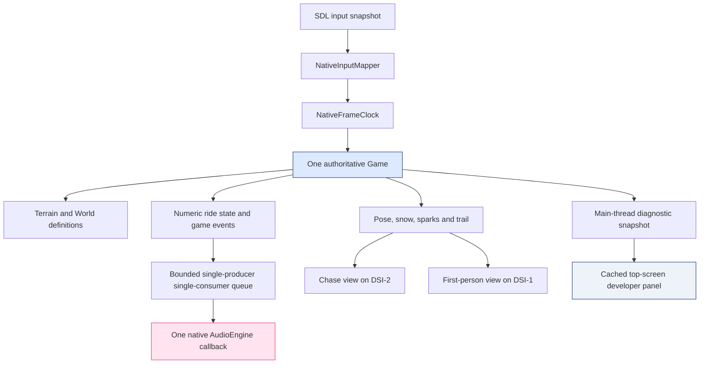
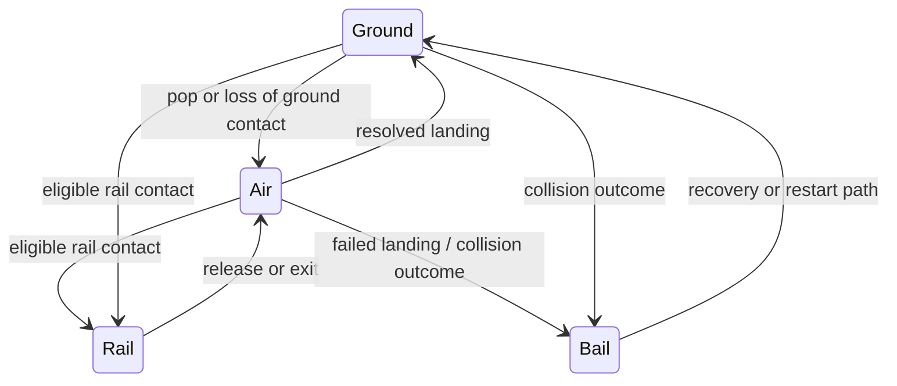
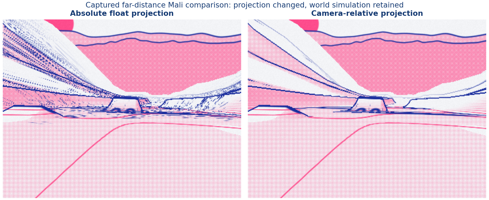
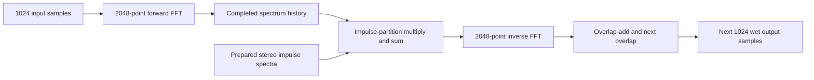
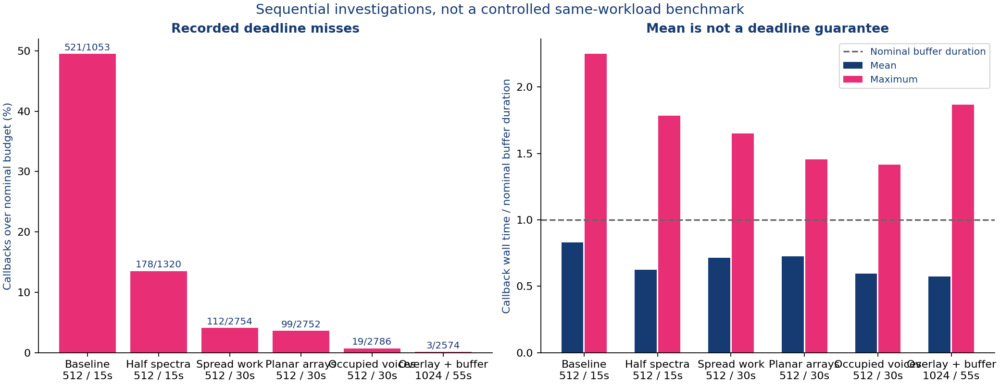
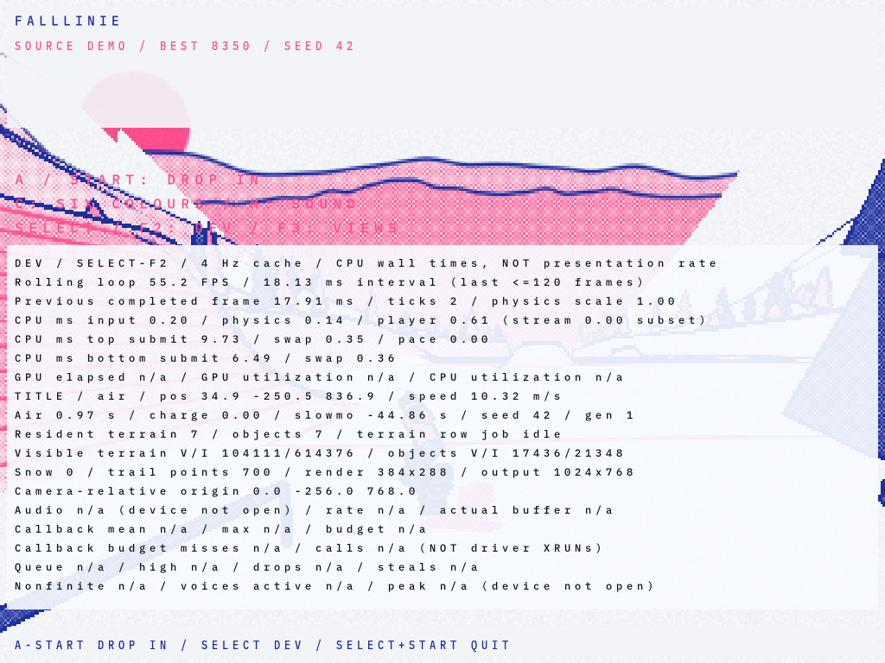
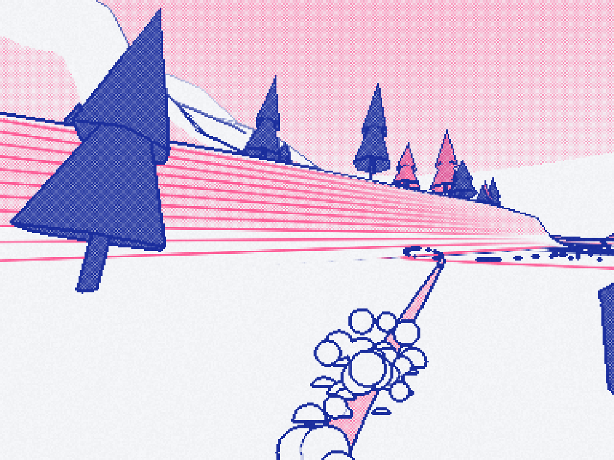
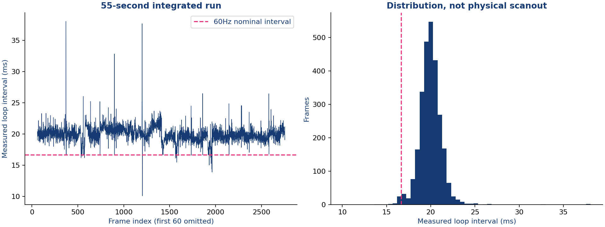
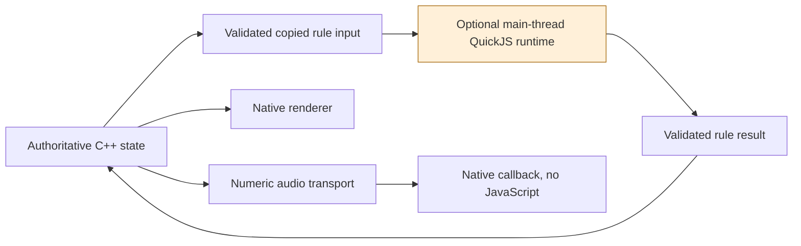

# Falllinie: Integrating a Native Game Without Losing Its Numerical and Timing Contracts

A native port of Falllinie must preserve more than its terrain and color palette. The browser original combines procedural geometry, fixed-step riding physics, trick scoring, an articulated rider, persistent surface marks, particles, generated music and screen-space rendering effects. Moving these systems into C++ changes their execution environment: SDL supplies input and audio devices, OpenGL ES renders through a Mali driver, and a compositor places two windows on separate handheld displays. The port has to reproduce the relationships between those systems without assuming that browser services exist in the new process.

This report explains the integrated implementation at revision `f5ab7b1`, then examines three problems that only became clear after the earlier graphics work: unstable projection at large world coordinates, audio callbacks exceeding their time allowance, and the difficulty of adding useful developer telemetry without inventing measurements. A final section evaluates whether embedded JavaScript would improve the architecture, using isolated experiments rather than an interpreter added to the shipping candidate.

> [!summary]
> The integrated native game contains trees, trunks/cones, rails, snow, sparks, persistent board marks, source-derived riding/scoring, an articulated rider and generated audio. Both views share one simulation and one audio engine. Camera-relative projection repairs the demonstrated far-distance instability, and DSP optimizations substantially reduce callback budget misses. The latest combined run still misses some audio budgets and runs around 50 FPS; neither complete source parity nor final handheld acceptance is claimed. JavaScript remains research, not a production dependency.

The repository began on October 12, 2026. This is a new October 13 follow-up, not a replacement for the earlier [[PROJECT REPORT - Falllinie Playable Port - Dual Views, Frame Profiling and Cooperative Terrain Streaming]]. That report qualified a smaller graphics/gameplay workload. The current report describes a larger integrated workload and must not carry its predecessor's 60 FPS result forward without a new measurement.

## 1. Establish the execution model before translating features

Three definitions organize the implementation. **Authoritative state** is the state that determines subsequent simulation results: rider position and velocity, procedural terrain history, collision definitions, trick/combo state and current game mode. A **render view** is a camera-dependent representation of that state. An **audio callback** is the function invoked by the audio backend to fill a requested buffer of samples; its computation has to finish quickly enough for the backend to continue playback.

These definitions lead to separate ownership rules. The application has one authoritative `Game`, but renders it twice. It has one `AudioEngine`, but communicates with it from the main thread through numeric messages. Neither the first-person view nor developer diagnostics creates another game update. Drawing a second image is not another physics tick, another collision pass or another opportunity to publish the same landing event.

The distinction is visible in the source organization:

| Responsibility | Primary implementation | Ownership contract |
|---|---|---|
| Device/window lifetime and frame orchestration | `src/main.cpp` | Main thread owns SDL video and OpenGL calls. |
| Input edges, title autopilot and fixed-step clock | `src/runtime.cpp`, `src/runtime.hpp` | One normalized input decision per frame. |
| Rider modes, tricks, feedback and persistence | `src/game.cpp`, `src/game.hpp` | One authoritative game state. |
| Procedural surface and object definitions | `src/terrain.*`, `src/world.*` | Rendering and collision derive from shared definitions. |
| Rider pose, effects and view adaptation | `src/pose.*`, `src/particles.*`, `src/game_renderer.cpp` | Main-thread visual derivation from game state. |
| GLES resources, scene/print passes and HUD | `src/renderer.*`, `assets/shaders/` | One shared context used sequentially. |
| Sample scheduling, voices and DSP | `src/audio.cpp`, `src/audio_dsp.hpp` | Callback consumes bounded numeric state. |
| Cached developer text | `src/developer_overlay.*` | Main-thread snapshots; no callback formatting. |

A context is the OpenGL object and state environment used to issue rendering commands. The two SDL windows share a context rather than each owning an independent renderer. The main thread changes the current target, draws the chase view, then changes the target and draws first person. The compositor-placement worker performs IPC only; it does not receive permission to call SDL video or GL functions.



The diagram separates data ownership from observable output. It does not imply that the two render operations execute in parallel, or that the callback receives access to `Game`. Those would be different architectures with different synchronization requirements.

### Follow one landing through the system

Consider a rider moving from `Air` to `Ground`. During a fixed physics tick, the game evaluates the surface, resolves the contact and updates landing/trick state. That state can produce a `Land` event and combo-related feedback. Later in the frame, the renderer derives the rider pose and visible effects from the updated state. The feedback publication function sends the effective ride sound and each queued game event to audio, then clears the main-thread event collection.

The callback receives a numeric event representation. It can select a preallocated sound voice and update its sample-based envelope; it cannot inspect a UI string, load a sample from disk or query the renderer. The chase and first-person views then display the same resolved landing. Rendering the second view does not trigger another `Land` event.

This example identifies an important integration failure: individually correct modules can duplicate a side effect if frame ordering is unspecified. The integration contract therefore includes when feedback is collected, when it is published and which operation clears it.

## 2. Four game modes and three relevant clocks

`RiderMode` contains `Ground`, `Air`, `Rail` and `Bail`. These are different motion/contact states, not merely labels for animation. Ground riding follows the procedural surface and handles charge/pop behavior. Air motion integrates gravity and records rotations and grabs. Rail motion follows a shared rail definition while maintaining its own active ride state. Bail and recovery provide a controlled failure transition instead of allowing an invalid landing to continue as ordinary riding.

A representative state diagram is useful, but it is not an exhaustive enumeration of every scoring or recovery branch:



The runtime distinguishes wall time, simulation time and audio sample time. Wall time is elapsed application time measured between frames. Simulation time advances through fixed ticks, with slow-motion scaling where the game contract requests it. Audio sample time advances according to the number of samples produced, not according to how often the main loop redraws the screen.

`NativeFrameClock::advance` clamps finite raw frame time to at most 0.05 seconds, calls `Game::begin_frame`, then accumulates scaled time into 1/120-second physics ticks. It permits no more than twelve ticks in a frame and discards excess accumulator time at that limit. Finally, it calls `real_time_feedback` with raw frame time. The following is a condensed description of the current function, not a new proposed scheduler:

```cpp
raw_dt = finite(raw) ? clamp(raw, 0, 0.05) : 0;
scale = game.begin_frame(raw_dt);
if (!game.paused()) {
    accumulator += raw_dt * scale;
    while (accumulator >= 1.0 / 120 && ticks < 12) {
        game.step(input, 1.0 / 120);
        accumulator -= 1.0 / 120;
        ++ticks;
    }
    if (ticks >= 12) accumulator = 0;
}
game.real_time_feedback(input, raw_dt);
```

At a nominal 60 Hz loop rate and scale 1, a frame usually contains two physics ticks. At approximately 50 Hz it can contain two or three, depending on accumulator phase. The fixed step means a frame-rate change does not directly redefine the integration interval. It does not mean arbitrary application stalls become harmless: clamping and the tick limit intentionally bound catch-up work rather than simulate an unlimited elapsed interval.

Calling `begin_frame` before the ticks matters because effects and slow-motion decisions must apply at the intended frame boundary. A newly awarded effect during a tick should not be accidentally consumed or overwritten by a second frame-initialization operation. Likewise, the music's 86 BPM clock remains sample-based rather than speeding up, slowing down or restarting with the physics scale. Pause freezes audio; mute preserves its computation and clock while suppressing output.

### Definitions must survive cache retirement

Procedural generation is coupled to collision and rendering. A tree cannot be generated at one position for collision and another for the GPU. The same applies to rails and terrain-derived placement. `World` supplies seeded definitions to both consumers, while bounded caches avoid retaining every previously visited cell indefinitely.

The important lifetime rule is visible in `world.hpp`: an active rail ride owns a copy of its rail definition. Holding a reference into a cache would be unsafe once that entry is retired. Similarly, callers must not keep a reference to a cached vector while performing nested queries that can mutate the cache. The port uses copied feature data at the relevant boundaries rather than assuming container storage remains stable.

Restart is another lifetime boundary. A generation identifier invalidates old visual work and GPU residency when a new world is requested. A job created for an earlier generation must not install geometry into the restarted world just because it finishes later. These constraints preserve source behavior more effectively than independently reimplementing approximate collision objects in the renderer.

### Best-score storage is an application concern

The native application uses `SDL_GetPrefPath` to choose app-owned storage. A default `Game` does not access the filesystem merely because a unit test constructs it; persistence is configured by the application. Parsing was tightened to reject a numeric prefix followed by arbitrary text, so `123garbage` is not accepted as a valid score. Trailing whitespace remains acceptable. Writes use a temporary file that is closed before rename.

This is a host adaptation, not a claim that the browser's storage API has been reproduced. The preserved behavior is that valid best-score state survives application runs without requiring filesystem work inside physics ticks or the audio callback.

## 3. Source coverage: visible objects were present, but parity was not complete

The feature audit corrected a misleading interpretation of the native build: trees, trunks/cones, snow spray, rail sparks and persistent board marks were not merely described in docs or declared in unused classes. They were connected to GPU drawing through the integrated world/effect/render paths. The captured printed scene below provides a concrete example of the deployed visual output.


That image supports a narrower conclusion than complete visual parity. It demonstrates a rendered scene from the integrated build. It does not verify every collision response, trick combination, lifetime limit, palette or camera configuration. Automated source-derived tests, code tracing and device captures answer different questions, and none alone proves that every browser interaction has been preserved.

The remaining omissions include the original mathematical X-ray overlay, browser touch/DOM presentation and exact Unicode UI rendering. The new native developer pane is not the original mathematical overlay under another name. It reports runtime counters and timing; it does not repair those source UI omissions. Audio also preserves formulas, arrangement and reactions without claiming sample-for-sample identity with a browser engine's noise generation, filtering, resampling and device pipeline.

## 4. Why the distant terrain developed false edges

The long-distance rendering defect appeared around 58.6 km of world travel. The visible symptoms included blue speckle, false terrain edges and apparent mountain movement. Increasing depth-sampler precision had already addressed a different Mali issue, but it could not repair a matrix whose relevant information had been rounded before the shader sampled depth.

A world position is represented with double precision in the simulation, while the GL matrix storage uses 32-bit floats. A view matrix translates positions relative to the camera, and a projection matrix converts that view-space position into homogeneous clip coordinates. The post-processing shader also uses an inverse view-projection matrix to reconstruct a ray or position from screen/depth information.

At a coordinate magnitude near 60,000, the spacing of adjacent binary32 values is approximately 0.00390625. That alone does not explain every visible error: the more damaging step is cancellation and inversion involving large translated float matrices. Storing a matrix in float, then performing its inversion in double, cannot recover information already lost during storage.

The investigation measured adjacent-ray discontinuity using both absolute and camera-relative projection. The absolute calculation produced a maximum jump of `0.0617543549`, approximately 16.4358 pixels under the probe's conversion. The relative calculation reduced that to `3.40007826e-05`, approximately 0.00904924 pixels. These are measurements from the bounded projection probe, not a general guarantee for every camera transform.

### Rebase projection, not the authoritative world

The implementation introduces a `RenderFrame` containing an origin, relative eye position, view-projection matrix and inverse matrix. Its origin is snapped to 128-meter increments on each axis:

\[
O_i = 128\,\operatorname{round}(E_i/128).
\]

The camera and look target are translated by the same origin before constructing the view matrix. Scene projection uses the corresponding relative coordinates. This keeps the matrix's translations small while leaving physics positions, procedural generation and source world-space shading semantics intact.

```cpp
Vec3 origin = relative
    ? Vec3{round(eye.x/128)*128,
           round(eye.y/128)*128,
           round(eye.z/128)*128}
    : Vec3{};
Mat4 vp = multiply(
    perspective(fovy, aspect, .1, 900),
    look_at(eye-origin, look-origin, up));
return {origin, eye-origin, vp, inverse(vp)};
```

The origin does change at a snapping boundary. That is acceptable only if all projection-dependent values change coherently: the scene transform, relative eye and inverse projection must refer to the same origin. Mixing an absolute eye with a relative inverse matrix would produce another reconstruction error. The bounded regression therefore checks origin-boundary transitions and rolled cameras, not just a stationary forward-facing camera.



The Mali comparison at cell 536 removed the demonstrated false speckle, with `GL_error=0`. The original shader bodies remained preserved; the projection adaptation is explicit in the native host path. `--absolute-render-coordinates` retains the previous mode for diagnosis. The earlier fixed prototype subsequently completed a 900-measured-frame dual-view run near 60 FPS, but that prototype did not contain the current integrated workload. Its numerical repair and its performance result are separate facts.

## 5. Two cameras require state restoration, not duplicated simulation

The chase and first-person images differ in camera position, orientation, field of view and rider visibility. `Renderer::render_first_person` temporarily adapts render state, draws the second view, then restores the chase configuration. Restoration covers the camera, shake, FOV, following state, rider count and first-person suppression, including exception paths.

This is necessary because one renderer/context is reused. If first-person rider suppression were left active, the next chase frame could lose its rider. If FOV or camera state leaked, a subsequent capture could silently come from the wrong configuration. The integration also redraws the upper view when a capture must represent the chase scene rather than whichever framebuffer was most recently used for first person.

Window placement has a separate constraint: both windows need their first swaps before compositor IPC placement. Earlier work showed that naming a window and requesting a position before the compositor has a usable surface can produce the wrong placement. The current lifetime sequence retains that qualification rather than replacing it with another untested startup order.

The source-integrated terrain residency is seven cells. One cell has 14,873 vertices and 87,768 indices, so seven resident terrain meshes total 104,111 vertices and 614,376 indices before accounting for objects or effects. The developer capture reports those counts. They explain why comparing current performance directly with an earlier four-cell prototype would be unsound even at the same internal resolution.

## 6. Audio correctness includes a deadline, not just finite output

The original music uses generated voices, filters, delay, convolution reverb, saturation and reactions to riding/game events. Digital signal processing (DSP) is the numerical transformation of those audio samples. The native engine prepares its DSP storage before playback and accepts numeric control messages through bounded transport. It does not allocate voices dynamically in the callback. Its fixed capacities include 128 voice slots, a 256-command queue and a bounded 64-event pump representation.

A **single-producer single-consumer queue** permits one thread to publish messages and one thread to consume them. Here the main thread is the producer and audio is the consumer. The transport avoids callback locks and avoids sending main-thread strings. It still needs a policy for repeated or bursty updates; suppressing duplicate effective `RideSound` snapshots during a long pause prevented otherwise unnecessary queue overflow without suppressing distinct game events.

Offline correctness tests can establish finite samples, response accuracy and watched allocation counts. Real-time correctness adds another requirement: completion before the backend needs the next buffer. For a buffer of \(F\) frames at sample rate \(f_s\), its nominal duration is

\[
T_b = F/f_s.
\]

At the observed 48 kHz, 512 frames provide 10.6667 ms. A callback with a low mean but a 23.9911 ms maximum can still miss its budget. The first integrated run was audibly reported as crackling; the later instrumentation showed why mean throughput was not an adequate acceptance criterion.

The backend was SDL's PulseAudio driver connected to PipeWire 1.2.6, with floating-point stereo output. Callback counters use cached performance-counter frequency, two timing samples around the callback work and atomic publication of aggregate values. The recorded audio thread had normal scheduling with nice -20, not a demonstrated real-time scheduling policy. Wall time can therefore include preemption as well as DSP computation.

A budget miss is not the same measurement as an ALSA or PipeWire XRUN. An XRUN records an actual underrun/overrun in a device or stream; the application counter records that callback wall time exceeded its nominal buffer duration. Backend buffering can affect the relationship. The report does not equate the two or claim measured end-to-end latency.

The source arrangement also contains an intentional vinyl/crackle component, retained in the native mix. A listening report of crackling therefore does not identify every audible noise as a transport failure. The large measured miss counts establish a timing problem, but distinguishing unwanted discontinuities from the intended sound requires waveform/listening evidence. Removing the vinyl component merely to make the output quieter would change the source design.

### Preserve the source response while changing its computation

The optimization did not delete the reverb tail or replace the arrangement with a cheaper soundtrack. `Reverb::init` retains a 2.6-second stereo impulse response, with noise shaped by

\[
h_c[i] = (2r_i-1)(1-i/L)^{3.4},\qquad L=\lfloor 2.6 f_s\rfloor.
\]

It applies the documented WebAudio-style RMS/sample-rate normalization. At 48 kHz the response has 124,800 samples per channel. Directly multiplying that many coefficients for every output sample would be expensive; the native implementation partitions the response into blocks and performs convolution in the frequency domain. A Fast Fourier Transform (FFT) computes the discrete frequency spectrum of a block; an inverse transform converts the spectral result back into time-domain samples.

Convolution describes the contribution of prior input samples through the impulse response. With block size \(B=1024\), the transform size is \(N=2048\): each input/IR partition is padded to twice the block size to support linear convolution. At 48 kHz there are 122 impulse partitions. Denoting completed input spectra by \(X_k\) and impulse spectra by \(H_p\), the frequency-domain sum is

\[
Y_k = \sum_{p=0}^{P-1} H_p X_{k-p}.
\]

After inverse transformation, the first half combines with saved overlap and the second half becomes the next overlap. The implementation retains one block of explicit wet latency. That DSP delay is a separate quantity from SDL buffer duration.



### Half spectra and planar accumulation

For real-valued input and impulse data, the transform is Hermitian: the negative-frequency half is the complex conjugate of the corresponding positive-frequency bins. Only 1,025 bins carry independent data in a 2,048-point transform. The optimized engine stores those independent bins and reconstructs the other half before the inverse transform. The DC and Nyquist bins are handled as the nonduplicated endpoints.

Complex multiplication is expressed with explicit finite real arithmetic:

\[
(a_r+ia_i)(b_r+ib_i)
=(a_rb_r-a_ib_i)+i(a_rb_i+a_ib_r).
\]

That makes the bounded numeric operation visible to the compiler instead of depending on general-purpose complex overflow recovery. The storage then separates real and imaginary arrays. This planar representation allows independent bins to be processed in ARM NEON vectors without repeatedly rearranging interleaved complex fields.

The kernel uses nonaliasing pointer declarations and a local GCC O3 attribute. The target compiler reported 16-byte vectorization; global fast-math was not enabled. Nonaliasing is an actual correctness precondition, not a free performance annotation: output tail arrays must not overlap the impulse/history input planes. The independent review inspected that relationship in the current implementation.

### Move completed-history work away from the block boundary

The original partition accumulation concentrated work at the block boundary. With a 1,024-sample DSP block and 512-frame SDL buffer, this can produce an expensive callback every other buffer. Delayed partitions do not need the unfinished current input spectrum; they depend on already completed history.

The current `process` function distributes delayed partitions in 64-sample groups. Its exact scheduling expression is:

```cpp
const size_t due =
    (pos/64) * (partitions-1) / (block/64);
while (next_tail <= due) {
    const size_t p = next_tail++;
    const size_t old = (head + partitions - p) % partitions;
    // Accumulate impulse p against completed history old, for each channel.
}
```

At the final sample, all delayed partitions are complete. The engine transforms the newest input, adds partition zero, reconstructs the full spectrum, performs the inverse transform and advances the history head. It does not read the unfinished current-block slot as delayed history. Initialization clears the history, overlap, tails and scheduling phase.

This changes when work is executed, not which partitions contribute to the output. Preserving the 1,024-sample wet latency is part of that distinction. A different design that begins emitting incomplete results early would require a different correctness argument.

### Visit occupied voices without changing summation order

A profile attributed 17.45% of samples in a diagnostic run to `AudioEngine::Impl::voice_sample`. Calling that path for every inactive slot was avoidable. The engine now keeps a sorted array of occupied slot indices. New free slots are inserted in ascending order; expired slots are removed as rendering proceeds. Stealing an existing active voice does not insert a duplicate index.

Sorting is deliberate. Floating-point addition is order-sensitive, so visiting active voices in allocation-time order could change the mix even if every voice individually produced identical samples. Ascending slot order retains the old traversal order while skipping empty entries. The earliest-ending voice selection policy also remains unchanged.

Nonlinear saturation can create harmonics above the sample rate's representable frequency range; their foldback into lower frequencies is aliasing. The saturation path retains 2x processing through a preallocated 49-tap half-band implementation, with the reported 24-sample native latency. An earlier review also corrected the acid WaveShaper endpoint clamp. Keeping these details matters because reducing callback work by removing saturation or changing its endpoint behavior would be a sound-design change, not just an optimization.

## 7. What the audio measurements establish

The sequential target investigations produced the following counters. All were muted computations, so muting did not remove the DSP workload. The durations and song phases differ; this is a development sequence, not a controlled same-workload causal benchmark.

| Run | Frames per callback | Callbacks | Mean ms | Maximum ms | Budget misses |
|---|---:|---:|---:|---:|---:|
| Baseline, 15 s | 512 | 1,053 | 8.84164 | 23.9911 | 521 |
| Explicit arithmetic / half spectra, 15 s | 512 | 1,320 | 6.67424 | 19.0377 | 178 |
| Distributed partitions, 30 s | 512 | 2,754 | 7.61094 | 17.6165 | 112 |
| Planar accumulation, 30 s | 512 | 2,752 | 7.73134 | 15.5368 | 99 |
| Occupied voice traversal, 30 s | 512 | 2,786 | 6.34155 | 15.0859 | 19 |
| Overlay plus larger buffer, 55 s | 1,024 | 2,574 | 12.2459 | 39.8702 | 3 |



The mean for a 1,024-frame callback should not be compared directly with a 512-frame mean as though both produced the same amount of audio. Its nominal duration is 21.3333 ms, twice the earlier budget. The final maximum still exceeds that duration, so the latest measurement cannot support a zero-miss claim. Three misses among 2,574 callbacks are fewer observed misses than the earlier runs, but changing buffer size and covering different song phases limits attribution.

The larger buffer is explicit configuration: `AudioEngine::open(int buffer_frames=512)` and `--audio-buffer N` accept powers of two from 256 through 4,096. The executable/API default stays 512; the handheld launcher currently requests 1,024. An already-open engine remains idempotent, so changing the buffer requires close/reopen. The overlay reports the obtained backend rate and buffer rather than assuming the request was honored.

That is a latency trade-off, not a substitute for DSP repair. It neither shortens the impulse response nor changes the native wet-delay block. It also does not specify total listening latency, which includes additional processing and backend/device buffering.

The numerical checks provide complementary evidence. The optimized full source-response comparison recorded maximum error `9.28995e-09`; a non-impulse stereo direct-convolution test recorded `3.17755e-08`. The latter uses a 127-sample sinusoidal/cosine input rather than only an impulse, reducing the chance that a history/overlap error escapes the test. The recorded CPU and ASan/UBSan checks passed with zero watched callback allocations, retained late-tail behavior and a selected saturation alias result around -103.314 dB. That alias measurement is a bounded test result, not a complete spectral qualification for every instrument.

Queue drops, steals and nonfinite counts were zero in the quoted target runs. Those counters rule out specific observed problems; they do not establish that backend delivery was perfect. Final audible acceptance still requires listening evidence, and the combined application's approximately 50 FPS remains another open gate.

## 8. Developer telemetry that states what it does not measure

The developer panel uses the original font through bounded geometry rather than a fullscreen pass for every glyph. It contains at most 18 rows of 82 characters, refreshes text/geometry at approximately 4 Hz and uses one additional draw. The reviewed geometry bound is 8,862 vertices. The disabled path does not read audio diagnostics or format text.

This is more than a UI optimization. Main-thread formatting prevents strings, font lookup, vertex allocation and GL work from migrating into the callback. Audio publishes numeric counters; the panel converts them into human-readable text later. Each displayed quantity has an explicit interpretation.



The frame rate is a rolling CPU-loop measure over up to 120 completed frames, not physical presentation rate. Input, physics, player, top/bottom submit, swap and pacing values are CPU wall intervals for the previous completed frame. Streaming is a subset of player work, so adding it again would double-count that portion. Submit wall time can include driver waiting; it is not a separate measurement of GPU execution.

The panel reports state, position, speed, air time, charge, slow motion, physics ticks, seed/generation, resident cells, vertex/index counts, snow/trail counts and render/output dimensions. It also shows the camera-relative origin, making a projection-coordinate change observable. Audio backend, actual rate/buffer, mean/max callback duration, budget/miss counts, queue depth/high-water mark, drops, steals, nonfinite samples and voices are presented with unavailable values marked `n/a`.

GPU elapsed/utilization and CPU utilization are deliberately unavailable in this panel. The separate CSV/GPU profiler remains independent. No percentage is inferred from draw time or callback cost. Maximum and miss counters are cumulative rather than reset every text refresh, so a late spike does not disappear at the next 250 ms update.

### Chords require ownership of the earlier toggle

The handheld mapping is SELECT for the panel, SELECT+Y for a new run and SELECT+START for quit. F2 is the independent keyboard toggle. The difficult case is a chord that arrives across two snapshots: SELECT is pressed first, then Y or START joins while SELECT remains held.

The implementation gives immediate SELECT-alone feedback and records ownership of that press's toggle. A later chord requests restoration of pre-press visibility. A simultaneous chord suppresses the standalone toggle. If F2 independently changes visibility while SELECT is held, ownership is cleared so the later chord cannot undo the keyboard action. Main applies restoration before a requested toggle.

This is an explicit behavioral choice. A short transient panel change may be visible in the SELECT-first sequence; the port does not pretend an immediate press edge can predict a future chord. Tests cover both initial visibility states, held buttons, press orders, title/pause and keyboard interactions.



The top and lower captures demonstrate separate placement and top-only developer drawing. They were captured from the compositor and are not a substitute for physical legibility or human controller qualification. The latest integrated host suite passed 8/8, including controls, formatting/cache/extreme-value behavior and dummy audio lifecycle. The dummy lifecycle test explicitly avoids a physical backend and checks invalid buffer rejection, pause/resume, close/reopen and subsystem ownership.

## 9. The combined frame result still fails the 60 FPS requirement

The 55-second target run used autoplay, dual screens, internal 384×288 rendering, no vsync, a 60 FPS cap, muted computation, developer overlay and a requested/obtained 1,024-frame audio buffer. It completed 2,756 frames, of which 2,696 were measured after the initial 60-frame exclusion. Median loop interval was 19.7951 ms, p95 21.6306 ms and p99 23.0993 ms; peak RSS was 115,092 KiB and `GL_error=0`.



A 60 Hz nominal interval is 16.6667 ms. The median and upper percentiles exceed it, so a cap of 60 does not demonstrate delivery of 60. Conversely, a successful GL error check does not demonstrate frame-time acceptance. The earlier prototype's approximately 60 FPS and lower streaming hitches remain historical results for a smaller feature set.

The first integrated 20-second deployment already showed the regression: 926 frames, 866 measured, median 19.8396 ms, p95 22.1455 ms and p99 24.3633 ms, followed by the user's crackling report. The later work improves audio headroom but does not turn the integrated renderer into the earlier prototype. Any next optimization must identify actual work or waiting and preserve source features rather than silently disabling objects, effects or one camera.

The available CPU-submit values do not yet prove whether fragment work, geometry, driver synchronization or shared resource pressure dominates every frame. That uncertainty is a reason to measure the next hypothesis, not to assign a GPU-utilization percentage to the observed interval.

## 10. Embedded JavaScript: compatibility is not a browser host

A JavaScript engine parses and executes ECMAScript and manages its objects. It does not inherently supply `document`, DOM events, a canvas, WebGL or WebAudio. This distinction was demonstrated by the probes rather than left as an architectural warning: both QuickJS variants parsed the actual main inline script, evaluating HTML failed with a syntax error, and evaluating browser-dependent inline code without a host failed because `document` was undefined.

The research package is in `FALLLINIE-JS-001`, with experiments under `scripts/2026/10/13/falllinie-js-runtime/`. It compares Bellard QuickJS 2026-06-04, QuickJS-ng v0.17.0, Duktape, V8 and JavaScriptCore, but not at the same measurement depth.

| Runtime | Concrete evidence | What is not established |
|---|---|---|
| Bellard QuickJS | Host compatibility, selected oracles, ownership/errors/limits, benchmark repeats, AArch64 cross-link | Device execution, production integration, hardened hostile scripts |
| QuickJS-ng | Equivalent categories of host probes and cross-link; distinct API inspection | Device winner or drop-in Bellard/wrapper ABI |
| Duktape | Required syntax/API rejection probes and bounded compatible-subset results | Unchanged-source suitability |
| V8 | Official embedding/build documentation and feasibility analysis | Built/measured target integration or JIT advantage here |
| JavaScriptCore | API/build documentation, typed-array and timeout constraints | Target runtime performance or qualified timeout integration |

### Selected values provide a useful, limited oracle

An oracle is a reference result against which another implementation is compared. The extraction and probe workload compares 85 selected leaves from source-derived hashes, random values, terrain, normals/paint, scores and trees. Bellard and ng matched the Node results exactly for those leaves; native maximum absolute floating error was `2.220446049250313e-16`.

For a concrete terrain example, the selected query at `(x=12,z=150)` returns height `-36.96929557018999` and normal approximately `(-0.0197652929, 0.9997120832, 0.0136045538)`. The scoring fixture yields `10260` and then `6155` for its selected repeated-trick cases. These values establish useful compatibility for the extracted functions. They do not execute every game mode, browser callback, render path or musical interaction, and therefore do not prove complete simulation parity.

### A binding must specify memory ownership

A native binding makes a C++ function callable from script. Passing a typed-array view across that boundary introduces questions beyond its element type: who owns the memory, whether offsets are honored, whether the engine can move or detach it, how long the pointer is valid, and who releases an external allocation.

The host probes test rooted copying, view offsets, numeric-width validation, rejection of NaN/oversized input, exceptions, interruption, memory limits and exactly-one lease release. A lease here retains the owner of externally exposed memory until the script-facing use is released. Both retained logs report `copy/offset/lease PASS release_count=1`. These are trusted-only experiments with missing adversarial/OOM hardening acknowledged; the tests do not establish a general security boundary.

A safe proposed production seam would be a pure score/trick function that receives a copied/versioned numeric snapshot and returns a validated numeric result. C++ would still own game state, terrain history, GL and audio. The following diagram is a proposal, not the current deployed engine:



The recommendation is not to put JavaScript in the callback or maintain a second terrain/game history in the interpreter. A hot-reload implementation would also need a defined pause/migration/validation boundary before replacing modules. Bytecode formats and engine versions cannot be treated as interchangeable trusted inputs.

### Host benchmark numbers cannot choose the handheld winner

One retained native terrain-row run reports p50 17.537 µs, p95 17.655 µs and maximum 33.116 µs. The corresponding labeled host batch probes report Bellard p50 707.645 µs/p95 890.694 µs and ng p50 962.927 µs/p95 1,032.17 µs. These are examples from 300-iteration, 30-warmup host runs, not portable performance ratios.

The row coordinates match, but allocation shapes differ; scalar and batched bridge loops also differ. Host scheduling was not fully qualified, and the recorded GC timing is explicit-GC timing rather than a bound on automatic collection pauses. The supplied repeats and caveats support the narrower recommendation to keep the current native architecture and use a small optional rules experiment only if JavaScript authoring is desired.

Both interpreter hosts cross-linked to AArch64 ELF files in the existing container. Neither was executed on the handheld. Cross-link success proves construction of an executable for that architecture, not device feasibility, latency or an interpreter's contribution to current frame cost.

### API compatibility must be checked against the pinned engine

QuickJS-ng's class-ID and external ArrayBuffer interfaces differ from the Bellard interfaces used by existing examples/wrappers. In particular, the inspected ng external-buffer contract includes resize/free handling that is not a drop-in replacement for the Bellard call shape. Actual quickjspp compilation probes failed against the investigated combinations. A wrapper's project name or advertised QuickJS support does not establish compatibility with these pins.

Duktape rejected required arrows/classes/Map in the tested unchanged-source requirements. Choosing it would require a different source strategy rather than merely changing the linked library. V8 and JavaScriptCore remain documentation/build-feasibility evaluations; there is no measured basis here for claiming that just-in-time (JIT) compilation into machine code would solve the handheld workload. JavaScriptCore's documented temporary typed-array pointer and private timeout API also require explicit design work rather than assumptions transferred from another engine.

## 11. Review and provenance are part of the technical result

The integration was divided into scoped worktrees so gameplay/audio/overlay/research work could be reviewed without concurrent writers modifying one source tree. The parent owned merges, deployment and device acceptance. The recovered gameplay lane and completed research artifacts were preserved after orchestration failures rather than rerun through a different agent execution mode.

The independent DSP/overlay review inspected exact patches at frozen `eb6c1a5`, current source and recorded evidence. It found no qualifying code issues and accepted further qualification, explicitly not release. Its findings covered convolution history/latency/bounds, voice ordering, callback fixed storage, controls, cached geometry and first-person restoration. The later buffer option is outside that exact review scope and has its own lifecycle/backend evidence.

Research review supported the underlying experiments but blocked final acceptance on two provenance/status issues, with one navigation correction. The guide had presented an unreachable parent preflight as latest state after native deployment had occurred. A later lowercase ng `readme.md` fetch had also failed while the retained uppercase `README.md` capture had a valid earlier receipt. The correction labels deployment context historical, restores the case-correct fetch URL, reconciles the retained capture with its original successful timestamp/hash and preserves the complete failed retry separately. No new network success or runtime experiment is fabricated.

The ticket now links to its dated script group and pin/evidence manifest. Parent acceptance checks validate those links and capture identity; ticket doctor passes, with the repository's information-only missing-vocabulary notice kept distinct from a failed experiment. Preserving the original blocked review while documenting its correction makes the acceptance history inspectable.

## 12. Reproduce the evidence and keep the acceptance boundary explicit

The native repo is `/home/manuel/code/wesen/2026-10-12--falllinie-spike`. The report checkpoint is `f5ab7b1`; relevant milestones include `7eac73f` for relative projection, `d911ee4` for its Mali comparison, `a0d5326` for distributed/planar convolution and occupied-voice work, `0a153c7`/`eb6c1a5` for the overlay, and `ee81963` for the corrected research package. These are useful source boundaries rather than a chronological substitute for the explanations above.

The main evidence locations are:

- `ttmp/2026/10/12/FALLLINIE-GAME-002--source-faithful-falllinie-gameplay-integration-and-final-playtest/`, including the parent investigation diary and scoped implementation diaries.
- `scripts/2026/10/13/full-gameplay-integration/target-evidence/`, including all quoted audio-budget runs and `overlay-buffer1024` CSV/log/captures.
- `scripts/2026/10/13/full-gameplay-integration/review-evidence/`, containing exact review patches, original reviewer outputs and correction context.
- `scripts/2026/10/13/render-jitter-investigation/`, containing the coordinate probe and far-distance comparison.
- `ttmp/2026/10/13/FALLLINIE-JS-001--javascript-embedding-research-for-the-native-falllinie-engine/`, containing the detailed runtime guide, source captures and chronological research diary.
- `scripts/2026/10/13/falllinie-js-runtime/evidence/`, containing actual oracles, benchmark repeats, ownership/error checks and cross-link receipts.

Host integration checks run without claiming hardware qualification:

```sh
cmake --build build/integrated-source -j4
ctest --test-dir build/integrated-source --output-on-failure
node scripts/2026/10/13/full-gameplay-integration/validate-research-acceptance.cjs
```

The latest quoted target experiment used this application configuration after parent-managed deployment and Wayland setup:

```sh
./falllinie-spike --autoplay --dual-screen --place \
  --render-size 384x288 --no-vsync --fps 60 \
  --muted --dev-overlay --audio-buffer 1024 --seconds 55 \
  --profile /tmp/falllinie-overlay-buffer1024/frames.csv \
  --capture-dir /tmp/falllinie-overlay-buffer1024
```

The run did not request `--receipt`; its evidence is the actual log, CSV and captures, not an invented application receipt. Raw BMPs are retained locally and lossless PNGs are committed after checking identical decoded pixels. This vault contains copied, self-contained figures rather than cross-repository image dependencies. The figure generator is in the sibling project at `scripts/2026/10/13/falllinie-integrated-report/build-figures.py` and reads the retained native logs directly.

The installed interactive controls are A/START to drop in, START to pause, SELECT to toggle developer data, SELECT+Y for a new run and SELECT+START to quit. F2 supplies the keyboard toggle. The current installed build permits listening with the larger buffer, but this report contains no subsequent human listening result.

The remaining acceptance work is specific: measure and repair the integrated rendering cost without source omissions; establish adequate callback headroom over relevant musical/gameplay phases; check physical panel/controller behavior; and perform the final human gameplay/listening gate. Adding an interpreter is not on that critical path unless separately approved.

The central engineering result is the preservation of explicit contracts while the host environment changes. One authoritative simulation supports two cameras. Relative projection changes the matrix coordinate range rather than the procedural world. Convolution scheduling changes the distribution of work rather than the response. Developer telemetry names its measurement limits. JavaScript experiments establish selected compatibility without pretending to create a browser. Those distinctions make the remaining failures diagnosable and prevent intermediate successes from being reported as complete acceptance.


## Falllinie optimization report network

Navigation addendum: [[MOC - Optimization and Performance Engineering|series index, reading routes and evidence boundaries]]. The original report above remains a historical checkpoint; these cross-links do not revise its measurements.

Later buffered-audio and ARM64 JavaScript reports extend this checkpoint. Actual rendering attribution and hardware-counter results are in the rendering and GPU reports.

- [[PROJECT REPORT - Falllinie Native GLES Spike - Deterministic Terrain, Print Shaders and Mali Depth Precision|Graphics foundations]] — Deterministic terrain, encoded scene/print passes and Mali depth-sampler precision; establishes the fidelity constraints for later tuning.
- [[PROJECT REPORT - Falllinie Playable Port - Dual Views, Frame Profiling and Cooperative Terrain Streaming|Playable port and streaming]] — Shared dual views, frame pacing and cooperative terrain generation; an earlier, smaller workload.
- [[PROJECT REPORT - Falllinie Buffered Audio - PCM Ownership, Callback Deadlines and Measured Producer Scheduling|Buffered audio qualification]] — Producer-owned DSP, SPSC PCM transport, copy-only callbacks and finite target deadline results.
- [[PROJECT REPORT - Falllinie JavaScript Embedding - ARM64 Qualification, V8 Ownership and Bounded Rules|ARM64 JavaScript experiments]] — Actual QuickJS, QuickJS-ng and V8 embeddings, ownership contracts and isolated workload measurements.
- [[PROJECT REPORT - Falllinie Tracing - CPU Execution, Driver Waits and GPU Attribution|Tracing concepts and investigation plan]] — Wall versus CPU time, scheduler-state interpretation and proposed perf/ftrace/eBPF investigation.
- [[PROJECT REPORT - Falllinie Rendering Measurements - CPU Execution, Mali Driver Work and GPU Timer Limits|Measured CPU and driver attribution]] — Actual paired clocks and perf samples, driver execution, non-running time and unresolved GPU elapsed-query anomalies.
- [[PROJECT REPORT - Falllinie GPU Profiling - Hardware Counters, Shader Compilation and a Rejected Optimization|Hardware counters and rejected shader candidate]] — Actual G52 counters, exact-input offline compilation, non-parity post bypass and a null-result ABBA shader experiment.
