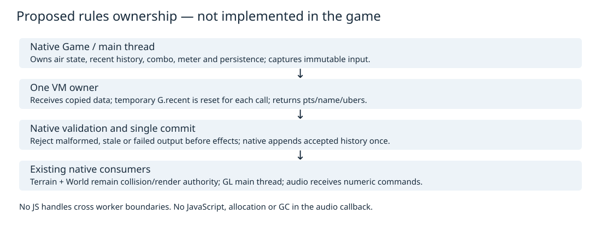
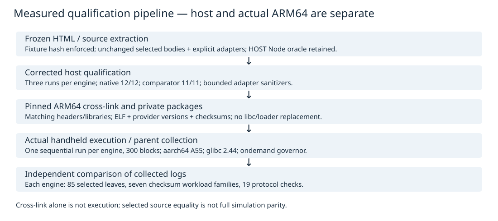
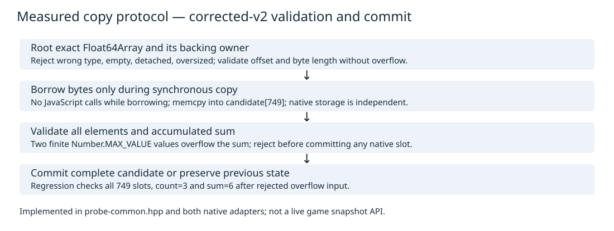
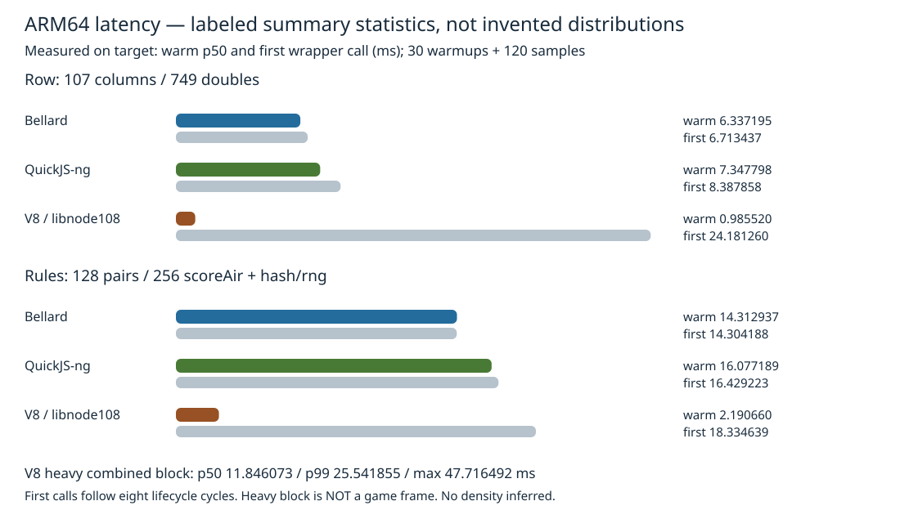
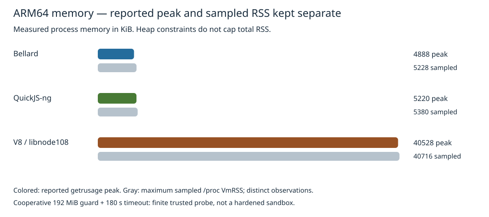
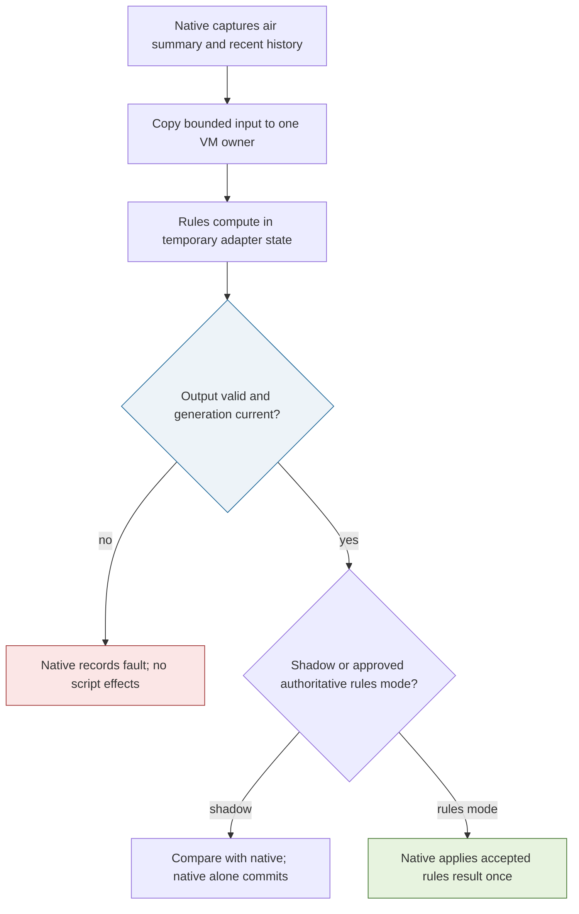

# Falllinie JavaScript Embedding

Falllinie is currently a native C++ game. Its original browser implementation contains authored JavaScript for terrain, simulation and scoring, but the native executable does not run that JavaScript. This report explains the isolated experiments that establish how selected original functions can execute inside a C++-owned JavaScript engine, how their values cross into native memory, and what the actual ARM64 measurements establish. It then develops a proposed rules-only integration in which JavaScript computes a result while native code retains authority to change the game.

An **embedding** is an application creating and controlling an ECMAScript engine through its native API. ECMAScript specifies JavaScript syntax and standard objects; the surrounding **host** supplies capabilities such as input, rendering, files and scheduling. An engine therefore does not supply a browser merely because it evaluates JavaScript. **Authority** means the exclusive right to commit a state change or externally visible effect. Keeping these three concepts separate is the prerequisite for understanding both the experiments and their limits.

> [!summary]
> Bellard QuickJS, QuickJS-ng and raw V8 C++ embeddings actually executed on the handheld. Each passed 85 selected source-oracle leaves, seven checksum workload families and the corrected 19-check protocol.
> V8 had substantially lower warmed row and scoring-batch cost in this configuration, but higher process memory, startup costs and important first-call/tail latency.
> No JavaScript production module, full simulation migration, hot reload or frame-time budget has been implemented. Native terrain, simulation, rendering and audio remain authoritative.

The source boundary is commit `22241ca` in `/home/manuel/code/wesen/2026-10-12--falllinie-spike`. Report placement follows the local publication date, 2026-10-13; the retained device tests were collected late that day in UTC. Earlier research documents deliberately retain their original “not executed” and “pending” statements. Their historical status is superseded only for the corrected packages that have actual target receipts, not for every proposed feature in those documents.

## 1. The execution model before the API

A **runtime** owns a managed heap: memory containing JavaScript objects whose lifetimes are determined by engine rules rather than ordinary C++ stack scope. A **context**, also called a realm, supplies global objects and language environments inside that runtime. QuickJS exposes runtime and context separately. V8 uses an **isolate** as its heap/execution boundary and contexts within that isolate. These are related concepts, not interchangeable C API types.

A **binding** is a native function registered so JavaScript can call it. In this research, `consume`, `scalar` and `acceptScore` are bindings; they are not gameplay methods. A **snapshot** is a copied description of state, independent of the original owner's mutable storage. A snapshot can be inspected without granting the reader permission to mutate the game. The proposed scoring input is such a snapshot, whereas exporting a mutable `Game*` would grant a much larger and harder-to-review capability.

A managed value must remain reachable while the host uses it. A **root** is an engine-recognized reference that prevents collection of a value still needed by the application. A **borrowed pointer** permits temporary access to storage owned elsewhere; it does not transfer ownership. A **native-owned copy** has its own storage and remains valid after JavaScript mutates its source array or the runtime is destroyed. These distinctions explain why copying a few kilobytes is preferable to retaining an unqualified engine pointer.

**Garbage collection**, or GC, reclaims unreachable managed objects. It may perform work during allocation or at an explicitly requested collection point. **Jobs** are deferred JavaScript work, including Promise reactions, whose execution policy belongs to the host. Finally, an **interpreter** executes engine instructions without the default optimizing machine-code pipeline used here by V8; **just-in-time compilation**, or JIT, produces machine code during execution. A JIT can improve repeated computation while increasing first-call cost. Neither execution strategy gives a hard deadline guarantee.

The experiments compare these responsibilities explicitly. C++ creates a runtime, registers a small binding surface, compiles extracted source, invokes cached functions, validates returned values and destroys every retained engine value before destroying the runtime. JavaScript receives no SDL, GL, filesystem or audio interface. The proposed production arrangement preserves the same restriction while replacing test callbacks with a reviewed rules contract.



The figure is a proposed ownership partition, not a diagram of an existing production script subsystem. Its essential constraint is that computing a score and committing a score are different operations. That remains true even when both computations happen on the main thread.

## 2. Why evaluating the HTML is not a port

`fixtures/falllinie.html` is a browser application, not a stand-alone rules module. It contains markup, CSS, embedded fonts, inline JavaScript, WebGL shader setup, WebAudio construction, DOM interactions and browser input handling. ECMAScript includes `Math`, arrays, `Map` and `Promise`; it does not include `document`, Canvas, WebGL or WebAudio. Native bindings for those interfaces would be additional implementation work, not an option enabled by selecting V8 instead of QuickJS.

Historical probes demonstrate the difference directly. Both QuickJS variants successfully compiled the whole main inline script without executing it. Execution in a fresh browserless context failed at the missing `document` global. Evaluating literal HTML failed at `<`. These failures distinguish language compatibility from host compatibility: the parser accepts the program's JavaScript, but the host does not implement its browser dependencies. Substituting no-op browser functions would conceal missing behavior rather than reproduce it.

The source requires modern constructs: lexical declarations, arrows, classes, destructuring, spread, iteration, `Map`, Unicode strings and typed arrays. The stock Duktape 2.7.0 probe rejected arrows, class syntax, the tested `let` destructuring form and `Map`. It accepted exponentiation and `Float64Array`, so the evidence is not a blanket statement that all newer features fail. Duktape was rejected for unchanged authored source; transpilation and polyfills would introduce a separate semantic and maintenance project.

The initial study inspected JavaScriptCore and V8 documentation without building those engines. The later qualification actually tested V8 through its C++ API; JavaScriptCore remains documentation-only in this investigation. This temporal distinction matters because a Node oracle is evidence about expected source values, not evidence that a custom C++ embedder handles lifetimes, callbacks or packaging correctly.

The development motivation is therefore narrower than restoring browser functionality. Authored scoring rules could become directly executable instead of mechanically translated. Native terrain and game mechanics already exist. Browser typography, DOM notes screens or Canvas equation overlays would require their own implementation or a complete browser host. They do not become available through an ECMAScript engine alone.

## 3. Extracting a controlled source subset

The new experiment directory is `ttmp/2026/10/13/FALLLINIE-JS-001--javascript-embedding-research-for-the-native-falllinie-engine/scripts/02-arm64-v8`, abbreviated **P** below. The older experiment directory is `scripts/2026/10/13/falllinie-js-runtime`, abbreviated **H**. H remains unchanged and contains earlier extraction, compatibility, wrapper and oracle receipts. P reads the historical adapter definitions rather than silently redefining the original mathematical routines.

`P/01-extract.cjs` verifies the frozen HTML SHA256, then extracts selected bodies using explicit source markers. The fixture hash is `cb9b4befd0252859d9c45246f94fbd7dd1662c6d034c6ccb95fbe16947e8b556`. The resulting unchanged subset is 18,149 bytes. It includes math/terrain definitions, grab definitions, trick naming and scoring, and terrain-row construction. It excludes the browser renderer and the full rider simulation. Generated working files are ignored; the source fixture itself is not edited.

An **adapter** supplies the surrounding state or data representation needed to execute the extracted functions outside the browser. Here it sets `SEED=42`, clears procedural caches, creates minimal `G.recent` state, packs terrain rows into a typed array and provides benchmark wrappers. Additional P workloads are appended separately. This distinction preserves source discoverability: a discrepancy can be traced to an original body, a deliberate adapter or the native boundary instead of being hidden inside a rewritten monolithic program.

A **source oracle** is an expected result computed from the retained original source for controlled inputs. The extractor uses host Node to produce JSON values, not to benchmark the engines. The native oracle is separately compiled from existing C++ source. On the device, comparison uses retained host Node and native oracle files. There is no newly measured ARM64 native performance baseline in this qualification.

| Oracle family | Selected coverage | What agreement establishes |
|---|---|---|
| Hashing | Five integer inputs, including large unsigned values | Tested coercion and wraparound outputs agree exactly. |
| Seeded randomness | Twelve values from `rng(12345)` | The selected deterministic stream agrees. |
| Terrain | Five coordinates, including negative z; height, normal and paint | Those sampled numerical definitions agree within tolerance. |
| Scoring | One trick evaluated twice with repetition history | Points and canonical Unicode labels agree exactly. |
| Trees | Two definitions from cell 3 | The selected procedural object definitions agree. |

The recursive comparator counts 85 scalar leaves across these structures. It checks matching object keys and array lengths, exact labels and integers, and floating values with absolute tolerance `1e-9` plus relative tolerance `1e-12`. The selected tests do not exercise every collision, input edge, rail transition, pause boundary or long simulation trajectory. Passing them is a concrete compatibility result, not full simulation parity.

Integer semantics deserve independent attention even when floats are close. JavaScript bitwise operations use particular 32-bit coercions; `>>> 0` and `Math.imul` are not ordinary unbounded arithmetic. Negative-cell flooring, rounding and `Map` insertion order also affect procedural and scoring behavior. The harness avoids global fast-math and preserves source bodies instead of replacing them with superficially equivalent expressions.

## 4. Following one scoring result through the system

The representative scoring input has spin `2π`, flip `−2π`, airtime `1.3` seconds, no switch takeoff, an Indy grab held for `0.5` seconds with `0.3` seconds of tweak, and one completed Helikopter lasting `1.5` seconds. The landing is marked perfect. `P/workloads.js` constructs this input explicitly; H's `oracle()` evaluates it twice with an initially empty `G.recent`.

```javascript
// Implemented research input; not a production rules interface.
const scoringInput = {
  spin: Math.PI * 2, flip: -TAU, t: 1.3, sw: false,
  grabs: new Map([['Indy', {t: .5, tw: .3}]]),
  ubers: [{name: 'Helikopter', dur: 1.5}], uber: null
};
```

The native reference in `src/game.cpp`, `Game::score_air`, exposes the scoring structure. Two half-turn spin units contribute 375 points; one full flip contributes 700. The grab contributes `(200 + 450 × 0.5) × 1.5 = 637.5`, and the completed über contributes `3000 + 1200 × 1.5 = 4800`. Airtime contributes `160 × (1.3 − 0.9) = 64`. The subtotal 6576.5 is multiplied by 1.3 for combined spin/flip and 1.2 for a perfect landing, giving 10259.34 before repetition and final rounding.

The canonical name is `FS Rodeo 360 · Indy · Helikopter`. With no prior matching name, rounding to five-point increments yields 10260. With one prior match, the repetition multiplier is 0.6; it is applied to the unrounded value, producing 6155 after final rounding. Applying decay to an already rounded base is a different algorithm and must not replace the source ordering.

```json
[
  {"name":"FS Rodeo 360 · Indy · Helikopter","pts":10260,"ubers":1},
  {"name":"FS Rodeo 360 · Indy · Helikopter","pts":6155,"ubers":1}
]
```

These are actual selected oracle outputs. They demonstrate points, label construction, a completed über count and one repetition step. Unicode punctuation belongs to canonical game state. `src/game_renderer.cpp` transliterates known characters for its ASCII presentation, but the rendered spelling must not replace the canonical label used to count repetitions.

Original `scoreAir` is not intrinsically pure: it reads and changes `G.recent`. A **pure rules adapter** would make that dependency explicit by receiving a copied recent-label list, assigning it to temporary adapter state for one computation, and returning validated data without committing native history. The same input and supplied history should produce the same result. Native code would append the accepted canonical label exactly once and retain the source's ten-entry history bound.

The research workload instead resets `G.recent=[]` before each deterministic pair, performs two `scoreAir` calls, adds original hash/RNG work, and resets history afterward. `sourceRules()` runs 128 such pairs. It is a reproducible computation batch, not an implemented landing-event callback. Its 256 scoring evaluations must not be divided into a claimed isolated single-event latency: batching changes cache state, allocation, compilation and surrounding work.

## 5. QuickJS: values, roots and release order

`P/quickjs-probe.cpp` uses the direct C API without quickjs-libc, a generic binding wrapper or browser services. Construction creates `JSRuntime`, sets a 32 MiB runtime-allocation limit and 512 KiB stack limit, creates `JSContext`, stores the native adapter pointer as context opaque data and registers the callbacks. Compile-only evaluation produces a retained compiled value; execution transfers that value to `JS_EvalFunction`. Cached function values remain rooted in the adapter's map until teardown.

A QuickJS API result often carries an owned reference. The application must free it when finished or duplicate it when retaining another reference. Function arguments are borrowed. Property setters commonly consume the value passed to them. These ownership conventions are part of the API contract; a C++ variable holding `JSValue` does not automatically establish the right release behavior.

The adapter's `checked` function distinguishes a normal result from `JS_EXCEPTION`, retrieves the exception, converts its message where possible, releases it and raises a native error. Numeric calls convert the return value, free the return reference, then check conversion success. Text conversion releases both the temporary C string and engine value. The deliberately thrown qualification exception is caught; later evaluation of `2+2` succeeds. This proves the tested exception path leaves that context usable, not that every allocation failure is recoverable.

Destruction frees cached functions, compiled source and the captured intrinsic getter before freeing the context, then frees the runtime. No engine values may outlive these owners. A production RAII layer could encode this order, but it would still need to preserve borrowed/owned distinctions and exception checks. Wrapping every value in a class cannot repair an incorrect lifetime design by itself.

Bellard QuickJS 2026-06-04 and QuickJS-ng 0.17.0 are separate pinned implementations. They have related concepts but incompatible API details. The earlier external-buffer experiment encountered ng's different maximum-length and resize/free callback signature; its adapter refused resizing and released storage at size zero. Current ng also changes `JS_IsArray` and `JS_IsError` signatures, requires a runtime argument for `JS_NewClassID`, and differs around `JS_BOOL`. Matching headers and libraries are required; using one variant's declarations with the other's binary is not a supported shortcut.

The current copy probe avoids a general class API. ng provides exact typed-array type identification. Bellard captures the intrinsic typed-array brand getter during initialization and uses it before borrowing bytes. Both reject arrays with the wrong element type, including BigInt64 arrays whose element width alone could appear suitable. This is a meaningful improvement over the historical width-only probe, but still does not constitute a complete adversarial bridge audit.

## 6. V8: the actual C++ embedding and its provenance

`P/v8-probe.cpp` initializes `v8::V8` and a default platform, creates isolates and contexts, compiles scripts and calls functions through raw `v8::` APIs. It does not invoke a Node executable, initialize `node::`, run npm or provide browser facilities. The linked library is Debian `libnode108`, Node package version `18.20.4+dfsg-1~deb12u2`, containing V8 `10.2.154.26-node.37`. Its default JIT is enabled. This is an actual V8 embedding, but not a latest standalone custom V8 build.

V8 uses **handles** rather than exposing stable raw object addresses. A `Local<T>` remains valid within its handle scope; a `Global<T>` retains a persistent reference until reset. The adapter stores persistent context, script and cached-function handles. Each operation enters the isolate, opens a `HandleScope`, enters the context and uses scoped local values. Script compilation and function execution check `MaybeLocal` results through `ToLocal` and use `TryCatch` to report failures.

```cpp
// Essential structure from the implemented call path.
v8::TryCatch tc(isolate);
v8::Local<v8::Value> value;
if (!function->Call(context, v8::Undefined(isolate), 0, nullptr)
         .ToLocal(&value)) {
    throw std::runtime_error(error(tc));
}
require(value->IsNumber(), "call nonnumber");
```

The snippet omits owner setup but preserves the fallible-call pattern. Calling `ToLocalChecked` on arbitrary script results would turn an ordinary JavaScript failure into a process-level failure. The qualification code still uses checked construction conveniences for trusted setup, including strings and callback registration; it is not a proof of graceful recovery from fatal V8 OOM at every setup allocation.

The platform outlives every isolate. Within an adapter, cached functions, compiled script and context are reset before `Dispose`; the ArrayBuffer allocator survives isolate disposal. No local scopes survive that point. After all adapters are destroyed, the process disposes V8 and shuts down the platform. Repeated create/compile/execute/dispose tests make this ordering observable rather than relying solely on a single successful call.



Headers come from the same pinned architecture/version's `libnode-dev` package as the linked library. Installed Ubuntu headers/libraries and the active nvm Node executable are not mixed into this embedding. The harness compiler and flags are recorded, but exact internal compiler/flags for the prebuilt upstream/Debian V8 library are unavailable: its `.comment` section is absent. Reproducing a pinned binary input is different from reproducing the engine's complete build from source.

The first host execution also demonstrated transitive dependency risk. Using the entire private Debian host library directory caused `GLIBCXX_3.4.32` lookup failures because the harness used GCC 13 while Debian supplied GCC 12 runtimes. The corrected host closure excludes those private C++ runtimes and uses compatible host runtimes. ARM harnesses use GCC 12 and pinned ARM libraries. This was a private dependency-selection correction, not replacement of system libraries.

## 7. Borrow, validate, copy, commit

A typed array is a view into an ArrayBuffer. Its byte offset and byte length may describe only a subrange of the backing storage. Element type, detachment, offset and length must be checked before reading bytes. Bounds should use `offset <= length` and `bytes <= length - offset` rather than an unchecked `offset + bytes`, because the addition itself can overflow.

The current bridge accepts one nonempty `Float64Array` containing at most 749 elements. The number comes from 107 terrain columns with seven doubles each: x, y, z, lip, stripe, relative height and lateral coordinate. The bridge roots the view/backing owner, obtains the selected range and copies it synchronously. It makes no JavaScript calls while the bytes are borrowed. After copying, no native job retains the engine pointer.

For QuickJS, `JS_GetTypedArrayBuffer` supplies an owned backing-buffer root plus offset, byte length and element size. That root is freed after the copy attempt. For V8, exact `IsFloat64Array` checking precedes access; `WasDetached` is rejected, and a shared backing-store owner retains storage while the view's range is checked. Both paths delegate to the same `CopyState` helper.



`CopyState` uses a zero-initialized fixed candidate array, copies the incoming bytes into it, validates every active element, calculates a sum and validates that sum. Only then does it assign the candidate, count and sum to accepted state. This makes the boundary a small transaction: failure has no accepted-state mutation. Zeroing unused slots also gives the test a complete expected state rather than leaving unobserved stale capacity.

```text
candidate[749] = zeros
reject empty, misaligned or oversized byte count
copy borrowed bytes into candidate
sum = 0
for each active element:
    reject nonfinite element
    sum += element
reject nonfinite accumulated sum
accepted.values = candidate
accepted.count = active element count
accepted.sum = sum
```

This is pseudocode for the corrected implemented helper. Native jobs can safely use accepted storage after the function returns because it belongs to C++, not the VM. The offset test copies `[1,2,3]` from a larger array beginning with 99 and obtains sum six. Another test mutates the original array after a successful copy and verifies the native sum remains six. Those observations demonstrate subarray handling and copy independence separately.

The score binding validates structured output rather than accepting a generic object as trusted. `pts` must be a finite integer from 0 through 1,000,000; `name` must be a string no longer than 256 UTF-8 bytes; `ubers` must be a finite integer from 0 through 16. Property retrieval can execute getters and throw, so each get is checked before conversion. String bytes, not JavaScript character count, determine the native byte bound. This binding consumes source score output but applies no game effects.

The protocol's reported 19 checks are its fixed test-contract marker, not a claim that only 19 assertions occur. It includes nine rejected buffer categories, offset/copy preservation checks, scalar rejection, malformed score cases, valid/source score acceptance and overflow preservation. Separate driver checks cover an intentional exception, recovery and explicit job execution. The host driver additionally compares every one of the 749 native slots, count three and sum six after overflow rejection.

## 8. What the independent review changed

The initial independent review found two P2 defects. Both were narrow, reproducible and relevant to the qualification claim. The first affected measurement endpoints: some calls to the elapsed-time helper occurred after preceding `std::cout` insertions. Source-read, first-call and explicit-GC durations could therefore include formatting or a buffer flush. Warm distributions already captured endpoints before output and were not affected by that particular defect.

The fix computes elapsed time immediately after the operation, stores the result and prints afterward. Corrected logs contain `timing_contract=operation_end_before_logging_v2`; the comparator requires that marker. Total internal process elapsed is intentionally broader: source read through final checks, including preceding logging and memory sampling, excluding platform initialization, final status output and final disposal. External process time has another boundary and is labeled separately.

The second defect concerned numerical closure. Checking that each element is finite does not ensure that their sum is finite. Two `Number.MAX_VALUE` elements are individually valid doubles but overflow the accumulated sum to infinity. The original helper committed that nonfinite result. The smallest correct fix rejects the nonfinite sum before assigning any accepted slots, count or aggregate.

The new regression first accepts `[1,2,3]`, then supplies two maximum finite doubles and requires an exception. JavaScript checks sum preservation; the native driver verifies all 749 slots, count and sum. The helper test also covers nonfinite-input preservation and acceptance of a finite maximum sum. The original helper and all three original embedding binaries failed the new regression. Corrected code passed. Retained red logs report `FAIL finite input sum overflow accepted` or `FAIL Error: native sum overflow accepted`.

New receipts were segregated under `P/evidence/review-corrections-v2`; historical measurements were not overwritten. Follow-up review found both defects resolved without a new correction-caused issue. The reviewed source sequence is `5fbe46a`, `684c2d3`, `6dd6f89`, `3535a2d`, followed by parent commit `22241ca` retaining actual hardware evidence. The report's provenance JSON hashes committed files at that final immutable revision.

Corrected validation receipts report native CPU tests 12/12, comparator regressions 11/11, direct and sanitized helper success, nine corrected host embedding runs and three bounded sanitized embedding passes. Sanitizers instrument the C++ adapters, not the prebuilt third-party engines. V8 UBSan vptr checking was excluded because the Debian library does not export the required RTTI. ASan quarantine was bounded after its default overhead exceeded the unchanged cooperative RSS threshold. None of this establishes that the engine libraries are fully sanitized.

Tooling diagnostics are also retained honestly. The worker's strict ticket doctor scanned six downloaded ng Markdown files in ignored `.work` despite attempted ignore flags. Renaming a raw operational README to `.txt` removed its own frontmatter error, but did not remove imported-source errors. The later parent doctor receipt contains only the existing research-vocabulary warning in its checkout. These are different environments, not a silently manufactured single clean result.

## 9. Defining the benchmark before reading the numbers

A **checksum** is a deterministic accumulated result used here to verify that timed computation produced expected values. A fast call returning the wrong value does not pass. The shared driver checks first-call results, warmed sums and the sustained-block sum against host-produced expectations. There are six named isolated wrappers plus the combined sustained family, giving seven workload families.

| Wrapper | Fixed work in one invocation | Important interpretation |
|---|---|---|
| `noop` | Cached function call returning one | Adapter/scope/conversion overhead, not a complete tick. |
| `batch` | Original `terrainRow(3,4)`, pack/copy 749 doubles | Includes source computation, packing and native acceptance. |
| `sourceRules` | 128 scoring pairs, 256 `scoreAir` calls, hash/RNG | Batch computation, not isolated event latency. |
| `scalarBridge` | 749 numeric callbacks | Includes its JavaScript loop and summation. |
| `batchedBridge` | 749 JavaScript writes and one copied batch | Different work from scalar callback loop. |
| `churn` | 500 small self-cycles, each with 16 values | Allocation/reclamation pressure, not gameplay objects. |
| Sustained block | Eight rows, four rules batches, four churn calls | Heavy synthetic combined block, not a game frame. |

Before timing wrappers, the process performs eight fresh runtime/isolate lifecycle cycles. Each creates, compiles, executes, evaluates a sanity expression and disposes its owner. Source compilation timing measures the engine compile API, not all later V8 lazy compilation or optimization. The final timing realm is another prepared context. The first invocation of each cached wrapper is logged, followed by 30 untimed warmups and 120 measured calls. Oracle and protocol invocations occur afterward so they do not prewarm these wrappers.

“First call” therefore means first call of that wrapper in the prepared realm, after eight prior lifecycle cycles. It is not whole-process-cold startup. Earlier wrappers may already have warmed shared hash/RNG or terrain dependencies. Warm duration includes native call and numeric result conversion; release/scoping is part of adapter cost. Sorted percentiles select index `floor((n−1) × p/100)`. The retained logs provide summary statistics, not every raw latency sample, so the figures do not invent histograms or probability densities.

Default sustained work is 300 blocks: `300 × 8 = 2400` terrain rows, `300 × 4 × 256 = 307200` scoring evaluations and `300 × 4 × 500 = 600000` cyclic objects. Those totals describe the sustained stage alone, excluding preceding first calls, warmups and measured isolated wrappers. Work is identical across engines. Retained state is 128 objects each containing a 128-element Float64 buffer, about 128 KiB of backing data plus object overhead.

Three corrected host runs per engine establish repeated host compatibility and expose variation, but host CPU load/frequency were not locked. Corrected host row p50 ranges were approximately 0.960–1.474 ms for Bellard, 0.985–1.332 ms for ng and 0.107–0.267 ms for V8. They are not ARM64 predictions, and their differences from historical runs do not establish a causal performance effect of the two review fixes. Device results must be read from device receipts.

## 10. Actual ARM64 results

The parent executed one corrected sequential run per engine on the aarch64 handheld. Preflight identified Cortex-A55 CPU part `0xd05`, Linux 7.2.7, glibc 2.44, 998,480 KiB of total RAM, approximately 975 MiB, and no swap. The governor was `ondemand`; frequencies were observations rather than controlled conditions. V8's preflight recorded 1,416,000 kHz on all four CPUs. Bellard and ng preflights recorded different per-core snapshots, including 1,104,000 kHz and, for ng CPU0, 1,992,000 kHz. Frequency stability or a fixed-frequency comparison was not established.

Each target process exited zero. Collected logs passed the independent comparator: all 85 oracle leaves, seven workload families and corrected protocol markers. Both QuickJS engines differed from the retained host Node oracle by at most `2.220446049250313e-16`; V8's maximum difference was zero. Integers and labels were exact. The retained native host oracle also had the small floating delta. These errors are far below the explicit tolerance, but exact future discrete decisions near thresholds still need replay testing.

| Target metric | Bellard 2026-06-04 | QuickJS-ng 0.17.0 | V8 10.2 / libnode108 |
|---|---:|---:|---:|
| Row warm p50, ms | 6.337195 | 7.347798 | 0.985520 |
| Row warm p99, ms | 6.999264 | 7.977200 | 2.301782 |
| First row wrapper, ms | 6.713437 | 8.387858 | 24.181260 |
| Rules-batch warm p50, ms | 14.312937 | 16.077189 | 2.190660 |
| Rules-batch warm p99, ms | 15.250334 | 17.020127 | 6.322611 |
| First rules wrapper, ms | 14.304188 | 16.429223 | 18.334639 |
| Heavy block p50, ms | 122.357619 | 138.382295 | 11.846073 |
| Heavy block p99, ms | 127.302429 | 143.319816 | 25.541855 |
| Heavy block maximum, ms | 135.605699 | 156.141492 | 47.716492 |
| Explicit requested GC wall, ms | 0.698818 | 0.648069 | 3.570213 |
| Reported getrusage peak RSS, KiB | 4888 | 5220 | 40528 |
| Maximum sampled VmRSS, KiB | 5228 | 5380 | 40716 |
| External integer process wall, s | 40 | 46 | 5 |



V8's lower warmed row and scoring-batch medians are substantial in this measured configuration. Its first row wrapper exceeds 24 ms, however, and the heavy-block maximum is nearly 48 ms. Warm throughput and latency predictability are different properties. The source has nested arrays, closures and caches; a JIT's benefit on repeated code does not eliminate allocation or host-side work. The no-op result also shows that a faster computational engine need not have the smallest tiny-call adapter overhead.

The heavy block is not a frame, and its 11.846073 ms V8 median must not be interpreted as “the JavaScript game runs at 84 FPS.” It performs a defined mixture of rows, scoring batches and cycles, without rendering, real input, collisions or native audio coexistence. Likewise, adding separately measured row and rules averages to native frame components would produce a fabricated combined headroom estimate. Integration timing requires the actual integration workload and schedule.

Only one sequential target run per engine exists. There was no randomized engine order, long thermal test or repeated device distribution across runs. The results qualify a finite isolated feasibility slice. They support choosing what to investigate next, not a universal ranking of engines or an unconditional shipping decision.

## 11. Memory, GC and deferred execution

The memory table preserves two observations: kernel `getrusage` peak RSS as reported by the probe and maximum sampled `/proc` VmRSS. They differ slightly; the report does not replace them with an invented common value. V8's process was about 40 MiB, versus about five MiB for the interpreters in this harness. That is feasible within this isolated run's guard but says nothing about total game-plus-engine memory under a large streamed world.



QuickJS's 32 MiB allocation limit is not a process RSS limit. V8's old-generation 24 MiB and young-generation eight MiB constraints are also not an exact 32 MiB total cap; the observed heap-size limit was 36 MiB. Code, native allocator state, stacks, shared libraries and external buffers are additional concerns. The harness samples RSS each sustained block and checks a final reported peak below 192 MiB. Sampling is cooperative: it can observe a breach only when execution reaches the check.

Explicit GC timings measure the wall duration of a requested collection. QuickJS calls `JS_RunGC`; V8 requests a full collection with the testing API. V8 used heap fell from 2,514,352 to 676,552 bytes, while recorded external bytes remained 137,085. One collection need not immediately reduce every accounting category. QuickJS records allocation/object counts, but automatic-GC counts and pause attribution are unavailable.

V8 records GC prologue callback observations: 675 before the explicit request and 676 afterward in the retained run. These counts are observations, not proof that a particular measured tail was caused by GC. No synchronized per-pause trace attributes automatic collection time to individual wrapper or heavy-block samples. Compiler work, scheduling and collection must not be assigned causal proportions from this evidence alone.

Promise execution is controlled only for a known single finite job. QuickJS does not automatically execute pending jobs; the probe explicitly drains its known reaction and imposes a four-job ceiling. V8 selects explicit microtasks and performs one checkpoint for the known reaction. That checkpoint does not implement a bounded arbitrary hostile Promise-queue drain. A future production policy should either exclude asynchronous rules or define and test a stronger scheduling contract.

The outer target timeout is 180 seconds with five seconds of kill grace for its owned probe process. Along with bounded trusted fixtures, count checks and memory observations, it limits this experiment's exposure. It is not a hardened sandbox or an implemented per-event execution budget. Historical QuickJS interrupt/OOM probes demonstrate specific recovery paths; they do not qualify V8 fatal OOM recovery, blocking native callbacks or interrupted partial game-state mutation.

## 12. Binary qualification is a separate test layer

Cross-linking proves that a toolchain can produce an ARM64 executable. It does not prove that the target loader will resolve dependencies, that the embedded engine will execute correctly, or that its timing is acceptable. `P/03-build-arm64.sh` used an existing pinned container image with networking disabled and GCC 12.2.0-14. `readelf` established ELF64 AArch64 identity, the expected system loader, dynamic dependencies and symbol-version requirements.

`P/06-package.py` builds a private dependency closure. It follows `DT_NEEDED` entries, copies required private libraries, checks each bundled ELF architecture, verifies provider version definitions and ensures requested GLIBC versions do not exceed 2.44. Matching a SONAME alone is insufficient: a library can have the correct name while lacking a required versioned symbol. Each package contains fixture/adapters, manifest, checksums and notices, but no replacement libc or loader.

V8's libnode distribution brings transitive ICU, OpenSSL, compression, networking-related and other libraries even though Node JavaScript initialization is absent. This link closure is a packaging cost, not proof those JavaScript services are exposed. Target preflight `ldd` confirms private selections and the target's system libc/libm/loader. Libraries remain under `/storage/apps/falllinie-js-probes`; no system install or native-game replacement occurred.

The target runner checks aarch64 identity, current available memory of at least 256 MiB, bundle checksums, a shared atomic lock and absence of an existing result log. Signal handling terminates its own timeout/probe, not unrelated processes. Transfer refuses an existing engine directory/archive; collection is a separate operation. These constraints make the experiment reviewable and preserve prior results rather than silently overwriting them.

Corrected archive identities are retained in committed package audits and parent verification code. The bounded vault provenance file hashes the source, reviews, package audit, comparison, summaries and target logs at `22241ca`; it does not copy engine binaries, raw dependency trees or large logs into the vault. Older manifests marked PENDING remain historical build snapshots. Actual collected preflight and execution receipts establish the later status for the tested packages.

## 13. Why the wrapper failure is not an ecosystem verdict

The wrapper tested was quickjspp at observed commit `01cdd3047ced48265b127790848a0ca88204f2c7`, bundling QuickJS 2025-04-26. Its C++ conveniences include RAII and typed conversions. The initial syntax smoke appeared successful because its quoted include selected that bundled old header despite the intended include search ordering. Linking to current libraries then failed on `JS_SetHostUnhandledPromiseRejectionTracker`; the ng case additionally lacked `__JS_FreeValue` expected by the old declarations.

A separate include-adapted working copy exposed current-header compile failures. Bellard suggested the current `JS_SetHostPromiseRejectionTracker` name. ng diagnostics also involved changed array/error predicates, runtime-scoped class IDs and `JS_BOOL`. These are distinct failures: old declarations with new binaries versus wrapper assumptions compiled against new declarations. The latter is not repaired merely by choosing a different linker path.

The correct conclusion is to reject that wrapper unmodified with these pins. One rename does not establish callback signatures, handle lifetimes, value representation, exception conversion, buffers or destruction behavior. Conversely, testing one wrapper does not establish that all wrappers are unusable or that no maintained wrapper ecosystem exists. No broad maintained-wrapper survey was proven. The narrow direct adapters were sufficient for this research surface without creating a speculative generic binding framework.

## 14. The proposed production contract

A first integration should preserve the native simulation and expose original score/trick rules through a copied, bounded interface. **Bounded** has several independent meanings: limited input/output sizes, restricted authority, a defined execution policy, accounted memory and a failure policy that prevents partial effects. Limiting a typed array length alone does not satisfy the other dimensions.

The input would contain immutable spin, flip, airtime and switch status; ordered grab/über summaries; landing quality; and copied recent history. Exact schema/version fields should be defined before implementation. The output would retain the source names `pts`, `name` and `ubers`, not introduce an unrelated label spelling. Native validates the whole result before applying combo/meter/history changes. A result for an obsolete run or module generation must be rejected even if its numeric fields are valid.



This is proposed control flow. **Shadow mode** computes both implementations but permits only native gameplay to publish effects or persistence. It records differences and event latency without double-appending history or double-banking points. `Game::score_air` already changes native history, so a shadow comparison needs the pre-call copied history; calling it first and then feeding its mutated history into JavaScript would compare different inputs.

The first owner should remain on the main thread to preserve existing action/tick/event ordering. If a later worker is approved, it gets its own runtime and exchanges native-owned copied messages, never `JSValue`, V8 handles or borrowed engine storage across worker boundaries. SDL video and GL calls remain main-thread operations. Audio receives validated numeric commands through the existing native path; no JavaScript evaluation, GC, string processing or module loading belongs in its real-time callback.

An execution budget and interrupt policy must be implemented and measured for the actual landing event. The research's 20 ms historical interrupt demonstration and 180-second process timeout are not acceptable substitutes. Native callbacks must also be bounded because an engine interrupt cannot preempt arbitrary blocking host work. Failure should record a native diagnostic and leave no script result committed; switching formulas mid-air or replaying effects after an exception would violate single authority.

Reload would need a staging runtime, export/ABI checks and an atomic swap at an approved safe boundary. A stateless rules adapter avoids migrating game history because native owns it. Even then, module generation, cached function release, failed staging retention and teardown deserve tests. No production module loader, whitelist, interrupt deadline, reload generation or hot-reload UX exists in this research. These are prerequisites for integration, not completed features described by the diagram.

## 15. Choosing scope without duplicating authority

Keeping everything native has the lowest current runtime and packaging risk. Source-derived oracles can still reduce translation drift. Its cost is maintaining authored JavaScript and translated C++ definitions with explicit parity discipline. Rules-only embedding adds one runtime and a constrained failure surface while retaining most existing native behavior. The measured V8 throughput and interpreter footprint give concrete alternatives to investigate, but neither removes the need to justify authoring value.

Full JavaScript simulation with native rendering is a different migration. A render snapshot would need enough state to reproduce pose, particles, HUD and camera behavior without mutating an incomplete shadow `Game`. Native `Game::step` and JavaScript physics must never both update live state. Shadow replay may calculate both for comparison, but one provider alone emits events, saves scores and advances authoritative history. A mode switch requires a complete ownership decision, not synchronization of public fields while private rail/input/timer state remains divergent.

Initially, native Terrain and World should remain joint authority for collision definitions and rendered geometry. The JavaScript terrain samples are oracles, not a live mesh provider. Migrating collision to JavaScript terrain while keeping visually similar native terrain would risk two different surfaces. If JavaScript terrain itself becomes an approved goal, both consumers must switch together, with copied row batches, generation tags, halo coverage and stale-result rejection. Interpreter row costs make that a particularly important independent performance gate.

A full browser host is the only option here that naturally supplies DOM/CSS/Canvas/WebGL/WebAudio. It would introduce a browser graphics/process/input/audio stack and a separate dual-screen feasibility problem. Embedding JavaScriptCore is not equivalent to embedding WebKit's complete host. No browser-host build or device probe occurred. Browser fidelity can justify another project, but it is disproportionate to a rules-module experiment without new product authority.

The native frame baseline also constrains every option. The latest retained buffered dual-view 384×288 profile has mean interval 19.7839 ms after the first 60 frames, approximately 50.5 FPS. A 60 FPS interval is `1000/60 ≈ 16.667` ms, so the mean must improve by about 3.1 ms plus margin before adding frame-critical work. There is no demonstrated current 60 FPS headroom, and selecting V8 does not by itself repair the renderer's baseline.

These context numbers come from the AUDIO-003 `scripts/target/buffered/frames.csv`, interpreted using `src/main.cpp` and renderer sources. Physics averages 0.1557 ms, top GL wall 9.5481 ms, bottom GL wall 8.1037 ms and both swaps about 0.8962 ms. Player update averages 0.6613 ms and already includes streaming's 0.0866 ms; adding streaming again double-counts it. GL wall is CPU-observed elapsed time, not GPU execution time; the associated GPU CSV contains only its header. Audio producer work is on a separate thread, so it is not a serial frame component to add to these numbers, although it can contend for CPU resources.

This context explains the integration limit rather than converting this into a rendering or audio report. A shadow rules implementation could measure real event latency and scheduling interactions, but the native baseline still requires separate improvement and qualification. Production acceptance must test combined behavior instead of extrapolating from an isolated scoring batch.

## 16. Reproducibility and the next justified step

The durable evidence route begins with the ticket design guide, then `reference/01-investigation-diary.md` Steps 6–7, worker `reference/02-arm64-v8-qualification-diary.md`, `scripts/01-research-script-index.md` and P's `README.txt`. Read the actual adapter/helper/workload code before the summary. The initial and correction review receipts explain why corrected-v2 evidence, rather than historical host numbers, supports the current protocol claim.

The following read-only command recomputes comparison from retained target logs; it does not connect to a device or execute an engine. Run it from the source repository root. The directory's preflight and collection receipts establish actual target origin separately from the generic comparator's status field.

```bash
P=ttmp/2026/10/13/FALLLINIE-JS-001--javascript-embedding-research-for-the-native-falllinie-engine/scripts/02-arm64-v8
python3 "$P/04-compare.py" "$P/evidence/target-corrected-v2"
```

`P/12-summarize-target.py` derives the committed target summary, but also writes that file; it is a reproduction tool, not needed merely to read this report. Report-specific figure generation and validation live only in the previous ticket's `scripts/03-vault-report`. The report's [bounded provenance JSON](_assets/falllinie-js-arm64-22241ca/provenance.json) makes figures and numerical tables traceable without transporting full engine packages or raw logs into the vault.

The next justified engineering step is an explicitly approved optional rules module plus lifecycle/fault tests, followed by shadow event measurements against unchanged native authority. Its gate should require input/output schema validation, exact scoring/repetition labels, no failed-call effects, bounded execution and module teardown, with combined device evidence. A long replay should cover landings, rails, bails, held inputs, restart, pause and slow motion before any simulation migration. Trusted developer scripts remain a narrower scope than hostile downloaded mods.

The research answers a specific question: original selected JavaScript can execute through real C++ embeddings on this ARM64 device, with checked copied data and measured costs. It does not answer whether shipping a scripting runtime is worth its maintenance, whether latest standalone V8 behaves similarly, or whether a live script path meets frame and thermal requirements. Preserving those boundaries is what makes the results useful for the next implementation decision.

## Related project reports

- [[PROJECT REPORT - Falllinie Integrated Native Game - Precision, Real-Time Audio, Developer Telemetry and JavaScript Embedding]] — native project context and earlier integrated checkpoint.
- [[PROJECT REPORT - Falllinie Buffered Audio - PCM Ownership, Callback Deadlines and Measured Producer Scheduling]] — separate native audio qualification, not JavaScript integration.

## Project working rule

Introduce one bounded authoring responsibility at a time. Keep the current native game as the operational implementation until a separately reviewed script mode has correctness, lifetime, failure and combined-device evidence. Never turn selected oracle agreement, cross-link success or warmed batch throughput into a claim of full simulation parity or 60 FPS acceptance.
