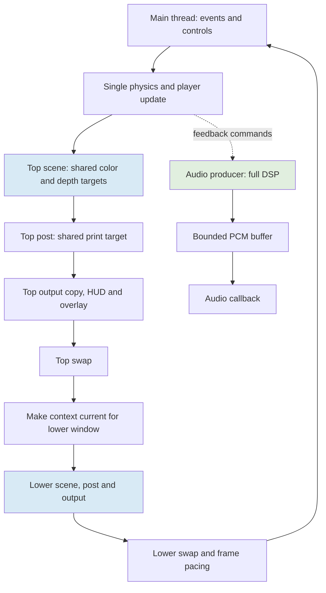
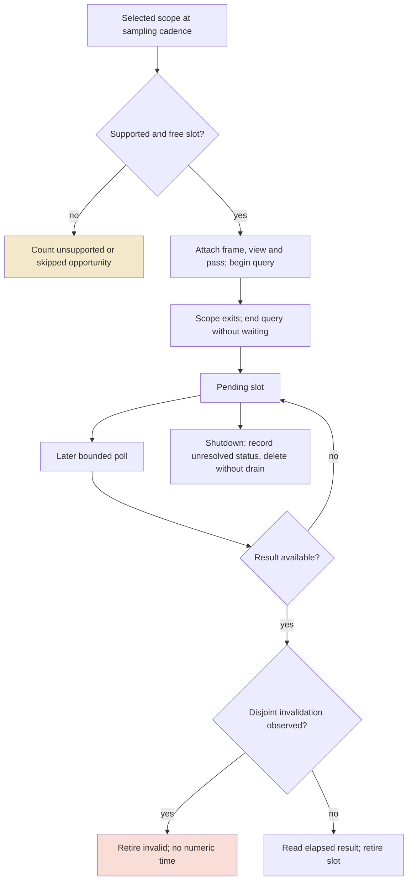
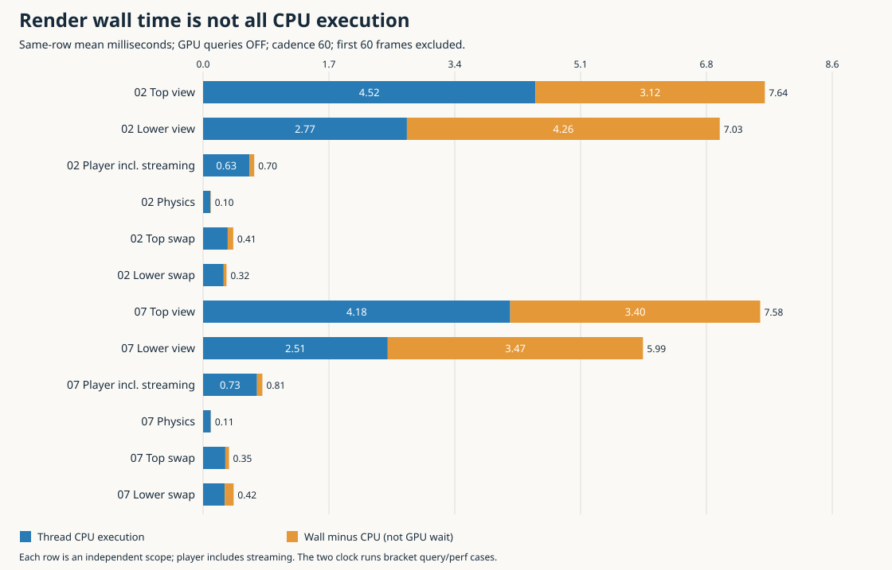
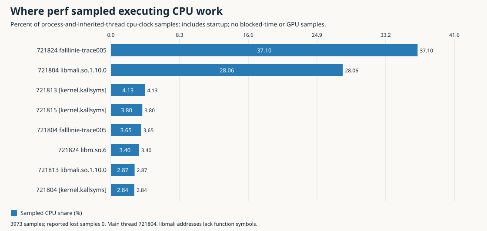

# Falllinie Rendering Measurements

Falllinie's rendering measurements now distinguish time spent executing CPU instructions from time during which the rendering thread was not executing. That distinction changes the optimization problem. In one live, query-disabled hardware run, the top view took **7.645 ms of wall time but 4.522 ms of thread CPU time**. The lower view took **7.031 ms and 2.774 ms**, respectively. A separate CPU sampling run attributed approximately **71.44% of the main thread's sampled execution to the Mali user-space driver**. These observations identify substantial driver execution and substantial non-running intervals. They do not identify every wait reason, and they do not turn the GPU timer output into a trustworthy per-pass budget.

This report develops those conclusions from the measurement definitions, implementation and actual hardware records. It connects the PERF004 rendering instrumentation to the subsequent TRACE005 paired-clock and `perf` campaign. It is an implementation-and-results report, not a repetition of the earlier tracing proposal. The source remains a graphics spike rather than a claim of complete game parity, and no proposed renderer optimization is presented as an implemented speedup.

> [!summary]
> - Rendering contains both executing CPU work and non-running time; output scopes contain much of the observed residual.
> - CPU sampling identifies heavy main-thread execution inside `libmali`, not GPU utilization or a particular redundant API call.
> - GPU elapsed queries produced impossible startup readings and inconsistent aggregate totals. Their causal interpretation remains unresolved.
> - The next useful work is controlled driver-submission and output-path experimentation, with source fidelity and thread ownership preserved.

## 1. Define the quantities before comparing them

A **wall interval** is elapsed time between two readings of a monotonic clock. It advances while the measured thread executes, sleeps, blocks, or waits to be scheduled. A **thread CPU interval** is the CPU time charged to that particular thread between two readings of its CPU clock. Work performed by a separate audio or driver thread does not become main-thread CPU time merely because the main thread depends on it.

For a scope with matching endpoint observations, define

\[
W = (w_1-w_0)/10^6,\qquad
C = (c_1-c_0)/10^6,\qquad
R = W-C,
\]

where timestamp differences are in nanoseconds and the resulting quantities are in milliseconds. Here, \(R\) is a **non-running estimate**, not a directly measured wait reason. It includes time during which the thread was not executing, together with clock-read skew and accounting residual. A thread can be blocked on a dependency or runnable without receiving CPU service; these are different scheduler states, but neither is resolved by subtracting two clocks.

A **GPU elapsed query** is a separate observation made through the graphics API. Its numerical result is not CPU execution time. Its usefulness depends on the driver's implementation, validity conditions and the meaning of the queried interval. Likewise, a `perf` CPU sample records executing code at a sampled instant; the distribution of those samples does not describe the periods when the thread was not running. The measurements are complementary, but their denominators must remain explicit.

The target frame period at 60 Hz is \(1000/60 \approx 16.667\) ms. A mean interval close to that period does not establish that all frames meet it. A pacing cap can hold an inexpensive workload at that interval, and long-tail intervals can still exceed it substantially. The frame CSV measures application-loop timing, not physical scanout or input-to-display latency.

This distinction was necessary because the earlier AUDIO003 live run reported a mean interval of 19.7839 ms, with 9.5481 ms and 8.1037 ms inside the two renderer-call wall boundaries. Its GPU CSV contained only a header. Those rendering intervals therefore could not legitimately be described as GPU times, nor could the empty GPU file be interpreted as zero GPU cost. The new work resolves part of that ambiguity rather than retrospectively changing the old evidence.

## 2. The renderer and its ownership boundaries

The native renderer uses one GL context on the main thread and presents two views through two SDL windows. Each view renders a scene into an offscreen color/depth target, applies a print-style post-processing pass, and copies the result to the drawable. The top view also draws the gameplay HUD and developer overlay. The lower view temporarily substitutes the first-person camera and suppresses the rider's own face; it does not perform a second authoritative simulation update.

The order is significant because both views reuse the same offscreen targets. Main-thread ordering makes that reuse valid at the API level, but it does not prove that the driver avoids internal stalls or extra memory transfers. A CPU call may return before GPU work completes or may wait for an earlier dependency. Source inspection establishes the dependency structure; measurement is still needed to establish its cost.



All video and GL operations remain main-owned. The existing compositor-placement worker performs IPC, not GL rendering. The audio producer has its own ownership and deadline constraints. Moving a graphics operation to another thread is therefore not an interchangeable scheduling choice: it can introduce ownership violations, snapshot requirements, memory duplication or a new dependency wait.

The scope hierarchy reflects this architecture. A renderer `view` contains `scene`, `post` and `output`; dynamic mesh preparation and upload are CPU-only children of `scene`. Main-loop player work includes terrain streaming, rider preparation and uploads outside the renderer probes. The legacy `stream_ms` value is already included in `player_ms`. Adding either those two values or a render parent and its children double-counts work.

Internal resolution and output resolution also describe different workloads. At 384 × 288, an internal pass covers 110,592 pixels, while a 1024 × 768 drawable covers 786,432 pixels, approximately 7.11 times as many. Reducing internal resolution does not remove the full-size copy or HUD work. This is a source fact, not proof that pixel processing dominates the output scope's wall interval.

## 3. PERF004: asynchronous pass measurements without blocking the loop

The existing whole-view timer could not simply be retained around newly timed GPU passes. Elapsed queries on the same target cannot nest. PERF004 therefore introduced explicit `off`, `view` and `passes` modes. Whole-view mode queries the renderer call; pass mode queries scene, post and output separately. The CPU hierarchy remains nested in either mode, but GPU query ownership is nonnested.

The implementation uses `GL_EXT_disjoint_timer_query` only when the extension and required entry points are available. There are 32 slots, allocated by finding a free slot rather than assuming that a particular frame number maps to an available object. Each issued query keeps its original frame, view and pass until retirement. The default cadence is one sampled frame in 60; cadence is configurable within bounded limits.

The reason for a fixed pool is operational rather than statistical. A result can remain pending longer than expected, especially under load. Allocating indefinitely would turn a diagnostic into growing memory use; waiting would change the workload being observed. When no slot is available, the collector records a skipped opportunity and proceeds. Unsupported GPU timing likewise produces explicit availability information, not a fabricated duration.



Polling checks availability before reading a query result. There is no `glFinish`, spin loop or blocking drain to obtain a more complete-looking sample set. An observed disjoint flag conservatively invalidates outstanding samples; invalid elapsed values are not consumed as measurements. Shutdown records still-pending queries and deletes objects while the context remains valid. Scope guards close active queries during exception unwinding, before camera restoration or window-context switching proceeds.

The GPU CSV distinguishes valid, disjoint, pending and pending-disjoint records. Invalid or unresolved records have no numeric duration. Final counters include issued, valid, disjoint, pending, unsupported and skipped counts. Availability polls count attempts, not unique missing samples. These details matter because a histogram of returned numbers alone conceals how much data was unavailable and whether the collection completed.

Instrumentation itself has costs. CPU stop timestamps are cached before query closure and record enqueueing; serialization occurs outside render scopes. Parent CPU scopes still contain child instrumentation overhead. On sampled dynamic frames, separately timing construction and uploads briefly changes temporary mesh lifetimes. Query-off/on comparisons hold that CPU instrumentation fixed; they are not equivalent to comparing completely uninstrumented rendering against profiling.

## 4. Two review findings changed the evidence contract

A review found that the initial analyzer checked the spelling of a CPU parent label but did not require the parent record to exist. Replacing the entire CPU-pass CSV with its header could still produce a successful analysis with an empty distribution, even though GPU queries had been issued and the emitter reported no CPU drops. Missing data was being accepted as if it were an intentionally empty observation.

The correction added an independent emitted CPU-scope count to the final PERF004 statistics. **PERF004 stats schema 2** now records `cpu_samples` and explicit drops. The analyzer retains every `(frame, view, pass)` identity, reconciles the count, requires parent-record closure and requires a CPU counterpart for every issued GPU scope. That last rule applies even when the GPU result is pending or disjoint: a failed elapsed measurement does not erase the fact that a CPU scope was entered.

This check remains independent of GPU support. A machine can legitimately produce complete CPU records and an empty GPU file. Conversely, a CPU-only leaf removed from an otherwise plausible file must still be detected. Tests first reproduced the defect: the expanded 19-test suite produced 11 failures and one error against the old analyzer. After correction, all 19 passed. The focused profiler test also verifies shutdown accounting and an intentional overflow that emits 32 records while reporting eight drops.

Historical unversioned statistics are treated explicitly as schema 1, which lacks that independent completeness count. The corrected analyzer rejects their completeness certification and requests regeneration. It does not rewrite raw receipts or insert a guessed count calculated from the file whose completeness is in question. This is a format migration, not evidence that every old timing number was numerically wrong.

The second finding concerned screenshots. The smoke harness compared images captured after profiling had been detached and a fresh frame rendered. Those comparisons establish **post-run uninstrumented fixture repeatability**, not visual equivalence of the measured query-active draws. Current documentation narrows the claim accordingly, while retaining the original evidence and a correction annotation. Query-active image equivalence remains untested; it would require capturing the relevant rendered result without an intervening uninstrumented redraw.

## 5. Controlled diagnostics and the first target campaign

A reproducible fixture must specify what is held constant and what is absent. PERF004's `--freeze-scene` is a static seeded terrain fixture, not a paused representative game. It initializes fixed terrain and camera data, does not advance simulation or call the player update, and intentionally renders the same camera in both windows. Objects, rider, particles, trails, gameplay HUD, streaming and audio DSP are absent. Explicitly conflicting live options are rejected rather than silently creating a mixed workload.

The fixture is useful for controlled view-count, resolution and post-processing comparisons. It cannot answer how expensive a populated trail is, whether cell streaming causes tail latency, or whether graphics changes interfere with full DSP. A frozen frame number in time-dependent autoplay would not automatically reproduce the same scene: different elapsed times and cooperative streaming completion can change both the trajectory and available geometry.

`--post-bypass` performs an actual omission. It skips the post framebuffer binding, uniforms and draw, and presents raw encoded scene color. The output path explicitly establishes the fullscreen vertex-array and depth state needed without the normal post pass. This output is deliberately non-parity. Selecting a debug texture only after doing post would not test omitted post work, while interpreting a bypass difference as exact shader GPU time would ignore changed scheduling and dependencies.

The first PERF004 target evidence, committed with `ae2a175`, contains eight 20-second cases using runtime `532081682d36f1eaf5eb0daf9a45b17f4b60f136`. The table below is calculated from retained frame rows with `frame >= 60`, not from the older receipt threshold field.

| Initial target case | Post-warmup frames | Mean interval, ms |
|---|---:|---:|
| Static dual, queries off | 1,138 | 16.667 |
| Static dual, pass queries | 1,132 | 16.667 |
| Static single view | 1,139 | 16.667 |
| Static dual, post bypass | 1,137 | 16.667 |
| Static dual, 512 × 384 internal | 1,073 | 17.596 |
| Closing static queries off | 1,136 | 16.667 |
| Live dual, queries off | 1,031 | 18.313 |
| Live dual, pass queries | 1,034 | 18.243 |

Most static means are limited by the requested 60 FPS cap. Their equality does not mean that a second view or post-processing is free. The larger internal resolution exceeded that cap's period in this run, and the live cases were slower than the terrain-only fixture. These results justified further attribution, not a claim that bypass would save a particular number of milliseconds in production gameplay. They also are not the eight 30-second TRACE005 cases discussed next; the source revision, workload duration and measurement facilities differ.

## 6. TRACE005: paired clocks around the same work

TRACE005 adds `--paired-clocks` alongside the existing profile output. On Linux, `CLOCK_MONOTONIC` supplies wall timestamps and `CLOCK_THREAD_CPUTIME_ID` supplies the main thread's executing CPU timestamps. Disabled and unsampled paths perform no new paired-clock reads. The recorder uses a fixed 64-record buffer and flushes only when no paired scope is active, keeping serialization outside the measured region.

Clock reads cannot occur simultaneously. The implementation deliberately reads wall-start, CPU-start, the body, CPU-end and wall-end. For render scopes, GPU query begin precedes both clock starts and GPU query end follows both clock stops. The legacy steady-clock body is enclosed by the paired wall boundaries. These intervals are consequently related, but not bit-identical definitions of the same cost.

```text
if scope_is_sampled:
    begin_selected_GPU_query_if_any()
    wall_start = monotonic_clock()
    cpu_start  = thread_CPU_clock()
    legacy_start = steady_clock()

    execute_scope_body()

    legacy_stop = steady_clock()
    cpu_end  = thread_CPU_clock()
    wall_end = monotonic_clock()
    buffer_paired_record()
    end_selected_GPU_query_if_any()
    queue_legacy_CPU_record()
```

This is an explanatory ordering sketch of the current scope implementation, not a new algorithm proposal. Each record includes frame, view, stage/pass, PID, TID and a monotonic run-start identity. Sequence numbers are assigned on entry; nested scopes can finish in a different order. An analyzer must therefore validate identity and uniqueness rather than requiring completion order to equal sequence order.

The paired JSONL sidecar has its own **schema 1**, independent of PERF004 statistics schema 2. It begins with metadata and ends with a terminal record. Read failure is represented by `null`, not zero; a successful timestamp of zero remains valid. Each clock reports `valid`, `start_failed`, `end_failed`, `both_failed` or `regressed`. Initialization fails if the monotonic run identity cannot be obtained, while CPU-clock failure is preserved as invalid sample data.

Completeness requires `attempted = written + dropped`, `active = 0`, consistent identities and exactly reconciled terminal counts. Invalid-only groups have null means. Known drops or failed reads can coexist with complete transport, but they prevent claiming that all attempted samples were valid. A terminal record proves record-transport closure, not that the application completed the requested duration successfully; exit receipts remain necessary.

The new stages include events, physics, player work, context switches, swaps and pacing. Paired events exclude top-context restoration and profiler flushing, whereas the legacy events wall interval includes them. Player still includes streaming and GL uploads. Overlay refresh, feedback publication, some setup, logging and shutdown remain outside the paired stage partition. Summing the displayed stages as an exact frame decomposition would therefore introduce another measurement error.

## 7. Follow one actual paired record

Consider frame 60, top-view output, sequence 30 in the first clock-only run, `02-clocks`. The process and main-thread IDs are both 720280. The retained record reports both clock statuses as valid, with the following endpoints:

| Field | Actual nanosecond value |
|---|---:|
| `wall_start_ns` | 69,780,263,096,490 |
| `wall_end_ns` | 69,780,269,201,743 |
| `cpu_start_ns` | 1,352,585,865 |
| `cpu_end_ns` | 1,353,665,907 |

Subtract endpoints within this record:

\[
W = 6{,}105{,}253/10^6 = 6.105253\text{ ms},
\]
\[
C = 1{,}080{,}042/10^6 = 1.080042\text{ ms},
\]
\[
R = 5{,}025{,}211/10^6 = 5.025211\text{ ms}.
\]

The observable conclusion is that this output scope elapsed for about 6.105 ms while the main thread accumulated about 1.080 ms of executing CPU time. The remaining estimate is about 5.025 ms. It is not evidence that a GPU fence blocked the thread for exactly 5.025 ms. No scheduler transition or fence event in this record identifies that cause.

The copied [actual sample record](_assets/falllinie-render-measurements/representative-sample.json) preserves these fields and the run identity. Averages are formed from valid pairs within rows, not by subtracting unrelated wall and CPU populations. Negative residuals, if observed, would remain signed and counted rather than being clamped to zero. In this campaign all 3,360 paired records were valid and none were dropped; that collection result does not remove the general read-skew limitation.

## 8. The live hardware campaign and its distributions

The TRACE005 runtime was `209a6d092885ff3f0a1efd1efab4252cb4ad2b56`. The report reads source and committed evidence from checkout `f400ffa7c658086cf775fd6d27c28403ba09c2bb`; the original worker's isolated `09430e4` checkout is not the runtime used for these measurements. The deployed binary SHA256 was:

```text
2872ede7219ccd91890de4c0d47d5af8fab687f2b5b2cf9605e25ecb1dfcb1d2
```

All eight cases ran live autoplay for 30 seconds on the RG DS Plus, with dual 384 × 288 internal rendering, seed 42, no-vsync, a 60 FPS cap, developer overlay, buffered 1,024-frame audio and source vinyl enabled. Audio output was muted, but full DSP remained active. The binary was built with `-O2 -g -fno-omit-frame-pointer`, using the existing toolchain and target libraries. A separate candidate deployment left the production launcher and binary untouched.

The collection contains 13,133 total frame records and 12,653 after excluding the first 60 frames of every run. Six paired-clock cases each produced 560 records, totaling 3,360, with exact final reconciliation and zero invalid or dropped observations. At cadence 60, each named scope has 27 post-warmup samples per instrumented run. The paired record total includes startup samples; it is not a count of independent frames.

| TRACE005 case | Post-warmup frames | Mean, ms | p95, ms | p99, ms |
|---|---:|---:|---:|---:|
| 01 Baseline | 1,570 | 18.335 | 33.060 | 34.194 |
| 02 Paired clocks, GPU queries off | 1,585 | 18.202 | 32.949 | 33.942 |
| 03 Whole-view GPU queries | 1,570 | 18.408 | 33.034 | 34.255 |
| 04 Per-pass GPU queries | 1,575 | 18.309 | 33.026 | 34.166 |
| 05 `perf stat` | 1,576 | 18.309 | 33.030 | 34.154 |
| 06 `perf record` | 1,593 | 18.102 | 32.861 | 34.029 |
| 07 Closing paired clocks | 1,586 | 18.191 | 32.976 | 34.190 |
| 08 Closing baseline | 1,598 | 18.047 | 32.755 | 33.882 |


The concentrations near 16.7 and 33.3 ms are visible in the empirical distributions. These are application intervals, not a measured scanout sequence. All means exceed 16.667 ms and the upper tails are approximately twice that deadline, so the runs do not establish reliable 60 FPS operation. The older 19.7839 ms AUDIO003 mean is contextual history, not a controlled before/after optimization comparison with these runs.

The governor remained `ondemand`; frequency and thermal conditions were not fixed. Recorded boundary frequencies include 1.104, 1.608 and 1.992 GHz, and thermal readings changed materially through the campaign. Boundary snapshots do not reconstruct continuous frequency or throttling history. The cases were sequential rather than randomized replicates, and the final two were delayed by recovery of a reporting failure. Live trajectories also depend on timing. These constraints limit precise attribution of small differences between case means.

## 9. Where wall time differs from executing CPU time

The first paired-clock case disabled GPU queries, so its CPU observations do not depend on issuing elapsed queries. It shows both real execution and large residuals:

| Scope in case 02 | Mean wall, ms | Mean CPU, ms | Mean residual, ms |
|---|---:|---:|---:|
| Top view | 7.645 | 4.522 | 3.122 |
| Lower view | 7.031 | 2.774 | 4.257 |
| Top scene | 2.881 | 2.596 | 0.286 |
| Top post | 0.660 | 0.584 | 0.076 |
| Top output | 4.069 | 1.293 | 2.776 |
| Lower output | 4.808 | 0.843 | 3.965 |



The top scene is mostly executing CPU time at these boundaries. The output scope is different: most of its wall duration is not charged as executing time to the main thread. Output therefore deserves investigation beyond its application arithmetic. It contains the final copy and, for the top view, HUD/overlay activity, but a dependency created by earlier work can be encountered there. A scope identifies where a delay becomes visible, not necessarily where its cause originated.

Top scene, post and output are children of top view. The diagram's parent and child bars are alternative levels of description, not components to add together. Nor does the residual establish that deleting output drawing would eliminate the corresponding delay: synchronization may simply become visible at another call.

The closing clock run also finds substantial residual time: top view averages 7.582 ms wall and 4.180 ms CPU, while lower view averages 5.986 and 2.513 ms. The recurrence supports the qualitative conclusion, but the changed lower-view wall mean is a reminder not to treat one 27-sample group as a fixed hardware constant.

## 10. CPU sampling identifies driver execution, not GPU utilization

The `perf record` case used the `cpu-clock` event at a requested 99 Hz, with monotonic timestamps and frame-pointer collection. It recorded 3,973 samples and zero reported lost samples for the launched application and inherited threads, not for every system process. The retained flat reports include startup, whereas the paired-clock plots exclude the first 60 frames. Their populations are intentionally different.

A shared-object attribution answers which executable mapping contained sampled executing code. The main thread's total share is 39.28% of all sampled CPU periods across collected threads. Its execution within `libmali.so.1.10.0` contributes 28.06 percentage points of that same all-thread population. Conditioning on main-thread samples gives

\[
\frac{28.06}{39.28}\times100 \approx 71.44\%.
\]

The denominator change is essential. This is approximately 71.44% of the main thread's **sampled executing CPU share**. It is neither 71.44% of frame wall time nor Mali GPU utilization. It also is not the driver share of the complete machine: unrelated processes were not attached.



Much of the sampled driver code lacks useful internal function names. The supported result is attribution to the Mali user-space object, not to a named driver algorithm. The source repeatedly performs uniform lookups, state changes, uploads and submissions, but the samples do not prove which of those calls accounts for the driver cost. A targeted change still needs a controlled comparison.

The audio producer is another substantial executing consumer. Its application-object share is 37.10% of the all-thread sample population; leading symbols include planar convolution accumulation and voice sampling. That observation is consistent with full DSP continuing under output mute. It does not mean DSP has moved into the callback, and its samples must not be added as milliseconds to the serial render-thread stages.

The separate `perf stat` case counted 39,610.22 ms of aggregate CPU time, 83,050 context switches and 18,127 CPU migrations for the launched workload, including startup. Multiple executing threads allow aggregate CPU time to exceed elapsed wall time. Those totals do not reconstruct scheduling intervals or distinguish blocked time from runnable delay. Counts are useful workload descriptors, not an off-CPU causal trace.

## 11. Observer effects and unresolved GPU semantics

The beginning and ending baseline means were 18.335 and 18.047 ms. The two clock-only means were 18.202 and 18.191 ms. This campaign did not detect a broad slowdown from enabling the paired clocks. That is a bounded observation about these sequential runs, not proof that reading clocks and writing records are free or a statistical upper bound on overhead.

The same restraint applies to the GPU queries. Cadence-selected frames in the whole-view and pass-query runs were not markedly slower than other frames. This argues against the simple explanation that query-selected frames alone were dramatically inflated in this campaign. It does not establish zero observer effect: there were only 27 selected post-warmup frames per run, work can complete later, and the workload and device conditions varied.


The elapsed-query values nevertheless remain problematic. After warmup, whole-view means are 14.908 ms for the top and 12.363 ms for the lower view, summing to **27.272 ms**. In the separate pass-query case, the reported means are:

| View | Scene, ms | Post, ms | Output, ms |
|---|---:|---:|---:|
| Top | 10.010 | 7.044 | 5.092 |
| Lower | 8.883 | 7.797 | 3.348 |

The six pass means sum to **42.174 ms**, against an 18.309 ms mean frame interval in that run. These sums are shown to expose an interpretation problem, not to present a valid additive GPU budget. Whole-view and pass modes came from different runs and cannot be mixed into a single decomposition. Changing granularity did not resolve the inconsistency.


There is a more direct physical-validity failure. Four startup readings across the two GPU-query cases were approximately **1.84467441 × 10¹³ ms** while their API-derived status was `valid`. Such a duration is impossible for these 30-second experiments. The raw rows remain preserved. They disappear from the displayed post-warmup means only because the same `frame < 60` exclusion applies to all relevant plots, not because a special value-dependent filter silently removed them.

The unsigned-looking magnitude is a diagnostic clue, not a demonstrated wraparound explanation. Nor do the smaller later results become causally valid merely by appearing numerically plausible. Availability, lack of observed disjoint invalidation and finite numeric output establish less than a verified physical interpretation of the interval. The investigation has not measured a GPU busy counter or utilization, and it has not established query-caused inflation as the explanation for these totals.

## 12. Capability limits and actual failures

The device inventory found `perf` 7.2.7 and `CONFIG_PERF_EVENTS`. BPF-related configuration was enabled, but FTRACE and KPROBES were explicitly disabled. Kernel BTF and the usual `bpftrace`, `bpftool` and `trace-cmd` tools were absent, and no readable trace root was found. BPF configuration alone therefore did not provide the scheduler and driver observations needed for this investigation.

The supported path was paired clocks plus CPU sampling. No scheduler blocked-versus-runnable reconstruction, exact ioctl duration or fence-wait attribution was achieved. The residual remains unresolved at that causal level. The project did not install packages, replace the kernel, change governors, add FIFO scheduling or pin threads merely to obtain a more detailed-looking trace.

Two operational failures are distinct from application performance failures. An initial SSH launch lacked the credential environment expected by the existing askpass helper and ended with `Too many authentication failures` before target runs began. That retry does not count as a failed graphics experiment. Credentials were not placed in the evidence files.

After the sixth workload had completed and `perf` data had been recorded, report formatting failed with exit 141 and `addr2line configuration failed`. The retained recording was processed with `--no-inline -g none`, recovering flat symbol/object attribution without rerunning the workload. The failure limits the report's callchain interpretation and delayed the final bracket cases, but it does not invalidate the already collected workload merely because inline expansion failed.

All eight actual TRACE005 workloads completed with `GL_error=0`, zero reported callback budget overruns, zero starved callbacks and zero missing audio frames. These finite application counters do not prove absence of backend XRUNs, physical audio latency or display latency. The correct success statement is that these specific collection and application-health checks passed during the bounded runs.

## 13. Optimization hypotheses ordered by the new evidence

The measurements identify two useful investigation targets: substantial main-thread driver execution and non-running time concentrated in output boundaries. They do not identify a single dominant shader or authorize a renderer rewrite. The following ranking is therefore a ranking of next experiments, not promised savings.

**First, reduce demonstrably redundant submission-side work.** In `renderer.cpp`, helper functions repeatedly call `glGetUniformLocation`, and per-view rendering repeats fixed uniforms and state setup. Caching locations after successful program linking has a straightforward invalidation key: the linked program's lifetime. State caching is more delicate because capture, resize, initialization and both views can alter state. Start with the simpler location cache, compare executing CPU time with GPU queries off, and preserve images and behavior. The `libmali` share makes this class of experiment relevant, but does not predict its gain.

**Second, isolate the output path and its dependencies.** The large output residual suggests separating copy submission, HUD preparation/upload and their subsequent dependency effects. The lower view lacks the gameplay HUD yet still has substantial residual time, so HUD work alone cannot explain the entire phenomenon. Shared offscreen reuse, driver backpressure and presentation dependencies are hypotheses. A separately approved per-view-target experiment could test reuse effects, but it would add memory and bandwidth pressure on a roughly 975 MiB, no-swap device. A changed residual location must not be mistaken for eliminated work.

**Third, reuse camera-independent dynamic data before adding workers.** `Particles::trail_mesh(game_time_)` depends on trail history and age, not on the view camera, yet live rendering rebuilds and uploads it for both views. A reuse key must include history revision, time-dependent aging and world generation. Snow geometry cannot be reused blindly: billboard basis and normals depend on eye, right and up vectors. The existing dynamic probes combine snow and trail, so their totals provide neither an isolated trail cost nor a guaranteed saving. Split the measurement only if needed to judge that concrete change.

**Fourth, precompute only genuinely invariant structure.** Rider cylinder, sphere, box and board templates are already built once. Regenerated indices and material groups are possible reuse targets, but near-zero-length segments can be omitted, changing topology. HUD text geometry can be cached by content, layout, drawable size and style, while meter fractions and animated labels require invalidation. The developer overlay already caches geometry until dirty or resized. Describing those existing caches as new optimizations would misstate the source.

Shader inspection suggests further questions, not measured answers. Terrain/trail fragments evaluate three analytic shadow segments; the post non-sky branch performs ten color/depth texture reads, while sky reconstruction and print effects perform additional arithmetic. Some segment/light-only terms may be invariant, but reassociation can change floating-point results and degenerate cases. Existing high-precision depth handling and the explicit stable-sky adaptation must remain identified. Precision reduction, altered noise, LOD or reduced geometry would be fidelity changes requiring separate approval.

| Candidate experiment | Required correctness condition | Useful next observation |
|---|---|---|
| Uniform-location caching | Invalidate on program relink/destruction | Main-thread CPU distribution with identical rendering |
| Once-per-update trail preparation | Key history, age and generation; preserve uploads' ownership | Split trail construction/upload if combined probe warrants it |
| Output-path decomposition | Preserve framebuffer, depth and drawable semantics | Same-row CPU/residual plus whole-frame effects |
| Immutable streamed-cell jobs | No shared mutable terrain caches or game RNG | Streaming tails, completion latency, memory and audio health |
| Conservative culling | Bounds include all relevant geometry for both cameras | Boundary captures and submitted work, not assumed fog invisibility |

Parallelization is constrained by the actual source. `TerrainJob` holds a mutable `Terrain&`; terrain and world evaluation use caches, neighboring features and cumulative drop data. Moving that existing job directly to a worker would introduce races even though the terrain is deterministically seeded. A safe proposal requires an immutable snapshot or worker-owned equivalent evaluator, preserving the local generation sequence and neighbor samples needed for normals.

A bounded completion queue would return a mesh tagged with seed, generation, cell and geometry revision. The main thread would reject stale, duplicate or no-longer-requested completions before performing GL uploads. Queue size and mesh bytes must be bounded; the audio producer already consumes significant executing CPU time, so additional graphics workers can compete with it. The authoritative simulation and audio ownership remain unchanged, and game RNG ordering must not depend on completion timing.

The cooperative stream job's 3.5 ms argument is a requested row-processing budget, not a hard bound on the entire player update: a row can overrun it, and object construction, uploads or restart priming add work. Parallelizing small physics arithmetic would not automatically recover either driver execution or the non-running output intervals. An optimization is useful only if its end-to-end effect survives the complete workload and preserves the intended behavior.

## 14. Reproducibility and the decision now supported

The evidence checkout is `/home/manuel/code/wesen/2026-10-12--falllinie-spike` at `f400ffa7c658086cf775fd6d27c28403ba09c2bb`. PERF004 contains the source cost map, lifecycle/completeness tests, original target records and correction annotation. TRACE005 contains `analysis/01-measured-cpu-execution-non-running-time-and-mali-query-limitations.md`, the Step 4 investigation diary, `scripts/paired-clocks/`, and `scripts/evidence/target-20261014T020124Z`. Current implementation anchors are `src/main.cpp`, `src/profiler.cpp`, `src/paired_clocks.cpp`, `src/renderer.cpp` and `src/game_renderer.cpp`.

All five figures here are copied from the actual TRACE005 campaign, not recreated from illustrative values. The [campaign summary](_assets/falllinie-render-measurements/campaign-summary.json), [original figure provenance](_assets/falllinie-render-measurements/provenance.json), and [publication evidence manifest](_assets/falllinie-render-measurements/report-evidence.json) accompany them in this note's asset directory. The provenance identifies source-input and figure SHA256 values, the graph-generator hash and the filter: frame and paired plots exclude `frame < 60`; the perf aggregate covers the whole recording. The manifest also records the initial PERF004 table and actual paired sample used above.

The figure generator is TRACE005's `scripts/09-graphs.py`; the paired analyzer validates complete sidecars before the graph calculations. Reproduction should use the recorded revisions, exact arguments, raw status counts and failed-run context, not merely the rounded tables in this report. The legacy receipt's 33.3 ms spike threshold is not a 60 FPS qualification, and its historical source-asset hash is not the deployed runtime binary hash.

The supported decision is to investigate driver-submission efficiency and output-path dependencies while maintaining the measurement distinctions established here. The data do not support pricing a shader rewrite from the GPU query sums, calling the wall-minus-CPU residual GPU wait, or promising savings from a new rendering thread. The unresolved GPU semantics and unavailable scheduler attribution are explicit limits, not reasons to discard the useful CPU evidence.

The next investigation is more precise Mali GPU profiling. Its first research gate is to establish the exact GPU and driver combination, determine which hardware-counter interfaces are available, and assess Arm Streamline/gatord compatibility with this device image. Offline Compiler analysis and API/frame tools are secondary options, with their static or capture-based conclusions kept distinct from runtime counter measurements. This is future work, not confirmed tool compatibility or a record of tools already executed. Useful documentation will be retained in the relevant ticket's `sources/` directory; no new web research was performed for this publication.

This report continues, rather than replaces, [[PROJECT REPORT - Falllinie Tracing - CPU Execution, Driver Waits and GPU Attribution]] and [[PROJECT REPORT - Falllinie Buffered Audio - PCM Ownership, Callback Deadlines and Measured Producer Scheduling]]. Those notes retain their historical purposes. The next report should identify a concrete changed implementation, its exact source and binary hashes, the unchanged controls and the resulting measured distributions before calling any of these proposals an optimization success.


## Falllinie optimization report network

Navigation addendum: [[MOC - Optimization and Performance Engineering|series index, reading routes and evidence boundaries]]. The original report above remains a historical checkpoint; these cross-links do not revise its measurements.

Continue to GPU Profiling for subsequently implemented counter access and offline compilation. Those tools were future work at this checkpoint; their later availability does not validate the anomalous GL timer values.

- [[PROJECT REPORT - Falllinie Native GLES Spike - Deterministic Terrain, Print Shaders and Mali Depth Precision|Graphics foundations]] — Deterministic terrain, encoded scene/print passes and Mali depth-sampler precision; establishes the fidelity constraints for later tuning.
- [[PROJECT REPORT - Falllinie Playable Port - Dual Views, Frame Profiling and Cooperative Terrain Streaming|Playable port and streaming]] — Shared dual views, frame pacing and cooperative terrain generation; an earlier, smaller workload.
- [[PROJECT REPORT - Falllinie Integrated Native Game - Precision, Real-Time Audio, Developer Telemetry and JavaScript Embedding|Integrated workload and precision]] — Camera-relative projection, source DSP optimizations, telemetry and the initial embedding investigation.
- [[PROJECT REPORT - Falllinie Buffered Audio - PCM Ownership, Callback Deadlines and Measured Producer Scheduling|Buffered audio qualification]] — Producer-owned DSP, SPSC PCM transport, copy-only callbacks and finite target deadline results.
- [[PROJECT REPORT - Falllinie JavaScript Embedding - ARM64 Qualification, V8 Ownership and Bounded Rules|ARM64 JavaScript experiments]] — Actual QuickJS, QuickJS-ng and V8 embeddings, ownership contracts and isolated workload measurements.
- [[PROJECT REPORT - Falllinie Tracing - CPU Execution, Driver Waits and GPU Attribution|Tracing concepts and investigation plan]] — Wall versus CPU time, scheduler-state interpretation and proposed perf/ftrace/eBPF investigation.
- [[PROJECT REPORT - Falllinie GPU Profiling - Hardware Counters, Shader Compilation and a Rejected Optimization|Hardware counters and rejected shader candidate]] — Actual G52 counters, exact-input offline compilation, non-parity post bypass and a null-result ABBA shader experiment.
