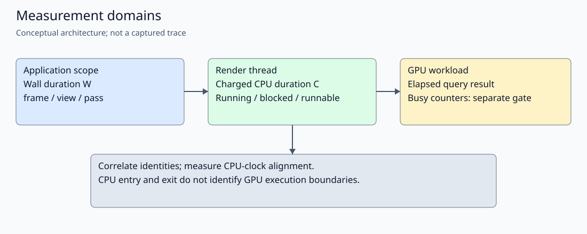
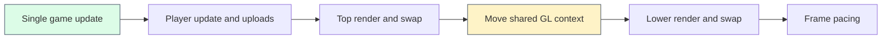
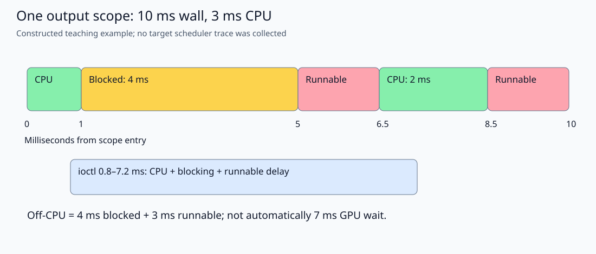
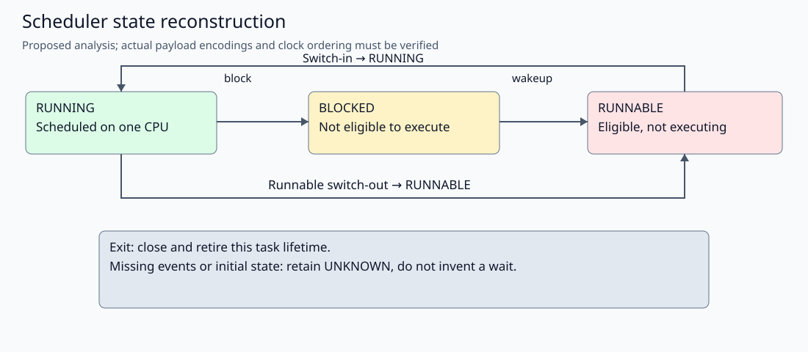
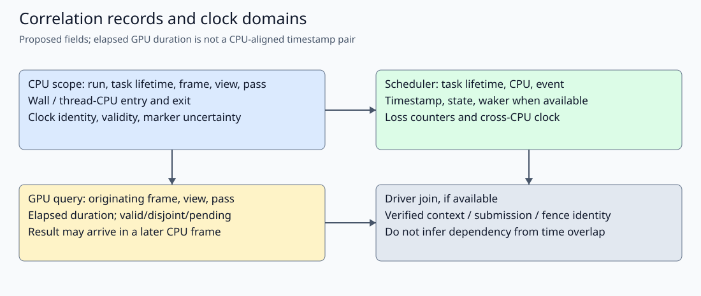
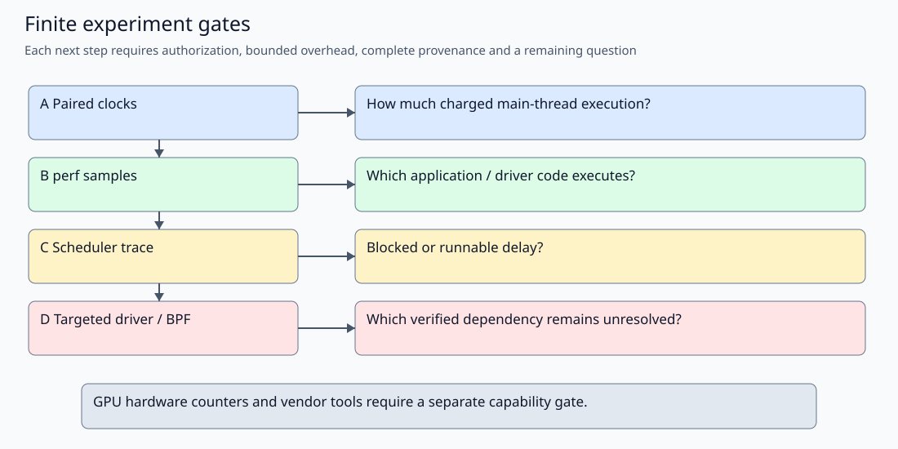

# Falllinie Tracing: CPU Execution, Driver Waits and GPU Attribution

A timer around a C++ rendering function answers how long that function took to return. It does not answer how much CPU execution it consumed, why its thread stopped executing, or how long the GPU was busy. This report develops the measurements needed to separate those questions for Falllinie's native renderer. The objective is a defensible optimization decision, not a more detailed label on the same ambiguous duration.

> [!summary]
> Thread CPU clocks measure execution charged to a thread. Scheduler events explain when that thread could not run. CPU samples identify executing code. GPU queries measure a different interval, with implementation-dependent consequences on tiled hardware. Their combination can narrow attribution; none alone establishes the complete cause of a slow frame.

## 1. Define the quantities before comparing them

**Wall time** is elapsed time between two observations of a clock. Here, a render scope is a region of code with explicit entry and exit boundaries; its wall duration includes everything that happens before execution reaches the exit, including interruptions and waits. A monotonic clock does not jump backward when the civil clock is corrected. Monotonicity does not imply that two independently chosen clocks have the same origin, rate adjustment, or cross-CPU behavior.

**Thread CPU time** is the CPU execution time the operating system charges to one thread. On Linux, `CLOCK_THREAD_CPUTIME_ID` provides a per-thread CPU clock. It includes charged user-space execution and charged kernel execution on that thread's behalf. It excludes time when another thread runs instead. A process CPU clock aggregates its threads and therefore answers a different question: simultaneous rendering and audio work can make process CPU time exceed the wall duration of an interval.

A thread is **on-CPU** while scheduled to execute and **off-CPU** while not executing. An off-CPU thread can be **runnable**, meaning eligible for execution but not currently selected, or **blocked**, meaning it awaits a condition before becoming runnable. The **scheduler** chooses which runnable thread executes on a CPU. A **run queue** represents eligible work; run-queue delay is time waiting for that selection, not evidence of a GPU dependency. A thread switched out while still runnable can incur scheduling delay without any wakeup event.

Rendering also crosses ownership boundaries. A **user-space graphics driver** translates API operations into implementation-specific commands and resource management. A **kernel driver** mediates device access and execution. An **ioctl** is a system-call interface through which user space requests device-specific operations. A **fence** represents completion of some asynchronous work; waiting for a fence is not the same as executing that work. A fence must be identified and associated with its producer before calling a particular wait a GPU wait.

A **command queue** contains submitted work that can execute after the submitting CPU function returns. **GPU busy time** describes activity under a particular hardware counter's definition. **GPU utilization** is a busy fraction over a stated observation interval and set of engines. **GPU elapsed time** from an API query is the duration defined by that query's completion semantics. It is not automatically an engine-wide busy fraction, shader instruction cost, or exclusive service time attributable to one draw.

A **tiled renderer** organizes framebuffer work into spatial regions called tiles, often retaining intermediate color and depth in local memory before writing external memory. **Binning** assigns geometry to those regions. A **shader** is a program executed by the GPU for a rendering stage. API submission order, tile processing, and completion of framebuffer transfers need not have a simple one-to-one timing relationship.

These definitions establish three different observations: the application's wall interval, the CPU thread's execution and scheduling history, and the device's execution measurements. The useful question is how those observations relate for a named frame, view, and render pass. A pass is a group of rendering operations, such as drawing the scene or processing its image; it is not necessarily one uninterrupted hardware execution interval.



*Figure 1. Different observations have different ownership and timing semantics. A shared frame identifier supports correlation; it does not make the clocks interchangeable.*

## 2. What the current project actually records

The source repository is `/home/manuel/code/wesen/2026-10-12--falllinie-spike`. Ticket `FALLLINIE-TRACE-005` owns this documentation and proposed tracing plan. The separate `FALLLINIE-PERF-004` ticket owns the existing pass instrumentation and its measurement report. No kernel trace, new main-thread CPU timer, tracing configuration change, or rendering worker was implemented for this publication. Target perf, ftrace, and eBPF capabilities remain unverified.

In `src/main.cpp`, one main thread advances the authoritative game state, updates the player-facing renderer state, renders the top view, swaps its window, moves the same GL context to the lower window, renders the head-camera view, and swaps again. Pacing follows both swaps. GL and SDL video operations remain main-thread-owned. Audio has separate callback and producer timing domains; their execution must not be silently added to serial frame cost.



This is the current serial main-loop ordering, not a proposed parallel renderer. Audio execution is separate and is intentionally absent from this serial cost sequence.

`Profiler::Scope` in `src/profiler.cpp` uses `std::chrono::steady_clock` for its field named `cpu_ms`. That field is **CPU-observed wall time**, not thread CPU execution time. The scope records its start after query begin and its stop before query end. Nested enclosing scopes can therefore contain query-management overhead that their children exclude. A proposed CPU-clock extension must state its own exact boundaries rather than promise an exact decomposition of differently bracketed intervals.

The renderer's `scene` scope includes scene submission and nested snow/trail preparation and upload. `post` processes the scene image. `output` includes the drawable-sized copy and, where enabled, HUD and developer overlay work. The dynamic preparation and upload children are already included in scene wall time. `Renderer::update_player` in `src/game_renderer.cpp` performs rider and streamed-cell uploads outside these render scopes; `stream_ms` is already included in `player_ms`. Adding children to parents would double-count.

The main-loop bottom submission interval includes make-current and head-camera setup that the inner renderer view scope excludes. Restoring the top context occurs early in the next frame. Consequently, subtracting a mean renderer scope from a mean main-loop scope is not a clean measurement of one driver operation, particularly when sparse pass samples and all-frame samples describe different populations.

The current GPU mechanism selects whole-view or scene/post/output queries, never nested elapsed queries. It has 32 query slots, retains originating frame/view/pass identifiers, polls availability without waiting, invalidates affected pending samples when a disjoint condition is observed, and reports unresolved samples at shutdown. Schema 2 also records an emitted CPU-sample count and reconciles scope identities. These are valuable integrity properties, but they establish record consistency rather than causal accuracy of a hardware interpretation.

`src/audio_timing.hpp` already uses a thread CPU clock for audio diagnostics, with unavailable readings kept distinct from measured time. That is a local implementation precedent, not evidence that the renderer has the same clock instrumentation. The callback contract remains copies, silence when necessary, numeric counters, and clocks. This plan adds no trace-marker writes, allocations, stack capture, JavaScript, or blocking notifications to that callback.

## 3. Existing evidence motivates a question, not a culprit

Historical AUDIO-003 evidence covers a 120-second buffered-audio dual-view run at internal resolution 384×288. After warmup, mean frame interval was 19.7839 ms, top renderer wall 9.5481 ms, lower renderer wall 8.1037 ms, physics 0.1557 ms, player 0.6613 ms including stream 0.0866 ms, swaps 0.8962 ms, and pacing 0.0058 ms. Its GPU CSV had no samples. Neither the empty CSV nor the missing utilization display meant zero GPU work.

A newer parent-collected PERF-004 set contains eight approximately 20-second target cases: static queries off, static passes, static single view, static post bypass, static higher resolution, another static off run, live off, and live passes. These files were **untracked and uncommitted when read for this report**. The bounded provenance manifest records source paths and SHA-256 hashes, not an assertion that the separate measurement work was already published. Metadata identifies runtime source `532081682d36f1eaf5eb0daf9a45b17f4b60f136`; the later ticket-creation revision `7ad1c7d` does not change that runtime.

One illustrative excerpt from `08-live-passes` is enough to expose the attribution problem. The receipt reports ARM Mali-G52, GLES 3.2, two views, 384×288 internal targets and 1024×768 drawable output. The frame mean after 60 warmup frames is 18.242673 ms over 1,034 intervals. Each pass below has only 18 postwarmup samples at cadence 60.

| Top-view scope | CPU-observed wall mean, ms | GPU-query elapsed mean, ms |
|---|---:|---:|
| Scene | 2.563042 | 10.159333 |
| Post | 0.667464 | 7.067552 |
| Output | 4.887863 | 5.111182 |

The lower-view GPU means are 8.509051, 7.457996, and 3.412806 ms respectively. Adding these six means gives about 41.718 ms, substantially more than the all-frame mean interval. That arithmetic is a diagnostic warning, **not an additive frame budget**. The samples are sparse and selected, whereas the interval distribution includes all postwarmup frames. Tiled query semantics, instrumentation perturbation, asynchronous ordering, scheduling, and driver behavior require investigation before treating any pass as the bottleneck. Schema-valid records and finite positive values do not settle those questions.

Both live logs report zero starved callbacks, zero callback-over-budget events, and `GL_error=0`. Each nevertheless reports one producer-over-budget block; callback safety and producer timing are different observations. These short runs do not establish long-run audio safety, complete graphics fidelity, or changed GPU utilization. Likewise, 18 pass samples cannot support a stable extreme-tail estimate merely because an analyzer prints a p99 field.

The static fixture omits the real gameplay dynamics, streaming, HUD, and audio DSP, and duplicates the initialized camera in both windows. It is useful for controlled renderer comparisons, not a substitute for representative live rendering. The first short live phase also differs from the historical 120-second trajectory. Their means are not a controlled before/after improvement. Existing capture checks establish post-run **uninstrumented fixture repeatability**; query-active capture equivalence remains untested.

## 4. Follow one render scope through the measurements

Consider a proposed record for frame 420, top view, output pass. The numbers in this section are **constructed teaching data**, not a Falllinie trace. Suppose its wall duration is 10 ms and its measured thread CPU duration is 3 ms. Let `W` be wall duration, `C` charged thread CPU duration, `B` blocked time, and `R` runnable-but-not-running time.

$$
W = t_{exit}-t_{entry},\qquad C=c_{exit}-c_{entry}
$$

$$
W-C \approx B+R+\epsilon
$$

The residual term represents clock resolution, slightly different scope boundaries, accounting conventions, interrupts, and measurement overhead. A CPU clock measures charged execution, whereas a scheduler reconstruction measures scheduled residency. Interrupt or softirq accounting can prevent their equality. Neither measurement should be forced to match the other by subtracting an unexplained constant.

For the example, a scheduler trace might establish this sequence:

```text
Constructed example; milliseconds relative to scope entry
0.0  scope begin: frame=420 view=0 pass=output
0.0–1.0  render thread executes
1.0  switch out, non-runnable state
5.0  successful wakeup of render thread
6.5  render thread switches in
6.5–8.5  render thread executes
8.5  switch out, still runnable
10.0 render thread switches in; scope ends
```

There are 3 ms of scheduled execution, 4 ms between blocking and wakeup, and 3 ms of runnable delay: 1.5 ms after wakeup plus 1.5 ms after the runnable switch-out. The wall-minus-CPU difference is therefore consistent with the reconstructed 7 ms off-CPU interval. A wakeup-to-run-only analysis would miss the final preemption interval and incorrectly report just 1.5 ms of scheduler delay.



*Figure 2. Constructed 10 ms output scope. Blocked and runnable intervals are both off-CPU, but require different explanations and remedies.*

Now add an ioctl lasting from 0.8 to 7.2 ms. Its 6.4 ms duration contains 0.9 ms of execution, 4 ms blocked, and 1.5 ms runnable delay in this constructed timeline. Calling all 6.4 ms “GPU wait” would be wrong even if the ioctl eventually proves to contain a GPU fence wait. Its runnable component is scheduler delay; its on-CPU component may be validation, memory management, or driver work. A generic ioctl duration alone does not identify the blocking object.

Suppose the corresponding GPU query later returns 8 ms. The application can associate that result with frame 420/view 0/output because the query retained those identifiers. It cannot infer that the 4 ms blocked interval lies within those exact 8 ms, because the CPU and GPU clocks are not aligned by an elapsed duration. Nor can it conclude that the wait belongs to this frame: the driver might be waiting for an earlier buffer use. A fence or submission identifier and documented driver event semantics would be needed to establish that dependency.

This progression yields an appropriately limited conclusion: the render scope contains substantial off-CPU time, split between blocking and scheduling. It does not yet establish which device or object caused the blocking. The next instrument should resolve that missing fact, rather than repeat a more expensive measurement of wall duration.

## 5. Start with paired wall and thread CPU clocks

The minimum useful implementation proposal is a paired measurement on the main thread around selected existing scopes. Read a monotonic wall clock and `CLOCK_THREAD_CPUTIME_ID` at entry and exit; preserve errors and unavailable readings. Sample sparsely, store numeric records in bounded preallocated storage, and serialize outside the measured scope. Measure empty-scope overhead and compare enabled and disabled runs before interpreting sub-millisecond differences.

```text
Proposed measurement, not current renderer implementation
entry = read_wall_and_thread_cpu_with_validity()
run_existing_render_scope()
exit = read_wall_and_thread_cpu_with_validity()
record(frame, view, pass, thread_identity,
       wall_delta, cpu_delta_if_valid, clock_status)
```

A `cpu_ms` field should not silently change meaning. Introduce explicitly named thread-CPU and wall fields with a versioned record contract. Parent and child scopes require matching boundaries; otherwise an apparent exclusive cost can be an artifact of subtracting different instrumentation. Logging must include the sampling cadence and the number of valid, unavailable, and dropped observations.

If `C` is close to `W`, the thread spends most of the interval executing or receiving charged CPU time. It may be running application C++, driver C/C++, or kernel code. It may also be spinning on a condition: high CPU time does not prove useful computation. If `C` is much smaller than `W`, further CPU micro-optimization cannot recover the whole interval without understanding why it was off-CPU. That result still does not distinguish GPU waiting from a lock, page fault, audio-related contention, compositor interaction, or scheduling.

Measure renderer and audio threads independently. Summing thread CPU durations over the same wall window can estimate process demand, but dividing that sum by one render scope's duration does not describe a serial rendering stage. Interrupt accounting, per-thread scope overlap, CPU migration, and asynchronous producer work must be documented. Negative or implausible deltas are validity failures to investigate, not values to clamp into an apparently successful profile.

## 6. What perf contributes, and what it cannot observe

Linux perf can count events and sample executing instruction locations. A hardware performance-monitoring unit provides architecture-specific counters such as cycles and instructions when available; software events provide other observations. `perf stat` supplies aggregate counts over a defined task and duration. `perf record` samples execution with event-specific weighting. These are CPU facilities unless an explicitly supported device PMU provides a separate event source.

An on-CPU sample can identify application mesh construction, repeated uniform lookup, user-space driver code, or kernel execution. It does **not** assign elapsed off-CPU duration to the stack that happened to block. Few samples in a long wall scope are compatible with waiting, but absence of samples is not a precise wait measurement. A flame graph of CPU samples is a distribution of sampled execution, not automatically a distribution of frame latency.

A call stack requires unwinding: reconstructing callers from register and stack state. Frame-pointer unwinding needs usable frame pointers through the relevant call chain. DWARF call-frame information can support unwinding when frame pointers are omitted, but requires matching metadata, sufficient captured stack data, and a perf build with appropriate support. Inline functions, tail calls, stripped libraries, and proprietary driver code can truncate or distort attribution. ARM64 hardware does not acquire Intel branch-record facilities because a generic perf manual lists them.

Keep exact executable and library build IDs, mapping records, load addresses, and file offsets. Address-space layout randomization changes virtual addresses between runs; a sampled address is meaningful only with its process mapping and object version. Do not symbolize against a newly rebuilt executable with the same filename. Even if driver function symbols are unavailable, mapping samples to a particular shared object can distinguish application execution from driver execution. Unknown internal names limit function-level attribution; they do not erase all evidence.

The following are **capability-dependent examples for a later authorized session**, not commands run for this report. `TID` must identify the verified render thread; output must go into a new bounded run directory. Installed help and policy take precedence over the example syntax.

```sh
# Proposed only: aggregate one identified thread for five seconds.
perf stat -t "$TID" -e task-clock,context-switches,cpu-migrations -- sleep 5
# Proposed only: low-rate user CPU samples, if this event/unwinder exists.
perf record -t "$TID" -e cpu-clock:u -F 99 --call-graph fp,32 \
  -m 128 -o "$RUN/render-user.data" -- sleep 5
```

User-only samples intentionally omit kernel execution. A separately approved kernel-inclusive run can answer a different question. Event support, thread attachment, inherited tasks, buffer units, perf version, and clock selection must be verified. For multiplexed hardware events, record time enabled and time running; scaled counts are estimates. Sampling frequency, lost records, throttling, unwind failures, and sample populations belong in the report, not only the resulting percentages.

## 7. Reconstruct scheduler state, not just paired timestamps

Ftrace provides kernel tracing facilities, including compiled-in event tracepoints. A **tracepoint** is an event site with a defined payload; the available event list and each event's `format` file describe the running kernel's actual interface. Scheduler switch and wakeup events can reconstruct when the render thread ran, blocked, became runnable, and resumed. They do not directly identify every reason a blocked thread waited.

At a switch-out, inspect the outgoing thread's state using that kernel's encoding. A runnable switch-out begins runnable delay. A blocking switch-out begins a blocked interval, which a successful relevant wakeup may end. At switch-in, close the previous non-running state. Handle wakeup-new, repeated wakeups, exits, and incomplete initial state explicitly. Never overwrite a valid runnable timestamp merely because another wakeup-like event appears.

```text
Proposed reconstruction; payload/state decoding is kernel-specific
on switch_out(task, state, t):
    close RUNNING interval
    enter RUNNABLE if state means runnable else BLOCKED
on successful_wakeup(target, t):
    if target is BLOCKED: close BLOCKED; enter RUNNABLE
    else: retain state and annotate duplicate/unknown transition
on switch_in(task, t):
    close known BLOCKED/RUNNABLE interval or flag missing transition
    enter RUNNING
on exit(task, t):
    close state; retire this task lifetime
```

A real implementation must be stricter than this sketch. Include process and thread identity, task lifetime, CPU, timestamp, state, and loss metadata. Linux thread IDs can be reused after exit; the same numeric ID must not join two different tasks. CPU migration requires a suitable cross-CPU trace clock and ordered event processing, not independent pairing within each CPU's buffer. Concurrent wakeup and switch events need documented ordering and uncertainty treatment. Missing records produce unknown intervals, not fabricated sleeps.

Filter by the **event's subject**, not blindly by the task executing the tracepoint. A wakeup record may be emitted by a waker whose current thread ID differs from the render thread being awakened. Likewise, a switch involves both outgoing and incoming tasks. Check event-specific fields and any tracefs PID-filter behavior before enabling filters. Cgroup scoping can help where supported, but does not automatically preserve every external waker or relevant kernel worker.

Waker identity provides context: an interrupt, compositor thread, driver worker, or another application thread may make the render thread runnable. It does not prove the original dependency by itself. A signal or spurious wakeup can end a sleep without completing the intended operation. Correlate wait entry, wakeup, return status, and any object identifier before assigning a cause.



*Figure 3. Proposed state reconstruction includes runnable switch-outs, cross-thread wakeups, lifecycle termination, and explicit unknown intervals when records are incomplete.*

## 8. Driver tracing and the limited role of eBPF

A **kprobe** dynamically observes a kernel instruction or function location, subject to architecture and kernel restrictions. A **uprobe** observes a user-space executable location. **eBPF** is a facility for loading verified programs that can execute at supported hooks and maintain bounded state. Its verifier checks properties such as memory access and control-flow safety before accepting a program. Verification does not prove the measurement's causal interpretation or acceptable application overhead.

Prefer existing tracepoints with understood semantics before attaching to internal functions. Internal kernel and proprietary driver functions are not stable measurement APIs. Inlining, symbol restrictions, module updates, probe blacklists, and optimized entry/exit paths can invalidate a guessed function name or return-probe pairing. Nested calls and recursion also require depth-aware state rather than one start timestamp per thread. An ioctl record can identify request and file descriptor, but resolving the device safely and respecting descriptor reuse remain necessary.

For this target, Mali vendor tracepoints might exist, or they might not. The report does not invent a universal Mali submission, fence, or busy event. Inspect available event names, formats, exposed properties, and matching driver documentation before selecting an attachment. A generic fence event, if present, may describe another engine or client. Context and completion identifiers must connect it to the application before it supports attribution.

**BTF** is type metadata used by BPF tooling to describe kernel types. **CO-RE**, compile once–run everywhere, uses that metadata and relocations to adapt certain structure accesses across kernels. It does not guarantee that a desired tracepoint, helper, program type, or proprietary module's type information exists. BTF absence does not prove that every form of BPF tracing is impossible; it can rule out the planned CO-RE approach while other designs require separate review.

Kernel configuration, architecture support, security policy, capabilities, lockdown, and installed tooling are independent gates. `CAP_PERFMON` and `CAP_BPF` have distinct roles; older kernels and particular attachments can require different checks or broader capabilities. Some helpers and program types have GPL-compatible licensing requirements. Selecting a license string is not a way to bypass either legal obligations or kernel restrictions. A kernel release label such as 7.2.7 is not proof of any particular configuration or permitted attachment.

Use custom BPF only when simpler records leave a named unanswered question. For example, after scheduler evidence establishes repeated blocking inside a verified driver wait, a bounded program could aggregate wait durations by object class or correlate a submission identifier with completion. Predeclare maximum tracked tasks, nesting depth, stack IDs, keys, and output rate. Delete lifecycle state on exit; expire incomplete entries; count map insertion failures, ring-buffer reservation failures, discarded records, and unmatched exits. Do not turn a dropped event into a zero-duration wait.

No CPU BPF program observes shader instruction execution merely by attaching to a graphics API or kernel driver. GPU hardware counters and vendor profiling tools require a separate capability, authorization, and semantics check. A traced submission interval can identify queueing or synchronization behavior without explaining whether shader arithmetic, texture access, fill rate, or memory bandwidth dominates the submitted workload.

## 9. Correlation and tiled GPU interpretation

Use a proposed compact identity tuple: run ID, source/build ID, process lifetime, thread lifetime, frame, view, pass, and event kind. Entry/exit markers should identify coarse scopes, not every draw. A tracefs marker write produces a CPU-side trace event; a uprobe on a stable application boundary can provide a different attachment strategy. Both have overhead. Neither records the instant the GPU executes the corresponding commands.

Application wall clocks, SDL performance counters, perf timestamps, tracefs clocks, and GPU query clocks must be distinguished. SDL ticks convert to seconds by dividing a counter difference by `SDL_GetPerformanceFrequency()`, not by assuming nanoseconds. `steady_clock`'s monotonic property does not by itself establish its mapping to a chosen trace clock. Measure paired observations before and after collection and preserve their uncertainty; choose compatible monotonic domains where supported. Cross-CPU synchronization and drift matter for a migrated thread.

A marker syscall can be delayed between the application's entry observation and the actual trace event. Record or bound that gap rather than placing the marker at an exact application timestamp by convention. Marker emission can itself cause a preemption or additional I/O work. Compare no-marker and marker-enabled runs; keep identifiers fixed-size and avoid formatting or allocations in latency-sensitive paths. Audio callbacks remain excluded.



*Figure 4. Proposed joins use identities and measured CPU-clock alignment. A delayed GPU elapsed result retains its originating scope but supplies no common-clock GPU start timestamp.*

GPU query results become available asynchronously. Falllinie correctly retains their original frame/view/pass rather than attaching them to the frame that polls them. However, elapsed duration alone supplies no CPU-aligned start and finish. Queue depth and older resource dependencies can shift waits into later API calls. A costly `glBufferData`, draw, or output call can expose pressure caused by earlier work, not just its own payload.

The Khronos `EXT_disjoint_timer_query` specification explicitly warns that tiled implementations may not produce the timing intuition expected from linear rendering. Its implementation note for some ARM and Qualcomm tilers describes elapsed work accumulated across binning and tile rendering, with implementation-dependent inclusion of tile-memory transfers. It does not authorize counting overlapping binning and rendering twice, and it is not a specification of this exact Mali driver. These distinctions are why the 41.718 ms sum above demands investigation rather than an invented overlap explanation.

Do not assert that queue latency is necessarily included in every elapsed query. The query's semantics, timer implementation, and boundary placement determine what it measures. Conversely, a long CPU API call can include driver CPU execution, scheduling, or synchronization regardless of the query's elapsed value. Disjoint handling and availability checks make records usable under the API contract; they do not demonstrate non-perturbation or convert those records into utilization.

Keep the existing no-`glFinish`, no blocking result read, bounded-pool policy. Adding a forced completion to make CPU and GPU intervals easier to align changes the workload and can remove the asynchronous behavior being investigated. Whole-view versus per-pass modes, changed sampling cadence, and carefully controlled diagnostic bypasses are useful future comparisons, but each comparison needs its own observer-effect assessment and representative live confirmation.

## 10. A finite, authorized experiment sequence

The first gate is a **read-only capability inventory**, not a tracing session. A future operator should record the exact kernel and driver build, available perf executable/version, readable kernel configuration, perf policy, BPF policy, BTF availability, tracefs mount and permissions, existing tracing ownership, event names and payload formats, available trace clocks, unwinding support, and binary/library identities. Missing files or denied access are results, not invitations to install packages, mount filesystems, weaken policy, or elevate privileges.

Illustrative inventory commands are deliberately limited and were **not executed on the target** here:

```sh
# Proposed, read-only, only where these paths/tools already exist.
command -v perf
cat /proc/sys/kernel/perf_event_paranoid
cat /proc/sys/kernel/unprivileged_bpf_disabled
ls -l /sys/kernel/btf/vmlinux
cat /sys/kernel/tracing/available_events
cat /sys/kernel/tracing/events/sched/sched_switch/format
cat /sys/kernel/tracing/events/sched/sched_wakeup/format
cat /sys/kernel/tracing/trace_clock
```

A denied or absent tracefs path is not a negative hardware finding. A readable event format is not permission to enable it. Avoid broad probing tools that load programs as part of their feature test when only read-only inspection has been approved. Configuration inspection should use already available files; do not alter the device merely to make the checklist complete.

The next phases are finite proposals, each requiring explicit authorization for implementation or target operation:

| Phase | Bounded action | Required result before proceeding |
|---|---|---|
| A | Add paired main-thread clocks at coarse scopes; compare fixed short off/on runs. | Validity counts, overhead estimate, matched scope definitions, no audio regression. |
| B | Five-second low-rate perf counts/samples for the identified render thread. | Loss/throttling and unwind assessment; application-versus-driver CPU evidence. |
| C | Five-second scheduler trace with a few coarse markers. | Cross-CPU clock choice, state completeness, blocked/runnable split with unknown intervals retained. |
| D | One targeted driver/BPF correlation for a still-unanswered dependency. | Verified event semantics, bounded state, lifecycle/loss accounting, causal join evidence. |
| E | Repeat a justified optimization candidate under normal instrumentation-off conditions. | Representative frame tails, audio safety, fidelity, and reproducible benefit. |

Start with a dedicated tracefs instance if supported and approved; it can separate buffers and event configuration, but not every control or dynamic probe definition is instance-local. Inspect ownership, save precisely the settings to be touched, and restore only those owned settings. Never clear another collector's buffer or toggle global `tracing_on` to obtain an apparently clean experiment. If safe isolation is unavailable, stop for an operator decision rather than taking over tracing.

Bound total memory, not just a per-CPU buffer value. For a proposed initial trace, choose a five-second duration, a documented per-CPU allocation constrained to a small total cap, and at most coarse frame/pass markers. Use 99 Hz as an initial CPU sampling proposal rather than an entitlement to that frequency. Confirm an external timeout supported by the device and define graceful termination so final statistics are not lost. Record actual buffer usage, overwritten records, perf lost records, map failures, and collector exit status.

Baseline, instrumented, instrumented, baseline order is a useful minimum comparison, not a substitute for enough repetitions. Hold seed, workload phase, audio mode, display configuration, internal resolution, query mode/cadence, compiler flags, and placement fixed. Record temperature and CPU/GPU frequency information where already readable, noting whether observations are boundary snapshots or continuous telemetry. Do not silently change governors, affinity, priorities, or pacing to reduce variance.

System-wide scheduler and kernel traces may expose other task names, addresses, timing, and activity. Stack dumps may contain application data beyond return addresses. Prefer thread/process/cgroup filtering where it preserves the needed events, avoid ioctl payload capture and arbitrary memory reads, and restrict raw artifact access. Publish bounded aggregates and redacted identifiers rather than raw stacks, environment strings, or user data. Hashing a sensitive trace does not make the trace safe to publish.

Acceptance is not “the tool ran.” Require a complete provenance receipt, bounded collection, known clocks, reviewed filters, loss accounting, meaningful sample coverage, and quantified instrumentation perturbation. If records are missing, attribution must retain an unknown component. If instrumentation materially changes frame or audio distributions, reduce scope and repeat before using its timing to select an optimization. Rollback disables only the experiment's attachments, closes owned descriptors, restores owned settings, and verifies normal application behavior; no uninstall, module unload, or service termination is implicit.

## 11. Turn observations into optimization decisions

A conclusion should name both its evidence and the additional proof needed. The following decision table is deliberately stricter than matching a long duration to a familiar subsystem.

| Observation | Candidate explanation | Additional proof required | Possible direction |
|---|---|---|---|
| Wall and thread CPU rise together; samples identify application code. | CPU computation or allocation. | Representative call paths, useful work versus spinning, bounded exclusive cost. | Cache invariant work, batch preparation, reduce allocation. |
| High thread CPU with many driver-module samples. | User-space driver submission overhead. | Symbols or module attribution, API count/state context, controlled reduction. | Cache locations, batch compatible work, reduce redundant state. |
| Low CPU/wall ratio; blocking occurs inside a verified driver wait. | Resource or device dependency. | Fence/object identity, completion and return correlation, prior-use mapping. | Buffer reuse/lifetime changes, fewer forced dependencies. |
| Long runnable intervals after wakeup or runnable switch-out. | CPU scheduling contention. | Competing workload, priority and migration context, repeated conditions. | Reduce CPU demand and worker contention; do not assume shader changes help. |
| Delay correlates with swap/compositor/display events. | Presentation pacing or buffering. | Verified display policy and relevant completion events. | Presentation analysis; preserve authorized display behavior. |
| GPU elapsed shifts strongly with query boundaries/cadence. | Query perturbation or timing-semantics mismatch. | Matched off/on frame distributions and driver/query semantics. | Repair measurement interpretation before optimizing. |
| Controlled GPU metrics scale with pixels or shader workload. | Fill, shader, or bandwidth limitation. | Hardware-counter semantics or controlled tests separating those causes. | Investigate shader work, resolution, bandwidth; validate appearance. |



*Figure 5. Increasing instrument complexity requires a remaining question and a passed safety/evidence gate. GPU counters are a separate capability gate, not an automatic result of CPU tracing.*

The source already suggests concrete CPU candidates: repeated uniform-location lookup, HUD construction, and camera-independent trail preparation. Those mechanisms exist, but the recoverable time is bounded by the correctly attributed CPU component. Snow geometry is camera-dependent; blindly reusing its top-view vertices would change the lower view. Existing rider templates and overlay caching also mean that some apparent precomputation opportunities have already been implemented.

A CPU job system is justified only when independent CPU preparation is material and its synchronization and memory costs are measured. Terrain and world objects have mutable caches; moving existing references to a worker is not safe simply because terrain generation is deterministic. A later design would need immutable inputs or worker-owned evaluators, bounded queues, generation-tagged results, and main-thread GL upload. It must leave budget for the audio producer and retain one authoritative world update and its RNG behavior.

GPU-limited work requires different evidence and remedies. Shader simplification, fill reduction, bandwidth changes, and render-target lifetime changes can affect appearance or memory use. More CPU threads do not inherently remove a GPU dependency, and can worsen contention while leaving the same device workload. Conversely, a large API wall time is not permission to rewrite a shader before determining whether that time was CPU execution, resource waiting, or scheduler delay.

The near-term outcome is therefore a capability and attribution gate, not a selected optimization. Keep main-thread GL ownership, keep JavaScript out of the real-time audio path, and keep a single authoritative simulation. The report is complete as a research and experiment design publication even though its proposed target tracing remains intentionally unperformed.

## 12. Sources, provenance, and continuation

The native ticket is `ttmp/2026/10/13/FALLLINIE-TRACE-005--cpu-gpu-driver-and-scheduler-attribution-with-perf-ftrace-and-ebpf`. Its design document records architecture, experiment limits, and acceptance; its diary records the actual request, authoring actions, research failures, and publication verification. The capability/tracing task remains open. The separate PERF-004 report remains the authority for that measurement campaign, rather than this small illustrative excerpt.

Primary references below were retrieved on 2026-10-14 UTC, during the 2026-10-13 local publication session. Kernel documentation was a moving development version, not documentation matched to a verified target configuration. Referenced features must be checked against the actual kernel and tools. The self-contained [provenance manifest](_assets/falllinie-trace-005/provenance.json) contains retrieval hashes, local evidence hashes, figure definitions, and source revision labels. Figures are original diagrams; the only numerical timeline is explicitly constructed.

1. [Linux ftrace documentation](https://docs.kernel.org/trace/ftrace.html): trace clocks, instances, markers, buffers, PID filtering, and control-file semantics.
2. [Linux event tracing](https://docs.kernel.org/trace/events.html): available events, payload formats, and event-specific filters. The examples are documentation, not permission to write global settings.
3. [Linux perf security](https://docs.kernel.org/admin-guide/perf-security.html): scope restrictions, resource controls, capabilities, and exposure of collected data.
4. [Linux perf-record source manual](https://github.com/torvalds/linux/blob/master/tools/perf/Documentation/perf-record.txt): call-graph methods, build IDs, clocks, and recording options. Installed help remains authoritative for the device.
5. [Linux eBPF verifier](https://docs.kernel.org/bpf/verifier.html), [libbpf overview](https://docs.kernel.org/bpf/libbpf/libbpf_overview.html), and [BPF licensing](https://docs.kernel.org/bpf/bpf_licensing.html): program validation, BTF/CO-RE, lifecycle, and GPL-related restrictions.
6. [Khronos EXT_disjoint_timer_query specification](https://github.com/KhronosGroup/OpenGL-Registry/blob/main/extensions/EXT/EXT_disjoint_timer_query.txt): completion semantics, disjoint validity, and tiled implementation caveats, especially issues 10 and 18. The direct registry endpoint returned HTTP 403; the official Khronos repository copy was used.

These sources support the measurement model, not a claim that target tracing is already available. The next authorized experiment should first distinguish wall duration from charged main-thread execution, then use scheduler and driver evidence only to answer what remains unresolved.
