# Francois Catalog: A Hosted Subscriber Platform for Single-File HTML Applications

Francois began as a local program that runs saved single-file HTML applications, such as the POLIS city-building IDE, and supplies the browser APIs those applications expect from Claude's artifact runtime: a document database, shared rooms, user identity, and model sampling with browser-executed tools. The work described here, ticket FRANCOIS-002, turns that local runner into a hosted subscription service. Subscribers sign in through ZITADEL, pay through Stripe, and launch private application instances pinned to immutable releases. Each instance runs on its own browser origin with a persistent PostgreSQL-backed database, rooms shared between explicitly invited members, real user identities, and model calls that the server meters against a monthly allowance. Administrators upload HTML, preview it on an isolated origin, publish it, and manage users, instances, billing, usage and settings from a web interface.

This report explains how the system works and how it was built, at the level of detail needed to modify it safely. It follows the code at commits `495066f` through `b1a8150` in `/home/manuel/code/wesen/go-go-golems/francois`, the FRANCOIS-002 design guide, and the implementation diary. Where the report states that something was verified, the evidence is a test in the repository or a recorded browser run against real ZITADEL, a Stripe sandbox and real Pi model providers.

> [!summary]
> - **One Go process, two kinds of origin.** A trusted portal origin serves login, billing, the catalog and the admin interface. Every application instance gets its own hostname, `i-<id>.<app-domain>`, routed by exact `Host` to the same process. Uploaded HTML never executes on the portal origin.
> - **Authority is re-derived on every request.** A browser-bound launch exchange turns a portal session into a short-lived, instance-scoped bearer grant. Each hosted request resolves that grant into a principal `(user, instance, release, role)` and rechecks membership, instance state and subscription before acting.
> - **Money and model spend are ledgers, not flags.** Stripe webhooks are durable refresh requests: the worker always fetches current Stripe state and projects it by subscription ID. Model calls reserve credits in a row-locked transaction before the provider starts, and settle exactly once.
> - **Verified end to end.** A PostgreSQL integration test exercises the security boundaries, and a Docker Compose stack was driven in a real browser through ZITADEL login, Stripe Checkout and Portal, sharing and presence, POLIS agent calls through Pi, revocation and grant renewal.

## How to read this report

The chapters follow the dependencies between concepts. Chapter 1 defines the vocabulary. Chapter 2 explains what existed before and why it could not simply be exposed to the internet. Chapter 3 shows the whole architecture and follows one subscriber through it. Chapters 4 to 13 then take each subsystem in turn, in the order a request meets them: host dispatch, identity, the data model, releases, instances, the launch protocol, the hosted runtime, model calls, billing and administration. Chapters 14 and 15 cover the frontend and deployment. Chapter 16 records how the system was verified, including the bugs that only a real browser found. Chapter 17 lists review findings and limitations, and Chapter 18 lists the work that remains.

A reader who wants the security argument can read Chapters 4, 5, 9 and 10 in order. A reader who wants the commercial logic can read Chapters 11 and 12.

## 1. The concepts the system depends on

The system has more named entities than a typical web application, because it separates who a person is, what they have paid for, which code they run, which workspace they run it in, and which browser tab is talking to the server. Each of these has a different lifetime and a different owner, and most of the security properties come from keeping them apart. The definitions below are introduced in dependency order; later chapters use them without re-explanation.

**Identity and accounts.** An *identity provider* (IdP) authenticates people. This deployment uses ZITADEL through OpenID Connect (OIDC). The IdP returns an *issuer* (which provider) and a *subject* (which person within it). A *local user* is the platform's row for one `(issuer, subject)` pair, with a generated ID such as `usr_3f…`. Email and display name are mutable profile fields copied from the IdP on each login; they are never the identity key. A user has a *role*, either `subscriber` or `admin`, and a `disabled` flag. A *portal session* is the platform's own browser login: an opaque random token in an HTTP-only cookie, stored server-side only as its SHA-256 digest.

**Commerce.** A *subscription* is Stripe's recurring billing relationship with a *Customer*. The platform keeps a *projection* of each Stripe subscription in its own table, keyed by Stripe subscription ID. *Entitlement* (or *access*) is the platform's decision, computed by a pure function, that a user may use hosted features now. Entitlement can also come from a *complimentary grant*, an administrator-issued access window that is deliberately not a fake Stripe row.

**Code.** A *catalog artifact* is a product entry such as `polis`. A *release* is one immutable version of an artifact, for example `polis 1.0.0`, with a *manifest* that declares which browser capabilities the application uses. *Release files* are the stored HTML and manifest, identified by SHA-256. A release moves through the states `draft → published → withdrawn`.

**Workspaces.** An *instance* is a workspace that runs one release. It has an owner, *members* with roles `owner`, `editor` or `viewer`, durable documents and assets, and its own hostname. Two subscribers running the same release have two instances with separate data. A *preview instance* is an admin-only instance used to inspect a draft before publication.

**Browser sessions inside an instance.** A *view* is one live page of one user in one instance, identified by `v_…`. Two tabs are two views. A *capability* is a namespace of the `window.claude` API, such as `db`, `room`, `user` or `sample`.

**Hosted authority.** The *portal origin* is the trusted website, for example `http://localhost:8090`. An *application origin* is an instance's own origin, for example `http://i-8e19bb1e6c08af74bc87.apps.localhost:8090`. A *launch code* is a one-use, 60-second secret that the portal issues for one instance, bound to the portal session and to a PKCE challenge. A *runtime grant* is the bearer token the application origin receives in exchange for a launch code; it is scoped to one user and one instance and expires after 30 minutes by default. A *principal* is the server's verified answer to "who is acting, in which instance, under which release, with which role", recomputed from the grant on every request.

**Model spend.** *Credits* are the unit of the included model allowance. Each approved model has a credit weight per call. A *reservation* holds credits for one call before the provider is contacted; *settlement* converts the reservation to usage or releases it.

The following diagram shows how these entities relate. Arrows read "references".

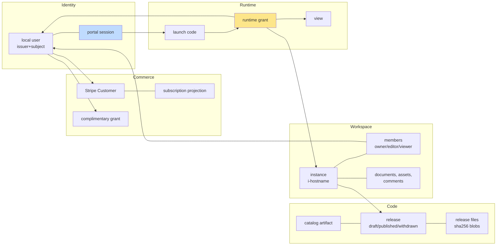

Two misunderstandings are worth addressing at the start. First, signing in does not grant access: a freshly signed-in user who has not paid sees the catalog but cannot create an instance, download a paid release, or make model calls. Second, a runtime grant is not a login. It cannot call any portal endpoint, cannot see billing, and cannot touch any instance other than the one it was issued for.

## 2. Where the project started and why the local runner could not be exposed

### 2.1 The local runner

Before FRANCOIS-002, Francois was a single-user program, described in the vault note [[PROJ - Francois - Hosting Claude Artifacts with Go and Pi]]. Its `francois serve` command starts a Go host (`pkg/host`) that listens only on loopback, stores state in SQLite (`pkg/store`), and gives each imported artifact its own persisted loopback port, so each artifact gets a separate browser origin and therefore separate `localStorage`. A Node worker (`worker/src/main.ts`) uses the Pi SDK and the operator's own Pi configuration in `~/.pi/agent` to call model providers. When a model asks to use a tool, the worker sends the request back through Go to the page, where the application's own JavaScript callback runs; this is how POLIS's `eval` tool edits the scene in the browser.

The local host's identity model is a single durable owner. `pkg/host/server.go` creates it once:

```go
func New(ctx context.Context, s *store.Store, b piworker.Backend, root string) (*Host, error) {
	owner, err := s.Identity(ctx, id("u_"))
	...
	return &Host{Store: s, Backend: b, Owner: owner, ...}, nil
}
```

and `Run` refuses any non-loopback listen address:

```go
if net.ParseIP(ip) == nil || !net.ParseIP(ip).IsLoopback() {
	return errors.New("listen must use a loopback IP address")
}
```

Every document query, private path, profile, comment and presence entry in the local host is stamped with `h.Owner`. Rooms report every peer as `isMe: true`, because there is only one person. Model calls use whatever Pi credentials are on the machine.

### 2.2 Why relabeling the owner would not work

Exposing that host to subscribers would require answering questions it has no data for. Which person is making this request? Which workspace does this document belong to, when two people run the same application? May this person write, or only read? Has this person paid? Who pays for this model call, and how much may they spend? The local design answers all of these with "the owner", which is correct on a laptop and wrong on a server.

The design guide states the rule that the implementation follows: the hosted service keeps the browser capability contract and reuses domain code where its semantics fit, but every operation runs with an explicit, server-verified context instead of a global owner. In the guide's words, "a single local `Host.Owner` cannot identify several subscribers. Scoping by release/artifact alone also merges different users' data and rooms. Instance identity is needed independently of user identity."

The result is a separate command group, `francois catalog`, with its own packages under `pkg/catalog`. The local commands and `pkg/host` are unchanged, apart from a few helpers that were extracted so both sides could share them (section 10.4).

### 2.3 How the scope changed during design

The ticket went through two design revisions before any code was written, and the change matters for understanding the result.

| Revision | Commit | Scope | What changed it |
|---|---|---|---|
| 1 | `b294a00` | Distribution only: subscribers sign in, pay, and download HTML files to run locally with their own Pi credentials; opt-in release emails. | Initial request: "people can subscribe to receive and download such html files". |
| 2 | `07e8677` | Hosted platform: instances with `db`, `room`, `user`, and server-funded LLM calls; an administrator UI for upload, users and settings. Downloads remain an optional feature. | User: "we should actually provide hosting, i.e. db / room / user / LLM functionality", and "we also want an admin side of things, to upload new html, manage users, settings". |

Revision 2 is what was implemented. The distribution features from revision 1 survive as authenticated downloads (section 7.6). Release notification email (Phase 7) is still open.

### 2.4 How it was built

The implementation was delivered in a short series of commits. The first commit contains the whole platform core; the following commits came from running it for real.

| Commit | Content |
|---|---|
| `495066f` | Hosted catalog core: PostgreSQL store and migrations, OIDC login, sessions, releases, instances, launch grants, hosted runtime, Stripe services, admin API, React UI. 65 files, about 11,000 lines. |
| `b59bbbd` | Docker Compose acceptance stack (PostgreSQL, ZITADEL, provisioning job, Stripe CLI forwarder) and fixes for four bugs found in the browser. |
| `341262f` | Pi provider directory copied into a private volume; `max` thinking level accepted; Stripe sandbox and POLIS validated. |
| `1fca310` | `--grant-ttl` flag, fake-gateway tests for the billing service, README and diary. |
| `0bee348` | Generated package loggers, lint fixes, and grant renewal at 75% of remaining lifetime. |
| `c59e75d`, `b1a8150` | Diary and changelog. |

The design guide was used as the specification. Its Sections 13–15 (schema, packages and HTTP API) map closely onto the files that exist now, and its Section 17 phases 1 to 6 are complete. Section 16 of this report lists the failures encountered along the way.

## 3. Architecture

### 3.1 The process and its dependencies

The production shape is deliberately small: one Go process, one Node worker child process, one PostgreSQL database, one private directory for release files, the external ZITADEL issuer, and Stripe. There is no message broker and no separate billing service. Durable work, such as webhook processing, lives in PostgreSQL tables and is drained by goroutines in the same process.

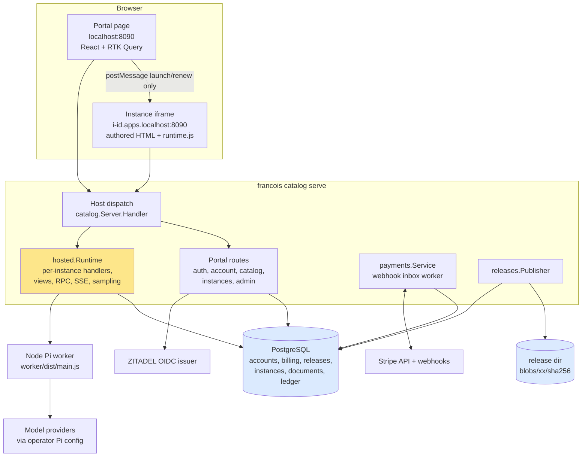

The authorities are divided cleanly. ZITADEL decides who a person is. Stripe decides what they have paid. PostgreSQL holds the platform's own records: users, sessions, projections of Stripe state, releases, instances, data and the credit ledger. The release directory holds immutable bytes named by their hash. The browser displays what the server decided; hiding a button is never an authorization check.

### 3.2 Package map

| Package | Responsibility | Key files |
|---|---|---|
| `pkg/catalog` | Portal server: config, host dispatch, authentication guard, portal and admin routes, the single access rule `authorizeInstance`. | `server.go`, `auth.go`, `routes.go`, `instances.go`, `admin.go` |
| `pkg/catalog/hosted` | Everything served on application origins: launch exchange, page injection, views, SSE, RPC, rooms, assets, sampling. | `runtime.go`, `routes.go`, `views.go`, `rpc.go`, `sample.go` |
| `pkg/catalog/store` | PostgreSQL access and embedded migrations. | `store.go`, `users.go`, `sessions.go`, `instances.go`, `documents.go`, `usage.go`, `billing.go`, `releases.go`, `assets.go`, `settings.go`, `migrations/*.sql` |
| `pkg/catalog/billing` | Pure access policy over subscriptions and grants. | `policy.go` |
| `pkg/catalog/payments` | Stripe gateway interface and implementation; checkout, portal, webhook ingest, inbox worker, reconciliation. | `gateway.go`, `service.go` |
| `pkg/catalog/identity` | OIDC relying party with lazy discovery. | `oidc.go` |
| `pkg/catalog/releases` | Upload validation, content-addressed blob storage, the single `Publisher`. | `releases.go` |
| `pkg/catalog/settings` | Strictly parsed, validated platform settings document. | `settings.go` |
| `pkg/catalog/httpx` | JSON response and error conventions. | `httpx.go` |
| `pkg/catalog/web` | Embedded portal and application-origin assets. | `embed.go`, `static/` |
| `ui/catalog` | React portal and admin UI, launch bootstrap and protocol. | `api.ts`, `instances.tsx`, `admin.tsx`, `launch.ts`, `launch-protocol.ts` |
| `ui/src/runtime.ts` | The `window.claude` runtime, shared with local hosting, with a hosted mode. | `runtime.ts` |
| `cmd/francois/cmds/catalog.go` | Glazed CLI: `catalog serve`, `migrate`, `publish`, `settings`, `users …`. | `catalog.go` |
| `deploy/compose` | Local end-to-end stack. | `compose.yaml`, `Dockerfile`, `bin/catalog-setup`, `bin/catalog-serve` |

### 3.3 One subscriber, end to end

The clearest way to see how the parts connect is to follow Alice from first visit to a model call. Each step names the code that handles it; later chapters explain each step in detail.

1. **Catalog.** Alice opens `http://localhost:8090`. The portal serves the SPA shell (`routes.go`, `spa`). The SPA calls `GET /api/session` and `GET /api/catalog`. The catalog response contains titles, versions, capabilities and file sizes, but never HTML bytes.
2. **Sign-in.** She clicks Sign in. `GET /auth/login` stores a login flow (state, nonce, PKCE verifier, return path) in PostgreSQL, sets a browser-binding cookie, and redirects to ZITADEL. After she authenticates, `GET /auth/callback` consumes the flow, exchanges the code, validates the ID token, upserts her user by `(issuer, subject)`, and creates a portal session cookie.
3. **Access.** Alice has no subscription, so `access.allowed` is false with reason `subscription_required`. Pressing Run in the catalog sends her to `/account?subscribe=1`.
4. **Payment.** `POST /api/billing/checkout` admits one checkout attempt and returns a Stripe-hosted Checkout URL. She pays with a test card. Stripe sends `checkout.session.completed` and related events to `POST /webhooks/stripe`. The handler verifies the signature on the raw body, stores the event, and wakes the worker. The worker fetches all of her Customer's subscriptions from Stripe and writes the projection. Her access decision becomes `allowed, reason subscriber, until <period end>`. The return page polls `/api/account` until it sees that, but the return itself grants nothing.
5. **Instance.** She presses Run on POLIS. `POST /api/instances` checks entitlement and the per-user instance limit, then creates `ins_<hex>` with hostname `i-<hex>` and an owner membership.
6. **Launch.** The portal navigates to `/instances/ins_<hex>`, which renders an iframe whose `src` is `http://i-<hex>.apps.localhost:8090/launch`. That bootstrap page contains no application code. It creates a PKCE verifier and challenge, asks the parent for a launch code by `postMessage`, and the parent obtains one with a CSRF-protected `POST /api/instances/{id}/launch`. The bootstrap redeems the code at `POST /api/launch/exchange` on its own origin and receives a runtime grant.
7. **Page.** The bootstrap fetches `GET /page` with `Authorization: Bearer <grant>`. The server returns the release's HTML with a JSON boot block and `<script src="/static/runtime.js">` injected at the start of `<head>`. The bootstrap replaces its own document with that HTML.
8. **Runtime.** `runtime.js` reads the boot block, creates a view (`POST /api/views`), opens an event stream, and installs `window.claude`. POLIS's code runs and calls `db`, `room`, `user` and `sample` methods; each request carries the grant and is re-authorized.
9. **Model call.** Alice asks the POLIS agent to make the tower taller. `POST /api/views/{view}/calls` validates the request, resolves an approved model, checks concurrency, reserves one credit in a row-locked transaction, and starts the call. The Pi worker streams thinking and text back; when the model requests the `eval` tool, the request goes to Alice's view, her browser runs the callback, and the result is posted back. When the call ends, the reservation is settled with the real token counts.

```mermaid
sequenceDiagram
  autonumber
  participant B as Portal page
  participant F as Instance frame
  participant S as Go server
  participant Z as ZITADEL
  participant St as Stripe
  participant W as Pi worker
  B->>S: GET /auth/login
  S-->>B: 303 to ZITADEL (state, nonce, S256)
  B->>Z: authenticate
  Z-->>B: 303 /auth/callback?code&state
  B->>S: callback (flow cookie)
  S->>Z: code + verifier → ID token
  S-->>B: session cookie
  B->>S: POST /api/billing/checkout
  S->>St: create Customer, Checkout Session (idempotency keys)
  S-->>B: Checkout URL
  St->>S: webhook events (signed)
  S->>St: list Customer subscriptions (status=all)
  S->>S: project subscriptions, mark event processed
  B->>S: POST /api/instances
  B->>F: iframe src=/launch
  F->>B: postMessage ready(challenge)
  B->>S: POST /api/instances/{id}/launch (CSRF, challenge)
  S-->>B: one-use code
  B->>F: postMessage code
  F->>S: POST /api/launch/exchange (code, verifier)
  S-->>F: runtime grant
  F->>S: GET /page (Bearer grant)
  S-->>F: authored HTML + boot JSON + runtime.js
  F->>S: POST /api/views, GET events (SSE)
  F->>S: POST calls (sample)
  S->>S: reserve credits (row lock)
  S->>W: sample request
  W-->>S: thinking/text/tool_call/usage
  S-->>F: events (tool call)
  F->>S: tool result
  W-->>S: result + usage
  S->>S: settle call
```

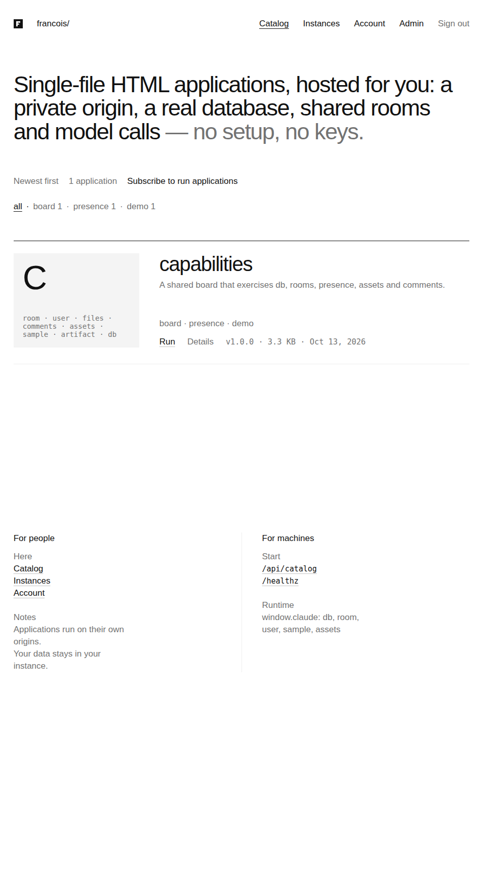

*The subscriber catalog. The interface uses only type and grey, following html.moldandyeast.com; the applications provide all the colour. The capability chips are read from the release manifest.*

## 4. Host dispatch and origin isolation

### 4.1 Why every instance needs its own origin

A browser's *origin* is the triple of scheme, host and port. JavaScript running on one origin can read the DOM, `localStorage`, cookies and same-origin HTTP responses of that origin, and cannot read those of another origin unless the other origin allows it. The platform hosts HTML written by someone other than the platform operator: curated, but still arbitrary JavaScript. If that code ran on the portal origin, it could call `/api/admin/...` with the administrator's cookies, read the CSRF token from `/api/session`, or open a Stripe Portal session for the signed-in user. Putting it in an iframe on a path such as `/apps/polis` does not help, because an iframe on the same origin is fully scriptable by and scripting toward its parent.

Instances also need to be isolated from each other. Two instances of POLIS store their editor state in `localStorage`. If they shared an origin, one subscriber's instance would read another's browser state, and a malicious release could read every instance's state. The local runner solved this by giving each artifact its own loopback port. The hosted platform cannot open a TCP port per instance on a public server, so it gives each instance its own hostname under a separate application domain and routes all of them to one listener.

### 4.2 The dispatch function

`catalog.Server.Handler` in `pkg/catalog/server.go` is the single entry point for every HTTP request. It decides between the portal and an instance by exact host comparison:

```go
func (s *Server) Handler() http.Handler {
	portalHost := s.Config.PublicURL.Host
	suffix := "." + s.Config.AppDomain
	return http.HandlerFunc(func(w http.ResponseWriter, r *http.Request) {
		host := strings.ToLower(r.Host)
		if host == strings.ToLower(portalHost) {
			s.portal.ServeHTTP(w, r)
			return
		}
		name := host
		if h, port, err := net.SplitHostPort(host); err == nil {
			if port != s.Config.AppPort {
				httpx.Fail(w, 421, "misdirected", "Unknown host")
				return
			}
			name = h
		} else if s.Config.AppPort != "" {
			httpx.Fail(w, 421, "misdirected", "Unknown host")
			return
		}
		if !strings.HasSuffix(name, suffix) || strings.Count(strings.TrimSuffix(name, suffix), ".") != 0 {
			httpx.Fail(w, 421, "misdirected", "Unknown host")
			return
		}
		inst, err := s.Store.InstanceByHost(r.Context(), strings.TrimSuffix(name, suffix))
		if err != nil {
			httpx.Fail(w, 404, "not_found", "Unknown instance")
			return
		}
		s.Runtime.Handler(inst).ServeHTTP(w, r)
	})
}
```

Several properties follow from this code:

- The portal is served only for the exact configured portal host. A request with any other `Host` can never reach a portal route, so instance-origin code cannot reach `/api/admin` by sending a crafted `Host` header to the same IP.
- An application hostname must be exactly one DNS label directly under the application domain. `i-abc.apps.localhost` matches; `x.i-abc.apps.localhost` and `apps.localhost` do not. The response for a non-matching host is `421 Misdirected Request`.
- The label must belong to a registered instance. Unknown labels return `404`.
- The instance is loaded fresh from PostgreSQL on every request, and `Runtime.Handler(inst)` builds a mux bound to that instance. No route on an application origin can name a different instance, because the instance comes from the host and not from the path.

`catalog serve` validates the configuration at startup. `--public-url` must be a bare origin, and `--app-domain` must differ from the portal hostname and must not start with a dot:

```go
if s.AppDomain == "" || strings.HasPrefix(s.AppDomain, ".") || strings.EqualFold(s.AppDomain, public.Hostname()) {
	return errors.New("app-domain must be a separate domain, e.g. apps.example")
}
```

### 4.3 Response headers on each kind of origin

The two kinds of origin send different security headers, because they serve different content.

| Header | Portal origin | Application origin |
|---|---|---|
| `Content-Security-Policy` | `default-src 'self'; frame-src <app-scheme>://*.<app-domain>[:port]; img-src 'self' data:; style-src 'self'; script-src 'self'; connect-src 'self'; frame-ancestors 'none'; base-uri 'none'; form-action 'self'` | Only on `/launch`: `frame-ancestors <portal origin>`. Authored pages carry no CSP, because the platform cannot know what CDNs an application uses. |
| `X-Frame-Options` | `DENY` | not set |
| `X-Content-Type-Options` | `nosniff` | `nosniff` |
| `Referrer-Policy` | `same-origin` | `no-referrer` |
| `Cache-Control` | `no-store` on JSON (via `httpx.JSON`) | `no-store` on everything |
| Cross-origin requests | Mutations require `Origin == portal origin` and a CSRF token (section 5.5). | Any request with an `Origin` header different from the instance origin gets `403 invalid_origin`. |

The portal's CSP is strict: the portal loads only its own scripts and styles, can frame only application origins, and cannot be framed at all. The `/launch` bootstrap can be framed only by the portal. The application origin's blanket rule — reject any request whose `Origin` is another origin — means that even if one instance's code tried to call another instance's API with a stolen grant from inside the browser, the browser-supplied `Origin` header would cause rejection. Outside the browser, an attacker can forge `Origin`, which is why the grant itself is also bound to the instance (section 9).

### 4.4 Development domains and the same-site caveat

The Compose stack uses `localhost:8090` for the portal and `*.apps.localhost:8090` for instances. Chromium resolves any `*.localhost` name to the loopback address and treats it as a secure context, so `crypto.subtle`, which the launch bootstrap needs for SHA-256, works over plain HTTP. The cost is that `localhost` and `i-x.apps.localhost` are the same *site* (they share the registrable domain `localhost`), even though they are different *origins*. Browsers send `SameSite=Lax` cookies on same-site requests. The portal's session cookie is host-only, so it is never sent to an instance host, but application JavaScript could send a request to the portal and the browser would attach the portal cookie.

The control against this is the portal's mutation guard: a cookie-authenticated mutation must carry the correct `X-CSRF-Token`, which instance code cannot read, and an `Origin` equal to the portal origin. The integration test sends a portal mutation with `Origin: http://i-x.apps.test` and asserts `403`. Production should still place applications under a different registrable domain, for example `francois.example` and `francois-apps.example`, so that the browser's own site boundary applies. This is listed under Phase 8b.

## 5. Identity: OIDC login, local users and portal sessions

This chapter explains how a person becomes a local user with a portal session, and how every portal request is authenticated. The design follows a rule from the predecessor projects recorded in the vault (the ZITADEL TODO billing project and Fortress): identity comes from the IdP, but authorization belongs to the application. ZITADEL says who someone is; only the platform's own tables say whether they are an administrator, whether they are disabled, and whether they have paid.

### 5.1 The relying party

`pkg/catalog/identity/oidc.go` wraps `github.com/zitadel/oidc/v3`'s relying-party client. Two decisions shape it.

**Discovery is lazy.** OIDC discovery fetches the issuer's `/.well-known/openid-configuration` and signing keys. If the server did this at startup and ZITADEL were down, the whole platform, including existing sessions and running instances, would fail to start. Instead, `Provider.party` performs discovery on first use under a mutex and caches the result. If discovery fails, `/auth/login` redirects to `/?login_error=provider_unavailable`, and everything else keeps working.

**The platform owns PKCE and the nonce.** The library can store PKCE verifiers in encrypted cookies. The platform stores them in PostgreSQL instead, alongside the rest of the login flow, and passes them to the library explicitly:

```go
opts := []rp.AuthURLOpt{rp.WithCodeChallenge(oidc.NewSHACodeChallenge(verifier)), withParam("nonce", nonce)}
...
ctx = context.WithValue(ctx, nonceKey{}, nonce)
tokens, err := rp.CodeExchange[*oidc.IDTokenClaims](ctx, code, party, rp.WithCodeVerifier(verifier))
```

The nonce check deserves an explanation, because it is easy to get wrong. The library's ID-token verifier is configured once, at discovery time, with `rp.WithNonce(func(ctx) string)`. That function cannot know which login flow is being completed, so it reads the expected nonce from the request context, where `Exchange` placed it. The library then compares it with the `nonce` claim in the signed ID token, together with issuer, audience, signature and expiry.

ZITADEL can omit profile claims from the ID token. When `name` or `email` is empty, `Exchange` calls the userinfo endpoint with the access token. Finally, it rejects a token whose issuer is not the configured issuer.

### 5.2 The login transaction

A login transaction must be bound to the browser that started it. Without that binding, an attacker could start a login, capture the callback URL with their own authorization code, and get a victim to open it, which would sign the victim into the attacker's account (login CSRF). The platform binds each flow with a random cookie whose hash is stored with the flow.

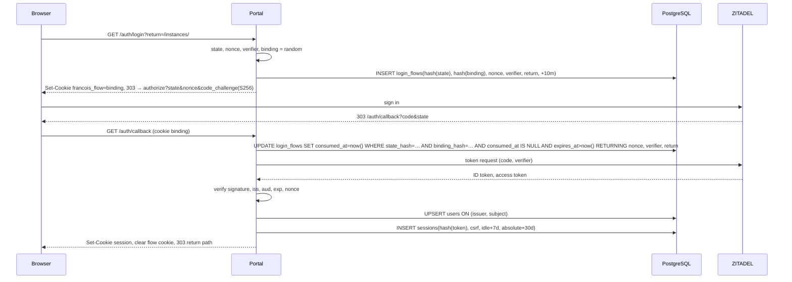

The consumption query is a single atomic `UPDATE … RETURNING`. It succeeds only when the state matches, the binding cookie matches, the flow has not been used, and it has not expired. A replayed callback fails because `consumed_at` is set. A callback from a different browser fails because the binding hash differs. Expired flows older than an hour are deleted opportunistically when new flows are saved.

The return path is sanitized by `safeReturn`, which accepts only local paths. It rejects absolute URLs, protocol-relative `//host`, the backslash form `/\host`, and anything under `/auth/`, so the login cannot be used as an open redirect or a redirect loop.

### 5.3 Local users

`UpsertIdentity` inserts or updates the user on `(issuer, subject)`:

```sql
INSERT INTO users(id,issuer,subject,email,email_verified,display_name,last_login_at)
VALUES($1,$2,$3,$4,$5,$6,now())
ON CONFLICT(issuer,subject) DO UPDATE SET
  email=EXCLUDED.email, email_verified=EXCLUDED.email_verified,
  display_name=EXCLUDED.display_name, last_login_at=now()
RETURNING ...
```

The update clause lists only profile fields. `role` and `disabled` are never touched by a login, so an IdP change cannot promote a user, and a disabled user cannot re-enable themselves by signing in again. The first administrator is created out of band by exact issuer and subject with `francois catalog users promote --issuer … --subject …`; the Compose provisioning script does this for `admin@francois.test`.

Email matters in one place: sharing. `UserByVerifiedEmail` finds a user by case-insensitive email, but only if the email is verified, the account is not disabled, and exactly one user matches. It queries with `LIMIT 2` and returns not-found when it gets two rows, so an ambiguous address can never resolve to the wrong person.

### 5.4 Portal sessions

A portal session is a 32-byte random token, hex-encoded, in an HTTP-only cookie. The database stores only `sha256(token)`. A database leak therefore does not reveal usable session tokens. The same rule applies to every bearer secret in the system: login state, launch codes and runtime grants are all stored as hashes (`store.Hash`).

| Property | Value | Where |
|---|---|---|
| Cookie name | `__Host-francois_session` over HTTPS, `francois_session_dev` over HTTP | `auth.go` `sessionCookie` |
| Cookie flags | `HttpOnly`, `SameSite=Lax`, `Secure` over HTTPS, `Path=/`, host-only | `setCookie` |
| Idle expiry | 7 days, sliding | `store.SessionIdle` |
| Absolute expiry | 30 days | `store.SessionAbsolute` |
| CSRF token | 24 random bytes, per session | `CreateSession` |

The `__Host-` prefix makes browsers refuse the cookie unless it is `Secure`, has `Path=/` and has no `Domain` attribute. That guarantees the cookie cannot be set by, or sent to, any subdomain, which matters because the application domain may be a subdomain of the portal's domain in some deployments.

`ResolveSession` slides the idle expiry and authenticates in one statement:

```sql
UPDATE sessions SET last_seen_at=now(),
  expires_at=LEAST(absolute_expires_at, now()+$2::interval)
WHERE token_hash=$1 AND revoked_at IS NULL AND expires_at > now() AND absolute_expires_at > now()
RETURNING token_hash,user_id,csrf_token,expires_at
```

Revoking a session revokes everything derived from it. `RevokeSession` sets `revoked_at` on the session and on every `runtime_grants` row with that `session_hash`, in one transaction. `RevokeUserSessions`, used by the admin "revoke sessions" action, does the same for all of a user's sessions. After the database update, the handler also calls `Runtime.RevokeSession` or `Runtime.RevokeUser`, which cancels live views so that open instance pages close immediately (section 10.3).

Logout ends the platform session only. The ZITADEL session remains, so the next sign-in completes without a password prompt. This is ordinary OIDC behavior; ending the IdP session would require RP-initiated logout through ZITADEL's end-session endpoint, which is not implemented.

### 5.5 The route guard

Every portal API route is wrapped by `Server.guard(level, handler)`. The level is declared at registration, so the authorization requirement of each endpoint is visible in one table in `routes.go` and `admin.go`.

| Level | Requirement | Examples |
|---|---|---|
| `public` | Session optional; loaded if present. | `GET /api/session`, `/api/catalog`, downloads (which apply their own rule) |
| `session` | Signed in. | `GET /api/account`, `/api/instances`, `POST /api/billing/portal` |
| `enabled` | Signed in and not disabled. | `POST /api/instances`, `/launch`, sharing, checkout |
| `admin` | Signed in, not disabled, role `admin`. | everything under `/api/admin/` |

The levels are cumulative, and one detail is deliberate: a disabled user keeps the `session` level. They can still sign in, view their account and open the Stripe Portal to manage or cancel billing, but they cannot start instances or launch.

For every non-GET, non-HEAD request at level `session` or above, the guard enforces two independent checks before the handler runs:

```go
if r.Method != http.MethodGet && r.Method != http.MethodHead && level >= session {
	if !s.sameOrigin(r) {
		httpx.Fail(w, 403, "invalid_origin", "Cross-origin request rejected")
		return
	}
	token := r.Header.Get("X-CSRF-Token")
	if subtle.ConstantTimeCompare([]byte(token), []byte(p.Session.CSRF)) != 1 {
		httpx.Fail(w, 403, "csrf_failed", "Missing or invalid CSRF token")
		return
	}
}
```

`sameOrigin` requires the `Origin` header to equal the portal origin exactly. Browsers send `Origin` on all cross-origin POSTs, so any request initiated from an application origin is rejected here. If `Origin` is absent, it falls back to the Fetch Metadata header `Sec-Fetch-Site`, accepting only `same-origin` or an absent header (non-browser clients). The CSRF token is a per-session secret returned by `GET /api/session`. The SPA stores it and adds it to every mutation (section 14.2). The two checks protect against different failures: the token protects against a page that can make the browser send cookies but cannot read the token; the origin check protects against a same-site page in the development configuration even if that page somehow obtained a token.

The Stripe webhook is the only unauthenticated mutation. It is registered without the guard and authenticated by its signature (section 12.4).

## 6. The data model

### 6.1 Migrations

The schema is two SQL files embedded in the binary: `pkg/catalog/store/migrations/001_core.sql` (accounts, releases, instances, launch codes, grants) and `002_billing_usage.sql` (Stripe projections, the event inbox, the allowance ledger). `Store.Migrate` applies them in one transaction under a PostgreSQL advisory lock, so two processes starting at once cannot both apply a migration. It records a SHA-256 checksum for each applied file and refuses to proceed if an applied file's content has since changed:

```go
if string(existing) != string(sum[:]) {
	return nil, errors.Errorf("migration %s changed after it was applied", e.Name())
}
```

`catalog serve` does not migrate implicitly unless `--migrate` is passed. It calls `Store.Pending` and refuses to start against a database with unapplied migrations, with the message `database has pending migrations [...]; run francois catalog migrate`. A server binary is therefore never run against a schema it does not expect.

### 6.2 The tables

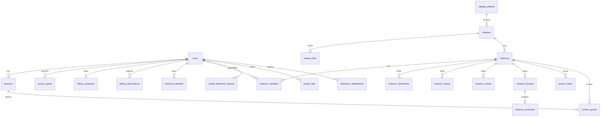

The tables fall into six groups.

| Group | Tables | Notes |
|---|---|---|
| Accounts | `users`, `login_flows`, `sessions`, `access_grants`, `admin_audit` | `users` is unique on `(issuer, subject)` and checks `role IN ('subscriber','admin')`. Secrets are stored as `bytea` hashes. |
| Settings | `platform_settings` | Append-only revisions; the newest is active. |
| Catalog | `catalog_artifacts`, `releases`, `release_files` | `releases` is unique on `(artifact_id, version)` and checks `state IN ('draft','published','withdrawn')`. `release_files` is unique on `(release_id, role)` with role `html` or `manifest`. |
| Instances | `instances`, `instance_members`, `instance_documents`, `instance_leases`, `instance_assets`, `instance_threads`, `instance_comments` | Everything below `instances` has `ON DELETE CASCADE`, so deleting an instance deletes its data in one statement. `hostname` is unique. |
| Launch | `launch_codes`, `runtime_grants` | Both store only hashes, both reference the portal session by hash, and both cascade with their instance. |
| Billing and usage | `billing_customers`, `billing_subscriptions`, `checkout_attempts`, `stripe_events`, `model_allowance_periods`, `model_calls`, `allowance_adjustments` | Discussed in Chapters 11 and 12. |

A few schema details encode rules that would otherwise need application code:

- `billing_subscriptions` is keyed by `stripe_subscription_id`, not by user. A user can have an old canceled subscription and a new active one at the same time, and an event about the old one cannot overwrite the new one (section 12.5).
- `checkout_attempts` has a partial unique index, `UNIQUE (user_id) WHERE state IN ('pending','open')`. The database itself guarantees at most one admitted checkout per user (section 12.3).
- `model_allowance_periods` has `CHECK (reserved >= 0 AND used >= 0)`. A bug that released a reservation twice would fail the transaction instead of silently creating credit.
- `model_calls` and `stripe_events` have partial indexes on their open states (`state IN ('reserved','started')` and `state='pending'`), so the recovery and worker queries scan only live rows.
- `instance_documents` stores the `collection` (the path without its last segment) as a column with an index on `(instance_id, collection)`, so a query for one collection in one instance is an index range scan.

### 6.3 Identifiers

IDs are opaque random hex with a type prefix, generated by `store.NewID(prefix)`, which uses 12 random bytes: `usr_`, `rel_`, `fil_`, `agr_`, `chk_`, `mc_`, `adj_`, `v_`, `b_`, `t_`, `m_`. Instances use 10 bytes, and the hostname reuses the same hex: `ins_82f3669b96eb2f785857` has hostname `i-82f3669b96eb2f785857`. Instance hostnames are therefore unguessable, although the design does not rely on that; a guessed hostname gives nothing without a grant.

## 7. Releases: upload, check, draft, preview, publish

### 7.1 The publication model

A release is immutable once created. Its HTML and manifest are stored as content-addressed files, and their hashes are recorded in `release_files`. A correction to a published application is a new release with a new version label, never an edit. This has three consequences. Instances can pin an exact release and keep running the code their data was created with. A download's hash can be checked against what was published. Withdrawal changes catalog visibility, not stored bytes.

The lifecycle has three states and two transitions, each a single conditional `UPDATE` that succeeds only from the expected state:

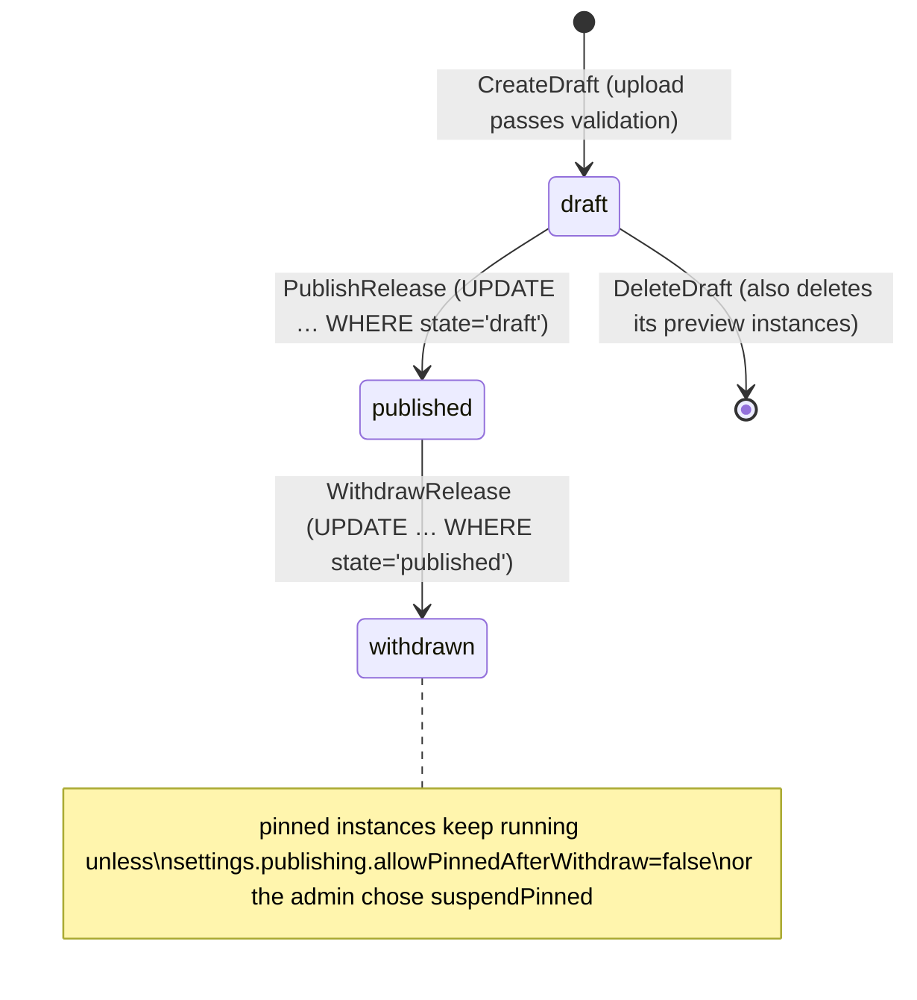

Publishing and withdrawing write an `admin_audit` row in the same transaction as the state change, so the audit log cannot miss a transition that happened.

### 7.2 Validation

`releases.Validate` inspects an upload and returns findings at three levels. Errors block the draft; warnings and info are shown to the operator. The admin UI's Check button calls `POST /api/admin/releases/check`, which runs validation without storing anything; Save draft runs the same validation again inside `CreateDraft`.

| Code | Level | Rule | Why |
|---|---|---|---|
| `artifact_id` | error | `^[a-z0-9][a-z0-9_-]{0,63}$` | IDs appear in URLs and file names. |
| `version` | error | `^[A-Za-z0-9][A-Za-z0-9._+-]{0,39}$` | Version labels appear in file names. |
| `title`, `text_length` | error | Title 1–120 chars; description ≤ 2000; changelog ≤ 8000. | Bounded display. |
| `html_size` | error | 1 byte to `limits.maxHtmlBytes` (default 16 MiB). | Bounded storage and memory. |
| `html_document` | error | Must contain `<html`. | A fragment cannot be injected into reliably. |
| `database_copy` | error | Contains `SQLite format 3\0`. | A saved local page with an embedded database copy would leak a user's data. |
| `runtime_bootstrap` | error | Contains `id="francois-view"` or `/static/runtime.js`. | The upload is a page saved from a running Francois host, not authored source; publishing it would carry a stale boot block. |
| `credential_like` | error | Matches Stripe `sk_`/`rk_`/`whsec_` keys, PEM private keys, `"refresh_token":`, AWS `AKIA…`, Anthropic `sk-ant-…`, or long `sk-…` tokens. | Published HTML is delivered to every subscriber. |
| `manifest_json`, `manifest_size` | error | Manifest must be a JSON object ≤ 64 KiB. | |
| `manifest_unknown` | error | Capability not in `sample, db, user, room, comments, assets, artifact, downloads, files`. | A typo would silently disable a feature. |
| `files_disabled` | warning | Manifest declares `files`. | Hosted instances cannot read server files. |
| `artifact_publish` | warning | Manifest declares `artifact`. | Hosted instances cannot republish catalog code. |
| `external_script` | info | One entry per distinct `<script src>` host. | Shows the operator which CDNs the page depends on. |

When no manifest is supplied, the default is `{"sample": {}}`.

### 7.3 Content-addressed blob storage

`releases.Blobs` stores files under `<release-dir>/blobs/<first two hex>/<sha256>`. `Put` writes to a temporary file in the target directory, calls `fsync`, closes it, and renames it into place. Rename within one directory is atomic on POSIX file systems, so a reader never sees a partially written blob. If an identical blob already exists, it is reused.

`Read` validates the storage key against `^blobs/[0-9a-f]{2}/[0-9a-f]{64}$` before touching the file system, which rules out path traversal through a corrupted database row. It then recomputes the SHA-256 of the bytes and compares it with the recorded hash, returning `release file hash mismatch` if they differ. Every download and every page load therefore verifies integrity.

The ordering inside `Publisher.CreateDraft` is chosen for crash safety:

```text
CreateDraft(actor, upload):
    manifest, checks = Validate(upload)
    if any check is an error: return ErrInvalid{checks}
    upsert catalog_artifacts row (keep existing visibility)
    htmlKey, htmlSum = Blobs.Put(html)          # durable before metadata
    manKey,  manSum  = Blobs.Put(manifestJSON)
    INSERT releases + release_files in one transaction
        (unique (artifact_id, version) → ErrConflict → HTTP 409)
    audit release.draft with sha256
```

Bytes are written before the database row that references them. A crash between the two leaves an unreferenced blob, which is harmless. The opposite order could leave a release that points at missing bytes. `Store.ReferencedStorageKeys` and `Blobs.Missing` exist so that a future maintenance command can list orphans and missing files.

### 7.4 One publisher for the UI and the CLI

The admin upload handler and `francois catalog publish` both call `Publisher.CreateDraft`. The CLI publishes immediately unless `--draft` is given; the admin UI always creates a draft first. There is one validation path, one storage path and one transaction, so the CLI cannot publish something the UI would reject.

```bash
francois catalog publish --database-url-file /run/secrets/db \
  --release-dir /var/lib/francois/releases \
  --artifact-id polis --title "POLIS IDE" --version 1.0.0 \
  --html examples/polis.html --manifest polis.manifest.json \
  --actor-user-id usr_…
```

### 7.5 Preview on an isolated origin

An administrator must be able to run a draft before publishing it, and the draft must not run on the portal origin. `POST /api/admin/releases/{id}/preview` creates, or reuses, an instance of kind `preview`, owned by the administrator and pinned to the draft. It runs through exactly the same launch protocol and hosted runtime as a subscriber instance. The only difference is in `authorizeInstance`: a preview instance requires the `admin` role and does not require a subscription.

```go
if inst.Kind == "preview" {
	if u.Role != "admin" {
		return hosted.Denied(403, "admin_required", "Preview instances are for administrators")
	}
	return nil
}
```

Preview instances are excluded from subscriber instance lists and from the per-user instance limit. Deleting a draft deletes its preview instances first, in the same transaction.

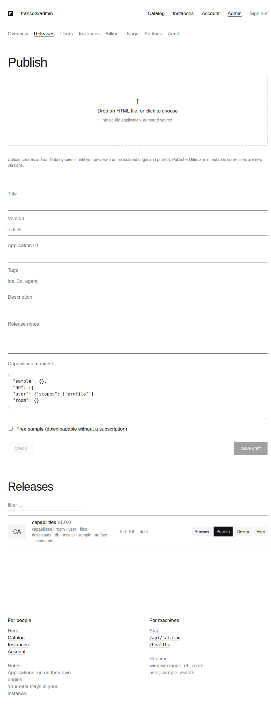

*The admin Releases screen. Upload creates a draft; Preview opens it on an application origin; Publish makes it visible in the catalog.*

### 7.6 Catalog metadata and downloads

The public catalog endpoints return metadata only. `publicRelease` builds a response from the release row and lists only capabilities the hosted runtime actually provides, so a manifest's `files` declaration is not advertised to subscribers. The integration test fetches `/api/catalog` and asserts that a marker string from the uploaded HTML does not appear in it.

Downloads apply the rule the design guide took from the hyperblog project: the server must withhold paid bytes, not hide them in the UI. The handler at `GET /api/releases/{release}/files/{file}/download` checks, in order: the release is published; the file belongs to the release; the caller is not disabled; and, unless the release is a free sample, the caller is signed in and entitled. Only then does it read the blob. Denials are JSON errors, never partial content. Successful responses are `Content-Disposition: attachment` with a sanitized file name, `Cache-Control: private, no-store`, and an `X-Content-SHA256` header with the expected hash. The download is an attachment so that the HTML is saved, not rendered on the portal origin.

## 8. Instances and membership

### 8.1 Creating an instance

`POST /api/instances` requires the `enabled` guard level, current entitlement (`Server.entitled`), and a published release. `Store.CreateInstance` then enforces the per-user limit from settings. Counting existing instances and inserting a new one is a read-then-write sequence, and two concurrent requests could both see `n = limit - 1` and both insert. The function serializes per owner with a transaction-scoped advisory lock:

```go
// Serialize per-owner admission so concurrent creates respect the limit.
if _, err = tx.Exec(ctx, `SELECT pg_advisory_xact_lock(hashtext('instances:'||$1))`, owner); err != nil {
	return Instance{}, err
}
```

The lock is released automatically at commit or rollback. The same pattern is used for the per-instance asset quota (`'assets:'||instance`).

The instance row and the owner's `instance_members` row are inserted in the same transaction, so an instance never exists without an owner membership.

### 8.2 Roles

| Role | Shared documents | Own private namespace | Comments, assets | Share, rename, upgrade, delete |
|---|---|---|---|---|
| owner | read, write | read, write | create, reply, resolve; delete any thread or asset | yes |
| editor | read, write | read, write | create, reply, resolve; delete own | no |
| viewer | read | read, write | read only | no |

Platform administrators can rename, share and upgrade any instance they are a member of through `Server.owner`, which accepts either the instance owner role or the platform `admin` role. Administrators manage other subscribers' instances through the admin API (suspend, resume, inspect), not by opening them.

### 8.3 Sharing

The owner shares by email and role. `addMember` resolves the email with `UserByVerifiedEmail` (section 5.3), then calls `Store.SetMember`, which locks the instance row with `SELECT … FOR UPDATE`, refuses to change the owner's role, enforces the member limit for new members, and upserts the membership. Every member must have their own entitlement; there are no guest seats. Each member's model calls are charged to that member's allowance, not the owner's.

After a role change, `addMember` calls `Runtime.RevokeMember(instance, user)`. The member's open views close, their pages reload through the launch protocol, and the new role takes effect immediately. Removing a member deletes the membership and revokes that member's grants for the instance in one transaction, then closes their live views. The integration test removes Bob while his view is open and asserts that his next `db.get` fails with 401 or 403.

Co-members see each other's names, not email addresses. `GET /api/instances/{id}` blanks `Email` in the member list unless the caller is the owner, and the hosted `user.profiles` and `user.search` operations never return email (section 10.6).

### 8.4 Upgrades and deletion

An instance pins `release_id`. Publishing `polis 1.1.0` does not change existing instances. The owner sees newer published releases of the same artifact in the instance's info panel and can upgrade explicitly. `UpgradeInstance` is a single guarded `UPDATE`:

```sql
UPDATE instances i SET release_id=$2, updated_at=now()
FROM releases cur, releases nxt
WHERE i.id=$1 AND cur.id=i.release_id AND nxt.id=$2
  AND nxt.artifact_id=cur.artifact_id AND nxt.state='published'
```

The instance keeps its ID, hostname and data, so `localStorage` and documents survive. The handler then revokes the instance's views so that every open page reloads with the new code. Applications whose stored data needs a migration between versions would need an explicit migration contract; none exists yet.

Deleting an instance revokes its views and deletes the row; cascades remove members, documents, leases, assets, comments, launch codes and grants.

### 8.5 Suspension and owner entitlement

An administrator can suspend an instance. `SetInstanceState(…, "suspended")` updates the state and revokes all grants for the instance in one transaction, and the handler closes live views. The instance's data is untouched, and resuming restores access.

An instance is also unusable, though not suspended, when its owner loses entitlement. `authorizeInstance` checks both the caller and, if different, the owner:

```go
if inst.OwnerUserID != u.ID {
	...
	if !od.Allowed {
		return hosted.Denied(403, "owner_inactive", "The instance owner's subscription is not active; the instance is frozen")
	}
}
```

This rule is what the design guide calls a frozen instance: a paying member cannot keep using a workspace whose owner stopped paying, and nothing is deleted when that happens.

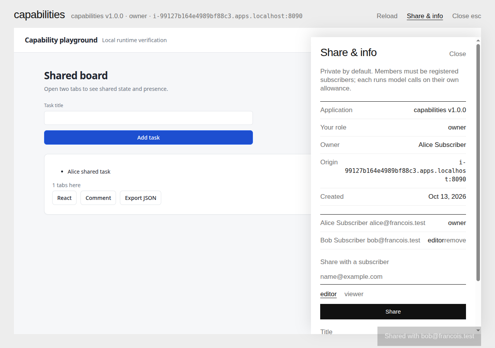

*Alice's instance with the Share & info panel open. Bob has been added as an editor. The origin shown is the instance's own hostname.*

## 9. The launch protocol

This chapter explains how a signed-in portal user comes to hold a credential that works on an instance's origin, and why that takes six messages instead of one. It is the part of the system with the most security reasoning, so the chapter states the problem first, then the protocol, then what each binding prevents.

### 9.1 The problem

The portal session cookie belongs to the portal host. The instance runs on a different host, and the browser will not send the portal cookie there. Setting a cookie for the application domain from the portal is not possible either, and in production the application domain is a different site, where cookies in an iframe count as third-party cookies, which browsers increasingly block. So the instance cannot authenticate with cookies.

The instance therefore needs a credential it can hold in memory and send in a header. The question is how to deliver it. Three obvious approaches are unsafe:

- **Put a token in the iframe URL.** URLs end up in history, logs and `Referer` headers, and a URL is replayable by anyone who sees it.
- **Have the portal `postMessage` the token to the frame.** A message is only as trustworthy as its sender and receiver checks. If the frame's content were swapped, or the message were delivered to the wrong window, the token would go to the wrong place. `postMessage` also proves nothing to the server about which browser asked.
- **Let the instance call the portal with credentials.** That reintroduces exactly the cross-origin access to the portal that origin isolation is meant to prevent.

The protocol uses a pattern from OAuth: a short-lived, one-use *code* travels through the browser, and is redeemed for a longer-lived *grant* by a party that proves possession of a secret generated at the start (PKCE). The code alone is useless.

### 9.2 The messages

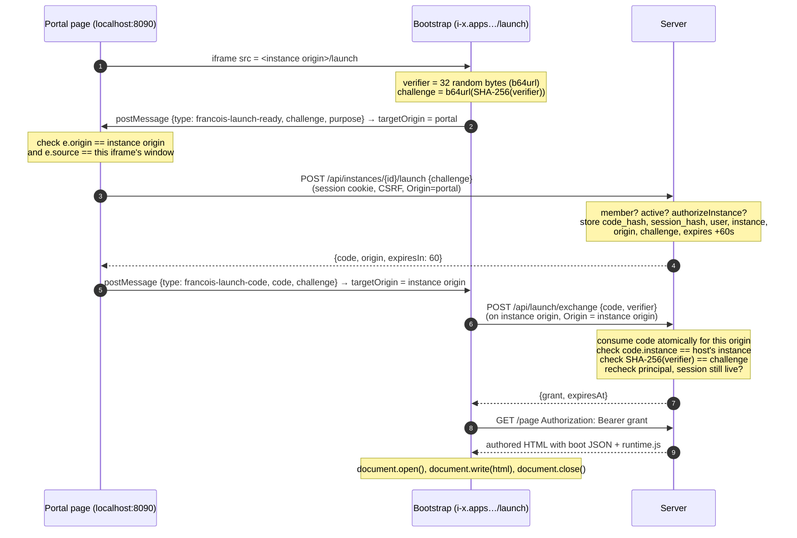

The code for each side is short. The bootstrap, `ui/catalog/launch.ts`, refuses to run when it is not framed, then does the exchange and replaces itself:

```ts
async function launch() {
  if (parent === window) {
    status.textContent = "Open this application from your Francois account.";
    return;
  }
  const { grant } = await obtainGrant(portal, "launch");
  const r = await fetch("/page", { headers: { Authorization: "Bearer " + grant } });
  if (!r.ok) throw (await r.json()).error;
  const html = await r.text();
  document.open();
  document.write(html);
  document.close();
}
```

`ui/catalog/launch-protocol.ts` implements the child's side of the handshake. It ignores any message whose origin is not the portal, whose source is not its parent window, or whose challenge does not match the one it sent, and it times out after 20 seconds:

```ts
function receive(e: MessageEvent) {
  if (e.origin !== portal || e.source !== parent) return;
  const d = e.data;
  if (!d || d.challenge !== challenge) return;
  if (d.type === "francois-launch-code" && typeof d.code === "string") { … resolve(d.code); }
  else if (d.type === "francois-launch-denied") { … reject({ code: d.code, message: d.message }); }
}
addEventListener("message", receive);
parent.postMessage({ type: "francois-launch-ready", challenge, purpose }, portal);
```

The parent's side lives in the `Launcher` component in `ui/catalog/instances.tsx`. It answers only messages from the exact instance origin and the exact iframe window it rendered, and it posts the code back with an explicit `targetOrigin`:

```tsx
const receive = async (e: MessageEvent) => {
  if (e.origin !== origin || e.source !== frame.current?.contentWindow) return;
  const d = e.data;
  if (d?.type !== "francois-launch-ready" || typeof d.challenge !== "string") return;
  const target = frame.current!.contentWindow!;
  try {
    const r = await launch({ id, challenge: d.challenge }).unwrap();
    target.postMessage({ type: "francois-launch-code", code: r.code, challenge: d.challenge }, origin);
  } catch (err: any) {
    target.postMessage({ type: "francois-launch-denied", code: …, message, challenge: d.challenge }, origin);
  }
};
```

The parent is not a general proxy. It handles exactly one message type and performs exactly one server request for the instance it is displaying.

On the server, `Server.launch` (portal) issues the code after the same checks as any instance access, and `Runtime.exchange` (instance origin) redeems it:

```go
func (rt *Runtime) exchange(w http.ResponseWriter, r *http.Request, inst store.Instance, origin string) {
	if r.Header.Get("Origin") != origin { … 403 invalid_origin }
	… read {code, verifier}; verifier length 43–128 …
	code, err := rt.Store.ConsumeLaunchCode(r.Context(), in.Code, origin)
	if err != nil || code.InstanceID != inst.ID { … 401 launch_invalid }
	sum := sha256.Sum256([]byte(in.Verifier))
	if base64.RawURLEncoding.EncodeToString(sum[:]) != code.Challenge { … 401 launch_invalid }
	if _, err = rt.principal(r.Context(), code.UserID, inst.ID, nil, code.SessionHash); err != nil { failErr(w, err); return }
	expires := time.Now().Add(rt.Config.GrantTTL)
	token, err := rt.Store.CreateGrant(r.Context(), store.Grant{SessionHash: code.SessionHash, UserID: code.UserID, InstanceID: inst.ID, ExpiresAt: expires})
	if err != nil { … 401 session_ended }
	httpx.OK(w, map[string]any{"grant": token, "expiresAt": expires})
}
```

`ConsumeLaunchCode` is one atomic statement, `UPDATE launch_codes SET consumed_at=now() WHERE code_hash=$1 AND origin=$2 AND consumed_at IS NULL AND expires_at>now() RETURNING …`. Note the order: the code is consumed *before* the verifier is checked. A request with a wrong verifier still burns the code, so an attacker who intercepted a code gets one guess, and the legitimate frame's subsequent redemption fails too, which is visible rather than silent. The integration test asserts this ordering: it sends a wrong verifier, then the right one, and expects both to fail.

`CreateGrant` checks inside its transaction that the originating portal session is still live, so a grant cannot be minted from a code issued just before logout.

### 9.3 What each binding prevents

| Attack | What stops it |
|---|---|
| A page on another site frames `/launch` to obtain a grant. | `/launch` sends `Content-Security-Policy: frame-ancestors <portal>`. The bootstrap only accepts codes from the portal origin and its own parent window. |
| Another window posts a fake code to the frame. | The child checks `e.origin === portal`, `e.source === parent`, and that the challenge matches. |
| The parent's code is delivered to a different frame or origin. | The parent posts with `targetOrigin = instance origin`; the browser drops the message if the frame has navigated elsewhere. |
| Someone who sees the code redeems it. | Redemption requires the verifier, which never left the frame. The code is one-use and valid for 60 seconds. |
| A code for instance A is redeemed on instance B. | The code row stores the exact origin; consumption filters on it, and the handler checks `code.InstanceID == inst.ID`. The test redeems Alice's code on Bob's instance origin and expects 401. |
| A stolen grant is used against another instance. | `ResolveGrant` filters on `instance_id`. The test sends Alice's grant to Bob's instance and expects 401. |
| A grant is used to call the portal. | Portal routes authenticate only by session cookie; the test sends a grant to `/api/account` and expects 401. |
| A grant outlives its user's logout. | `ResolveGrant` joins `sessions` and requires the session to be unrevoked and unexpired; logout also revokes grants derived from the session. The test logs Alice out and expects her next RPC to return 401. |
| A user who lost access keeps using a long-lived grant. | Every request re-runs membership, instance state and entitlement checks (section 10.1); grants expire after 30 minutes by default. |

The grant is a bearer credential. Anyone who holds it can use it until it expires, from any client. That is acceptable because of what it can do: act as one user inside one instance, with that user's current role, subject to current entitlement, and nothing else. The application's own JavaScript can read it from the boot block. That is by design, because the application already acts with exactly that authority through `window.claude`. The grant gives the application no authority it does not already have.

### 9.4 Page delivery and injection

`GET /page` is the only route that returns release bytes on an application origin, and it requires a valid grant. The handler authenticates, reads the HTML blob (verifying its hash), and builds a boot object:

```go
boot, _ := json.Marshal(map[string]any{
	"hosted": true, "artifactId": p.Release.ArtifactID, "version": 1, "release": p.Release.Version,
	"manifest": available(p.Release.Manifest), "owner": p.User.ID, "me": me, "models": rt.models(p),
	"grant": token, "grantExpiresAt": g.ExpiresAt, "portalOrigin": rt.Config.PortalOrigin, "origin": origin,
	"instance": map[string]any{"id": inst.ID, "title": p.Instance.Title, "role": p.Role},
})
injected := `<script type="application/json" id="francois-view">` + boot + `</script><script src="/static/runtime.js"></script>`
```

The boot JSON goes inside a `<script>` element. If any string in it contained `</script>`, it could terminate the element and inject markup. Go's `json.Marshal` escapes `<`, `>` and `&` as `<`, `>` and `&` by default, which rules this out. (The handler also contains a `bytes.ReplaceAll` intended as a second escape; in the current source both arguments are a literal `<`, so that line does nothing. It is harmless because of `json.Marshal`'s escaping, and is noted in Chapter 17.)

`inject` finds the insertion point with the `golang.org/x/net/html` tokenizer rather than a string search. It advances token by token, keeping a byte offset, and inserts immediately after the first `<head>` start tag. A string search for `<head>` would match occurrences inside comments, scripts or attribute values, or miss `<HEAD lang="en">`; the tokenizer parses tags the way a browser does. If no `<head>` exists, the runtime is prepended.

`models` in the boot object is the intersection of the models the Pi worker currently offers and the settings allowlist, with labels and thinking levels taken from settings. The application shows only models the user is allowed to use.

### 9.5 Replacing the bootstrap document

After fetching the page, the bootstrap calls `document.open(); document.write(html); document.close()`. This replaces the bootstrap's document with the authored one in the same browsing context, on the same origin and URL. The browser parses the new HTML from scratch, so its scripts run in document order: the boot JSON, then `runtime.js`, which installs `window.claude`, then the application's own scripts, including those loaded from CDNs. The application sees a normal page load.

There were simpler alternatives, and each was worse. Serving the authored HTML directly at the iframe URL would require authenticating that navigation, which can carry only cookies, which is the original problem. Fetching the HTML and inserting it into a `<div>` would not execute its `<script>` elements in order. A `blob:` URL inherits the creator's origin but complicates reloads and relative URLs. `document.write` keeps the origin, the URL and script ordering. The diary marked this as an item to verify in real browsers; it worked for POLIS, which loads React, ReactDOM, htm, marked and DOMPurify from cdnjs and jsDelivr, and for the capability playground in Chromium. Other browsers have not been tried.

### 9.6 Renewal and reload

The runtime renews its grant before it expires, through the same protocol with `purpose: "renew"`. `ui/src/runtime.ts` schedules renewal at three quarters of the remaining lifetime, at least 15 seconds apart, and retries once on any 401:

```ts
function scheduleRenewal(expiresAt: string) {
  const wait = (new Date(expiresAt).getTime() - Date.now()) * 0.75;
  setTimeout(() => void renew().catch(() => {}), Math.max(wait, 15000));
}
export async function request(path, options = {}, retried = false) {
  const headers = new Headers(options.headers);
  if (hosted) headers.set("Authorization", "Bearer " + grant);
  const response = await fetch(path, { ...options, headers });
  if (hosted && response.status === 401 && !retried) {
    await renew().catch(() => {});
    return request(path, options, true);
  }
  …
}
```

Renewal goes through the parent portal, which calls the launch endpoint again with full authorization. The application cannot extend its own grant by claiming it is still entitled. Concurrent 401s share one renewal promise.

The original implementation renewed two minutes before expiry. With the 1-minute TTL used to test renewal, that produced renewals every few seconds; the diary records 17 renewals in three minutes. Step 6 changed it to 75% of the remaining time. With the default 30-minute TTL, a grant is renewed about every 22 minutes. `--grant-ttl` accepts 1 minute to 12 hours.

When the server closes a view because authorization was revoked, the event stream sends `{"type":"revoked"}` and the runtime calls `location.reload()`. Because the document was written over the bootstrap, the URL is still `/launch`, so the reload runs the bootstrap again. It asks the portal for a new code; the portal now refuses, and both the frame and the portal display the reason. The screenshot below shows Bob's frame after an administrator suspended the instance.

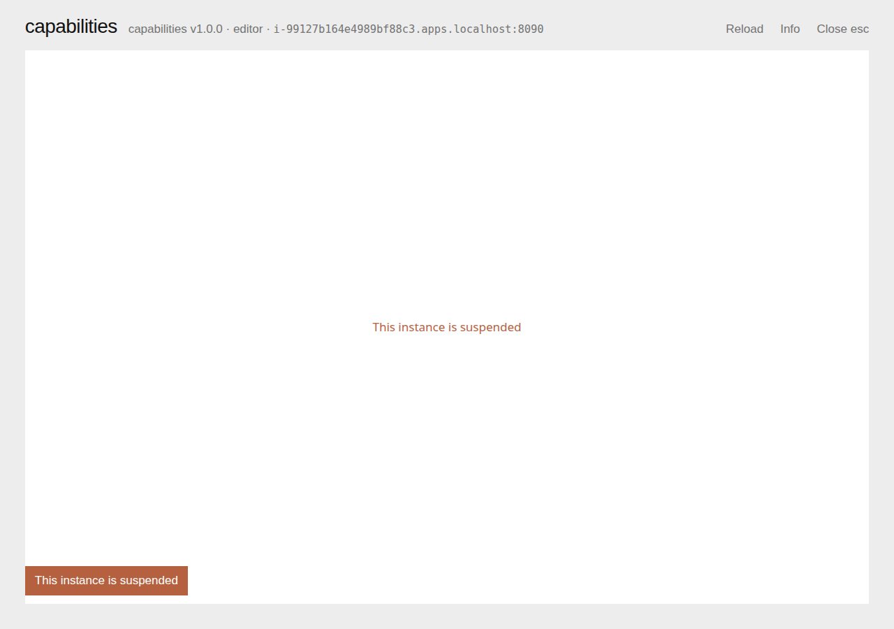

*Bob's open page after an administrator suspended the instance: the server closed his view, the runtime reloaded into the bootstrap, and the portal refused the new launch with "This instance is suspended".*

## 10. The hosted runtime

The hosted runtime, `pkg/catalog/hosted`, serves everything on application origins after the launch: views, the event stream, capability RPC, rooms, assets and model calls. This chapter covers everything except model calls, which have Chapter 11 to themselves.

### 10.1 The principal is recomputed on every request

Every hosted handler begins by turning the bearer grant into a `Principal`:

```go
type Principal struct {
	User      store.User
	Instance  store.Instance
	Role      string
	Release   store.Release
	GrantHash []byte
	Session   []byte
}
```

`Runtime.authenticate` resolves the grant (`ResolveGrant`: unrevoked, unexpired, for this instance, with a live session) and then calls `Runtime.principal`, which reloads the user, loads the instance *through the membership join* (so a removed member gets `403 not_member`), checks the instance is active, calls the portal-supplied `Authorize` function, and loads the pinned release.

`Authorize` is `Server.authorizeInstance`, passed into `hosted.New` as a function value. The hosted package therefore has no billing logic of its own, and there is exactly one implementation of the hosted access rule. In order, it checks: the user is not disabled; preview instances are admin-only; a withdrawn release is still allowed for pinned instances only if `publishing.allowPinnedAfterWithdraw` is set; the caller is entitled; and the owner, if different, is entitled.

Nothing about the principal is cached in the grant. The grant row stores only who, which instance and which session. Role changes, removal, suspension, disabling and loss of payment therefore take effect on the next request. The cost is several queries per request (grant, user, membership, release, settings, subscriptions and grants for the caller and possibly the owner). For one replica serving a modest number of subscribers this is acceptable; the diary flags it as the first thing to cache if load grows, with the warning that any cache needs explicit invalidation on each of those changes.

### 10.2 Views and the event stream

A view is one live page. `POST /api/views` creates it in memory with the authenticated principal and a context derived from the runtime's root context. If the page does not open its event stream within 15 seconds, a watchdog goroutine removes the view.

`GET /api/views/{view}/events` streams server-sent events. The runtime reads the stream with `fetch` and a body reader rather than `EventSource`, because `EventSource` cannot send an `Authorization` header. The handler marks the view connected (only one stream per view), writes a `ready` event, broadcasts room membership, and then loops:

```go
for {
	select {
	case e := <-v.events:          // forward queued event as "data: {json}\n\n"
	case <-keep.C:                  // ": keepalive" every 15 s
	case <-recheck.C:               // every 30 s
		if _, err := rt.principal(r.Context(), v.P.User.ID, inst.ID, nil, v.P.Session); err != nil {
			// send {"type":"revoked"} and close
		}
	case <-r.Context().Done():      // client went away
	case <-v.ctx.Done():            // explicit revocation: send {"type":"revoked"} and close
	}
}
```

The 30-second recheck bounds how long a stream can stay open after an authorization change that no code path signaled explicitly, for example a subscription that lapsed at its period end with no webhook at that moment. Explicit changes do not wait for it.

Each view has a buffered event channel of 128 entries. `View.emit` never blocks: if the buffer is full, it cancels the view. A slow or stalled client therefore loses its own view instead of blocking broadcasts to its peers.

When a view closes, `closeView` cancels its context, cancels all its in-flight model calls, removes it from the runtime's map, and re-broadcasts room membership so peers see it leave.

### 10.3 Revocation

The runtime can cancel views selected by a predicate. Four entry points cover every case:

```go
func (rt *Runtime) RevokeUser(user string) int                 // disable, comp revoke, payment loss
func (rt *Runtime) RevokeInstance(inst string) int             // suspend, upgrade, delete, withdraw+suspend
func (rt *Runtime) RevokeMember(inst, user string) int         // role change, removal
func (rt *Runtime) RevokeSession(session []byte) int           // logout
```

Every portal or admin action that reduces someone's authority does two things. It updates the database (including revoking grants), which stops new requests, and it calls one of these functions, which closes open streams and cancels in-flight model calls immediately. The payment worker calls `RevokeUser` through `Server.New`'s `OnChange` hook whenever a processed event leaves a user without access (section 12.6).

| Action | Database effect | Runtime effect |
|---|---|---|
| Logout | session and its grants revoked | `RevokeSession` |
| Admin revokes sessions | all sessions and grants of the user revoked | `RevokeUser` |
| Admin disables user | `disabled=true`, grants revoked | `RevokeUser` |
| Admin revokes complimentary access | grants (`access_grants`) revoked | `RevokeUser` if no other access remains |
| Stripe event ends access | projection updated | `RevokeUser` via `OnChange` |
| Owner removes member | membership deleted, member's grants revoked | `RevokeMember` |
| Owner changes member role | membership updated | `RevokeMember` (reload with new role) |
| Admin suspends instance | state `suspended`, instance grants revoked | `RevokeInstance` |
| Owner upgrades instance | `release_id` changed | `RevokeInstance` (reload with new code) |
| Admin withdraws release with suspend | release withdrawn, pinned instances suspended, grants revoked | `RevokeInstance` for each |

### 10.4 Capabilities: declared intersect available

An application's manifest declares the capabilities it uses. The hosted runtime implements seven of them. The effective set is the intersection:

```go
func available(m map[string]json.RawMessage) map[string]json.RawMessage {
	out := map[string]json.RawMessage{}
	for name, decl := range m {
		switch name {
		case "sample", "user", "db", "room", "comments", "assets", "downloads":
			out[name] = decl
		}
	}
	return out
}
```

`files` (reading the server's project files) and `artifact` (republishing the application's own HTML) exist in the local runner and are deliberately absent here. RPC dispatch takes the namespace from the method name (`db.set` → `db`) and rejects any call whose namespace is not in the effective set with `403 not_declared`. Declaring a capability is necessary but not sufficient: the role checks below still apply.

The runtime code itself is shared with the local host. `ui/src/runtime.ts` is built twice by `scripts/build.mjs`, once into `pkg/web/static/runtime.js` for local hosting and once into `pkg/catalog/web/static/runtime.js` for hosted origins. The boot flag `hosted: true` switches on the bearer grant, renewal, and a `user` implementation backed by the server-provided `me` profile instead of the local owner. On the Go side, `pkg/store/documents.go` was refactored to export `ValidatePath`, `ValidateQuery`, `ValidateDepth`, `Apply` and `Merge`, and sample validation moved to `piworker.ValidateRequest`, so the hosted runtime enforces the same path rules, query windows, document depth and request limits as the local runner.

### 10.5 Documents

The `db` capability stores JSON documents at slash-separated paths. A path with an even number of segments names a document (`tasks/one`), and its collection is the path minus the last segment (`tasks`). Hosted documents live in `instance_documents`, keyed by `(instance_id, path)`.

The private namespace `data/users/<uid>/…` belongs to the user whose ID is the third segment. `PrivateOwner(path)` extracts it. The rule is enforced in three places:

- **Reads.** `Store.Document` returns "does not exist" for another user's private path without querying, so the owner of an instance cannot read a member's private data either.
- **Queries.** `QueryDocuments` filters in SQL, before any application-level filtering or limits:

  ```sql
  SELECT path,body,version FROM instance_documents
  WHERE instance_id=$1 AND collection=$2
    AND (path NOT LIKE 'data/users/%' OR split_part(path,'/',3)=$3)
  ORDER BY path LIMIT 5001
  ```

  Scoping in SQL matters. If the code loaded a collection and then filtered by user, a bug in the filter, the limit, or the ordering could expose another user's rows; and a query window applied before filtering would return the wrong page. Here, rows the caller may not see are never read. The shared `local.Apply` then applies the query's filters, order and limit to the visible rows. A scan of more than 5000 documents fails rather than truncating silently.
- **Writes.** `writable(p, path)` allows any member to write their own private namespace, rejects other users' private paths with `permission_denied`, and requires `owner` or `editor` for shared paths, returning `read_only` for viewers. `Store.WriteDocument` checks the private owner again, in case a caller skips the handler.

`WriteDocument` implements `set`, `update` (a deep merge with the existing body under `SELECT … FOR UPDATE`) and `delete`, enforces a 256 KiB body limit and the per-instance document limit, and increments a version number on each write. After a successful write, the handler broadcasts `{"type":"db_changed"}` to views of *this instance only*, and the runtime's subscriptions re-query. The local host broadcast changes per artifact; scoping by instance is what keeps one subscriber's writes from waking another subscriber's pages.

Leases (`db.acquire`) give cooperative locks: an upsert that takes the lease if it has expired or is already held by the same holder, with a TTL of 1 second to 10 minutes. They follow the same private-namespace and role rules.

### 10.6 Users, rooms and presence

The `user` capability returns the signed-in user's profile, built server-side by `profile()`: ID, display name (or the local part of the email if none), a colour and an SVG initial avatar derived from a hash of the user ID, `isMe`, and `email: null`. The boot block adds `role`, `isOwner` and `canEdit`. `user.profiles` returns profiles only for co-members of the instance; any other ID returns an empty placeholder. `user.search` searches co-members by name only. The integration test asserts both: Bob's profile has a name and no email, and Carol, a non-member, comes back empty.

Rooms are in memory, keyed implicitly by instance: every room operation iterates only over views whose principal is in the same instance. A view can join up to 16 named rooms plus the default room. Presence is a small JSON object per view per room (at most 4 KiB); events are at most 4 KiB with topic names matching `^[a-z][a-z0-9_.-]{0,47}$`.

Room messages carry two identity flags, and the distinction between them is the main correction to the local runner, where every peer was `isMe: true`:

```go
peers = append(peers, map[string]any{
	"peer": v.ID, "by": rt.person(v.P),
	"isMe":    v.P.User.ID == target.P.User.ID, // same person
	"sameTab": v.ID == target.ID,               // same view
	…
})
```

| Peer seen by Alice's tab 1 | `isMe` | `sameTab` |
|---|---|---|
| Alice's tab 1 | true | true |
| Alice's tab 2 | true | false |
| Bob's tab | false | false |

`by` is the sender's user ID only when the release declares the `user` capability; otherwise it is `null`. The integration test joins Alice and Bob to room `main`, waits for a two-peer list, and checks both flags for every peer, then has Bob emit an event and checks that Alice receives it with `by = bob` and `isMe = false`. In the browser run, the capability playground showed "2 tabs here" across Alice's and Bob's sessions.

Because rooms are in memory, a server restart disconnects everyone; clients reconnect and rejoin, and documents are unaffected. Running more than one replica would need a shared pub/sub for rooms and broadcasts. That is out of scope for the first release.

### 10.7 Comments and assets

Comments are threads anchored to an application-defined JSON anchor. Editors and owners create, reply and resolve; deletion is allowed to the thread's creator or the instance owner. Every thread operation checks that the thread belongs to the instance.

Assets are uploaded with `POST /api/assets` and a `Content-Type` from an allowlist (common image, video, font, PDF and text types), each limited to 20 MiB. Viewers cannot upload. `PutAsset` holds a per-instance advisory lock while it checks the instance's count (at most 1000) and byte quota (`limits.assetBytesPerInstance`, default 256 MiB). Assets are stored in PostgreSQL as `bytea`.

Asset URLs have a specific problem: an `` cannot carry an `Authorization` header. The runtime therefore issues short-lived capability URLs:

```go
func (rt *Runtime) signBlob(instance, id string) string {
	exp := strconv.FormatInt(time.Now().Add(time.Hour).Unix(), 10)
	m := hmac.New(sha256.New, rt.key)
	m.Write([]byte(instance + "|" + id + "|" + exp))
	return "/_blob/" + id + "?e=" + exp + "&s=" + hex.EncodeToString(m.Sum(nil))
}
```

The HMAC covers the instance, the asset ID and the expiry, so a URL cannot be moved to another instance or extended. The key is 32 random bytes generated at process start, so all signed URLs become invalid on restart; `assets.list` issues fresh ones. `GET /_blob/{id}` serves images, fonts and video inline and everything else as `Content-Disposition: attachment`, so an uploaded HTML-like text file can never render as a page on the instance origin.

## 11. Model calls: approved models, admission and the credit ledger

Hosted model calls cost the operator money. Pi runs with the operator's provider credentials, and every subscriber's call is billed to the operator's provider account. This chapter explains how a call is admitted, how its cost is charged against the caller's allowance, and how the system makes sure a credit is never spent twice or lost.

### 11.1 The policy surface

Model policy lives in the settings document (Chapter 13), not in code:

```json
{
  "models": {
    "allowed": [
      {"selector": "lunaroute/glm-5.3-flash", "label": "GLM-5.3 Flash", "thinking": ["low","medium","high"], "credits": 1},
      {"selector": "lunaroute/deepseek-4.1-flash", "label": "DeepSeek 4.1 Flash", "thinking": ["low","high","xhigh"], "credits": 2}
    ],
    "tiers": {"default": "lunaroute/glm-5.3-flash"}
  },
  "allowance": {"monthlyCredits": 20, "dailyCredits": 0, "perUserConcurrency": 2, "globalConcurrency": 8, "maxToolRounds": 5}
}
```

This is the shape of the configuration used in the browser run. A *selector* is a Pi `provider/model` identifier. Each approved model has a credit weight per call and an allowlist of thinking levels. *Tiers* (`quick`, `default`, `complex`) map an application's abstract request, such as `modelTier: "default"`, to an approved model. The defaults approve no models and include zero credits, so hosted sampling is off until an administrator turns it on.

### 11.2 The admission pipeline

`Runtime.sample` processes `POST /api/views/{view}/calls` in a fixed order. Each step can reject the call, and the order is chosen so that cheap checks run first and nothing is reserved until everything that could reject the request has been checked.

```text
sample(request):
    view, principal = authenticate grant, load caller's own view   # 401/403/404
    require manifest declares "sample"                             # 403 not_declared
    decode request (≤ 16 MiB); callId 1–100 chars                  # 400
    piworker.ValidateRequest(request)                              # 400 (input shape, tools, sizes)
    settings = ActiveSettings()
    model, selector = resolveModel(settings, request, worker models)
        explicit model not approved        → 403 model_not_allowed
        approved but not offered by worker → 503 model_unavailable
        thinking level not approved        → 403 model_not_allowed
        tier unmapped                      → 503 sampling_disabled
    images present → require manifest {"sample":{"images":true}} and model supports images
    request.Options.Model = selector; request.MaxRounds = settings.maxToolRounds
    admit(user, perUserConcurrency, globalConcurrency)             # 429 rate_limited
    reservation = Store.Reserve(user, instance, callId, selector, credits, …)
        not enough credits → 402 allowance_exhausted
        daily cap reached  → 429 daily_limit
    register call on the view; start goroutine run(…)
    return 202 {callId}
```

Two rules in `resolveModel` are worth stating explicitly. An explicit model outside the approved set is rejected, never silently replaced by another model. A request that would have gone to an expensive model is not quietly downgraded, and a request for a cheap model is not quietly upgraded. And the request's `maxRounds` is always overwritten by the server's setting, so a page cannot ask for unlimited tool rounds.

The integration test checks the first rule: a request with `model: "other/model"` gets `403 model_not_allowed`. In the browser run, Bob's request for `openai/gpt-x` was refused the same way.

### 11.3 Reserving credits without a race

A user with one credit left who opens two tabs and starts a call in each must get exactly one call. The naive implementation reads the remaining balance, compares, and then increments the reservation; two transactions can both read "1 remaining" and both proceed. `Store.Reserve` avoids this with one statement that both creates the period row and locks it:

```sql
INSERT INTO model_allowance_periods(user_id, period, included) VALUES($1, $2, $3)
ON CONFLICT(user_id, period) DO UPDATE SET included = EXCLUDED.included
RETURNING included, adjustments, reserved, used
```

`INSERT … ON CONFLICT DO UPDATE` takes a row lock on the existing row (or the inserted row) that lasts until the transaction ends. A second transaction for the same user and period blocks at this statement until the first commits, then reads the updated `reserved`. The availability check and the increment are therefore serialized per user:

```go
if used+reserved+r.Credits > included+adjustments {
	return Reservation{}, ErrAllowance
}
… optional daily cap: sum of today's non-released call credits …
UPDATE model_allowance_periods SET reserved = reserved + $credits …
INSERT INTO model_calls(id, call_id, user_id, instance_id, period, settings_revision, model, credits, state) VALUES(…, 'reserved')
COMMIT
```

The `DO UPDATE SET included = EXCLUDED.included` clause has a second purpose: it refreshes the period's included credits from the current settings on every reservation, so an administrator who raises the monthly allowance affects the current period immediately. The period is the UTC calendar month (`2026-10`); a new month creates a new row.

The integration test sets the monthly allowance to 1 credit, opens two views on Alice's grant, and fires two calls concurrently from two goroutines. It asserts exactly one `202` and one `402`, then waits for the admitted call to settle and asserts the ledger shows `used = 1, reserved = 0, remaining = 0`.

Each model call row records the `settings_revision` it was admitted under, so an operator can tell which policy priced a given call even after the settings change.

### 11.4 The call state machine

A reservation is not yet a charge. Whether the call is charged depends on whether the provider was contacted.

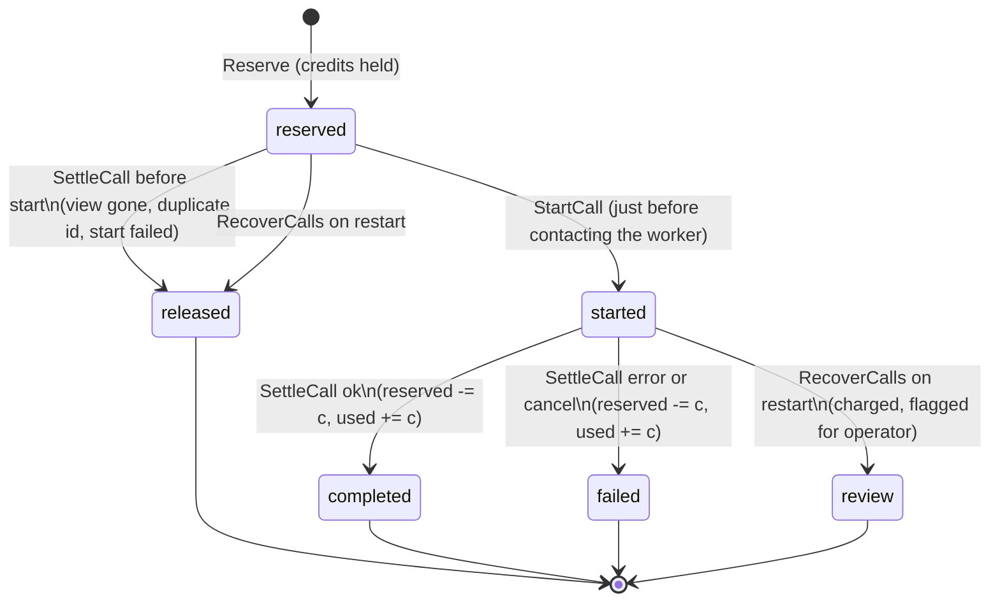

The policy, taken from the design guide, is that once a provider attempt has started, cancellation or failure does not refund the credits. Otherwise a page could start and cancel calls repeatedly and receive paid inference for free. A call that never started, for example because the view disconnected between reservation and start, releases its credits. Administrators can refund explicitly with a ledger adjustment (section 13.3).

`SettleCall` is idempotent by state. It locks the call row, reads its state, and acts only from `reserved` (release) or `started` (charge). Any other state means the call was already settled and the function returns without changes. Settlement updates the call row and the period counters in one transaction.

`RecoverCalls` runs once in `Server.Run` before the listener opens. After a crash, calls may be left in `reserved` or `started`. It releases all `reserved` calls and charges all `started` calls, marking them `review` with error code `process_restart`, with the period counters adjusted in the same transaction:

```sql
WITH r AS (UPDATE model_calls SET state='review', error_code='process_restart', settled_at=now()
           WHERE state='started' RETURNING user_id, period, credits)
UPDATE model_allowance_periods p SET reserved = p.reserved - x.c, used = p.used + x.c
FROM (SELECT user_id, period, sum(credits) c FROM r GROUP BY 1, 2) x
WHERE p.user_id = x.user_id AND p.period = x.period
```

A started call whose outcome is unknown is charged rather than refunded, because the provider may well have done the work. The `review` state lets an operator find and refund those calls.

### 11.5 Running the call

`Runtime.run` executes in a goroutine owned by the runtime's errgroup, with a 5-minute timeout derived from the view's context. Closing the view (navigation, revocation, logout) therefore cancels the provider request.

```go
func (rt *Runtime) run(ctx context.Context, v *View, c *call, req piworker.Request, res store.Reservation) {
	settleCtx := context.Background()
	if err := rt.Store.StartCall(settleCtx, res); err != nil { … settle as start_failed; emit error; return }
	usage := store.CallUsage{}
	emit := func(e piworker.Event) {
		if e.Type == "usage" { aggregate tokens, cost, rounds, model; return }   // never forwarded
		… mark settled on "result" or "error"; forward to this view only …
	}
	execute := func(ctx context.Context, event piworker.Event) (piworker.ToolResult, error) {
		… tool name must be one the page declared …
		… register a channel under the tool call id, emit the tool_call to the view,
		  wait up to 150 s for POST …/tools/{tool}/result …
	}
	err := rt.Backend.Sample(ctx, req, emit, execute)
	… if no terminal event was emitted, emit an error (cancelled or upstream_error) …
	rt.Store.SettleCall(settleCtx, res, ok, code, usage)
}
```

Settlement uses `context.Background()` rather than the request context, so a call whose view was cancelled is still settled in the database.

Events go only to the calling view. Another member of the same instance never sees the call's thinking, text or tool requests, unless the application itself writes them to shared documents.

**Browser tools.** When the model requests a tool, the worker sends a `tool_call` event to Go. `execute` checks that the tool name was declared in this request (so a model cannot invoke an undeclared callback), registers a one-slot channel under the tool call ID, and forwards the event to the view. The page runs its callback, for POLIS the `eval` function that executes JavaScript in the editor, and posts the result to `POST /api/views/{view}/calls/{call}/tools/{tool}/result`. `toolResult` delivers it to the channel; a second result for the same tool call gets `409`. Results are limited to 32 KiB. The JavaScript runs in the caller's browser, on the instance origin. The server and the Node worker never execute application code.

**Usage frames.** Before FRANCOIS-002, the worker discarded the per-round token usage that the Pi SDK reports. The design guide identified this as a gap: allowance can be counted in credits without token data, but operators need tokens and cost to tune credit weights. The worker now emits a private `usage` event after each round:

```ts
const message = await stream.result();
// Private accounting frame; the host aggregates it and never forwards it.
emit({ type: "usage", callId: r.callId, usage: {
  input: message.usage?.input ?? 0, output: message.usage?.output ?? 0,
  cacheRead: message.usage?.cacheRead ?? 0, cacheWrite: message.usage?.cacheWrite ?? 0,
  cost: message.usage?.cost?.total ?? 0, model: model.provider + "/" + model.id } });
```

The hosted `emit` aggregates these frames into the call's totals and never forwards them to the page. The local host drops them. Provider cost can be zero for OAuth or subscription routes such as the LunaRoute models used in testing, so credits are the customer-facing allowance and tokens and cost are operational data.

**Tool rounds.** The worker loops for at most `maxRounds` rounds (clamped to 1–10). On the last round, it removes the tools from the request, which forces the model to answer in text instead of requesting another tool call. This bounds the number of provider requests one call can make.

**Concurrency.** `admit` and `release` maintain in-memory counters of running calls per user and in total, under the runtime mutex. They are released in the call goroutine's `defer`, and also on every early-return path after admission.

### 11.6 A recorded call

The browser run recorded this call in the usage ledger for POLIS, with the operator's real Pi configuration:

| Field | Value |
|---|---|
| Model | `lunaroute/glm-5.3-flash:low` |
| State | `completed` |
| Credits | 1 |
| Input tokens | 4377 |
| Output tokens | 60 |
| Rounds | 2 |
| Provider cost | 0 (OAuth route) |

Two rounds is what a single tool use looks like: in round one the model requested `eval` with `ide.patch("height: 6,", "height: 10,")`; the browser ran it and returned the result; in round two the model wrote its one-sentence reply. The screenshot shows the agent panel and the rebuilt scene.

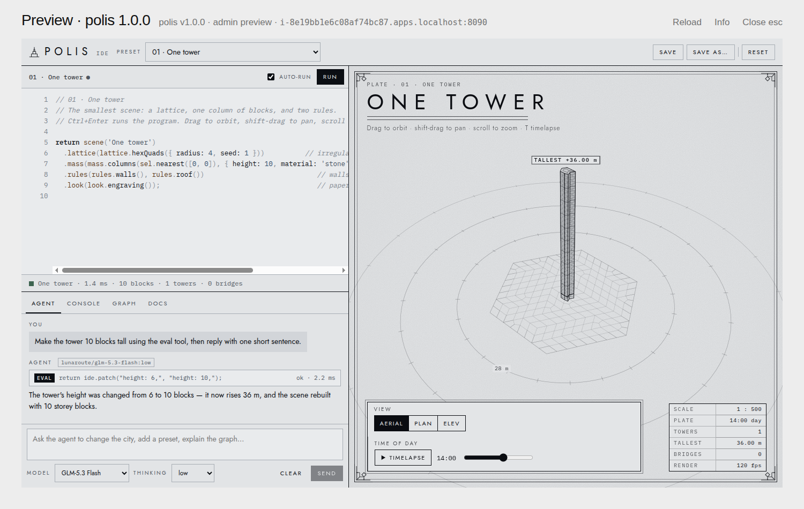

*POLIS running as an admin preview on its own origin (`i-8e19bb1e6c08af74bc87.apps.localhost`). The agent, using `lunaroute/glm-5.3-flash:low`, called the browser-side `eval` tool to patch the program; the scene rebuilt with a 10-block tower.*

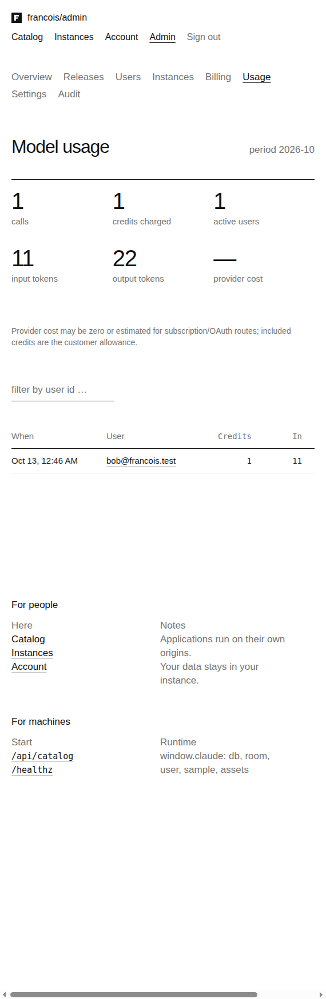

*The admin Usage screen for the period, with calls, credits charged, tokens and provider cost. The single row is Bob's call through the deterministic test model.*

## 12. Billing: Stripe Checkout, webhooks and the access policy

The billing design is built around one observation from the predecessor project in the vault ([[PROJECT REPORT - Stripe Billing - End to End Subscription Infrastructure and Acceptance]]): a webhook event is a notification that something changed, not an authoritative description of the current state. Events can arrive late, out of order, duplicated, or not at all. The platform therefore treats each webhook as a request to refresh, fetches the Customer's current subscriptions from Stripe, and writes those. Access is computed from the stored projection by a pure function.

### 12.1 The access policy

`billing.Policy.Access(account, subscriptions, comps, now)` returns a `Decision{Allowed, Reason, Until, Status, CancelScheduled}`. It has no I/O, which made it possible to test with a 20-case table.

```text
Access(account, subs, comps, now):
    if account.disabled: deny account_disabled
    eligible = subs with accepted Price, quantity 1, exactly 1 item,
               and status in {active, trialing, past_due, unpaid, paused}
    best_comp = unrevoked comp with the latest Until > now
    if more than one eligible subscription:
        return best_comp if any, else deny billing_conflict
    if exactly one eligible subscription s:
        active and now < s.accessUntil              → allow subscriber until accessUntil
        trialing, trials enabled, now < trialUntil  → allow subscriber_trial
        active but period over                      → deny subscription_expired
        past_due                                    → deny payment_past_due
        otherwise                                   → deny subscription_required
        if denied and best_comp exists → allow complimentary (status kept for display)
    if best_comp: allow complimentary
    if any subscription is incomplete: deny payment_incomplete
    deny subscription_required
```

Three policy choices differ from the predecessor TODO project and were made deliberately for this product:

- **`past_due` denies access.** The predecessor granted access while a renewal payment was failing. Here, model calls cost the operator money, so access stops until payment succeeds. A grace period would be an explicit future policy.
- **Two eligible subscriptions are a conflict, not a choice.** Picking one arbitrarily would hide a billing problem (the user is being charged twice). The user is denied with `billing_conflict` unless a complimentary grant covers them, and an administrator resolves it.
- **Only the configured Price counts.** A subscription to some other product in the same Stripe account does not unlock the platform. So does a quantity other than 1, or a subscription with extra items.

Access ends at `accessUntil`, the current billing period end, taken from the subscription *item*. In recent Stripe API versions the period fields live on subscription items, and `payments.Project` reads `item.CurrentPeriodEnd`. Period-end cancellation keeps `status = active` with `cancel_at_period_end = true` until the period ends, so a subscriber who cancels keeps access until the date they paid for. The account page shows that as "Ends Nov 12, 2026 · cancellation scheduled".

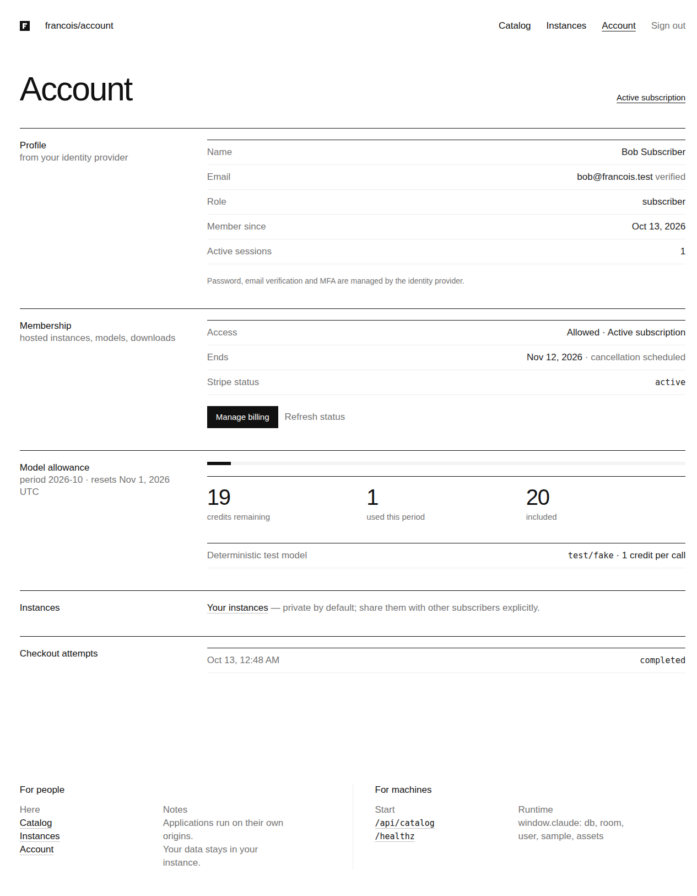

*Bob's account after cancelling in the Stripe Customer Portal: access remains allowed until the period end, the cancellation is shown as scheduled, and the model allowance is displayed for the period.*

### 12.2 The gateway boundary

`payments.Gateway` is an interface with seven methods: `CreateCustomer`, `CreateCheckout`, `RetrieveCheckout`, `CreatePortal`, `SubscriptionCustomer`, `CustomerSubscriptions` and `ConstructEvent`. The production implementation uses `stripe-go/v86`. The tests use a fake. All Stripe calls go through this interface, which is why the billing service's failure scenarios could be tested without network access (section 12.7).

`NewStripe` refuses keys that do not start with `sk_` or `rk_` and webhook secrets that do not start with `whsec_`. `catalog serve` refuses a key whose mode (`_live_` or not) does not match `--stripe-live-mode`, and refuses live mode without an HTTPS public URL. Multiple webhook secrets are accepted to allow rotation.

### 12.3 Checkout

The checkout flow must survive double clicks, network timeouts and retries without creating two Customers or two Checkout Sessions, and must not sell a second subscription to someone who already has one.

```text
Checkout(user):
    if the user has a Customer:
        fetch the Customer's subscriptions from Stripe
        if any subscription for our Price is open (standing or incomplete):
            enqueue a refresh; return ErrSubscriptionOpen   # UI sends the user to the Portal
    customer = ensureCustomer(user)        # idempotency key "<deployment>-customer-<user>"
    attempt = AdmitCheckout(user)          # returns the existing pending/open attempt, if any
    if attempt is open and its Session has not expired: return its URL
    session = CreateCheckout(…, idempotency key "<deployment>-checkout-<attempt id>")
    OpenCheckout(attempt, session.id, session.url, session.expiresAt)
    return session.url
```

`AdmitCheckout` relies on the partial unique index from section 6.2. It first expires open attempts whose Session lifetime has passed, then runs `INSERT … ON CONFLICT DO NOTHING RETURNING`. If the insert returns a row, this request created the attempt. If not, another attempt is already pending or open, and the function returns that one. Two simultaneous clicks therefore resolve to one attempt.

The idempotency keys are what make retries safe across the network boundary. If `CreateCheckout` succeeds at Stripe but the response is lost, the attempt stays `pending` with no session ID. The next request finds the same pending attempt and calls `CreateCheckout` again with the same key, attempt ID included, and Stripe returns the same Session instead of creating a new one. The same holds for `CreateCustomer`: a retry after a failed database write gets the same Customer, and `SaveCustomer` uses `ON CONFLICT DO NOTHING` and returns whichever mapping was stored first.

Checkout Sessions carry `client_reference_id` and metadata with the user ID and attempt ID, and the subscription carries the user ID in its metadata. These are for operators reading the Stripe Dashboard. The platform never trusts them for routing (section 12.5).

The checkout handler also requires `email_verified`, so a subscription is attached only to an account whose email address the IdP has verified.

### 12.4 Webhook ingest

`POST /webhooks/stripe` reads the raw body (at most 256 KiB) and passes it unmodified to `stripe.ConstructEvent` with the `Stripe-Signature` header. Signature verification must use the exact bytes Stripe sent; parsing and re-serializing JSON would change them. `ConstructEvent` also checks the timestamp tolerance and, by default, that the event's API version matches the library's. The Stripe CLI in the test account forwarded `2026-06-24.dahlia` events, which matches stripe-go v86's release train, so strict verification worked without disabling the version check.

`Service.Ingest` then rejects events whose `livemode` differs from the deployment's mode, extracts routing IDs, and inserts one row into `stripe_events`:

```go
rec := store.StripeEvent{EventID: e.ID, Type: e.Type, CustomerID: e.CustomerID,
	SubscriptionID: e.SubscriptionID, SessionID: e.SessionID, Livemode: e.Livemode, StripeCreated: &e.Created}
if !e.Supported { rec.State = "ignored" }
s.Store.InsertEvent(ctx, rec)   // INSERT … ON CONFLICT DO NOTHING (event_id is the primary key)
```

The handler responds with these statuses:

| Situation | Status | Stripe's behavior |
|---|---|---|
| Bad signature, or mode mismatch | 400 | Does not retry. |
| Database unavailable | 503 | Retries with backoff. |
| Stored, including duplicates | 200 | Done. |

The event is durable before the handler acknowledges it. A crash after the acknowledgement loses nothing, because the work is in the table. A duplicate delivery is a no-op insert.

`Extract` reads only IDs from the event: the Customer, and the Subscription or Checkout Session depending on the object type. For invoices it reads `parent.subscription_details.subscription`, where recent API versions put it. Expandable fields may be a string ID or an object, and `expandable` handles both. Supported types are the subscription lifecycle events, Checkout Session completion and expiry (including asynchronous payments), and invoice paid, failed, action-required and finalization-failed. Unsupported types are stored as `ignored` for visibility.

### 12.5 The inbox worker

`Service.Run` runs in the server's errgroup. It drains the inbox until no event is due, then waits for a wake signal (sent after ingest, refresh and retry), a 5-second poll, or a 10-minute reconciliation tick.

`ClaimEvent` leases one due event with `FOR UPDATE SKIP LOCKED`, so multiple workers, if there were more than one, would never process the same event concurrently:

```sql
UPDATE stripe_events SET lease_token=$1, lease_until=now()+$2::interval, attempts=attempts+1
WHERE event_id=(SELECT event_id FROM stripe_events
                WHERE state='pending' AND next_attempt_at<=now() AND (lease_until IS NULL OR lease_until<now())
                ORDER BY next_attempt_at LIMIT 1 FOR UPDATE SKIP LOCKED)
RETURNING …
```

A lease expires after two minutes, so an event claimed by a worker that crashed becomes due again.

`processOne` then handles the event:

```text
processOne():
    e = ClaimEvent(lease 2m)                       # none due → idle
    backoff = 5 s × 2^min(attempts, 10); terminal after 12 attempts
    customer = e.customer, or look it up from e.subscription at Stripe
    if no customer: complete as "ignored"
    user = UserForCustomer(customer)
        not found → FailEvent("unknown_customer", backoff)   # never create users from event data
    subs = Gateway.CustomerSubscriptions(customer)  # status=all, paginated
        error → FailEvent("stripe_unavailable", backoff)
    if e.session: mark the Checkout attempt completed or expired
    CompleteEvent(e, user, subs)                    # one transaction, lease must still be owned
    OnChange(user)                                  # revoke live views if access was lost
```

Three design rules are visible here.

- **Current state, not event payload.** The projection is always the full list of the Customer's subscriptions in any status, retrieved at processing time. A late event about an old subscription causes a refresh that writes the current state of *every* subscription, so it cannot regress anything.
- **Projection keyed by subscription.** `upsertSubscriptions` writes one row per Stripe subscription ID, with a guard `WHERE billing_subscriptions.user_id = EXCLUDED.user_id`, so a subscription can never be reassigned to a different user by a later write. A canceled old subscription and an active replacement coexist as two rows; the policy sees one eligible subscription.
- **Events never create users.** The Customer-to-user mapping is created only by the platform's own checkout flow. An event for an unknown Customer is retried with backoff (the mapping write may still be in flight) and then surfaces to operators as an error event. Metadata in the event is not trusted to identify a user.

`CompleteEvent` writes the projection and marks the event processed in the same transaction, after checking with `SELECT … FOR UPDATE` that the lease token is still the one this worker holds. If another worker reclaimed an expired lease, the slow worker's completion is refused with `event lease lost`. `FailEvent` also checks the lease token, schedules the next attempt, and stores only a sanitized error code, never Stripe's error message or payload.

### 12.6 Reconciliation and the return page

Webhooks can be lost entirely, for example if the endpoint is misconfigured. Every 10 minutes, `reconcile` enqueues a synthetic refresh event (`francois.refresh.scheduled`) for every Customer with a nonterminal subscription that has not been refreshed in six hours, and checks Checkout attempts that have been pending or open for more than two minutes: it retrieves their Session and marks them completed (enqueuing a refresh) or expired, and marks attempts that never got a Session after an hour as `failed / creation_uncertain`. Refreshes go through the same inbox and worker as real webhooks, so there is one code path that writes projections.

The same queue serves user and operator requests. When a subscriber returns from Checkout, the account page calls `POST /api/billing/refresh` with the Session ID from the return URL. `Service.Refresh` verifies that the Session belongs to one of the caller's own checkout attempts (`ErrForeignSession` otherwise) and enqueues a refresh. The page polls `/api/account` every 2.5 seconds and shows "Checking your subscription status…" until access appears. The return URL itself grants nothing; the fake-gateway test asserts that a return without a processed webhook leaves access denied. In the browser run, the webhooks had already been processed by the time the return page loaded, so the checking state was never visible. The administrator's "Reconcile" action and the "Refresh status" button on the account page use the same queue.

`Server.New` installs `payments.Service.OnChange`. After every processed event, it re-evaluates the user's access and, if it is now denied, calls `Runtime.RevokeUser`. A subscription that ends closes the user's open instance pages at the moment the event is processed, instead of waiting for the 30-second recheck.

### 12.7 Failure scenarios covered by tests

`pkg/catalog/payments/service_test.go` runs the service against a fake gateway and a real PostgreSQL database.

| Scenario | Expected result |
|---|---|
| Two rapid Checkout requests | One attempt and one Session. |
| Session creation times out after Stripe created it | Attempt stays pending; retry reuses the idempotency key and gets the same Session. |
| Refresh with another account's Session ID | `ErrForeignSession`. |
| Checkout while a subscription is open | `ErrSubscriptionOpen`; no second purchase. |
| Return from Checkout without webhook processing | No access. |
| Replacement subscription B's event, then old subscription A's delayed deletion, with duplicates | B remains active; one row per subscription. |
| Event for an unknown Customer | No user created; event retried. |
| Terminal cancellation | Access removed on the next refresh. |

The browser run exercised the real path: `checkout.session.completed`, `invoice.paid` and `customer.subscription.created` were all processed on the first attempt; after the Portal cancellation, `customer.subscription.updated` produced the projection `active, quantity 1, item_count 1, access_until 2026-11-13, cancel_at_period_end true`.

## 13. Settings and administration

### 13.1 The settings document

Product policy that an operator needs to change without a deploy lives in one JSON document, `settings.Document`, with four sections: `models` (approved models and tiers), `allowance` (monthly and daily credits, per-user and global concurrency, maximum tool rounds), `limits` (instances per user, members per instance, documents per instance, asset bytes per instance, maximum HTML size), and `publishing` (`allowPinnedAfterWithdraw`).

Secrets are deliberately absent. Database URLs, the OIDC client secret, Stripe keys, webhook secrets and Pi provider credentials are deployment configuration, passed as files to `catalog serve`. The settings document cannot name a provider URL or carry a key, so an administrator account, or someone who compromises one, cannot redirect model traffic or read credentials through the settings API. The admin settings response reports secret configuration only as booleans: `{"oidc": true, "stripe": true, "modelProvider": true}`.

`settings.Parse` decodes with `DisallowUnknownFields`, so a misspelled key is an error rather than a silently ignored setting, and then `Validate` checks every field:

| Field | Rule |
|---|---|
| `models.allowed` | At most 32. Selector matches `provider/model`, contains no `:` (no thinking suffix), is unique. Credits 1–1000. Label ≤ 80. Thinking levels from `off, minimal, low, medium, high, xhigh, max`. |
| `models.tiers` | Keys `quick`, `default`, `complex`; each value must be an approved selector. |
| `allowance` | Credits 0–1,000,000. Concurrency 1–16 per user, 1–256 global. Tool rounds 1–10. |
| `limits` | Instances 1–1000 per user; members 1–100; documents 1–100,000; asset bytes 0–4 GiB; HTML 1 KiB–16 MiB. |

Revisions are append-only. `SaveSettings` validates, inserts a new `platform_settings` row, and writes an audit entry in one transaction. `ActiveSettings` reads the newest revision, or returns the built-in defaults as revision 0 if none exists. The browser run hit this validator: saving a model with the `max` thinking level, which Pi supports, returned `422 model … has unknown thinking level "max"`. The level was added to both the validator and the UI.

### 13.2 The admin API

All admin routes are under `/api/admin/` and use the `admin` guard level: a session with the admin role, plus CSRF and Origin checks on mutations. An application grant cannot reach them, because grants do not authenticate on the portal at all.

| Area | Endpoints | Notes |
|---|---|---|
| Overview | `GET overview` | Counts of users, admins, disabled, instances, drafts, published; live views; usage summary; billing health; whether billing and models are available. |
| Releases | `GET releases`, `POST releases` (multipart), `POST releases/check`, `POST releases/{id}/publish`, `…/withdraw`, `…/preview`, `DELETE releases/{id}`, `PATCH artifacts/{id}` | Withdraw accepts `suspendPinned`. Artifact patch edits title, description, tags and visibility (`listed`/`hidden`). The list includes how many instances pin each release. |
| Users | `GET users?q=`, `GET users/{id}`, `PATCH users/{id}`, `POST users/{id}/revoke-sessions`, `POST`/`DELETE users/{id}/access-grants` | Detail includes access decision, subscriptions, grants, instances, sessions, Stripe Customer ID, allowance, recent calls and audit. An admin cannot disable or demote themselves (`409 self_lockout`). Grants need 1–3660 days and a reason. |
| Instances | `GET instances?q=`, `GET instances/{id}`, `POST instances/{id}/suspend`, `…/resume` | Detail includes members, document and asset usage, active grants and views, recent failed or review calls, audit. |
| Settings | `GET settings`, `PATCH settings` | GET includes history, the models the Pi worker offers, defaults and secret status. |
| Billing | `GET billing?state=`, `POST billing/reconcile`, `POST billing/events/{id}/retry` | Event inbox, checkout attempts, health (pending, errors, oldest pending, open checkouts, customers, active subscriptions). |
| Usage | `GET usage?user=&limit=`, `POST usage/adjustments` | Adjustments are ±1–100,000 credits with a reason. |
| Audit | `GET audit?subject=` | The newest 200 entries. |

Every state-changing admin action writes an `admin_audit` row with the actor, the action, the subject and a small JSON summary. Prompts, model output and secrets are never written to the audit log.

### 13.3 Credit adjustments

`AdjustAllowance` adds to the period's `adjustments` column (creating the period row if needed), inserts an `allowance_adjustments` row with actor and reason, and writes an audit entry, in one transaction. Refunds and grants of extra credit are therefore always explicit, attributable ledger entries; nothing edits `used` directly.

### 13.4 Complimentary access

`POST /api/admin/users/{id}/access-grants` inserts an `access_grants` row. The policy treats an unrevoked, unexpired grant as access with reason `complimentary`. This was used in the browser run to give Alice and Bob access before Stripe was configured, and it is the intended mechanism for staff, reviewers and support cases. It is audited and never pretends to be a Stripe subscription, so billing reports stay accurate. Revoking grants re-evaluates access and closes live views if nothing else grants access. The CLI has the same operation: `francois catalog users grant-access --user-id … --days 30 --reason …`.

## 14. The frontend

### 14.1 Structure and build

The portal is a React and TypeScript single-page application in `ui/catalog`, using Redux Toolkit and RTK Query. `scripts/build.mjs` bundles it with esbuild into `pkg/catalog/web/static/catalog.js`, alongside `launch.js` (the bootstrap) and the hosted copy of `runtime.js`. `pkg/catalog/web/embed.go` embeds these files into the Go binary with `go:embed`, and exposes two separate lookup functions so the two kinds of origin can never serve each other's files:

```go
// PortalAsset serves only portal UI files, never subscriber HTML.
func PortalAsset(name string) ([]byte, string, bool)   // catalog.js, catalog.css, icon.svg
// AppAsset serves the trusted bootstrap and runtime on instance origins.
func AppAsset(name string) ([]byte, string, bool)      // launch.js, launch.css, runtime.js, style.css, icon.svg
```

`AppAsset` also serves the local runner's `style.css` and `icon.svg`. Applications built for the local runner link `/static/style.css`; without it, the browser refused the stylesheet with a `text/plain` MIME error during the browser run.

The portal routes `/`, `/apps/…`, `/account`, `/instances/…` and `/admin/…` all return the same `index.html`, and the SPA renders the matching screen.

| File | Screens |
|---|---|
| `catalog.tsx` | Catalog listing with tag filters; application detail with releases, Run and Download. |
| `account.tsx` | Profile, membership and access, Stripe actions, allowance, instances link, checkout attempts. |
| `instances.tsx` | Instance list (own and shared); the `Launcher` frame; the Share & info panel. |
| `admin.tsx` | Overview, Releases (upload/check/draft/preview/publish/withdraw), Users and user detail, Instances and instance detail, Billing, Usage, Settings, Audit. |
| `ui.tsx`, `store.ts`, `main.tsx` | Shared components, navigation and toast state, entry point. |

### 14.2 RTK Query and CSRF

`ui/catalog/api.ts` defines one RTK Query API slice with typed endpoints and cache tags (`Session`, `Account`, `Catalog`, `Instances`, `Instance`, `Overview`, `AdminReleases`, `AdminUsers`, `AdminUser`, `AdminInstances`, `Settings`, `Billing`, `Usage`, `Audit`). Mutations invalidate the tags they affect; publishing a release, for example, invalidates `AdminReleases`, `Catalog` and `Overview`, so the admin list, the public catalog and the overview counters refetch.

The CSRF token is captured when the session query resolves and added to every mutation by the base query:

```ts
let csrf = "";
const baseQuery = fetchBaseQuery({
  baseUrl: "/",
  prepareHeaders: (headers, { type }) => {
    if (type === "mutation" && csrf) headers.set("X-CSRF-Token", csrf);
    return headers;
  },
});
```

This produced one of the bugs found in the browser. Opening `/instances/<id>` directly rendered the iframe immediately; the bootstrap asked for a code before `/api/session` had returned, and the launch mutation went out without a token, failing with "Missing or invalid CSRF token". The `Launcher` now renders the iframe only after the session token is loaded (`const ready = !!session?.csrfToken`).

### 14.3 The launcher

`Launcher` renders a full-window viewer: a title bar with the instance title, release, role and origin; Reload, Info (or Share & info for owners) and Close (Escape) actions; and the sandboxed iframe:

```tsx
<iframe key={nonce} ref={frame} title={inst.title} src={inst.origin + "/launch"}
  sandbox="allow-scripts allow-same-origin allow-forms allow-popups allow-modals allow-downloads"
  allow="clipboard-write" />
```

`allow-same-origin` in a sandbox attribute means the framed document keeps its own origin, which is the instance origin, and so can use its own `localStorage` and make same-origin requests to its own API. It does not give the frame access to the portal; the origins differ. The sandbox omits `allow-top-navigation`, so application code cannot navigate the portal page away. Reload increments `nonce`, which remounts the iframe and runs the launch protocol again.

If the server reports that launch is blocked (`launchBlocked` in the instance response, for example because the owner's subscription lapsed or the instance is suspended), the launcher shows the reason and a link to the account page instead of a frame.

### 14.4 Checkout return

The account page reads `?checkout=<session id>` from the URL on return from Stripe, calls the refresh mutation once with that ID, and polls the account query every 2.5 seconds until access is allowed (section 12.6). Subscribe sends the user to the Checkout URL returned by the server; Manage billing opens a Stripe Customer Portal session for the caller's own Customer.

### 14.5 Visual style

The user asked for the aesthetics of `html.moldandyeast.com`, an index of single-file HTML pieces, and described this product as "basically building the subscription version of it". Its HTML and stylesheet were fetched and its design rules adopted in `pkg/catalog/web/static/catalog.css`: type only, black on white, hierarchy from size, weight and grey; square solid ("ink") and grey ("soft") buttons; underline to indicate the current selection; rows with a 300-pixel label column; a display-size introductory sentence; a grey surround for an opened application; and a "For people / For machines" footer. Colour tokens are defined once on `:root`:

```css
:root {
  --color-wall: #ffffff; --color-plinth: #f4f4f4; --color-table: #ededed;
  --color-line: #eeeeee; --color-faint: #c4c4c4; --color-muted: #737373;
  --color-text: #1d1d1d; --color-ink: #111111; --color-warn: #b5603f; --color-ok: #2f6f4f;
  --font-sans: "Helvetica Neue", Helvetica, Arial, system-ui, sans-serif;
  --text-display: clamp(32px, 4.72vw, 68px); --label: 300px; …
}
```

The applications provide all colour; the platform frames them in grey.

## 15. Command line and deployment

### 15.1 The `catalog` commands

All commands are Glazed commands registered in `cmd/francois/cmds/catalog.go`.

| Command | Purpose |
|---|---|
| `francois catalog serve` | Run the platform. |
| `francois catalog migrate` | Apply embedded migrations; prints one row per applied migration. |
| `francois catalog publish` | Create a release from an HTML file through the shared `Publisher`. |
| `francois catalog settings [--file settings.json]` | Show the active settings, or validate and activate a new revision. |
| `francois catalog users list [--search]` | List accounts. |
| `francois catalog users promote/disable/enable/revoke-sessions/grant-access` | Account operations by `--user-id` or exact `--issuer`/`--subject`. |

`catalog serve`'s important flags are listed below. Every secret has a file form, so secrets can be mounted rather than passed on the command line, where they would be visible in the process list.

| Flag | Meaning |
|---|---|
| `--listen` | Listen address. |
| `--public-url` | Portal origin, e.g. `https://francois.example`. |
| `--app-domain` | Application domain; instances are `i-<id>.<app-domain>`. Must differ from the portal host. |
| `--database-url` / `--database-url-file` | PostgreSQL. |
| `--release-dir` | Private blob directory. |
| `--migrate` | Apply migrations before serving; otherwise refuse to start with pending migrations. |
| `--oidc-issuer`, `--oidc-client-id[-file]`, `--oidc-client-secret-file` | ZITADEL relying party. The redirect URL is `<public-url>/auth/callback`. |
| `--stripe-secret-key-file`, `--stripe-webhook-secret-files`, `--stripe-price-id`, `--stripe-live-mode` | Billing; without a key file, billing is disabled and access comes only from complimentary grants. |
| `--trial-allowed` | Count `trialing` as access. |
| `--grant-ttl` | Runtime grant lifetime, 1m–12h, default 30m. |
| `--backend pi\|fake` | Real Pi worker or a deterministic fake (default `fake`). |
| `--node`, `--worker`, `--pi-agent-dir`, `--worker-dir` | Pi worker process configuration. |

The fake backend offers one model, `test/fake`, and returns a deterministic answer with a usage frame. It is used by the integration test and by the Compose stack when no Pi configuration is provided.

`Server.Run` recovers open model calls, starts the HTTP server and the billing worker in one errgroup, and on shutdown gives in-flight HTTP requests 10 seconds, then waits for the runtime's goroutines (view watchdogs and model calls, whose contexts are cancelled with the server's) to return.

### 15.2 The Compose acceptance stack

The user asked mid-implementation for "a docker compose setup to test the whole thing". `deploy/compose/compose.yaml` runs the complete system on one Linux machine:

| Service | Image | Role |
|---|---|---|
| `postgres` | `postgres:17` | One server with two databases, `zitadel` and `francois_catalog`, created by `postgres-init.sql`. Exposed on `127.0.0.1:5435`. |
| `zitadel` | `ghcr.io/zitadel/zitadel:v4.17.3` | Identity provider on `localhost:18081`, with the built-in login UI and a machine user whose personal access token is written to a shared volume. |
| `zitadel-setup` | the Francois image | One-shot provisioning (below). |
| `stripe` (profile `stripe`) | `stripe/stripe-cli:v1.30.0` | Forwards sandbox webhooks to `http://localhost:8090/webhooks/stripe` and writes the listener's signing secret to the shared volume. |
| `francois` | the Francois image | `catalog serve` on `127.0.0.1:8090` with portal `http://localhost:8090` and app domain `apps.localhost`. |

`zitadel-setup` runs `deploy/compose/bin/catalog-setup`. The script waits for the issuer, runs `catalog migrate`, then uses the ZITADEL management API with the bootstrap token to create (if missing) the project `francois`, a PKCE web application `francois-portal` (no client secret, development mode so `http` redirect URIs are allowed, ID-token userinfo assertion so profile claims appear in the ID token), and three human users with verified emails: `admin@francois.test`, `alice@francois.test` and `bob@francois.test`, all with password `Password1!`. It writes the client ID to the shared volume and promotes the admin by exact issuer and subject. Every step searches before creating, so the job is idempotent across restarts.

`deploy/compose/bin/catalog-serve` builds the `catalog serve` command line from the provisioned client ID, the backend choice and, if the Stripe profile has written its secrets and `STRIPE_PRICE_ID` is set, the billing flags. For the Pi backend, it copies only four provider files (`auth.json`, `models.json`, `models-store.json`, `settings.json`) from the read-only mount of the operator's `~/.pi/agent` into a private writable directory with mode 0700. The Pi worker needs to write there, for lock files and OAuth token refresh, and the container must not get write access to the operator's home directory or load its sessions, extensions or skills.

`francois` and `zitadel-setup` use host networking. With host networking, the browser and the server both reach ZITADEL at the same URL, `http://localhost:18081`, which the OIDC issuer check requires, and the server can receive requests for `*.apps.localhost`, which the browser resolves to loopback. Docker Desktop on macOS and Windows does not support host networking in the same way, so the stack is Linux-only, as the compose file header states.

The image is a three-stage build: Node 24 with pnpm builds the UI bundles and the worker; Go 1.26.5 builds a static `francois` binary with the bundles embedded; the final Node 24 slim image contains the binary, the worker and its production dependencies, the example applications and the two scripts, and runs as an unprivileged `francois` user.

The Stripe sandbox needs a test-mode key and a Price. For the browser run, a product "Francois Subscriber (sandbox)" with a placeholder USD 1.00 monthly price was created in the existing test-mode account. The key and price ID live only in the git-ignored, mode 0600 `deploy/compose/.env`.

```bash
docker compose -f deploy/compose/compose.yaml up --build                      # fake models, no billing
docker compose -f deploy/compose/compose.yaml --profile stripe up --build     # with .env: STRIPE_API_KEY, STRIPE_PRICE_ID
FRANCOIS_BACKEND=pi PI_AGENT_DIR=~/.pi/agent docker compose … up --build      # real Pi models
```

## 16. Verification

### 16.1 The integration test

`pkg/catalog/catalog_test.go`'s `TestHostedPlatform` builds the real server handler graph (portal, hosted runtime, store, publisher, fake model backend) against a fresh PostgreSQL database that the test creates and drops, named from `TEST_DATABASE_URL`. It sends requests with explicit `Host` headers for `portal.test` and `i-….apps.test`, and its portal helper adds `Origin` and `X-CSRF-Token` the way the SPA does. It does not use a browser or ZITADEL; users and sessions are created directly in the store.

The test is one long scenario, because most of the properties are about what happens to one actor's access after another actor's change:

| Step | Asserted property |
|---|---|
| Subscriber uploads a release | `403 admin_required`. |
| Admin uploads, uploads the same version again, publishes | `201`, then `409`, then `200`; the admin release list contains the release (regression for the empty-list bug). |
| Publish with a bad CSRF token; portal mutation with an application `Origin` | Both `403`. |
| Public catalog | Contains the release metadata and not a marker from the HTML. |
| Download anonymously, unentitled, entitled | `401` and `403` without bytes; `200` with matching SHA-256 and `attachment`. |
| Unentitled user creates an instance | `403 subscription_required`. |
| Alice and Bob create instances | Different origins; Bob gets `404` for Alice's instance and cannot launch it. |
| Wrong verifier, then right verifier with the same code | Both `401` (code consumed first). |
| Alice's code redeemed on Bob's instance origin | `401`. |
| Alice's grant on Bob's instance; `/page` without a grant | `401`; no bytes. |
| `/page` with a grant | HTML marker and Alice's user ID present. |
| Grant used on the portal | `401`. |
| Document written in A, read from B | Not found. |
| Bob added as viewer of A; Bob tries to share A | `200`; `403`. |
| Bob reads shared doc, writes shared doc, writes his private doc | Allowed; `403 read_only`; allowed. |
| Alice reads or writes Bob's private doc | Not found; `403`. |
| Rooms | `isMe` matches user, `sameTab` matches view; Bob's event reaches Alice with `by = bob`, `isMe = false`. |
| Profiles | Bob's has a name and no email; Carol (non-member) is empty. |
| Bob removed while connected | His next RPC fails. |
| Two concurrent calls with one credit | Exactly one `202` and one `402`; ledger `used 1, reserved 0, remaining 0`; tokens recorded. |
| Disallowed model | `403 model_not_allowed`. |
| Alice logs out | Her grant fails with `401`. |

Unit tests cover the access policy (20 cases), release validation and blob storage (including hash verification on read), and the payment service against a fake gateway (section 12.7).

### 16.2 The browser run

The Compose stack was driven through Playwright in three separate browser contexts (admin, Alice, Bob), against real ZITADEL, the Stripe sandbox and, later, the operator's Pi configuration with two LunaRoute models. The recorded journey:

1. Sign in through ZITADEL as admin; upload the capability playground (`examples/capabilities.html`); Check (warnings for `files` and `artifact`); Save draft; Preview on its own origin; add a task; Publish.
2. Alice signs in and is sent to the account page to subscribe. The admin grants Alice and Bob complimentary access and approves the `test/fake` model.
3. Alice runs an instance and shares it with Bob as editor. Both see the shared task and the playground reports "2 tabs here".
4. Bob makes a model call (1 credit) and is refused `openai/gpt-x`. `user.search` lists co-members without email.
5. The admin suspends the instance; Bob's open frame closes with "This instance is suspended".
6. The admin revokes Bob's complimentary access. Bob subscribes through hosted Checkout with the `4242` test card. The account page shows an active subscription renewing Nov 12. Manage billing opens the Customer Portal; Bob cancels at period end; the account shows "cancellation scheduled" with access continuing.
7. With `FRANCOIS_BACKEND=pi`, the admin approves `lunaroute/glm-5.3-flash` (low/medium/high, 1 credit) and `lunaroute/deepseek-4.1-flash` (low/high/xhigh, 2 credits), uploads, previews and publishes POLIS with `{"sample":{"images":true}}`. The POLIS agent runs `eval` and the scene rebuilds. Alice's own POLIS instance streams thinking and the answer.
8. With `GRANT_TTL=1m`, Bob's page still writes documents after 75 seconds; 17 renewals were recorded in three minutes.
9. After rebuilding and restarting the stack, Bob's instance data is still there.

### 16.3 Bugs that only the browser found

The integration test passed before the browser run, and the browser run still found four functional bugs. Each is instructive about the kind of gap a handler-level test leaves.

| Symptom | Cause | Fix |
|---|---|---|
| Admin Releases showed "No releases yet" after a successful draft, although the row existed. | `Releases(ctx, "")` passed a nil Go slice for the state filter. pgx sends it as SQL `NULL`; `cardinality(NULL)` is `NULL`, so `cardinality($2)=0` was not true and `state = ANY(NULL)` was not true either. The filter excluded every row. | `COALESCE(cardinality($2::text[]),0)=0`, and a regression assertion in the integration test. |
| Opening `/instances/<id>` directly failed with "Missing or invalid CSRF token". | The iframe's launch handshake ran before `/api/session` had returned the token. | Render the frame only after the token is loaded. |
| Console error: `Pattern attribute value [a-z0-9][a-z0-9_-]* is not a valid regular expression … /v: Invalid character in character class`. | Browsers compile the HTML `pattern` attribute with the `v` flag, where an unescaped `-` at the end of a class is invalid. | Escape the hyphen. |
| Saving settings with Pi's `max` thinking level returned `422`. | The validator's list of levels lacked `max`. | Add `max` to validator and UI. |

The run also found deployment problems: ZITADEL's own readiness probe checked an internal port that did not match the external domain, so its healthcheck never passed (removed; the setup job polls the issuer instead); the setup script passed an `--output` flag the commands did not have; the Pi worker could not create lock files on a read-only mount (fixed by the private copy); and applications that link `/static/style.css` were refused a stylesheet served as `text/plain` (fixed by serving it on application origins). Some failures were in the automation rather than the product, such as Playwright refusing screenshot paths outside the repository and clicks in a background browser context not registering; the diary records those separately.

### 16.4 Repository gates

At the final commit, these all passed: `go test ./...` with `TEST_DATABASE_URL` (including the PostgreSQL integration test), `pnpm test`, `pnpm check`, `golangci-lint run ./...` with zero issues, `make logcopter-check` (generated package loggers), `make glazed-lint`, and `docmgr doctor` for the ticket.

## 17. Review findings and limitations

These are observations from re-reading the code for this report, and limitations already recorded in the diary. None of them was found to break a security property tested above, but each is worth knowing before changing the code or deploying it.

**Redundant escape line in page injection.** `pkg/catalog/hosted/routes.go` contains `boot = bytes.ReplaceAll(boot, []byte("<"), []byte(`<`))`. The comment says it escapes `<` so the JSON cannot terminate the `<script>` element, but both arguments are a literal `<`, so the call does nothing. The intended replacement text was presumably `<`. Safety does not depend on it, because `json.Marshal` already escapes `<`, `>` and `&` in strings. The line should either be fixed or removed so it does not mislead a future reader.

**Document limit is not serialized.** `WriteDocument` counts the instance's documents and then inserts, inside a transaction but without a lock. Two concurrent creates at the limit can both succeed. The limit is a resource bound, not a security property, so slightly exceeding it is tolerable; the per-owner advisory-lock pattern used for instances and assets would make it exact.

**Authorization cost per request.** Every hosted request runs several queries to rebuild the principal and evaluate entitlement (section 10.1). This is the price of immediate revocation without a cache. It is fine for one replica at modest scale and should be measured before adding a cache, which would then need invalidation on every change listed in section 10.3.

**Single replica.** Views, rooms, presence, concurrency counters and the blob-URL signing key are in process memory. Running two replicas would split rooms, double the effective concurrency limits, and invalidate signed asset URLs across replicas. The database-backed parts (sessions, grants, documents, ledger, billing inbox) are already safe for multiple processes.

**Same-site development domains.** As explained in section 4.4, `localhost` and `*.apps.localhost` are the same site. CSRF tokens and strict `Origin` checks protect the portal, and the integration test covers it, but production should put applications on a separate registrable domain.

**Logout does not end the IdP session.** Signing out of Francois leaves the ZITADEL session active, so the next sign-in completes silently as the same person. To switch test users in one browser, sign out of ZITADEL as well, or use separate browser profiles. RP-initiated logout or `prompt=select_account` would change this.

**Bootstrap replacement tested in Chromium only.** `document.open/write` replacement worked for POLIS and the capability playground in Chromium. Firefox and Safari have not been tried.

**The grant is visible to application code.** This is by design (section 9.3), but it means the security of an instance's data rests on the release being trustworthy, which is why only administrators publish releases. Releases are curated, not user-uploaded.

**Assets in PostgreSQL.** Instance assets are `bytea` columns, bounded by the per-instance quota. This keeps backups to one system, but large media would be better in object storage.

**Linux-only Compose stack.** Host networking is required for the issuer URL and `*.apps.localhost` routing.

## 18. Open work

The ticket's task list has phases 1–6 and Phase 8a (the sandbox browser journey) complete. Still open:

- **Phase 7: release notifications.** Opt-in email when a new release is published, with durable recipient rows and retries, linking to the authenticated release page. The design guide distinguishes durable job deduplication from exactly-once delivery, which providers do not offer.
- **Phase 8b: production readiness.** `govulncheck` and toolchain findings; TLS with a separate registrable application domain and wildcard DNS and certificates; database and release-directory backups with a restore rehearsal; live Stripe and OIDC configuration.
- **Phase 9: launch.** Production deployment and operator runbooks.
- **Owner decisions.** Real pricing (the sandbox price is a placeholder), trial and grace policy, included credits and model weights, instance and storage limits, withdrawal policy for pinned instances, notification sender and domain, and license terms. The design guide's Section 19 lists them.

Smaller follow-ups from this report: fix or remove the no-op escape line; serialize the document limit; consider RP-initiated logout; test the bootstrap in Firefox and Safari; and add a maintenance command for orphaned or missing release blobs using `Blobs.Missing` and `ReferencedStorageKeys`.

## 19. Key points

- The hosted platform is a separate command and package tree, `francois catalog` and `pkg/catalog`, sharing the browser runtime, document semantics and Pi worker with the local runner but replacing its single owner with an explicit principal on every request.
- Origin isolation is enforced by exact host dispatch: the portal answers only its own host, and each instance answers only its own registered `i-<id>` hostname. Uploaded HTML never runs on the portal origin, including in admin preview.
- The launch protocol moves authority from the portal session to an instance grant through a one-use, origin-bound, PKCE-protected code. The code is consumed before the verifier is checked, and the grant depends on the portal session remaining live.
- Grants carry identity, not permissions. Membership, role, instance state, release state and entitlement for both caller and owner are re-evaluated on every request and every 30 seconds on open streams, and explicit revocations close views immediately.
- Private data is scoped in SQL before any filtering, so neither co-members nor the instance owner can read another member's `data/users/<uid>` documents.
- Model calls are admitted only for approved models and thinking levels, reserve credits under a row lock before contacting the provider, are charged once started, and settle exactly once, with crash recovery that releases unstarted and charges started calls.
- Stripe webhooks are durable refresh requests. The worker projects the Customer's current subscriptions by subscription ID, never trusts event payloads to identify users, and shares one queue with reconciliation, operator retries and the checkout return.
- Real-browser testing against real ZITADEL, Stripe and Pi found bugs that handler tests did not, most notably a nil-slice SQL filter that made the admin release list empty.

## 20. References

### Repository files

- Server and policy: `pkg/catalog/server.go` (`Handler`, `authorizeInstance`, `Run`), `pkg/catalog/auth.go` (`guard`, `login`, `callback`, `logout`), `pkg/catalog/routes.go`, `pkg/catalog/instances.go` (`launch`, sharing, upgrade), `pkg/catalog/admin.go`.
- Hosted runtime: `pkg/catalog/hosted/runtime.go` (`authenticate`, `principal`, revocation, blob signing), `routes.go` (`exchange`, `page`, `inject`, assets), `views.go` (views, SSE, rooms), `rpc.go` (`writable`, `operation`), `sample.go` (`resolveModel`, `sample`, `run`).
- Store: `pkg/catalog/store/migrations/001_core.sql`, `002_billing_usage.sql`; `store.go` (`Migrate`), `sessions.go`, `users.go`, `instances.go` (launch codes and grants), `documents.go`, `usage.go` (`Reserve`, `SettleCall`, `RecoverCalls`), `billing.go` (inbox), `releases.go`, `assets.go`, `settings.go`.
- Domain packages: `pkg/catalog/billing/policy.go`, `pkg/catalog/payments/{gateway,service}.go`, `pkg/catalog/identity/oidc.go`, `pkg/catalog/releases/releases.go`, `pkg/catalog/settings/settings.go`.
- Frontend: `ui/catalog/{api.ts,instances.tsx,account.tsx,admin.tsx,launch.ts,launch-protocol.ts}`, `ui/src/runtime.ts`, `pkg/catalog/web/static/catalog.css`, `scripts/build.mjs`.
- Worker: `worker/src/main.ts` (usage frames, round limit), `pkg/piworker/backend.go`.
- Tests: `pkg/catalog/catalog_test.go`, `pkg/catalog/payments/service_test.go`, `pkg/catalog/billing/policy_test.go`, `pkg/catalog/releases/releases_test.go`.
- Deployment: `deploy/compose/{compose.yaml,Dockerfile,postgres-init.sql}`, `deploy/compose/bin/{catalog-setup,catalog-serve}`, `cmd/francois/cmds/catalog.go`.

### Ticket documents

Under `ttmp/2026/10/12/FRANCOIS-002--subscriber-accounts-sso-stripe-billing-and-html-release-distribution/`:

- `design-doc/01-subscription-service-analysis-design-and-intern-implementation-guide.md`: the revision-2 design guide (about 14,000 words), especially Sections 1–5 (architecture), 13–15 (schema, packages, API) and 17–18 (phases and tests).
- `working-note/01-subscription-service-investigation-diary.md`: Steps 1–3 (design), 4 (core implementation), 5 (Compose and browser validation, with every failure), 6 (repository gates).
- `tasks.md`, `changelog.md`, and `sources/` with the preserved predecessor reports and their SHA-256 manifest.

### Related vault notes

- [[PROJ - Francois - Hosting Claude Artifacts with Go and Pi]]: the local runner this platform builds on.
- [[PROJECT REPORT - Stripe Billing - End to End Subscription Infrastructure and Acceptance]]: the predecessor Checkout, webhook and projection design.
- [[ARTICLE - Playbook - Subscription Search Product Architecture]]: the reusable OIDC + Stripe + entitlement pattern.
- [[PROJECT REPORT - hyperblog - A Subscription Blog Whose Cursor Is a Glossary Term]]: the byte-withholding rule for paid content.
- [[PROJ - Fortress - Developer Portal and Go Authentication Toolkit]]: identity separated from application permissions.
