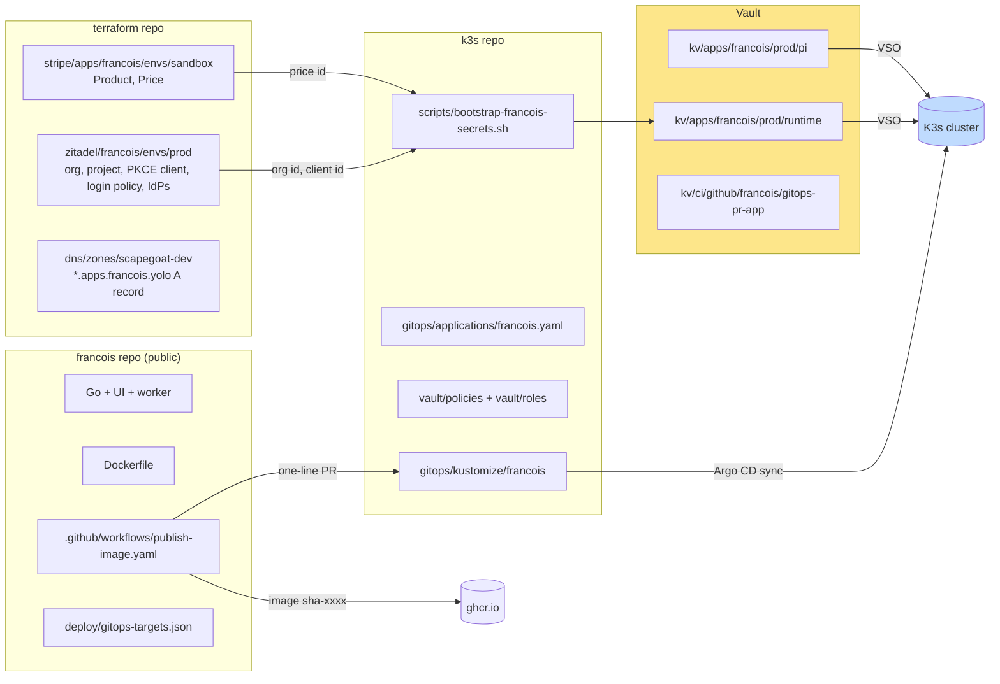
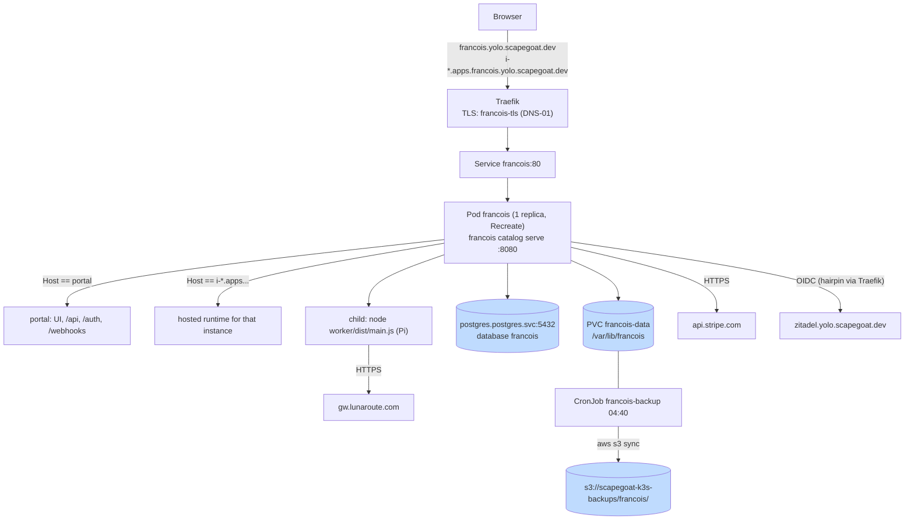
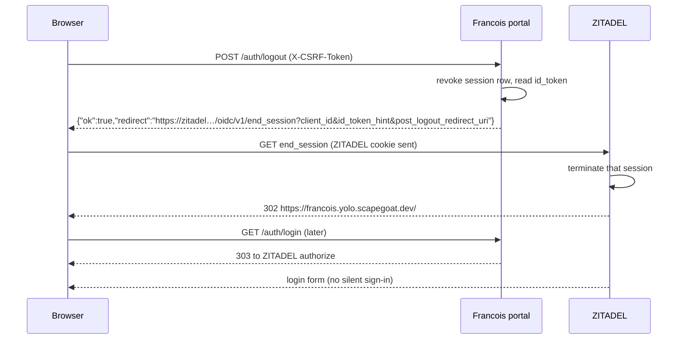

# Francois on Yolo: Deploying a Multi-Origin Go Service to K3s with Argo CD, Vault, ZITADEL and Stripe

Francois Catalog is a hosted subscriber platform for single-file HTML applications. Subscribers sign in through ZITADEL, pay through Stripe, and launch private instances of published applications, each on its own browser origin, with model calls metered against a credit allowance. The previous report, [[PROJECT REPORT - Francois Catalog - Hosted Subscriber Platform with Isolated Instances, Launch Grants and Metered Model Calls - A Technical Deep Dive]], explains how the platform works. This report explains how it was put into production on the scapegoat "yolo" cluster (a single Hetzner VM running K3s and managed by Argo CD), and what had to change in four places to do it: the Francois source, the shared Terraform, the GitOps repository and Vault.

The report is written to be re-used. Most of its content is not specific to Francois. Every service that routes by `Host`, serves wildcard origins, keeps state in process memory, or needs identity and billing from shared platform services will meet the same problems in the same order. The report records the decisions, the commands, the failures and their fixes, and ends with a runbook (Chapter 15) that can be followed for the next service.

> [!summary]
> - **The service runs at `https://francois.yolo.scapegoat.dev`**, with instance origins `https://i-<id>.apps.francois.yolo.scapegoat.dev`. Argo CD deploys it from `gitops/kustomize/francois` in the k3s repo, using an image built by CI and pinned by a one-line pull request that CI opens itself.
> - **Four properties of the service shaped the manifests.** It routes by exact `Host`, so probes must send the portal host. It serves a wildcard of origins, so the certificate needs DNS-01. It keeps views, rooms and a signing key in memory, so it runs one replica with `Recreate`. It reads every secret from a file, so Vault values are mounted, never placed in the environment.
> - **Most of the time went to the platform, not the service.** An expired Tailscale node key, two revoked DigitalOcean tokens, a missing Argo CD credential and a shared Stripe sandbox account had to be resolved before or during the first sync.
> - **Verified in production with a real browser:** ZITADEL login in an invite-only organization, Stripe Checkout and webhooks, instance isolation, sign-out that ends the ZITADEL session, egress restrictions, off-node backups, a rollout that preserves sessions, and real model calls through LunaRoute.

## How to read this report

Chapter 1 defines the platform vocabulary that the rest of the report uses. Chapter 2 states the requirements and the starting point. Chapter 3 shows the target architecture and which repository owns which part. Chapter 4 records three measurements taken before any design decision. Chapters 5 to 9 cover each layer in the order it must exist: code changes, Terraform, Vault, the Kubernetes package, and CI. Chapter 10 covers the platform repairs that blocked the first sync. Chapters 11 to 13 cover verification, the model backend and the prepared GitHub/Google sign-in. Chapter 14 is a table of every problem encountered and its resolution, Chapter 15 is the runbook, and Chapter 16 lists open items.

A reader who only wants to deploy the next service can read Chapter 1, then Chapters 14 and 15.

## 1. Concepts the deployment depends on

The deployment joins two systems: the Francois process and the yolo platform. Each has its own vocabulary, and several platform terms are used here with specific meanings.

**The Francois process.** `francois catalog serve` is one Go process that serves two kinds of origin. The *portal origin* (`--public-url`) is the trusted website: login, billing, catalog, admin, the JSON API, the Stripe webhook receiver and the probes `/healthz` and `/readyz`. An *instance origin* is `i-<opaque-id>.<app-domain>`, one per subscriber workspace, where untrusted application HTML runs. The process decides which one a request is for by comparing the `Host` header exactly. Model calls run in a *Pi worker*, a Node.js child process (`worker/dist/main.js`) that reads provider configuration from a *Pi agent directory* (`auth.json`, `models-store.json`, `settings.json`). A `fake` backend answers deterministically without credentials.

**Argo CD and sync waves.** Argo CD watches the k3s repository. Each application is an `Application` object (`gitops/applications/<app>.yaml`) pointing at a Kustomize directory, and belongs to an `AppProject` that limits its namespaces. On this cluster, `Application` and `AppProject` objects are applied by hand once; there is no app-of-apps. Within one sync, the annotation `argocd.argoproj.io/sync-wave` orders resources: Argo applies a wave, waits for it to be healthy, then applies the next.

**Vault and VSO.** HashiCorp Vault holds every secret value. The Vault Secrets Operator (VSO) reads `VaultAuth` and `VaultStaticSecret` objects from Git and writes ordinary Kubernetes `Secret` objects. A pod's ServiceAccount authenticates to Vault through the Kubernetes auth method, against a *role* that binds the ServiceAccount to a *policy*. A `VaultStaticSecret` re-reads its path every `refreshAfter` interval and can restart a Deployment when the value changes (`rolloutRestartTargets`).

**cert-manager issuers.** Two ClusterIssuers exist. `letsencrypt-prod` uses the HTTP-01 challenge and can issue only exact names. `letsencrypt-prod-dns01-digitalocean` proves control of the domain by writing a TXT record through the DigitalOcean API, and is the only one that can issue a wildcard name such as `*.apps.francois.yolo.scapegoat.dev`.

**ZITADEL organizations and the organization scope.** ZITADEL is the cluster's OIDC provider (`https://zitadel.yolo.scapegoat.dev`, v4.16.1, Login V2). An *organization* owns users and a *login policy* (whether self-registration is allowed, which external identity providers are offered). A relying party selects an organization by requesting the scope `urn:zitadel:iam:org:id:<org-id>`; ZITADEL then applies that organization's login policy and creates or looks up users there.

**RP-initiated logout.** OIDC's end-session endpoint lets a relying party end the identity provider's session. The browser is sent to `end_session_endpoint?client_id=…&post_logout_redirect_uri=…&id_token_hint=…`. Without this step, signing out of the application leaves the ZITADEL session alive, and the next login completes silently without a password prompt.

**The GitOps image PR.** The reusable workflow `go-go-golems/infra-tooling/.github/workflows/publish-ghcr-image.yml` builds `ghcr.io/<owner>/<repo>:sha-<short>`, then opens a pull request against the k3s repository that changes exactly one `image:` line, identified by a target file in the source repository. Merging that pull request is the deployment.

## 2. Requirements and starting point

At the start, Francois had been built and verified against a local Docker Compose stack (ticket FRANCOIS-002) but had no Git remote, no root Dockerfile and no image pipeline. The first step of FRANCOIS-003 was a design guide with draft manifests, delivered without touching any system. After review, the owner answered the open questions in one message:

- **"Repo is public."** The source and the image `ghcr.io/go-go-golems/francois` are public, so the cluster pulls anonymously and no image pull secret is needed.
- **"Save keys in vault."** Every credential (database, Stripe, webhook signing secret, GitHub App, test passwords, model key) goes to Vault, written by piping the value directly into `vault kv put`, and is never printed or committed.
- **"Sign up invite only."** ZITADEL self-registration is disabled for the Francois organization. Operators create users.
- **"Sign out ends zitadel."** Signing out of Francois must also end the ZITADEL session.

Two constraints came from the platform. The k3s repository's conventions (its `AGENTS.md` and `docs/app-deployment-pipeline.md`) fix the sync-wave order, require each `local-path` PVC to share the wave of its workload, forbid secret material in Git, and require images pinned by `sha-<short>`. The automation that edits the k3s repository must be able to change the deployed image by editing a single line.

## 3. Architecture

### 3.1 Ownership across repositories

The deployment touches four systems, and each object has exactly one owner. This division determines the order of work: Terraform objects must exist before their IDs can be written to Vault, and Vault records must exist before VSO can create the Secrets the Deployment mounts.



### 3.2 Runtime layout

All traffic for both the portal and the instance origins reaches one Service through Traefik, which forwards the `Host` header unchanged. One certificate covers the portal name and the instance wildcard.



## 4. Three measurements taken before designing

Three properties of the target were uncertain, and a wrong assumption about any of them would have produced a deployment that fails in a way the manifests do not reveal. Each was measured with a script stored in the ticket (`ttmp/2026/10/13/FRANCOIS-003--…/scripts/`).

### 4.1 Probes are rejected by host routing

Francois's outermost handler (`pkg/catalog/server.go`) treats any `Host` that is not the portal host as an instance name. It rejects with HTTP 421 any host that carries a port when the configured application port is empty. The kubelet sends probes to `http://<pod-ip>:8080/…`, so the `Host` header is `<pod-ip>:8080`. Script `01-probe-host-header-check.sh` started the server with the production flags and measured:

```text
GET /healthz, Host 10.42.0.17:8080 (kubelet default)          -> 421
GET /readyz,  Host 10.42.0.17:8080 (kubelet default)          -> 421
GET /healthz, Host francois.yolo.scapegoat.dev                -> 200
GET /readyz,  Host francois.yolo.scapegoat.dev                -> 200
GET /,        Host i-unknown.apps.francois.yolo.scapegoat.dev -> 404
GET /,        Host a.b.apps.francois.yolo.scapegoat.dev       -> 421
```

With default probes, the pod would never become Ready even though its logs show a healthy server. There were two possible fixes: a health route that answers on every host, or probes that send the portal host. A host-independent health route would also exist on every instance origin, inside the boundary that isolates untrusted code, so the probes override the header instead:

```yaml
startupProbe:
  httpGet:
    path: /readyz
    port: http
    httpHeaders:
      - name: Host
        value: francois.yolo.scapegoat.dev
```

### 4.2 The schema runs on the cluster's PostgreSQL 16

Development used PostgreSQL 17; the shared cluster database is `postgres:16-alpine`. Script `02-postgres16-migration-check.sh` started PostgreSQL 16.8, applied the migrations and ran the database-backed test packages with `TEST_DATABASE_URL` set. All passed. Running these tests with the variable set matters, because the tests call `t.Skip` when it is absent, and a passing run without it proves nothing.

### 4.3 The wildcard already resolves

Script `03-dns-wildcard-resolution-check.sh` queried the authoritative DigitalOcean name server. The existing `*.yolo.scapegoat.dev` record already answers for multi-label names such as `i-abc.apps.francois.yolo.scapegoat.dev`. An explicit `*.apps.francois.yolo` record was still added in Terraform, as a declaration that the name is in use. It is not needed for resolution.

## 5. Changes to the Francois source

Five changes were required in the service itself. Each one exists because production differs from the Compose stack in a specific way.

### 5.1 The organization scope

Without an organization scope, ZITADEL shows its instance-default login, applies the instance login policy and creates users in the default organization. The new flag `--oidc-extra-scopes` adds scopes to the authorization request. The Deployment passes `urn:zitadel:iam:org:id:$(FRANCOIS_ZITADEL_ORG_ID)`, where the variable comes from the runtime Secret. `identity.ValidateScopes` rejects empty scopes and scopes containing whitespace. It runs before the database connection is opened (commit `9dc27cc`), so a bad value fails immediately instead of after a database timeout.

The organization ID is not secret, but it is produced by Terraform, and Francois reads it from a flag, not a file. Kubernetes expands `$(VAR)` references in `args` from the container's `env`, and `env` can read a Secret key. Routing the value through the runtime Secret keeps every Terraform output in one Vault record:

```yaml
env:
  - name: FRANCOIS_ZITADEL_ORG_ID
    valueFrom: {secretKeyRef: {name: francois-runtime, key: oidc-org-id}}
args:
  - --oidc-extra-scopes=urn:zitadel:iam:org:id:$(FRANCOIS_ZITADEL_ORG_ID)
```

`--stripe-price-id=$(STRIPE_PRICE_ID)` uses the same mechanism.

### 5.2 Sign-out that ends the ZITADEL session

The requirement "sign out ends zitadel" needs RP-initiated logout, and the implementation has to choose between two forms. The `zitadel/oidc` library provides `rp.EndSession`, which calls the end-session endpoint from the server. That cannot work here, because the ZITADEL session is a cookie in the user's browser, and a server-to-server request does not carry it. The browser itself has to visit the endpoint. The implementation (commit `2c50123`) therefore uses front-channel logout:

1. `Exchange` returns the raw ID token alongside the identity. The token is stored in a new column `sessions.id_token` (migration `003_session_id_token.sql`) and cleared when the session is revoked.
2. `POST /auth/logout` revokes the portal session first, then computes the redirect with `Provider.LogoutURL(ctx, idToken, postLogout, state)` and returns `{"ok":true,"redirect":"…"}`.
3. The UI navigates to the returned URL. ZITADEL ends exactly the session named by `id_token_hint` and redirects to the registered `post_logout_redirect_uri`.



Two details matter. The portal session is revoked before the redirect is computed, so a missing end-session endpoint or a failed redirect still signs the user out of Francois. Sessions created before migration 003 have no ID token; the redirect then carries only `client_id`, which ZITADEL accepts, although it may ask which session to end. `pkg/catalog/identity/oidc_test.go` covers both forms against a stub discovery document.

The production test (Chapter 11) includes a control run: when only the portal session is revoked and the redirect is not followed, the next `/auth/login` lands back in Francois silently. When the redirect is followed, the next `/auth/login` stops at ZITADEL's login form.


*ZITADEL Login V2 after Francois sign-out: the next login asks for credentials. The branding shown is the instance default, because the Francois organization has no label policy (Chapter 16).*

### 5.3 Invite-only sign-up

`--signup-allowed` (default off) controls whether Francois honors `?signup=1` on `/auth/login` and whether `/api/session` reports `signupAvailable`. The UI hides the sign-up link when it is false. The authoritative control is ZITADEL's `allow_register = false` on the Francois organization; the flag only keeps the Francois UI consistent with it. The Compose stack passes `--signup-allowed`, because its local organization allows registration.

### 5.4 A root Dockerfile and a clean vulnerability scan

The Compose Dockerfile moved to the repository root, because the reusable workflow builds `./Dockerfile` with the repository as context. Making the repository public enabled the shared CI checks, and the first runs failed: `govulncheck` reported nine advisories in `golang.org/x/text`, `golang.org/x/net` and the Go 1.26.5 standard library, and `gosec` reported four findings. Commit `72999cc` moved to Go 1.26.9, `x/net v0.60.0` and `x/text v0.42.0`. `x/net v0.60.0` requires `x/text v0.42.0`, so the first attempt with `x/text v0.41.0` failed. It also gave each gosec finding a written `#nosec` justification. Before publishing, the full history was scanned for secret patterns; the only matches were test fixtures in the release validator.

### 5.5 Ignoring Stripe events that belong to other deployments

The Stripe sandbox account (`acct_1TxEMcLeHmcfmvuC`) is shared by three deployments: the.scapegoat.dev TODO application, the local Compose stack and now yolo. A webhook endpoint receives every subscription and invoice event in its account. Francois's worker retried any event whose customer it could not map to a local user, up to 12 times with exponential backoff, on the assumption that the mapping write was still in flight. In a shared account, every other deployment's event would have taken that path and then appeared as a failed event in Admin → Billing.

The fix (commit `7f1441a`) tags every customer Francois creates with `metadata.francois_deployment = <Config.Deployment>`. When the worker meets an unmapped customer, it reads the tag with `Gateway.CustomerDeployment`. It retries only when the tag names this deployment; otherwise it marks the event `ignored`.

```text
processOne(event):
  user := mapping(event.customer)
  if user found: project subscription; done
  tag := stripe.customer(event.customer).metadata.francois_deployment
  if tag == Config.Deployment: retry later      // our customer, mapping not yet written
  else: mark ignored                            // another deployment's customer
```

## 6. Shared infrastructure in Terraform

All Terraform changes are on branch `feat/francois-yolo` of the terraform repository (PR #34). Each part was applied separately, for reasons given below.

### 6.1 ZITADEL

`zitadel/francois/envs/prod` creates the organization `Francois`, a project with role checks disabled (Francois keeps roles in PostgreSQL), a PKCE public client, and a login policy with `allow_register = false`. The provider's access token is read from Vault through an ephemeral resource, so it is not stored in state. Apply created four resources: organization `394966170567966836`, project `394966174242177140` and client `394966177899610228`. The client registers `https://francois.yolo.scapegoat.dev/auth/callback` as its redirect URI and `https://francois.yolo.scapegoat.dev/` as its post-logout redirect URI; RP-initiated logout fails without the latter.

### 6.2 Stripe

The repository's billing-catalog module had the application slug and the lookup key hardcoded for the TODO application. The change adds `app_slug`, `lookup_key_prefix` and `price_nickname` variables with defaults equal to the old values. The existing sandbox environment then plans "No changes", which shows the refactor is neutral. A new root `stripe/apps/francois/envs/sandbox` manages the Francois Product and Price. Both already existed (created by hand during FRANCOIS-002), so they were imported (`prod_VQpH0Crg2Ztp5I`, `price_1UPxdFLeHmcfmvuCg0zsScj5`) and then updated in place: metadata, description, lookup key, nickname and `tax_behavior` from unspecified to `exclusive`. The charged amount is unchanged because Checkout does not enable automatic tax. A live Price will need an explicit tax decision.

The webhook endpoint is not in Terraform. Its signing secret is returned only once, at creation, and Terraform would store it in state. It was created with the Stripe CLI, and its secret was piped from the same shell straight into the bootstrap script. The endpoint was created disabled and enabled only once the host was serving. That kept Stripe from accumulating failed deliveries and from automatically disabling the endpoint.

### 6.3 DNS

The DNS zone plan showed three additions: the Francois wildcard and two PDS records (`pds_yolo_a`, `wildcard_pds_yolo_a`) that exist in DigitalOcean but were never imported. A full apply could have created duplicates. Only the Francois record was applied, with `-target='digitalocean_record.records["wildcard_apps_francois_yolo_a"]'`, and the PDS drift was reported on the PR. Fixing it belongs to a separate ticket (HK3S-0031).

## 7. Secrets in Vault

### 7.1 The records

| Vault path | Written by | Read by | Contents |
| --- | --- | --- | --- |
| `kv/apps/francois/prod/runtime` | `scripts/bootstrap-francois-secrets.sh` (k3s) | Pod (`francois-prod`), bootstrap Job | database name, user, password and URL; OIDC client and org IDs; Stripe key, webhook secret (current and previous), price ID |
| `kv/apps/francois/prod/pi` | `vault kv put` from a scratch directory | Pod (`francois-prod`) | `auth.json`, `models-store.json`, `settings.json` (LunaRoute only) |
| `kv/apps/francois/prod/e2e-users` | E2E account creation | E2E script | test account names and passwords |
| `kv/apps/francois/prod/idp-github`, `idp-google` | the owner (pending) | Terraform (ephemeral) | OAuth client secrets |
| `kv/ci/github/francois/gitops-pr-app` | copy of the shared GitHub App credential | CI (`francois-gitops-pr`) | App ID, installation, private key |
| `kv/infra/backups/object-storage` (key `francois-prefix`) | `vault kv patch` | backup CronJob (`francois-backup`) | shared bucket credentials, Francois prefix |

### 7.2 Identities and least privilege

Each workload has its own ServiceAccount, Vault role and policy. The serving pod's policy grants `read` on exactly two paths:

```hcl
path "kv/data/apps/francois/prod/runtime" { capabilities = ["read"] }
path "kv/data/apps/francois/prod/pi"      { capabilities = ["read"] }
```

The database bootstrap Job (`francois-db-bootstrap`) can also read the shared PostgreSQL admin credential, which the serving pod cannot. The backup CronJob (`francois-backup`) can read the shared object-storage credential, which the serving pod also cannot. CI authenticates through GitHub Actions OIDC to the role `francois-gitops-pr`, bound to this repository, and can read only the GitHub App record.

The platform's Vault bootstrap script rewrites every application's policies and roles. It was not run from a feature branch. Instead, only the Francois policies and roles were written, and each was read back.

### 7.3 The bootstrap script

`scripts/bootstrap-francois-secrets.sh` writes the runtime record from environment variables and generates the database password. Two properties of it are worth copying:

- It refuses a live Stripe key (`sk_test_*` or `rk_test_*` only), because the yolo deployment is a sandbox beta.
- It distinguishes "record does not exist" from other Vault errors. The first draft treated any `vault kv get` failure as "no record yet" and would have generated a new database password after a transient permission or network error, locking the application out of its own database.

```bash
if out=$(vault kv get -format=json "$path" 2>&1); then
  existing=$(jq -c '.data.data' <<<"$out")
elif grep -q 'No value found' <<<"$out"; then
  existing='{}'
else
  echo "$out" >&2; exit 1
fi
```

## 8. The Kubernetes package

`gitops/kustomize/francois` contains 21 resources. Their sync waves follow the platform order. Each wave becomes healthy before the next is applied.

| Wave | Resources | Why at this point |
| --- | --- | --- |
| −3 | Namespace | Everything else is namespaced. |
| −2 | ServiceAccounts (`francois`, `francois-db-bootstrap`, `francois-backup`), VaultConnection, VaultAuths | VSO needs an identity before it can read Vault. |
| −1 | VaultStaticSecrets `francois-runtime`, `francois-pi`, `francois-postgres-admin`, `francois-backup-storage` | The Job and the Deployment mount these. |
| 0 | ConfigMap with the bootstrap script | Used by the Job. |
| 1 | Job `francois-db-bootstrap` (Sync hook) | Creates role and database before the server connects. |
| 2 | PVC `francois-data`, Deployment, Certificate, CronJob | The `local-path` PVC binds only when its first consumer is scheduled, so it must share the Deployment's wave. |
| 3 | Service, Ingress, NetworkPolicy | Exposed and restricted last. |

### 8.1 The Deployment

The Deployment encodes the four properties listed in the summary.

**One replica, `Recreate`.** The HMAC key that signs asset URLs is generated at startup, and live views, server-sent-event streams and room fan-out are held in memory. A second replica would split rooms and reject the first replica's signed URLs. `Recreate` also matches the `ReadWriteOnce` PVC. The cost is a short outage on each rollout; Chapter 11 shows that sessions, which are in PostgreSQL, survive it.

**Secrets as files.** The runtime Secret is mounted at `/run/secrets/francois` with an explicit `items` list, so only named keys appear. Francois reads them with `--*-file` flags. No secret appears in `env`, in `args` or in `kubectl describe` output.

**Pi files copied by a startup wrapper.** The Pi worker takes locks in its agent directory and may refresh tokens there, so it needs a private writable directory. A Secret volume is read-only. The container's command is a small shell wrapper that copies the files and then `exec`s the server, so the server replaces the shell as PID 1 and receives signals directly:

```yaml
command:
  - /bin/sh
  - -ec
  - |
    install -d -m 0700 /var/lib/francois/pi /var/lib/francois/worker /var/lib/francois/releases
    for f in auth.json models.json models-store.json settings.json; do
      if [ -f "/etc/francois/pi/$f" ]; then
        install -m 0600 "/etc/francois/pi/$f" "/var/lib/francois/pi/$f"
      fi
    done
    exec francois "$@"
  - francois
```

The first design used an init container for this copy. It was replaced after reading the GitOps PR tool's source (`open_gitops_pr.py` in infra-tooling): `replace_manifest_image_text` only enters a container list when a line is exactly `containers:`. An `initContainers:` image would never be updated, and each release would run a new server image with an old init image. With the wrapper there is exactly one `image:` line.

**Security context.** The pod runs as uid/gid 10001 with `fsGroup: 10001` (so the uid can write the PVC), `RuntimeDefault` seccomp, no privilege escalation, all capabilities dropped and no ServiceAccount token mounted. Resources: requests 250m CPU and 512Mi memory, limit 1536Mi memory.

### 8.2 Certificate and Ingress

The `Certificate` `francois-tls` names `francois.yolo.scapegoat.dev` and `*.apps.francois.yolo.scapegoat.dev` and uses the DNS-01 issuer. A wildcard matches exactly one label, which is all instance names need, since they are `i-<id>` directly below the app domain. The Ingress has two host rules sharing that TLS Secret. It must not carry a `cert-manager.io/cluster-issuer` annotation, because ingress-shim would then create a second certificate with the HTTP-01 issuer, which cannot issue the wildcard. No Traefik middleware rewrites headers: Francois computes its own CSP `frame-src` and `frame-ancestors` from its flags.

### 8.3 Database bootstrap

The Job runs `postgres:16-alpine` with the shared admin credential and an idempotent script. It creates the role if it is missing (otherwise it resets the password to the Vault value), creates the database if it is missing, and sets ownership. The application then applies its own schema migrations at startup (`--migrate`). A separate migration Job was not used because the server already refuses to start with pending migrations, and only one replica ever runs.

### 8.4 NetworkPolicy

The NetworkPolicy was enabled only after the unrestricted deployment had passed the full browser test (k3s PR #340). That order meant any later failure could be attributed to the policy alone. The live labels of the target pods (PostgreSQL, Traefik, CoreDNS) were read from the cluster before the selectors were written.

| Direction | Peer | Port | Purpose |
| --- | --- | --- | --- |
| Ingress | Traefik pods in `kube-system` | 8080 | all browser traffic |
| Ingress | node address `91.98.46.169/32` | 8080 | kubelet probes |
| Egress | `kube-dns` | 53 UDP/TCP | name resolution |
| Egress | PostgreSQL primary in `postgres` | 5432 | database |
| Egress | Traefik in `kube-system` | 8443 | OIDC: the public ZITADEL hostname resolves to the node, and the request hairpins to Traefik's in-cluster endpoint |
| Egress | `0.0.0.0/0` | 443 | Stripe API and model provider |

The Traefik egress rule is required. The pod reaches `https://zitadel.yolo.scapegoat.dev` at the node's public address, which is translated to Traefik's pod on port 8443. Without the rule, the OIDC code exchange fails even though the browser-side login succeeds.

### 8.5 Release-blob backup

The shared nightly `pg_dumpall` covers the database. Release HTML and manifests live on the PVC as content-addressed blobs (`releases/blobs/<xx>/<sha256>`), and the database refers to them by hash. A database restore without the blobs would leave published releases that cannot be served. The CronJob `francois-backup` (04:40 daily) mounts the PVC read-only and runs:

```sh
aws --endpoint-url "$S3_ENDPOINT" s3 sync /data/releases/blobs \
    "s3://$S3_BUCKET/${S3_PREFIX}releases/blobs/" --size-only --no-progress
local=$(find /data/releases/blobs -type f | wc -l)
remote=$(aws --endpoint-url "$S3_ENDPOINT" s3 ls --recursive "s3://$S3_BUCKET/${S3_PREFIX}releases/blobs/" | wc -l)
[ "$remote" -ge "$local" ]
```

An incremental sync without deletes is a complete backup here, because blobs are immutable and named by content. The last line makes the Job fail if the remote copy has fewer files than the local directory. The CronJob uses its own ServiceAccount and Vault role, so the serving pod never holds the bucket credentials.

## 9. CI and the release loop

`.github/workflows/publish-image.yaml` calls the reusable infra-tooling workflow. On pull requests it builds and tests. On `main` it pushes `ghcr.io/go-go-golems/francois:sha-<short>` and opens the GitOps PR described by `deploy/gitops-targets.json`:

```json
{ "name": "francois-yolo", "gitops_repo": "wesen/2026-03-27--hetzner-k3s",
  "gitops_branch": "main", "manifest_path": "gitops/kustomize/francois/deployment.yaml",
  "container_name": "francois" }
```

The PR is opened with a GitHub App installation token, not a personal token. The workflow obtains a Vault token through GitHub Actions OIDC (role `francois-gitops-pr`, bound to `go-go-golems/francois`), reads the App credential from `kv/ci/github/francois/gitops-pr-app`, and mints an installation token scoped to the k3s repository. All applications share one GitHub App (ID 3926776), and each repository gets its own copy of the credential under its own Vault path and role.

`open_gitops_pr` was off until the Vault role and the App credential existed, then switched on in commit `25aa9cd`. That run opened k3s PR #342, which changed `sha-7f1441a` to `sha-25aa9cd` and nothing else. Once its validation check passed it was merged, and Argo rolled the Deployment. The workflow ignores `ttmp/**` and `*.md`, so ticket and documentation commits do not produce images.

## 10. Bringing the platform back to a deployable state

Most of the elapsed time was spent on platform state that had decayed since the last deployment. None of these problems is specific to Francois, and each is likely to recur.

### 10.1 The cluster was unreachable

The documented administration path is `kubectl` over Tailscale (`.cache/kubeconfig-tailnet.yaml`). It failed with `dial tcp 100.73.36.123:6443: i/o timeout`. `tailscale status --json` showed the cause: `k3s-demo-1 … keyExpiry=2026-09-25T19:59:42Z expired=true`, and the same for two other cluster nodes. A Tailscale node key expires after a fixed period unless expiry is disabled for that node. Disabling expiry in the admin console changed the status to `expired=false`, but the node stayed `online=false` until `tailscale up` was run on the node itself.

The public path to the node was closed by design. The Hetzner firewall allows SSH and the Kubernetes API only from `admin_cidrs = ["100.40.113.156/32"]`, and the operator's address was different. An attempt to add a temporary SSH rule through `hcloud` was denied by the agent's permission system as a security-weakening action. The owner added the rule themselves and ran `tailscale up` on the node. Once the tailnet worked, the temporary rule was removed. The first `hcloud firewall delete-rule` failed with "the specified rule was not found" because a rule is matched on all its fields, including `--description`; the second attempt, with the matching description, succeeded. A leftover rule would have been both an exposure and drift from the Terraform-managed firewall.

### 10.2 Both DigitalOcean tokens were revoked

The DNS plan failed with `401 … Unable to authenticate you`. Both tokens in Vault, the Terraform DNS token (`kv/infra/dns/scapegoat-dev`) and cert-manager's DNS-01 token (`kv/platform/cert-manager/prod/digitalocean`), returned 401 from `/v2/account`. The second one affected the whole cluster: no wildcard certificate could be issued or renewed. One certificate, `static-sites/storybook-yolo-wildcard-tls`, had already missed its renewal date (2026-10-07). The owner created a new token with domain read and write scopes and wrote it to both paths. VSO refreshed cert-manager's Secret within its 30-minute interval. The Francois certificate was issued on first sync, and the storybook certificate has since renewed (`notAfter` 2027-01-11).

### 10.3 There was no Argo CD credential

The `ARGOCD_TOKEN` in the k3s repository's `.envrc` returned `no session information`, and no Argo CD credential exists among the Vault paths. This did not block the deployment, because the one-time steps are `kubectl apply` operations: the AppProject `prod-apps` (after `kubectl diff` showed the only change was `+ namespace: francois`) and the Application `francois`. The AppProject must be applied before the Application, or Argo rejects the destination namespace. Later syncs are automatic.

### 10.4 First sync

About 30 seconds after the Application was applied:

- Both VaultStaticSecrets for the runtime and the PostgreSQL admin credential were Synced.
- `job.batch/francois-db-bootstrap` was `Complete 1/1` in 5 seconds.
- The PVC was Bound, and the pod was `1/1 Running`, meaning the Host-header probes passed.
- `francois-pi` reported not synced, as expected: no Vault record existed yet and its mount is optional.

The pod log showed the three migrations, then `Francois catalog ready address=[::]:8080 apps=*.apps.francois.yolo.scapegoat.dev portal=https://francois.yolo.scapegoat.dev`. The DNS-01 challenge was presented and propagated, and `francois-tls` became Ready about 109 seconds after creation.

The public smoke tests:

```text
/healthz               -> {"status":"ok"}
/readyz                -> {"models":true,"status":"ready"}
/api/session           -> loginAvailable true, signupAvailable false, billingEnabled true
portal CSP             -> frame-src https://*.apps.francois.yolo.scapegoat.dev; X-Frame-Options DENY
i-doesnotexist.apps…   -> 404
POST /webhooks/stripe  -> 400 invalid_signature
/auth/login            -> 303 to ZITADEL, scope "openid profile email urn:zitadel:iam:org:id:394966170567966836"
```

`/readyz` reports `models: true` with the fake backend, because the fake model is listed. The flag means "a model backend is configured", not "a provider is reachable".

## 11. Accounts, release and verification in production

### 11.1 Invited accounts and the first administrator

With sign-up disabled, an operator has to create accounts. Two test accounts were created through ZITADEL's user API in the Francois organization, with verified email and random passwords: `e2e-admin@francois.test` and `e2e-alice@francois.test`. The API was called with the Terraform administrator token. The passwords were written directly to `kv/apps/francois/prod/e2e-users`. Francois administrators are local users with role `admin`, promoted by exact issuer and subject:

```bash
kubectl -n francois exec deploy/francois -- francois catalog users promote \
  --database-url-file /run/secrets/francois/database-url \
  --issuer https://zitadel.yolo.scapegoat.dev --subject <zitadel-user-id>
```

The first release was published from inside the pod with `francois catalog publish … --artifact-id polis --version 1.0.0 --html /app/examples/polis.html --manifest /app/examples/polis.manifest.json`, which returned `rel_02fefc881efb42bfc6a002cb published`.

### 11.2 The browser test

`scripts/05-yolo-e2e.sh <step>` in the ticket drives headless Chromium through `playwright-core`. It reads credentials from Vault inside its own process, so passwords never appear in a command line or a transcript. The steps and their recorded output:

```text
[admin] session {"authenticated":true,"role":"admin","email":"e2e-admin@francois.test"}
[admin] admin page title: Operations
[alice-subscribe] before {"role":"subscriber","allowed":false,"reason":"subscription_required"}
[alice-subscribe] returned to /account?checkout=cs_test_…
[alice-subscribe] after {"allowed":true,"reason":"subscriber"}
[alice-run] instance origin https://i-….apps.francois.yolo.scapegoat.dev
[alice-run] instance document {"title":"Polis IDE","bytes":254310,"cookieVisible":false}
[alice-run] portal API from instance origin: blocked: TypeError
[control] next /auth/login lands on Francois (silent re-login, as expected while ZITADEL session lives)
[logout] next /auth/login lands on zitadel.yolo.scapegoat.dev/ui/v2/login/loginname
[admin-models] save 200 {"revision":1,"approved":["lunaroute/glm-5.3-flash","lunaroute/glm-5.3","lunaroute/deepseek-4.1-flash"]}
[alice-sample] sample {"ok":true,"ms":2550,"text":"pong","tier":"quick","model":"lunaroute/glm-5.3-flash"}
```

The production `stripe_events` table held `checkout.session.completed`, `customer.subscription.created` and `invoice.paid`, each processed on its first attempt. This shows the endpoint, the signature check and the worker working together.


*Alice's account page after Stripe Checkout in the sandbox: access is allowed through an active subscription.*

Automating Stripe Checkout took four iterations, because Checkout's markup has changed since the patterns most scripts use:

1. `#cardNumber` was not visible. Payment methods are now an accordion with Card collapsed.
2. Clicking the "Card" radio or text failed: a transparent button (`data-testid="card-accordion-item-button"`) intercepts pointer events.
3. Clicking that button failed as "not visible". A forced click on the "Card" label opened the section.
4. After submit the page stayed on Checkout. The pre-checked "Save my information with Link" box required a phone number. Unchecking it allowed the payment to complete.


*Step 4: Checkout waiting for a Link phone number after submit.*

### 11.3 Verifying the NetworkPolicy, the backup and a rollout

After the NetworkPolicy was enabled, the pod stayed Ready with no restarts or probe failures, and the `admin`, `control` and `alice-run` steps passed again. A successful `admin` login proves that the OIDC code exchange from the pod to ZITADEL works through the Traefik hairpin. Egress was tested from the pod with `curl`:

```text
api.stripe.com                    -> 404 (reachable, unauthenticated)
gw.lunaroute.com/v1/models        -> 401 (reachable)
zitadel discovery                 -> 200
10.43.0.1:443 (Kubernetes API)    -> blocked
```

The backup ran once by hand (`kubectl create job francois-backup-manual-1 --from=cronjob/francois-backup`). It uploaded the two Polis blobs and printed `release blobs: local=2 remote=2`. Both object keys matched the SHA-256 values recorded at publish time.

When the CI-built `sha-25aa9cd` rolled out through `Recreate`, a rerun of `alice-run` with the stored browser state launched Polis without signing in again. Portal sessions live in PostgreSQL, so they survive the pod replacement.

## 12. The model backend: LunaRoute only

The deployment ran the fake backend until it was settled whose credentials would pay for subscriber model calls. The local Pi configuration used during development holds personal subscription logins (Anthropic, OpenAI Codex, Z.ai, Kimi) as well as LunaRoute. Personal subscription credentials should not pay for a hosted service's traffic, so none of them were copied. The owner chose LunaRoute and supplied a key issued for Francois alone.

### 12.1 What the worker reads

The worker's LunaRoute support (`worker/src/lunaroute.ts`) registers the provider from the cached catalog in `models-store.json` and takes the gateway key from the `lunaroute` entry of `auth.json`. In that entry, `getApiKey` returns the `access` field, and `refreshToken` returns the credential unchanged. The Pi runtime is created with `allowModelNetwork: false`, so the worker never fetches the model list itself. The provisioned directory therefore has exactly three files:

```text
auth.json          {"lunaroute":{"type":"oauth","access":<key>,"refresh":<key>,"expires":4102444800000}}
models-store.json  the "lunaroute" entry of a Pi models store (14 models)
settings.json      default provider lunaroute, default model glm-5.3, thinking minimal
```

There is deliberately no `models.json` and no other `auth.json` entry. If an administrator approves a selector for another provider, the worker still has no credential for it. The expiry is set far in the future so Pi never attempts a refresh. `auth.json` was built with `jq --rawfile` from the key file, so the key never appeared on a command line or in output.

Before Vault was touched, the directory was tested locally with `francois models list --pi-agent-dir <dir>`, which listed only LunaRoute models. The key was tested directly against the gateway: `GET /v1/models` returned 200 with 14 models, and a chat completion returned 200.

### 12.2 Ordering the secret change against the rollout

The owner's message naming the dedicated key arrived while the first Vault write was being made. That write, version 1 of `kv/apps/francois/prod/pi`, therefore contained the key from the operator's personal LunaRoute login. Version 2 was written with the dedicated key, and version 1 was destroyed with `vault kv destroy -versions=1`, which removes the data and not only the latest pointer.

The switch to `--backend=pi` (k3s PR #343) could not be merged immediately. `francois-pi` refreshes every 5 minutes, and a rollout before the refresh would have started the worker with the destroyed version's key. The cluster Secret's key prefix was polled until it showed the dedicated key, and only then was the PR merged. The new pod listed the three files in `/var/lib/francois/pi` with mode 0600 and logged `Francois catalog ready`. The worker fails initialization when no authenticated model exists for a tier, so a ready pod already shows that the files were accepted.

### 12.3 Approval and a real call

Francois allows no hosted models until an administrator approves them. The E2E step `admin-models` sends a settings revision through `PATCH /api/admin/settings` (CSRF-protected):

| Selector | Label | Credits per call | Tier |
| --- | --- | --- | --- |
| `lunaroute/glm-5.3-flash` | GLM 5.3 Flash | 1 | quick |
| `lunaroute/glm-5.3` | GLM 5.3 | 3 | default, complex |
| `lunaroute/deepseek-4.1-flash` | DeepSeek 4.1 Flash | 1 | — |

The allowance is 2000 credits per month and 200 per day. The step `alice-sample` then signs Alice in, launches Polis and, inside the instance frame, uses the same API the application uses:

```js
const sample = await window.claude.use("sample");
const r = await sample([{ role: "user", content: "Reply with exactly the word: pong" }], { modelTier: "quick" });
// {"text":"pong","modelTierApplied":"quick","modelUsed":"lunaroute/glm-5.3-flash"}, 2.55 s
```

The request passed through the hosted runtime's admission pipeline: grant, declared capability, approved model, concurrency, credit reservation, then the Pi worker and LunaRoute.


*Polis on its instance origin, with the approved GLM-5.3 Flash model selected in the agent panel.*

## 13. GitHub and Google sign-in for invited users

The owner also asked for GitHub and Google sign-in. That conflicts with invite-only sign-up unless the providers are configured carefully. A ZITADEL external identity provider has four switches: whether a login with it may create a ZITADEL user (`is_creation_allowed`), whether it does so automatically (`is_auto_creation`), whether it may link to an existing user (`is_linking_allowed`), and whether the existing user is found by email or username (`auto_linking`). If creation is allowed, any GitHub or Google account can register, which is open sign-up. The configuration added to `zitadel/francois/envs/prod` (terraform commit `1607bf2`) allows linking only:

```hcl
resource "zitadel_org_idp_github" "francois" {
  count               = var.github_client_id == "" ? 0 : 1
  org_id              = zitadel_organization.francois.id
  client_id           = var.github_client_id
  client_secret       = ephemeral.vault_kv_secret_v2.idp_github[0].data["client_secret"]
  scopes              = ["read:user", "user:email"]
  is_creation_allowed = false
  is_auto_creation    = false
  is_linking_allowed  = true
  is_auto_update      = false
  auto_linking        = "AUTO_LINKING_OPTION_EMAIL"
}
```

The Google resource is identical except for its scopes (`openid profile email`). The login policy enables external login only when at least one provider exists. An operator still creates the user, and on the first GitHub or Google login ZITADEL prompts the user to link the account with the matching email. Email matching is safe only with providers whose email claim is verified. Google's is, and GitHub's primary email must be verified on GitHub.

The client secret does not enter Terraform state. In zitadel provider 3.3.0, `client_secret` is a write-only attribute, the only kind of attribute that accepts an ephemeral value, so it can be read from Vault at apply time without being stored. `client_id` is a normal attribute and cannot take an ephemeral value, so it is a non-secret variable. With both IDs empty the plan shows no changes, so the branch can be merged before the OAuth clients exist. Rotating a secret means updating Vault and applying with `-replace`, because the provider cannot see a changed write-only value.

GitHub OAuth Apps and Google OAuth clients can only be created in the GitHub and Google web consoles, so this step is waiting on the owner. Neither provider existed at instance or organization level: both template searches returned empty. The callback URI for both is `https://zitadel.yolo.scapegoat.dev/idps/callback`, ZITADEL v4's generic IdP callback. A request to it without state returns 400, which shows the route exists.

## 14. Issues encountered and how they were resolved

| # | Symptom | Cause | Resolution | Where |
| --- | --- | --- | --- | --- |
| 1 | Probes would return 421 | Host routing rejects `<pod-ip>:8080` | Probes send `Host: francois.yolo.scapegoat.dev` | Ch. 4.1 |
| 2 | Wrong login page and organization | No organization scope | `--oidc-extra-scopes=urn:zitadel:iam:org:id:<id>` | Ch. 5.1 |
| 3 | Silent re-login after sign-out | ZITADEL session survived | Front-channel RP-initiated logout with `id_token_hint` | Ch. 5.2 |
| 4 | Dependency scan failed after publishing | Old Go, `x/net`, `x/text`; gosec findings | Go 1.26.9, `x/net 0.60.0`, `x/text 0.42.0`, justified `#nosec` | Ch. 5.4 |
| 5 | Foreign Stripe events would retry 12× | Shared sandbox account | Customer tag `francois_deployment`; ignore foreign customers | Ch. 5.5 |
| 6 | Release image would not update the init container | GitOps tool edits only `containers:` | Shell wrapper instead of init container | Ch. 8.1 |
| 7 | GitHub Actions policy name doubled to `gha-gha-…` | Bootstrap script adds the prefix | Policy file named `francois-gitops-pr.hcl` | Ch. 7.2 |
| 8 | Bootstrap could rotate the DB password on a Vault error | Any read error treated as "no record" | Match `No value found` explicitly | Ch. 7.3 |
| 9 | `kubectl` timed out | Tailscale node key expired; node offline | Disable expiry, `tailscale up` on the node | Ch. 10.1 |
| 10 | SSH blocked; agent could not open the firewall | `admin_cidrs`; permission system | Owner added a temporary rule; removed afterwards with matching `--description` | Ch. 10.1 |
| 11 | DNS plan 401; wildcard renewals stalled | Both DigitalOcean tokens revoked | New token in both Vault paths | Ch. 10.2 |
| 12 | Full DNS apply would duplicate PDS records | Records created outside Terraform, never imported | Targeted apply of the Francois record only | Ch. 6.3 |
| 13 | No Argo CD credential | `.envrc` token invalid; none in Vault | One-time steps via `kubectl apply`; automated sync afterwards | Ch. 10.3 |
| 14 | Checkout automation stalled | Accordion overlay; Link phone requirement | Forced label click; uncheck Link | Ch. 11.2 |
| 15 | Personal model key in Vault version 1 | Dedicated key named mid-write | Version 2 with the dedicated key; version 1 destroyed; merge after VSO refresh | Ch. 12.2 |
| 16 | `terraform providers schema` failed | S3 backend needs AWS credentials | `AWS_PROFILE=manuel` | — |
| 17 | `rollout status` returned immediately after merge | Argo had not synced yet | Wait on the Deployment's image or args, then `rollout status` | — |

## 15. Runbook for the next service

The order below follows the dependencies. Each step names its verification.

1. **Measure the service's contract.** Start it with production flags and send probe-shaped requests with the kubelet's `Host`. Run its database tests against the cluster's PostgreSQL major version with the test database variable set. Resolve the intended hostnames against the authoritative name server.
2. **Check platform credentials before starting.** Check that `tailscale status` shows the node online and not expired, that `kubectl get nodes` works, that `vault token lookup` succeeds, and that `curl -H "Authorization: Bearer $(vault kv get -field=access-token kv/platform/cert-manager/prod/digitalocean)" https://api.digitalocean.com/v2/account` returns 200. Each of these failed during this deployment.
3. **Source repository.** Add a root Dockerfile, `deploy/gitops-targets.json` and the publish workflow with `open_gitops_pr: false`. Scan the history for secrets before making it public. Make the dependency scan pass.
4. **Terraform.** Create the identity organization, client and login policy; billing objects (import any made by hand); DNS records. Apply each root separately, and use `-target` when a zone has unrelated drift. Re-plan with `-detailed-exitcode` to confirm zero changes.
5. **Out-of-band objects.** Create webhook endpoints with the CLI, disabled, and pipe their secrets straight into Vault.
6. **Vault.** Write only the new application's policies and roles, and read them back. Run the application's bootstrap script. Copy the shared GitHub App credential to the new application's path.
7. **GitOps package.** Follow the wave table in Chapter 8. Put each PVC in its workload's wave. Use one container `image:` line. Override probe `Host` when the service routes by host. Use the DNS-01 issuer for wildcard names, with no issuer annotation on the Ingress. Run `scripts/validate_gitops.sh`.
8. **First sync.** Merge the package. `kubectl diff` and apply the AppProject, then apply the Application. Watch waves, the bootstrap Job, the certificate and the pod log. Run public smoke tests. Enable webhook endpoints.
9. **Accounts and content.** Create invited users through the identity API with passwords written to Vault. Promote the first administrator. Publish the first release.
10. **Browser test.** Run a scripted browser test that reads credentials from Vault. Include a control run for any security property, such as sign-out, so the test shows the property's effect.
11. **Restrict.** Add the NetworkPolicy after the unrestricted test passes. Read live labels before writing selectors. Allow the identity-provider hairpin to Traefik. Re-run the browser test and test egress from the pod.
12. **Backups.** Cover every persistent file the database refers to, with a separate backup identity. Run the backup once by hand and compare counts.
13. **Release loop.** Create the CI Vault role, set `open_gitops_pr` to the main-push expression, push, and merge the first automated PR. Re-run a browser step after the rollout.
14. **Secrets with a rollout.** When a Vault value and a rollout change together, wait until VSO has refreshed the Secret before merging.

## 16. Open items

- **GitHub and Google sign-in.** The owner creates the GitHub OAuth App and the Google OAuth web client with callback `https://zitadel.yolo.scapegoat.dev/idps/callback`, and writes `client_id` and `client_secret` to `kv/apps/francois/prod/idp-github` and `idp-google`. Then set `github_client_id` and `google_client_id` in `zitadel/francois/envs/prod` and apply.
- **Terraform PR #34** is not merged, although its ZITADEL, Stripe and Francois DNS parts are applied. The PDS DNS drift needs an import (HK3S-0031).
- **ZITADEL branding.** The Francois organization has no label policy, so the login pages show the instance default branding ("TODO").
- **Test accounts.** `e2e-admin` and `e2e-alice` are real users in the production organization, and Alice has an active sandbox subscription. Keep them for regression runs or delete them.
- **Same-site origins.** Instance origins share the registrable domain `scapegoat.dev` with every other yolo application. Isolation relies on separate origins and `__Host-` cookies, which hold; a public launch should consider a dedicated registrable domain.
- **LunaRoute catalog freshness.** The worker uses the cached catalog. When LunaRoute adds models, re-seed `models-store.json` in Vault and restart the pod.
- **Argo CD credential.** Store a working read-only Argo CD token in Vault so that status checks do not depend on `kubectl`.
- **Live billing.** A live Stripe account should be used by Francois alone, or keep the customer-tag filter. It needs an explicit tax decision for the Price.

## Source material

- Ticket: `/home/manuel/code/wesen/go-go-golems/francois/ttmp/2026/10/13/FRANCOIS-003--deploy-the-hosted-francois-catalog-to-the-scapegoat-yolo-k3s-cluster-with-argo-cd/`. It contains the intern guide (`design-doc/01-…`), the diary (`working-note/01-deployment-investigation-diary.md`, Steps 1–9), the measurement and E2E scripts (`scripts/01`–`05`) and the screenshots (`various/e2e/`).
- GitOps package: `/home/manuel/code/wesen/2026-03-27--hetzner-k3s/gitops/kustomize/francois/`, `gitops/applications/francois.yaml`, `vault/policies/kubernetes/francois-*.hcl`, `vault/roles/kubernetes/francois-*.json`, `scripts/bootstrap-francois-secrets.sh`.
- Terraform: `/home/manuel/code/wesen/terraform` branch `feat/francois-yolo`: `zitadel/francois/envs/prod`, `stripe/apps/francois/envs/sandbox`, `dns/zones/scapegoat-dev/envs/prod`.
- Previous report: [[PROJECT REPORT - Francois Catalog - Hosted Subscriber Platform with Isolated Instances, Launch Grants and Metered Model Calls - A Technical Deep Dive]].
