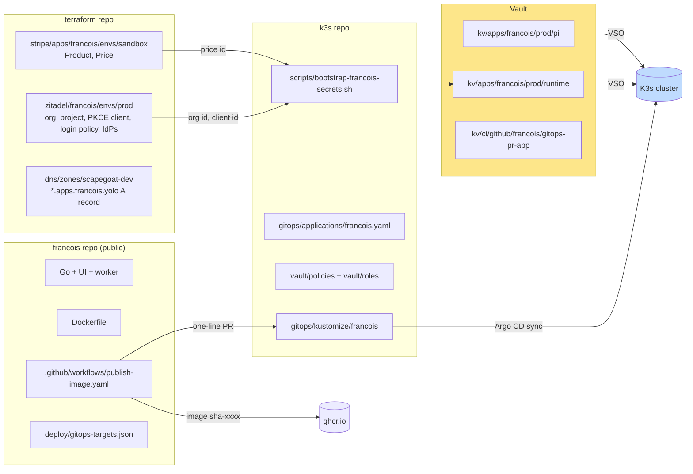
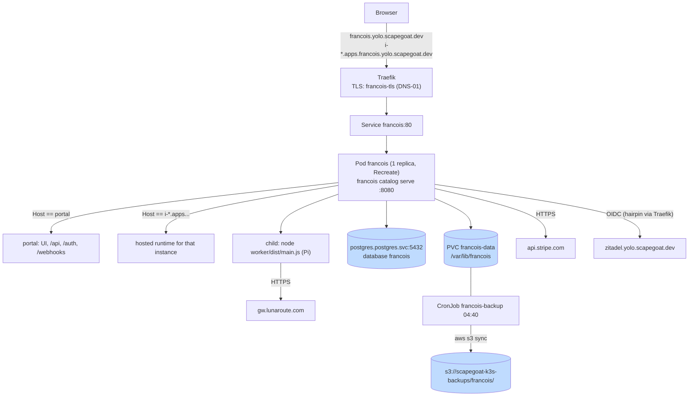
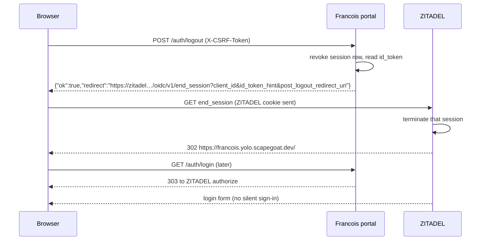
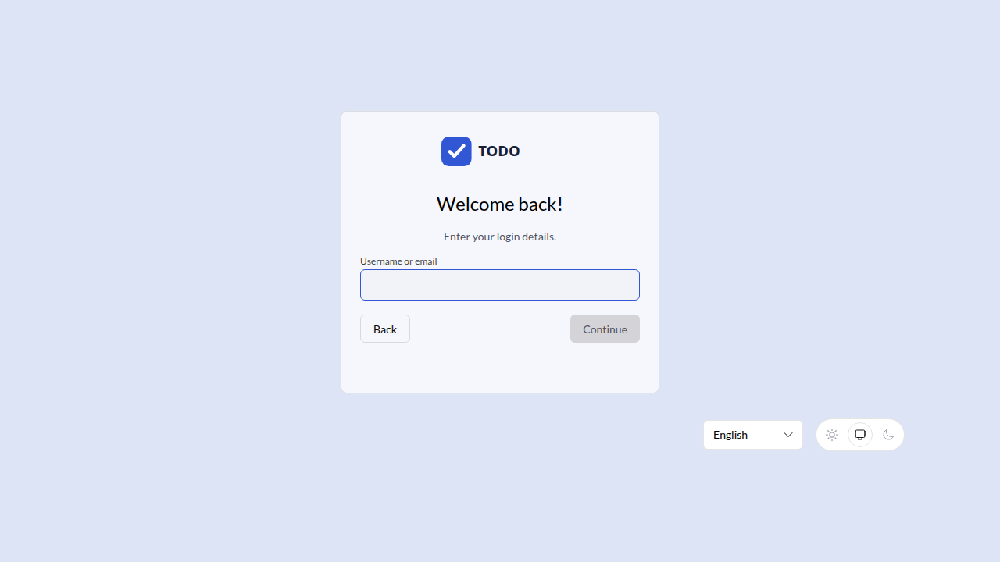
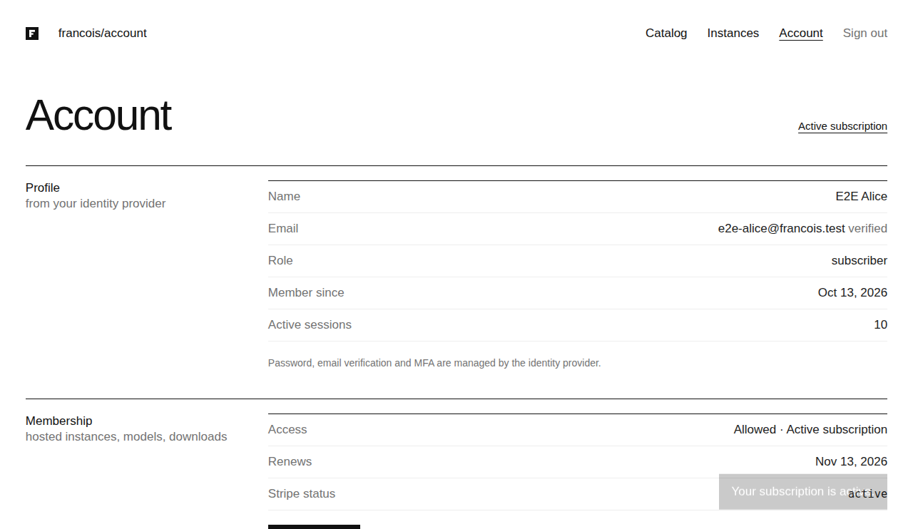
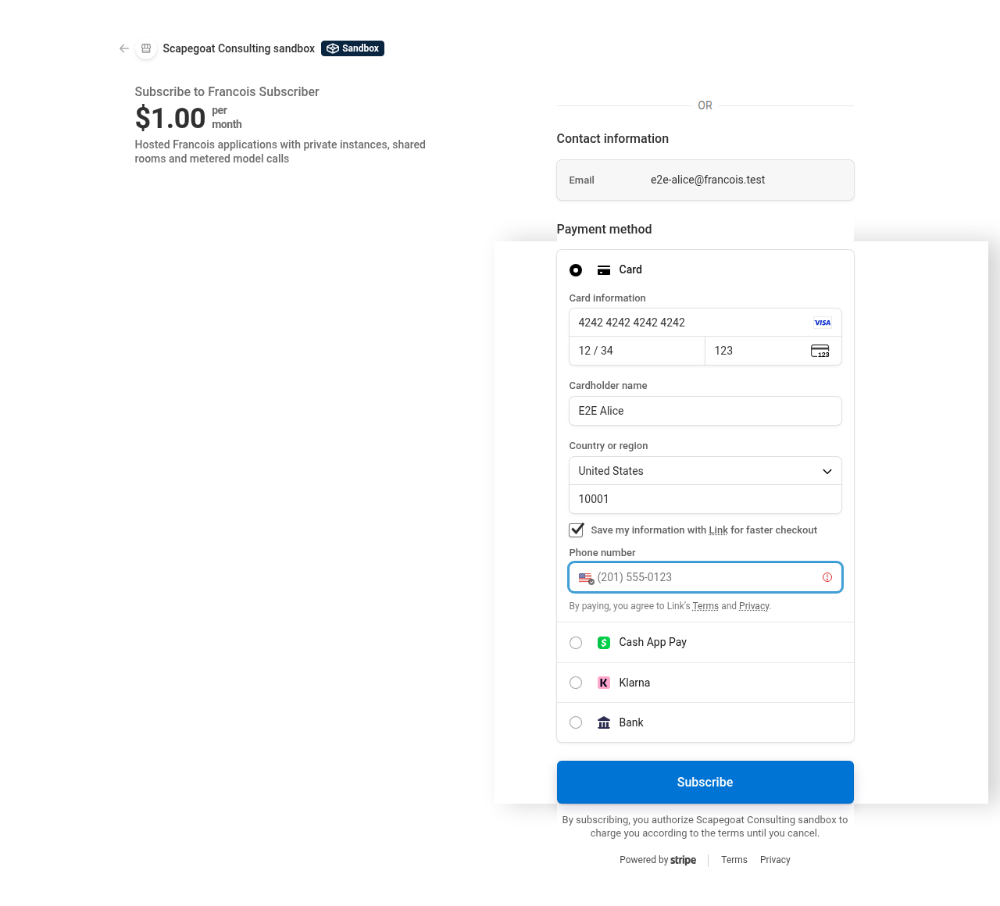
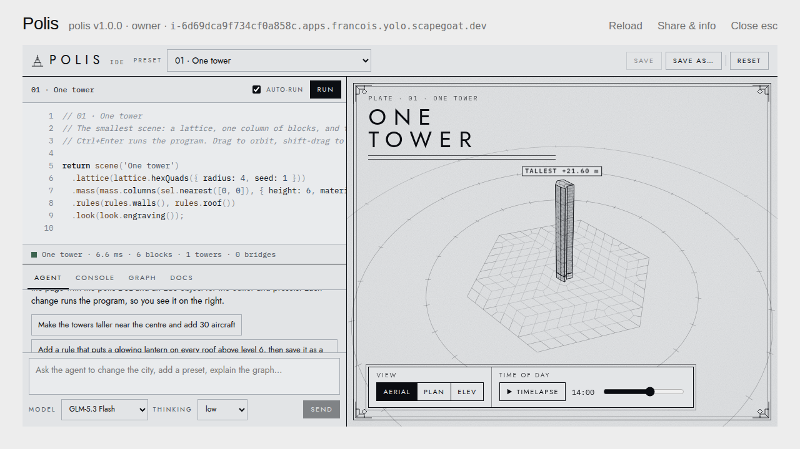
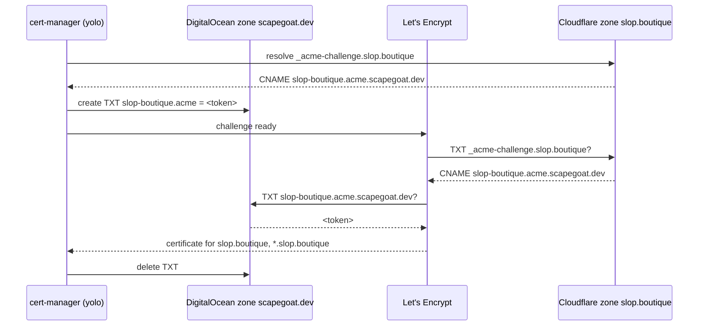

# Francois on Yolo: Deploying a Multi-Origin Go Service to K3s with Argo CD, Vault, ZITADEL and Stripe

Francois Catalog is a hosted subscriber platform for single-file HTML applications. Subscribers sign in through ZITADEL, pay through Stripe, and launch private instances of published applications, each on its own browser origin, with model calls metered against a credit allowance. The previous report, [[PROJECT REPORT - Francois Catalog - Hosted Subscriber Platform with Isolated Instances, Launch Grants and Metered Model Calls - A Technical Deep Dive]], explains how the platform works. This report explains how it was put into production on the scapegoat "yolo" cluster (a single Hetzner VM running K3s and managed by Argo CD), and what had to change in four places to do it: the Francois source, the shared Terraform, the GitOps repository and Vault.

The report is written to be re-used. Most of its content is not specific to Francois. Every service that routes by `Host`, serves wildcard origins, keeps state in process memory, or needs identity and billing from shared platform services will meet the same problems in the same order. The report records the decisions, the commands, the failures and their fixes, and ends with a runbook (Chapter 18) that can be followed for the next service.

> [!summary]
> - **The service runs at `https://francois.yolo.scapegoat.dev`**, with instance origins `https://i-<id>.apps.francois.yolo.scapegoat.dev`. Argo CD deploys it from `gitops/kustomize/francois` in the k3s repo, using an image built by CI and pinned by a one-line pull request that CI opens itself.
> - **Four properties of the service shaped the manifests.** It routes by exact `Host`, so probes must send the portal host. It serves a wildcard of origins, so the certificate needs DNS-01. It keeps views, rooms and a signing key in memory, so it runs one replica with `Recreate`. It reads every secret from a file, so Vault values are mounted, never placed in the environment.
> - **Most of the time went to the platform, not the service.** An expired Tailscale node key, two revoked DigitalOcean tokens, a missing Argo CD credential and a shared Stripe sandbox account had to be resolved before or during the first sync.
> - **A second domain and external sign-in followed.** `slop.boutique`, hosted on someone else's Cloudflare account, became a second site of the same process, with its certificate validated through a delegated ACME challenge. GitHub and Google sign-in link to invited users only; their OAuth clients were created with the `surf` browser CLI, which needed fixes for both consoles.
> - **One Certificate stopped every deployment.** A certificate that waits for a third party's DNS record never becomes healthy, and Argo CD waits for health in every sync wave. It was removed from the package until the record exists.
> - **Verified in production with a real browser:** ZITADEL login in an invite-only organization, Stripe Checkout and webhooks, instance isolation, sign-out that ends the ZITADEL session, egress restrictions, off-node backups, a rollout that preserves sessions, and real model calls through LunaRoute.

## How to read this report

Chapter 1 defines the platform vocabulary that the rest of the report uses. Chapter 2 states the requirements and the starting point. Chapter 3 shows the target architecture and which repository owns which part. Chapter 4 records three measurements taken before any design decision. Chapters 5 to 9 cover each layer in the order it must exist: code changes, Terraform, Vault, the Kubernetes package, and CI. Chapter 10 covers the platform repairs that blocked the first sync. Chapters 11 to 13 cover verification, the model backend and GitHub/Google sign-in. Chapter 14 adds a second domain with delegated certificate validation, Chapter 15 analyses a sync that blocked every deployment, and Chapter 16 covers the legal pages and two smaller fixes. Chapter 17 is a table of every problem encountered and its resolution, Chapter 18 is the runbook, and Chapter 19 lists open items.

A reader who only wants to deploy the next service can read Chapter 1, then Chapters 14 and 15.

## 1. Concepts the deployment depends on

The deployment joins two systems: the Francois process and the yolo platform. Each has its own vocabulary, and several platform terms are used here with specific meanings.

**The Francois process.** `francois catalog serve` is one Go process that serves two kinds of origin. The *portal origin* (`--public-url`) is the trusted website: login, billing, catalog, admin, the JSON API, the Stripe webhook receiver and the probes `/healthz` and `/readyz`. An *instance origin* is `i-<opaque-id>.<app-domain>`, one per subscriber workspace, where untrusted application HTML runs. The process decides which one a request is for by comparing the `Host` header exactly. Model calls run in a *Pi worker*, a Node.js child process (`worker/dist/main.js`) that reads provider configuration from a *Pi agent directory* (`auth.json`, `models-store.json`, `settings.json`). A `fake` backend answers deterministically without credentials.

**Argo CD and sync waves.** Argo CD watches the k3s repository. Each application is an `Application` object (`gitops/applications/<app>.yaml`) pointing at a Kustomize directory, and belongs to an `AppProject` that limits its namespaces. On this cluster, `Application` and `AppProject` objects are applied by hand once; there is no app-of-apps. Within one sync, the annotation `argocd.argoproj.io/sync-wave` orders resources: Argo applies a wave, waits for it to be healthy, then applies the next. It also waits for the last wave before the operation completes, and while an operation runs, no automated sync starts. A resource that never becomes healthy therefore holds every later deployment (Chapter 15).

**Vault and VSO.** HashiCorp Vault holds every secret value. The Vault Secrets Operator (VSO) reads `VaultAuth` and `VaultStaticSecret` objects from Git and writes ordinary Kubernetes `Secret` objects. A pod's ServiceAccount authenticates to Vault through the Kubernetes auth method, against a *role* that binds the ServiceAccount to a *policy*. A `VaultStaticSecret` re-reads its path every `refreshAfter` interval and can restart a Deployment when the value changes (`rolloutRestartTargets`).

**cert-manager issuers.** Two ClusterIssuers exist. `letsencrypt-prod` uses the HTTP-01 challenge and can issue only exact names. `letsencrypt-prod-dns01-digitalocean` proves control of the domain by writing a TXT record through the DigitalOcean API, and is the only one that can issue a wildcard name such as `*.apps.francois.yolo.scapegoat.dev`.

**ZITADEL organizations and the organization scope.** ZITADEL is the cluster's OIDC provider (`https://zitadel.yolo.scapegoat.dev`, v4.16.1, Login V2). An *organization* owns users and a *login policy* (whether self-registration is allowed, which external identity providers are offered). A relying party selects an organization by requesting the scope `urn:zitadel:iam:org:id:<org-id>`; ZITADEL then applies that organization's login policy and creates or looks up users there.

**RP-initiated logout.** OIDC's end-session endpoint lets a relying party end the identity provider's session. The browser is sent to `end_session_endpoint?client_id=…&post_logout_redirect_uri=…&id_token_hint=…`. Without this step, signing out of the application leaves the ZITADEL session alive, and the next login completes silently without a password prompt.

**The GitOps image PR.** The reusable workflow `go-go-golems/infra-tooling/.github/workflows/publish-ghcr-image.yml` builds `ghcr.io/<owner>/<repo>:sha-<short>`, then opens a pull request against the k3s repository that changes exactly one `image:` line, identified by a target file in the source repository. Merging that pull request is the deployment.

## 2. Requirements and starting point

At the start, Francois had been built and verified against a local Docker Compose stack (ticket FRANCOIS-002) but had no Git remote, no root Dockerfile and no image pipeline. The first step of FRANCOIS-003 was a design guide with draft manifests, delivered without touching any system. After review, the owner answered the open questions in one message:

- **"Repo is public."** The source and the image `ghcr.io/go-go-golems/francois` are public, so the cluster pulls anonymously and no image pull secret is needed.
- **"Save keys in vault."** Every credential (database, Stripe, webhook signing secret, GitHub App, test passwords, model key) goes to Vault, written by piping the value directly into `vault kv put`, and is never printed or committed.
- **"Sign up invite only."** ZITADEL self-registration is disabled for the Francois organization. Operators create users.
- **"Sign out ends zitadel."** Signing out of Francois must also end the ZITADEL session.

Two constraints came from the platform. The k3s repository's conventions (its `AGENTS.md` and `docs/app-deployment-pipeline.md`) fix the sync-wave order, require each `local-path` PVC to share the wave of its workload, forbid secret material in Git, and require images pinned by `sha-<short>`. The automation that edits the k3s repository must be able to change the deployed image by editing a single line.

## 3. Architecture

### 3.1 Ownership across repositories

The deployment touches four systems, and each object has exactly one owner. This division determines the order of work: Terraform objects must exist before their IDs can be written to Vault, and Vault records must exist before VSO can create the Secrets the Deployment mounts.



### 3.2 Runtime layout

All traffic for both the portal and the instance origins reaches one Service through Traefik, which forwards the `Host` header unchanged. One certificate covers the portal name and the instance wildcard.



## 4. Three measurements taken before designing

Three properties of the target were uncertain, and a wrong assumption about any of them would have produced a deployment that fails in a way the manifests do not reveal. Each was measured with a script stored in the ticket (`ttmp/2026/10/13/FRANCOIS-003--…/scripts/`).

### 4.1 Probes are rejected by host routing

Francois's outermost handler (`pkg/catalog/server.go`) treats any `Host` that is not the portal host as an instance name. It rejects with HTTP 421 any host that carries a port when the configured application port is empty. The kubelet sends probes to `http://<pod-ip>:8080/…`, so the `Host` header is `<pod-ip>:8080`. Script `01-probe-host-header-check.sh` started the server with the production flags and measured:

```text
GET /healthz, Host 10.42.0.17:8080 (kubelet default)          -> 421
GET /readyz,  Host 10.42.0.17:8080 (kubelet default)          -> 421
GET /healthz, Host francois.yolo.scapegoat.dev                -> 200
GET /readyz,  Host francois.yolo.scapegoat.dev                -> 200
GET /,        Host i-unknown.apps.francois.yolo.scapegoat.dev -> 404
GET /,        Host a.b.apps.francois.yolo.scapegoat.dev       -> 421
```

With default probes, the pod would never become Ready even though its logs show a healthy server. There were two possible fixes: a health route that answers on every host, or probes that send the portal host. A host-independent health route would also exist on every instance origin, inside the boundary that isolates untrusted code, so the probes override the header instead:

```yaml
startupProbe:
  httpGet:
    path: /readyz
    port: http
    httpHeaders:
      - name: Host
        value: francois.yolo.scapegoat.dev
```

### 4.2 The schema runs on the cluster's PostgreSQL 16

Development used PostgreSQL 17; the shared cluster database is `postgres:16-alpine`. Script `02-postgres16-migration-check.sh` started PostgreSQL 16.8, applied the migrations and ran the database-backed test packages with `TEST_DATABASE_URL` set. All passed. Running these tests with the variable set matters, because the tests call `t.Skip` when it is absent, and a passing run without it proves nothing.

### 4.3 The wildcard already resolves

Script `03-dns-wildcard-resolution-check.sh` queried the authoritative DigitalOcean name server. The existing `*.yolo.scapegoat.dev` record already answers for multi-label names such as `i-abc.apps.francois.yolo.scapegoat.dev`. An explicit `*.apps.francois.yolo` record was still added in Terraform, as a declaration that the name is in use. It is not needed for resolution.

## 5. Changes to the Francois source

Five changes were required in the service itself. Each one exists because production differs from the Compose stack in a specific way.

### 5.1 The organization scope

Without an organization scope, ZITADEL shows its instance-default login, applies the instance login policy and creates users in the default organization. The new flag `--oidc-extra-scopes` adds scopes to the authorization request. The Deployment passes `urn:zitadel:iam:org:id:$(FRANCOIS_ZITADEL_ORG_ID)`, where the variable comes from the runtime Secret. `identity.ValidateScopes` rejects empty scopes and scopes containing whitespace. It runs before the database connection is opened (commit `9dc27cc`), so a bad value fails immediately instead of after a database timeout.

The organization ID is not secret, but it is produced by Terraform, and Francois reads it from a flag, not a file. Kubernetes expands `$(VAR)` references in `args` from the container's `env`, and `env` can read a Secret key. Routing the value through the runtime Secret keeps every Terraform output in one Vault record:

```yaml
env:
  - name: FRANCOIS_ZITADEL_ORG_ID
    valueFrom: {secretKeyRef: {name: francois-runtime, key: oidc-org-id}}
args:
  - --oidc-extra-scopes=urn:zitadel:iam:org:id:$(FRANCOIS_ZITADEL_ORG_ID)
```

`--stripe-price-id=$(STRIPE_PRICE_ID)` uses the same mechanism.

### 5.2 Sign-out that ends the ZITADEL session

The requirement "sign out ends zitadel" needs RP-initiated logout, and the implementation has to choose between two forms. The `zitadel/oidc` library provides `rp.EndSession`, which calls the end-session endpoint from the server. That cannot work here, because the ZITADEL session is a cookie in the user's browser, and a server-to-server request does not carry it. The browser itself has to visit the endpoint. The implementation (commit `2c50123`) therefore uses front-channel logout:

1. `Exchange` returns the raw ID token alongside the identity. The token is stored in a new column `sessions.id_token` (migration `003_session_id_token.sql`) and cleared when the session is revoked.
2. `POST /auth/logout` revokes the portal session first, then computes the redirect with `Provider.LogoutURL(ctx, idToken, postLogout, state)` and returns `{"ok":true,"redirect":"…"}`.
3. The UI navigates to the returned URL. ZITADEL ends exactly the session named by `id_token_hint` and redirects to the registered `post_logout_redirect_uri`.



Two details matter. The portal session is revoked before the redirect is computed, so a missing end-session endpoint or a failed redirect still signs the user out of Francois. Sessions created before migration 003 have no ID token; the redirect then carries only `client_id`, which ZITADEL accepts, although it may ask which session to end. `pkg/catalog/identity/oidc_test.go` covers both forms against a stub discovery document.

The production test (Chapter 11) includes a control run: when only the portal session is revoked and the redirect is not followed, the next `/auth/login` lands back in Francois silently. When the redirect is followed, the next `/auth/login` stops at ZITADEL's login form.



*ZITADEL Login V2 after Francois sign-out: the next login asks for credentials. The branding shown is the instance default, because the Francois organization has no label policy (Chapter 19).*

### 5.3 Invite-only sign-up

`--signup-allowed` (default off) controls whether Francois honors `?signup=1` on `/auth/login` and whether `/api/session` reports `signupAvailable`. The UI hides the sign-up link when it is false. The authoritative control is ZITADEL's `allow_register = false` on the Francois organization; the flag only keeps the Francois UI consistent with it. The Compose stack passes `--signup-allowed`, because its local organization allows registration.

### 5.4 A root Dockerfile and a clean vulnerability scan

The Compose Dockerfile moved to the repository root, because the reusable workflow builds `./Dockerfile` with the repository as context. Making the repository public enabled the shared CI checks, and the first runs failed: `govulncheck` reported nine advisories in `golang.org/x/text`, `golang.org/x/net` and the Go 1.26.5 standard library, and `gosec` reported four findings. Commit `72999cc` moved to Go 1.26.9, `x/net v0.60.0` and `x/text v0.42.0`. `x/net v0.60.0` requires `x/text v0.42.0`, so the first attempt with `x/text v0.41.0` failed. It also gave each gosec finding a written `#nosec` justification. Before publishing, the full history was scanned for secret patterns; the only matches were test fixtures in the release validator.

### 5.5 Ignoring Stripe events that belong to other deployments

The Stripe sandbox account (`acct_1TxEMcLeHmcfmvuC`) is shared by three deployments: the.scapegoat.dev TODO application, the local Compose stack and now yolo. A webhook endpoint receives every subscription and invoice event in its account. Francois's worker retried any event whose customer it could not map to a local user, up to 12 times with exponential backoff, on the assumption that the mapping write was still in flight. In a shared account, every other deployment's event would have taken that path and then appeared as a failed event in Admin → Billing.

The fix (commit `7f1441a`) tags every customer Francois creates with `metadata.francois_deployment = <Config.Deployment>`. When the worker meets an unmapped customer, it reads the tag with `Gateway.CustomerDeployment`. It retries only when the tag names this deployment; otherwise it marks the event `ignored`.

```text
processOne(event):
  user := mapping(event.customer)
  if user found: project subscription; done
  tag := stripe.customer(event.customer).metadata.francois_deployment
  if tag == Config.Deployment: retry later      // our customer, mapping not yet written
  else: mark ignored                            // another deployment's customer
```

## 6. Shared infrastructure in Terraform

All Terraform changes are on branch `feat/francois-yolo` of the terraform repository (PR #34). Each part was applied separately, for reasons given below.

### 6.1 ZITADEL

`zitadel/francois/envs/prod` creates the organization `Francois`, a project with role checks disabled (Francois keeps roles in PostgreSQL), a PKCE public client, and a login policy with `allow_register = false`. The provider's access token is read from Vault through an ephemeral resource, so it is not stored in state. Apply created four resources: organization `394966170567966836`, project `394966174242177140` and client `394966177899610228`. The client registers `https://francois.yolo.scapegoat.dev/auth/callback` as its redirect URI and `https://francois.yolo.scapegoat.dev/` as its post-logout redirect URI; RP-initiated logout fails without the latter.

### 6.2 Stripe

The repository's billing-catalog module had the application slug and the lookup key hardcoded for the TODO application. The change adds `app_slug`, `lookup_key_prefix` and `price_nickname` variables with defaults equal to the old values. The existing sandbox environment then plans "No changes", which shows the refactor is neutral. A new root `stripe/apps/francois/envs/sandbox` manages the Francois Product and Price. Both already existed (created by hand during FRANCOIS-002), so they were imported (`prod_VQpH0Crg2Ztp5I`, `price_1UPxdFLeHmcfmvuCg0zsScj5`) and then updated in place: metadata, description, lookup key, nickname and `tax_behavior` from unspecified to `exclusive`. The charged amount is unchanged because Checkout does not enable automatic tax. A live Price will need an explicit tax decision.

The webhook endpoint is not in Terraform. Its signing secret is returned only once, at creation, and Terraform would store it in state. It was created with the Stripe CLI, and its secret was piped from the same shell straight into the bootstrap script. The endpoint was created disabled and enabled only once the host was serving. That kept Stripe from accumulating failed deliveries and from automatically disabling the endpoint.

### 6.3 DNS

The DNS zone plan showed three additions: the Francois wildcard and two PDS records (`pds_yolo_a`, `wildcard_pds_yolo_a`) that exist in DigitalOcean but were never imported. A full apply could have created duplicates. Only the Francois record was applied, with `-target='digitalocean_record.records["wildcard_apps_francois_yolo_a"]'`, and the PDS drift was reported on the PR. Fixing it belongs to a separate ticket (HK3S-0031).

## 7. Secrets in Vault

### 7.1 The records

| Vault path | Written by | Read by | Contents |
| --- | --- | --- | --- |
| `kv/apps/francois/prod/runtime` | `scripts/bootstrap-francois-secrets.sh` (k3s) | Pod (`francois-prod`), bootstrap Job | database name, user, password and URL; OIDC client and org IDs; Stripe key, webhook secret (current and previous), price ID |
| `kv/apps/francois/prod/pi` | `vault kv put` from a scratch directory | Pod (`francois-prod`) | `auth.json`, `models-store.json`, `settings.json` (LunaRoute only) |
| `kv/apps/francois/prod/e2e-users` | E2E account creation | E2E script | test account names and passwords |
| `kv/apps/francois/prod/idp-github`, `idp-google` | the owner (pending) | Terraform (ephemeral) | OAuth client secrets |
| `kv/ci/github/francois/gitops-pr-app` | copy of the shared GitHub App credential | CI (`francois-gitops-pr`) | App ID, installation, private key |
| `kv/infra/backups/object-storage` (key `francois-prefix`) | `vault kv patch` | backup CronJob (`francois-backup`) | shared bucket credentials, Francois prefix |

### 7.2 Identities and least privilege

Each workload has its own ServiceAccount, Vault role and policy. The serving pod's policy grants `read` on exactly two paths:

```hcl
path "kv/data/apps/francois/prod/runtime" { capabilities = ["read"] }
path "kv/data/apps/francois/prod/pi"      { capabilities = ["read"] }
```

The database bootstrap Job (`francois-db-bootstrap`) can also read the shared PostgreSQL admin credential, which the serving pod cannot. The backup CronJob (`francois-backup`) can read the shared object-storage credential, which the serving pod also cannot. CI authenticates through GitHub Actions OIDC to the role `francois-gitops-pr`, bound to this repository, and can read only the GitHub App record.

The platform's Vault bootstrap script rewrites every application's policies and roles. It was not run from a feature branch. Instead, only the Francois policies and roles were written, and each was read back.

### 7.3 The bootstrap script

`scripts/bootstrap-francois-secrets.sh` writes the runtime record from environment variables and generates the database password. Two properties of it are worth copying:

- It refuses a live Stripe key (`sk_test_*` or `rk_test_*` only), because the yolo deployment is a sandbox beta.
- It distinguishes "record does not exist" from other Vault errors. The first draft treated any `vault kv get` failure as "no record yet" and would have generated a new database password after a transient permission or network error, locking the application out of its own database.

```bash
if out=$(vault kv get -format=json "$path" 2>&1); then
  existing=$(jq -c '.data.data' <<<"$out")
elif grep -q 'No value found' <<<"$out"; then
  existing='{}'
else
  echo "$out" >&2; exit 1
fi
```

## 8. The Kubernetes package

`gitops/kustomize/francois` contains 21 resources. Their sync waves follow the platform order. Each wave becomes healthy before the next is applied.

| Wave | Resources | Why at this point |
| --- | --- | --- |
| −3 | Namespace | Everything else is namespaced. |
| −2 | ServiceAccounts (`francois`, `francois-db-bootstrap`, `francois-backup`), VaultConnection, VaultAuths | VSO needs an identity before it can read Vault. |
| −1 | VaultStaticSecrets `francois-runtime`, `francois-pi`, `francois-postgres-admin`, `francois-backup-storage` | The Job and the Deployment mount these. |
| 0 | ConfigMap with the bootstrap script | Used by the Job. |
| 1 | Job `francois-db-bootstrap` (Sync hook) | Creates role and database before the server connects. |
| 2 | PVC `francois-data`, Deployment, Certificate, CronJob | The `local-path` PVC binds only when its first consumer is scheduled, so it must share the Deployment's wave. |
| 3 | Service, Ingress, NetworkPolicy | Exposed and restricted last. |

### 8.1 The Deployment

The Deployment encodes the four properties listed in the summary.

**One replica, `Recreate`.** The HMAC key that signs asset URLs is generated at startup, and live views, server-sent-event streams and room fan-out are held in memory. A second replica would split rooms and reject the first replica's signed URLs. `Recreate` also matches the `ReadWriteOnce` PVC. The cost is a short outage on each rollout; Chapter 11 shows that sessions, which are in PostgreSQL, survive it.

**Secrets as files.** The runtime Secret is mounted at `/run/secrets/francois` with an explicit `items` list, so only named keys appear. Francois reads them with `--*-file` flags. No secret appears in `env`, in `args` or in `kubectl describe` output.

**Pi files copied by a startup wrapper.** The Pi worker takes locks in its agent directory and may refresh tokens there, so it needs a private writable directory. A Secret volume is read-only. The container's command is a small shell wrapper that copies the files and then `exec`s the server, so the server replaces the shell as PID 1 and receives signals directly:

```yaml
command:
  - /bin/sh
  - -ec
  - |
    install -d -m 0700 /var/lib/francois/pi /var/lib/francois/worker /var/lib/francois/releases
    for f in auth.json models.json models-store.json settings.json; do
      if [ -f "/etc/francois/pi/$f" ]; then
        install -m 0600 "/etc/francois/pi/$f" "/var/lib/francois/pi/$f"
      fi
    done
    exec francois "$@"
  - francois
```

The first design used an init container for this copy. It was replaced after reading the GitOps PR tool's source (`open_gitops_pr.py` in infra-tooling): `replace_manifest_image_text` only enters a container list when a line is exactly `containers:`. An `initContainers:` image would never be updated, and each release would run a new server image with an old init image. With the wrapper there is exactly one `image:` line.

**Security context.** The pod runs as uid/gid 10001 with `fsGroup: 10001` (so the uid can write the PVC), `RuntimeDefault` seccomp, no privilege escalation, all capabilities dropped and no ServiceAccount token mounted. Resources: requests 250m CPU and 512Mi memory, limit 1536Mi memory.

### 8.2 Certificate and Ingress

The `Certificate` `francois-tls` names `francois.yolo.scapegoat.dev` and `*.apps.francois.yolo.scapegoat.dev` and uses the DNS-01 issuer. A wildcard matches exactly one label, which is all instance names need, since they are `i-<id>` directly below the app domain. The Ingress has two host rules sharing that TLS Secret. It must not carry a `cert-manager.io/cluster-issuer` annotation, because ingress-shim would then create a second certificate with the HTTP-01 issuer, which cannot issue the wildcard. No Traefik middleware rewrites headers: Francois computes its own CSP `frame-src` and `frame-ancestors` from its flags.

### 8.3 Database bootstrap

The Job runs `postgres:16-alpine` with the shared admin credential and an idempotent script. It creates the role if it is missing (otherwise it resets the password to the Vault value), creates the database if it is missing, and sets ownership. The application then applies its own schema migrations at startup (`--migrate`). A separate migration Job was not used because the server already refuses to start with pending migrations, and only one replica ever runs.

### 8.4 NetworkPolicy

The NetworkPolicy was enabled only after the unrestricted deployment had passed the full browser test (k3s PR #340). That order meant any later failure could be attributed to the policy alone. The live labels of the target pods (PostgreSQL, Traefik, CoreDNS) were read from the cluster before the selectors were written.

| Direction | Peer | Port | Purpose |
| --- | --- | --- | --- |
| Ingress | Traefik pods in `kube-system` | 8080 | all browser traffic |
| Ingress | node address `91.98.46.169/32` | 8080 | kubelet probes |
| Egress | `kube-dns` | 53 UDP/TCP | name resolution |
| Egress | PostgreSQL primary in `postgres` | 5432 | database |
| Egress | Traefik in `kube-system` | 8443 | OIDC: the public ZITADEL hostname resolves to the node, and the request hairpins to Traefik's in-cluster endpoint |
| Egress | `0.0.0.0/0` | 443 | Stripe API and model provider |

The Traefik egress rule is required. The pod reaches `https://zitadel.yolo.scapegoat.dev` at the node's public address, which is translated to Traefik's pod on port 8443. Without the rule, the OIDC code exchange fails even though the browser-side login succeeds.

### 8.5 Release-blob backup

The shared nightly `pg_dumpall` covers the database. Release HTML and manifests live on the PVC as content-addressed blobs (`releases/blobs/<xx>/<sha256>`), and the database refers to them by hash. A database restore without the blobs would leave published releases that cannot be served. The CronJob `francois-backup` (04:40 daily) mounts the PVC read-only and runs:

```sh
aws --endpoint-url "$S3_ENDPOINT" s3 sync /data/releases/blobs \
    "s3://$S3_BUCKET/${S3_PREFIX}releases/blobs/" --size-only --no-progress
local=$(find /data/releases/blobs -type f | wc -l)
remote=$(aws --endpoint-url "$S3_ENDPOINT" s3 ls --recursive "s3://$S3_BUCKET/${S3_PREFIX}releases/blobs/" | wc -l)
[ "$remote" -ge "$local" ]
```

An incremental sync without deletes is a complete backup here, because blobs are immutable and named by content. The last line makes the Job fail if the remote copy has fewer files than the local directory. The CronJob uses its own ServiceAccount and Vault role, so the serving pod never holds the bucket credentials.

## 9. CI and the release loop

`.github/workflows/publish-image.yaml` calls the reusable infra-tooling workflow. On pull requests it builds and tests. On `main` it pushes `ghcr.io/go-go-golems/francois:sha-<short>` and opens the GitOps PR described by `deploy/gitops-targets.json`:

```json
{ "name": "francois-yolo", "gitops_repo": "wesen/2026-03-27--hetzner-k3s",
  "gitops_branch": "main", "manifest_path": "gitops/kustomize/francois/deployment.yaml",
  "container_name": "francois" }
```

The PR is opened with a GitHub App installation token, not a personal token. The workflow obtains a Vault token through GitHub Actions OIDC (role `francois-gitops-pr`, bound to `go-go-golems/francois`), reads the App credential from `kv/ci/github/francois/gitops-pr-app`, and mints an installation token scoped to the k3s repository. All applications share one GitHub App (ID 3926776), and each repository gets its own copy of the credential under its own Vault path and role.

`open_gitops_pr` was off until the Vault role and the App credential existed, then switched on in commit `25aa9cd`. That run opened k3s PR #342, which changed `sha-7f1441a` to `sha-25aa9cd` and nothing else. Once its validation check passed it was merged, and Argo rolled the Deployment. The workflow ignores `ttmp/**` and `*.md`, so ticket and documentation commits do not produce images.

## 10. Bringing the platform back to a deployable state

Most of the elapsed time was spent on platform state that had decayed since the last deployment. None of these problems is specific to Francois, and each is likely to recur.

### 10.1 The cluster was unreachable

The documented administration path is `kubectl` over Tailscale (`.cache/kubeconfig-tailnet.yaml`). It failed with `dial tcp 100.73.36.123:6443: i/o timeout`. `tailscale status --json` showed the cause: `k3s-demo-1 … keyExpiry=2026-09-25T19:59:42Z expired=true`, and the same for two other cluster nodes. A Tailscale node key expires after a fixed period unless expiry is disabled for that node. Disabling expiry in the admin console changed the status to `expired=false`, but the node stayed `online=false` until `tailscale up` was run on the node itself.

The public path to the node was closed by design. The Hetzner firewall allows SSH and the Kubernetes API only from `admin_cidrs = ["100.40.113.156/32"]`, and the operator's address was different. An attempt to add a temporary SSH rule through `hcloud` was denied by the agent's permission system as a security-weakening action. The owner added the rule themselves and ran `tailscale up` on the node. Once the tailnet worked, the temporary rule was removed. The first `hcloud firewall delete-rule` failed with "the specified rule was not found" because a rule is matched on all its fields, including `--description`; the second attempt, with the matching description, succeeded. A leftover rule would have been both an exposure and drift from the Terraform-managed firewall.

### 10.2 Both DigitalOcean tokens were revoked

The DNS plan failed with `401 … Unable to authenticate you`. Both tokens in Vault, the Terraform DNS token (`kv/infra/dns/scapegoat-dev`) and cert-manager's DNS-01 token (`kv/platform/cert-manager/prod/digitalocean`), returned 401 from `/v2/account`. The second one affected the whole cluster: no wildcard certificate could be issued or renewed. One certificate, `static-sites/storybook-yolo-wildcard-tls`, had already missed its renewal date (2026-10-07). The owner created a new token with domain read and write scopes and wrote it to both paths. VSO refreshed cert-manager's Secret within its 30-minute interval. The Francois certificate was issued on first sync, and the storybook certificate has since renewed (`notAfter` 2027-01-11).

### 10.3 There was no Argo CD credential

The `ARGOCD_TOKEN` in the k3s repository's `.envrc` returned `no session information`, and no Argo CD credential exists among the Vault paths. This did not block the deployment, because the one-time steps are `kubectl apply` operations: the AppProject `prod-apps` (after `kubectl diff` showed the only change was `+ namespace: francois`) and the Application `francois`. The AppProject must be applied before the Application, or Argo rejects the destination namespace. Later syncs are automatic.

### 10.4 First sync

About 30 seconds after the Application was applied:

- Both VaultStaticSecrets for the runtime and the PostgreSQL admin credential were Synced.
- `job.batch/francois-db-bootstrap` was `Complete 1/1` in 5 seconds.
- The PVC was Bound, and the pod was `1/1 Running`, meaning the Host-header probes passed.
- `francois-pi` reported not synced, as expected: no Vault record existed yet and its mount is optional.

The pod log showed the three migrations, then `Francois catalog ready address=[::]:8080 apps=*.apps.francois.yolo.scapegoat.dev portal=https://francois.yolo.scapegoat.dev`. The DNS-01 challenge was presented and propagated, and `francois-tls` became Ready about 109 seconds after creation.

The public smoke tests:

```text
/healthz               -> {"status":"ok"}
/readyz                -> {"models":true,"status":"ready"}
/api/session           -> loginAvailable true, signupAvailable false, billingEnabled true
portal CSP             -> frame-src https://*.apps.francois.yolo.scapegoat.dev; X-Frame-Options DENY
i-doesnotexist.apps…   -> 404
POST /webhooks/stripe  -> 400 invalid_signature
/auth/login            -> 303 to ZITADEL, scope "openid profile email urn:zitadel:iam:org:id:394966170567966836"
```

`/readyz` reports `models: true` with the fake backend, because the fake model is listed. The flag means "a model backend is configured", not "a provider is reachable".

## 11. Accounts, release and verification in production

### 11.1 Invited accounts and the first administrator

With sign-up disabled, an operator has to create accounts. Two test accounts were created through ZITADEL's user API in the Francois organization, with verified email and random passwords: `e2e-admin@francois.test` and `e2e-alice@francois.test`. The API was called with the Terraform administrator token. The passwords were written directly to `kv/apps/francois/prod/e2e-users`. Francois administrators are local users with role `admin`, promoted by exact issuer and subject:

```bash
kubectl -n francois exec deploy/francois -- francois catalog users promote \
  --database-url-file /run/secrets/francois/database-url \
  --issuer https://zitadel.yolo.scapegoat.dev --subject <zitadel-user-id>
```

The first release was published from inside the pod with `francois catalog publish … --artifact-id polis --version 1.0.0 --html /app/examples/polis.html --manifest /app/examples/polis.manifest.json`, which returned `rel_02fefc881efb42bfc6a002cb published`.

### 11.2 The browser test

`scripts/05-yolo-e2e.sh <step>` in the ticket drives headless Chromium through `playwright-core`. It reads credentials from Vault inside its own process, so passwords never appear in a command line or a transcript. The steps and their recorded output:

```text
[admin] session {"authenticated":true,"role":"admin","email":"e2e-admin@francois.test"}
[admin] admin page title: Operations
[alice-subscribe] before {"role":"subscriber","allowed":false,"reason":"subscription_required"}
[alice-subscribe] returned to /account?checkout=cs_test_…
[alice-subscribe] after {"allowed":true,"reason":"subscriber"}
[alice-run] instance origin https://i-….apps.francois.yolo.scapegoat.dev
[alice-run] instance document {"title":"Polis IDE","bytes":254310,"cookieVisible":false}
[alice-run] portal API from instance origin: blocked: TypeError
[control] next /auth/login lands on Francois (silent re-login, as expected while ZITADEL session lives)
[logout] next /auth/login lands on zitadel.yolo.scapegoat.dev/ui/v2/login/loginname
[admin-models] save 200 {"revision":1,"approved":["lunaroute/glm-5.3-flash","lunaroute/glm-5.3","lunaroute/deepseek-4.1-flash"]}
[alice-sample] sample {"ok":true,"ms":2550,"text":"pong","tier":"quick","model":"lunaroute/glm-5.3-flash"}
```

The production `stripe_events` table held `checkout.session.completed`, `customer.subscription.created` and `invoice.paid`, each processed on its first attempt. This shows the endpoint, the signature check and the worker working together.



*Alice's account page after Stripe Checkout in the sandbox: access is allowed through an active subscription.*

Automating Stripe Checkout took four iterations, because Checkout's markup has changed since the patterns most scripts use:

1. `#cardNumber` was not visible. Payment methods are now an accordion with Card collapsed.
2. Clicking the "Card" radio or text failed: a transparent button (`data-testid="card-accordion-item-button"`) intercepts pointer events.
3. Clicking that button failed as "not visible". A forced click on the "Card" label opened the section.
4. After submit the page stayed on Checkout. The pre-checked "Save my information with Link" box required a phone number. Unchecking it allowed the payment to complete.



*Step 4: Checkout waiting for a Link phone number after submit.*

### 11.3 Verifying the NetworkPolicy, the backup and a rollout

After the NetworkPolicy was enabled, the pod stayed Ready with no restarts or probe failures, and the `admin`, `control` and `alice-run` steps passed again. A successful `admin` login proves that the OIDC code exchange from the pod to ZITADEL works through the Traefik hairpin. Egress was tested from the pod with `curl`:

```text
api.stripe.com                    -> 404 (reachable, unauthenticated)
gw.lunaroute.com/v1/models        -> 401 (reachable)
zitadel discovery                 -> 200
10.43.0.1:443 (Kubernetes API)    -> blocked
```

The backup ran once by hand (`kubectl create job francois-backup-manual-1 --from=cronjob/francois-backup`). It uploaded the two Polis blobs and printed `release blobs: local=2 remote=2`. Both object keys matched the SHA-256 values recorded at publish time.

When the CI-built `sha-25aa9cd` rolled out through `Recreate`, a rerun of `alice-run` with the stored browser state launched Polis without signing in again. Portal sessions live in PostgreSQL, so they survive the pod replacement.

## 12. The model backend: LunaRoute only

The deployment ran the fake backend until it was settled whose credentials would pay for subscriber model calls. The local Pi configuration used during development holds personal subscription logins (Anthropic, OpenAI Codex, Z.ai, Kimi) as well as LunaRoute. Personal subscription credentials should not pay for a hosted service's traffic, so none of them were copied. The owner chose LunaRoute and supplied a key issued for Francois alone.

### 12.1 What the worker reads

The worker's LunaRoute support (`worker/src/lunaroute.ts`) registers the provider from the cached catalog in `models-store.json` and takes the gateway key from the `lunaroute` entry of `auth.json`. In that entry, `getApiKey` returns the `access` field, and `refreshToken` returns the credential unchanged. The Pi runtime is created with `allowModelNetwork: false`, so the worker never fetches the model list itself. The provisioned directory therefore has exactly three files:

```text
auth.json          {"lunaroute":{"type":"oauth","access":<key>,"refresh":<key>,"expires":4102444800000}}
models-store.json  the "lunaroute" entry of a Pi models store (14 models)
settings.json      default provider lunaroute, default model glm-5.3, thinking minimal
```

There is deliberately no `models.json` and no other `auth.json` entry. If an administrator approves a selector for another provider, the worker still has no credential for it. The expiry is set far in the future so Pi never attempts a refresh. `auth.json` was built with `jq --rawfile` from the key file, so the key never appeared on a command line or in output.

Before Vault was touched, the directory was tested locally with `francois models list --pi-agent-dir <dir>`, which listed only LunaRoute models. The key was tested directly against the gateway: `GET /v1/models` returned 200 with 14 models, and a chat completion returned 200.

### 12.2 Ordering the secret change against the rollout

The owner's message naming the dedicated key arrived while the first Vault write was being made. That write, version 1 of `kv/apps/francois/prod/pi`, therefore contained the key from the operator's personal LunaRoute login. Version 2 was written with the dedicated key, and version 1 was destroyed with `vault kv destroy -versions=1`, which removes the data and not only the latest pointer.

The switch to `--backend=pi` (k3s PR #343) could not be merged immediately. `francois-pi` refreshes every 5 minutes, and a rollout before the refresh would have started the worker with the destroyed version's key. The cluster Secret's key prefix was polled until it showed the dedicated key, and only then was the PR merged. The new pod listed the three files in `/var/lib/francois/pi` with mode 0600 and logged `Francois catalog ready`. The worker fails initialization when no authenticated model exists for a tier, so a ready pod already shows that the files were accepted.

### 12.3 Approval and a real call

Francois allows no hosted models until an administrator approves them. The E2E step `admin-models` sends a settings revision through `PATCH /api/admin/settings` (CSRF-protected):

| Selector | Label | Credits per call | Tier |
| --- | --- | --- | --- |
| `lunaroute/glm-5.3-flash` | GLM 5.3 Flash | 1 | quick |
| `lunaroute/glm-5.3` | GLM 5.3 | 3 | default, complex |
| `lunaroute/deepseek-4.1-flash` | DeepSeek 4.1 Flash | 1 | — |

The allowance is 2000 credits per month and 200 per day. The step `alice-sample` then signs Alice in, launches Polis and, inside the instance frame, uses the same API the application uses:

```js
const sample = await window.claude.use("sample");
const r = await sample([{ role: "user", content: "Reply with exactly the word: pong" }], { modelTier: "quick" });
// {"text":"pong","modelTierApplied":"quick","modelUsed":"lunaroute/glm-5.3-flash"}, 2.55 s
```

The request passed through the hosted runtime's admission pipeline: grant, declared capability, approved model, concurrency, credit reservation, then the Pi worker and LunaRoute.



*Polis on its instance origin, with the approved GLM-5.3 Flash model selected in the agent panel.*

## 13. GitHub and Google sign-in for invited users

The owner asked for GitHub and Google sign-in. That conflicts with invite-only sign-up unless the providers are configured carefully, so this chapter first explains the ZITADEL configuration that keeps the invitation as the gate. It then covers creating the two OAuth clients, which turned out to need browser automation, a published Google consent screen and the user records that the logins link to.

### 13.1 Linking without creating

A ZITADEL external identity provider has four switches:
- `is_creation_allowed`: whether a login through it may create a ZITADEL user;
- `is_auto_creation`: whether it does so without asking;
- `is_linking_allowed`: whether it may link to an existing user;
- `auto_linking`: whether that existing user is found by email or by username.

If creation is allowed, any GitHub or Google account can register, which is open sign-up. The configuration in `zitadel/francois/envs/prod` (terraform commit `1607bf2`) allows linking only:

```hcl
resource "zitadel_org_idp_github" "francois" {
  count               = var.github_client_id == "" ? 0 : 1
  org_id              = zitadel_organization.francois.id
  client_id           = var.github_client_id
  client_secret       = ephemeral.vault_kv_secret_v2.idp_github[0].data["client_secret"]
  scopes              = ["read:user", "user:email"]
  is_creation_allowed = false
  is_auto_creation    = false
  is_linking_allowed  = true
  is_auto_update      = false
  auto_linking        = "AUTO_LINKING_OPTION_EMAIL"
}
```

The Google resource is identical except for its scopes (`openid profile email`). The login policy enables external login only when at least one provider exists. Email matching is safe only with providers whose email claim is verified. Google's is, and GitHub's primary email must be verified on GitHub.

The client secret does not enter Terraform state. In zitadel provider 3.3.0, `client_secret` is a write-only attribute, the only kind of attribute that accepts an ephemeral value, so it can be read from Vault at apply time without being stored. `client_id` is a normal attribute and cannot take an ephemeral value, so it is a non-secret variable. With both IDs empty the plan shows no changes, so the branch could be merged before the clients existed. Rotating a secret means updating Vault and applying with `-replace`, because the provider cannot see a changed write-only value.

Both providers use one callback, `https://zitadel.yolo.scapegoat.dev/idps/callback`, ZITADEL v4's generic IdP callback. This callback serves every Francois site, including the second domain of Chapter 14. GitHub and Google return the browser to ZITADEL, and ZITADEL then returns it to whichever portal origin started the authorization request. The provider never sees a Francois URL, so adding a site adds nothing on the GitHub or Google side.

### 13.2 Creating the clients with surf

GitHub OAuth Apps and Google OAuth clients have no creation API; they exist only in the GitHub and Google web consoles. The owner's `surf` CLI drives a signed-in Chromium through a browser extension and has verbs for both consoles: `surf github oauth register` and `surf google oauth register`. Both consoles had changed since those verbs were written, so each run exposed a defect. The table lists them in the order they appeared; every fix is in wesen/surf-cli #16.

| Console | Failure | Cause | Fix |
| --- | --- | --- | --- |
| GitHub | `GITHUB_LOGIN_BOUNCE` | The Chromium that surf drives was not signed in | Owner signed in there |
| GitHub | "OAuth app form did not render" | The single "Authorization callback URL" field became a "Redirect URIs" list | Fall back to the first row, `oauth_application_application_callback_urls_attributes_0_url` |
| GitHub | "expected the GitHub app settings page with a Client ID" after the app was created | The Client ID is now a bare `<code>` element | Read the ID from `<code>` |
| Google | `GOOGLE_PROJECT_ID_ERROR` on `project create --name slop.boutique` | The console rejects a dot in project names, so the ID field never appears | Name `slop-boutique`; surf validates names (4–30 letters, digits, `'`, `-`, space, `!`) |
| Google | `GOOGLE_CONSENT_SCREEN_REQUIRED` | A new project has no consent screen (brand) | New verb `surf google oauth consent` (13.3) |
| Google | `TypeError: btn.click is not a function` | `waitForCondition` returns `{value, waitedMs}`; the script used the wrapper as the element, so Create was never clicked | Unwrap `.value` |
| Google | Client created, secret not captured, dialog closed | The dialog can mask the secret, and the script closed it once it had the ID | Read the secret from the dialog's copy-button `aria-label`; close only when ID and secret were both captured |

Two of these failures happened after a client already existed, and re-running the verb would have created a second one. Both were finished by hand in the open tab, with the secret routed straight into Vault:
- **GitHub:** `surf js` clicked "Generate a new client secret", read the 40-hex value into a shell variable and piped it to `vault kv put kv/apps/francois/prod/idp-github client_secret=-`.
- **Google:** the console no longer shows a secret after creation ("Viewing and downloading client secrets is no longer available"). The only way forward was "Add secret", whose full value appears in a copy button's label, `Copy to clipboard: GOCSPX-…`. That left an unused first secret on the client, to be deleted after the first successful Google login.

Each credential pair was then checked against its token endpoint with a dummy authorization code.
- **GitHub** answered `bad_verification_code`, which it returns only after accepting the client ID and secret.
- **Google** answered `invalid_request` ("doesn't comply with Google's OAuth 2.0 policy") for the stored secret and for a deliberately wrong one alike, so the endpoint cannot verify a Google secret this way. Only a real login can.

### 13.3 The consent screen and publishing

A Google project needs a consent screen before it can hold OAuth clients. Google Auth Platform creates it through a four-step wizard at `/auth/overview/create`:
- the app name and a user support email, chosen from addresses the console offers;
- the audience, internal or external;
- developer contact emails;
- agreement to the Google API Services User Data Policy.

The new verb `surf google oauth consent` runs this wizard, then fills the Branding page (home page, privacy policy and terms links, authorized domains) and reports or changes the publishing status on the Audience page. It ticks the policy agreement only with `--agree-user-data-policy`, and checks for that flag before the first click. It was verified end to end on a throwaway project (`surf-consent-test-1013`, since shut down) before being used on `slop-boutique`.

Three console rules shaped the configuration:
- **Authorized domains.** Every domain that appears in a client redirect URI or a branding link must be listed: `scapegoat.dev` for ZITADEL's callback, and `slop.boutique` for the links.
- **Testing versus production.** In "Testing", only listed test users (at most 100) can sign in. Publishing an app that asks only for `openid email profile` needs no Google verification.
- **Links before publishing.** Publishing does require the home page, privacy policy and terms links. Without them the Audience page says "To publish your app, you must complete your configuration on the Branding page" and the button does nothing. Francois had no such pages, which is why they were written (Chapter 16).

```bash
surf google oauth consent --project slop-boutique \
  --app-name slop.boutique --support-email <owner> --agree-user-data-policy \
  --home-page https://slop.boutique \
  --privacy-policy https://slop.boutique/privacy --terms-of-service https://slop.boutique/terms \
  --authorized-domains slop.boutique,scapegoat.dev --publish
```

With the clients in place, the two client IDs became the variables' defaults (terraform `6efd957`). The plan added both providers and enabled external login in the login policy. The owner ran the apply, because the agent's permission system refuses `terraform apply`. A command run with the `!` prefix gets no standard input, so the apply needs `-auto-approve`; without it Terraform fails with `error asking for approval: EOF`. A re-plan showed no changes, and ZITADEL's login page now offers both providers.

### 13.4 Users for the logins to link to

Linking needs an existing user in the Francois organization with the same, verified email. The users were created with ZITADEL's `POST /v2/users/human` (organization `394966170567966836`, `isVerified: true`, no password), with the Terraform administrator token from Vault in a header file.

One of the two addresses, `wesen@ruinwesen.com`, already belonged to a user in another organization (`383503427226894574`). Francois requests the organization scope `urn:zitadel:iam:org:id:<francois>`, so that user cannot sign in to Francois. Creating a second user with the same username failed with `User already exists (V3-DKcYh)`: ZITADEL usernames are unique across the whole instance, while email addresses are not. The Francois user therefore has the username `wesen-github` and the email `wesen@ruinwesen.com`. Linking matches on email, so the username is never typed.

The administrator role was assigned before the first login. `francois catalog users promote --issuer … --subject <zitadel user id>` creates the identity row when it does not exist, so the first login already has the admin role. The owner then signed in with GitHub, confirmed the link and landed on the admin pages, which completes the GitHub path in production. The Google path is configured and published, but no real Google login has been run yet.

## 14. A second domain: slop.boutique

The owner of `slop.boutique` wanted that domain to front the same catalog. The zone is hosted on the owner's Cloudflare account, and neither side shares DNS credentials with the other. The result is a second *site*: a portal at `https://slop.boutique`, instances at `https://i-<id>.slop.boutique`, the same users, instances and billing, and TLS issued by the yolo cluster. The work divides into a code change (14.1–14.2), DNS delegation for the certificate (14.3–14.4) and a handover order for the domain owner (14.5).

### 14.1 Sites in the code

Before the change, Francois had one `PublicURL` and one `AppDomain`. Every absolute URL and every origin check was derived from them. Serving a second domain requires each of those values to follow the domain the request arrived on, so the change introduces a site: a portal origin, an application domain and an OIDC relying party with that portal's callback URL (francois `a8200b9`).

```go
type Site struct {
	PublicURL *url.URL           // https://slop.boutique
	AppDomain string             // slop.boutique → instances at i-<id>.slop.boutique
	AppScheme, AppPort string
	OIDC      *identity.Provider // redirect_uri = <portal>/auth/callback
}
type Config struct{ Sites []Site /* [0] is primary */ ; ... }
```

`Server.Handler` resolves the site from `Host` in a fixed order:
1. an exact portal host (the portal handler runs with the site in the request context);
2. `www.<portal>` (308 redirect to the portal);
3. a single-label child of an application domain (the instance handler runs with that site's portal and instance origins).

Anything else gets 421. The portal handlers read the site with `s.site(r)`. The table lists every place that used the single configuration before.

| Where | Before | After |
| --- | --- | --- |
| Host dispatch | One portal host, one suffix | Portal hosts first, then application suffixes, per site |
| OIDC login, callback, logout | One relying party | The site's relying party; logout returns to the site's portal |
| Origin check on mutations | `PortalOrigin()` | The request site's portal origin |
| Portal CSP `frame-src`, `/api/session` `appDomain` | Fixed | The request site's app domain |
| Instance `origin` in JSON and in launch codes | Fixed | The request site's app domain |
| Instance `frame-ancestors`, `data-portal`, boot `portalOrigin` | `hosted.Config.PortalOrigin` | Passed to `Runtime.Handler(inst, portal, origin)` |
| Stripe Checkout and Portal return URLs | `payments.Config.PublicURL` | Passed per call |
| Stripe `Deployment` idempotency tag | `francois-<primary host>` | Unchanged |

Three consequences follow.
- **Launch codes are bound to their site.** A launch code stores the instance origin it was issued for, and the exchange compares that origin with the request's. A code issued on one portal therefore cannot be redeemed on the other site's instance origin.
- **Sessions are per domain.** The session cookie is host-only, so a user signs in separately on each site.
- **The Stripe idempotency tag stays fixed.** It also marks this deployment's customers in the shared sandbox account (Chapter 5.5), so it must not change with the site.

`Config.Validate` rejects:
- a site URL that is not a bare origin;
- a scheme that differs from the primary site's, because `__Host-` cookies need HTTPS everywhere;
- a malformed application domain;
- a repeated portal host or application domain.

The serve command takes each additional site as `--site <portal origin>=<app domain>`. `TestSecondSite` covers the per-site session data and CSP, the `www` redirect, a rejected cross-site `Origin`, the same instance under both domains, framing and boot data on the second site, and a launch code refused on the other site's origin.

### 14.2 Why `*.slop.boutique` and not `*.apps.slop.boutique`

The primary site uses a separate application domain (`apps.francois.yolo.scapegoat.dev`). For the second site the application domain is the portal hostname itself, so the validation rule that required them to differ was relaxed. Two facts favour the shorter form.
- **One delegation record covers both names.** The ACME DNS-01 challenge for `slop.boutique` and the challenge for `*.slop.boutique` are both answered at `_acme-challenge.slop.boutique`. With `*.apps.slop.boutique`, the wildcard's challenge would live at `_acme-challenge.apps.slop.boutique` and need a second record.
- **Sharing the parent domain weakens nothing.** Instances cannot write the portal's cookies: `__Host-` cookies forbid a `Domain` attribute, so a page on a subdomain cannot set or overwrite them. Portal mutations need the exact portal `Origin` and the CSRF header. The primary site already has portal and instances under the registrable domain `scapegoat.dev`.

### 14.3 Delegated DNS-01 validation

A certificate for `*.slop.boutique` needs DNS-01, and DNS-01 needs a TXT record at `_acme-challenge.slop.boutique`. The cluster's DNS-01 solver can only write to the DigitalOcean zone `scapegoat.dev`. The standard remedy is a delegation record: the domain owner adds, once,

```text
_acme-challenge.slop.boutique.  CNAME  slop-boutique.acme.scapegoat.dev.
```

Let's Encrypt follows CNAMEs when it looks up the challenge, so a TXT record at `slop-boutique.acme.scapegoat.dev` answers for `slop.boutique`. cert-manager has to write it there, which is what the solver option `cnameStrategy: Follow` does: it resolves the CNAME before choosing the zone. That option changes where every certificate of an issuer writes its record. It therefore lives in a separate ClusterIssuer, `letsencrypt-prod-dns01-digitalocean-follow`, with the same DigitalOcean token, and existing certificates keep the plain issuer.



The delegation also covers renewal: cert-manager repeats the same steps every 60 days without involving the domain owner. Without the CNAME, the solver looks for a `slop.boutique` zone in the DigitalOcean account and fails with a DigitalOcean SDK error. Nothing is sent to Let's Encrypt in that case, so no ACME failure or rate-limit penalty accumulates.

The ZITADEL client needed the second portal's callback and post-logout URIs. The variable `alias_urls` (default `["https://slop.boutique"]`) extends both lists (terraform `5b07f73`), the same pattern Datadrop uses for its alias domain.

### 14.4 Verifying before DNS exists

The site could be tested before any public record existed, by sending requests to the pod through `kubectl port-forward svc/francois` with a `Host: slop.boutique` header.

| Request | Result |
| --- | --- |
| `GET /api/session` | `"appDomain":"slop.boutique"` |
| `GET /` | CSP `frame-src https://*.slop.boutique` |
| `GET /account?x=1` with `Host: www.slop.boutique` | `308 https://slop.boutique/account?x=1` |
| `GET /auth/login` | Redirect to ZITADEL with `redirect_uri=https%3A%2F%2Fslop.boutique%2Fauth%2Fcallback` |
| `GET /` with `Host: i-nope.slop.boutique` | 404 `Unknown instance` |
| `GET /api/session` with the primary host | 200 |

After the ZITADEL apply, the authorization request with that `redirect_uri` reached the login UI instead of an error, which confirms the URI registration.

### 14.5 The handover order for the domain owner

The domain owner received instructions in two stages, so that visitors never meet a certificate error.

| Stage | Records (Cloudflare, all "DNS only") | Visible effect |
| --- | --- | --- |
| 1, now | `_acme-challenge` CNAME `slop-boutique.acme.scapegoat.dev` (plus a CAA record allowing `letsencrypt.org`, only if CAA records already exist) | None |
| 2, after the certificate is issued | `@` and `*` CNAME `francois.yolo.scapegoat.dev`, replacing the current `@` record | The domain serves Francois |

The records must not be proxied ("orange cloud"). Cloudflare's free certificates do not cover a wildcard two levels deep, and the cluster terminates TLS itself. Explicit records such as `www` or `MX` keep precedence over `*`.

At the time of writing, stage 1 has not been done. The Certificate manifest therefore exists in the repository but is not deployed, for the reason Chapter 15 explains.

## 15. A certificate that held every deployment

The second site's Certificate was first deployed in sync wave 2, the wave of the primary certificate and of the Deployment (k3s #345). It went to "Progressing" and stayed there, because its challenge cannot succeed until the domain owner adds the CNAME. Argo waits for a wave to be healthy before it applies the next one, so wave 3 (Ingress, NetworkPolicy) never ran. The sync operation started at 22:20 stayed in phase `Running`. An automated sync does not start while another operation runs, so the two pull requests merged after it were never deployed:
- #346, the image with the privacy and terms pages;
- #347, the contact address.

The symptom was indirect. `https://francois.yolo.scapegoat.dev/privacy` returned 404 after its pull request had been merged, and the Deployment still referenced the previous image. The cause is visible in the Application's operation state, which names both the revision the operation is applying and the resource it waits for:

```bash
kubectl -n argocd get app francois -o json | jq -r '.status.operationState
  | "\(.syncResult.revision[:7]) \(.phase) \(.message)"'
# 26fb78d Running waiting for healthy state of cert-manager.io/Certificate/francois-slop-boutique-tls
```

### 15.1 The fix, and a first attempt that would not have worked

The first attempt moved the Certificate to its own last wave (4), on the assumption that Argo waits for health only before starting a later wave. A review of the pull request pointed out that Argo also waits for the last wave before it marks the operation complete. The move would only have deferred the wait, and the operation would again have stayed `Running`. The k3s repository's `AGENTS.md` states the same wave rule for PVCs.

The applied fix removes the Certificate from `kustomization.yaml` and keeps the file, with a comment that says when to add it back: once `dig CNAME _acme-challenge.slop.boutique` returns the delegation target (#348, `0d67872`). The two Ingress host rules for `slop.boutique` stay. They refer to a TLS Secret that does not exist yet, which is harmless while no DNS points at the cluster. When the CNAME exists, adding the file back holds one sync for the minutes that issuance takes.

### 15.2 Recovering the stuck operation

Merging #348 does not end the running operation, because the running operation is the one that would have to apply it. Without an Argo CD API token (Chapter 10.3), the operation was ended the way `argocd app terminate-op` ends it, by setting its phase:

```bash
kubectl -n argocd patch app francois --type merge \
  -p '{"status":{"operationState":{"phase":"Terminating"}}}'
```

Three further steps were needed, each with its own cause.
1. **The automated restart picked an older revision.** It synced `6150625` (#347), the revision Argo had last fetched, which still contained the Certificate, and it stopped at the same wait. The operation had to be terminated a second time.
2. **The Certificate had to be deleted by hand.** Pruning runs after the waves, so an operation that still contains the Certificate waits for it before it can prune it. I deleted it manually; the final revision removes it anyway.
3. **Two challenges had to be cleaned up.** They were left behind with an owner reference to the ClusterIssuer, not to the deleted Order, so garbage collection never removed them. One kept the `acme.cert-manager.io/finalizer` after deletion: its cleanup would delete a TXT record from a zone that does not exist. No record had ever been presented, so removing the finalizer was safe.

The next operation synced `3e4a581` and ended with `successfully synced (all tasks run)`.

The rule that follows applies to any GitOps package. A resource whose health depends on an action outside the platform must not be in the waves of a production application until that action has happened. Such actions include a DNS record at a third party, a manual approval, or an external account. Argo has no timeout for health, so one such resource stops every later deployment of the application.

## 16. Legal pages and smaller fixes

**Privacy policy and terms.** Google publishes a consent screen only with privacy and terms links (Chapter 13.3), so Francois gained `GET /privacy` and `GET /terms` (francois `31043b3`).
- **Rendering.** They are plain HTML rendered with `html/template` from `pkg/catalog/web/legal.tmpl` and styled with the portal's stylesheet, so consent screens and crawlers can read them without JavaScript. Each page names the site the request arrived on.
- **Contact.** The contact address comes from `--legal-contact` (`manuel@scapegoat.dev` in production, k3s #347), and the portal footer links both pages.
- **Content.** The privacy text was written from what the code actually stores. For example, `model_calls` has columns for the model, credits and token counts but none for prompt or answer text, so the policy says that text is not stored.

**The model list showed one model four times.** The admin settings form listed `lunaroute/glm-5.3` four times.
- **Cause.** The Pi worker was written for Francois's local mode, which has three model tiers. It reports the models of its quick, default and complex tiers before the full catalog. All three tiers of the LunaRoute `settings.json` point to `glm-5.3`, so it appeared three times as a tier entry and once more as itself.
- **Effect.** The rows shared one selector, so they toggled together. Unchecking one removed the model from the tiers, and re-checking it reset its credits to 1.
- **Fix.** The hosted catalog configures tiers in its own settings, so it now keeps one entry per selector (`uniqueModels`, francois `67dbfc7`). I checked the fix locally with the production LunaRoute configuration in place of the Compose stack's container: 14 rows, no duplicates.

**A doubled line.** Lists and tables at the top of a section drew their own dark top border directly below the section's rule. A single rule in `catalog.css` removes the list's border when it opens a ruled section (francois `750f359`).

## 17. Issues encountered and how they were resolved

| # | Symptom | Cause | Resolution | Where |
| --- | --- | --- | --- | --- |
| 1 | Probes would return 421 | Host routing rejects `<pod-ip>:8080` | Probes send `Host: francois.yolo.scapegoat.dev` | Ch. 4.1 |
| 2 | Wrong login page and organization | No organization scope | `--oidc-extra-scopes=urn:zitadel:iam:org:id:<id>` | Ch. 5.1 |
| 3 | Silent re-login after sign-out | ZITADEL session survived | Front-channel RP-initiated logout with `id_token_hint` | Ch. 5.2 |
| 4 | Dependency scan failed after publishing | Old Go, `x/net`, `x/text`; gosec findings | Go 1.26.9, `x/net 0.60.0`, `x/text 0.42.0`, justified `#nosec` | Ch. 5.4 |
| 5 | Foreign Stripe events would retry 12× | Shared sandbox account | Customer tag `francois_deployment`; ignore foreign customers | Ch. 5.5 |
| 6 | Release image would not update the init container | GitOps tool edits only `containers:` | Shell wrapper instead of init container | Ch. 8.1 |
| 7 | GitHub Actions policy name doubled to `gha-gha-…` | Bootstrap script adds the prefix | Policy file named `francois-gitops-pr.hcl` | Ch. 7.2 |
| 8 | Bootstrap could rotate the DB password on a Vault error | Any read error treated as "no record" | Match `No value found` explicitly | Ch. 7.3 |
| 9 | `kubectl` timed out | Tailscale node key expired; node offline | Disable expiry, `tailscale up` on the node | Ch. 10.1 |
| 10 | SSH blocked; agent could not open the firewall | `admin_cidrs`; permission system | Owner added a temporary rule; removed afterwards with matching `--description` | Ch. 10.1 |
| 11 | DNS plan 401; wildcard renewals stalled | Both DigitalOcean tokens revoked | New token in both Vault paths | Ch. 10.2 |
| 12 | Full DNS apply would duplicate PDS records | Records created outside Terraform, never imported | Targeted apply of the Francois record only | Ch. 6.3 |
| 13 | No Argo CD credential | `.envrc` token invalid; none in Vault | One-time steps via `kubectl apply`; automated sync afterwards | Ch. 10.3 |
| 14 | Checkout automation stalled | Accordion overlay; Link phone requirement | Forced label click; uncheck Link | Ch. 11.2 |
| 15 | Personal model key in Vault version 1 | Dedicated key named mid-write | Version 2 with the dedicated key; version 1 destroyed; merge after VSO refresh | Ch. 12.2 |
| 16 | `terraform providers schema` failed | S3 backend needs AWS credentials | `AWS_PROFILE=manuel` | — |
| 17 | `rollout status` returned immediately after merge | Argo had not synced yet | Wait on the Deployment's image or args, then `rollout status` | — |
| 18 | A second domain needed its own absolute URLs | One `PublicURL` and `AppDomain` | Sites selected from `Host`, carried in the request context | Ch. 14.1 |
| 19 | No way to write the friend's Cloudflare zone | Zone and credentials belong to the domain owner | `_acme-challenge` CNAME to `scapegoat.dev`; issuer with `cnameStrategy: Follow` | Ch. 14.3 |
| 20 | Agent could not apply Terraform | Permission system refuses `terraform apply` | Owner applies; `!` has no stdin, so `-auto-approve` | Ch. 13.3 |
| 21 | surf could not fill or read GitHub's OAuth app pages | Console layout changed | Redirect-URI row fallback; Client ID from `<code>`; finished the created app by hand | Ch. 13.2 |
| 22 | Google project creation refused | Dot in the project name | Name `slop-boutique`; name validation in surf | Ch. 13.2 |
| 23 | Google client creation never clicked Create | Script used the `waitForCondition` wrapper as the element | Unwrap `.value` | Ch. 13.2 |
| 24 | Google client secret lost | Dialog closed before capture; console hides secrets afterwards | "Add secret", value from the copy button label; close dialog only with both values | Ch. 13.2 |
| 25 | Google app could not leave "Testing" | Privacy and terms links missing | `/privacy` and `/terms` pages; `surf google oauth consent --publish` | Ch. 13.3, 16 |
| 26 | ZITADEL user creation conflicted | Usernames are instance-wide; the address was a username in another organization | Username `wesen-github`, same email | Ch. 13.4 |
| 27 | Merged releases did not deploy | `slop.boutique` Certificate Progressing in wave 2 held the operation | Certificate out of the kustomization until DNS is delegated; operation terminated | Ch. 15 |
| 28 | Restarted sync stopped at the same wait | Auto-sync restarted on the previously fetched revision | Terminate again; delete the Certificate by hand | Ch. 15.2 |
| 29 | Challenges stayed after the Certificate was deleted | Owned by the ClusterIssuer; finalizer cleanup targets a missing zone | Delete them; remove the finalizer (nothing was presented) | Ch. 15.2 |
| 30 | One model listed four times in admin settings | Worker reports its local tier models before the catalog | `uniqueModels` per selector | Ch. 16 |
| 31 | Two lines at the top of admin sections | List border below the section rule | One CSS rule for lists opening a ruled section | Ch. 16 |

## 18. Runbook for the next service

The order below follows the dependencies. Each step names its verification.

1. **Measure the service's contract.** Start it with production flags and send probe-shaped requests with the kubelet's `Host`. Run its database tests against the cluster's PostgreSQL major version with the test database variable set. Resolve the intended hostnames against the authoritative name server.
2. **Check platform credentials before starting.** Check that `tailscale status` shows the node online and not expired, that `kubectl get nodes` works, that `vault token lookup` succeeds, and that `curl -H "Authorization: Bearer $(vault kv get -field=access-token kv/platform/cert-manager/prod/digitalocean)" https://api.digitalocean.com/v2/account` returns 200. Each of these failed during this deployment.
3. **Source repository.** Add a root Dockerfile, `deploy/gitops-targets.json` and the publish workflow with `open_gitops_pr: false`. Scan the history for secrets before making it public. Make the dependency scan pass.
4. **Terraform.** Create the identity organization, client and login policy; billing objects (import any made by hand); DNS records. Apply each root separately, and use `-target` when a zone has unrelated drift. Re-plan with `-detailed-exitcode` to confirm zero changes.
5. **Out-of-band objects.** Create webhook endpoints with the CLI, disabled, and pipe their secrets straight into Vault.
6. **Vault.** Write only the new application's policies and roles, and read them back. Run the application's bootstrap script. Copy the shared GitHub App credential to the new application's path.
7. **GitOps package.** Follow the wave table in Chapter 8. Put each PVC in its workload's wave. Keep out of the waves any resource whose health depends on an action outside the platform (Chapter 15). Use one container `image:` line. Override probe `Host` when the service routes by host. Use the DNS-01 issuer for wildcard names, with no issuer annotation on the Ingress. Run `scripts/validate_gitops.sh`.
8. **First sync.** Merge the package. `kubectl diff` and apply the AppProject, then apply the Application. Watch waves, the bootstrap Job, the certificate and the pod log. Run public smoke tests. Enable webhook endpoints.
9. **Accounts and content.** Create invited users through the identity API with passwords written to Vault. Promote the first administrator. Publish the first release.
10. **Browser test.** Run a scripted browser test that reads credentials from Vault. Include a control run for any security property, such as sign-out, so the test shows the property's effect.
11. **Restrict.** Add the NetworkPolicy after the unrestricted test passes. Read live labels before writing selectors. Allow the identity-provider hairpin to Traefik. Re-run the browser test and test egress from the pod.
12. **Backups.** Cover every persistent file the database refers to, with a separate backup identity. Run the backup once by hand and compare counts.
13. **Release loop.** Create the CI Vault role, set `open_gitops_pr` to the main-push expression, push, and merge the first automated PR. Re-run a browser step after the rollout.
14. **Secrets with a rollout.** When a Vault value and a rollout change together, wait until VSO has refreshed the Secret before merging.
15. **Another domain.** Deploy the code with `--site <origin>=<app domain>` and add the portal to the ZITADEL client's `alias_urls`. Send the domain owner the challenge CNAME first. Add the Certificate to the kustomization only when `dig CNAME _acme-challenge.<domain>` answers, and wait for it to become Ready. Then ask for the traffic records, set to "DNS only". Before any record exists, test with `kubectl port-forward` and a `Host` header.
16. **External identity providers.** Create the clients with `surf github oauth register` and `surf google oauth register` (after `surf google oauth consent`), and pipe each secret from a shell variable straight into Vault. Use ZITADEL's `/idps/callback` as the only callback. Publish the Google app once the home page, privacy and terms links exist. Create users in the application's organization with verified email, and promote administrators by issuer and subject before their first login.

## 19. Open items

- **`slop.boutique` handover.** The domain owner adds `_acme-challenge` CNAME `slop-boutique.acme.scapegoat.dev`. Then re-add `certificate-slop-boutique.yaml` to the kustomization, wait for it to be Ready, and let the owner switch `@` and `*`. Finish with a browser run on `slop.boutique` covering sign-in, launch and sign-out.
- **Google sign-in in practice.** Run a real Google login, then disable and delete the unused first client secret.
- **Pending deploy.** k3s #350 (`sha-67dbfc7`) carries the model-list and CSS fixes; #349 is superseded. After it deploys, check that `glm-5.3` is approved at 3 credits and backs the default and complex tiers; the duplicated rows may have reset both.
- **Terraform PR #34** is not merged, although everything in it except the PDS records is applied. The PDS DNS drift needs an import (HK3S-0031).
- **ZITADEL branding.** The Francois organization has no label policy, so the login pages show the instance default branding ("TODO").
- **Test accounts.** `e2e-admin` and `e2e-alice` are real users in the production organization, and Alice has an active sandbox subscription. Keep them for regression runs or delete them.
- **Same-site origins.** Instance origins share their registrable domain with the portal on both sites (`scapegoat.dev`, `slop.boutique`). Isolation relies on separate origins and `__Host-` cookies, which hold. A public launch should still consider a dedicated registrable domain for instances.
- **LunaRoute catalog freshness.** The worker uses the cached catalog. When LunaRoute adds models, re-seed `models-store.json` in Vault and restart the pod.
- **Argo CD credential.** Store a working Argo CD token in Vault. Status checks and the termination in Chapter 15.2 had to go through `kubectl`.
- **Live billing.** A live Stripe account should be used by Francois alone, or keep the customer-tag filter. It needs an explicit tax decision for the Price.

## Source material

- Ticket: `/home/manuel/code/wesen/go-go-golems/francois/ttmp/2026/10/13/FRANCOIS-003--deploy-the-hosted-francois-catalog-to-the-scapegoat-yolo-k3s-cluster-with-argo-cd/`. It contains the intern guide (`design-doc/01-…`), the diary (`working-note/01-deployment-investigation-diary.md`, Steps 1–11), the measurement and E2E scripts (`scripts/01`–`05`) and the screenshots (`various/e2e/`).
- GitOps package: `/home/manuel/code/wesen/2026-03-27--hetzner-k3s/gitops/kustomize/francois/`, `gitops/applications/francois.yaml`, `vault/policies/kubernetes/francois-*.hcl`, `vault/roles/kubernetes/francois-*.json`, `scripts/bootstrap-francois-secrets.sh`.
- Terraform: `/home/manuel/code/wesen/terraform` branch `feat/francois-yolo`: `zitadel/francois/envs/prod`, `stripe/apps/francois/envs/sandbox`, `dns/zones/scapegoat-dev/envs/prod`.
- surf: `/home/manuel/code/wesen/surf-cli/go/internal/cli/commands/` (`google_oauth_consent.go`, `scripts/google_oauth_consent_*.js`, `scripts/github_oauth_*.js`, `scripts/google_oauth_create.js`), wesen/surf-cli #16.
- Previous report: [[PROJECT REPORT - Francois Catalog - Hosted Subscriber Platform with Isolated Instances, Launch Grants and Metered Model Calls - A Technical Deep Dive]].
