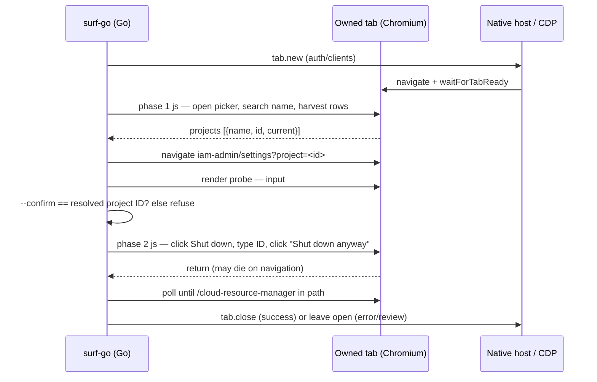

# Surf CLI OAuth and Google Project Management: Multi-Phase Browser Automation for Google Auth Platform and GitHub

surf-cli is a local CLI through which an agent controls Chrome: CLI commands travel over a Unix socket to a native host, which drives the user's signed-in browser through the Chrome DevTools Protocol. This report covers the work in [PR #15](https://github.com/wesen/surf-cli/pull/15): eleven new surf-go verbs that register OAuth applications on GitHub and Google and manage Google Cloud projects end to end — `surf github oauth register`, `surf google oauth register`, and `surf google project list | view | create | update | delete`.

The report is written to be re-used. The verbs themselves are one deliverable, but the harder deliverable is the engineering method underneath them: how a Go CLI drives short-lived JavaScript phases inside an Angular single-page console whose URLs, DOM and interaction semantics must be treated as live contracts, verified by probing rather than assumed. Every failure recorded here generalizes to the next browser-side verb.

> [!summary]
> - **Execution environment first.** CDP `Runtime.evaluate` with `awaitPromise: true` caps every in-page script at 35 seconds and destroys the script's execution context on navigation. That single constraint produced the central architecture: Go orchestrates short phases, polls tabs between phases, and recovers lost phase results from `sessionStorage`.
> - **The 2026 Google console was reverse-engineered live, not assumed.** The OAuth client flow has moved to Google Auth Platform (`/auth/clients/create`); project settings live at `/iam-admin/settings`; invalid projects answer with a "You need additional access" error page. Picker table rows respond only to full `mousedown`/`mouseup`/`click` sequences with coordinates.
> - **Nine bugs were found against the real console, all with exact diagnostics preserved.** The most dangerous class was false success on destructive operations: the shut-down dialog's own "pending deletion" text satisfied a completion check that then closed the tab before the shutdown landed. Completion signals for destructive actions must be out-of-dialog effects.
> - **The full lifecycle was verified with a live create → rename → shutdown cycle**, including wrong-confirmation refusal and an independently confirmed pending-deletion state. All 29 probe scripts and a 16-step investigation diary are archived in ticket `SURF-20261013-OAUTH`.

## How to read this report

Chapter 1 defines the execution environment and the terms the rest of the report depends on. Chapter 2 states the requirements and the starting point in the codebase. Chapter 3 shows the orchestration architecture. Chapter 4 records what was measured and probed in the real console before selectors were written. Chapter 5 is the command surface, and Chapter 6 the safety model behind it. Chapter 7 walks through the failure modes in the order they were found, with diagnostics. Chapter 8 covers verification, Chapter 9 is a compact resolution table, Chapter 10 is a runbook for the next browser-side verb, and Chapter 11 lists open items.

## 1. The execution environment

The verbs run JavaScript in the user's signed-in browser. Three properties of that channel shape everything else, so they come first.

**Evaluation is capped.** The surf extension executes scripts through CDP:

```ts
// src/cdp/controller.ts
export const DEFAULT_ASYNC_EVALUATE_TIMEOUT_MS = 35_000;

return this.send(tabId, "Runtime.evaluate", {
  expression,          // "(async () => {\n'use strict';\n<user code>\n})()"
  returnByValue: true,
  awaitPromise: true,
  timeout: DEFAULT_ASYNC_EVALUATE_TIMEOUT_MS,
});
```

A phase script that waits longer than 35 seconds is killed by the timeout, regardless of the CLI's own socket deadline. Any flow that must observe slow page behavior therefore cannot live inside one script; it has to be split into executions that each finish quickly, with waiting done by the Go side polling the tab.

**Navigation destroys the script.** `awaitPromise: true` means the evaluated promise is tracked in a specific execution context. When the tab navigates — a form POST on GitHub, a console route change on Google — that context is destroyed and the pending promise never resolves. The CLI receives an error such as `Execution context was destroyed` or `Cannot find default execution context`, and the phase result is lost even though the click that caused the navigation succeeded.

**The page can preserve state across that destruction.** `sessionStorage` survives same-tab navigations on the same origin. A script can write its intended result to `sessionStorage` *before* clicking the navigation trigger; the next phase, executing in the fresh context, reads and clears it. This is the recovery handshake used everywhere the flow navigates.

A fourth property matters for the Google console specifically: although the console is an Angular application, cross-route moves (picker selection, project creation) behave like full navigations for the debugger, and the "current project" is per-page state encoded in the URL (`?project=<id>`), not a global value that updates in already-open pages. Chapter 7 shows how that property produced a false negative and a false positive in turn.

## 2. Requirements and starting point

The request was threefold: register GitHub OAuth apps through `github.com/settings/developers`, register Google OAuth clients through the Cloud Console with the option of choosing or creating a project, and manage Google projects in general — list, view, create, update (rename), and delete with confirmation. All of it through the already-signed-in browser; no API keys, no service accounts.

The codebase already had the pattern for browser-side verbs. A dual-mode Glazed command (`RunIntoGlazeProcessor` for structured rows, `RunIntoWriter` for a markdown report) decodes its flags, opens an owned tab, executes an embedded `//go:embed scripts/<verb>.js` script through the `js` tool, and closes the tab on success. The `upwork portfolio create` verb established the safety convention this work follows: **fill-only by default; an explicit flag performs the mutation**.

What did not exist was any handling of the three properties in Chapter 1 — the existing scripts were single-phase — and no knowledge of the 2026 Google console's actual DOM.

## 3. Architecture: multi-phase orchestration

Every new verb is organized as a pipeline of phases. Go owns the sequencing, the tab, the timeouts and the recovery; each JavaScript phase owns one bounded stretch of page interaction and returns a small JSON result. The pipeline for `surf google project delete` — the most involved — looks like this:



Three mechanisms make this robust. They are worth stating precisely because they are the reusable part of the work.

**Owned-tab lifecycle with a URL probe.** `openOwnedTab` creates the tab, then `waitForTabReady` polls a tiny probe script — `return { href, title, readyState }` — until the document is complete and its href is stable. Because probe errors during navigation are expected, the probe loop tolerates them and keeps polling. On success the command closes the tab it created; on any failure the tab stays open, which is deliberate: the user (or agent) inherits the page exactly where the flow stopped, which is the fastest path to a manual fix or a re-run.

**The sessionStorage recovery handshake.** Wherever a phase clicks something that navigates, the script first writes its result under a fixed key:

```js
// scripts/google_oauth_project.js — before the navigation-triggering click
saveState({ projectAction: 'selected', projectId: rowProjectId, projectLabel });
dispatchRealClick(clickTarget);
```

```go
// google_oauth_register.go — runs only when the phase result was lost
const googleOAuthRecoverScript = `try { const raw = sessionStorage.getItem(` +
	"`" + googleOAuthStateKey + "`" + `); sessionStorage.removeItem(` +
	"`" + googleOAuthStateKey + "`" + `); return raw ? { recovered: true, state: JSON.Parse(raw) } :
	{ recovered: false }; } catch (e) { return { recovered: false }; }`
```

If the phase script returns normally, the state is ignored; if the context died mid-navigation, Go classifies the error with `isTransientTabLifecycleError` and recovers the pre-saved state instead of failing. The click happened either way — the handshake only decides whether the CLI learns what was clicked.

**Phases short enough for the 35-second cap.** Each script's worst-case wait budget stays under about 30 seconds (form ready 12–20s, dropdown 8s, dialog 10–20s), and slow global effects — project provisioning, picker reload, GitHub's post-register redirect — are never waited for inside a script. Go polls them: `waitForGithubAppPage` polls the href for `/settings/applications/<digits>`, `waitForGoogleProjectSettings` polls the settings render probe, `waitForGoogleProjectCurrent` polls the picker button's aria-label.

## 4. Reverse-engineering the console

No selector in this work was assumed; every one was probed in the signed-in browser with one-off `js --file` scripts, which are archived, numbered 01–29, in the ticket's `scripts/` directory. The probes produced a contract list that is the real documentation of the Google side:

| Surface | Verified contract (2026-10-13) |
|---|---|
| Project picker trigger | `button[aria-label*="working in"]` — label reads `You're currently working in <name>. Hit enter to switch projects, folders, or organizations` |
| Picker dialog | filter input `aria-label="Search projects and folders"`; projects are `TR.cfctest-table-body-row` rows in a `CFC-TABLE` with Name / Type / ID cells; ID cell `.cfc-purview-picker-list-id`; clickable target is `A.cfc-purview-picker-list-name-link` |
| OAuth clients list | `/auth/clients?project=<id>`; create entry is an anchor `aria-label="Create client"` with href `/auth/clients/create` |
| Client create form | `/auth/clients/create?project=<id>`; application type is a `cfc-select` (role `combobox`) inside a `mat-form-field`; options are `mat-mdc-option`s (Web application, Android, Chrome Extension, iOS, TVs and Limited Input devices, Desktop app) |
| URI sections | `Authorized JavaScript origins` and `Authorized redirect URIs` are sibling sections, each with one default input and a button `aria-label="Add URI"` |
| Consent screen blocker | an **anchor** (`mdc-button`-styled) with text `Configure consent screen`, href `/auth/branding?project=<id>` |
| Project settings | `/iam-admin/settings?project=<id>` (legacy `/iam/settings` is dead); name is directly editable in `input#resourceName` with an inline Save button; project ID and number are readonly inputs; shut-down button `aria-label="Shut down"` |
| Shut-down dialog | one text input for the project ID; confirm button `aria-label="Shut down anyway"`, disabled until the ID is typed; on success the console navigates to `/cloud-resource-manager` |
| Project creation | `/projectcreate`; name input `input#p6ntest-name-input`; generated ID shown as text `Project ID: <id>`; "Edit the project id." reveals `input#p6ntest-id-input` |

Two discoveries changed the plan outright. First, the historical create-form URL `/apis/credentials/oauthclient` now redirects to Google Auth Platform — the entire flow was retargeted to `/auth/clients/create`, which removed the need to automate the "Create credentials" menu at all. Second, the invalid-project answer is an `Error – IAM & Admin` page reading "You need additional access", not the "URL not found" text the legacy path produced; both patterns are now detected, and a reference that merely *looks* like a project ID (for example the project name `hair-booking`) falls back to picker-search resolution before giving up.

## 5. The command surface

| Command | What it does | Mutation gate |
|---|---|---|
| `surf github oauth register` | fills GitHub's OAuth app form (name, homepage, callback URL, description) | `--register` clicks "Register application"; `--generate-secret` additionally generates and prints the client secret |
| `surf google oauth register` | fills the Auth Platform create-client form (`--app-type web\|desktop`, name, `--redirect-uris`, `--origins`) | `--register` clicks Create and prints client ID + secret from the result dialog |
| `surf google project list` | reads projects from the picker; `--search` queries all accessible projects | read-only |
| `surf google project view` | settings-page details: name, ID, number, state | read-only |
| `surf google project create` | `/projectcreate` flow with optional `--project-id`; verifies the project via the settings render check | creates directly (the verb is the gate) |
| `surf google project update` | fills the inline rename field | `--save` clicks Save |
| `surf google project delete` | shuts the project down (30-day pending deletion) | `--confirm <project-id>` must equal the resolved ID exactly, then Google's own type-the-ID dialog |

All commands share the socket plumbing (`--socket-path`, `--timeout-ms`, `--tab-id`, `--window-id`, `--debug-socket`) and every `--project` reference accepts a name or an ID. Errors are typed strings — `GOOGLE_SIGNIN_REQUIRED`, `GOOGLE_CONSENT_SCREEN_REQUIRED`, `GOOGLE_PICKER_ERROR`, `GOOGLE_PROJECT_NOT_FOUND`, `GOOGLE_SHUTDOWN_ERROR`, `GITHUB_LOGIN_BOUNCE` — so an agent can branch on them without parsing prose.

## 6. The safety model

Three rules, applied uniformly.

**Fill-only defaults.** Every mutating verb leaves the form filled and the tab open for review by default. The submit flag (`--register`, `--save`) is separate, and the generated identifiers that deserve human review — GitHub's client secret, Google's client ID and secret, a new project's generated ID — are printed exactly once when the mutation runs, because the consoles never show them again.

**Typed confirmation for destructive actions.** Deleting a Google project is a 30-day pending deletion. The CLI refuses to start unless `--confirm` matches the *resolved* project ID (not the user's input string) exactly; the error message repeats the correct value so the retry is copy-pasteable. Google's dialog then requires the same ID a second time. The wrong-`--confirm` refusal was verified live.

**Completion must be an out-of-dialog effect.** The shut-down dialog contains the words "pending deletion" in its own explanatory text. Any completion check that greps page text while a dialog is open will match that text before the click's effect exists. The rule that fell out of this: a destructive operation is complete only when the *page itself* demonstrates it — here, the console navigating to `/cloud-resource-manager` — never when text that the dialog carries matches a pattern.

## 7. Failure modes, in the order they were found

Every failure below has its exact diagnostic preserved in the ticket diary; the snippets here are the ones that carried the diagnosis.

**7.1 The wrapper bug (twice).** The shared `waitForCondition` helper returns `{ value, waitedMs }`, not the awaited value itself. The first live run of the Google form phase died with `TypeError: typeOption.click is not a function`; a later phase died with `(value || "").replace is not a function` because `nameInput.value` was the input *element* (the wrapper's `value` field), not the input's string value. Both were call-site fixes — `.value.click()` where the wrapper needed unwrapping — but the class of bug is structural: every new script must be audited for unwrapping before it ships, and a bare-value helper would remove the class.

**7.2 Sibling-section scope overlap.** The two URI sections are rendered as siblings, and the origins section precedes the redirect section in DOM order. Harvesting a section by "closest heading, then nearest container" produced a container that held *both* sections' inputs, so the redirect URI was typed into the origins input. The read-back showed one input populated and the other section empty while the command reported success. The fix scopes each section by walking up from its "Add URI" button until the container's text includes that section's title and excludes the sibling's — and the command now reads values back per section and warns when they differ from what was requested.

**7.3 Picker rows need real mouse events.** A bare `el.click()` on the picker row does nothing. The row is a `TR` whose handler responds to a full event sequence with coordinates:

```js
function dispatchRealClick(el) {
  const rect = el.getBoundingClientRect();
  const opts = { bubbles: true, cancelable: true, view: window,
                 clientX: rect.x + rect.width / 2, clientY: rect.y + rect.height / 2, button: 0 };
  el.dispatchEvent(new MouseEvent('mousedown', opts));
  el.dispatchEvent(new MouseEvent('mouseup', opts));
  el.dispatchEvent(new MouseEvent('click', opts));
}
```

Working forward from this also produced the leaf-then-anchor discovery: clicking a nested `span` inside the row registers nothing; the `A.cfc-purview-picker-list-name-link` is the real target.

**7.4 Table `textContent` concatenation.** A table row's `textContent` joins cell text without whitespace: `Not current pyxisProject pyxis-495321` lowercases to a string in which the project-ID regex happily matches `currentpyxisproject`. The command then navigated to `/auth/clients/create?project=currentpyxisproject` and failed. IDs are now read from the dedicated ID cell, or from the single `td` whose text matches the ID pattern exactly, with a whole-row token match only as a last resort that must contain a hyphen-digit suffix. The Go side goes further: after a picker selection it re-probes the reloaded URL and prefers the `?project=` parameter — the URL is authoritative even when the row parse is wrong.

**7.5 The consent blocker is an anchor.** Projects without a consent screen answer the create-form URL with a "Configure consent screen" control — an `mdc-button`-styled **anchor**, not a `button`. A button-only scan reported a generic form-not-found; scanning `button, a, [role="button"]` produced the typed `GOOGLE_CONSENT_SCREEN_REQUIRED` with instructions the user can follow in the already-open tab.

**7.6 The skeleton-row race.** `surf google project list` returned success with an empty list while a manual probe on the same page showed four rows. Instrumented snapshots showed the cause: the picker dialog renders its shell first, then a single loading-skeleton row, then the real rows; the harvest ran at the skeleton moment. The readiness wait now requires a *parseable* row — `parseProjectRow` must yield a name or an ID — and the parseable-row count must be unchanged for 600 ms before the harvest runs:

```js
if (count !== lastRowCount) { lastRowCount = count; stableSince = Date.now(); return null; }
if (count > 0 && Date.now() - stableSince >= 600) return 'rows';
```

**7.7 Creation verified against the wrong signal.** The first live `create` reported failure — "project did not become the active console project in time" — while the project had in fact been created. After clicking Create, the console had navigated to the **dashboard of the previously current project**, whose picker label legitimately still named that project. "Current project" is per-page state, so a picker-label wait can never observe a different project's creation. Verification now navigates to the new project's settings page and polls the render probe: if `input#resourceName` appears, the project exists and is reachable.

**7.8 The rename snackbar.** `update --save` filled the name, clicked Save, and reported "no confirmation appeared within 15 s" — while the rename had persisted. The console confirms renames with a snackbar reading `Now viewing project "<name>" in organization "No organization"`; the Save button stays enabled for further edits. The detection now accepts: value kept, plus (Save disabled or gone, or the page text containing the new name together with `now viewing|updated|saved|renamed`).

**7.9 The false shutdown success.** The first `delete` run reported `State: pending deletion` and closed the tab — and the project was still active. The completion check had matched "pending deletion" inside the still-open dialog's explanatory text a quarter-second after the click; the CLI declared success and closed the owned tab before the shutdown request completed. A manual re-run with 2.5-second observation ticks proved the actual completion signal: the console navigates to `/cloud-resource-manager` and shows a progress dialog there. The rewritten check accepts only that navigation or the dialog closing, and the confirm button is found by its verified `aria-label="Shut down anyway"`. This is the failure worth remembering from the whole project: a false success on a destructive operation, caused by reading text that the destructive operation's own dialog carries.

## 8. Verification

The suite was exercised against the live console in three passes, matching the diary's commit boundaries. Fill-only flows first (the Google create-client form, verified by reading the inputs back per section), then the picker and resolution paths (`list`, `list --search`, `view` by name, by ID-shaped name, and by ID), then the full mutation cycle on a labeled throwaway project:

1. `project create --name "surf-cli-test-project"` — created, verified via the settings render check;
2. `project update --project <id> --name "surf-cli-renamed-project" --save` — rename persisted, verified via `view`;
3. `project delete --project <id> --confirm WRONG-ID` — refused before any click;
4. `project delete --project <id> --confirm <id>` — shutdown completed, independently confirmed on the `/cloud-resource-manager?pendingDeletion=true` page listing the project.

Between the failed and the successful delete run, the restore path was probed and exercised (select the row's `mat-pseudo-checkbox`, click "Restore resource", confirm in the dialog), which is itself a candidate verb. The throwaway project is now intentionally pending deletion with its 30-day recovery window. `go vet ./...` and the full `go test ./...` suite are green, and the binaries at `~/.local/bin/surf{,-go}` and the native host were rebuilt and reinstalled from the final tree.

## 9. Issues encountered and how they were resolved

| Issue | Symptom | Resolution |
|---|---|---|
| 35 s evaluate cap | long scripts die at `Runtime.evaluate` timeout | phase split; Go polls slow effects |
| Context destroyed on navigation | phase results lost after clicks | `sessionStorage` handshake + transient-error recovery |
| Legacy Google URLs | `/apis/credentials/oauthclient`, `/iam/settings` dead | live probing; retargeted to Auth Platform and `/iam-admin/settings` |
| ID-shaped project names | `hair-booking` used directly as an ID | picker fallback after "You need additional access" detection |
| `waitForCondition` wrapper | `typeOption.click is not a function` | `.value` unwrapping audit across all scripts |
| Section scope overlap | redirect URI typed into origins input | button-anchored `sectionFor` scoping + per-section read-back |
| Picker row clicks inert | dialog does not close, nothing selected | full `mousedown/mouseup/click` sequence with coordinates |
| Row text concatenation | `?project=currentpyxisproject` | ID cell / exact-`td` parse; URL re-probe as authority |
| Consent blocker invisible | generic form-not-found on consent-less projects | scan anchors too; typed consent error |
| Skeleton-row race | empty `project list` | parseable-row + 600 ms stability wait |
| Wrong creation signal | false "not active" on successful create | settings-page render check replaces picker-label wait |
| Rename confirmation missed | "NOT saved" on a persisted rename | "Now viewing" snackbar accepted as signal |
| False shutdown success | "pending deletion" reported, project active | out-of-dialog effect required: `/cloud-resource-manager` navigation |

## 10. Runbook: adding the next browser-side verb

- Start from a fill-only dual-mode command; add the mutation flag only after fill-only works against the real page.
- Probe before writing: one-off `js --file` scripts against the signed-in page; keep every probe, numbered, in the ticket's `scripts/` directory — they are the page contract.
- Keep each phase's worst-case wait under ~30 s; move anything slower into a Go-side poll of a tiny probe script.
- Before any navigation-triggering click, write the phase result to `sessionStorage`; treat transient context errors as recoverable, not fatal.
- Audit every `waitForCondition` result for `.value` unwrapping, and prefer scanning `button, a, [role="button"]` for click targets — console "buttons" are frequently anchors.
- Scope sibling form sections from their action buttons, not from headings; read values back per section before reporting success.
- For table rows, parse cells individually; never tokenize whole-row `textContent`.
- For destructive dialogs, define completion as an out-of-dialog effect observed on the page, and gate the CLI behind a typed confirmation of the resolved identifier.
- Verify in three passes: fill-only, resolution paths, then the full mutation cycle on a labeled throwaway resource.

## 11. Open items

- The GitHub oauth verbs follow the same architecture but have not been live-tested; ticket task `sftc` tracks a fill-only run and a throwaway-app `--register --generate-secret` run.
- A `surf google project restore` verb is unimplemented; the restore flow is already probed (row pseudo-checkbox → "Restore resource" → confirm dialog).
- The `--window-id` code paths cannot probe tabs by id; the project verbs report reduced confidence there and the GitHub register flow falls back to a developers-page navigation.
- A bare-value `waitForCondition` variant would remove the wrapper bug class entirely.

## Source material

- Repository: `/home/manuel/code/wesen/surf-cli` — branch `oauth-project-verbs`, PR [#15](https://github.com/wesen/surf-cli/pull/15) (commits `757d49c`, `db5d832`, `f6a546b`).
- Implementation: `go/internal/cli/commands/{github,google}_oauth_register.go`, `google_project_{list,view,create,update,delete,picker}.go`, and the embedded phase scripts under `go/internal/cli/commands/scripts/`.
- Ticket `SURF-20261013-OAUTH` at `ttmp/2026/10/13/SURF-20261013-OAUTH--add-github-and-google-oauth-app-registration-and-google-cloud-project-management/`: the 16-step investigation diary (`design-doc/01-…-implementation-diary.md`) and 29 numbered probe scripts (`scripts/01-…-29-…js`).
- Execution-environment constants: `src/cdp/controller.ts` (`DEFAULT_ASYNC_EVALUATE_TIMEOUT_MS`), `go/internal/cli/commands/tab_ready.go` (probe and retry helpers).
