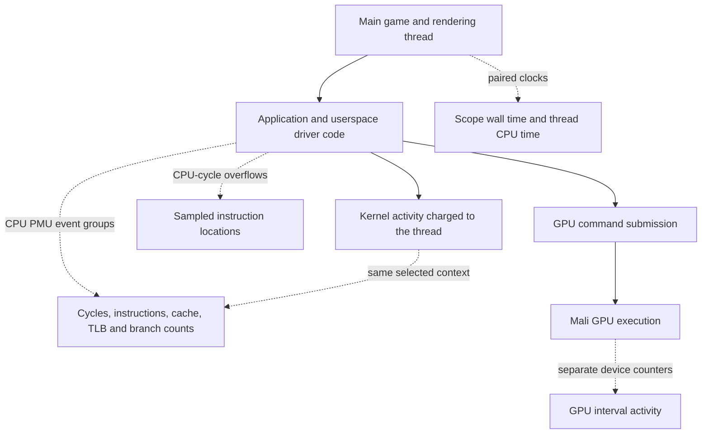
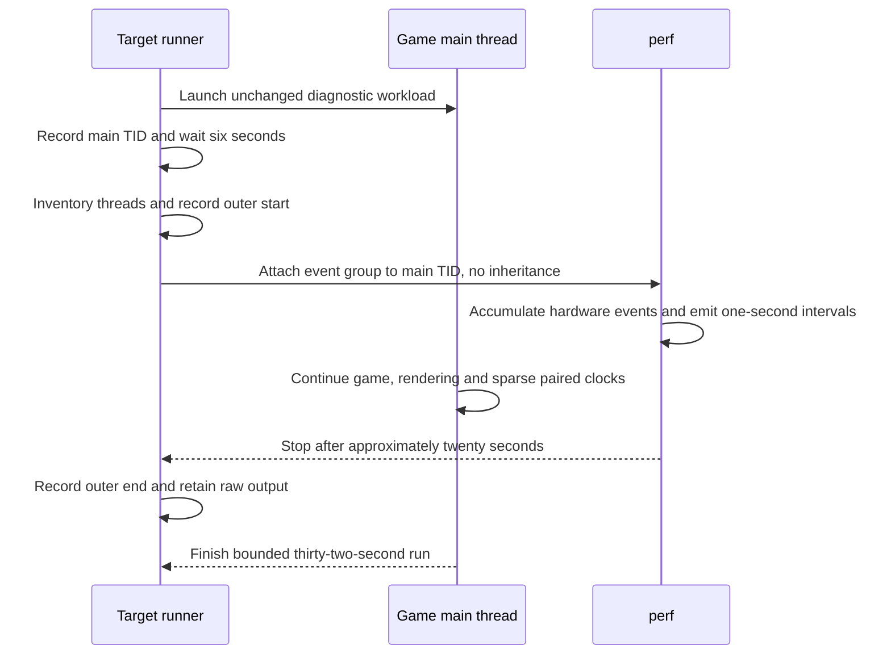
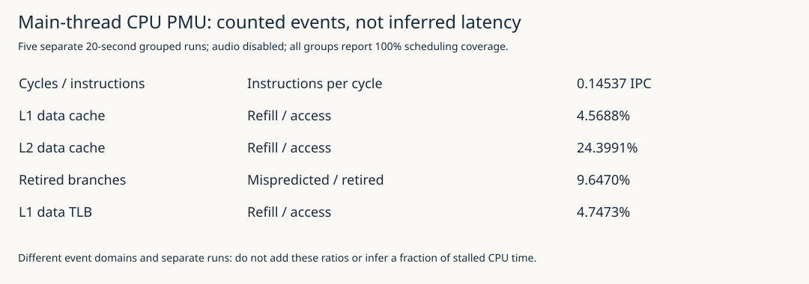
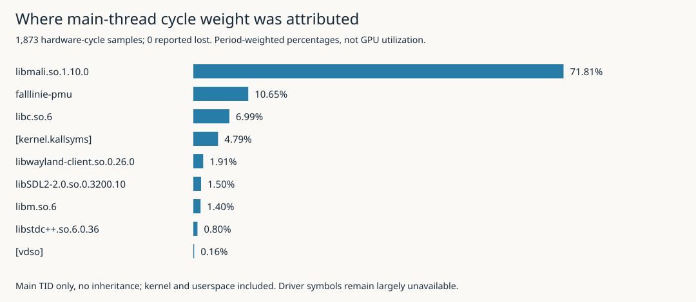
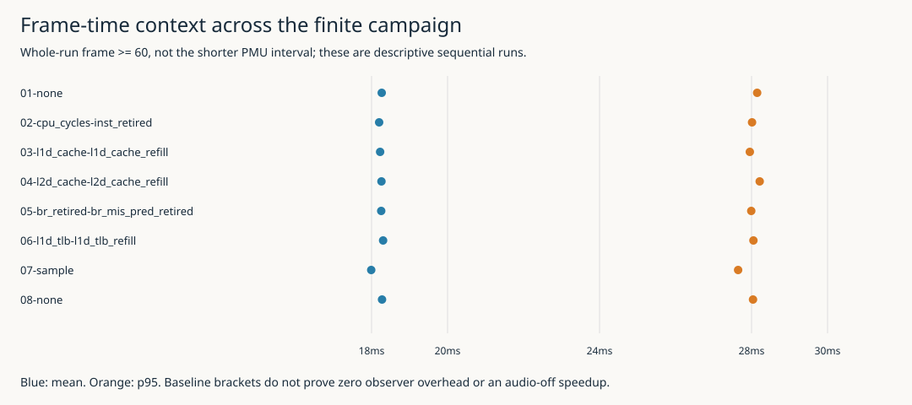

# Falllinie CPU PMU: Cache Events, Driver Cycles and an Audio-Disabled Baseline

## What changed in our understanding

Falllinie's rendering investigation had already established that substantial main-thread CPU execution occurred inside the Mali userspace driver. It had also obtained real GPU hardware counters. What it lacked was CPU hardware evidence: how many instructions retired, how many processor cycles accumulated, and what cache, translation and branch events accompanied that execution.

This report describes the implementation and first complete device campaign that supplied those measurements. It also explains a deliberate workload change: audio was disabled, not merely muted, so the experiment could concentrate on the main game loop and rendering without the audio producer competing for CPU resources.

The distinction between those changes matters. Selecting only the main thread determines which execution is counted. Disabling audio changes the surrounding workload. Neither makes the GPU, kernel, compositor or memory system disappear, and neither proves that the resulting numbers describe the fully integrated game.

> [!summary]
> Five pairs of Cortex-A55 hardware events were collected successfully with full reported PMU scheduling coverage. The main thread averaged 0.14537 retired instructions per cycle in its cycles/instructions run. A separate hardware-cycle profile attributed 71.81% of its main-thread cycle weight to `libmali`. Cache, TLB and branch ratios are now measured, but a specific cache bottleneck or expensive GL operation is not yet established.

This is a living investigation report. Its completed measurement checkpoint is `f8f6632`; the baseline implementation is `323b095`. Later attribution experiments can be added with their own workload and evidence boundaries. The current chapter does not claim that cache-refill or branch-misprediction **location profiles** have already been collected: those events were counted, while instruction-location sampling used CPU cycles.

## 1. Define what the CPU instruments measure

### 1.1 Time, events and sampled instruction locations are different quantities

A thread can be executing, runnable but not executing, or blocked. Wall time includes all of those states. Thread CPU time measures execution charged to that thread. Their difference is useful, but it does not identify the cause of the non-running interval.

A CPU Performance Monitoring Unit, or PMU, adds counters for processor events. A counter can accumulate cycles, retired instructions, cache-related activity, branch events or other supported events while the selected context runs. These are event counts, not durations assigned to source functions.

The collection program can read a counter once per second without limiting observation to one instant per second. The hardware accumulates the events between reads. The one-second output interval controls reporting granularity; it is not a one-hertz sample of CPU state.

Sampling is a separate mode. A hardware counter overflow can trigger a sample containing an instruction location and other context. That connects an event stream to executing code, but the recorded instruction location need not be the exact instruction that caused the triggering event. Interrupt latency and hardware behavior can introduce sampling skid.

The campaign therefore has two products: interval counts for five event pairs, and a separate CPU-cycles profile. Neither is a continuous dump of general-purpose CPU registers. Neither provides precise memory addresses or per-load latency.

### 1.2 Instructions per cycle requires a matched numerator and denominator

An instruction retires when its architectural effects are committed. Processor cycles count a different kind of activity. Instructions per cycle, or IPC, is the ratio:

\[
\mathrm{IPC}=\frac{N_{\mathrm{retired\ instructions}}}{N_{\mathrm{CPU\ cycles}}}.
\]

The ratio is interpretable only when both counts describe the same selected context over the same interval. Counting instructions in one run and cycles in another would add uncontrolled workload variation to the ratio. This implementation instead schedules each pair together as a perf event group.

IPC summarizes execution efficiency under the measured conditions. A low value does not identify a cause. Dependencies, instruction mix, memory latency, branch behavior and synchronization or polling can all affect it. It must be interpreted with code attribution and targeted experiments rather than converted directly into a claim about memory stalls.

### 1.3 Refill and misprediction ratios need equally explicit definitions

A cache refill indicates that a cache line was obtained to satisfy the relevant cache activity. It does not imply that every refill reached DRAM: another cache level can supply data. A TLB, or translation lookaside buffer, caches address translations; its refill events describe translation activity, not data-cache misses.

For a simultaneously measured pair, the reported refill/access ratio is:

\[
R_{\mathrm{refill}}=\frac{N_{\mathrm{refill}}}{N_{\mathrm{access}}}.
\]

That is an event ratio. It is not the fraction of elapsed time spent waiting, the latency of each refill, or necessarily the probability that an arbitrary source-level load misses. Event definitions can cover different architectural or speculative populations.

The branch pair deliberately uses **retired branches** and **retired mispredicted branches**, rather than combining a speculative branch event with a retired denominator. Matching names and event domains is part of the measurement design, not merely a formatting choice.

## 2. Locate this work in the existing measurement system

The earlier [[PROJECT REPORT - Falllinie Rendering Measurements - CPU Execution, Mali Driver Work and GPU Timer Limits|rendering report]] used paired wall/thread-CPU clocks and `perf` sampling driven by the software `cpu-clock` event at 99 Hz. That identified executing CPU code and non-running time without determining what caused either.

The subsequent [[PROJECT REPORT - Falllinie GPU Profiling - Hardware Counters, Shader Compilation and a Rejected Optimization|GPU report]] collected Mali-G52 hardware counters at approximately 10 Hz and ran the offline shader compiler. Those measurements describe GPU activity or static shader estimates, not Cortex-A55 cache behavior.

The new CPU PMU measurements complement both. Their relationship is easiest to understand by keeping their scopes explicit:

| Instrument | Quantity observed | Important boundary |
|---|---|---|
| Paired monotonic/thread-CPU clocks | Wall duration and executing CPU time for an application scope | Residual time is not identified GPU wait. |
| Software `cpu-clock` sampling | Executing instruction locations sampled through a software event | Not a CPU cache measurement. |
| CPU PMU counting | Hardware events for the selected main thread | No automatic source-function or render-pass attribution. |
| CPU-cycles sampling | Period-weighted instruction-location profile | Not precise cache-miss blame or GPU utilization. |
| Mali hardware counters | Device-level GPU activity and traffic | Whole-device intervals, not just one application pass. |
| Offline compiler | Static resource and pipeline estimates | Not runtime milliseconds. |



The new experiment does not validate the anomalous OpenGL elapsed-query results documented earlier. It adds independent CPU evidence while leaving that unresolved timer question intact.

## 3. Disable audio explicitly rather than relying on mute

### 3.1 Muted synthesis still consumes resources

Falllinie's buffered audio implementation has a producer that synthesizes PCM and a callback that copies prepared samples. Muting output does not remove the producer's DSP work. Earlier rendering campaigns used muted audio to avoid audible output while retaining that integrated workload.

For the present question, retaining the producer would add competition for CPU scheduling and shared resources. The user explicitly permitted audio to be excluded temporarily. The implementation therefore added a separate `--no-audio` diagnostic flag rather than changing the meaning of `--muted`.

The new flag guards both paths that open the audio engine: autoplay startup and an interactive start action. The control flow is equivalent to:

```cpp
if (autoplay) {
    game.start();
    if (!no_audio) {
        audio_started = audio.open(audio_options);
    }
}

if (start_action && !audio_started && !no_audio) {
    audio_started = audio.open(audio_options);
}
```

This excerpt shows the guards, not the complete surrounding error handling and mute configuration. The existing default behavior remains unchanged. Users must explicitly select the reduced workload.

### 3.2 Keep game feedback ownership intact

Disabling the device does not require removing game-side feedback logic. The existing `publish_feedback` function submits sound state and events only when audio has started, then clears the game event list in either case:

```cpp
if (started) {
    audio.set_ride(game.sound);
    for (const auto& event : game.events)
        audio.trigger(event);
}
game.events.clear();
```

Keeping the drain avoids accumulating obsolete events while audio is disabled. It also avoids introducing a separate simulation authority or changing the game feedback event lifecycle merely to simplify profiling.

The `AudioEngine` object still exists and can retain inert construction/storage. The claim is that no audio device, producer thread, callback or continuing synthesis runs—not that every byte of audio-related state or every game feedback calculation has been removed.

### 3.3 Make the changed workload visible in evidence

The program logs the policy and writes `audio_disabled: true` into its receipt. The host smoke run used a deliberately invalid SDL audio driver together with `--no-audio`; autoplay completed with `GL_error=0` and without an audio-open failure. On the target, all eight thread inventories contained one main game thread and named Mali workers, with no audio producer or callback threads.

That provides evidence for the intended diagnostic mode. It does not qualify audio listening or physical latency, and it does not establish full-game performance with sound restored. The [[PROJECT REPORT - Falllinie Buffered Audio - PCM Ownership, Callback Deadlines and Measured Producer Scheduling|buffered-audio report]] remains the source for that subsystem's earlier finite qualification.

## 4. Qualify the actual Cortex-A55 PMU interface

### 4.1 Explicitly select the CPU device

The handheld runs kernel 7.2.7 and perf 7.2.7. Its event-source devices include `armv8_cortex_a55`, `rockchip_ddr`, software events and breakpoint support. The CPU PMU has type 9 and exposes named event aliases through sysfs.

The first reconnaissance command used familiar generic names:

```sh
perf stat -e cycles,instructions -- sleep 0.1
```

It reported CPU cycles and instructions, but also an unsupported `rockchip_ddr/cycles/` event. The generic `cycles` name had expanded across more than one PMU. That was not evidence that CPU counting was unavailable.

The implementation therefore uses explicit event syntax:

```sh
perf stat -e '{armv8_cortex_a55/cpu_cycles/,armv8_cortex_a55/inst_retired/}' \
  -- sleep 0.1
```

The explicit group succeeded. The inventory preserves the PMU type, exposed event encodings and format files rather than guessing raw event IDs from a different processor's documentation.

No kernel, permission policy, governor or affinity setting was changed to obtain access. The CPU governor remained `ondemand`. Frequency snapshots were recorded as context, not treated as controlled frequencies.

### 4.2 Attach to the real main thread

The target runner starts the game executable directly in the background and records the resulting PID. For this process, that PID also identifies the main thread. Perf attaches to that identifier with inheritance disabled:

```sh
perf stat --no-inherit -t "$main_tid" -I 1000 -x , \
  -e '{armv8_cortex_a55/cpu_cycles/,armv8_cortex_a55/inst_retired/}' \
  -- sleep 20
```

Here `sleep 20` bounds collection. It is not the measured workload: `-t` selects the already-running main game thread. Avoiding a wrapper PID and disabling inheritance are both necessary to make the scope unambiguous.

The event selection includes userspace execution and kernel activity charged to the selected thread. It does not count all Mali worker threads or all compositor execution. Those other activities can nevertheless influence cache state, memory contention and scheduling. Per-thread accounting is not physical isolation.

## 5. Build a bounded campaign rather than one overloaded counter set

### 5.1 Group related events and separate unrelated pairs

The campaign uses five pairs:

1. CPU cycles and retired instructions.
2. L1 data-cache accesses and refills.
3. L2 data-cache accesses and refills.
4. Retired branches and retired branch mispredictions.
5. L1 data-TLB accesses and refills.

Each pair is collected simultaneously. The pairs run separately so the experiment does not request more concurrent counters than necessary. If perf multiplexes event sets, scaled counts can still be useful, but their interpretation becomes less direct. This first baseline instead requires full reported scheduling coverage for its accepted intervals.

Unsupported, not-counted or malformed rows are not converted to zero. A zero denominator is not assigned a ratio. The analyzer verifies matching interval timestamps and scheduling data within a group, positive event running times and valid count fields.

### 5.2 Keep measurement windows distinct

Each game runs for 32 seconds. The runner waits six seconds for startup and warmup, then collects for approximately 20 seconds. A small device-side helper records `CLOCK_MONOTONIC` immediately before and after invoking perf.

Those two timestamps define an **outer collection envelope**. They include perf startup and teardown, so they are not exact hardware enable/disable timestamps. Paired application scopes are summarized only when their boundaries fall completely within that envelope. The report does not divide whole-run frame counts into the shorter counter interval.

Separately, frame summaries use CSV records with `frame >= 60`. This preserves a reproducible whole-run warmup convention. Frame distributions and hardware totals consequently have related but different scopes, which remain explicit in the outputs.



### 5.3 Hold the remaining workload constant

The cases use seed 42, autoplay, two sequential views at 384×288 internal resolution, no-vsync, a 60-FPS application target, the developer overlay and paired clocks at cadence 60. GPU elapsed queries are off. The shader assets and production launcher are unchanged.

Two no-counter cases bracket the five counter cases and one profile case. These brackets expose gross drift and large instrumentation effects, but do not prove zero overhead. The live trajectories and frequencies are not experimentally pinned.

The campaign ran in a separate directory, `/storage/apps/falllinie-pmu-20261014T144623Z`. The executable SHA-256 was:

```text
c2b0fc135c880766a2f1dde2ed819a5aa922654ddcbae460c9a2e36cc141c9c1
```

## 6. Follow an actual interval through the calculation

The first cycles/instructions interval ended 1.001154278 seconds into perf's collection. Its records contained:

| Field | Recorded value |
|---|---:|
| CPU cycles | 664,337,540 |
| Retired instructions | 112,020,043 |
| Event running time | 489,699,742 ns |
| Reported running coverage | 100.00% |

The [actual interval record](./_assets/falllinie-cpu-pmu/actual-interval.json) is included alongside the article. For this interval:

\[
\mathrm{IPC}\approx\frac{112,020,043}{664,337,540}\approx0.169.
\]

The event ran for approximately 0.490 seconds during approximately one elapsed second. There is no contradiction with 100% reported coverage. Coverage refers to the PMU's ability to schedule the selected event while enabled for that thread. It does not mean that the thread consumed an entire CPU for the whole wall interval.

The complete cycles group accumulated 10.01362088 seconds of event running time over 20.006157158 seconds elapsed. Its 14,300,334,687 cycles correspond to approximately 1.428 billion cycles per running second. That is a descriptive ratio of the recorded quantities, not proof of a constant CPU frequency throughout the run.

This example is why raw scheduling fields matter. Omitting them would make a reader more likely to misinterpret “100% coverage” as “100% CPU use” or to compare the count with an unrelated frequency snapshot.

## 7. Interpret the five measured event pairs

All five groups produced 20 accepted intervals with 100% reported running coverage. The aggregate ratio for each pair divides the sum of its numerator counts by the sum of its denominator counts, rather than averaging interval percentages with unequal event volumes.

| Simultaneously collected pair | Denominator total | Numerator total | Result |
|---|---:|---:|---:|
| CPU cycles → instructions retired | 14,300,334,687 | 2,078,852,033 | **0.14537 IPC** |
| L1D accesses → refills | 695,609,378 | 31,780,725 | **4.5688%** |
| L2D accesses → refills | 164,525,671 | 40,142,728 | **24.3991%** |
| Retired branches → retired mispredictions | 367,486,825 | 35,451,416 | **9.6470%** |
| L1D TLB accesses → refills | 690,887,026 | 32,798,337 | **4.7473%** |



*Each ratio belongs to a different simultaneously collected pair. The five pairs were measured in separate live runs; they are not a partition of CPU time.*

The low IPC makes a purely “count the source operations” explanation inadequate. It invites examination of dependencies, memory behavior and driver execution. It does not identify which of those dominates.

The cache and TLB ratios establish actual event activity that was absent from the earlier evidence. They still do not assign a latency cost. A large number of inexpensive events can matter less than a small number of expensive serialized events, and aggregate counters do not supply that distinction by themselves.

It would also be incorrect to subtract the L1 refill total from the L2 refill total and infer a same-run traffic path. Those totals came from different runs and can cover different event populations. L2 events need not correspond one-for-one with the L1 data-access stream being counted. The fact that this L2 refill count exceeds the separately recorded L1 refill count is not, on its own, evidence that collection failed.

The retired branch ratio is similarly a useful observation rather than a complete explanation. Locating where the mispredictions accumulate would require a further event-location profile, with the sampling-skid caveat retained. That work has not yet been performed at this checkpoint.

## 8. Locate CPU-cycle weight in the executing code

A separate run recorded CPU-cycle samples at a requested frequency of 199 Hz, using the same main-thread selection and no inheritance. Frame-pointer call-chain recording was requested; decoded reports use exclusive attribution rather than adding descendant costs into every ancestor.

The recording contained **1,873 samples and zero reported lost samples**. The effective number of samples per wall second need not equal 199 because the selected thread is not executing continuously, and frequency-mode periods adapt.

Perf's reported overhead percentages here are weighted by event periods. They are not simply each function's sample count divided by 1,873. Nor are they directly interchangeable with percentages from the earlier software `cpu-clock` run.

| Shared object | Main-thread cycle weight |
|---|---:|
| `libmali.so.1.10.0` | **71.81%** |
| Game executable | 10.65% |
| `libc.so.6` | 6.99% |
| Kernel | 4.79% |
| Wayland client | 1.91% |
| SDL2 | 1.50% |
| `libm.so.6` | 1.40% |
| `libstdc++.so.6` | 0.80% |
| vDSO | 0.16% |



*These percentages describe the selected main thread's CPU-cycle sample weight. They are not GPU utilization or a partition of frame wall time. Rounded percentages need not sum to exactly 100%.*

One unsymbolized location in `libmali`, offset `0x42d6dc`, accounts for 16.89% of the symbol report's cycle weight. This is a concrete inspection target. It does not yet name a GL operation or show that the instruction at that address caused a cache miss.

The application side includes rider geometry updates, renderer execution and mesh-building functions. The existence of those entries does not establish a successful geometry optimization; it identifies executing code that can be examined under a more specific hypothesis.

The driver-heavy result agrees qualitatively with the earlier CPU study, but the agreement should not erase the differences: audio is now disabled, the event is hardware cycles, the selected thread is explicit, and the collection is a separate live campaign. The precise percentages are not a before/after optimization comparison.

## 9. Check frame behavior without overclaiming observer effects

The application continued rendering throughout the counter and sample captures. Its postwarmup frame summaries were:

| Case | Postwarmup mean ms | p95 ms |
|---|---:|---:|
| Opening no-counter bracket | 18.267517 | 28.147277 |
| Cycles / instructions | 18.199694 | 28.013003 |
| L1D pair | 18.225572 | 27.954602 |
| L2D pair | 18.260685 | 28.214238 |
| Branch pair | 18.254118 | 27.992026 |
| L1D TLB pair | 18.303829 | 28.049142 |
| CPU-cycles profile | 17.991269 | 27.646532 |
| Closing no-counter bracket | 18.275653 | 28.038546 |



*Blue points are means and orange points are p95 values from whole-run CSV records after the declared warmup. The PMU collection windows are shorter. These are finite sequential observations, not confidence intervals.*

The counter cases fall close to the no-counter bracket means, so there is no obvious gross slowdown attributable to counting in these runs. The profile case happens to be faster. That is not evidence that profiling improves performance; it is another reason not to treat small differences between uncontrolled live runs as causal results.

All eight runs completed with `GL_error=0`. Every receipt recorded audio-disabled mode. Paired-clock final counts reconciled, with no invalid or dropped records and no active scopes left open. The actual thread identities matched the directly launched game process.

These checks qualify the measurement campaign's basic integrity. They do not prove that every hardware event has a precisely understood latency cost, or that the full game now meets a robust 60-FPS requirement. The p95 values themselves show that the reduced workload still has substantial frame-time tails.

## 10. Preserve build identity, failures and reproducibility

The implementation was built and checked before its code commit was created. The original build receipt therefore names the earlier parent HEAD, while the source files already contained the new feature. Rather than rewriting that receipt, a subsequent qualification record verified every captured source hash against implementation commit `323b095`. The local executable hash also matched the deployed executable hash.

This distinction matters because a Git revision alone does not identify an uncommitted build. The [build qualification](./_assets/falllinie-cpu-pmu/build-qualification.json) records both the situation and the actual checks. The report's measurement checkpoint, `f8f6632`, adds the completed evidence and interpretation.

The feature boundary included a host build, **15 passing CPU tests**, an ARM64 build with optimization/debug information/frame pointers, and the no-audio host smoke. The target campaign then exercised actual PMU access and autoplay with audio disabled. Interactive start is protected by the same explicit opening guard, but was not separately exercised through automated key injection.

The generic `cycles` alias issue was the meaningful capability failure. There were no failed target cases in the complete campaign. A later bookkeeping check found that the repository's general build-directory ignore rule had excluded textual build receipts; those bounded receipt files were explicitly staged, without adding binaries.

The native ticket is:

```text
ttmp/2026/10/13/FALLLINIE-TRACE-005--cpu-gpu-driver-and-scheduler-attribution-with-perf-ftrace-and-ebpf
```

Its concise design is `design-doc/02-cpu-pmu-qualification-and-audio-disabled-render-loop-measurement.md`; the detailed diary is `reference/03-cpu-pmu-implementation-and-target-investigation-diary.md`; and the measured analysis is `analysis/02-measured-cortex-a55-pmu-baseline-without-audio.md`.

Under `scripts/10-cpu-pmu/`, the inventory, build, bounded target runner, campaign and analyzer are numbered `01` through `05`. The analyzer validates PMU scheduling coverage, matched pair timestamps, positive running time, thread identities, paired-clock reconciliation and receipt flags. Small positive and negative fixtures check that unsupported or multiplexed input is rejected rather than silently accepted as a valid zero.

Raw `perf.data` remains in the private device deployment with a retained SHA-256. Decoded reports, raw interval CSV, event definitions, thread inventories and application evidence are committed in the native repository. The vault contains the [derived summary](./_assets/falllinie-cpu-pmu/summary.json), [input provenance](./_assets/falllinie-cpu-pmu/analysis-provenance.json), actual worked interval, build qualification and [figure hashes](./_assets/falllinie-cpu-pmu/report-provenance.json). No new target run was required to write this report.

## 11. What to investigate next—and what remains unproven

The next question is more specific than “is the CPU busy?” The main-thread cycle profile identifies substantial driver execution, the counter groups establish low IPC and measurable cache/translation/branch events, and the frame tails remain. The useful continuation is to connect a selected event to code and then test a narrow hypothesis.

Two candidates for the next measurement are a cache-refill location profile and a retired-branch-misprediction location profile. Both would retain main-thread scope and the audio-disabled baseline. Neither would automatically provide precise causal instruction blame, so a location report must be interpreted with the relevant code and sampling behavior.

A read-only follow-up has also begun for the prominent driver offset: the target library was copied into ignored local storage, verified against SHA-256 `605e3a5caf1be62bb48d97b1168434257355d56db5e3be9b515cfa742c173118`, and a bounded disassembly excerpt was generated. This report does **not** yet assign a semantic explanation to that excerpt. Publication was prioritized before new attribution experiments.

Uniform-location caching remains a plausible CPU-side optimization, not a demonstrated remedy. The current evidence is stronger than a general impression that driver work is expensive, but it still does not show that name lookup is responsible for the large hotspot. Likewise, cache ratios alone do not justify changing geometry layout, precision or shader formulas.

When a candidate is selected, keep the workload and instrumentation controls comparable and change one relevant behavior. If the measured result does not improve, preserve that outcome as the earlier shader experiment did. Eventually restore audio and repeat integrated acceptance; an optimization qualified only in this reduced workload is not yet qualified for the full game.

## Related reports and reading map

Start with [[MOC - Optimization and Performance Engineering|the general optimization MOC]] for the wider vault, including the older corrected x264/eBPF investigation and methodology references.

- [[PROJECT REPORT - Falllinie Tracing - CPU Execution, Driver Waits and GPU Attribution|Tracing]] introduces execution, waiting and scheduler attribution; its constructed examples remain conceptual.
- [[PROJECT REPORT - Falllinie Rendering Measurements - CPU Execution, Mali Driver Work and GPU Timer Limits|Rendering Measurements]] contains the earlier actual paired-clock and software CPU-sampling campaign.
- [[PROJECT REPORT - Falllinie GPU Profiling - Hardware Counters, Shader Compilation and a Rejected Optimization|GPU Profiling]] explains the distinct GPU counters, compiler estimates and rejected local shader change.
- [[PROJECT REPORT - Falllinie Buffered Audio - PCM Ownership, Callback Deadlines and Measured Producer Scheduling|Buffered Audio]] explains the subsystem temporarily disabled here and its ownership/acceptance limits.
- [[PROJECT REPORT - Falllinie Integrated Native Game - Precision, Real-Time Audio, Developer Telemetry and JavaScript Embedding|Integrated Native Game]] establishes the expanded workload and projection-precision constraints.
- [[PROJECT REPORT - Falllinie Native GLES Spike - Deterministic Terrain, Print Shaders and Mali Depth Precision|Native GLES Spike]] and [[PROJECT REPORT - Falllinie Playable Port - Dual Views, Frame Profiling and Cooperative Terrain Streaming|Playable Port]] establish the rendering semantics and shared dual-view architecture.
- [[PROJECT REPORT - Falllinie JavaScript Embedding - ARM64 Qualification, V8 Ownership and Bounded Rules|JavaScript Embedding]] remains an isolated-runtime study; these CPU results do not imply available budget for integrating it.

The present result is an implemented, qualified CPU measurement path and a reproducible reduced-workload baseline. A specific optimization success, causal cache diagnosis and completed event-location investigation remain future findings, not conclusions hidden inside the current numbers.
