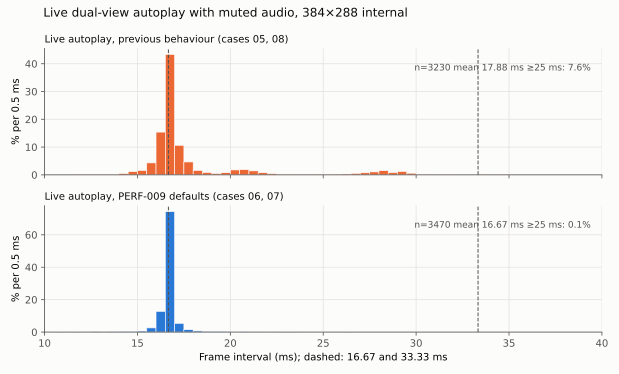

# Falllinie GPU Budget Recovery

This report records the work that followed [[PROJECT REPORT - Falllinie Performance Review - Measurement Discipline, Missed Bottlenecks and a Path to 60 FPS|the performance review]]. The review proposed an order of work: measure the existing shadow-bounds candidate at the configuration the game actually ships with, measure geometry directly, apply only changes that provably cannot alter pixels, and instrument the presentation wait. All four steps were carried out on the RG DS Plus in one session, as ticket `FALLLINIE-PERF-009`.

The result is that the game now holds its 60 Hz refresh in the shipping configuration. In live dual-view autoplay with the full audio synthesis running, the share of frames that miss a refresh fell from 7.6% to 0.1%, and the 95th-percentile frame interval fell from 27.8 ms to 17.2 ms. The three changes responsible are now defaults in the spike: conservative shadow-footprint rejection, per-view culling of terrain row blocks, and 16-bit index buffers. Each is byte-identical to the previous renderer at five visual checkpoints on the Mali-G52.

> [!summary]
> - Shadow bounds alone, measured at 384×288 dual view, remove every long frame in the audio-off replay (3.9% → 0%) and almost every one with audio (6.5% → 0.5%).
> - Geometry counters show 425,000 primitives per frame, of which 59% cover no sample and only 16% are visible; vertex and tiler work is about half of GPU-active time.
> - Row-block culling (−1.6%) and 16-bit indices (−0.7%) help; a constant-shading shortcut for fully fogged terrain hurts (+0.7%) because it lengthens the shader for every other fragment, and was rejected.
> - An explicit clear at the start of each window's output pass isolates the wait: 9.2–9.5 ms of wall time against 0.3–0.4 ms of CPU, i.e. waiting for the window system to return a buffer.

## 1. Starting point

The review established three facts from the earlier evidence. The frame loop is paced by the displays, so the useful metric is the share of frames that miss a refresh, not the mean interval. The single-core Mali-G52 is saturated in the shipping configuration (384×288 internal resolution, two views), which the replay benchmark put about 5% over the 13.33 million GPU cycles available per 60 Hz frame. And the shadow-bounds candidate from GPU-008 had only been measured at 512×384, so nobody knew whether it was enough at the shipping size.

The ticket's design document fixed the rules before any code was written:

- **Workload.** The deterministic replay (600 frames, seed 42, fixed 1/60 s simulation step, fixed terrain work per frame) at 384×288 dual view, and a final live-autoplay comparison with launcher-like settings.
- **Metrics.** Mean, p95 and p99 interval, the share of intervals at or above 25 ms ("long frames"), and missed refreshes per frame (mean ÷ 16.667 − 1).
- **Promotion rule.** A change becomes the default if it keeps the replay signature, produces byte-identical images at five checkpoints, is not slower in an ABBA campaign, and is healthy (`GL_error=0`, complete records).
- **Controlled CPU clock.** Each campaign records the CPU governor, sets `performance` for its duration and restores the recorded value in all cases. Every case then started at 1.992 GHz instead of the 0.8–2.0 GHz spread of earlier campaigns.

## 2. Phase A: shadow bounds at the shipping size, with and without audio

The replay benchmark previously forced audio off. A new `--replay-audio` flag starts the normal buffered audio producer, muted, without changing the simulation (the producer only consumes game events), so the replay signature is identical with and without it. This made it possible to compare audio-on and audio-off in one session with one binary.

| Case (384×288 dual view, replay) | Mean ms | p95 ms | p99 ms | Long frames |
|---|---:|---:|---:|---:|
| Original shadows | 17.273 | 20.399 | 29.875 | 3.9% |
| Shadow bounds | 16.620 | 17.611 | 18.251 | 0.0% |
| Original shadows, audio running | 17.697 | 28.424 | 29.903 | 6.5% |
| Shadow bounds, audio running | 16.688 | 17.901 | 20.399 | 0.5% |

The review's prediction held in outcome: bounds bring the shipping configuration under the budget. The counters corrected its reasoning, though. Even at 60 loop frames per second with bounds, the GPU reports about 800 million active cycles per second, so it is still busy essentially all the time. When the GPU is saturated, "GPU-active cycles per frame" is just the GPU clock divided by the frame rate and cannot show how much work a change removed. Bounds created just enough room, not comfortable headroom.

The audio producer also showed up as a real cost. With the original shadows, running it raised the long-frame share from 3.9% to 6.5% in the same session.

## 3. Phase B: what the geometry costs

A copy of the counter probe gained a second counter set for geometry and rasterisation, chosen from the pinned Mali-G52 reference. One replay campaign at the shipping size produced the following per-frame values (two views; whole-device rates divided by the loop frame rate, so they are estimates):

| Counter | Per frame | Meaning |
|---|---:|---|
| `MaliGeomTotalPrim` | 424,955 | Primitives submitted |
| `MaliGeomSampleCullPrim` | 251,571 | Culled because they cover no sample point |
| `MaliGeomZPlaneCullPrim` | 84,813 | Outside the near or far plane |
| `MaliGeomFaceXYPlaneCullPrim` | 22,243 | Back-facing or outside the side planes |
| `MaliGeomVisiblePrim` | 66,328 | Reached rasterisation |
| `MaliTilerPosShadThread` | 447,477 | Position-shader invocations |
| `MaliTilerVarShadThread` | 76,585 | Varying-shader invocations |
| `MaliFragThread` | 2,543,976 | Fragment threads |
| `MaliNonFragActiveCy` | 7.21 M | Cycles with geometry work active |
| `MaliGPUActiveCy` | 13.95 M | Cycles with any work active |

Three conclusions follow.

1. **Geometry is about half of the GPU's active time**, and most of it produces nothing visible. Six out of ten primitives are sub-sample triangles, almost all of them distant terrain: rows are generated every 0.8 m and the resident window extends about 660 m ahead of the rider.
2. **The fragment work is dominated by the full-resolution output copies.** The two 1024×768 copies account for about 1.57 million of the 2.54 million fragment threads; the scene and post passes at 384×288 are under one million together.
3. **Sub-sample triangles cannot be removed without a visible decision.** A coarser distant mesh would change depth and the terrain/sky silhouette that the post shader reads, so distance level of detail changes pixels. It is the largest remaining lever, and it is the project owner's call.

## 4. Phase C: pixel-identical geometry changes

Three changes were implemented, each behind a switch, each with an argument for why it cannot change any pixel.

**Per-view culling of row blocks.** Terrain indices are emitted row by row, so a block of 16 row strips (about 12.8 m of slope, 10,176 indices) is a contiguous range of the index buffer. Each block stores the bounding box of the vertices it references. Before drawing a view, a block is skipped if all eight corners of its box lie outside the same clip-space half-space. Clip coordinates are linear in position, so every point of the box is then outside too, and the block's triangles cannot produce fragments. Surviving consecutive blocks are merged into one draw, so the remaining triangles are drawn in their original order. Culling whole cells first was nearly useless (about 1% of triangles), because each cell is 600 m wide; row blocks raise that to about 10%.

**16-bit indices.** A terrain cell has 14,873 vertices, so its indices fit in 16 bits. Index values and order are unchanged; only storage width changes. Dynamic meshes, the rider and the multi-cell static fixture keep 32-bit indices.

**Constant shading for fully fogged blocks.** For any fragment at least 400 m from the camera, the original scene shader's last three lines produce `(1, 0, uMat/255, 0)` no matter what the rest of the shader computed: `smoothstep` returns exactly 1, `blk` and `gry` become 0, and `lum` becomes 1 or one unit in the last place below it, which an 8-bit target stores as 255. Blocks whose bounding box is more than 402 m from the camera were drawn with a uniform flag that returns that constant at the top of the shader.

A CPU test checks the first and third arguments against float evaluation of the same expressions: 19,460 rejected boxes with 7.78 million sampled points, all outside the same clip plane, and 12,917 fogged boxes with 826,688 sampled points, all at float distance ≥ 400 and all quantising to the constant.

On the Mali-G52, every candidate and their combination produced 0 different pixels against the original at all five checkpoints (frames 120, 600 and 1,200 with seed 42; frame 600 with seed 7; frame 600 with palette 5). Each comparison covers eight images: full top and lower windows plus both cameras' scene, print and depth targets.

Timing used 512×384 dual view, where frames still exceed the budget and savings therefore show up in the frame interval, with shadow bounds as the baseline:

| Mode | Mean ms | Long frames | Non-fragment Mcycles/frame | Reads MB/frame |
|---|---:|---:|---:|---:|
| Bounds | 20.571 | 23.8% | 7.83 | 27.3 |
| + constant fogged blocks | 20.712 | 24.9% | 7.88 | 26.7 |
| + 16-bit indices | 20.425 | 22.9% | 7.65 | 24.8 |
| + row-block culling | 20.236 | 21.9% | 7.08 | 25.2 |
| + all three | 20.297 | 22.0% | 6.93 | 22.2 |

Each mode ran twice in mirrored order, and the repeats agree within 0.04 ms. Culling and 16-bit indices passed the promotion rule. The fog shortcut made things slower in both repetitions. The offline compiler explains why: adding the uniform branch raised the shader's longest arithmetic path from 11.03 to 11.20 cycles for every fragment, while only the thin band of distant terrain benefits. The shortcut remains available as `--fog-cells constant` and is recorded as rejected.

After promotion, the spike's defaults are `--shadow-mode bounds --view-culling on --short-indices on`. The previous behaviour is `--shadow-mode original --view-culling off --short-indices off`.

## 5. Phase D: measuring the presentation wait

The review inferred that the long non-executing time in each view's output pass was the loop waiting for the window system to release a buffer. Phase D tested that directly. With `--output-clear on`, the output pass starts with an explicit `glClear` of the window framebuffer inside its own timing scope, `acquire`. The full-screen copy overwrites every pixel, so the clear changes nothing visible (confirmed at all five checkpoints).

Sampling every frame at the shipping size:

| Run | Top `acquire` wall / CPU | Lower `acquire` wall / CPU |
|---|---|---|
| 1 | 9.53 / 0.40 ms | 0.23 / 0.18 ms |
| 2 | 0.40 / 0.34 ms | 9.23 / 0.28 ms |

In each run, one window's first framebuffer operation waits about 9.5 ms while the thread executes for less than half a millisecond. The swap calls themselves take about 0.3 ms. The loop is therefore limited by buffer acquisition at the first draw into the window, even though the swap interval is 0. Which window waits differs between runs, consistent with the two panels refreshing with a session-dependent phase offset.

A second Phase D experiment requested no depth buffer for the two window surfaces. It changed nothing measurable (20.132 vs 20.147 ms at 512×384) and was not promoted.

## 6. Acceptance

The final campaign compared the previous behaviour with the new defaults, both with the muted audio producer running. It used the shipping replay and live autoplay with launcher-like settings (`--autoplay --dual-screen --render-size 384x288 --no-vsync --fps 60 --audio-buffer 1024 --no-vinyl`), in mirrored order.

| Workload | Mode | Mean ms | p95 ms | p99 ms | Long frames |
|---|---|---:|---:|---:|---:|
| Replay + audio | Previous | 17.753 | 27.928 | 29.813 | 6.9% |
| Replay + audio | Defaults | 16.625 | 17.510 | 18.419 | 0.0% |
| Live autoplay + audio | Previous | 17.883 | 27.796 | 29.436 | 7.6% |
| Live autoplay + audio | Defaults | 16.670 | 17.235 | 18.616 | 0.1% |

*Pooled intervals after frame 60 from the two previous-behaviour and two default-behaviour live runs. Dashed lines mark one and two refresh periods.*

Every case reported `GL_error=0`, zero starved audio callbacks and zero missing audio frames; producer blocks over budget were 0–3 per run. Peak resident memory was 95–107 MiB and not higher with the defaults.

## 7. Limits and next decisions

- **Headroom is thin.** With the defaults the GPU still reports about 13.0–13.1 million active cycles per 60 Hz frame. Heavier scene content or a different trajectory could produce long frames again.
- **Sub-sample terrain is the largest remaining cost**, and the next step is an owner decision with side-by-side images: distance-dependent terrain detail, or ending terrain at full fog and letting the sky render there. Both change pixels.
- **The production launcher still runs the previous binary.** Deploying the new one is a separate, approvable step.
- **Live runs are not frame-identical.** Live gameplay follows a timing-dependent trajectory, so the live comparison rests on mirrored ordering and on the size of the effect, not on identical content.
- **Replay audio and live audio differ.** The replay's audio follows the replay trajectory; the producer settings are the launcher's.

## 8. Reproduction

The ticket is `ttmp/2026/10/14/FALLLINIE-PERF-009--shipping-configuration-gpu-budget-recovery-with-pixel-identical-geometry-reductions` in the spike repository. Its design document is `design-doc/01-shipping-configuration-gpu-budget-recovery-design.md`, and the investigation diary is `reference/01-implementation-and-measurement-diary.md` (Steps 1–6). The scripts are numbered: `01-build.sh`, `02-host-check.py`, `03-counters/` (probe with `base` and `geometry` sets), `04-target-case.sh`, `05-capture-case.sh`, `06-campaign.py PLAN` (`phase-a`, `phase-b`, `phase-c`, `phase-d`, `acceptance`), `07-analyze.py`, `08-live-case.sh`, `09-figures.py`.

The implementation is in `src/geometry_bounds.hpp` (bounding boxes, clip rejection, index chunks, fog-distance test, fog adaptation), `Renderer::render` and `Renderer::upload_cell` in `src/renderer.cpp`, and the defaults in `src/main.cpp`. `tests/test_geometry_bounds.cpp` checks the conservativeness arguments. Code commits are `a7626fd`, `aab2163` and `f1c44a7` (promotion); the final evidence commit is `3620684`. The measured device binary at promotion has SHA-256 `97d5af0434236dbb01df80179445ef248734dd16a1634106da2e9e15edc40733`.

The vault copies the campaign summaries and the Phase C comparison results to `_assets/falllinie-perf009/`.

## Related notes

- [[PROJECT REPORT - Falllinie Performance Review - Measurement Discipline, Missed Bottlenecks and a Path to 60 FPS]] — the review whose plan this work executed.
- [[PROJECT REPORT - Falllinie GPU Profiling - Hardware Counters, Shader Compilation and a Rejected Optimization]] — counter probe, replay benchmark and the original shadow-bounds candidate.
- [[MOC - Optimization and Performance Engineering]] — series index.
