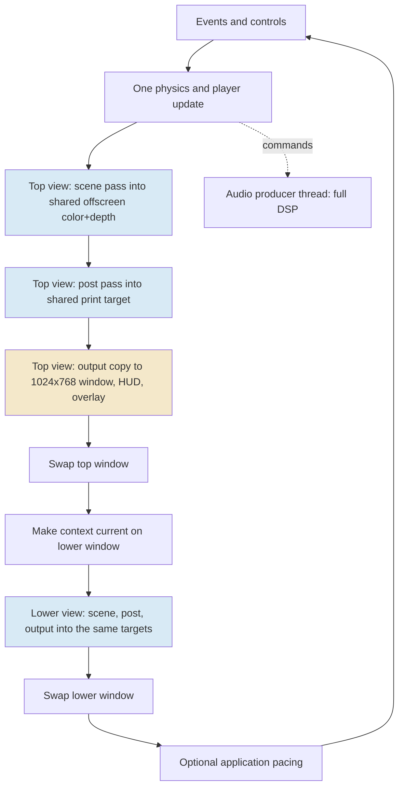
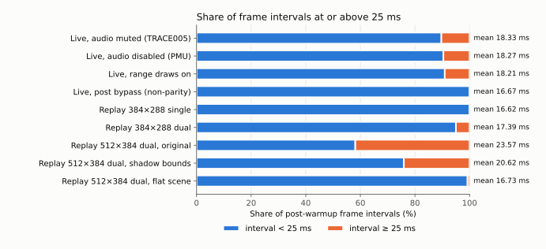
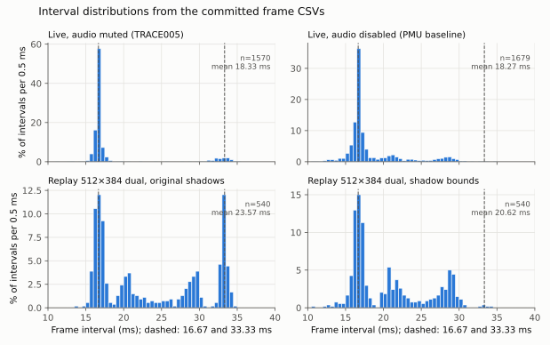
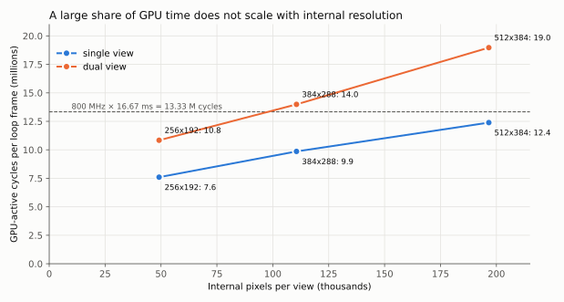
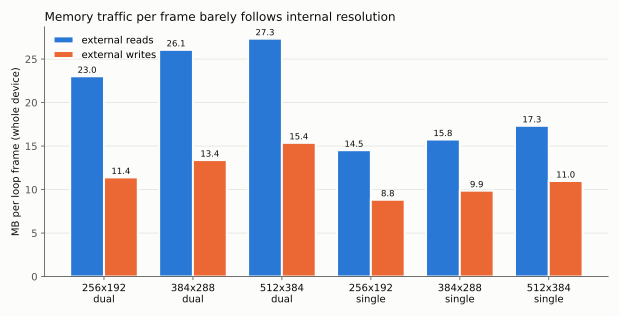

# Falllinie Performance Review

Between the evening of 13 October and the afternoon of 14 October 2026, the Falllinie native port went through an intensive performance investigation. The investigation produced four long performance reports, a map-of-content note, five docmgr tickets of scripts, designs, diaries and evidence, and about forty commits in the spike repository. This note is a review of that work. It explains, in my own words, what each experiment did and what it established, re-analyses the committed raw data where the original reports stopped short, and then lays out what I would have done differently and what I would do next.

The short version is that the measurement discipline is excellent and the prioritisation is weak. The investigation built instruments that are more careful than most professional performance work, and it found two genuine wins: a driver hotspot traced to an index-range scan, and a conservative shadow-rejection test that preserves every tested pixel while cutting mean frame time by 12.5% in a demanding configuration. But after all of it, no change is enabled by default, the game still does not hold 60 FPS, and the reports never state the diagnosis that their own counters support: the single-core Mali-G52 is saturated, a large part of its time does not depend on the internal render resolution, and the frame loop is paced by display refreshes, so every frame that overruns costs a whole extra refresh.

> [!summary]
> - **What was done well:** explicit measurement definitions, preserved negative results, ABBA ordering, deterministic replay, provenance hashes, an evidence-backed driver-hotspot diagnosis, and a provably conservative, pixel-identical shadow optimization.
> - **What was missed:** the GPU is saturated in the shipping dual-view configuration; roughly 8 of the 14 million GPU-active cycles per dual-view frame do not scale with internal resolution; the collected counters show vertex/tiler activity at about half of GPU-active time; nobody looked at geometry density (≈205,000 terrain triangles per view, before objects, against 110,592 internal pixels), or at the fact that terrain is drawn up to about 660 m ahead of the rider although fog is total beyond 400 m.
> - **New analysis in this note:** frame intervals cluster at refresh-related values, swaps are cheap and the waiting happens inside the render calls, per-frame memory traffic is nearly independent of internal resolution, and a linear cycle model predicts that shadow bounds alone may bring the shipping 384×288 dual-view replay under the 60 Hz budget.
> - **What I would do next:** measure shadow bounds at the shipping configuration; collect geometry counters; apply pixel-identical geometry reductions (per-view culling, 16-bit indices, a constant shader for cells entirely in full fog); then test precision and presentation changes, each with a one-page decision record.

## How to read this note

The note has five parts. Part I builds the vocabulary and the model of the hardware that the rest depends on. Part II walks through the investigation chronologically, experiment by experiment, and gives a verdict on each. Part III is new analysis of the committed raw data. Part IV is the overall assessment. Part V is the plan I would follow instead, written so it can be executed directly.

The reviewed material is the spike repository at `/home/manuel/code/wesen/2026-10-12--falllinie-spike`, revision `becb67f`, together with the vault reports listed in the frontmatter and their sibling reports on the native spike, playable port, integrated game and buffered audio. All numbers quoted from the original work are taken from those reports or from the committed CSV and JSON evidence. Numbers that I derived are marked as derived, and estimates are marked as estimates, with their assumptions stated.

---

# Part I — Foundations

## 1. The question the investigation had to answer

Falllinie is a native C++/OpenGL ES port of a browser snowboarding game. It runs on an Anbernic RG DS Plus handheld: a Rockchip RK3568 with four Cortex-A55 CPU cores, a Mali-G52 GPU with **one shader core** running at 800 MHz, roughly 975 MiB of RAM and no swap. The operating system is ROCKNIX with the Sway Wayland compositor. The device has two 1024×768 DSI panels; the top panel (DSI-2) shows a third-person view of the rider and the bottom panel (DSI-1) shows a first-person view.

The requirement is simple to state. Both panels refresh at 60 Hz, so the game must deliver a new frame to each panel every

$$
T_{\text{frame}} = \frac{1000\ \text{ms}}{60} \approx 16.667\ \text{ms}.
$$

The earlier "playable port" checkpoint met that requirement at an internal render size of 384×288 per view, with a smaller feature set: p95 frame interval 16.80 ms. The integrated game then added trees, rails, cones, snow particles, persistent board trails, an articulated rider and a reactive audio engine with a 2.6-second convolution reverb. The integrated game ran at roughly 50 FPS (median loop interval 19.8 ms). The performance investigation exists to recover 60 FPS without giving up visual or audio fidelity to the source game. The repository's working rules make fidelity a hard constraint: original shader bodies are preserved and every adaptation must be explicit.

This framing matters for the assessment. The goal was never "understand every cycle on the device". The goal was "find enough GPU and CPU time to put both views back under 16.667 ms, without changing what the game looks or sounds like". Instruments are valuable to the extent that they move that number or rule out a direction.

## 2. The rendering pipeline in concrete terms

A single main thread owns the OpenGL ES context and both SDL windows. Each loop iteration advances the simulation once and then renders two views in sequence. The code is in `src/main.cpp` and `src/renderer.cpp`.



Each view has three GPU passes.

1. **Scene.** The terrain cells, objects, board trail, rider and snow particles are drawn into an offscreen framebuffer object (FBO) at the internal resolution, 384×288 in the shipping configuration. The fragment shader (`assets/shaders/scene_fs.glsl`) does not output a colour. It writes an *encoded* image: luminance, a black-ink channel, a material identifier and a grey channel. For terrain and trails it evaluates three analytic "ray-to-segment" shadow tests against segments along the rider's body and board, terrain contour lines using `fwidth`, distance markers sampled from a glyph texture, and fog.
2. **Post.** A fullscreen triangle at the internal resolution reads the encoded colour and the depth texture and produces the final printed look (`assets/shaders/post_fs.glsl`). For scene pixels it reads the centre and four neighbours of both depth and colour (ten texture reads) to detect edges; for sky pixels it reconstructs the view direction and draws procedural mountain contours and the sun. It then applies a rotated halftone screen, speed lines and a per-frame grain.
3. **Output.** A fullscreen triangle at the **window** resolution, 1024×768, samples the printed texture with nearest filtering and writes it to the window's default framebuffer. The top view then draws the HUD text with blending, and optionally the developer overlay.

The pixel counts explain why the output pass is not negligible:

| Pass | Resolution | Pixels per view | Shader cost estimate (Mali Offline Compiler, longest path, arithmetic cycles per fragment) |
|---|---|---:|---:|
| Scene | 384×288 | 110,592 × overdraw | 10.47 |
| Post | 384×288 | 110,592 | 9.13 (load/store 8.00 in parallel) |
| Output copy | 1024×768 | 786,432 | 1.04 (texture 1.00 in parallel) |

The output pass touches 7.11 times as many pixels as each internal pass. Its per-pixel cost is low, but 786,432 × ~1.0 cycle is about 0.8 million cycles per view, comparable to the whole post pass (110,592 × ~9 ≈ 1.0 million cycles).

The geometry is just as important and was never examined. The vertex format is 11 floats, 44 bytes (`struct Vertex` in `src/terrain.hpp`): position, normal, albedo, two paint values and two "lateral/relative height" values. The scene vertex shader passes all of them on as five `highp` varyings, again 11 floats. Terrain rows are generated every 0.8 m down the slope, 138 rows per 110 m cell, each row with 107 columns: 1 m apart within 44 m of the line, then widening to 300 m at the edges (`TerrainJob` in `src/terrain.cpp`). One cell is therefore 139 × 107 = 14,873 vertices and 138 × 106 × 2 = 29,256 triangles. The replay receipts record **104,111 vertices and 614,376 32-bit indices**, exactly seven resident terrain cells, or 204,792 triangles drawn once per view. These counts cover terrain only; trees, rails, cones, the rider, snow particles and the trail are drawn on top. At 384×288 there are 110,592 internal pixels per view, so the terrain alone contains roughly **1.85 triangles per internal pixel**. Most distant triangles are much smaller than a pixel.

The resident window is one cell behind the rider's cell and five ahead (`patch_first_ = cell - 1; patch_count_ = 7` in `src/game_renderer.cpp`), 770 m of slope in total. The scene shader's fog reaches full strength at 400 m from the camera (`uFog = (150, 400)`), and for fully fogged fragments it writes the same encoded value regardless of lighting, shadows or contours. The farthest cell begins 440–550 m ahead of the rider, depending on where the rider is within its own cell, so it is always entirely in full fog; the second farthest begins 330–440 m ahead and is partly or entirely fogged. Every fragment of those cells still runs the complete scene shader, including the three shadow segments, and every vertex is still shaded and tiled. Section 26 returns to this.

## 3. How a tile-based mobile GPU spends its time

The Mali-G52 belongs to Arm's Bifrost generation. Its execution model differs from the desktop GPUs most graphics intuition comes from, and several conclusions in this note depend on the differences.

**Two phases per render pass.** A tile-based GPU processes each render pass in two phases. In the *geometry phase*, vertex shading runs and a fixed-function **tiler** sorts every surviving triangle into lists for small screen regions called tiles (16×16 pixels on Bifrost). In the *fragment phase*, the GPU processes the screen one tile at a time: it reads that tile's triangle list, rasterises, shades fragments into on-chip tile memory, and finally writes the finished tile to external memory. The two phases of consecutive passes can overlap, but on a GPU with one shader core, vertex shading and fragment shading compete for the same execution engines.

**Index-driven vertex shading (IDVS).** Bifrost splits the vertex shader into a *position* variant and a *varying* variant. The position variant runs for every referenced vertex; triangles are then culled (back-facing, outside the frustum, or too small to cover any sample); the varying variant runs only for vertices of surviving triangles and writes the varyings to external memory, from which the fragment phase reads them back. The Mali Offline Compiler report for Falllinie's scene vertex shader shows exactly this split: the position variant costs about 1 load/store cycle per vertex, the varying variant **15 load/store cycles per vertex**, because it stores 11 `highp` floats.

**Quads.** Fragments are shaded in 2×2 quads so that derivatives (`fwidth`, texture level-of-detail) can be computed. A triangle that covers one pixel still occupies a whole quad, so three of the four lanes do useless work. This is called quad overshading, and it makes sub-pixel triangles expensive in the fragment phase as well as in the tiler.

**External memory traffic.** Tile memory hides framebuffer traffic inside a pass, but everything that crosses a pass boundary goes to DRAM: vertex and index data in, varyings out and back in, polygon lists out and back in, finished tiles out, textures in. On a 1-core GPU sharing LPDDR with four CPU cores, bytes are a first-class cost.

**Asynchrony and where waiting appears.** OpenGL calls return before the GPU executes the work they submit. The CPU therefore sees GPU cost only indirectly, when a call has to wait: for a free window buffer, for a resource still in use, or for the driver's queue to drain. A CPU-side timer around a render function measures CPU work plus whatever wait happened to land inside it. This is why both the original reports and this review insist on separating executing CPU time from wall time.

**Presentation on Wayland.** Each SDL window owns a queue of buffers. `eglSwapBuffers` hands the finished buffer to the compositor; before the next frame can be drawn into the window, the driver must obtain a buffer the compositor has released. The compositor releases buffers in step with display refreshes. If no buffer is free, the first GL operation that needs the window surface blocks. With two windows on two panels, the loop must obtain a free buffer for **each** window every iteration, and each panel refreshes on its own vertical-blank schedule.

**GL timer queries on tilers.** `GL_EXT_disjoint_timer_query` measures elapsed GPU time between two points in the command stream. The extension specification itself warns that tile-based implementations may not produce the intuition expected from immediate-mode rendering, because one render pass's geometry and fragment work are separated in time and interleaved with other passes. On Mali, timer-query results for individual passes are well known to be unreliable as per-pass budgets.

## 4. Measurement vocabulary used throughout

The original reports define these terms carefully, and this note uses them in the same sense.

- **Frame interval** is the wall time between consecutive loop iterations, recorded per frame in `frames.csv` as `interval_ms`. It is an application-loop quantity, not a scanout measurement.
- **Wall time** of a scope is elapsed `CLOCK_MONOTONIC` time; **thread CPU time** is `CLOCK_THREAD_CPUTIME_ID` time charged to the main thread. Their difference, the **residual**, is time during which the thread was not executing: blocked or runnable. The residual does not say which.
- **GPU-active cycles** (`MaliGPUActiveCy`) count GPU cycles during which any job was queued or running. Fragment-active, non-fragment-active and tiler-active cycles count activity of those subsystems; they overlap and do not partition time.
- **Mali Offline Compiler cycles** are static per-thread throughput estimates for the arithmetic (A), load/store (LS), varying (V) and texture (T) pipelines. A shader is bound by its largest pipeline. They are not milliseconds.
- **ABBA ordering** runs baseline, candidate, candidate, baseline in sequence so that a linear drift over time affects both arms equally.
- **Warmup.** Frame statistics exclude frames 0–59.
- **Replay.** Since 14 October the game has a deterministic `--benchmark-replay` mode, described in Section 12, that feeds a fixed 1/60 s simulation step and a fixed amount of terrain-generation work per frame, so different render configurations draw the same sequence of game states.

Two derived quantities are introduced in this review:

- **Long-frame share**: the fraction of post-warmup intervals at or above 25 ms. Section 16 shows that the mean frame interval is almost entirely explained by this share.
- **Missed refreshes per frame**: $\bar{t}/T_{\text{frame}} - 1$, where $\bar{t}$ is the mean interval. A value of 0 means every loop iteration fits in one refresh; 0.41 means the loop loses on average 0.41 refreshes per frame.

---

# Part II — What the investigation did, experiment by experiment

## 5. Timeline

The repository history gives a precise timeline. The performance-specific work starts at commit `1802822` (13 October, 20:25) and ends at `becb67f` (14 October, 16:08), with an overnight gap. That is roughly twelve active hours. In that time the investigation produced the following.

| Time (local) | Ticket | What happened | Commit(s) |
|---|---|---|---|
| 12 Oct 19:47–22:28 | PLAY-001 | Native spike and playable port; 60 FPS at 384×288 for the smaller workload | `ed4fa2c` … `c99143e` |
| 12 Oct 22:50 – 13 Oct 12:01 | GAME-002 | Full gameplay, objects, rider rig, reactive audio; regression to ≈50 FPS; DSP optimisations; developer overlay | `c32856a` … `f5ab7b1` |
| 13 Oct 13:06–14:19 | AUDIO-003 | DSP moved to a producer thread with a lock-free PCM ring | `f1781ed` … `83d21a2` |
| 13 Oct 20:25–21:47 | PERF-004 | Pass-level CPU scopes and GL timer queries; frozen-scene and post-bypass fixtures | `1802822` … `ae2a175` |
| 13 Oct 21:11–22:37 | TRACE-005 | Tracing plan; paired wall/thread-CPU clocks; `perf` campaign | `7ad1c7d` … `4e31f26` |
| 13 Oct 22:46–23:43 | PERF-004 | Mali hardware counters; Mali Offline Compiler; post-shader candidate (null result) | `7b22f7d` … `a425977` |
| 14 Oct 07:07 | — | Cross-report navigation and optimisation MOC | `0fd8f24` |
| 14 Oct 10:46–12:18 | TRACE-005 | Cortex-A55 PMU counters; event-location profiles; driver scan; `glDrawRangeElements` | `323b095` … `2557dcd` |
| 14 Oct 13:39–14:41 | GPU-006 | Deterministic replay; resolution and view-count scaling | `c7ca46a` … `0a0d849` |
| 14 Oct 15:10–15:24 | GPU-007 | Scene/post sensitivity with non-parity shader substitutions | `074588b` … `ecc86e3` |
| 14 Oct 15:43–16:08 | GPU-008 | Conservative shadow-footprint rejection | `88f1f32` … `becb67f` |

The volume is remarkable. The four performance reports and the MOC alone total about 33,000 words, and each ticket also carries a design document and a detailed diary. Twelve hours is not a long time for this amount of instrumented hardware work. The critique below is therefore not that the investigation was slow. It is that a large fraction of the time went into instruments and documentation that did not change the decision, while the cheapest decisive experiments came last.

## 6. Background: what the earlier checkpoints had already shown

Two earlier reports set up the problem and, read carefully, already contained most of the diagnosis.

The **playable port** report ([[PROJECT REPORT - Falllinie Playable Port - Dual Views, Frame Profiling and Cooperative Terrain Streaming]]) records a sequence of controlled changes on the smaller workload:

| Case | FPS | p95 interval | What it shows |
|---|---:|---:|---|
| Isolated 512×384 baseline | 47.33 | 24.66 ms | Below 60 at the larger internal size |
| Batched HUD, 512×384 | 49.39 | 23.55 ms | Upper submission time fell from 6.62 to 2.69 ms, but FPS barely moved |
| Vsync disabled, 512×384 | 49.63 | 22.66 ms | Swap time fell, submission time rose; the wait moved |
| Unpaced 384×288 | 68.06 | 16.85 ms | Fewer internal pixels create headroom |
| Cooperative terrain, paced 384×288 | 60.00 | 16.80 ms | The 86 ms cell-rebuild hitch is gone |

Three of the main lessons of the later investigation are already here. Reducing CPU submission time does not raise the frame rate (the HUD batching case). Waiting migrates between scopes when one wait is removed (the vsync case). Internal pixel count matters (the 384×288 case). The playable-port report states each of these explicitly.

The **integrated game** report ([[PROJECT REPORT - Falllinie Integrated Native Game - Precision, Real-Time Audio, Developer Telemetry and JavaScript Embedding]]) then records the regression. After adding objects, rider, particles, trails and audio, the 55-second dual-view run at 384×288 had a median interval of 19.80 ms and p95 21.63 ms. In the same period the audio callback was optimised from 521 budget misses in 15 seconds to 3 misses in 55 seconds, through explicit arithmetic, half-spectrum storage, distributing convolution partitions over the block, planar accumulation and skipping silent voices. That audio work is good, targeted engineering, and it is outside the scope of this review except where audio competes with rendering.

The **buffered audio** report ([[PROJECT REPORT - Falllinie Buffered Audio - PCM Ownership, Callback Deadlines and Measured Producer Scheduling]]) moved the DSP out of the SDL callback into a producer thread that writes into an 8,192-frame single-producer/single-consumer ring. The callback's mean wall time fell from 12.907 ms to 0.023 ms. The DSP itself still costs about **11.3 ms of CPU per 21.33 ms block**, which is about 53% of one Cortex-A55 core running continuously, even when output is muted. That number is relevant later: the rendering investigation's "live" workload always included this producer unless audio was explicitly disabled.

## 7. PERF-004: pass-level instrumentation and GL timer queries

### What was built

PERF-004 added a profiler with explicit modes: `off`, whole-`view`, and per-`passes` (scene, post, output). CPU scopes nest; GL elapsed-time queries cannot nest on one target, so the GPU side is either per view or per pass. Queries come from a fixed pool of 32 slots, are sampled once every 60 frames, are polled for availability without blocking, and are invalidated if the disjoint flag fires. Every CSV row carries frame, view and pass identity, and shutdown records still-pending queries instead of draining them with `glFinish`. Two diagnostic fixtures were added: `--freeze-scene`, a static seeded terrain with the same camera in both windows, and `--post-bypass`, which really omits the post pass and presents the raw encoded scene.

A review found that the analyzer accepted a CPU-pass CSV truncated to its header as a valid empty observation. The fix added an independent emitted-sample count (statistics schema 2) and made the analyzer reconcile every `(frame, view, pass)` identity and require a CPU record for every issued GPU scope. The new tests reproduced the bug first (11 failures and one error out of 19) and passed after the fix.

### What it found

The first target campaign (eight 20-second cases) showed static scenes pinned at exactly 16.667 ms by the 60 FPS cap, the static 512×384 case at 17.596 ms, and the live dual-view game at 18.31 ms. The GPU timer queries produced values that cannot be a frame budget: in the live per-pass run the six pass means summed to about 42 ms against an 18.3 ms frame interval, and four startup readings were about $1.84\times10^{13}$ ms while flagged valid. The second figure is $2^{64}$ nanoseconds expressed in milliseconds, which is what an unsigned subtraction of a later timestamp from an earlier one produces.

### Assessment

The profiler design is careful and the completeness fix is exactly what an analyzer should do. The timer-query work was a poor investment. The playable-port report had already recorded the same $1.84\times10^{13}$ ms readings and had added a 500 ms sanity cutoff, and the tracing report quoted the Khronos warning about tiled implementations. On Mali, per-pass elapsed queries measure intervals that include binning, other passes' work and queueing; they cannot add up to a frame. Building a 32-slot pool with disjoint handling, versioned schemas and shutdown accounting for a measurement already known to be uninterpretable on this hardware consumed effort that should have gone to the experiments in Sections 12 to 14.

The frozen-scene fixture was also a weak choice as the primary controlled workload. It omits objects, rider, particles, trails, HUD and streaming, and it renders the same camera in both windows. Most of what made the integrated game slower than the playable port is missing from it. The investigation recognised this later and built the replay mode, which is the right fixture.

## 8. TRACE-005 part one: the tracing plan

### What was written

Before any tracing was implemented, a long design report ([[PROJECT REPORT - Falllinie Tracing - CPU Execution, Driver Waits and GPU Attribution]]) defined wall time, thread CPU time, on-CPU and off-CPU states, runnable versus blocked, fences, ioctls, tiled rendering and GPU utilisation. It proposed a sequence of gated phases: paired clocks, then `perf`, then an ftrace scheduler reconstruction, then a targeted eBPF probe, then an optimisation candidate. It worked through a constructed 10 ms scope to show how a scheduler trace would split off-CPU time into blocked and runnable intervals.

### Assessment

The conceptual content is correct and well written; it is the best reference in the vault on the difference between CPU samples, scheduler state and GPU time. The problem is ordering. The plan was written before checking whether the kernel supported the proposed tools, and the next session found that it does not: `CONFIG_FTRACE` and `CONFIG_KPROBES` are disabled, there is no BTF, and `bpftrace`, `bpftool` and `trace-cmd` are absent. A five-minute capability inventory would have removed half of the plan. More importantly, scheduler attribution was never going to answer the question that mattered. Knowing whether the main thread is blocked on a fence or runnable behind the audio producer would not have identified which rendering work to remove, and removing work is the only way the frame gets shorter.

## 9. TRACE-005 part two: paired clocks and CPU sampling

### What was built

`--paired-clocks` reads `CLOCK_MONOTONIC` and `CLOCK_THREAD_CPUTIME_ID` around selected scopes, writes records into a fixed 64-entry buffer that is flushed only outside measured scopes, and emits a JSONL sidecar with explicit validity states and a terminal reconciliation record. The campaign ran eight 30-second live dual-view cases: two baselines, two clock-only runs, whole-view and per-pass GPU queries, `perf stat` and `perf record`.

### What it found

The headline measurement is the split between executing and non-executing time in the render scopes (case 02, GPU queries off):

| Scope | Wall, ms | Thread CPU, ms | Residual, ms |
|---|---:|---:|---:|
| Top view | 7.645 | 4.522 | 3.122 |
| Lower view | 7.031 | 2.774 | 4.257 |
| Top scene | 2.881 | 2.596 | 0.286 |
| Top post | 0.660 | 0.584 | 0.076 |
| Top output | 4.069 | 1.293 | 2.776 |
| Lower output | 4.808 | 0.843 | 3.965 |

The scene and post scopes are almost entirely CPU execution: submitting draw calls. The **output** scopes are mostly waiting. `perf record` at 99 Hz found that 71.44% of the main thread's sampled CPU time was inside `libmali.so`, and that the audio producer accounted for 37.10% of all samples in the process. Frame intervals in all eight cases had means of 18.0–18.4 ms and p95 values near 33 ms.

### Assessment

The paired-clock instrument is sound and its result is important: the main thread is not CPU-bound in the output scope; it waits there. The report correctly declined to call the residual "GPU wait". What it did not do is take the next step that its own data allowed. The output scope is the first operation on the window's default framebuffer after the previous swap. On a Wayland EGL implementation that acquires the next window buffer lazily, that is exactly where a wait for a free buffer appears. Section 16 shows, from the replay data, that this wait is present even when the GPU is lightly loaded, which identifies it as presentation throttling rather than GPU completion.

The `perf` result, 71% of main-thread CPU in the driver, was interpreted as a reason to reduce driver CPU work. That is reasonable only if the main thread's CPU time is on the critical path. The paired clocks had just shown that the render scopes spent large fractions of their time not executing, and the frame intervals clustered at refresh multiples. Both point away from CPU submission as the limit.

## 10. PERF-004 continued: Mali counters, the offline compiler and a null result

### Hardware counters

The investigation built a small ARM64 probe on Arm's `libGPUCounters` (pinned at `378c7b5`), confirmed that the device exposes 240 counters through `/dev/mali0` without kernel or permission changes, selected 13 metrics, and sampled them at 10 Hz alongside gameplay. It handled the backend/host clock offset (about 1.26 s, later 1.64–1.79 s) honestly by using host poll intervals instead of joining timestamps.

The first comparison was normal rendering against the non-parity post bypass:

| Metric | Normal | Post bypass |
|---|---:|---:|
| Mean interval | 18.171 ms | 16.666 ms |
| p95 interval | 32.754 ms | 16.818 ms |
| GPU-active | 803.27 Mcycles/s | 788.42 Mcycles/s |
| Fragment-active | 798.42 Mcycles/s | 704.93 Mcycles/s |
| External reads | 1431.82 MB/s | 1528.29 MB/s |
| External writes | 747.53 MB/s | 570.46 MB/s |
| ALU utilisation | 70.66% | 64.62% |
| Texture utilisation | 13.12% | 7.89% |

At an 800 MHz clock, 803 million GPU-active cycles per second means the GPU had work queued essentially all the time, and fragment work was present for 99.4% of that. The report refused to call this saturation because active cycles can include stalls and because a point frequency snapshot is not a calibrated integral. Those caveats are correct in the strict sense, but they do not change the engineering conclusion: a GPU that is never idle cannot absorb more work per frame, and removing work is the only way to make frames faster. The summary JSON also contains two counters that the report did not discuss: non-fragment-active and tiler-active cycles at about **400 Mcycles/s each, half of GPU-active time**. On this GPU the non-fragment work is mainly vertex shading, which runs on the same single shader core as fragment shading. The two counters report identical values in every run, which suggests that this driver derives both from the same geometry-job activity; they are best read together as "geometry work was queued for half of the active time". That is the first sign that geometry matters, and it went unremarked.

### The offline compiler

The investigation dumped the exact GLSL submitted to the driver (including the native adaptations: a `highp` depth sampler, a 170-entry uniform table for the stable sky hash, and camera-relative projection), downloaded Arm Performance Studio 2026.5, verified its hash, and ran `malioc` for the Mali-G52. The post shader reported 32 work registers, full occupancy, no stack spilling, **0% 16-bit arithmetic**, and arithmetic as the bound pipeline (total A=10.63, LS=8.00, T=3.50).

Three variants were generated. Moving the colour fetch into the non-sky branch made the compiled shader slightly worse. Skipping the edge-detection neighbourhood beyond full fog shortened the cheap path but doubled register use and halved occupancy. Combining both restored occupancy and kept the shortest path short. The combined variant produced byte-identical fixture images, and an ABBA live campaign found pooled means of 18.263 ms (baseline) and 18.317 ms (candidate). The candidate was rejected and documented.

### Assessment

The counter probe is a durable, reusable tool, and getting it working without touching the system is good work. The compiler workflow, dumping the exact submitted source rather than the asset file, is the right method and is worth reusing. The null result is honestly reported.

The choice of candidate was the weak point. The post-bypass experiment removed the whole post pass, about one million cycles per view. The candidate only skipped the edge neighbourhood for pixels beyond full fog. A quick estimate of how many pixels are fully fogged in a typical frame, which the frozen fixture images could have provided, would have shown how small the possible saving was. More fundamentally, the bypass result mainly showed that the frame time was *sensitive to removing GPU work*, not that the post pass in particular was the problem. Sections 13 and 17 show that the scene pass and the resolution-independent work, most likely geometry, are larger costs.

## 11. CPU PMU: cache events, a driver hotspot and range draws

### What was built

A `--no-audio` flag was added so the audio producer does not run at all. A target runner attached `perf stat` to the main thread only (`--no-inherit -t`), with five explicitly named Cortex-A55 event pairs collected as groups: cycles/instructions, L1D accesses/refills, L2D accesses/refills, retired branches/mispredictions and L1 data-TLB accesses/refills. A generic `cycles` alias had expanded to the DDR controller's PMU as well, and the runner uses explicit `armv8_cortex_a55/...` names to avoid that.

### What it found

| Event pair | Result |
|---|---:|
| Instructions per cycle | 0.145 |
| L1D refill ratio | 4.57% |
| L2D refill ratio | 24.40% |
| Branch misprediction ratio | 9.65% |
| L1 dTLB refill ratio | 4.75% |

The cycle profile attributed 71.81% of main-thread cycles to `libmali`, and one unsymbolised location, offset `0x42d6dc`, carried 16.89% of the weight. The investigation mapped the sampled address through the process mapping to the library offset, followed a frame-pointer caller to a `bl` instruction, and disassembled the helper. It is a vectorised unsigned minimum/maximum scan: `LD4` loads sixteen 32-bit values, `UMIN`/`UMAX` reduce them. A driver scanning 32-bit data for its minimum and maximum, called from the draw path, is almost certainly computing the vertex index range of an indexed draw.

The test was direct. `--draw-ranges` replaces `glDrawElements` with `glDrawRangeElements(GL_TRIANGLES, 0, vertex_count-1, ...)`, which tells the driver the range so it does not need to scan. With the same binary in ABBA order, the hotspot disappeared from the range-draw profiles and came back in the closing ordinary run. Top-scene CPU time fell from 2.91 ms to 1.42 ms and the sum of the two views' CPU time from 7.01 ms to 5.89 ms. The frame interval did not improve: pooled means were 18.071 ms ordinary and 18.225 ms with ranges, and the top-output wait grew by about as much as the scene scope shrank.

### Assessment

The driver-scan attribution is the best piece of detective work in the series. It goes from a sampled address to a disassembled loop to a hypothesis about the public API to a controlled intervention that removes the hotspot and restores it. That is exactly how an unsymbolised driver should be investigated.

The rest of the PMU campaign answered questions nobody needed answered. IPC, cache refill ratios and TLB refill ratios for a thread that spends most of its CPU time inside a closed-source driver cannot be acted on, and the report itself says that no causal cache-latency diagnosis follows. The outcome of the range-draw experiment was predictable from the playable port's HUD-batching result and from the paired clocks: when the main thread is waiting on presentation or the GPU, removing main-thread CPU work makes the wait longer, not the frame shorter. The investigation recorded the result correctly. It did not draw the general conclusion, and the next CPU-side proposal (uniform-location caching) stayed on the list.

## 12. GPU-006: deterministic replay and resolution/view scaling

### What was built

`--benchmark-replay` makes different render configurations consume the same game states. Every rendered frame advances the seeded autopilot and the game clock by exactly 1/60 s, regardless of how long the frame took in real time. Production terrain streaming uses a wall-time budget of 3.5 ms per frame, which would let faster configurations stream terrain sooner; the replay instead allows at most 32 row-sized work units per frame, so terrain arrives on the same frame in every configuration. Audio is not started (but game events are still drained), score persistence and physical input are disabled, and quit still works. A rolling 64-bit signature over frame number, seed, game time, score, position, velocity, camera and mesh counts lets every run prove it followed the same trajectory: all eight device runs produced signature `6081555844518115723`. Endpoint scene, depth and print images are compared byte for byte between cases at the same resolution.

### What it found

| Case | Mean ms | p95 ms | Loop FPS | Fragment-active Mcycles/s |
|---|---:|---:|---:|---:|
| 384×288 dual (opening reference) | 17.389 | 24.377 | 57.51 | 801.72 |
| 256×192 single | 16.621 | 18.152 | 60.16 | 317.48 |
| 256×192 dual | 16.620 | 17.369 | 60.17 | 511.80 |
| 384×288 single | 16.618 | 18.259 | 60.17 | 447.61 |
| 512×384 single | 16.622 | 18.481 | 60.16 | 634.78 |
| 512×384 dual | 23.574 | 33.489 | 42.42 | 801.94 |
| 384×288 dual (closing reference) | 17.408 | 25.286 | 57.45 | 799.69 |
| 384×288 dual, paced 60 | 17.357 | 23.468 | 57.61 | 801.18 |

Every single-view configuration runs at 60 loop frames per second, even with application pacing off, while fragment activity doubles from the smallest to the largest internal size. Dual view saturates the GPU at 384×288 and above.

### Assessment

The replay is the single most valuable tool the investigation built, and it should have been the first thing built. Fixing the simulation step is the obvious part; recognising that a wall-time-budgeted streaming job also makes the workload depend on render speed, and fixing it with a work-unit limit that is validated against synchronous generation, is the careful part. The signature and endpoint-image checks make every later comparison trustworthy.

The matrix itself is the right experiment. Its two results, "single view is presentation-capped at 60" and "dual view at 384×288 is just over budget", are the most decision-relevant facts in the series. Section 16 and Section 17 extract more from these runs than the report did.

## 13. GPU-007: scene and post sensitivity

### What was built and found

At the demanding 512×384 dual-view replay, three private shader packages replaced parts of the work while keeping geometry, framebuffers and draw structure: a cheap post (depth selects white sky or grey scene luminance), a flat scene (constant luminance, no lighting, shadows, contours, glyphs or fog), and both. The order was baseline, post, flat, both, both, flat, post, baseline.

| Mode | Mean ms | p95 ms | Fragment-active Mcycles/s |
|---|---:|---:|---:|
| Baseline | 23.575 | 33.557 | 801.80 |
| Cheap post | 19.305 | 29.634 | 802.29 |
| Flat scene | 16.733 | 18.290 | 793.53 |
| Both | 16.621 | 20.222 | 528.28 |

The flat scene alone reached the 60 Hz floor; adding the cheap post on top lowered fragment activity by a third without changing the frame interval.

### Assessment

This is a well-designed sensitivity experiment and it should have been run on the first evening, at the shipping configuration. It identifies the scene fragment shader as the largest sensitive cost and shows that once the GPU is no longer saturated, further savings are invisible because presentation caps the loop. Two shortcomings: it was run only at 512×384, which is not the shipping size, and it changed the scene shader as a whole rather than also testing geometry (for example, drawing three resident cells instead of seven), so it could not separate per-fragment from per-triangle cost.

## 14. GPU-008: conservative shadow-footprint rejection

### The idea

The scene fragment shader computes, for every terrain and trail fragment, the minimum of three "ray-to-segment" shadow terms:

```glsl
for (int i = 0; i < 3; i++) {
  vec4 a = uSeg[i*2], b = uSeg[i*2+1];
  sh = min(sh, smoothstep(a.w*0.7, a.w*1.2, rayseg(vW, uL, a.xyz, b.xyz)));
}
```

`rayseg` finds the point $Q$ on the segment $A..B$ closest to the light ray through the receiver $P$ and returns the distance between them. The `smoothstep` reaches 1, meaning no shadow, once that distance exceeds $r = 1.2\,a.w$. The rider is small and the terrain is large, so most terrain fragments are far from any shadow, but every one of them evaluates all three segments.

The candidate computes a conservative region of the terrain where shadows can possibly fall. It projects points along the light direction $L$ onto a two-dimensional coordinate that is constant along each light ray:

$$
F(P) = \left(P_x - \frac{L_x}{L_y}P_y,\; P_z - \frac{L_z}{L_y}P_y\right),\qquad F(P + tL) = F(P).
$$

Because $F$ is linear and $Q$ lies between the segment endpoints, $F(Q)$ lies between $F(A)$ and $F(B)$. A receiver whose distance to the light ray through $Q$ is less than $r$ has $F(P)$ within $r$ of $F(Q)$ after scaling each component by $\sqrt{1 + (L_x/L_y)^2}$ or $\sqrt{1 + (L_z/L_y)^2}$. The union of the three expanded rectangles therefore contains every receiver that can be shadowed, in exact arithmetic. The CPU computes the rectangle from the same float values it uploads to the shader, rounds it outward, and adds 0.25 units of slack. The shader tests the receiver against the rectangle and runs the **unchanged** original loop if it is inside. Unsupported inputs (non-finite values, extreme slopes, degenerate segments, the static spike's sentinel segments near $10^6$) fall back to the original loop.

### What it found

A CPU stress test of 600,000 points rejected 300,280 of them and kept all 207,121 points that actually receive shadow. On the device, at 512×384 dual view with original/off/bounds/bounds/off/original ordering:

| Mode | Mean ms | p95 ms | p99 ms |
|---|---:|---:|---:|
| Original | 23.575 | 33.527 | 34.097 |
| Bounds | 20.636 | 29.381 | 32.626 |
| Shadows off (non-parity) | 20.024 | 29.448 | 30.309 |

Bounds recovered 83% of the time that removing shadows altogether would recover. Forty full-window and internal-target image pairs across five checkpoints (three frame numbers, a second seed and a second palette) were identical in every RGBA byte.

### Assessment

This is the right kind of optimisation for this project: it removes work that provably contributes nothing, keeps the original code path for everything that might contribute, and is checked against both a mathematical argument and real screenshots. The fallback design for unsupported inputs is exactly what makes a conservative bound safe to ship.

It is also still opt-in, and it was measured at the wrong size. The shipping configuration is 384×288 dual view, where the replay already averages 17.39 ms with only 4.3% of loop time lost to missed refreshes. Section 17 estimates that the bounds alone may be enough to bring that configuration under budget. That measurement is the most valuable single experiment that has not been run.

## 15. Scorecard

The table rates each experiment on two axes: the quality of its execution and the value of its result for the actual decision, which is how to reach 60 FPS without fidelity loss.

| Experiment | Execution | Decision value | Comment |
|---|---|---|---|
| Pass profiler and completeness fix | Excellent | Medium | Reusable, but the per-pass CPU split mainly measures submission |
| GL timer queries | Careful | Very low | Known unreliable on this tiler; already seen in the playable port |
| Frozen-scene fixture | Good | Low | Omits most of what made the game slower |
| Tracing plan | Excellent writing | Low | Tools unavailable; question not on the critical path |
| Paired clocks | Excellent | High | Showed the output scope waits; interpretation stopped short |
| `perf` CPU sampling | Good | Medium | Showed driver CPU share; not the limit |
| Mali counter probe | Excellent | High | Showed saturation and geometry activity; under-interpreted |
| Offline compiler workflow | Excellent | Medium | Right method; 0% fp16 not followed up |
| Post-shader candidate | Good | Low | Small possible saving; honest null result |
| CPU PMU event pairs | Careful | Very low | Not actionable for driver-dominated CPU time |
| Driver scan attribution and range draws | Excellent | Medium | Real fix of a real hotspot; frame unaffected because CPU is not the limit |
| Deterministic replay | Excellent | Very high | Should have been first |
| Resolution/view matrix | Excellent | Very high | The most informative data in the series |
| Scene/post sensitivity | Very good | High | Should have been early and at 384×288 |
| Shadow bounds | Excellent | High | Best result; measured at the wrong size; not promoted |

---

# Part III — Re-reading the committed evidence

The original reports publish means, percentiles and counter rates. The spike repository also contains every raw `frames.csv` and the counter summaries, so several questions the reports left open can be answered directly. The scripts used here are copied into this note's asset folder (`_assets/falllinie-performance-review/`): `frame_quantization.py` reads 26 committed frame CSVs, `counter_per_frame.py` normalises the published counter rates by loop frame rate, and `figures.py` draws the four figures. Their JSON outputs are stored next to them.

## 16. Frame time is a count of missed refreshes

### The mean is explained by the long-frame share

For each campaign case I split the post-warmup intervals into those below 25 ms and those at or above 25 ms, and compared the share of long frames with the number of refreshes lost per frame, $\bar{t}/16.667 - 1$:

| Case | Mean ms | Share ≥ 25 ms | Missed refreshes per frame |
|---|---:|---:|---:|
| Live, audio muted (TRACE005 baseline) | 18.335 | 0.103 | 0.100 |
| Live, audio disabled (PMU baseline) | 18.267 | 0.096 | 0.096 |
| Live, range draws on | 18.207 | 0.091 | 0.092 |
| Live, post bypass (non-parity) | 16.666 | 0.000 | 0.000 |
| Replay 384×288 single | 16.618 | 0.000 | 0.000 |
| Replay 384×288 dual | 17.389 | 0.050 | 0.043 |
| Replay 512×384 dual, original | 23.575 | 0.418 | 0.414 |
| Replay 512×384 dual, shadow bounds | 20.622 | 0.241 | 0.237 |
| Replay 512×384 dual, flat scene | 16.733 | 0.007 | 0.004 |

The two right-hand columns agree to within about 0.01 in every case. In words: the mean interval is 16.667 ms plus roughly one refresh period for each long frame. Later sessions also contain intervals between 18.5 and 25 ms, but the next subsection shows that these are almost always the first half of a pair that loses exactly one refresh in total. Frame time on this device is therefore best described as a count of missed refreshes, not as a continuous quantity.



*Derived from the committed `frames.csv` files, frames ≥ 60. The bars show the share of intervals below and at or above 25 ms; the right-hand label is the mean interval of the same run.*

### Long frames come in pairs that span three refreshes

The histograms show more structure than two peaks. In the TRACE005 live session the intervals sit at 16.7 and 33.3 ms. In the later audio-disabled and replay sessions there are four clusters, at about 16.7, 21, 29 and 33.3 ms.



*Histograms of `interval_ms` in 0.5 ms bins, normalised to percent. The dashed lines mark one and two refresh periods.*

The intermediate clusters are not independent partly-late frames. In the 512×384 dual-view original run, an interval in the 18.5–24 ms band is followed by one in the 24–31 ms band **97% of the time**, and the cluster medians are 20.74 and 28.87 ms. Their sum, 49.6 ms, is three refresh periods. A pair of loop iterations delivered two frames in three refreshes: one refresh was missed, and the measurement boundary of the loop happened to split the lost period between two intervals. Which split appears depends on where in the loop the blocking wait lands relative to the refresh, and that differs between sessions. That is why the TRACE005 session shows clean 33.3 ms intervals while later sessions show 21+29 pairs.

### The wait happens inside rendering, not inside swap

The frame CSV records wall time for each stage of the loop. Splitting the 512×384 original run into short and long frames:

| Stage mean, ms | Frames < 25 ms | Frames ≥ 25 ms |
|---|---:|---:|
| Top submit (scene+post+output) | 8.23 | 15.95 |
| Top swap | 0.32 | 0.37 |
| Bottom submit | 7.99 | 13.45 |
| Bottom swap | 0.29 | 0.29 |
| Player update | 0.69 | 0.66 |

`SDL_GL_SwapWindow` never waits. The extra time in long frames appears inside the submit stages, and the paired clocks place it in the output scope. The single-view replay runs point to the cause. At 512×384 single view, the top-submit stage takes **15.1 ms on average in every frame**, and yet the GPU is not saturated (fragment-active 635 Mcycles/s of 800). Across the three single-view cases the top-output scope spends 9.8–11.9 ms of wall time against about 1 ms of thread CPU time. The most direct explanation is that the loop waits for the next window buffer, which the compositor releases once per refresh. The application's `--fps 0` and swap interval 0 do not remove that wait, which is consistent with the wait being in buffer acquisition rather than in the swap call. Step 4 in Section 26 describes how to confirm this directly.

So the frame loop is **presentation-paced**: it runs at most once per refresh, and when the GPU work for both views does not finish in time for a buffer to be released, the loop loses a whole refresh. The practical consequences are:

- The target metric should be missed refreshes per second (or the long-frame share), not the mean interval. A mean of 18.3 ms is a 10% miss rate.
- Savings smaller than the remaining margin are invisible. A change that saves 1 ms per frame will not move the mean at all if the GPU still needs more than 16.667 ms; it will move it a lot once the frame fits.
- A GPU-side saving that brings per-frame GPU work under the refresh period removes the misses. This is why the flat-scene diagnostic jumps straight to 16.73 ms instead of improving gradually.

### An unexplained change in distribution shape

The AUDIO003 runs from the afternoon of 13 October, with nominally the same dual-view 384×288 configuration, have a completely different distribution: unimodal around 19–21 ms, with 99.8% of intervals below 25 ms and only 7–12% within 1.5 ms of 16.67 ms. Those runs were not presentation-quantised at all; they were throughput-bound at about 50 FPS, with 9.5 and 8.1 ms spent in the two submit stages. The runs from later sessions show the quantised shape. No report remarks on this change. It suggests that either the CPU submission cost fell enough for presentation to become the limit, or that presentation behaviour itself changed between sessions. One run with both configurations in the same boot would settle it, and it matters for interpreting any comparison with the earlier ~50 FPS figure.

## 17. A cycle budget for the GPU

### GPU-active cycles per frame

Dividing GPU-active cycles per second by loop frames per second gives GPU-active cycles per frame. The published report did not do this because the counter window is shorter than the frame window; the error that introduces is small compared with the effects below, and I treat the results as estimates.

| Replay case | Loop FPS | GPU-active Mcycles per frame | Non-fragment-active / GPU-active |
|---|---:|---:|---:|
| 256×192 single | 60.16 | 7.60 | 0.31 |
| 384×288 single | 60.17 | 9.86 | 0.26 |
| 512×384 single | 60.16 | 12.39 | 0.27 |
| 256×192 dual | 60.17 | 10.84 | 0.48 |
| 384×288 dual | 57.51 | 13.99 | 0.50 |
| 512×384 dual | 42.42 | 18.97 | 0.42 |

The budget at 800 MHz is

$$
800\times10^6\ \text{cycles/s} \times 16.667\ \text{ms} = 13.33\times10^6\ \text{cycles per frame}.
$$

The shipping configuration, 384×288 dual view, needs about 14.0 million GPU-active cycles per frame: **5% over budget**, consistent with its 0.043 missed refreshes per frame.



*Derived from the GPU-006 replay summary: `MaliGPUActiveCy` per second divided by loop frames per second. The dashed line is the 60 Hz budget at 800 MHz.*

### Most of the cost does not scale with internal resolution

Fitting a straight line to the single-view points gives

$$
C_{\text{single}} \approx 6.0\ \text{M} + 32.5\ \text{cycles} \times N_{\text{px}},
$$

and to the dual-view points (using total internal pixels for both views)

$$
C_{\text{dual}} \approx 8.1\ \text{M} + 27.6\ \text{cycles} \times N_{\text{px,total}}.
$$

At 384×288 dual view, $N_{\text{px,total}} = 221{,}184$, so the model gives $8.1 + 6.1 = 14.2$ M cycles, consistent with the measured 14.0 M. The important term is the intercept. **About 8 million of the 14 million cycles per frame do not depend on the internal resolution.** Lowering the internal resolution, simplifying the post shader, or skipping shadow work mostly attacks the other six million.

The resolution-independent part contains:

- the two output copies at 1024×768, estimated at 0.8–1.0 M cycles each from the compiler report;
- the HUD and developer overlay draws;
- vertex shading and tiling for about 205,000 terrain triangles per view (two views: 410,000 per frame), plus object, rider and particle geometry;
- the fragment cost of triangles that are smaller than a quad, which scales with triangle count rather than pixel count.

The compiler's numbers allow a rough estimate of the vertex part. If every vertex were shaded once per view with the varying variant, $104{,}111 \times 16 \approx 1.7$ M cycles per view, or 3.3 M per frame. That is an upper bound for the terrain's vertex-shader cost alone, excluding object geometry and the tiler. It is the same order of magnitude as the unexplained intercept, and it matches the counters' report that non-fragment work is active for about half of GPU-active time in dual view.

The marginal per-pixel cost is also revealing. The compiler estimates about 10.5 arithmetic cycles per scene fragment and 9 per post fragment, roughly 20 cycles per internal pixel at an overdraw of one. The fitted marginal cost is 27–33 cycles per pixel. The difference is what overdraw, quad overshading on sub-pixel triangles, texture and memory stalls add in practice.

### What the model predicts for shadow bounds

At 512×384 dual view, shadow bounds reduced GPU-active cycles per frame from 18.94 M to 16.59 M, a saving of 2.35 M cycles over 393,216 internal pixels, or about 6 cycles per pixel. Shadow work is per fragment, so the same saving at 384×288 dual view would be about $6 \times 221{,}184 \approx 1.3$ M cycles. That moves the shipping configuration from 14.0 M to roughly **12.7 M cycles per frame, about 5% under the 13.33 M budget**. The model predicts that shadow bounds alone should remove most missed refreshes from the shipping replay. The margin is thin, live gameplay adds the audio producer and different scene content, and the prediction may be wrong; it is precisely why this measurement should be the next one.

## 18. Memory traffic follows geometry, not pixels

### Bytes per frame

The same normalisation applied to the external-bus counters gives bytes per loop frame:

| Replay case | Reads, MB/frame | Writes, MB/frame |
|---|---:|---:|
| 256×192 single | 14.5 | 8.8 |
| 384×288 single | 15.8 | 9.9 |
| 512×384 single | 17.3 | 11.0 |
| 256×192 dual | 23.0 | 11.4 |
| 384×288 dual | 26.1 | 13.4 |
| 512×384 dual | 27.3 | 15.4 |



*Derived from the GPU-006 replay summary. These are whole-device counters, including any compositor work.*

Quadrupling the internal pixel count in single view (256×192 to 512×384) adds only 2.8 MB of reads per frame. Adding the second view adds 8.5–10 MB. A single-view frame reads about 13–14 MB that has nothing to do with the internal resolution.

The writes behave as expected for framebuffers. The 147,456 extra internal pixels from 256×192 to 512×384 single view add 2.2 MB of writes, about 15 bytes per pixel, close to the 12 bytes per pixel that the scene colour, scene depth and print targets need. The single-view intercept of about 8 MB of writes per frame is the 3.1 MB window buffer plus something else of similar size.

### Where 13 MB of resolution-independent reads can come from

A rough account of per-view terrain geometry traffic, using the receipt's mesh sizes (object meshes add to this):

| Item | Size per view | Comment |
|---|---:|---|
| Terrain index buffer, 614,376 × 4 B | 2.46 MB | Read by the position shader; 32-bit indices |
| Terrain vertex buffer, 104,111 × 44 B | 4.58 MB | 44-byte stride; partial reads still fetch whole cache lines |
| Varyings written, ≤ 104,111 × 44 B | ≤ 4.58 MB | 11 `highp` floats per shaded vertex |
| Varyings read back by fragments | comparable to the written amount | Read during triangle setup in the fragment phase |
| Polygon lists written and read | not estimated | Proportional to triangle count and tile coverage |

The read side of that table is roughly 11–12 MB per view before polygon lists, and the write side roughly 4.6 MB, which fits both the read intercept and the unexplained half of the write intercept. This is an inference from sizes, not a measurement; the G52 exposes geometry and bus counters that can confirm or refute it in a single run (Step 2 in Section 26). If it holds, geometry is the largest consumer of memory bandwidth and a large fraction of the GPU's resolution-independent time, and it was never examined.

### Triangle density

At the shipping resolution each view draws about 205,000 terrain triangles, plus object, rider and particle geometry, into 110,592 pixels. Terrain rows are 0.8 m apart and the resident cells extend up to about 660 m ahead of the rider; beyond a few tens of metres, adjacent rows project to less than a pixel. A sub-pixel triangle still costs a tiler entry, a varying fetch and at least one partially covered quad. This is the most likely reason why the per-pixel marginal cost is higher than the compiler estimate, and why fragment activity remains high when the scene shader is simplified.

## 19. Why CPU-side wins did not move frames

Three experiments reduced main-thread CPU time without improving the frame interval: HUD batching in the playable port (upper submission 6.62 → 2.69 ms, FPS 47.3 → 49.4), the vsync change (swap wait moved into submission), and range draws (view CPU 7.01 → 5.89 ms, frame mean unchanged). Each time, the output-scope wait grew by roughly the amount of CPU time saved.

This is the expected behaviour of a pipeline whose limit is downstream. The main thread submits work for frame $n$ while the GPU is still busy with earlier work and the compositor still holds the window's buffers. Submitting faster only means arriving earlier at the point where the thread must wait for a buffer. CPU-side work becomes relevant again only when the main thread's executing time approaches the refresh period. In the measured data, the top and lower views together execute for about 6–7.5 ms of CPU time per frame, well under 16.667 ms. The `libmali` hotspot is worth removing for power and for headroom once the GPU problem is solved, but it is not on the critical path today.

## 20. Audio as a competing workload

Audio was handled inconsistently across the campaigns. The live TRACE005 and counter runs had the producer running with muted output; the PMU runs disabled audio entirely; the replay disables it too. The producer costs about 11.3 ms of CPU per 21.33 ms block, about 53% of one core. Its partitioned convolution keeps 122 partitions of 1,025 complex bins for each channel's impulse response and input history, so each block streams roughly 4 MB of spectra through the CPU caches (derived: 122 × 1,025 × 8 B × 2 arrays × 2 channels).

The audio-on and audio-off live runs come from different sessions and runtime revisions, so the data does not show how much the producer affects frame timing. The comparison that is missing is simple: the 384×288 dual-view replay with the producer running, in the same session as the replay without it. If the producer adds missed refreshes, a non-uniformly partitioned convolution (short partitions for the early response, long partitions for the tail) computes the same linear convolution with several times fewer multiply-accumulates per block, and differs from the current output only by floating-point rounding.

---

# Part IV — Assessment

## 21. What the investigation did well

**It defined its quantities and never mixed them.** Every report states what each number measures and what it does not. Wall time is never called CPU time, CPU samples are never called GPU utilisation, and residuals are never called GPU waits. This is the most common failure in performance work and it does not occur here once.

**It preserved negative results and corrections.** The post-shader candidate that did not help, the analyzer that accepted missing data, the screenshot comparison that did not cover query-active frames, and the failed deployments are all recorded with their causes. A later reader can see exactly which ideas have already been tested.

**It controlled the workload properly in the end.** The deterministic replay, with its fixed simulation step, fixed streaming work, state signature and same-resolution image comparisons, makes comparisons between render configurations meaningful. The ABBA and bracketing sequences in every campaign expose drift.

**It produced two real optimisations.** The index-range finding is a textbook attribution of an unsymbolised driver hotspot, with a clean on/off/on intervention. The shadow bound is a provably conservative culling test with a floating-point qualification, a fallback for every unsupported input, a stress test and forty pixel-identical comparisons.

**It respected the ownership rules.** All GL calls stayed on the main thread, nothing changed the production launcher, the device configuration was left alone, and source shader bodies were preserved.

## 22. Where it went wrong

### It never stated the diagnosis

By the end of the counter campaign on the first evening, the investigation had three facts: GPU-active cycles equal to the GPU clock, fragment-active at 99.4% of that, and frame intervals clustered at one and two refresh periods. Together they say that the GPU is saturated in dual view and that the loop is paced by display refreshes. The reports qualify each fact individually ("not a calibrated utilisation", "not a measured scanout") and never combine them into a working hypothesis. A working hypothesis is not a claim of proof. It is what decides the next experiment, and without one the investigation spent the next morning on CPU cache events.

### It built instruments before asking which instrument the decision needed

The order of work was: GL timer queries, a tracing plan, paired clocks, `perf`, GPU counters, the offline compiler, CPU PMU counters, CPU event-location profiles, and only then the replay and the sensitivity experiments. The sensitivity experiments — change resolution, drop a view, flatten a shader — need no new instrument at all, and they gave the clearest answers in the series. Standard GPU performance practice starts there, because the first question is always which resource limits the frame, and removing work is the cheapest way to find out.

### It selected counters for the hypothesis it already had

The counter probe chose 13 of 240 available counters: activity cycles, bus bytes, and fragment, arithmetic and texture utilisation. These are the counters for a "fragment shader is expensive" hypothesis. The G52 also exposes counters for input primitives, culled primitives by reason, visible primitives, sub-sample (microtriangle) culls, rasterised and partially covered quads, and fragment threads per pixel. One run with those counters would have shown how much of the GPU's time is spent on geometry. Even the counters that were collected showed non-fragment and tiler activity at half of GPU-active time, and that was not discussed.

### It measured the best candidate at the wrong configuration

The 512×384 dual-view replay was chosen as the "demanding" configuration so that effects would be large. That is a reasonable choice for a sensitivity experiment. It is the wrong choice for an acceptance experiment. The question the project needs answered is whether shadow bounds bring the shipping 384×288 dual-view configuration to 60 Hz, and the model in Section 17 suggests the answer may be yes. The campaign that would answer it takes a few minutes of device time.

### Self-imposed constraints made the data noisier and the options narrower

Three rules were applied more strictly than the project required.

- The CPU governor stayed at `ondemand` in every benchmark. CPU frequency snapshots varied between 816 MHz and 1.99 GHz within a campaign. For a benchmark mode, switching to `performance` for the duration of the run and restoring the previous governor afterwards is standard practice and removes a source of variance; it can be recorded in the receipt like every other condition.
- Separate offscreen targets per view were deferred because of memory pressure on a 975 MiB device. A 384×288 RGBA colour texture, depth texture and print texture together take about 1.3 MB.
- Any precision change was treated as a fidelity change needing separate approval. The project now has a pixel-comparison harness that can show whether a `mediump` change alters any output byte. A change that is pixel-identical at forty checkpoints carries the same evidence as the shadow bound.

### Nothing was promoted

Both successful candidates (range draws and shadow bounds) remain behind opt-in flags. There was no stated rule for when a candidate becomes the default, so each result ended with "remains opt-in pending broader qualification". A performance investigation needs an exit criterion, for example: "a change that is pixel-identical at the standard checkpoints and does not regress the replay frame distribution becomes the default; a change that alters pixels goes to a human decision".

### The writing cost too much and conveyed too little

Each experiment produced a long synthesis report in addition to a design document and a diary. The reports are accurate, but almost every paragraph carries one or more qualifications, and the decision-relevant state is hard to find. For example, the GPU profiling report opens with a 12.46% speedup in its summary box and then explains for several thousand words why that is not a 60 FPS result, without saying what is still missing in one sentence. Writing time is investigation time. A one-page decision record per experiment, plus a living results table, would have kept the provenance and freed hours for experiments.

## 23. Overall verdict

| Dimension | Rating | Reason |
|---|---|---|
| Measurement rigour and honesty | Excellent | Definitions, provenance, preserved failures, controlled comparisons |
| Tooling | Excellent | Replay, counter probe, compiler workflow, analyzers with completeness checks |
| Diagnosis | Weak | Saturation, presentation pacing and geometry cost not stated or examined |
| Prioritisation | Weak | Instruments before sensitivity experiments; CPU work after GPU saturation was visible |
| Results delivered | Modest | Two real optimisations, neither enabled; 60 FPS not reached |
| Communication | Accurate but inefficient | Hard to extract decisions; very high writing overhead |

The investigation is a very good laboratory that started running its most informative experiments only near the end. The work is far from wasted: the replay, the counter probe and the shadow bound are exactly the foundations the next step needs.

---

# Part V — What I would do instead

## 24. Working principles

1. **Find the limiting resource before choosing an instrument.** Change the amount of work in each major category (pixels, views, geometry, shader complexity, CPU submission, audio) and see which change moves the frame. This needs a repeatable workload and nothing else.
2. **Keep a cycle and byte budget.** Express each hypothesis as "this change removes about N million GPU cycles or M MB per frame", using the compiler and the counters. A candidate that cannot plausibly save more than the current overrun is not worth measuring first.
3. **Optimise against the metric the player sees.** Here that is missed refreshes. Report the long-frame share next to the mean.
4. **Measure acceptance at the shipping configuration.** Use larger configurations for sensitivity, and the shipping configuration, with audio, for decisions.
5. **Decide with a written rule.** Pixel-identical and not slower: make it the default. Pixel-changing: put the images in front of a person.
6. **Write one page per experiment.** Hypothesis, change, controls, result, decision. Keep the diary for provenance.

## 25. What the first day could have looked like

With the hardware and the playable-port history in hand, this is the order I would have followed on 13 October. Each step is small and uses facilities that already existed or were built during the investigation.

| Step | Experiment | Expected answer |
|---|---|---|
| 1 | Replay mode (fixed step, fixed streaming work, signature) | A workload that can be compared across configurations |
| 2 | Resolution × view matrix | Dual view is over budget; single view is presentation-capped |
| 3 | Flat scene, cheap post, fewer resident cells | Splits per-pixel shader cost from per-triangle cost |
| 4 | GPU counters including geometry and quad counters | How many primitives, how many culled, how many sub-pixel; overdraw |
| 5 | Cycle budget from the compiler and counters | Which categories can recover the 0.7 M cycles the shipping configuration lacks |
| 6 | Candidates in budget order, at 384×288 dual with audio | A default-on change list |

Steps 1–4 are a few hours of work given the tools that exist now, and they would have pointed at geometry and the scene shader before any CPU-side work.

## 26. The concrete plan from here

The steps are ordered by expected value per hour. Every step uses the existing replay, the existing counter probe and the existing image-comparison tooling. Every pixel-identical step can be promoted as soon as it passes; pixel-changing steps need a decision from the project owner.

### Step 1 — Measure shadow bounds at the shipping configuration

Run the GPU-008 campaign at 384×288 dual view, in original/bounds/bounds/original order, first without audio, then with the audio producer running. Report the long-frame share as well as the mean.

- If bounds removes most missed refreshes, make `--shadow-mode bounds` the default after one live session with audio and a visual check on the standard checkpoints.
- If it does not, the remaining overrun tells the next step how many cycles it must find.

### Step 2 — Measure geometry

Add geometry and rasterisation counters to the probe for one 384×288 dual-view replay run. From the pinned Mali-G52 counter reference, choose the counters for total input primitives, primitives culled by facing, by frustum or Z plane and by sample coverage (microtriangle culling), visible primitives, rasterised fragment quads, partially covered quads and fragment threads per pixel. Names such as `MaliGeomTotalPrim`, `MaliGeomVisiblePrim` and `MaliGeomSampleCullPrim` are the kind of identifiers to look for; check each against the pinned reference rather than assuming them.

Run the same replay once with only the nearest terrain cell resident (a diagnostic, non-parity flag), so the per-triangle share of fragment and non-fragment activity can be read directly.

### Step 3 — Remove or simplify geometry whose contribution is known

Three pixel-identical changes follow from the geometry numbers.

**Per-view culling of cells and object meshes.** Each terrain cell and object mesh has a fixed axis-aligned bounding box. Testing it against each view's frustum on the CPU before drawing removes the position shading, index fetch and tiler work for cells the view cannot see. The first-person lower view looks down the slope and cannot see cells behind the rider.

```cpp
// Computed once when a cell's mesh is built.
struct Bounds { Vec3 min, max; };

// Per view, before the cell loop in Renderer::render.
const Frustum frustum = extract_planes(frame.vp);   // six planes from the view-projection matrix
for (int cell = patch_first_; cell < patch_first_ + patch_count_; ++cell) {
    auto found = cell_meshes_.find(cell);
    if (found == cell_meshes_.end()) continue;
    if (!frustum.intersects(found->second.bounds)) continue;  // conservative: AABB vs planes
    glBindVertexArray(found->second.vao);
    draw_indexed(found->second.indices, found->second.vertices);
}
```

The plane test is conservative, so it can only skip geometry that would be clipped anyway. The frame's camera-relative projection must be accounted for when building the planes, and the bounds must include any vertex-shader displacement (there is none in the current shader).

**16-bit indices per cell.** Each terrain cell has 14,873 vertices, so its indices fit in `GL_UNSIGNED_SHORT`; object meshes need the same check, and any mesh above 65,536 vertices (the static multi-cell fixture, for example) keeps 32-bit indices. Converting at upload time halves index memory traffic (2.46 MB to 1.23 MB per view per frame) and halves the work of any driver range scan that still happens. Index values and order are unchanged, so rasterisation is identical.

```cpp
// At cell upload, when mesh.vertices.size() <= 65536.
std::vector<uint16_t> narrow(mesh.indices.begin(), mesh.indices.end());
glBufferData(GL_ELEMENT_ARRAY_BUFFER, narrow.size() * 2, narrow.data(), GL_STATIC_DRAW);
// draw_indexed then uses GL_UNSIGNED_SHORT and an offset in 2-byte units.
```

**A constant shader for cells entirely in full fog.** For a terrain fragment at distance $d \ge 400$ m from the camera, the end of `scene_fs.glsl` computes

```glsl
float f = smoothstep(uFog.x, uFog.y, dist);   // exactly 1.0 when dist >= uFog.y
lum = mix(lum, 1., f); blk *= 1. - f; gry *= 1. - f;
o = vec4(clamp(lum, 0., 1.), blk, uMat/255., gry);
```

so, for finite intermediate values, the output is $(1, 0, \text{uMat}/255, 0)$ whatever the lighting, shadow, contour and glyph code computed before it. (`mix` can round to one unit in the last place below 1.0; the 8-bit target stores both as 255.) If the nearest point of a cell's bounding box is farther than 400 m from the camera, plus a small margin, every fragment of that cell produces this constant. The cell can then be drawn with a uniform flag that makes the fragment shader write the constant immediately:

```glsl
uniform bool uFarFog;      // set per draw by the CPU from the cell's bounding box
void main() {
  if (uFarFog) { o = vec4(1., 0., uMat/255., 0.); return; }
  // ... original body unchanged ...
}
```

Keeping the same program means the vertex shader, and therefore every depth value, is unchanged. A separate program with fewer varyings would save more vertex work, but then both programs must declare `invariant gl_Position` so that depth stays bit-identical. The farthest resident cell always qualifies and the next one often does. This change is pixel-identical by the argument above, and the visual checkpoints confirm it in practice.

### Step 4 — Isolate and instrument the presentation wait

Add an explicit `glClear` (or `glInvalidateFramebuffer`) of the default framebuffer as the first operation of the output pass, inside its own paired-clock scope. Arm recommends clearing or invalidating every attachment at the start of a render pass so the driver never needs to load previous contents. In this code it has a second use: the wait for a free window buffer will then land in that scope, so it is measured directly instead of being mixed with the copy and HUD.

Record that acquisition time per window and per frame. If one window systematically waits longer, the two panels' refresh phases are offset, and the order in which the views are rendered and presented can be chosen to match them. Request no depth buffer for the window surfaces (`SDL_GL_DEPTH_SIZE` is currently 24, and the output pass never uses depth); the offscreen scene depth is a separate texture and is unaffected.

### Step 5 — Give each view its own offscreen targets

The two views currently reuse the same colour, depth and print textures, so the lower view's scene pass cannot start writing until the top view's post and output passes have finished reading. Separate targets cost about 1.3 MB and remove that write-after-read dependency, so the driver can schedule the lower view's scene pass without waiting for the top view's reads to retire. The expected gain is uncertain on a single-core GPU, and the experiment is cheap; it is pixel-identical by construction.

### Step 6 — Precision, gated by pixel identity

Both fragment shaders declare `precision highp float` throughout, the vertex shader writes five `highp` varyings, and the compiler reports 0% 16-bit arithmetic. On Bifrost, 16-bit arithmetic can execute two operations per lane where 32-bit executes one, and `mediump` varyings halve varying storage and traffic.

World positions cannot be `mediump`: at 500 m from the origin, a 16-bit float resolves only 0.25 m. Normals, albedo, paint values, lighting terms and the post shader's tone and halftone arithmetic are candidates. The procedure is mechanical:

1. Change one group of declarations (for example, `vN`, `vA` and `vP` and the lighting terms that use them).
2. Run the standard visual checkpoints and compare every byte.
3. Keep the change only if all comparisons are identical; otherwise record the differing pixels and put the images in front of the project owner.
4. Measure the replay at 384×288 dual view.

### Step 7 — Draw order

The scene draws terrain first, then objects, trail, rider and particles. Terrain fragments behind trees, rails and the rider are shaded and then overwritten. Drawing opaque objects and the rider before the terrain lets early depth testing reject the hidden terrain fragments. The trail must still follow the terrain because it relies on polygon offset against the terrain depth. Equal-depth ties could resolve differently under `GL_LESS`, so this needs the pixel-identity check; the fragment-threads-per-pixel counter from Step 2 shows whether overdraw is large enough to matter.

### Step 8 — Audio in the same session

Run the 384×288 dual-view replay with and without the audio producer in one session. If the producer adds missed refreshes, implement non-uniform partitioned convolution and verify it against the existing full-response test with its current tolerance.

### Step 9 — Decisions that need the project owner

Some of the largest remaining savings change pixels and therefore need a decision rather than a measurement: distance-dependent terrain level of detail (removing sub-pixel triangles far from the camera), rendering the output pass at lower resolution and letting the compositor scale it (which also changes the HUD), and not drawing terrain beyond full fog at all (those pixels would then take the sky path in the post shader and change). Each can be prepared as a side-by-side image set with its measured saving, so that the decision is about what the player sees.

## 27. A one-page experiment record

This is the format I would use instead of a long synthesis report per experiment.

```markdown
## EXP-NNN — <one-line change>

Hypothesis: <mechanism>, expected saving <N> M GPU cycles / <M> MB per frame.
Change: <flag or commit>; pixel-identical by construction | needs image check.
Workload: replay seed 42, 600 frames, 384×288 dual, audio <on|off>, governor <x>.
Order: A B B A, binary <sha256>, assets <sha256>.
Result: mean <a> → <b> ms; long-frame share <p> → <q>; GPU-active <c> → <d> M cycles/frame.
Images: <n> checkpoints, <k> differing pixels.
Decision: default | opt-in | rejected | needs owner decision — because <one sentence>.
Evidence: <ticket path>, <campaign directory>.
```

## 28. Open questions

- Does Mali's Wayland EGL implementation acquire the next window buffer lazily, at the first draw to the default framebuffer, as the stage timings suggest? Step 4 answers this.
- Why do the AUDIO003 runs show a unimodal ~20 ms distribution while later runs with nominally the same configuration are refresh-quantised?
- What fraction of non-fragment activity is vertex shading for geometry that is culled or sub-pixel? Step 2 answers this.
- Does Sway scan the two fullscreen windows out directly, or does it compose them on the same GPU? The write-traffic accounting in Section 18 does not require composition, but it does not rule it out.
- How large is the audio producer's effect on missed refreshes in the shipping configuration? Step 8 answers this.

## 29. Key points

- The Falllinie investigation measured carefully and reported honestly, and its replay benchmark, counter probe and shadow bound are durable assets.
- The dual-view game is limited by the single Mali-G52 shader core, and the frame loop is paced by display refreshes: each frame either fits in one refresh or loses one.
- The mean frame interval is approximately 16.667 ms plus one refresh for each long frame, so the right target is the long-frame share.
- About 8 of the 14 million GPU-active cycles per shipping frame do not depend on internal resolution; geometry density (≈1.85 terrain triangles per internal pixel, terrain drawn to about 660 m ahead) and the full-resolution output passes are the likely contents.
- CPU-side savings did not move frames because the main thread waits for presentation; they will matter only once the GPU fits in the budget.
- Shadow bounds may already bring the shipping replay under budget; measuring that is the next experiment, followed by geometry counters and pixel-identical geometry reductions such as per-view culling, 16-bit indices and a constant shader for fully fogged cells.

## 30. Reproducing this note's analysis

The scripts and their outputs are in `_assets/falllinie-performance-review/`. They read the committed evidence in the spike repository and the published summaries in the vault; they do not need the device.

```sh
REPO=/home/manuel/code/wesen/2026-10-12--falllinie-spike
VAULT=/home/manuel/code/wesen/go-go-golems/go-go-parc/Projects/2026/10
A=$VAULT/14/_assets/falllinie-performance-review
G=$VAULT/13/_assets/falllinie-gpu-shader-investigation

python3 -I $A/frame_quantization.py $REPO quantization.json
python3 -I $A/counter_per_frame.py $G/replay-scaling/summary.json \
    $G/shader-sensitivity/summary.json $G/shadow-bounds/summary.json > counters_per_frame.json
python3 -I $A/figures.py $REPO quantization.json counters_per_frame.json figures/
```

The per-frame counter normalisation divides whole-device rates over the counter window by the loop frame rate over the frame window; the two windows differ, so the per-frame values are estimates. The cluster-pairing statistic in Section 16 (97% of 21 ms intervals followed by a 29 ms interval) was computed from `GPU-008/.../01-original/frames.csv` with the same 18.5/24/31 ms band edges used in the text.

## Related notes

- [[MOC - Optimization and Performance Engineering]] — the series index for the reviewed reports.
- [[PROJECT REPORT - Falllinie Tracing - CPU Execution, Driver Waits and GPU Attribution]] — measurement concepts and the tracing plan (Section 8).
- [[PROJECT REPORT - Falllinie Rendering Measurements - CPU Execution, Mali Driver Work and GPU Timer Limits]] — PERF-004 and the paired-clock campaign (Sections 7 and 9).
- [[PROJECT REPORT - Falllinie GPU Profiling - Hardware Counters, Shader Compilation and a Rejected Optimization]] — counters, compiler, replay, sensitivity and shadow bounds (Sections 10, 12, 13 and 14).
- [[PROJECT REPORT - Falllinie CPU PMU - Cache Events, Driver Cycles and an Audio-Disabled Baseline]] — PMU events, the driver scan and range draws (Section 11).
- [[PROJECT REPORT - Falllinie Playable Port - Dual Views, Frame Profiling and Cooperative Terrain Streaming]] and [[PROJECT REPORT - Falllinie Integrated Native Game - Precision, Real-Time Audio, Developer Telemetry and JavaScript Embedding]] — the 60 FPS baseline and the regression (Section 6).
- [[PROJECT REPORT - Falllinie Buffered Audio - PCM Ownership, Callback Deadlines and Measured Producer Scheduling]] — the audio producer's cost (Sections 6 and 20).
- [[PROJECT REPORT FOLLOW-UP - Anbernic RG DS Plus - First Boot on ROCKNIX, the Dual-Screen Stack, and a Black-Screen Diagnosis]] — the device's display and compositor configuration.
