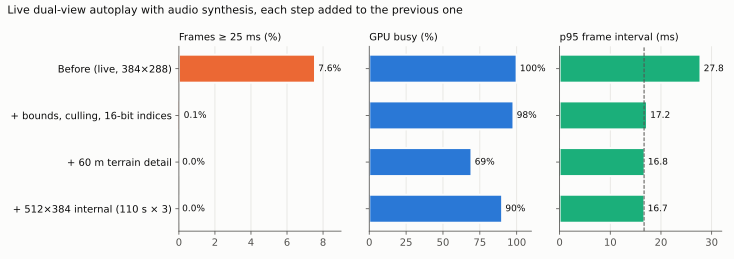
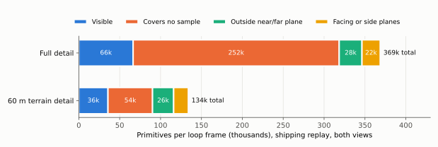
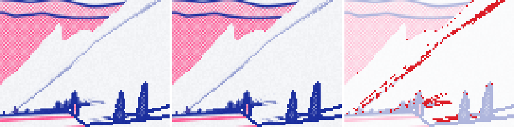
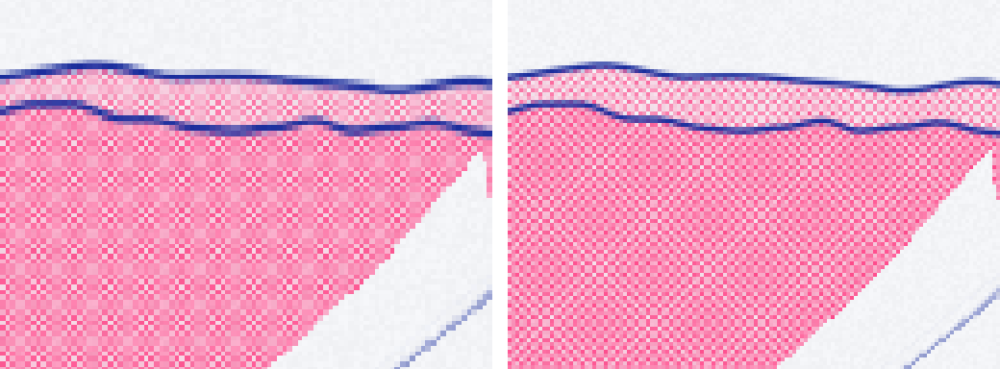

# Falllinie at 60 FPS

Falllinie is a native C++/OpenGL ES port of a browser snowboarding game, running on an Anbernic RG DS Plus with two 1024×768 screens. On the evening of 14 October 2026 it went from missing one display refresh in thirteen during live play to a release that holds every refresh at a sharper internal resolution, and that appears in the handheld's game menu. This report explains how, step by step. It covers the measurements that located the cost, the changes that removed it, the arguments that show which changes cannot alter the image, the one change that does alter it and why it was accepted, and the deployment.

The sequence was planned in [[PROJECT REPORT - Falllinie Performance Review - Measurement Discipline, Missed Bottlenecks and a Path to 60 FPS|the performance review]] and partly reported in [[PROJECT REPORT - Falllinie GPU Budget Recovery - Shadow Bounds at the Shipping Size, Geometry Counters and Presentation Acquisition|GPU Budget Recovery]]. This note is the complete deep dive across both tickets, `FALLLINIE-PERF-009` and `FALLLINIE-PERF-010`, from the first measurement to the deployed build.

> [!summary]
> - **Where the time went.** The single-core Mali-G52 was saturated. About half of its active time was geometry work, and 59% of the triangles it received covered no pixel sample at all: distant terrain rows only 0.8 m apart.
> - **What fixed it.** Four image-preserving changes (shadow bounds, row-block culling, 16-bit indices, then measurement of the presentation wait) brought the shipping configuration to 60 Hz with no headroom. One image-changing change, distance-dependent terrain detail starting at 60 m, removed 64% of submitted triangles and freed about 30% of the GPU, changing 0.6–1.4% of window pixels.
> - **What the headroom bought.** The owner spent it on a crisper 512×384 internal resolution, an exact 2× scale to the panels that removes a halftone moiré. Three 110-second live sessions with audio ran 19,605 frames, none missing a refresh, at about 90% GPU busy.
> - **Where it lives.** The build is deployed to `/storage/apps/falllinie-spike`, launches at 512×384 and is listed in ROCKNIX's Ports menu as "Falllinie" with a screenshot.



*Live dual-view autoplay with the muted audio synthesis running. Each row adds one step to the previous configuration. The first two rows come from the PERF-009 acceptance session, the third from the PERF-010 acceptance session and the last from three 110-second sessions at 512×384. GPU busy is GPU-active cycles per second divided by the 800 MHz clock.*

---

## Part I — The problem in concrete terms

### 1. The budget

The handheld refreshes each panel at 60 Hz, so the game must produce a new frame for both screens every

$$
T = \frac{1000}{60} \approx 16.667\ \text{ms}.
$$

The GPU is a Mali-G52 with a single shader core at 800 MHz. In one frame period it can be active for at most

$$
800 \times 10^6\ \text{cycles/s} \times 16.667\ \text{ms} = 13.33 \times 10^6\ \text{cycles}.
$$

Every frame, the renderer runs three GPU passes for each of the two screens. The **scene** pass draws terrain, objects, the rider and particles into a small offscreen image (384×288 at the start of this work). The **print** pass turns that image into the game's printed look: halftone dots, ink outlines, a procedural sky. The **output** pass copies the result into the screen's 1024×768 window and draws the HUD on top. A single main thread issues all of this and then hands both windows to the Sway compositor.

### 2. What "slow" meant

At the start, live autoplay with audio averaged 17.88 ms per frame, with 7.6% of frames at or above 25 ms and a 95th percentile of 27.8 ms. The review had shown that this is not a continuous slowdown. The frame loop is paced by the displays: a frame either finishes in time for the next refresh or waits for the one after. The mean interval is almost exactly 16.667 ms plus one refresh period for each late frame. The metric that matters is therefore the share of frames that miss a refresh, not the mean.

### 3. Why the GPU, and what part of it

Earlier investigations had collected three facts without combining them. The GPU-active counter equalled the GPU clock. Fragment work was present for 99% of that time. Main-thread CPU time was well below the frame budget. Together they say the GPU was saturated. What they did not say was *which* GPU work dominated, and that question decided everything that followed.

---

## Part II — Method

### 4. A workload that can be compared

All decisions used the deterministic replay benchmark built in an earlier ticket. It advances the game by exactly 1/60 s per rendered frame and limits terrain generation to a fixed number of rows per frame, so every configuration draws the same sequence of game states. A 64-bit signature over position, velocity, camera and mesh counts proves this: every replay run in this report produced `6081555844518115723`.

Two additions made the replay suitable for acceptance decisions:

- **`--replay-audio`.** The replay used to switch audio off. The flag starts the normal buffered audio producer, muted, without changing the simulation, because the producer only consumes game events. Its synthesis costs about 9–11 ms of CPU per 21.33 ms block, so leaving it out understates the load.
- **A controlled CPU clock.** Each campaign recorded the CPU frequency governor, set it to `performance` for the duration and restored it in all cases. Every case then started at 1.992 GHz instead of anywhere between 0.8 and 2.0 GHz.

Live autoplay with the launcher's settings was the final check for every accepted change, because live play uses wall-clock terrain streaming and a timing-dependent trajectory.

### 5. A written promotion rule

Each change started behind a command-line switch. It became the default only if it met four conditions:

1. the replay signature was unchanged;
2. every compared image was byte-identical to the previous behaviour at five checkpoints: frames 120, 600 and 1,200 with seed 42; frame 600 with seed 7; frame 600 with print palette 5;
3. it was not slower in an ABBA campaign (A, B, B, A ordering, so linear drift affects both arms equally);
4. every run reported no GL errors and complete measurement records.

Each comparison covers eight images: the full top and lower windows plus the internal scene, print and depth targets of both cameras. A change that alters any pixel cannot pass condition 2. Such changes went to the project owner with side-by-side captures instead.

---

## Part III — Image-preserving changes

### 6. Shadow bounds at the shipping size

The scene shader evaluates, for every terrain fragment, three "ray-to-segment" shadow terms against the rider's body and board. The earlier GPU-008 ticket had built a conservative test that skips that work for fragments that provably cannot be in shadow. It projects positions along the light direction into a two-dimensional coordinate that is constant along each light ray, bounds the rider's segments in that coordinate, and runs the original shadow loop only inside the bound. It had been measured only at 512×384. At the shipping 384×288, in the replay:

| Case | Mean ms | p95 ms | Frames ≥ 25 ms |
|---|---:|---:|---:|
| Original shadows | 17.273 | 20.399 | 3.9% |
| Shadow bounds | 16.620 | 17.611 | 0.0% |
| Original shadows, audio running | 17.697 | 28.424 | 6.5% |
| Shadow bounds, audio running | 16.688 | 17.901 | 0.5% |

Bounds alone brought the shipping configuration to 60 Hz. The GPU counters still reported about 800 million active cycles per second, so the GPU had essentially no idle time. When the GPU is saturated, "active cycles per frame" is simply the clock divided by the frame rate, so it cannot show how much work a change removed. The configuration met the budget with no margin.

### 7. What the GPU does with distant terrain

A tile-based GPU such as the G52 processes each pass in two phases. In the geometry phase it runs a short *position* shader for every vertex the index buffer references, then assembles triangles and discards those that cannot produce a fragment. Some face away from the camera, some lie outside the view volume, and some are so small that they cover no pixel sample point. It then runs the full *varying* shader only for the vertices of surviving triangles and sorts those triangles into per-tile lists. In the fragment phase it shades pixels tile by tile. On a GPU with one shader core, both phases compete for the same execution hardware.

A copy of the Mali counter probe gained a geometry counter set and measured one replay at the shipping size (per loop frame, both views):

| Counter | Per frame | Meaning |
|---|---:|---|
| Primitives submitted | 424,955 | All triangles in all draws |
| Covers no sample | 251,571 | Discarded after position shading and setup |
| Outside near/far plane | 84,813 | Behind the camera or beyond 900 m |
| Facing or side planes | 22,243 | Back-facing or outside the left/right/top/bottom planes |
| Visible | 66,328 | Reached rasterisation |
| Position-shader threads | 447,477 | Vertices shaded for position |
| Varying-shader threads | 76,585 | Vertices shaded fully |
| Non-fragment active cycles | 7.21 M | Of 13.95 M GPU-active cycles |

Six out of ten triangles never produce a pixel, and geometry work occupies about half of the GPU's active time. The source is the terrain mesh. Rows are generated every 0.8 m down the slope with 107 columns each, a cell of 110 m contains 29,256 triangles, and seven cells are resident, one behind the rider and five ahead. At grazing view angles, rows a few hundred metres away project to a fraction of a pixel.

### 8. Row-block culling

The first image-preserving response is to stop sending geometry that cannot be seen. Terrain indices are written row by row, so a block of 16 consecutive rows (about 12.8 m of slope) is a contiguous range of the index buffer. Each block stores the bounding box of the vertices it references. Before drawing a view, the renderer transforms the box's eight corners by that view's projection. If all eight lie outside the same clip-space half-space (for example, all have `x < −w`), the block is skipped.

The argument that this cannot change the image is short. Clip coordinates are a linear function of position, so every point inside the box is a convex combination of the corners. If every corner lies outside one half-space, every point of the box does too. No triangle in the block can produce a fragment, so skipping its draw changes nothing. The remaining blocks are merged into as few draws as possible, in their original order. A CPU test checks the float evaluation of the same expression on 7.78 million sampled points from 19,460 rejected boxes. Culling whole 110 m cells instead would have removed only about 1% of triangles, because each cell is 600 m wide and almost always intersects both views.

### 9. 16-bit indices

A terrain cell has 14,873 vertices, so every index fits in 16 bits. Narrowing the index buffer at upload keeps every value and the order unchanged and halves index memory traffic. Dynamic meshes, the rider and the multi-cell static test fixture keep 32-bit indices.

### 10. A rejected shortcut: constant shading for fully fogged terrain

The scene shader ends with

```glsl
float f=smoothstep(uFog.x,uFog.y,dist);
lum=mix(lum,1.,f); blk*=1.-f; gry*=1.-f;
o=vec4(clamp(lum,0.,1.),blk,uMat/255.,gry);
```

with fog complete at 400 m. For any fragment at least 400 m away, `f` is exactly 1, and the output is a constant independent of lighting, shadows and contours. A block whose bounding box lies entirely beyond 402 m could therefore be drawn with a uniform flag that returns the constant immediately. The argument is sound, and the images were byte-identical, but it made frames slower: 20.712 ms against 20.571 ms at 512×384, in both repetitions. The offline compiler explains why. The extra branch lengthened the shader's longest arithmetic path from 11.03 to 11.20 cycles for *every* fragment, while only the thin band of distant terrain benefits. The shortcut stayed opt-in and is recorded as rejected.

### 11. Measuring the presentation wait

The review had inferred that each frame spends most of its non-executing time waiting for the window system to hand back a buffer. With `--output-clear on`, the output pass begins with an explicit clear of the window, inside its own timing scope. The full-screen copy overwrites every pixel, so the clear changes nothing visible. Sampling every frame:

| Run | Top window acquire, wall / CPU | Lower window acquire, wall / CPU |
|---|---|---|
| 1 | 9.53 / 0.40 ms | 0.23 / 0.18 ms |
| 2 | 0.40 / 0.34 ms | 9.23 / 0.28 ms |

In each run, one window's first framebuffer operation waits about 9.5 ms while the thread executes for less than half a millisecond. The swap calls take about 0.3 ms. The loop is paced by buffer acquisition at the first draw into a window, even with the swap interval set to 0. Which window waits differs between sessions, consistent with the two panels refreshing with a session-dependent phase offset.

### 12. Result of the image-preserving changes

At 512×384 dual view, where frames still exceeded the budget and savings show directly, culling saved 1.6% of mean frame time and 16-bit indices 0.7%. Shadow bounds, culling and 16-bit indices were promoted to defaults. In live autoplay with audio, the share of frames at or above 25 ms fell from 7.6% to 0.1%, and p95 from 27.8 to 17.2 ms. The GPU, however, was still about 98% busy.

---

## Part IV — The image-changing change

### 13. Row-decimated terrain level of detail

Culling cannot touch the largest cost, the triangles that are on screen but smaller than a sample. Removing them means drawing distant terrain with fewer triangles, which changes depth, silhouettes and interpolated values slightly. The design keeps the change as small and as safe as possible.

**Decimate rows, keep columns.** For each 16-row block, level *L* draws every 2^*L*-th row (levels 1–4: every 2nd, 4th, 8th or 16th row) and all 107 columns. Each quad joins row *a* to row *a* + 2^*L* with the same two triangles and winding as the original strips.

**No cracks between blocks.** A block's first and last rows are always included, at full column resolution. Neighbouring blocks share those boundary rows with identical vertices, whatever level each uses, so their edges meet exactly. Mismatched levels cannot leave a gap or a T-junction.

**Selection by distance.** For a block whose bounding box is *d* metres from the camera and a near distance *N*, the level is 0 for *d* < *N* and otherwise ⌊log₂(*d*/*N*)⌋ + 1, capped at 4 and at the deepest level the block's row count supports. The last block of a cell has 10 rows, so it supports level 1 only.

**Layout.** The element buffer stores the original indices followed by every block's decimated ranges. The renderer picks a range per block and merges adjacent blocks that use the same level into one draw. Culling and 16-bit indices continue to apply.

A CPU test builds a real terrain cell and checks that every level references only rows at the right stride, always includes both boundary rows and emits the expected number of indices. It also checks that a single swapped index makes the mesh fail validation, so an unexpected mesh layout falls back to full detail.

### 14. What it saved

Measured on the device against the full-detail defaults:



*Per-frame primitive counts from the Mali geometry counters, shipping replay at 384×288, both views. "Full detail" already includes the culling of Section 8, which is why fewer triangles fall outside the near/far planes than in the table of Section 7.*

| | Full detail | 60 m |
|---|---:|---:|
| Primitives submitted | 368,600 | 134,000 |
| Covers no sample | 252,000 | 54,500 |
| Non-fragment active cycles | 5.26 M | 2.80 M |
| External memory reads | 21.2 MB | 9.2 MB |
| GPU busy at the shipping size | ≈99% | ≈69% |
| 512×384 dual view: mean / frames ≥ 25 ms | 20.12 ms / 21.0% | 16.62 ms / 0.0% |

A near distance of 120 m saved less (GPU about 77% busy) and changed fewer pixels.

### 15. What it changed, and how that was decided

Against full detail, the 60 m setting changed 0.6–1.4% of window pixels per 1024×768 window across the five checkpoints. The 120 m setting changed 0.3–0.7%. The changes concentrate on distant ridge lines, the halftone dots along them and some contour lines, where the coarser surface cuts slightly inside the original.



*Device captures, top window, frame 600, seed 42. Left: full detail. Middle: 60 m. Right: changed pixels in red over the dimmed full-detail image. This is the 256×192 region with the most changed pixels in the frame.*

The owner reviewed device captures of both screens at all checkpoints on a comparison page with side-by-side, swipe and difference views, and chose 60 m. The acceptance runs confirmed it in live play with audio: p95 17.40 → 16.78 ms, p99 18.84 → 17.69 ms, GPU busy about 97% → 69%. The same runs showed one audio underrun of a single 1,024-frame block with the change and one without it. That rare underrun belongs to the audio producer, not to rendering.

---

## Part V — Spending the headroom on image quality

### 16. What the output copies are

GL cannot hand an offscreen texture to the compositor; the compositor shows each window's own 1024×768 framebuffer. Every frame, the output pass therefore draws one full-screen triangle per window. Its shader reads the internal print image with nearest-neighbour sampling and writes all 786,432 window pixels. The top window then draws the HUD text at full resolution, which keeps text sharp at any internal size.

The copies are cheap per pixel, about one cycle each, but large. Together they account for about 1.57 million of the 2.54 million fragment threads per frame, roughly 1.6 million GPU cycles (12% of the budget) and 6.3 MB of writes. Making them faster gains little: on Mali a framebuffer blit is the same kind of draw. Removing them by letting the compositor or display hardware scale a smaller window would soften the image and the HUD. The copies stay.

### 17. Why 384×288 shows a moiré

Nearest-neighbour scaling by 1024/384 = 2.667 maps texels to screen columns in a repeating pattern of widths 3, 3, 2 pixels (8 pixels per 3 texels), and the same holds vertically. The print shader's halftone screen has a pitch of 4.4 × width / 1024 texels, so dots keep the same on-screen size, 4.4 pixels, at any internal width. At 384×288, the 4.4-pixel dot pattern is resampled through the uneven 3-3-2 texel grid. The interference between the two periods appears as a plaid pattern across halftone areas, and outlines become lumpy where a line crosses the 2-pixel columns.

At 512×384, the scale is exactly 2. Every texel becomes a 2×2 block, the halftone pitch is 2.2 texels, and the pattern is reproduced evenly.



*Device captures, top window, frame 600. Left: 384×288 with the uneven 2.67× stretch. Right: 512×384 with an exact 2× stretch.*

### 18. What it costs

With 60 m terrain detail and audio running, both sizes hold 60 Hz with no frames at or above 25 ms in the replay and in live autoplay. 512×384 uses about 93% of the GPU against about 69% at 384×288. The owner chose 512×384. Three live sessions of 110 seconds each, with launcher settings and audio, checked the narrower margin over longer and varied play:

| Seed | Frames | Mean ms | p95 ms | p99 ms | Longest ms | Frames ≥ 25 ms | GPU busy |
|---|---:|---:|---:|---:|---:|---:|---:|
| 42 | 6,533 | 16.667 | 16.735 | 16.939 | 21.45 | 0 | 90.6% |
| 7 | 6,536 | 16.667 | 16.738 | 16.942 | 21.74 | 0 | 90.3% |
| 1234 | 6,536 | 16.666 | 16.745 | 16.917 | 19.75 | 0 | 89.5% |

Every run reported no GL errors and no audio underruns. Peak memory was 99–102 MiB.

---

## Part VI — Release

### 19. Configuration

| Setting | Where | Value |
|---|---|---|
| Shadow bounds | binary default | `--shadow-mode bounds` |
| Row-block culling | binary default | `--view-culling on` |
| 16-bit indices | binary default | `--short-indices on` |
| Terrain level of detail | binary default | `--terrain-lod 60` |
| Internal resolution | launcher | `--render-size 512x384` |

Each default can be reversed on the command line: `--shadow-mode original`, `--view-culling off`, `--short-indices off`, `--terrain-lod off`. The binary's built-in internal size was already 512×384. Only the launcher script had been passing 384×288.

### 20. Deployment and registration with ROCKNIX

ROCKNIX's EmulationStation defines a **Ports** system whose path is `/storage/roms/ports` and whose extensions are `.sh` and `.appimage`. Every script in that directory appears in the Ports menu and runs through ROCKNIX's launcher wrapper. The project's deploy script already copied the launcher there, so the game was listed under its file name. The release added a proper entry:

- **Rollback copy.** The previous binary is kept as `falllinie-spike.previous`; restoring it is one `mv`.
- **Gamelist entry.** A small merge script reads the existing `/storage/roms/ports/gamelist.xml` and replaces only the entry whose path is `./falllinie-spike.sh`. It adds the name "Falllinie", a description, genre, player count and a screenshot at `./images/falllinie-spike.png`, a 512×384 device capture of the top window. Other ports' entries are kept, and the previous gamelist is saved as `gamelist.xml.bak`.
- **Rescan.** EmulationStation reads gamelists at start, so the deploy script restarts its service (`systemctl restart essway`) when `RESTART_ES=1` is set.

```sh
RESTART_ES=1 bash scripts/deploy-device.sh
```

After the deploy, the device reported the expected binary hash `7f86667c…16363398`, the launcher passing `--render-size 512x384`, the gamelist entry and image in place, and EmulationStation active. Its log listed no "Ports has no games" warning; its only error was an unrelated network check.

---

## Part VII — What generalises

### 21. Lessons

- **Name the limiting resource before choosing an instrument.** The decisive data came from cheap experiments and one counter set chosen for the right question (geometry), not from more elaborate timing.
- **On a saturated GPU, measure savings where the GPU is overloaded.** At a configuration that already meets the refresh, a saving only shows up as idle time. A larger configuration that misses the refresh shows it as frame time.
- **Count what happens to geometry.** "Primitives submitted versus visible versus culled by reason" was the most informative table in this work. A tile-based GPU pays for every submitted triangle, including those that never produce a pixel.
- **Prove image identity, then check it on the hardware.** The culling, index and fog arguments are short and testable. The device checks found no exceptions, and the timing rejected the shortcut whose argument was correct but whose cost was not.
- **Put image-changing decisions in front of a person with real captures.** The terrain decision took one look at side-by-side device frames; the resolution decision took one look at enlarged crops.

### 22. Open items

- **Human playtest.** All measurements use autoplay. Menus, bails, restarts (which rebuild two terrain cells synchronously), and the feel of real input are unmeasured.
- **Audio robustness.** A one-block underrun occurs rarely, independent of rendering. Possible fixes are a deeper PCM lead (3,072 instead of 2,048 frames) or a cheaper reverb partitioning.
- **Long-session thermal behaviour.** A 20-minute heat soak was started after the deploy and stopped at the owner's request after about 2.5 minutes. With about 10% GPU headroom at 512×384, throttling in very long sessions remains possible and untested.
- **Further headroom without visual change.** Half-precision arithmetic, kept only where captures stay byte-identical, is the main remaining candidate.

## 23. Reproduction

The spike repository is `/home/manuel/code/wesen/2026-10-12--falllinie-spike`; everything is on `main` at or after `0bf9969`.

- `ttmp/2026/10/14/FALLLINIE-PERF-009…/`: design document, seven-step diary, campaign scripts `01`–`09` (`06-campaign.py` plans `phase-a` to `phase-d` and `acceptance`), counter probe with `base` and `geometry` sets, and evidence.
- `ttmp/2026/10/14/FALLLINIE-PERF-010…/`: design document, diary, campaign plans `lod`, `accept60`, `res512` and `long512`, review-page builders `08-review-assets.py` and `09-resolution-assets.py`, and evidence.
- Implementation: `src/geometry_bounds.hpp` (bounding boxes, clip rejection, index chunks, terrain level-of-detail ranges, fog adaptation), `Renderer::render` and `Renderer::upload_cell` in `src/renderer.cpp`, defaults in `src/main.cpp`, tests in `tests/test_geometry_bounds.cpp`.
- Release: `scripts/falllinie-spike.sh`, `scripts/deploy-device.sh`, `scripts/ports/merge-gamelist.py`, `scripts/ports/falllinie-spike.png`.
- This note's figures: `_assets/falllinie-60fps-release/figures.py SPIKE_REPO OUT_DIR`.

## Related notes

- [[PROJECT REPORT - Falllinie Performance Review - Measurement Discipline, Missed Bottlenecks and a Path to 60 FPS]] — the review that set the plan.
- [[PROJECT REPORT - Falllinie GPU Budget Recovery - Shadow Bounds at the Shipping Size, Geometry Counters and Presentation Acquisition]] — the PERF-009 checkpoint report, with the follow-up sections.
- [[PROJECT REPORT - Falllinie GPU Profiling - Hardware Counters, Shader Compilation and a Rejected Optimization]] — the counter probe, replay benchmark and original shadow bound.
- [[PROJECT REPORT FOLLOW-UP - Anbernic RG DS Plus - First Boot on ROCKNIX, the Dual-Screen Stack, and a Black-Screen Diagnosis]] — the device, Sway and EmulationStation setup.
- [[MOC - Optimization and Performance Engineering]] — series index.
