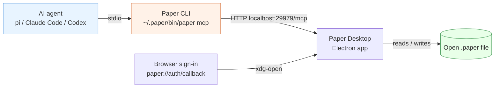

# Paper Desktop MCP on Linux: AppImage Sandboxing, Browser Callbacks, and Agent Integration

[Paper](https://paper.design) is a design tool whose documents are HTML and CSS documents, which makes it directly legible to language-model agents. The official integration path is a Model Context Protocol (MCP) server that ships with the Paper Desktop application. On macOS and Windows this integration is a one-click install. On Linux the application ships as an AppImage, and three separate mechanisms — Chromium's process sandbox, the desktop entry database, and the URL-scheme handler registry — must be configured by hand before the MCP server becomes usable. This article explains each mechanism, why it fails by default on a modern Ubuntu-derived distribution, and how to configure it correctly. Every command below was executed and verified on Ubuntu 24.04 (AppArmor enabled, `kernel.apparmor_restrict_unprivileged_userns = 1`).

> [!summary]
> - Paper Desktop on Linux requires three manual integrations: an AppArmor profile granting `userns` to the AppImage, a desktop entry plus `xdg-mime` registration for `paper://` OAuth callbacks, and an MCP stdio entry pointing at the CLI the app installs at `~/.paper/bin/paper`.
> - The Electron SUID-sandbox failure and the later GPU-process failure have different causes and different fixes; `--no-sandbox` addresses the first and `--in-process-gpu` the second.
> - The stdio transport (`paper mcp`) supersedes the older HTTP transport (`http://127.0.0.1:29979/mcp`) because tool discovery works even when the desktop app is closed.

## Why this note exists

The failure chain on Linux is not obvious from any single error message. The first error — "The SUID sandbox helper binary was found, but is not configured correctly" — mentions file ownership and mode `4755`, which suggests a packaging bug in the AppImage. It is not a packaging bug. The second error — "GPU process launch failed: error_code=1002" — appears after the first is worked around and suggests a graphics driver problem. It is not a graphics driver problem. Both are consequences of how Ubuntu 23.10+ restricts unprivileged user namespaces, and both disappear once the kernel-level restriction is lifted for this specific binary. This note preserves the full diagnosis so it does not have to be re-derived for the next Electron AppImage.

## The MCP architecture

Paper's integration has three processes with distinct responsibilities:

- **Paper Desktop** (Electron) is the design canvas. When it runs, it starts an MCP server in the background and serves it over HTTP at `http://127.0.0.1:29979/mcp` while a file is open. It also writes a standalone CLI binary to `~/.paper/bin/paper`.
- **The Paper CLI** (`~/.paper/bin/paper`) speaks MCP over stdio. Invoked as `paper mcp`, it bridges an agent's stdio channel to the desktop app's HTTP server. Its declared advantage over direct HTTP: an agent that connects through the CLI can list tools and start sessions even when the desktop app is not running; reads and writes succeed once the app opens a file.
- **The agent** (Claude Code, Codex, Cursor, pi, or any MCP client) connects only to the CLI. It never needs the HTTP URL, which is an implementation detail of the desktop app.



One property of this architecture shapes every session with an agent: **the MCP server operates on whichever file is open in the desktop app**. There is no per-request file targeting in the common tools — `paper_get_basic_info` returns the file currently open, and `paper_write_html` writes into that file. To work on a specific document, open it in Paper Desktop first. Read access extends to files shared with your account; a view-only shared file returns its full artboard list, node tree, and styles, but `fileName` may come back as `null` and writes will not succeed.

## The Electron sandbox on a locked-down kernel

### What the error means

Chromium-derived applications isolate rendering and network code in child processes. On Linux, this isolation historically used a SUID-root helper binary (`chrome-sandbox`) that re-creates the process tree inside new user and mount namespaces. The helper must be owned by root with mode 4755. Inside an AppImage, the application is mounted from a read-only squashfs at a path like `/tmp/.mount_paper-XXXXX/chrome-sandbox`, where the ownership condition cannot be changed to root. Chromium detects this and aborts deliberately rather than continue unsandboxed:

```
FATAL:sandbox/linux/suid/client/setuid_sandbox_host.cc:166] The SUID
sandbox helper binary was found, but is not configured correctly. Rather
than run without sandboxing I'm aborting now. You need to make sure that
/tmp/.mount_paper-rBQHnl/chrome-sandbox is owned by root and has mode 4755.
```

The message describes a real condition, but the condition is not actionable inside an AppImage. The actionable path is the alternative sandbox backend: user namespaces created by an unprivileged process.

### Why Ubuntu blocks it

Since Ubuntu 23.10, unprivileged processes may not create user namespaces unless an AppArmor profile allows it:

```
$ sysctl kernel.apparmor_restrict_unprivileged_userns
kernel.apparmor_restrict_unprivileged_userns = 1
```

Packaged applications (debs and snaps) ship AppArmor profiles that grant themselves `userns`. An AppImage ships no profile, so every `clone(CLONE_NEWUSER)` from the AppImage is denied, and the sandbox aborts with the message above.

### The fix: a per-binary AppArmor profile

The correct fix is not to disable the sandbox (`--no-sandbox`) and not to relax the restriction globally, but to grant this one binary the namespace capability:

```bash
sudo tee /etc/apparmor.d/paper-desktop >/dev/null <<'EOF'
abi <abi/4.0>,
include <tunables/global>

profile paper-desktop /home/manuel/.local/apps/paper-desktop-0.5.15x86_64.AppImage flags=(unconfined) {
  userns,

  include if exists <local/paper-desktop>
}
EOF
sudo apparmor_parser -r /etc/apparmor.d/paper-desktop
```

Two details in this profile matter. First, the profile path is matched literally against the AppImage's filesystem path, so **moving the AppImage requires updating and reloading the profile**. Second, `flags=(unconfined)` scopes the grant narrowly: the process receives the `userns` permission and is otherwise not confined by this profile. After loading the profile, the SUID-helper abort disappears because Chromium proceeds with its namespace-based sandbox instead of the SUID helper.

### The GPU process failure

With the sandbox issue addressed, a second failure can appear:

```
ERROR:content/browser/gpu/gpu_process_host.cc:1029] GPU process launch failed: error_code=1002
FATAL:content/browser/gpu/gpu_process_host.cc:417] GPU process isn't usable. Goodbye.
```

The GPU process is itself a sandboxed child. When its launch fails, Electron aborts on the assumption that rendering is unavailable. Running the compositor in the browser process sidesteps the child-process launch entirely:

```bash
./paper-desktop-0.5.15x86_64.AppImage --in-process-gpu
```

Note that `--disable-gpu` does **not** fix this: that flag changes how rendering is done inside the GPU process but still launches the process, so the launch failure persists. The failure mode was reproducible in an environment where `DISPLAY=:0` was set and the X server was reachable, which rules out a missing display. It is worth testing whether the AppArmor profile alone resolves the GPU launch too, once the profile is loaded; if the GPU process succeeds, `--in-process-gpu` can be dropped.

### Working launch flags before the profile exists

If the AppArmor profile has not yet been installed, the application still runs with both flags:

```bash
./paper-desktop-0.5.15x86_64.AppImage --no-sandbox --in-process-gpu
```

The vendor's own desktop entry ships `Exec=AppRun --no-sandbox`, which indicates the vendor already expects Linux users to disable the SUID sandbox. The AppArmor profile is the better configuration because it preserves namespace isolation while satisfying the kernel policy; `--no-sandbox` should be treated as a temporary workaround, not the end state.

## Registering the `paper://` callback scheme

Paper's browser sign-in completes by redirecting to a URL such as:

```
paper://auth/callback?code=01M4Y66MWHTAF6HSTT44ZCSV96
```

For the browser to hand this URL to an application, two registrations must exist: a desktop entry declaring the `MimeType`, and a scheme-to-entry mapping in the desktop database. An AppImage does not create either.

### Extracting the metadata

The AppImage contains its desktop entry and icon in an embedded squashfs:

```bash
./paper-desktop-0.5.15x86_64.AppImage --appimage-extract
```

This writes `squashfs-root/`, which contains `paper-desktop.png` and a `.desktop` file whose relevant lines are:

```ini
[Desktop Entry]
Name=Paper
Exec=AppRun --no-sandbox %U
MimeType=x-scheme-handler/paper;x-scheme-handler/paper-dev;
```

Two changes are required before this file is installed. `Exec` must reference the AppImage's absolute path, because the desktop environment launches the entry directly, without the AppImage's mounting context; and `%U` must be preserved, because it is the placeholder through which the browser passes the callback URL as an argument.

### Installing the entry and the handler

```bash
mkdir -p ~/.local/share/icons/hicolor/512x512/apps
cp squashfs-root/paper-desktop.png ~/.local/share/icons/hicolor/512x512/apps/

mkdir -p ~/.local/share/applications
cat > ~/.local/share/applications/paper-desktop.desktop <<'EOF'
[Desktop Entry]
Name=Paper
Exec=/home/manuel/.local/apps/paper-desktop-0.5.15x86_64.AppImage --no-sandbox --in-process-gpu %U
Terminal=false
Type=Application
Icon=paper-desktop
StartupWMClass=Paper
Comment=Paper Desktop
MimeType=x-scheme-handler/paper;x-scheme-handler/paper-dev;
Categories=Utility;
EOF

update-desktop-database ~/.local/share/applications
xdg-mime default paper-desktop.desktop x-scheme-handler/paper
xdg-mime default paper-desktop.desktop x-scheme-handler/paper-dev
```

The `xdg-mime default` calls write the scheme mapping into `~/.config/mimeapps.list`. Verification is one command per scheme:

```bash
$ xdg-mime query default x-scheme-handler/paper
paper-desktop.desktop
```

The single-instance lock is the last piece of the callback flow. When the browser invokes the desktop entry while Paper is already running, the new process forwards the callback URL to the running instance through the single-instance lock and exits:

```
[startup] Another Paper instance is already running (single-instance lock not acquired) — exiting.
```

This exit is the success path for a callback, not an error.

## Connecting an agent over stdio

The CLI that the desktop app installed at `~/.paper/bin/paper` is the only endpoint an agent needs. The generic stdio configuration is:

```json
{
  "mcpServers": {
    "paper": {
      "type": "stdio",
      "command": "/home/manuel/.paper/bin/paper",
      "args": ["mcp"]
    }
  }
}
```

Agent-specific one-liners exist for Claude Code and Codex, and the desktop app's "Connect your agent" dialog can write the config itself:

| Agent | Install method | Notes |
|---|---|---|
| Claude / Claude Code | dialog, or `claude plugin install paper-desktop@paper` | installs both the Chat extension and Claude Code server |
| Codex | dialog, or `codex mcp add paper -- ~/.paper/bin/paper mcp` | shared config with the ChatGPT app |
| Cursor | marketplace plugin, or `/add-plugin paper-desktop` | plugin-based |
| VS Code | dialog; `.vscode/mcp.json` stdio entry | server started from the editor |
| pi | `~/.pi/agent/mcp.json` stdio entry | session must be restarted to load |

### Why stdio supersedes the HTTP endpoint

The older documented transport connected agents directly to `http://127.0.0.1:29979/mcp`. That endpoint only exists while the desktop app is running and a file is open. An agent configured against it fails its connection handshake at startup when the app is closed, which surfaces in the agent as a failed server rather than an available-but-idle one. The CLI fixes this by holding the tool manifest locally: the agent's `initialize` handshake succeeds against the CLI at any time, and the CLI returns errors only for read/write calls that genuinely need the desktop app. New sessions therefore start with the Paper tools visible regardless of app state.

## The tool surface, verified

With the server connected, `get_basic_info` on an open file returns the page tree, artboard inventory with world coordinates, available font families, and design tokens. A complete write cycle is three calls:

1. `create_artboard` — takes `name` and `styles` (a camelCase CSS object; width and height are required, whole-pixel values) and returns the new node ID. The artboard is placed in an empty canvas region automatically.
2. `write_html` with `mode: "insert-children"` and the artboard's ID as `targetNodeId` — parses an HTML fragment with inline styles into design nodes. Because Paper documents are HTML/CSS documents, this is not a lossy import step; the markup becomes the design.
3. `finish_working_on_nodes` — required to release the nodes the session worked on.

A minimal verification is an 800×600 artboard with one centered heading:

```
create_artboard({ name: "Hello World", styles: { display: "flex",
  flexDirection: "column", alignItems: "center", justifyContent: "center",
  width: "800px", height: "600px", backgroundColor: "#f5f5f5" } })
→ { "id": "8L-0", ... }

write_html({ targetNodeId: "8L-0", mode: "insert-children",
  html: '<h1 style="font-family: Inter, sans-serif; font-size: 64px;
         font-weight: 700; color: #111; margin: 0;">Hello World</h1>' })
→ { "createdNodes": [{ "id": "8M-0", "component": "Text" }] }

finish_working_on_nodes({ nodeIds: ["8M-0", "8L-0"] }) → OK
```

The read side is symmetric: `get_jsx` returns the JSX representation of a node, `get_computed_styles` the resolved CSS, `get_tree_summary` a compact subtree description, `get_screenshot` a rendered image, and `find_nodes` a style- or content-based search. Roughly 37 tools cover file management, inspection, mutation, tokens, comments, and export.

## Common failure modes

- **SUID helper abort at launch.** Caused by AppArmor denying user namespaces to the AppImage. Fix: install the per-binary `userns` profile. `--no-sandbox` is the workaround; the profile is the fix.
- **`GPU process launch failed: error_code=1002` after `--no-sandbox`.** The GPU child process cannot launch. `--in-process-gpu` sidesteps the child process; `--disable-gpu` does not help because the process is still launched.
- **Browser shows a generic handler dialog without Paper.** The desktop entry is missing, or `xdg-mime default` was never run, or the scheme mapping in `~/.config/mimeapps.list` is stale. Verify with `xdg-mime query default x-scheme-handler/paper`.
- **AppImage moved, sandbox error returns.** The AppArmor profile matches the literal filesystem path. Update the path in `/etc/apparmor.d/paper-desktop` and reload with `apparmor_parser -r`. The desktop entry's `Exec` line must be updated in the same step.
- **MCP tools absent from a new pi session.** pi reads its MCP config at session start. Restart the session after editing `~/.pi/agent/mcp.json`.
- **Writes go to the wrong file.** The MCP operates on the file open in the desktop app. `get_basic_info` is the first call of any session; its `file.id` and `fileName` tell you where subsequent writes will land.

## Working rules

- Keep the AppImage at one stable path (`~/.local/apps/`), and update the AppArmor profile and desktop entry together when it moves. The profile path match is the reason both break on a move.
- Prefer the AppArmor `userns` profile over `--no-sandbox`; prefer testing without `--in-process-gpu` after the profile is loaded.
- Connect agents through the stdio CLI (`paper mcp`), not the HTTP endpoint, so tool discovery does not depend on the desktop app running.
- Call `get_basic_info` before any mutation to confirm which file the desktop app has open.
- Always close a mutation sequence with `finish_working_on_nodes`.

## Related notes

- [[PROJ - ZK Tool]]
