# Francois Storefront: Creator Pages, Plans, Demos, a Studio, Videos and Release Attachments

Francois Catalog hosts single-file HTML applications. A subscriber launches a private *instance* of a published application on its own browser origin, and the application gets a database, shared rooms, comments, assets and metered model calls through a runtime script. Two earlier reports describe the platform ([[PROJECT REPORT - Francois Catalog - Hosted Subscriber Platform with Isolated Instances, Launch Grants and Metered Model Calls - A Technical Deep Dive]]) and its production deployment ([[PROJECT REPORT - Francois Yolo Deployment - Shipping a Multi-Origin Go Service to K3s with Argo CD, Vault, ZITADEL and Stripe - A Technical Deep Dive]]). This report covers what came next: turning a closed beta with an admin panel into a storefront where two creators, Manuel and Ramon, show their applications, explain them, let visitors try them, and sell ongoing access to them as subscriptions.

The work happened in two tickets on one branch. FRANCOIS-004 built the storefront itself: a content model, server-rendered public pages, a studio for creators with its own API and role, subscription plans with an entitlement resolver, visitor demos without an account, and personal API tokens with a `push` command. FRANCOIS-005 added first-class videos and release attachments. Both were verified against PostgreSQL integration tests and in a browser against a local stack with a real identity provider and a Stripe sandbox.

> [!summary]
> - **The product is access to live artifacts.** A subscription buys the right to run applications in private instances, with model credits; the storefront exists to show what that buys. Public pages are server-rendered Go templates; the studio and account pages stay in the React SPA.
> - **One pure function decides what an account may do.** `resolveEntitlement(user, billingDecision, settings)` maps roles, subscriptions and grants to exactly one *plan*, and every check (run, launch, share, download, model call, demo) asks it. Plans live in the versioned settings document, which forced a migration that rewrites stored settings.
> - **Visitors can try before paying.** A demo creates a guest account and a non-sliding session bounded by the demo lifetime, then uses the ordinary launch handshake; admission, rate and model spending are capped separately from paying users.
> - **Media and files scale past the first design.** Videos stream from disk with Range requests, embed in Markdown through the goldmark parser context, and carry poster frames captured in the browser. Releases carry attachments that follow the release's download rule but, unlike the application HTML, can change after publishing.

## How to read this report

Chapter 1 defines the terms the rest depends on, in the order they build on each other. Chapter 2 states what was asked and where the code stood. Chapter 3 gives the architecture and follows one application, Polis, through every new path. Chapters 4 to 12 take each subsystem in turn: the content model, public pages, Markdown, the studio, plans, demos, tokens, videos and attachments. Chapter 13 records how the work was verified, Chapter 14 collects the failures and what they taught, and Chapter 15 lists the open work. Readers who only need the design decisions can read Chapters 1, 3 and the *Decision* paragraphs.

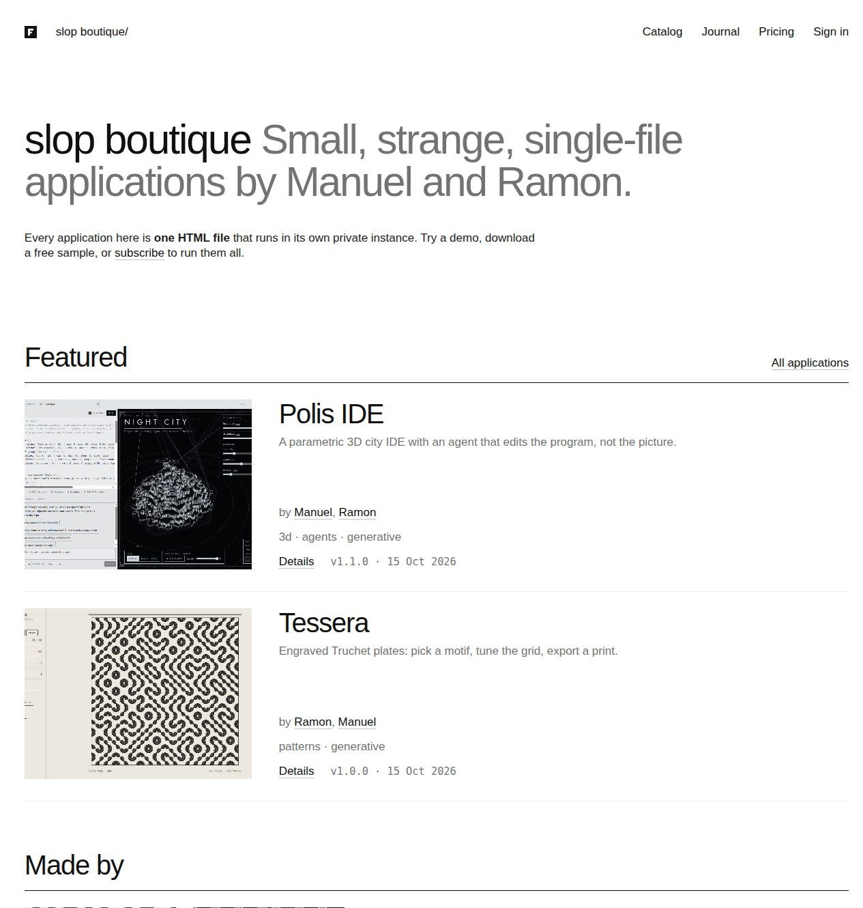

*The local storefront after seeding: storefront wording from the settings, featured applications with covers and creators, creator cards and the journal.*

## 1. Concepts the storefront depends on

The platform already had most of the nouns. The storefront adds a few and changes the meaning of one.

**Portal origin and site.** The portal origin is the trusted website, for example `https://slop.boutique`, which serves the catalog, the account pages, the admin and studio pages and their JSON API. Session cookies live on it. A *site* is a portal origin plus the domain its instances run under (`i-<id>.apps.slop.boutique`). One process serves several sites from one database.

**Artifact and release.** An artifact is a catalog entry (`polis`) with a title, a short description, tags and a visibility. A release is one immutable version of the artifact's HTML plus its capability manifest, moving from `draft` to `published` and optionally `withdrawn`. Its bytes are content-addressed blobs on disk: the storage key is `blobs/<xx>/<sha256>`.

**Instance, launch and grant.** An instance is a running copy of a release with its own data, served on its own origin. To act for a signed-in user without sharing the portal cookie, the portal issues a one-use *launch code*, which the instance origin exchanges for a short-lived *runtime grant*. Every runtime request re-checks authorization through `authorizeInstance`.

**Settings revision.** A versioned JSON document of non-secret policy: approved models and their credit costs, limits, and, after this work, plans, demo limits and storefront wording. Each save is a new row in `platform_settings`; the newest is active. Parsing is strict: unknown fields are rejected, and missing fields decode as zero and fail validation. This property matters twice in this report.

**Plan.** A named tier in the settings document: a key, a rank, prices (Stripe price IDs per interval), instance and member limits, monthly and daily credits, and an optional list of allowed models. Higher rank means more access. An artifact names the plan it requires; an empty requirement means the lowest *paid* plan.

**Entitlement.** The plan that applies to an account right now, together with its source (`staff`, `subscription`, `trial`, `complimentary`, `guest`, `free`, `disabled`). Before this work the platform had a yes/no *access decision*; the entitlement replaces every use of it.

**Page and page draft.** The public write-up of an artifact: Markdown body, cover and gallery, stored as a JSON document on the artifact. Editors change a draft copy and publish it separately.

**Media.** A public image or video uploaded for pages, posts and profiles, served at `/media/<id>` on the portal origin. A video can have a *poster*, an image media item shown before playback and on cards.

**Creator, editor and creator role.** A creator is a public profile (name, bio, avatar, links), optionally linked to a user account. An artifact credits one or more creators; the users linked to those creators are its *editors*. The `creator` user role grants access to the studio; object rules then limit each creator to their own artifacts and posts.

**Guest.** A user with role `guest`, created for a visitor who starts a demo. A guest never signs in through the identity provider.

**Personal API token.** A secret of the form `frt_` followed by 43 base64url characters, stored only as its SHA-256 hash, accepted only by the studio API.

**Attachment.** A supplementary file on a release, such as a manual or an archive. It is downloaded under the release's rule but is not part of the immutable release.

## 2. Requirements and starting point

### 2.1 What was asked

The owners want a place where the two of them sell and showcase their artifact design work, with a write-up for each artifact, multiple tiers, and a working authoring flow. When asked what is being sold, the answer was "Ongoing access to live artifacts (subscriptions)". That sentence sets the shape of everything else: the public pages are an advertisement for what a subscription runs, not a download shop, and the important access question is "which applications may this account run", not "has this account paid".

Later requests added videos and "multiple file attachments to a version for additional information".

### 2.2 Where the code stood

The hosted catalog was a React SPA. Every page, including the public catalog, was rendered in the browser from `/api/catalog`. Releases were uploaded in the admin UI by administrators only. Access was binary: `billing.Policy.Access` returned allowed or denied, from Stripe subscription projections and complimentary grants. Instance and member limits and credit allowances were global settings, the same for every subscriber. There was one Stripe price, passed on the command line as `--stripe-price-id`. Artifacts had a one-line description and nothing else.

Four consequences followed:

- Search engines and link previews saw an empty shell, because the SPA renders client-side.
- Only administrators could publish, so a creator could not maintain their own work.
- Tiers were impossible without replacing the access decision everywhere it was used.
- There was nowhere to put a write-up, an image or a video.

## 3. Architecture

### 3.1 Surfaces

The work splits the portal into three kinds of surface with different rendering and different authorization.

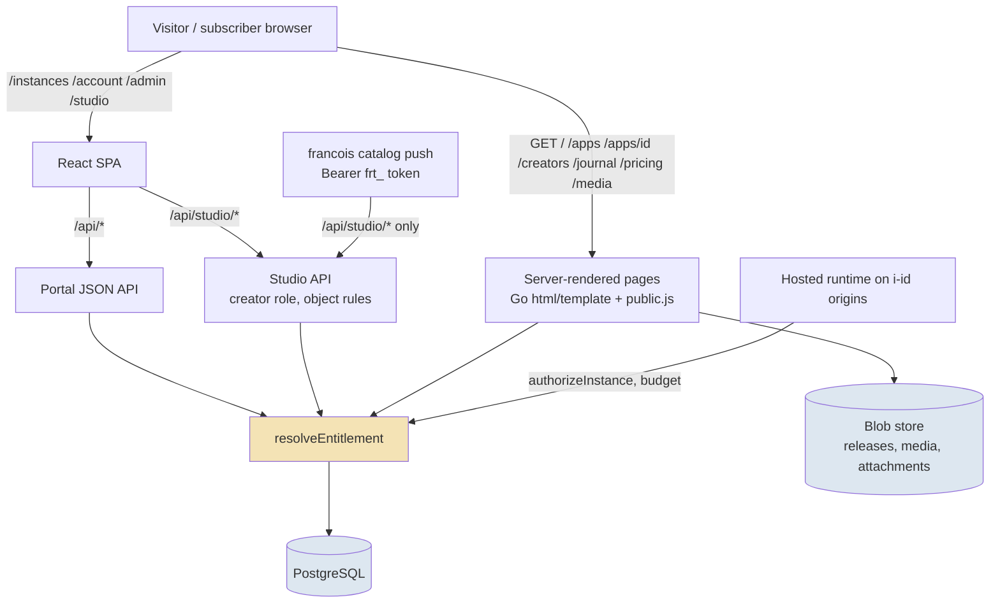

- **Public pages** are rendered by Go templates so they work without JavaScript. A small script, `public.js`, replaces placeholders with session-dependent actions: sign-in becomes *Run* or *Try the demo*, pricing buttons become checkout buttons.
- **The SPA** keeps instances, account, admin and the new studio.
- **The studio API** under `/api/studio/*` is a separate namespace from `/api/admin/*`. The creator role and API tokens reach it, and nothing else.

### 3.2 Data model

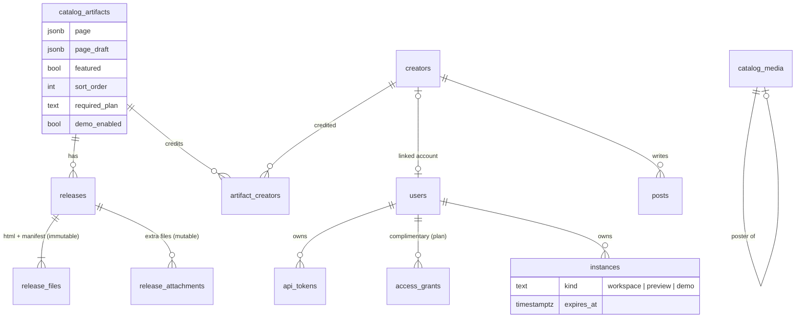

Plans, demo limits and storefront wording are not tables. They live in the settings document (Chapter 8).

### 3.3 One application followed end to end

Polis is a parametric 3D city IDE whose built-in agent edits the scene program. Following it through the new paths shows how the pieces meet.

1. **Publishing.** Manuel runs `francois catalog push --server https://slop.boutique --token-file token --artifact-id polis --version 1.1.0 --html polis.html --free-sample --attach "Polis DSL cheat sheet.pdf" --publish`. The guard sees `Authorization: Bearer frt_…` on `/api/studio/releases`, resolves the token to Manuel's user, and the studio checks that Manuel is credited on `polis`. The release is validated, stored as a draft, the attachment is streamed to the blob store, and the release is published.
2. **Writing the page.** In the studio, Manuel edits the Markdown write-up, picks a video cover from the media library and embeds the same video further down with ``. *Save draft* stores `page_draft`; `/apps/polis?draft=1` shows it to editors only; *Publish page* copies it into `page`.
3. **A visitor arrives.** `GET /apps/polis` renders the template. The cover is a muted looping video with its poster; the write-up renders the embed as a `<video>` player; the Versions list shows v1.1.0 with *Download HTML* (free sample) and the attachment links.
4. **The visitor tries it.** *Try the demo* posts to `/api/demos`. The server creates a guest user, sets a 30-minute session cookie, creates a `demo` instance and sends the browser to the launcher. The usual launch handshake runs; `authorizeInstance` admits the demo for its owner until it expires; model calls draw on the demo's own ledger and a shared daily budget.
5. **The visitor subscribes.** `/pricing` lists the plans. *Subscribe monthly* posts `{plan: "subscriber", interval: "month"}` to checkout; Stripe's webhook projects the subscription; `resolveEntitlement` now maps the subscription's price to the *Subscriber* plan.
6. **The subscriber runs it.** Creating an instance checks `CanRun` (plan rank against the artifact's required plan) and the plan's instance limit. Model calls reserve credits against the plan's monthly and daily allowance and only for models the plan allows.

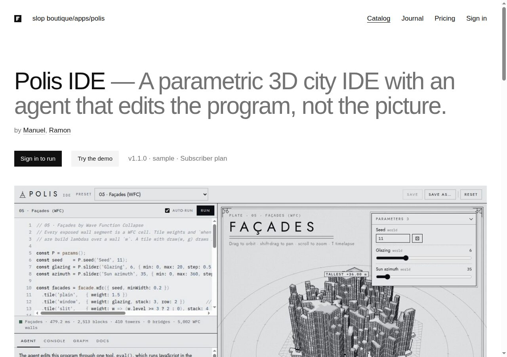

*The Polis page signed out: title and description, creators, the session actions filled in by `public.js` (sign in, demo), the release line with its required plan, and the video cover playing muted.*

## 4. The content model

Migration `004_storefront.sql` adds the storefront tables and columns in one step.

```sql
ALTER TABLE catalog_artifacts
    ADD COLUMN page jsonb NOT NULL DEFAULT '{}',      -- {"body","cover","gallery"}
    ADD COLUMN page_draft jsonb,                      -- editor's unpublished copy
    ADD COLUMN featured boolean NOT NULL DEFAULT false,
    ADD COLUMN sort_order integer NOT NULL DEFAULT 0,
    ADD COLUMN required_plan text NOT NULL DEFAULT '',
    ADD COLUMN demo_enabled boolean NOT NULL DEFAULT false;
```

It also creates `catalog_media`, `creators`, `artifact_creators`, `posts` and `api_tokens`, widens the role check to `subscriber | creator | admin | guest`, adds a `plan` column to complimentary grants, and adds the `demo` instance kind with an `expires_at` column.

**Decision: the draft is a second column, not a revision table.** A revision table would give history, but the workflow needs exactly two states, the public page and the one being edited. Two columns make publishing a single statement, `UPDATE … SET page = page_draft, page_draft = NULL`, and make "is there an unpublished draft" a null check. Fields that are not prose (title, tags, visibility, featured, required plan) apply immediately, as they did before.

**Decision: media lives in the release blob store.** Media bytes are written to the same content-addressed directory as releases, so the existing nightly backup of that volume covers them, identical uploads share one blob, and no second storage system is introduced. The cost is that deleting a media row cannot delete its blob, because another row may share it; there is no garbage collector yet.

The short `description` keeps its old meaning, a one-line summary shown on cards and in link previews. The write-up is separate. A media item cannot be deleted while anything refers to it: a page or draft field, a creator avatar, a post cover, a `/media/<id>` URL inside any Markdown body (pages, drafts, bios, posts, the storefront intro), or, after FRANCOIS-005, a video's poster.

## 5. Server-rendered public pages

The public routes are `/`, `/apps`, `/apps/{id}`, `/creators/{slug}`, `/journal`, `/journal/{slug}`, `/journal/feed.xml` (RSS), `/pricing` and `/media/{id}`. They are rendered with `html/template`, which escapes every value unless it is typed as `template.HTML`. The only `template.HTML` values come from the Markdown renderer.

Three implementation details are worth knowing before changing these pages.

- **Templates are parsed per page.** Every page template defines a block named `content`, and the layout calls `{{template "content" .}}`. Parsing all page templates into one set would let the last definition of `content` win, so each page gets its own set: the layout, shared partials (`cards`, `media`, `hero`, `thumb`) and that one page.
- **Rendering is buffered.** A template error halfway through a page would otherwise send a 200 with half a document. `render` executes into a buffer and sends a clean 503 page on failure.
- **Sessions only change placeholders.** The server renders a complete page for an anonymous visitor (*Sign in to run*). `public.js` fetches `/api/session` and replaces `[data-actions]` with the right buttons (*Run*, *Try the demo*, *Your plan does not include this application*) and binds checkout buttons. Search engines and link previews see the anonymous page.

The Content-Security-Policy of the portal allows images and media only from its own origin (`img-src 'self' data:; media-src 'self'`). This is why the Markdown renderer refuses external images: a remote image would be blocked by the browser anyway, and it would leak visitor addresses to third parties.

`/media/{id}` responses carry `Content-Security-Policy: default-src 'none'; sandbox`, `nosniff` and a one-year immutable cache, with an `ETag` of the content hash. Only types detected from the bytes are accepted: PNG, JPEG, GIF, WebP, MP4 and WebM. SVG is refused because it can carry script.

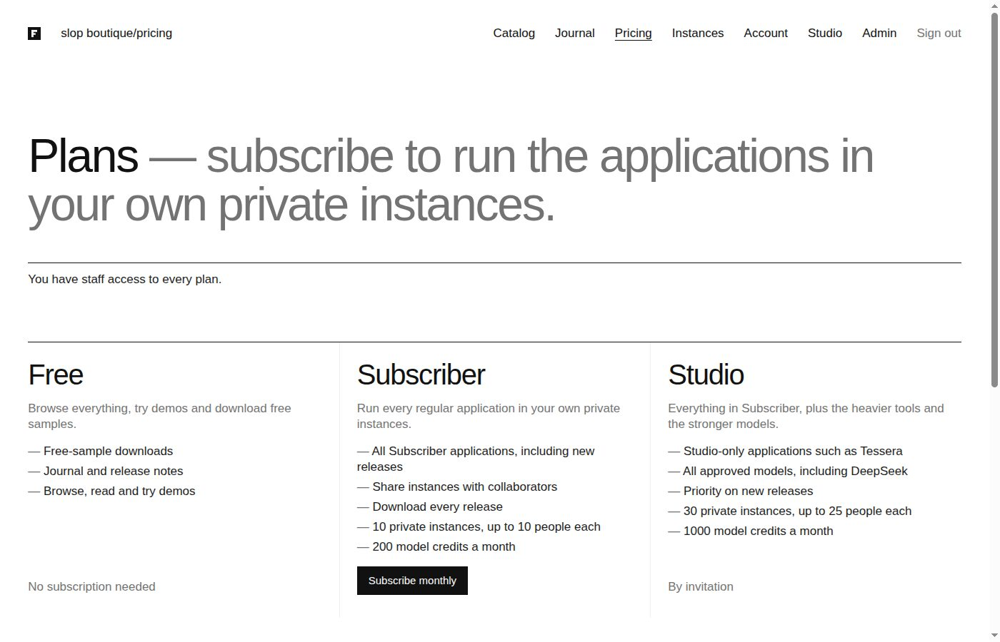

*The pricing page renders the plans from the settings document: description, highlights, limits and credits, and a checkout button per price. Plans without a price show "By invitation".*

## 6. Markdown with video embeds

Write-ups, bios, posts and the storefront intro are Markdown, rendered on the server by goldmark with the GitHub extensions and automatic heading IDs. The renderer has three rules:

- Raw HTML in the source is dropped. goldmark omits it unless `html.WithUnsafe` is set, and dangerous link schemes such as `javascript:` are removed.
- An image whose URL is exactly `/media/<id>` renders as a portal image. Any other image becomes a plain link with the alt text, and a dangerous image URL becomes the alt text alone.
- Since FRANCOIS-005, a `/media/<id>` image that refers to a video renders as a video player.

The third rule needs information the URL does not carry: whether `med_7012…` is an image or a video. The renderer is a single `*Markdown` value shared by all requests, and goldmark's node renderer functions receive only the output writer, the source and the node, so per-request data cannot be passed through the renderer. goldmark does offer a per-parse context, and AST transformers run with access to it. The implementation uses both:

```go
// Render returns sanitised HTML. embeds maps referenced media IDs to their types.
func (m *Markdown) Render(source string, embeds map[string]Embed) template.HTML {
    pc := parser.NewContext()
    pc.Set(embedsKey, embeds)
    m.md.Convert([]byte(source), &buf, parser.WithContext(pc))
    ...
}

// The transformer marks image nodes that refer to portal videos.
func (embedTransformer) Transform(doc *ast.Document, _ text.Reader, pc parser.Context) {
    embeds, _ := pc.Get(embedsKey).(map[string]Embed)
    ast.Walk(doc, func(n ast.Node, entering bool) (ast.WalkStatus, error) {
        img, ok := n.(*ast.Image)
        ...
        if e, found := embeds[id]; found && IsVideo(e.Type) {
            img.SetAttributeString("video", true)
            if e.Poster != "" { img.SetAttributeString("poster", e.Poster) }
        }
    })
}
```

The renderer reads the attributes and writes `<video src="/media/…" controls preload="metadata" playsinline poster="/media/…" aria-label="…">`. The server side is one helper used by every page that renders Markdown, so the home intro, artifact pages, creator bios, posts and the studio's live preview behave identically:

```go
func (s *Server) markdown(ctx context.Context, source string) template.HTML {
    embeds := map[string]content.Embed{}
    if ids := content.MediaRefs(source); len(ids) > 0 {     // regex /media/(med_…)
        media, _ := s.Store.MediaByIDs(ctx, ids)             // one query
        for id, m := range media { embeds[id] = content.Embed{Type: m.MediaType, Poster: m.Poster} }
    }
    return s.md.Render(source, embeds)
}
```

If the lookup fails, the map is empty and every reference renders as an image, which is the pre-FRANCOIS-005 behaviour. The test table covers the cases that matter for safety: a video with and without a poster, an image that stays an image, an unknown ID that stays an image, and an alt text containing `"><script>` that must come out escaped.

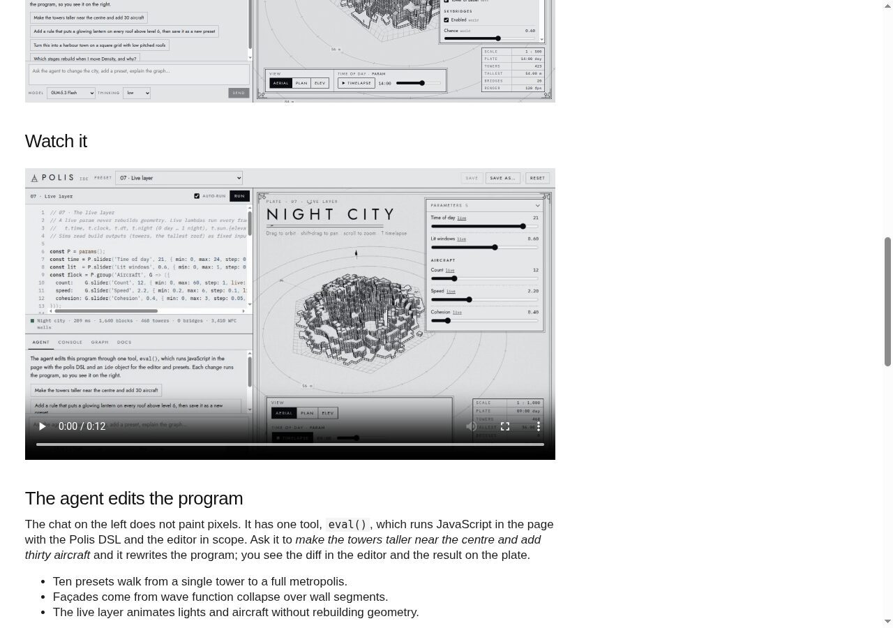

*A video embedded in the Polis write-up with ``, showing its poster before playback.*

## 7. The studio

### 7.1 A separate API with a creator role

The studio API lives under `/api/studio/*` and is guarded at the `creator` level: users with role `creator` or `admin` pass, everyone else gets `403 creator_required`. Role alone does not decide which objects a creator may change. Two object rules do:

- `canEditArtifact(user, artifactID)`: administrators may edit any artifact; a creator may edit an artifact that credits a creator profile linked to their account.
- `canEditPost(user, post)`: administrators, or the creator linked to the post's author.

A creator needs a linked profile before creating artifacts or posts (`409 creator_profile_required`), because the credit is how ownership is recorded. Only administrators create profiles and link accounts. Uploading a release for an artifact that does not exist creates it and credits the uploader's profile.

**Decision: a separate namespace instead of widening the admin API.** The admin API covers users, billing, settings and the audit log. Giving creators parts of it would have meant per-route exceptions in a namespace whose rule is "administrators only". A separate namespace makes the boundary a path prefix, which is also what lets API tokens be restricted to it with one check (Chapter 10). Release management moved from `/api/admin` to the studio API; administrators reach it there.

The studio API covers artifacts (details, page drafts, publish, discard), releases (upload, check, publish, withdraw, delete draft, preview), media, attachments, posts, creators, a Markdown preview, the plan list and tokens. Preview instances, an editor's private run of a draft release on an isolated origin, are authorized for the artifact's editors.

### 7.2 The studio UI

The studio is a section of the SPA with five parts: artifacts, journal, creators, media and tokens. An artifact opens in an editor with four tabs.

- **Details:** title, visibility, short description, tags, required plan, featured flag, sort order, credited creators.
- **Page:** a Markdown editor with a debounced server-rendered preview (the same renderer as the public page), cover and gallery pickers, *Save draft*, *Discard draft* and *Publish page*.
- **Releases:** an HTML drop zone, version, release notes, the capability manifest, the free-sample flag, *Check* and *Save draft*; below it, the versions with *Preview*, *Publish*, *Withdraw* and, since FRANCOIS-005, *Attachments (n)*.
- **Demo:** whether visitors may start a demo of this artifact.

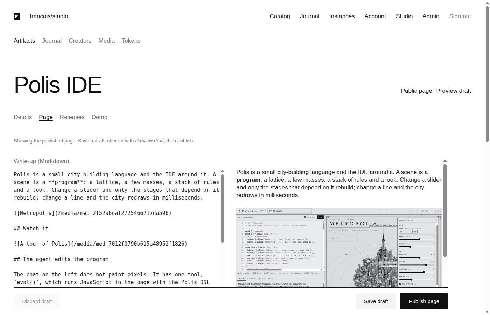

*The Page tab: Markdown on the left (with a video embed), the server-rendered preview on the right, and the draft actions at the bottom.*

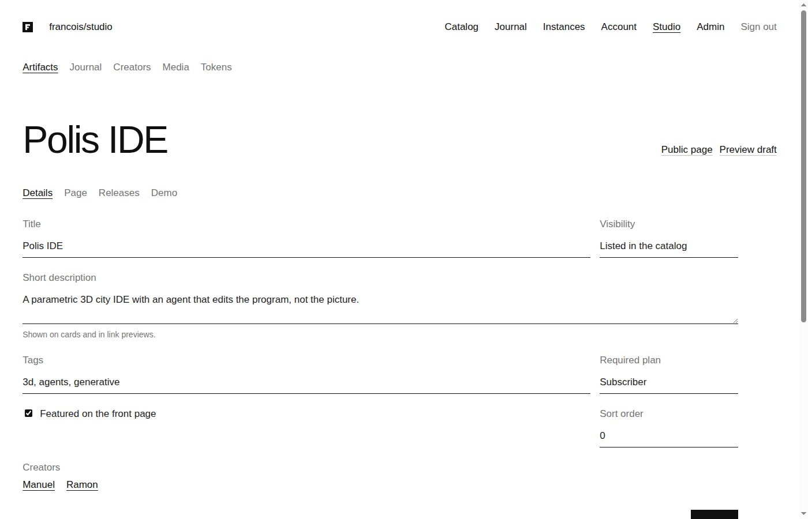

*The Details tab: fields that apply immediately, including the required plan and the credited creators.*

## 8. Plans and entitlements

### 8.1 Plans in the settings document

```go
type Plan struct {
    Key, Name          string
    Rank               int
    Description        string
    Highlights         []string
    Public             bool
    Prices             []PlanPrice // {priceId, interval, label}
    Instances          int
    MembersPerInstance int
    MonthlyCredits     int
    DailyCredits       int
    Models             []string    // empty = every approved model
}
```

**Decision: plans live in the settings document, not in tables.** The settings document already had validation, versioned history, an editor in the admin UI and an audit trail. Plans refer to the approved models in the same document, so validating "this plan allows `lunaroute/glm-5.3-flash`" against "approved models" is one in-memory check. Prices moved off the command line: the accepted Stripe prices are the union of every plan's prices, and `--stripe-price-id` was removed.

Validation enforces unique keys and ranks, a `free` plan at rank 0 without prices, unique price IDs across plans, and model lists that name approved models only.

### 8.2 One resolver

The entitlement is computed by a pure function. Billing still produces its decision exactly as before (`billing.Policy.Access`, with the accepted prices now taken from the plans), but the decision now also names the price it rests on and, for grants, the granted plan.

```go
//  disabled              → nothing
//  creator or admin      → the highest plan (staff run everything)
//  guest (demo visitor)  → the demo allowance, no workspaces
//  standing subscription → the plan that owns its price
//  complimentary grant   → the granted plan, or the highest plan
//  otherwise             → the free plan
func resolveEntitlement(u store.User, d billing.Decision, doc settings.Document) Entitlement
```

Checks are methods on the result:

```go
// CanRun reports whether the plan includes an artifact.
func (e Entitlement) CanRun(a store.Artifact, doc settings.Document) bool {
    switch e.Source {
    case SourceDisabled, SourceGuest:
        return false
    case SourceStaff:
        return true
    }
    return e.Plan.Rank >= doc.RequiredRank(a.RequiredPlan)
}
```

`RequiredRank("")` is the rank of the lowest plan above zero, so by default nothing runs on the free plan; an artifact must opt into being free to run. The free plan has zero instances anyway, which means it can browse, read, download free samples and try demos.

| Source | Plan | Typical case |
|---|---|---|
| `disabled` | free (and nothing passes) | an administrator disabled the account |
| `staff` | highest | Manuel and Ramon, administrators |
| `guest` | the demo allowance | a visitor running a demo |
| `subscription` / `trial` | the plan owning the Stripe price | a paying subscriber |
| `complimentary` | the granted plan, else highest | `users grant-access --plan studio` |
| `free` | the rank-0 plan | everyone else |

### 8.3 Where the resolver is asked

- **Creating, launching and running an instance.** `authorizeInstance` checks `CanRun` for the caller and, for shared instances, for the owner (`owner_inactive` freezes a shared instance whose owner lost the plan).
- **Instance limits.** A workspace is admitted only if its position among the owner's workspaces, ordered oldest first, is within the plan's `Instances`. A subscriber who downgrades keeps all instances; the newest ones beyond the limit stop launching (`over_plan_limit`) until the subscriber upgrades or deletes others. Nothing is deleted on a plan change.
- **Sharing.** Members per instance come from the owner's plan.
- **Downloads.** Release files and attachments use the same rule (Chapter 12).
- **Model calls.** The hosted runtime asks a `Budgeter` callback for the caller's budget: monthly and daily credits and allowed models from the plan, or the demo budget for demo instances. The runtime package keeps no policy of its own.
- **Checkout.** `POST /api/billing/checkout {plan, interval}` resolves the price from the plan (`checkoutPrice`), so the browser never names a price ID.

### 8.4 The settings migration

Stored settings revisions are parsed strictly. After deploying a binary whose `Document` has `plans` and no longer has `limits.instancesPerUser`, the production revision in the old shape would have failed to parse, and every request that needs settings would have returned 503. A lenient parser would have hidden that class of error permanently.

**Decision: rewrite stored revisions in a migration instead of loosening the parser.** `005_plans.sql` rewrites every revision that has no `plans` key. The old global limits become a `subscriber` plan, and its prices are the distinct prices existing subscriptions actually pay, so current subscribers keep their access:

```sql
WITH subscriber_prices AS (
    SELECT COALESCE(jsonb_agg(jsonb_build_object('interval','month','priceId',price_id,'label','') ORDER BY price_id), '[]')
    FROM (SELECT DISTINCT price_id FROM billing_subscriptions WHERE price_id LIKE 'price\_%') p)
UPDATE platform_settings SET document = (document #- '{limits,instancesPerUser}' ...)
    || jsonb_build_object('plans', jsonb_build_array(<free>, <subscriber with old limits and prices>), 'demo', ..., 'storefront', ...)
WHERE NOT document ? 'plans';
```

This was tested against a revision in the old shape and, during browser verification, against the real local database: the result was a Free plan and a Subscriber plan carrying the sandbox price `price_1UPx…`. FRANCOIS-005 needed the same treatment for one new field (`limits.maxAttachmentBytes`), applied by `006_videos_attachments.sql` with `jsonb_set`. The rule generalizes: with a strict settings parser, every new required field is a data migration.

## 9. Visitor demos

A demo is a short-lived instance of an artifact's latest release for someone without an account or without a plan. The design keeps the launch handshake, runtime grants and credit reservation unchanged by giving the visitor a real, restricted identity.

**Decision: guest users instead of anonymous instances.** Every runtime path assumes a principal: launch codes are bound to a session, grants to a user, credit reservations to a user and period. An anonymous instance would have required a second version of each. A guest user (`role = 'guest'`, issuer `urn:francois:guest`) and a guest session go through the same code; the differences are expressed as policy.

```mermaid
sequenceDiagram
  participant B as Visitor browser
  participant P as Portal
  participant DB as PostgreSQL
  participant I as Instance origin
  B->>P: POST /api/demos {artifactId} (Origin checked)
  P->>P: demos enabled? artifact listed, demo on, published release?
  P->>P: per-address limiter (N per hour)
  P->>DB: create guest user + session (expires with the demo, not sliding)
  P->>DB: pg_advisory_xact_lock('demos'); count live demos < maxActive; insert kind=demo, expires_at
  P-->>B: 201 {id, expiresAt} + session cookie
  B->>I: launcher → launch code → runtime grant (unchanged handshake)
  I->>P: authorizeInstance: demo owner? not expired?
  I->>P: Budgeter: demo ledger "demo:<id>" + shared daily budget
  Note over P,DB: every minute: suspend expired demos, revoke grants, close views; delete after 7 days
```

The constraints, and where each is enforced:

- **Cross-site requests.** `POST /api/demos` is a public endpoint that creates state and sets a cookie, so it checks `Origin` explicitly; the general guard checks Origin only for session-level routes.
- **Rate.** An in-memory sliding-window limiter allows `perAddressPerHour` demos per client address. Behind the ingress the address comes from `X-Real-Ip`, but only with `--trust-proxy-headers`, because otherwise any client could choose its own address.
- **Capacity.** At most `maxActive` live demos. The count and the insert run in one transaction holding a transaction-scoped advisory lock, so concurrent visitors cannot exceed the cap.
- **Spending.** Each demo draws on its own ledger period `demo:<instance>` with `credits` per demo and only the demo models, and all demos together are refused once the day's demo spending reaches `dailyBudget`.
- **Lifetime.** A guest session ends exactly when the demo ends (`expires_at` and `absolute_expires_at` are equal). A sweep every minute suspends expired demos, revokes their runtime grants and closes their live views; expired demos are deleted after seven days, after daily-budget accounting no longer needs them.
- **Containment.** Guests cannot create workspaces, check out or reach the studio, and are hidden from admin user lists.

## 10. Personal API tokens and `push`

Creators publish from their laptops with a token created in *Studio → Tokens*. The secret is shown once; the database stores only `sha256(secret)`, a name, timestamps, an optional expiry and a revocation time.

The guard handles tokens before session checks:

```go
if bearer := r.Header.Get("Authorization"); p == nil && strings.HasPrefix(bearer, "Bearer "+store.TokenPrefix) {
    if !strings.HasPrefix(r.URL.Path, "/api/studio/") {
        httpx.Fail(w, 401, "token_not_allowed", "API tokens are accepted only by the studio API")
        return
    }
    t, u, err := s.Store.ResolveToken(r.Context(), strings.TrimPrefix(bearer, "Bearer "))
    ...
}
```

The restrictions follow from what a leaked publishing token should not be able to do:

- A token works only under `/api/studio/*`. It cannot read accounts, change billing or open instances.
- A token cannot mint tokens (`403 session_required`); creating one needs a browser session.
- Token requests skip the CSRF check, because CSRF protects cookies that a browser attaches automatically, and a bearer header is never attached automatically.
- `ResolveToken` updates `last_used_at` in the same statement that validates the hash, expiry and revocation, so the token list shows use.

`francois catalog push` is a thin command over `pkg/catalog/studioclient`. It creates a draft through the same validation as the browser upload, uploads `--attach` files to the draft, and publishes with `--publish`. `--check` validates without storing. A missing attachment stops the push before a draft exists, so a failed push leaves nothing half-created on the server.

## 11. Videos

### 11.1 What did not scale

Video upload existed in FRANCOIS-004, but three properties of the first media path were designed for small images:

- Uploads were read into memory in full (`ReadLimited`) and written with `Blobs.Put(data)`.
- `/media/<id>` read the whole file and verified its SHA-256 on every request, then served the bytes with `http.ServeContent`. A video player issues many Range requests while seeking; each re-read and re-hashed the full file.
- The limit was a constant of 25 MB in the handler, although the settings document already had a `maxMediaBytes` field, which was being ignored.

Catalogue cards also rendered every cover as ``, so a video cover produced a broken image.

### 11.2 Streaming in both directions

```go
// PutReader streams r (at most limit bytes) into a temporary file while
// hashing it, then renames it into its content-addressed key.
func (b *Blobs) PutReader(r io.Reader, limit int64) (string, string, int64, error) {
    tmp, _ := os.CreateTemp(filepath.Join(b.Root, "blobs"), ".upload-*")
    h := sha256.New()
    size, err := io.Copy(io.MultiWriter(tmp, h), io.LimitReader(r, limit+1))
    if size > limit { return ErrTooLarge }
    tmp.Sync(); tmp.Close()
    sum := hex(h); key := "blobs/" + sum[:2] + "/" + sum
    return key, sum, size, os.Rename(tmp.Name(), final)
}
```

Uploads are parsed with `ParseMultipartForm(1 MiB)`, which spools larger parts to temporary files, under a `MaxBytesReader` of the settings limit plus 1 MiB. Detection reads the first 512 bytes of the spooled file, decodes image dimensions when needed, and rewinds; then `PutReader` copies the file into the blob store while hashing. At no point is the whole file in memory.

Serving opens the blob and passes the `*os.File` to `http.ServeContent`, which answers `Range` by seeking. The integrity check moved to write time: the key is the hash of the bytes written. `Read`, which hashes on every use, remains for release HTML, whose size is capped at 16 MiB. The test checks the behaviour directly: `Range: bytes=100-199` on a 4096-byte video returns `206`, 100 bytes and `Content-Range: bytes 100-199/4096`.

The limit is now the settings' `maxMediaBytes`, whose allowed range grew from 1–200 MiB to 1–1024 MiB; the studio shows the current limit, read from `GET /api/studio/me`.

### 11.3 Posters

`catalog_media.poster_media_id` references another media row, which must be an image, and only a video may have one. The poster is used in four places: Markdown embeds, the gallery, the cover, and cards, where a video with a poster renders as the poster image and a video without one as a muted first frame.

The studio sets a poster without any server-side video tooling. The video tile has controls; the editor scrubs to a frame and clicks *Use this frame as poster*:

```ts
function captureFrame(v: HTMLVideoElement): Promise<Blob> {
  const c = document.createElement("canvas");
  c.width = v.videoWidth; c.height = v.videoHeight;
  c.getContext("2d")?.drawImage(v, 0, 0);
  return new Promise((ok, fail) => c.toBlob((b) => (b ? ok(b) : fail(new Error("Could not capture the frame"))), "image/jpeg", 0.9));
}
```

The JPEG is uploaded as a new media item and set as the poster. Exporting a canvas is allowed only if nothing drawn on it came from another origin; media is served from the portal origin, so the canvas stays exportable. *Choose poster* opens the library filtered to images.

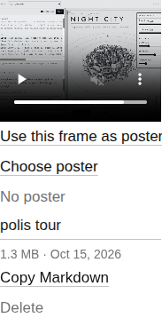

*A video in the media library with its captured poster and the poster actions.*

### 11.4 Where videos appear

| Place | Markup | Reason |
|---|---|---|
| Artifact or post cover | `autoplay muted loop playsinline controls`, poster | a moving overview of the application; `controls` lets visitors stop motion longer than five seconds |
| Gallery, Markdown | `controls preload="metadata" playsinline`, poster | the visitor decides to play |
| Catalogue and creator cards | poster image, else `muted preload="metadata"` | cards stay still |
| Open Graph image | the video's poster | link previews cannot show video |

`public.js` pauses autoplaying videos for visitors whose system requests reduced motion (`prefers-reduced-motion: reduce`); in the browser check the cover stayed at `currentTime 0`. Creator avatars must be images (`checkImage`), because avatars always render as ``.

## 12. Release attachments

### 12.1 Model

```sql
CREATE TABLE release_attachments (
    id text PRIMARY KEY,
    release_id text NOT NULL REFERENCES releases(id) ON DELETE CASCADE,
    name text NOT NULL,                -- original base name, ≤ 200 characters
    label text NOT NULL DEFAULT '',    -- shown instead of the name when set
    media_type text NOT NULL,          -- sniffed; informational only
    size bigint NOT NULL, sha256 text NOT NULL, storage_key text NOT NULL,
    position integer NOT NULL DEFAULT 0,
    created_by text NOT NULL REFERENCES users(id),
    created_at timestamptz NOT NULL DEFAULT now()
);
```

**Decision: a separate table, not more roles in `release_files`.** `release_files` has `UNIQUE(release_id, role)`, is part of the immutable release, and is iterated by publish checks and by the integrity sweep that reports missing or corrupted release blobs. Attachments have none of those properties.

**Decision: attachments can change after publishing.** Release files are immutable because instances pin a release: changing published HTML would change running applications under their users. Attachments do not run. A creator should be able to add the manual to 1.1.0 after shipping it without cutting 1.1.1. Editors may add, relabel, reorder and remove attachments in any release state.

### 12.2 One download rule, two routes

The rule for downloading a release's files was inline in the `download` handler. It became a helper that both the HTML download and the attachment download call:

```go
// anyone may download a free sample; otherwise the caller must be signed in
// with a plan that can run the artifact.
func (s *Server) mayDownload(w http.ResponseWriter, r *http.Request, rel store.Release) bool
```

- `GET /api/releases/{release}/attachments/{id}/download` serves published releases only and applies `mayDownload`.
- `GET /api/studio/attachments/{id}/download` serves editors in any state, so drafts can be checked before publishing.

Responses are `application/octet-stream` with `Content-Disposition: attachment`, `nosniff`, `Cache-Control: private, no-store` and `X-Content-SHA256`, so no attachment is ever rendered on the portal origin, whatever its contents. File names are encoded with `mime.FormatMediaType`, which uses RFC 2231 for non-ASCII names (`filename*=utf-8''Manual%20f%C3%BCr%20Loom.pdf`). `http.ServeContent` provides Range support, so interrupted downloads resume.

### 12.3 Limits under concurrency

A release holds at most 20 attachments and each is limited by `maxAttachmentBytes` (default 100 MiB, up to 2 GiB). The first version of `CreateAttachment` was a single statement, `INSERT … SELECT … WHERE (SELECT count(*) …) < 20`, with a comment saying concurrent uploads could not exceed the limit. Under PostgreSQL's default READ COMMITTED isolation that comment is false: two concurrent statements each evaluate the count against a snapshot that does not include the other's uncommitted row, and both insert. The final version locks the release row first:

```go
tx.QueryRow(ctx, `SELECT 1 FROM releases WHERE id=$1 FOR UPDATE`, a.ReleaseID)
tx.QueryRow(ctx, `SELECT count(*), COALESCE(max(position)+1,0) FROM release_attachments WHERE release_id=$1`, a.ReleaseID)
if n >= limit { return ErrConflict }   // 409 too_many_attachments
tx.QueryRow(ctx, `INSERT INTO release_attachments(...) VALUES(...)`)
```

The demos use a transaction-scoped advisory lock for the same reason (Chapter 9). The general rule: a count-then-insert limit needs a lock on something both transactions must touch.

### 12.4 Presentation

Under each version, the artifact page lists the attachments by label (or name) with their size. When the visitor may download them, each is a link; otherwise they are listed without links, followed by "Attachments are included with the Subscriber plan.", which turns the list into a description of what the plan includes. In the studio, each release row has an *Attachments (n)* panel with a drop zone, inline labels, reordering, download and remove. Reordering renumbers the whole list 0…n−1 and saves only the positions that change, because positions can have gaps after deletions.

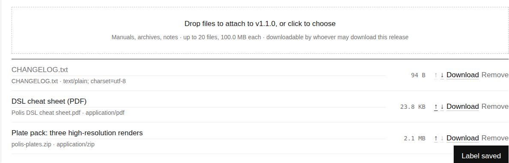

*The attachments panel on Polis v1.1.0: a renamed PDF, a labelled ZIP and an unlabelled text file, reordered.*

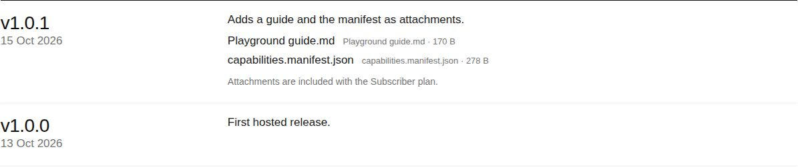

*The same feature seen by a signed-out visitor on a subscriber-only application: names and sizes, no links, and the plan that unlocks them.*

## 13. Verification

### 13.1 Tests

The integration tests run against a real PostgreSQL (`TEST_DATABASE_URL`) and a `httptest` server with portal, instance and second-site hosts. The storefront branch added these:

| Test | What it establishes |
|---|---|
| `TestContentStore` | media, creators, posts; reference checks block deletion |
| `TestStorefrontPages` | every public page, drafts visible to editors only, RSS, Open Graph |
| `TestStudio` | creator role, object rules, profiles, release upload by creators, media, drafts, posts |
| `TestPlans`, `TestResolveEntitlement`, `TestCanRunAndModels`, `TestCheckoutPrice` | plan resolution for every source, rank checks, instance limits, model lists, checkout prices |
| settings tests, `TestDecisionNamesPriceAndPlan` | plan validation; billing decisions name their price and plan |
| `TestDemos` | origin check, rate limit, capacity under concurrency, budgets, expiry |
| `TestTokensAndPush` | token scope, minting refused, push with attachments, check, version conflict, revocation |
| `TestVideos` | upload, Range 206, poster rules, poster in use, Markdown and page markup, card poster, video avatar refused, settings limit 413 |
| `TestAttachments` | editor-only drafts, RFC 2231 names, 401/403/206 under the rule, mutability after publish, ordering, public JSON without storage keys or user IDs, 20-per-release 409, size 413, cascade on draft delete |

`make ci-check` (Go build, vet, tests, `golangci-lint` with zero issues, TypeScript checks and the UI build) passes on the final commit.

### 13.2 A local stack with real services

Unit and integration tests do not exercise the identity provider, Stripe or real browser behaviour. The repository's compose stack runs PostgreSQL, ZITADEL with provisioned test users, the Stripe CLI forwarding sandbox webhooks, and Francois with host networking so that `*.apps.localhost` instance origins work. Rebuilding it from the branch applied migrations 004 to 006 to a database created by the earlier release, which was itself a useful test: the old settings became the two plans with the sandbox price, and the attachment limit was backfilled into all four stored revisions.

The showcase was then seeded through the studio API with a token: two creator profiles, three applications (Polis as a featured free sample with a demo; the capability playground for subscribers; Tessera, a small Truchet-pattern generator written for the occasion, for a *Studio* tier), three published journal posts and a draft, and three plans. The screenshots in this report come from that stack. Browser checks covered:

- the demo flow signed out, ending in a running Polis instance;
- free-sample downloads signed out (`200` for v1.1.0, `401` for v1.0.0);
- video upload, frame capture as poster, cover autoplay (muted, looping, `readyState 4`), the Markdown embed, and reduced motion (paused at 0);
- attachments uploaded, labelled and reordered in the studio; `push --attach` against the real server; links for a subscriber (`200`, correct `Content-Disposition`), none for a signed-out visitor.

## 14. Failures and what they taught

**Duplicate endpoint names in RTK Query.** After release management moved to the studio, the release upload in the studio sent `Content-Type: application/json` with a 30-byte body, and the server answered `request Content-Type isn't multipart/form-data`. The studio injected an endpoint named `uploadRelease` into the shared API object, which already had an endpoint with that name from the old admin API. `injectEndpoints` keeps the existing definition when names collide, unless told to override, so the studio's hook ran the old definition, which serialized its argument as JSON and did not invalidate the studio's cache tags. Removing the dead admin endpoints fixed both symptoms. The rule: when injecting endpoints into a shared API, names are a global namespace.

**A strict parser turns schema changes into data migrations.** This happened twice (plans, then the attachment limit). Both times the fix was a migration that rewrites stored documents, tested against the old shape.

**Cookies are not port-specific.** During browser checks, setting a session cookie for the dev server on `localhost:8095` with `document.cookie` silently did nothing. An older `HttpOnly` cookie with the same name, set by the compose stack on `localhost:8090`, blocked script writes, because cookies are scoped by host and path, not port. Setting the cookie through the browser automation API (or using a different host name) works.

**A count-then-insert limit races.** See Chapter 12.3. The error was in a comment that asserted a property the statement did not have; reviewing claims in comments is as necessary as reviewing code.

**Recording WebGL.** Playwright's built-in video recording produced a grey rectangle where the Polis WebGL canvas was, while element screenshots captured it correctly. The demonstration clip was built from 90 element screenshots taken at about 7 frames per second and encoded with `ffmpeg -framerate 7 … -c:v libx264 -crf 22 -movflags +faststart` (`faststart` moves the index to the front of the file, so playback starts before the download ends).

**Sandboxed tools and temporary directories.** `typst`, installed as a snap, could not read files under `/tmp`, so a PDF for a test attachment was rendered with Chromium's `page.pdf` instead. The editor's language server reported missing fields throughout the branch because it indexed another checkout; `go build ./...` was the reliable signal.

## 15. Status and open work

The branch `feat/storefront` is pushed but not merged or deployed. Its rollout has one hard ordering constraint, recorded in the production playbook: the binary no longer accepts `--stripe-price-id`, and an unknown flag stops the server. The Kubernetes deployment must lose that argument and gain `--trust-proxy-headers` in the same change that rolls out the image; the automated image pull request must not be merged on its own. Migrations 005 and 006 rewrite stored settings, so a rollback to an older image cannot read them.

Open items:

- Configure the Stripe billing portal for all plan products and prices, so subscribers can switch plans themselves.
- After deploying: create the two creator profiles, link the accounts, set roles, write the storefront wording, decide which applications offer demos.
- The second domain's DNS: `slop.boutique` has a valid certificate through a delegated ACME challenge, but its apex and wildcard records still point at the previous host until the domain's owner changes them.
- Blob garbage collection for deleted media and attachments.
- Filtering the in-application model selector by plan (the server already refuses models outside the plan).
- Multi-file artifacts, sketched in the FRANCOIS-004 design as a direction.
- A revenue split between the two creators, which the platform does not model.

## 16. Key points

- Server-render what strangers see and keep the SPA for what members do; a small script can upgrade server-rendered placeholders without making the page depend on it.
- Put the mapping from billing state, grants and roles to permissions in one pure function, and make every check ask it. Plans then become data, editable in the settings, and new tiers need no code.
- With strictly parsed stored documents, every new required field is a data migration; write it and test it against the old shape.
- Give anonymous trial users a real but restricted identity, so security-critical paths (launch, grants, credits) have one implementation.
- Restrict bearer tokens by path prefix, and let them neither create tokens nor reach accounts or billing.
- Stream large uploads and downloads; check integrity at write time for content-addressed storage, and let `http.ServeContent` handle Range.
- Per-request rendering data can reach a shared goldmark instance through the parser context and AST attributes.
- Immutability belongs to what runs. Supplementary files can stay editable without weakening what immutability protects.
- Limits enforced by counting need a lock that every competing transaction must take.

## Appendix A. Commits

| Commit | Change |
|---|---|
| `6f17315` | FRANCOIS-004 design document, ticket, diary |
| `19ba56b` | Content model: page drafts, creators, media, posts |
| `ab1598d` | Server-rendered storefront: home, catalog, artifact, creator, journal, RSS, media |
| `68a7daf` | Studio API with a creator role; releases move out of the admin API |
| `5f3da56` | Studio UI: artifact editor, journal, creators, media library |
| `0726015` | Plans and entitlements: plan-gated runs, limits, credits and checkout |
| `0ef0265` | Pricing page, plan-aware storefront, plan editing |
| `76be31e`, `95af5f4` | Visitor demos: guest sessions, expiring instances, demo budgets |
| `09f6c20` | Personal API tokens and `francois catalog push` |
| `e26639d`, `c8232be` | Docs and rollout notes; logging areas |
| `8fea289` | FRANCOIS-005 design |
| `7f75b7e` | Videos: Markdown embeds, posters, streaming, settings upload limit |
| `e0691da`, `f7f5a4b` | Release attachments, plan-gated downloads, `push --attach` |
| `5bf24d4` | FRANCOIS-005 docs, diary, local showcase script |

## Appendix B. Where things are

| Concern | Files (under `/home/manuel/code/wesen/go-go-golems/francois`) |
|---|---|
| Migrations | `pkg/catalog/store/migrations/004_storefront.sql`, `005_plans.sql`, `006_videos_attachments.sql` |
| Public pages | `pkg/catalog/pages.go`, `pkg/catalog/web/templates/*.tmpl`, `ui/catalog/public.ts` |
| Markdown and media detection | `pkg/catalog/content/markdown.go`, `pkg/catalog/content/media.go` |
| Studio API | `pkg/catalog/studio.go`, `pkg/catalog/attachments.go` |
| Studio UI | `ui/catalog/studio.tsx`, `ui/catalog/studio-api.ts` |
| Plans and entitlements | `pkg/catalog/settings/settings.go`, `pkg/catalog/entitlement.go`, `pkg/catalog/server.go` (`authorizeInstance`) |
| Demos | `pkg/catalog/demos.go`, `pkg/catalog/store/demos.go` |
| Tokens and push | `pkg/catalog/auth.go`, `pkg/catalog/store/tokens.go`, `pkg/catalog/studioclient/client.go`, `cmd/francois/cmds/push.go` |
| Blob store | `pkg/catalog/releases/releases.go` (`PutReader`, `Open`, `Read`) |
| Operations | `doc/production.md` (§3.7, §4.1, §5.3, §5.5, §5.6, §12) |
| Tickets | `ttmp/2026/10/14/FRANCOIS-004--…/`, `ttmp/2026/10/15/FRANCOIS-005--…/` (design documents, diaries, seed scripts) |
