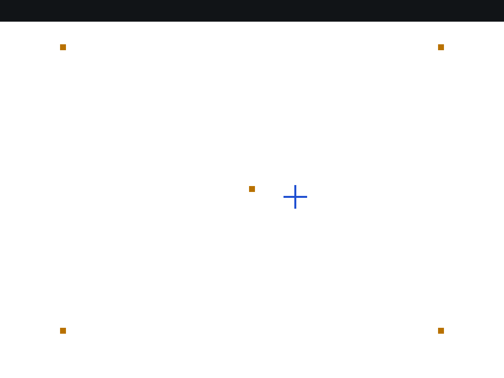
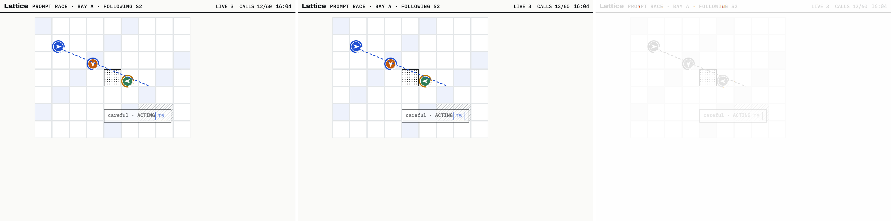
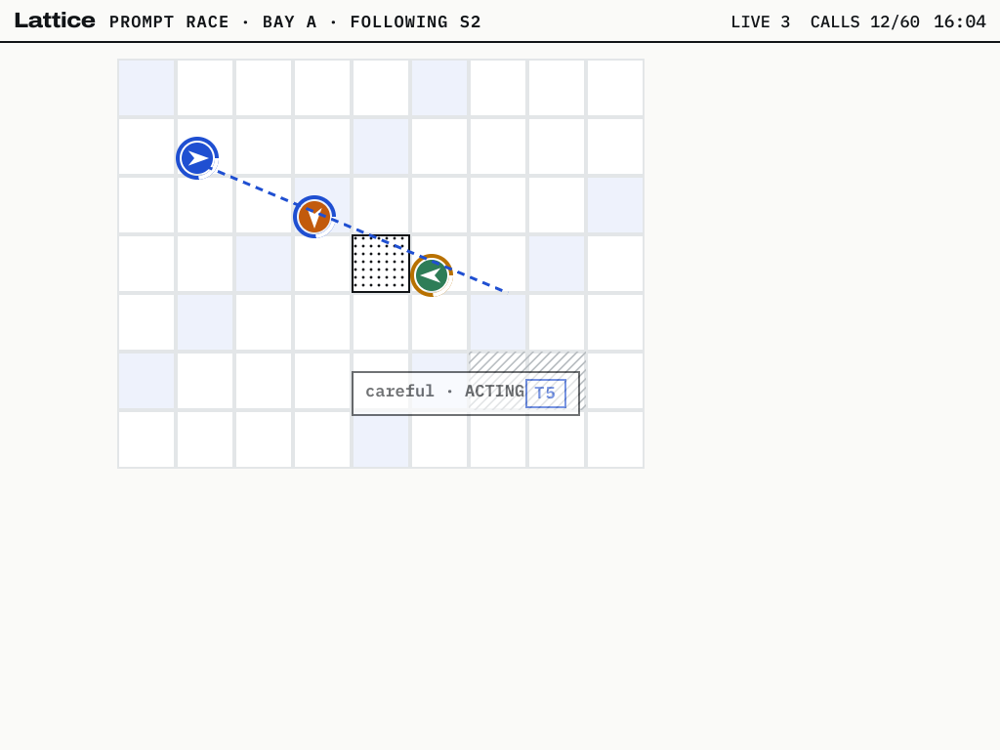
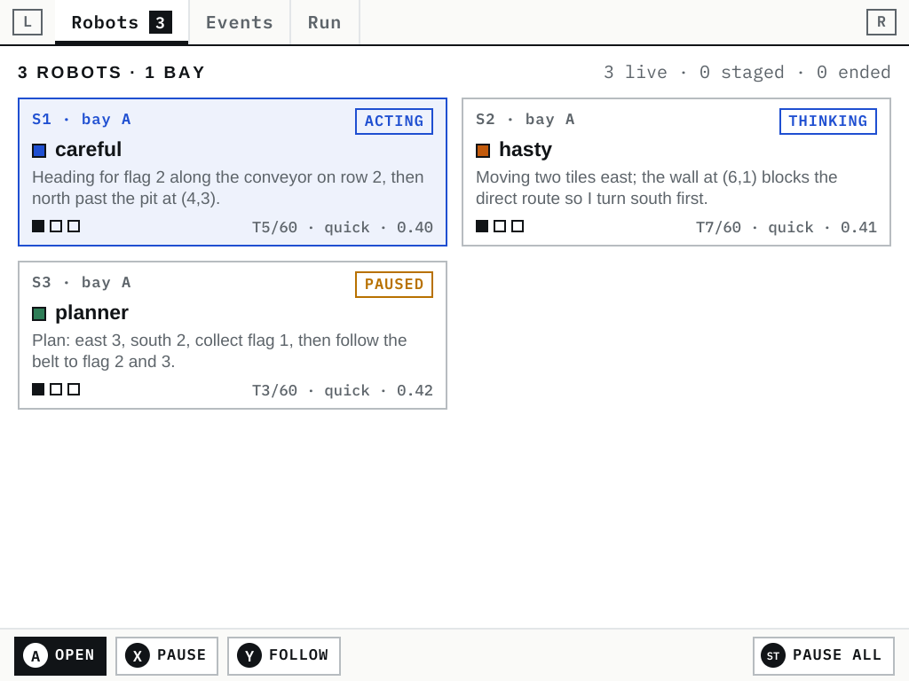
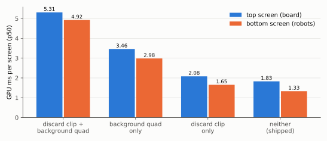

# Lattice DS Native

lattice-ui is a small JavaScript user-interface library. It turns a description of a screen into boxes, then into a flat list of drawing operations, then into SVG. Lattice Arena DS is an application built on it: a dual-screen handheld front end for an agent-training arena, drawn entirely by lattice-ui into two SVG elements in a web page. This report explains how both were brought to the real handheld they imitate, an Anbernic RG DS Plus with two 1024×768 panels, four Cortex-A55 cores and a single-core Mali-G52. The work replaces the library's engine with C++ and its SVG output with OpenGL ES.

The report covers the first three phases of ticket `DSUI-001`:
- Phase 0: the platform;
- Phase 1: the C++ layout core;
- Phase 2: the GPU backend.

It explains the measurements that ruled out keeping the engine in JavaScript, and the techniques that make a C++ port produce exactly the same numbers as the JavaScript original. It also explains how the GPU output was checked against the browser's, the defects that checking found (in my code, in the original library, and in the reference rasteriser), and the two shader changes that cut the GPU's time per screen by two thirds.

> [!summary]
> - **JavaScript is too slow for layout on this CPU.** The robots page (94 nodes, 508 drawing operations) costs 41 ms per frame in QuickJS and 12.2 ms in V8 on the handheld. A direct C++ port costs 0.59 ms, about 20× less than V8.
> - **The port is exact, not approximate.** lattice-core reproduces every box, every drawing operation and every hit-map entry of the JavaScript library on 5,005 trees, 5,000 of them random, on x86 and on the A55. Exactness required matching JavaScript's floating-point operation order, its rounding function, and the point at which text is uppercased.
> - **The GPU backend matches the browser's rendering.** Compared with the original SVG rasterised by resvg, the Mali-G52's output differs in at most 0.012% of pixels on the reference screens.
> - **Two shader changes cut the GPU time per screen from 5.3–5.7 ms to 1.3–1.8 ms:** folding the background into the clear, and clipping by geometry instead of `discard`.

## 1. What lattice-ui does

A lattice-ui screen is produced in four stages, and the rest of this report depends on keeping them apart.

1. A **description** is a tree of immutable nodes written with chained builders: `row().pad(3, 6).border(1, 'ink').add(text('careful', style))`.
   - Containers (`col`, `row`, `stack`, `grid`) arrange their children.
   - Leaves (`text`, `icon`, `ring`, `dot`, `line`) draw something.
2. **Layout** gives every node a position and a size. It implements a subset of CSS flexbox and grid, and measures text itself from the font files, with no browser involved.
3. **Paint** walks the positioned boxes and emits a **display list**: a flat array of operations in back-to-front order, such as `rect`, `glyph`, `icon`, `dot`, `ring`, `line`, `pattern`, and the paired `clip`/`unclip` and `group`/`ungroup`.
4. A **backend** turns the display list into pixels. The original backend writes SVG.

Colours are **tokens** such as `ink` or `sig`. Only the backend resolves them, from a theme table, so switching between light and dark needs no layout or paint. The stages are strictly one-way: layout never looks at pixels, and paint never changes a size. That property is what makes a native replacement checkable stage by stage. The same description must produce the same boxes, the same boxes the same display list, and the same display list the same pixels.

The library has a textbook (*The Lattice DS UI System*), and the full source is in `reference/lattice-ds/` in the repository. The library's own correctness was established against Chrome before this work began: its layout reproduces the arena's React screens to within 0.04–0.07% of pixels (textbook Chapter 8). That makes lui.js, the library file, a trustworthy **oracle**. A native port that agrees with it agrees with Chrome by transitivity, without repeating the Chrome capture.

## 2. Why the engine left JavaScript

The obvious plan is to keep lattice-ui in JavaScript on the device and replace only the SVG backend. Measurement rules it out.

The benchmark loads the real lui.js and the real subset fonts. It builds screens copied from the handheld module's own builders, with mocked robots, and times each stage on the device with the CPU governor fixed at `performance`. Two engines were measured:
- QuickJS-ng 0.16.2, cross-compiled for aarch64;
- V8 through Node 24.

V8 is the engine the earlier Falllinie project qualified on this device ([[PROJECT REPORT - Falllinie JavaScript Embedding - ARM64 Qualification, V8 Ownership and Bounded Rules|Falllinie JavaScript Embedding]]).


| Screen (ops) | QuickJS-ng | V8 | V8, tree reused | lattice-core C++ |
|---|---|---|---|---|
| robots (508) | 41.2 ms | 12.2 ms (p90 34 ms) | 4.6 ms | 0.59 ms |
| events, 15 rows (1,231) | 78.4 ms | 16.8 ms | — | 1.25 ms |
| events, 120 rows (9,388) | 575 ms | 129 ms | 53 ms | 12.1 ms |
| start-up: parse 10 fonts | 425 ms | 205 ms | — | under 1 ms (face pack) |

Three properties of these numbers decided the architecture.
- **Layout is the dominant stage on every engine,** 55–72% of the frame. A native backend alone would leave most of the cost in place.
- **V8 is 3–4× faster than QuickJS here, but its absolute cost is still too high.** The arena wants 30 frames per second on the top screen while robots move, which is a 33 ms frame. 12 ms for one bottom-screen page leaves no room, and the 90th percentile of 34 ms already exceeds the frame.
- **The CPU is the limit, not the engine.** A Cortex-A55 is an in-order core. QuickJS ran 7.7× slower on it than on the development laptop. V8's JIT closed only part of that gap, because lattice-ui allocates many small objects and hashes strings.

The owner of the project set the direction from these numbers: port the system to C++ "for the most part" and keep "the thin JS on top". The remaining question was what that thin layer costs. Describing the robots page in JavaScript costs 0.98 ms in V8 on the device. Flattening the description into a binary buffer for C++ costs another 0.44 ms. The full path, a JavaScript description plus the C++ engine, therefore costs about 2.0 ms against 12.2 ms. Scripts, coach cards and application pages keep the JavaScript builder API, and everything proportional to the size of the screen runs natively.

## 3. Porting a layout engine exactly

### 3.1 What "exact" means and why it is needed

A port that is approximately right is hard to trust and hard to maintain. If the C++ layout differs from lui.js by a pixel somewhere, it is impossible to tell whether the difference is a deliberate improvement, a rounding artefact, or a bug that will become visible on a screen nobody has tried yet. An exact port turns every disagreement into a bug with a location. The target was therefore that every box (`x`, `y`, `w`, `h`, line count), every drawing operation and every keyed hit-map entry agree with lui.js to six decimal places. In practice, after the work described here, they agree bit for bit.

### 3.2 The oracle loop

The verification loop has four parts.

1. **A fixture generator in Node** (`tools/make-fixtures.js`) builds description trees with lui.js's own builders. It encodes each tree into the binary wire format, and asks lui.js for its box tree and display list, which become the **oracle**.
2. **A C++ dump tool** (`lattice-dump`) decodes the same buffer, lays it out, paints it, and writes its own boxes and operations in the oracle's format.
3. **A comparator** checks every number within 2×10⁻⁶ and every string for equality.
4. **A seeded random-tree generator** produces descriptions that use every node kind and property in combinations no hand-written screen would. These include negative margins, clamped text that breaks inside words, grids nested in shrinking rows, opacity groups inside clips, and characters that need fallback fonts.

The five hand-written screens agreed with the first prototype. The random trees did not, and both defects they found are instructive.

### 3.3 Floating-point rules

JavaScript numbers are IEEE-754 doubles, and so are C++ `double`s, but the same formula can still produce different bits. Three rules keep them equal.

- **Keep the order of operations.** `x += advance * scale + letterSpacing` must be written in the same grouping as lui.js. Floating-point addition is not associative, and a reordered sum can differ in the last bit.
- **Disable fused multiply-add.** A compiler may contract `a * b + c` into one instruction that rounds once instead of twice. The result differs in the last bit from JavaScript, which always rounds twice. GCC contracts by default for C++ (`-ffp-contract=fast`), and aarch64 has a fused multiply-add instruction for it to use. Building with `-ffp-contract=off` is required, and the cross-architecture parity run exists to catch a build that forgets it.
- **Emulate `Math.round`.** `Math.round` rounds halves towards +∞, while C's `round` rounds them away from zero. The port uses `floor(v + 0.5)`, which matches `Math.round` for the value ranges layout produces.

### 3.4 Fonts without a font parser

lui.js measures text through opentype.js: glyph advances, kerning pairs, and the ascent, descent and line gap from which line heights are derived. A C++ reimplementation of opentype.js's table reading would duplicate a parser. Using HarfBuzz or FreeType's kerning would be worse, because they read kerning formats that opentype.js does not. For example, opentype.js finds no kerning pairs in the Liberation Sans subset, which is why the textbook notes that *AV* is unkerned. A native shaper that kerned *AV* would make every line containing those letters a fraction of a pixel narrower than the oracle's.

The solution measures fonts **offline**. `tools/make-facepack.js` runs opentype.js once per face at build time and writes a **face pack**:
- units per em;
- the hhea, post and OS/2 metrics;
- the character-to-glyph map;
- every glyph's advance;
- every non-zero kerning pair, exactly as `getKerningValue` reports it.

The C++ shaper reads only this file. It needs no font parser for layout, it loads in microseconds instead of the 200–425 ms that parsing the fonts took in JavaScript, and kerning means exactly what the oracle means by it: 0 pairs for Liberation Sans, 2,281 for Archivo. FreeType still loads the TTF files, but only to rasterise glyph outlines for the GPU (Section 5).

### 3.5 The first defect: where capitals are made

The first random run reported 965 of 1,005 trees identical. The first instructive failure was a text box that lui.js broke into 29 lines and the port into 27. It had the `caps` style, a width of 26 pixels, and the word *größe* among others. Printing lui.js's lines showed the cause:

```text
["gr"] ["ö"] ["ß"] ["e"]
```

When a word is wider than the line, lui.js breaks it character by character. It slices the **original** string, and uppercases each piece only when measuring it, inside the shaper. The encoder in the port had uppercased the whole run beforehand, on the reasoning that the shaper would uppercase it anyway. For almost every string that reasoning holds. For *ß* it does not: uppercasing produces two characters, *SS*. The character-by-character break therefore walks over a different string, and the break points move.

The fix keeps the text unchanged through the encoder and the node store, and uppercases inside the shaper, at the same point as lui.js. The general lesson is that exactness covers operations on strings as well as on numbers: *where* a transformation happens matters as much as *what* it computes.

### 3.6 The second defect: in the oracle

The other random failures had `null` widths in the oracle, which is how JSON writes `NaN`. All came from a leaf node (`icon`, `dot`, `ring` or `line`) with `w('fill')`. lui.js's intrinsic-width function computes `(n.p.w || 0) + insets` for leaves. With `w = 'fill'` that is the string concatenation `'fill' + 0 = 'fill0'`, and every later arithmetic step on it yields `NaN`. This is a defect in lui.js, not behaviour to reproduce. The C++ core treats such a leaf as width 0. The generator no longer produces the case, and the exclusion is recorded with the tests. Agreement is claimed only on inputs where the oracle is well defined.

### 3.7 Result

After the two corrections, lattice-core agrees with lui.js on:
- 1,005 trees with seed 1, in boxes, operations and hits;
- 4,000 more trees with seed 2, 309,208 operations in all;
- the five reference screens built with the C++ builder API instead of the wire format.

It agrees on the development machine and on the device's aarch64 build. The wire decoder was also fed 150,000 corrupted buffers (truncated, byte-flipped, overwritten with `NaN`, infinities and huge counts) under AddressSanitizer and UndefinedBehaviorSanitizer. Every buffer either decoded or was rejected with a `WireError`, and the sanitizers found one real issue: a zero-length `memcpy` into an empty vector.

| Screen | decode | layout | paint + hits | total (A55, median) |
|---|---|---|---|---|
| chip (29 ops) | 0.011 ms | 0.009 ms | 0.005 ms | 0.026 ms |
| robots (508 ops) | 0.13 ms | 0.32 ms | 0.12 ms | 0.59 ms |
| events-15 (1,231 ops) | 0.27 ms | 0.57 ms | 0.34 ms | 1.25 ms |
| board (417 ops) | 0.11 ms | 0.08 ms | 0.06 ms | 0.25 ms |

## 4. The platform: two windows, buttons, and a touch panel nobody had used

Falllinie had established how a native program uses this handheld under ROCKNIX's Sway compositor.
- It opens two ordinary SDL windows with one shared OpenGL ES 3 context.
- A background thread moves them to their panels with `swaymsg`: the top screen is output `DSI-2`, the bottom `DSI-1`.
- It reads the buttons through SDL's raw joystick API.

lattice-ds reuses all three patterns. One detail of the Sway configuration matters: EmulationStation powers the lower panel off while it is in front, so the placement command starts with `output DSI-1 power on`.

Touch was new territory: Falllinie never used it. The device's inventory shows one Goodix capacitive panel with five touch slots over a 1024×768 range, and its libinput calibration matrix is `[0.5, 0, 0.5, 0, 1, 0]`. Sway lays the two outputs side by side in a 2048-pixel-wide space, and that matrix maps the panel onto the right half, the bottom screen. Sway also puts the panel in its own seat, `seat1`. It was therefore open whether an SDL window on `DSI-1` would receive the touches at all.

The test did not need a finger. Writing `struct input_event` records into the panel's own device node, `/dev/input/event1`, makes the kernel deliver them as if the hardware had produced them. They travel the whole real path: libinput's calibration, Sway's seat, Wayland, and SDL. The same works for the joypad's node. A small injector (`scripts/device/evinject.py`) taps, drags and presses, and the probe application printed what arrived:

```text
EVENT 3911 button-down A          … through RIGHT, all twelve buttons in order
EVENT 7923 finger-down screen=bottom finger=0 x=64.0 y=48.0
EVENT 8346 finger-down screen=bottom finger=0 x=448.0 y=48.0
EVENT 10055 finger-down screen=bottom finger=0 x=300.0 y=200.0
```

Every injected touch arrived at the bottom window at exactly the logical coordinates sent, after the round trip through the 1024×768 panel. The probe draws markers where touches land, and the compositor's own screenshot shows them in place.



Injection also makes input testable in general: a test can press buttons and touch the screen on the real device with no person present.

## 5. Drawing the display list on the GPU

### 5.1 One shader, one draw per layer

The GPU backend turns each drawing operation into one **instance**: a screen-aligned rectangle with a kind and a few parameters, 80 bytes in all. One program draws every kind, and one call draws a whole layer.

- **Rects** are filled quads. Their edges are snapped to whole layout pixels before the 2× device scale, as Blink and the SVG backend do. A one-pixel border is therefore exactly two device pixels wide and needs no antialiasing.
- **Glyphs and icons** sample a single-channel **atlas** texture.
  - Glyphs are rasterised by FreeType from the same font files the face pack was measured from: at the device pixel size, unhinted, and at four horizontal subpixel phases, because lattice-ui positions glyphs at fractional x.
  - Icons are polygons rasterised by FreeType's outline rasteriser with the non-zero fill rule, which is SVG's default.
  - Atlas texels map one to one onto screen pixels, so the shader reads them with `texelFetch` and no filtering.
- **Dots, rings, arcs, dashed lines, hatch and dither patterns** are computed analytically in the fragment shader from the pixel's position, with antialiasing from a signed distance. Arcs reproduce the SVG backend's path `M p0 A r r 0 0 1 p1` through SVG's own endpoint-to-centre construction, including what it does when the arc spans more than half a circle.
- **Clips** are culled on the CPU, as the SVG backend's flat mode does. An operation wholly outside the clip is dropped, and one wholly inside is drawn unclipped. Only one that straddles a clip edge carries the clip rectangle. On the 120-row events page, culling drops 8,162 of 9,388 operations before they reach the GPU.
- **Opacity groups**, a box with children drawn at reduced opacity, must be blended as one layer. Their contents are drawn into an offscreen texture, which one composite instance then blends at the group's opacity.
- **Colours** are slots in a 256-entry palette texture, resolved from the theme. Switching between light and dark changes the palette, not the instances.

### 5.2 Checking pixels against the browser's renderer

The display lists are proven identical (Section 3), so any pixel difference belongs to the backend. The reference is the textbook's own method: lui.js's SVG output for the same tree, rasterised without a browser by resvg. The comparison uses pixelmatch with a colour threshold of 0.15 and antialiased pixels excluded, the settings the textbook used against Chrome.

| Screen | Host (Mesa) | Device (Mali-G52) | Dark theme (host) |
|---|---|---|---|
| chip | 0.000% | 0.000% | 0.000% |
| robots | 0.000% | 0.000% | 0.000% |
| events-15 | 0.012% | 0.012% | 0.005% |
| board | 0.002% | 0.002% | 0.001% |



The comparison found four defects in the backend before reaching these numbers:
- **Missing text after an opacity group.** Creating the group's offscreen texture bound it on texture unit 0, which holds the atlas, so every glyph drawn afterwards sampled the wrong texture.
- **A full atlas.** In a run of 300 random trees through one renderer, the 1024² atlas filled up and later glyphs were silently dropped. The renderer now keeps each layer's display list, so that on overflow it can clear the atlas and rebuild every layer. The atlas grew to 2048² so that an icon as large as the screen still fits.
- **Unscaled icon offsets.** Icon paths with fixed offsets in layout pixels (the `bars2` and `bars3` icons) had been evaluated directly in device pixels.
- **A crash at exit.** The test tool destroyed the renderer after the GL context it needed.

It also found two defects in the reference.
- **Hatch phase.** Hatch patterns differed by 14–34% of their area. Rendering the same `<pattern patternTransform="rotate(45)">` in Chrome 138, and reading the pixels back from a canvas, settled which side was right. Chrome puts the stripes where the SVG specification and the shader put them: on row 100, dark at x = 90–91, 99–100 and 108–109. resvg puts them half a pitch away. The backend keeps Chrome's behaviour, and the comparison masks hatch areas and reports how much it masked.
- **A dropped group.** On one random tree resvg drew nothing at all. Bisection showed that resvg drops an entire opacity group when some of its glyphs lie far into negative coordinates (here x = −317), even though the group's rectangle at (9, 9) is plainly visible. On 31 other random trees resvg panicked outright on degenerate geometry. A reference rasteriser is itself a program with defects, and when two renderers disagree a third, here Chrome, has to decide.

With those accounted for, 272 of the 273 comparable random trees differ by at most 0.141% of pixels.

### 5.3 On the panels





Both images were taken by `grim` from the compositor, so they show what the panels display. The top screen is the board fixture:
- a clipped 9×7 tile grid;
- three robot markers with status rings, arcs and heading wedges;
- a dashed target line, a dithered pit and a hatched area;
- a label at 0.6 opacity;
- the header with the brand in Archivo.

The bottom screen is the robots page, with its tab strip, three cards and hint bar.

## 6. Where the GPU time went on a Mali-G52

The first device measurement found 5.7 ms of GPU time for the top screen and 5.3 ms for the bottom screen. That is a lot for 417 and 506 quads. An ablation located the cost: a diagnostic switch restored each of the two candidate causes separately.



Both fixes address the same fact about this GPU: its cost is per fragment, not per quad.

1. **The background rectangle was a full-screen pass through the general shader.** Each screen's description begins with a fill covering the whole screen, which became a 1024×768 quad shaded at full price, about 1.6 ms. When the first instance of a screen is an opaque rectangle covering the framebuffer, the renderer now uses its colour as the clear colour and skips it. The clear is handled by the tile hardware at almost no cost.
2. **`discard` disabled the GPU's hidden-fragment removal.** The first shader clipped straddling instances with `discard`. Mali GPUs remove fragments that a later opaque fragment will overwrite (forward pixel kill), but a program that can `discard` is excluded from it for every fragment, not only the clipped ones. With the background quad present, this cost a further 1.9 ms. Clipping now happens in the vertex shader instead: a straddling quad is shrunk to its clip rectangle. Every shading function in the program computes coverage from the pixel's absolute position, so a smaller quad is an exact clip, and the program no longer contains `discard`.

With both changes, a screen costs 1.3–1.8 ms of GPU time and 1.1–1.2 ms of CPU time. Converting the board's operations to instances takes 0.23 ms. Both screens together take 3.1 ms per frame, so the UI can redraw both panels at 30 frames per second using about a tenth of the GPU. An idle UI uses none, because the shell redraws a screen only when something on it changed.

## 7. What remains

The next phases are specified in the ticket's design guide.
- **Phase 3, the shell in C++:** screens and layers, the scheduler that redraws only what changed, the hit map, D-pad focus navigation, scrolling with anchoring, and touch routing. It will drive a native demo application of the arena's pages.
- **Phase 4, the thin JavaScript layer:** V8 embedded on the user-interface thread. The builder API and the scripting API (`ds`, `ui`) run on top of the wire format, whose encoder already exists as `js/wire.js`.
- **Phase 5, the arena itself:** its runtime in V8, with network access for Claude-backed robots.

## 8. Reproducing the results

```bash
cd ~/code/wesen/2026-10-15--nintendo-ds-ui
cmake -S . -B build -G Ninja && cmake --build build && (cd build && ctest)    # 9 tests: parity, fuzz, pixels
scripts/build-device.sh                          # native x86 cross toolchain, no emulation
scripts/device-core-parity.sh build/fixtures     # 1,005 fixtures + builder parity + timing on the A55
node tools/make-fixtures.js build/fx-svg --svg && scripts/device-gl.sh build/fx-svg   # Mali parity, bench, screenshots
```

| Path | What it is |
|---|---|
| `src/core/` | lattice-core: styles, face pack and shaper, node store and C++ builders, kit, wire decoder, layout, paint, hit map |
| `src/gl/` | lattice-gl: theme, FreeType atlas, instanced renderer and shaders |
| `src/platform/` | SDL windows, GL loader, input, Sway placement |
| `js/wire.js` | the wire-format encoder shared by the Node tools and, later, the device's V8 |
| `tools/` | face pack, fixtures, random trees, dump, headless render, pixel comparison |
| `apps/probe`, `apps/show` | the Phase 0 probe and the Phase 2 display and benchmark application |
| `ttmp/2026/10/15/DSUI-001…/` | design guide, diary (Steps 1–8) and every evidence file cited here |

## Related notes

- [[PROJECT REPORT - Falllinie JavaScript Embedding - ARM64 Qualification, V8 Ownership and Bounded Rules]]: the V8 and QuickJS qualification on this device that Section 2 builds on.
- [[PROJECT REPORT - Falllinie at 60 FPS - Geometry, Presentation and a Crisp 512x384 Release on a Single-Core Mali-G52]]: the same GPU and presentation path, from a 3D game.
