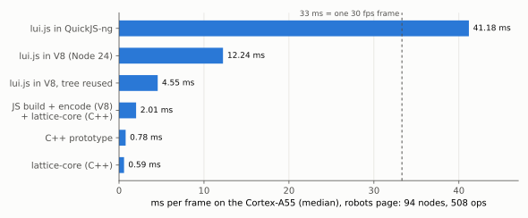
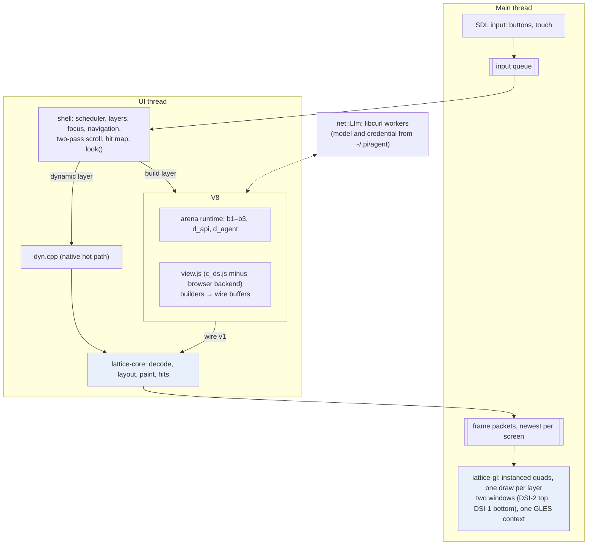
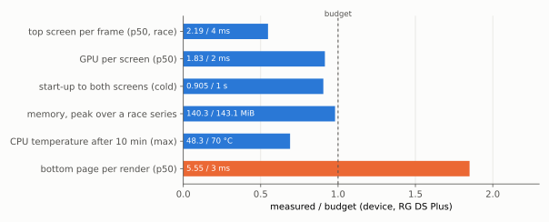
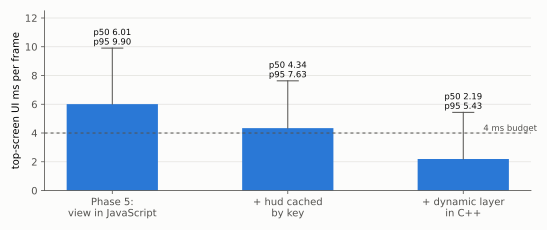
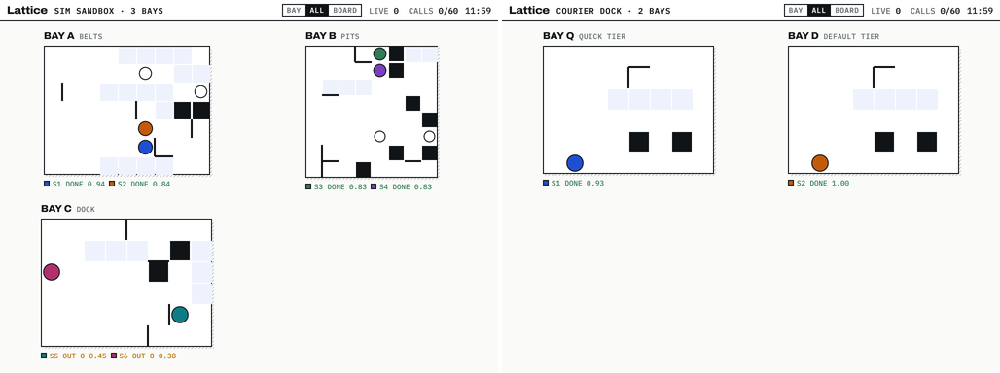

# Lattice DS Native: the whole project

Lattice Arena DS is a browser application that imitates a dual-screen handheld. Its two "screens" are SVG elements in a web page, drawn by a small UI library, lattice-ui. The screens show an arena in which robots, driven by Claude or by a scripted planner, race to flags on a shared board.

This project put that application on an actual dual-screen handheld: an Anbernic RG DS Plus, with two 1024×768 panels, four Cortex-A55 cores and a single-core Mali-G52 GPU, running ROCKNIX. The arena now starts from the device's Ports menu and runs its own JavaScript, with its own presets. It holds 30 frames per second on the board screen, and its pixels are checked against the browser's.

This report gives the whole arc in one place:
- the problem and the measurements that decided the architecture;
- the architecture end to end;
- the verification method used at every boundary;
- the results against every budget the design set;
- an audit of what the handheld version can and cannot do;
- the lessons that generalise.

Four earlier reports cover the phases in depth, and Section 10 is a reading guide to them.

> [!summary]
> - **Most of the system is C++; JavaScript decides what to show.** Layout and paint are a C++ port of lattice-ui, lattice-core. A GPU backend, lattice-gl, draws. A two-thread shell handles input, focus, scrolling and scheduling. The arena's JavaScript runs in an embedded V8 and describes what to show. The hottest layer is ported to C++ as well.
> - **Every port was checked against the original.** That covers the layout engine (5,005 trees, exact), the GPU output (at most 0.012% of pixels differing from the reference rasteriser), the demo's pages, the arena's hot layer (frame by frame), and the generated view (25 listed edits, kept in sync by a test).
> - **The device budgets are met except one.**
>   - Met: top screen 2.19 ms per frame against 4; GPU 1.83 ms against 2; start-up 0.9 s against 1; memory 140 MiB against 143; CPU 48 °C at most after ten minutes against 70.
>   - Not met: the bottom screen's pages, still described in JavaScript, take 5.5 ms against 3.
> - **The arena is functionally complete on the device, with three exceptions.**
>   - All ten built-in presets run to completion.
>   - A real model drives robots on the device: `lunaroute/deepseek-4.1-flash`, resolved from the pi agent setup (`~/.pi/agent`) copied to the handheld.
>   - The coach's chat panel and the script editor, which are browser UI outside the handheld module, are not on the device.

## 1. The problem

### 1.1 What was there

lattice-ui is about 650 lines of JavaScript. It turns a *description*, a tree of immutable nodes written with chained builders such as `row().pad(3, 6).border(1, 'ink').add(text('careful', style))`, into pixels in four stages:
1. **Layout** gives every node a position and size, using a subset of CSS flexbox and grid. It measures text from the font files itself.
2. **Paint** emits a *display list*: a flat array of drawing operations such as `rect`, `glyph`, `ring`, `line` and `clip`.
3. **Backend.** An SVG backend writes the operations out.
4. **Hit map.** Keyed boxes are collected into a *hit map* for input.

Lattice Arena DS uses lattice-ui for both of its screens. Its handheld module, c_ds.js, is about 1,200 lines. It also includes:
- a runtime: boards, robot sessions, a scheduler that rations Claude calls, scoring, transcripts;
- a scripting API (`arena`, `ui`, `ds`);
- ten preset experiments;
- a coach, a chat agent that can run JavaScript in the page.

### 1.2 What "on the real handheld" required

The browser gave the application several things that ROCKNIX does not have:
- a JavaScript engine fast enough to lay out pages;
- a vector renderer;
- a DOM to dispatch pointer and keyboard input;
- `localStorage`;
- the artifact runtime's `window.claude` API for Claude calls and storage.

The handheld, for its part, has two panels driven by one compositor (Sway), buttons and a touch panel exposed as Linux input devices, OpenGL ES 3.2 through the Mali driver, FreeType, SDL2 and libcurl.

The design question was which parts to rebuild natively and which to keep in JavaScript. Measurement answered it.

## 2. The measurements that decided the architecture

The first phase measured lattice-ui on the device itself, with the real library, the real fonts and screens copied from the handheld module. One representative page was measured throughout: the robots page, with 94 nodes and 508 drawing operations.



| Robots page on the Cortex-A55 | ms per frame (median) |
|---|---|
| lui.js in QuickJS-ng | 41.2 |
| lui.js in V8 (Node 24) | 12.2 (p90 34) |
| lui.js in V8, tree reused | 4.6 |
| C++ port of layout and paint | 0.59 |

The top screen redraws every 33 ms while robots move, and a 12 ms page leaves no room. The 90th percentile of 34 ms already exceeds the frame. The core therefore became C++.

The project's owner set the rule from these numbers: "port to C++ for the most part and then layer the thin JS on top". JavaScript would describe screens, and everything proportional to the screen's size would run natively. V8, which an earlier project had qualified on this device, was chosen as the engine over QuickJS.

## 3. Architecture



### 3.1 The data path of one frame

1. **The schedule.** The shell's scheduler decides that a screen is due. While something moves, a screen is redrawn at most every 33 ms. While nothing moves, nothing is drawn: zero renders over ten idle seconds.
2. **The description.** For each layer that must be rebuilt, the shell asks for a description.
   - The arena's view, in V8, builds a lattice-ui tree.
   - The tree is encoded into *wire v1*, a binary format: a string table, a style table, and the nodes as 64-bit words.
   - The board's moving layer is built directly in C++ instead, from plain data the view provides.
   - Layers whose cache key has not changed are skipped.
3. **Layout and paint.** lattice-core decodes the buffer, lays the tree out exactly as lui.js would, paints the display list, and collects the hit map.
4. **Hand-off.** The layer's operations travel to the main thread in a *frame packet*. The queue keeps only the newest packet per screen, and unchanged layers are carried over.
5. **Drawing.** lattice-gl turns the operations into instances of one shader, glyphs from a FreeType atlas, one draw call per layer, and presents each panel.

### 3.2 The path of one input

- **Buttons** arrive from SDL on the main thread and cross to the UI thread.
- **The D-pad** is navigated by the shell in C++. Focus moves to the box whose score is lowest: the gap along the pressed direction plus 2.2 times the offset across it, the same rule as c_ds.js.
- **A** activates the focused box's handler. Other buttons go to the view's own `press()`, the original c_ds.js button logic.
- **Taps** are resolved against the hit map.
- **Handlers never draw.** They change state and mark screens dirty, and the next tick renders.

### 3.3 Sizes

| Part | Language | Lines |
|---|---|---|
| lattice-core: styles, text shaping, tree and builders, wire, layout, paint, kit | C++ | 1,970 |
| lattice-gl: theme, atlas, renderer and shaders | C++ / GLSL | 930 |
| platform: windows, GL loader, input, Sway placement | C++ | 617 |
| shell: queues, shell, two-thread runtime | C++ | 1,023 |
| V8 host and bridge; network client | C++ | 932 + 165 |
| arena app (host, native dynamic layer) | C++ | 470 |
| browser shims, Claude protocol, scripting helpers, encoder | JavaScript | 644 |
| arena view and editor, generated from c_ds.js and f_app.js | JavaScript | 1,201 (from 1,295) |
| tools and tests | Node, C++, shell | 1,426 |

The arena's own runtime files load unchanged from the reference sources and are not counted here.

## 4. The method: an oracle at every boundary

A port that is "close" to its original cannot be trusted on a screen full of text, where a one-pixel difference in a line height shifts everything below it. Every boundary in this project was therefore checked exactly against the code it replaced, run on the same input.

| Boundary | Oracle | Check | Result |
|---|---|---|---|
| layout and paint (Phase 1) | lui.js in Node | every box, operation and hit-map entry of 5,005 trees, 5,000 random | exact, on x86 and on the A55 |
| GPU output (Phase 2) | lui.js's SVG rasterised by resvg | pixel comparison, anti-aliased edges masked | at most 0.012% of pixels differ on the Mali |
| wire encoder rewrite (Phase 4) | the first encoder | decoded normal forms of 2,005 trees | identical |
| demo pages in JavaScript (Phase 4) | the C++ pages | `pagecheck`: 7 pages, laid out and compared | identical on x86 and the device |
| the arena's view (Phase 5) | c_ds.js | a generator of 25 exact edits; `--check` in CTest | in sync |
| native dynamic layer (Phase 6) | the JavaScript builder | `dyncheck`: each frame both ways | identical on every frame type, x86 and device |

Exactness needed discipline in places a reader might not expect. Part 1 describes three such places in the layout port:
- floating-point operation order, compiled with `-ffp-contract=off` and copied from JavaScript;
- JavaScript's rounding function;
- the point at which text is uppercased.

In the dynamic layer, values from `sin()` are computed in JavaScript and passed in, because V8's and glibc's implementations may differ in the last bit.

Every check was also shown able to fail before it was trusted:
- `pagecheck` caught a page padded by one pixel;
- `dyncheck` caught a layer shifted by one pixel;
- the encoder comparison caught a deliberately broken encoder on 120 of 205 trees.

A check that cannot fail proves nothing. One perturbation, extra bottom padding on a fixed-size stack, was correctly reported as identical, because it changes nothing visible.

## 5. The phases

| Phase | Built | Gate |
|---|---|---|
| 0 Platform | two windows placed on the two panels, a GL context, buttons and touch from the kernel | passed |
| 1 lattice-core | the C++ port of layout and paint, wire v1, C++ builders and kit | exact on 5,005 trees, x86 and A55 |
| 2 lattice-gl | atlas, instanced shader, clips and groups | pixel parity; GPU 5.7 → 1.8 ms per screen after two shader changes |
| 3 Shell | layers, scheduler, focus, navigation, scrolling, touch; a native demo app | 30 fps; idle draws nothing; UI p95 1.13 / 2.83 ms |
| 4 V8 layer | libnode108 embedded, cards, scripts, the demo's pages in JavaScript | recipes and pagecheck pass; RSS met; the 2 ms JavaScript robots-page target not met |
| 5 The arena | the arena's own code over the shell; a language model over libcurl | a race START to end on the device; a real model robot finishes `hello` on the device |
| 6 Hardening | hud cache, native dynamic layer, memory, code cache, Ports menu | budgets met except pages; 10 minutes at 30 fps, at most 48.3 °C |

Three results reshaped the plan along the way.
- **Phase 4.** A JavaScript page costs about three times its C++ equivalent on this CPU, even with layout and painting already in C++. The builders and the encoder dominate. That moved the hot paths to C++.
- **Phase 5.** The arena's handheld module could be moved off the browser by replacing only its backend. That made the original code the oracle for every later port.
- **Phase 6.** Memory growth turned out to be glibc and V8 *retaining* freed memory, not a leak. That made the fix a matter of configuration.

## 6. Results against the budgets



| Budget (design guide 8.9) | Final measurement on the device | Status |
|---|---|---|
| top screen per frame during a race, 4 ms | p50 2.19 ms (performance governor); 3.8–4.3 ms (ondemand) | met |
| GPU per screen, 2 ms | 1.83 ms top, 1.34 ms bottom | met |
| idle, no work | 0 renders in 10 s with the race paused | met |
| start-up to first frame, 1 s | 905 ms cold, 810–845 ms with V8's code cache | met |
| memory, 150 MB (143.05 MiB) | peak 140.3 MiB over a series of races | met |
| CPU after 10 minutes, 70 °C | 40.6 °C from cold; 48.3 °C at most in any run | met |
| robots and events pages, 3 ms | 5.5–7.8 ms (pages still described in JavaScript) | not met |

The top screen's path from 6.0 to 2.19 ms per frame took two steps:
- a cache keyed by exactly what the header layer shows;
- the board's moving layer built in C++.



The memory figure required the right *timing* for one call. `mallopt(M_ARENA_MAX, 2)` limits glibc to two heaps instead of one per thread, but it only works if it runs before SDL and the Mali driver start their threads. Called from the runtime's `run()`, it barely helped: a race still ended at 128.6 MiB. Called from a static initializer, the same race ended at 98.8 MiB. A 6 MB V8 young generation and a full garbage collection between races, never during one, then bounded a long series of races at 140.3 MiB.

## 7. Is the functionality complete? An audit

The handheld version was audited against the browser application, feature by feature. Each line names how it was verified.

### 7.1 What works on the device

| Feature | Verified by |
|---|---|
| The arena runtime: boards, rules, sessions, scheduler, scoring, transcripts | races to the end; leaderboards match the scores |
| All ten built-in presets (hello, race, sim, courier, hooks, tools, coach, fork, judge, gepa) | `scripts/device/presets-arena.sh`: each staged, run, and finished on the device with no error |
| Top screen: one bay, all bays, leaderboard with event feed and call budget, coach cards, notes | compositor screenshots; `look()` text |
| Robots: tweened moves, status rings and pulses, bubbles, floats, speech, trails, targets, annotations | `dyncheck` frames; screenshots |
| Bottom screen: Robots, Events, Run (presets and settings), dossier with Live, Transcript, Tools, Prompt and Score, messaging with an on-screen keyboard | screenshots; smoke tests through the control channel |
| Input: D-pad focus navigation, A/B/X/Y/L/R/START/SELECT semantics, taps (select first, then open), drag to scroll | buttons: real input events injected into the kernel's devices (START, A, R, B, SELECT in the arena gate); taps: the select-then-open rule checked in the arena on the host; drags: real touch input on the Phase 3 demo, the same shell code |
| Follow and zoom with an easing camera | screenshots; `dyncheck` in follow mode |
| The scripting API (`arena`, `ui`, `ds`, `board`, `agent`, `evaluate`, …) | the ten presets, which use it throughout; scripts in the arena's smoke tests (`ui.annotate`, `ui.note`, `arena.waitAll`, `store.leaderboard`); the textbook's recipes 14.3 and 14.5, run unchanged on the Phase 4 demo |
| Storage: saved transcripts and preferences | file-backed `localStorage`; leaderboards persist across launches |
| Model transport and protocol | a mock serving both OpenAI Chat Completions and Anthropic Messages: a robot completes 6 turns with 12 streamed tool calls on each; on the device, a `lunaroute/deepseek-4.1-flash` robot finished `hello` (success in 2 turns, 10 tool calls, score 0.972) |
| Launch from the Ports menu; quit with SELECT+START | the installed launcher started the arena on both panels |

### 7.2 What works only partly

- **Model-backed robots.** Verified with one model and one course: `lunaroute/deepseek-4.1-flash` on `hello`, on the host and on the device. Every tier uses the one configured model, where the browser chooses among Claude models by tier. Without a usable setup, model-tier robots fall back to the scripted planner, exactly as in a browser without Claude, and the arena says so in their transcripts.
- **Presets that need a model for more than robots.** These were run without the model; with it they have not been run yet.
  - *judge* scores with an LLM criterion; without a model that criterion reports "could not score: Claude is not available in this view", and only the code criteria score.
  - *gepa* stops at `reflect()` with the same message.
  - Both behave as the browser does without Claude.
- **The theme.** Dark and light both render, but switching is a control-channel command; the browser follows the page's theme toggle, and the handheld has no control for it.
- **Downloads.** They are saved to files under the data directory, since there is no browser download.

### 7.3 What is not on the device

- **The coach's chat panel.** The coach's code (d_agent) loads and its API works, but its chat interface is part of the browser's React application, not of the handheld module. There is no way to type to the coach on the device.
- **The script editor.** The browser's IDE is likewise React. On the device, scripts come from the presets (Run page) or from a development control channel.
- **`ds.snapshot()`**, which renders both screens as one image for the coach. It returns an error explaining that it is not available; `ds.look()` reads both screens as text instead.
- **Images in model requests.** They are rejected with the code the coach already handles.

### 7.4 Verdict

For a player, the handheld version is functionally complete: every preset runs, every screen and control of the handheld module works, results persist, and the app starts from the menu. Against the full browser application it is not complete:
- the real model is verified on one course only, and *judge* and *gepa* have not run with it;
- the coach chat and the script editor are absent by design of the port, since they were browser UI around the handheld, not part of it;
- `snapshot` and images are missing.

### 7.5 Where the model comes from

The browser calls Claude through the artifact runtime's `window.claude`. The handheld has no such runtime. It reads the setup of pi, the coding agent, from a copy of `~/.pi/agent` on the device (`/storage/.pi/agent`), so a model added or logged in with pi on the development machine works on the handheld after the files are copied again. Four files are involved:

| File | What the arena takes from it |
|---|---|
| `models.json` | the provider: base URL, API, headers, and an `apiKey` fallback |
| `models-store.json` | the model, when it is only in the catalog an extension cached (`deepseek-4.1-flash` is) |
| `auth.json` | the credential: an OAuth `access` token (expiry checked) or an API key |
| `settings.json` | the default model when none is given |

The resolution runs in C++ (`src/net/agent.cpp`), and the credential never enters V8. That is deliberate. Scripts the coach generates run in the same isolate as the arena, and `auth.json` holds every provider's token. JavaScript receives only the provider, model, API and limits.

`sample()` (`js/arena/sample.js`) speaks the two APIs pi's providers use here: OpenAI Chat Completions, which LunaRoute serves, and Anthropic Messages. Each adapter defines the request body, the streamed events and the shape of tool results. The default model is `lunaroute/deepseek-4.1-flash`; `--agent-model` or `LATTICE_AGENT_MODEL` selects another. Tests and device measurements point the arena at an empty setup, because one smoke test spent real calls before they did.

## 8. What it took: failures and the rules they produced

The project's diary records every failure with its diagnostic. The ones that generalise:

- **A private library directory can shadow the system.**
  - *What happened.* Debian's libnode was unpacked privately with its whole dependency directory on the run path. Debian's older C++ runtime shadowed the host's: `GLIBCXX_3.4.31 not found`.
  - *Rule.* A curated directory holds only what the system lacks.
- **One process loads one OpenSSL.**
  - *What happened.* libnode refused ROCKNIX's OpenSSL for want of one symbol, `SSL_trace`. Shipping Debian's OpenSSL instead broke ROCKNIX's libcurl, which needs OpenSSL 3.2.
  - *Rule.* Measure the gap before choosing. Of 483 imported symbols, one was missing, and a two-line stub library supplied it.
- **Process-wide settings must precede the threads they govern.**
  - *What happened.* glibc's arena limit set inside `run()` came too late, because the GPU driver's threads already had their own heaps.
  - *Rule.* Set such limits in a static initializer, or measure that they took effect.
- **One clock.**
  - *What happened.* A JavaScript timer fired early, because it read the time of the last frame while the UI thread was asleep.
  - *Rule.* The runtime, the application and JavaScript now read one live clock.
- **Generated code needs the generator's escaping checked.**
  - *What happened.* A regular expression inside a JavaScript template literal lost its backslash (`\s` became `s`).
  - *Rule.* Inspect the generated text, and keep an oracle that would show the difference.
- **Measurement hygiene.**
  - *What happened.* RSS is reported in KiB and was twice quoted as MB. Peaks were once taken from once-a-minute samples, 5 MiB low.
  - *Rule.* State the unit, and compute peaks from all samples.
- **Tests that depend on timing or chance.**
  - *What happened.* A smoke test tapped a fixed point that a short list did not yet reach. A race check assumed a winner, but the planners draw random noise.
  - *Rule.* Tests assert on what is guaranteed.
- **Tools that match themselves.**
  - *What happened.* `pkill -f pattern` killed the shell that ran it, twice.
  - *Rule.* Use `pkill -x name`, or a pattern such as `'[c]laude-mock.js'` that cannot match itself.

## 9. What remains

1. **The model beyond `hello`.** Run *judge*, *gepa* and a race with the model configured (`scripts/device/agent-device.sh`), each spending real calls. OAuth tokens are used as stored; the handheld does not refresh them.
2. **The pages budget.** Port the bottom pages to C++ the way the dynamic layer was ported, with the JavaScript pages as the oracle. This is the one unmet budget.
3. **The JavaScript robots-page target from Phase 4 (2 ms p95).** It needs a newer V8 than Debian bookworm's 10.2, or memo nodes that skip unchanged subtrees.
4. **Optional, for parity with the browser:**
   - a coach chat page using the existing on-screen keyboard;
   - `snapshot` through a GL readback and an image encoder;
   - a theme control on the Run page.

## 10. Reading guide

- [[PROJECT REPORT - Lattice DS Native - An Exact C++ Port of a Browser Layout Engine and a GPU Backend on the RG DS Plus|Part 1]]: the measurements, the exact C++ layout port and its oracle loop, and the GPU backend with pixel parity. Phases 0–2.
- [[PROJECT REPORT - Lattice DS Native, Part 2 - A Two-Thread Shell and a Thin V8 Layer on the RG DS Plus|Part 2]]: the two-thread shell, the scheduler, focus and scrolling with a layout memo; embedding V8; what a JavaScript page costs. Phases 3–4.
- [[PROJECT REPORT - Lattice DS Native, Part 3 - Running a Browser Application's Own Code over a Native Shell|Part 3]]: moving c_ds.js off the browser by listed edits, the browser shims, Claude over libcurl, and the OpenSSL conflict. Phase 5.
- [[PROJECT REPORT - Lattice DS Native, Part 4 - Hardening a Handheld UI - an Exact Native Hot Path, Malloc Arenas and Ten Minutes at 41 C|Part 4]]: the hud cache, the native dynamic layer with `dyncheck`, memory, code cache, the soak and the Ports menu. Phase 6.



### Reproducing

```bash
cd ~/code/wesen/2026-10-15--nintendo-ds-ui
python3 third_party/v8/fetch.py && cmake -S . -B build -G Ninja && cmake --build build && (cd build && ctest)   # 15 tests
scripts/build-device.sh && scripts/deploy-device.sh && scripts/register-ports.sh      # cross-compiled on x86, no emulation
ssh root@192.168.0.202 sh /storage/apps/lattice-ds/scripts/presets-arena.sh /tmp/p    # every preset on the device
ssh root@192.168.0.202 sh /storage/apps/lattice-ds/scripts/soak-arena.sh /tmp/s 10    # ten minutes, temperature
```

| Path | What it is |
|---|---|
| `src/core`, `src/gl`, `src/platform`, `src/shell` | lattice-core, lattice-gl, platform, the shell |
| `src/js`, `src/net` | the V8 host and bridge; the model resolution from `~/.pi/agent`, the libcurl transport and the OpenSSL stub |
| `apps/arena`, `apps/demo` | the arena app with its native dynamic layer; the native demo |
| `js/`, `js/arena/` | encoder, scripting helpers, browser shims, the model protocols (`sample.js`), the generated view and editor |
| `tools/make-arena-view.js` | derives the arena's view from c_ds.js by 25 listed edits |
| `tests/` | parity, fuzz, pixel and smoke tests, the mock model API |
| `scripts/device/` | every device measurement in these reports |
| `ttmp/2026/10/15/DSUI-001…/` | the design guide, a 17-step diary, and all evidence (`scripts/evidence/phase0`–`phase7`) |

## Related notes

- [[PROJECT REPORT - Falllinie JavaScript Embedding - ARM64 Qualification, V8 Ownership and Bounded Rules]]: the V8 qualification on this device that this project reused.
- [[PROJECT REPORT - Falllinie at 60 FPS - Geometry, Presentation and a Crisp 512x384 Release on a Single-Core Mali-G52]]: the same device under a 3D game's load.
