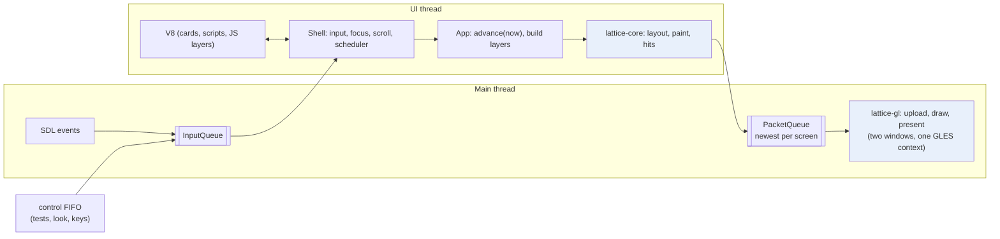
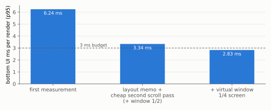
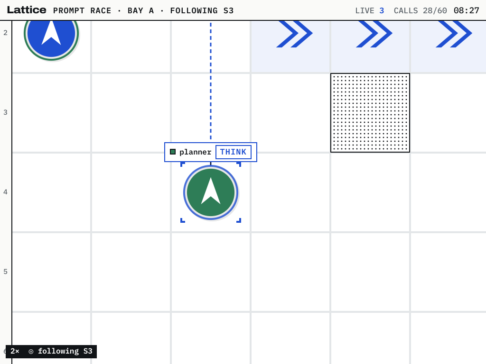
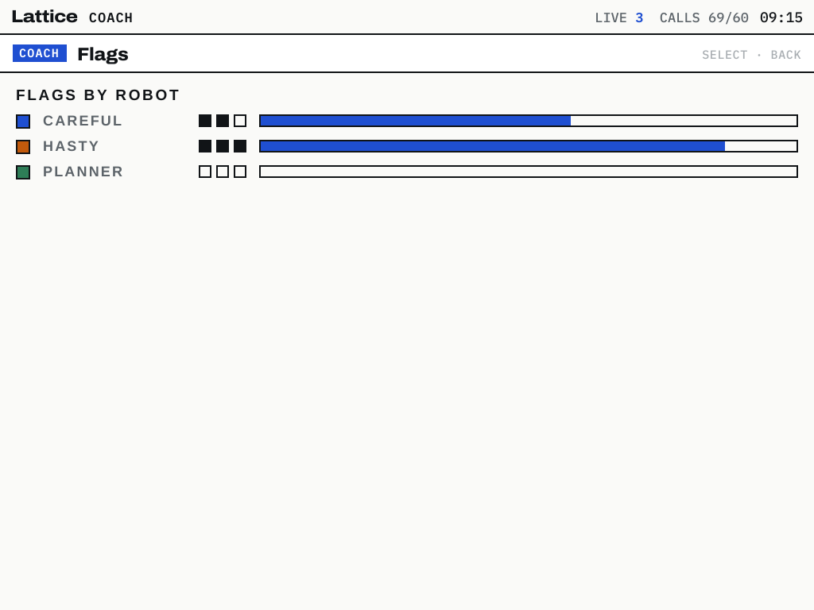
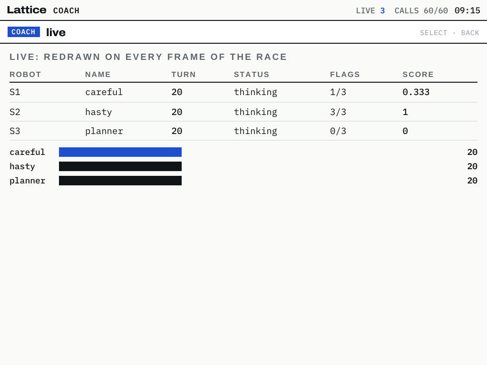
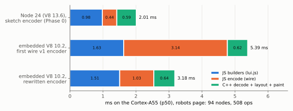
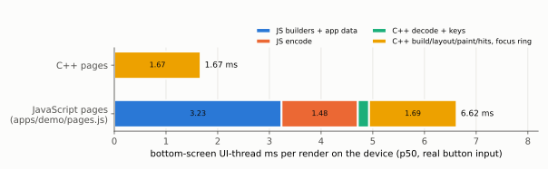
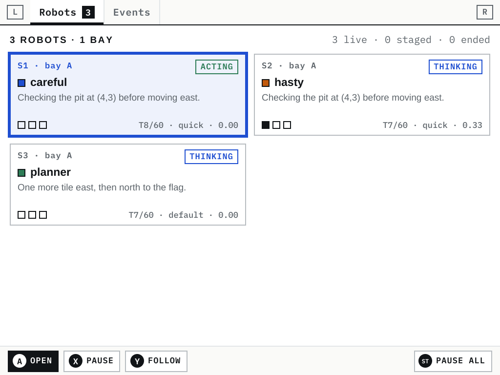
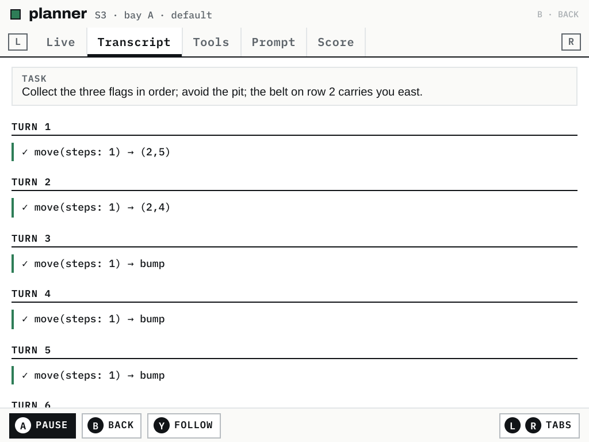
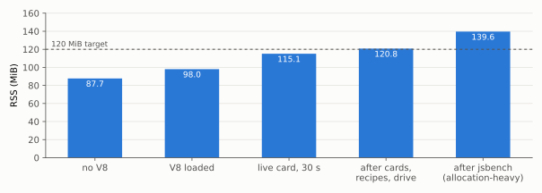

# Lattice DS Native, Part 2

[[PROJECT REPORT - Lattice DS Native - An Exact C++ Port of a Browser Layout Engine and a GPU Backend on the RG DS Plus|Part 1]] covered three phases:
- **Phase 0:** the platform.
- **Phase 1:** a C++ port of lattice-ui's layout engine, *lattice-core*, which reproduces the JavaScript library exactly.
- **Phase 2:** an OpenGL ES backend, *lattice-gl*, that draws its display list on the RG DS Plus's Mali-G52.

This report covers the next two phases of ticket `DSUI-001`:
- **Phase 3:** the *shell*, the part of a handheld user interface that is not layout. It decides when to draw, moves focus with the D-pad, scrolls, and routes touches, and it runs in C++ on two threads.
- **Phase 4:** the *JavaScript layer*. V8 is embedded over the shell so that coach cards, scripts and application pages can still be written with lattice-ui's builders.

Phase 3 met its budgets. Phase 4 is correct, but its performance teaches something the Phase 0 measurements did not: on this CPU a JavaScript *page* costs three times its C++ equivalent, even with layout and painting in C++.

> [!summary]
> - **The shell draws only when something changed.** With the race paused, both screens rendered nothing for 10 seconds. While robots move, the top screen renders every 33.1 ms (p50). UI-thread time per render is p95 1.13 ms (top) and 2.83 ms (bottom), within a 3 ms budget after an exact layout memo removed repeated work.
> - **V8 runs on the handheld as a library.** Debian's libnode108 (V8 10.2) is embedded with its own library directory; JavaScript cards, async scripts and the textbook's recipes 14.3 and 14.5 run unchanged.
> - **JavaScript pages are exactly equal to C++ pages but cost three times as much.** The demo's bottom pages, ported to JavaScript, lay out to identical boxes, operations and hit maps on x86 and on the device. A bottom-screen render costs 6.4–6.6 ms p50 with JavaScript pages against 1.67 ms with C++ pages. The robots-page target of 2 ms p95 for the JavaScript part was missed (3.2–4.1 ms).
> - **The encoder, not V8, was the first bottleneck.** A rewrite of the wire encoder that visits only the properties a node has cut its device time from 3.14 ms to 0.87–1.03 ms.

## 1. Where Part 1 left the design

Part 1 established three components and one decision.
- **lattice-core** takes a *description*, a tree of nodes built with lattice-ui's chained builders. It lays the tree out and paints it into a *display list*, a flat array of drawing operations.
- **lattice-gl** draws a display list with one instanced shader and one draw call per layer.
- **The wire format** carries a description from JavaScript to C++. `js/wire.js` encodes a lui.js tree into a binary buffer: a string table, a style table and the nodes as 64-bit words. lattice-core's `decodeWire` reads it.
- **The decision.** The project's owner set the direction after the Phase 0 measurements: "port to C++ for the most part and then layer the thin JS on top if possible". lui.js in V8 cost 12.2 ms per robots page on the device; the C++ port cost 0.59 ms.

Part 1 closed with a projection. Describing the robots page in JavaScript and encoding it had cost 0.98 + 0.44 ms in Node 24 on the device, so the full path would cost about 2.0 ms. Section 5 shows what that path cost once it existed. Those Phase 0 figures came from Node 24's V8 13.6 and a sketch encoder. The shipped path uses V8 10.2 and the full encoder.

## 2. The shell

A layout engine answers one question: given a description, where does everything go? A handheld interface must also answer:
- **when** to produce a new description;
- **which box** the D-pad is on, and where it should go next;
- **how far** a page is scrolled;
- **what** a touch at a given pixel hit.

In the original these answers live in `c_ds.js`, the Lattice DS module of the browser application. Phase 3 moves them into `src/shell/`.

### 2.1 Two threads, layers and packets

The runtime has two threads with strictly separated responsibilities.



The **main thread** owns SDL, the two windows (one per panel), the shared GLES context and presentation. Every GL and SDL call stays on it, a rule inherited from the Falllinie project on the same device. The **UI thread** owns everything that decides what to draw:
- the shell and the application;
- lattice-core;
- since Phase 4, the V8 isolate.

The two threads exchange two kinds of message.
- **Input events** go from main to UI through `InputQueue`. The UI thread blocks on it with a deadline, which is how it sleeps when nothing needs to happen.
- **Frame packets** go from UI to main through `PacketQueue`. A packet carries, per *layer*, either new drawing data or a mark that the layer is unchanged.

A **layer** is a separately built part of a screen with its own display list. The top screen of the demo has three:
- `stat`, the board tiles, cached by a key that changes only when the board does;
- `dyn`, the robots, rebuilt every frame while they move;
- `hud`, the header.

The bottom screen has the page and a focus-ring overlay. Drawing data travels as `shared_ptr<const LayerData>`. The packet queue keeps only the newest packet per screen, and when it replaces an undrawn packet it carries over any layer data the newer one marks unchanged. A packet that is never drawn therefore costs nothing, and the main thread never sees a gap.

The UI thread owns layout rather than the main thread because input needs the results. A tap is resolved against the *hit map*, the keyed boxes that paint collected; `look()` reads text back from the box tree; focus navigation needs the positions of focusable boxes. All three are answered on the thread that has the tree, without a round trip.

### 2.2 The scheduler: draw only on change

The scheduler follows c_ds.js's rule. Each tick, the application reports what is moving (`Motion`). The shell derives two intervals from it:
- **`want`:** how often the top screen must redraw even if nothing was marked dirty;
- **`minGap`:** the minimum time between two redraws.

```cpp
// src/shell/shell.cpp, Shell::tick
const double want   = (m.tween || m.camera) ? 33 : m.effects ? 50 : m.pulse ? 90 : 1e300;
const double minGap = (m.tween || m.camera) ? 30 : 50;
if ((dirty_[0] && now - last_[0] >= minGap) || now - last_[0] >= want) render(Screen::Top, now);
if (dirty_[1] && now - last_[1] >= 60) render(Screen::Bottom, now);
// the next deadline: the app's next scheduled change, or the earliest pending redraw
```

When nothing moves and nothing is dirty, `want` is effectively infinite and the next deadline is the application's next scheduled change. The UI thread sleeps until then or until input arrives.

On the device, START paused all robots. The render counters read `renders=484` on top and `104` on the bottom 1.5 s later, and the same values 10 s after that. While robots moved, the gaps between top-screen renders measured p10 30.1 ms, p50 33.1 ms and p90 33.1 ms over 277 renders. The 30 Hz target is held, and drawing stops when motion stops.

### 2.3 Focus as a key, navigation by geometry

Focus is stored as a **key string** per page, for example `robot:S2` or `ev:118`, never as a pointer to a box. Boxes are rebuilt on every render; keys survive. A page shown without a valid focus starts on its first focusable box.

D-pad navigation is spatial, as in c_ds.js. From the focused box, the shell considers every focusable box that lies entirely in the pressed direction. It scores each by the gap along that direction plus 2.2 times the offset across it, and moves to the lowest score:

```cpp
// Shell::navigate, for DOWN: candidates start below the current box
main = it->y - (c->y + c->h);           // gap along the direction
cross = std::fabs(ix - cx);             // centre offset across it
score = std::max(0.0, main) + cross * 2.2;
```

The weight makes a box directly below preferable to a closer one far to the side, which matches how a grid of cards reads. The focus ring is a separate layer, built after the page in the same render. It draws a 2-pixel `sig` rectangle around the focused key's hit box, clipped to the page's scroll viewport, so moving focus never rebuilds the page.

### 2.4 Scrolling in two passes, and an exact layout memo

A bottom page has a fixed header and hint bar and a scrolling body. The application builds the page with the body's top margin set to minus the scroll offset; the shell finds the body and content boxes by their reserved keys (`__body`, `__content`) after layout. The correct offset is often known only after layout:
- when focus moves to a box below the viewport;
- when the page is *anchored*, so that the focused box keeps its on-screen position while rows are added above it;
- when a list *sticks* to its end.

c_ds.js therefore renders twice: once to measure, once with the corrected offset.

The first device measurement of the bottom screen was p95 6.24 ms, over the 3 ms budget. The slow renders were all the events page with two passes: about 240 nodes, 1,100 operations, 5.5–7.9 ms. The host has no usable `perf` (`perf_event_paranoid=4`), so the profile came from callgrind on the host. It showed layout dominating, for a structural reason.

lattice-ui's layout calls `layout(node, W, H)` recursively. Rows with stretched children and columns with growing children lay out some children twice: once to measure their natural size, and again at the final size. The repetition compounds with nesting.

`layout(node, W, H)` is a pure function of its arguments within one tree, so a per-frame memo keyed by (node, W, H) returns a copy of the earlier result. Children are shared, because their positions are relative to their parent. The memo cannot change a single number, and the parity suite confirmed it: 1,005 of 1,005 fixtures, 4,005 of 4,005 random trees and 5 of 5 builder screens stayed identical.

The memo also made a cheap second pass possible. Only the content node's top margin changes between the passes. The shell patches that one field, invalidates the memo entries of the content's ancestors (`Layout::invalidateAncestors`), and re-runs layout (`Core::relayout`). Every unchanged subtree comes back from the memo, and the page is not rebuilt.



The last step narrowed the events list's virtual window. The list has 120 rows of fixed height, so the rows visible at a scroll offset follow by arithmetic; only those plus a margin are described, and two spacer boxes stand for the rest. With the second pass no longer rebuilding the page, the margin could shrink from three screens to a quarter screen on each side, because the next build sees the new offset. Final figures, with three rounds of real button presses through the kernel's input devices:

| Screen | UI-thread ms per render, p50 | p95 | max |
|---|---|---|---|
| top (board, robots, header) | 0.80 | 1.13 | — |
| bottom (pages) | 1.55 | 2.83 | 3.62 |

### 2.5 Testing with real input

The shell is tested at two levels.
- **On the device**, `evinject.py` writes `input_event` records into the Goodix touch panel's and the joypad's `/dev/input` nodes. Taps, drags and button presses therefore pass through the kernel, libinput, Sway and SDL exactly as a user's would.
- **On both host and device**, a control FIFO lets a test send `press`, `tap`, `look`, `keys`, `state`, `perf` and `capture` commands. `look` reads each screen back as text lines from the box tree, which is how assertions are written.



## 3. Embedding V8

### 3.1 Packaging a JavaScript engine that the distribution does not ship

ROCKNIX does not ship Node or V8. The Falllinie project qualified a different route on this device: Debian bookworm's `libnode108` package (Node 18.20.4, V8 10.2), unpacked privately and linked as a library. `third_party/v8/fetch.py` downloads it and its dependencies by pinned SHA-256 for both architectures. The host build links the amd64 copy, the device build the arm64 copy. Three problems appeared, each with a precise cause.

1. **Debian's C++ runtime shadowed the host's.** The first host binary failed with `libstdc++.so.6: version 'GLIBCXX_3.4.31' not found`. Its run path pointed at Debian's library directory, which contains GCC 12's `libstdc++`, older than the host's. `fetch.py` now builds curated directories of symlinks that contain libnode and its dependencies but not `libstdc++` or `libgcc_s`. Both the host and ROCKNIX have newer copies, which are backward compatible.
2. **ROCKNIX's OpenSSL lacks a symbol libnode imports.** The device binary failed with `undefined symbol: SSL_trace, version OPENSSL_3.0.0`. ROCKNIX builds OpenSSL without the trace feature. Debian's `libssl.so.3` and `libcrypto.so.3` now ship to `/storage/apps/lattice-ds/lib` with libnode, ICU 72 (ROCKNIX has 74), libuv, brotli and c-ares: 82.6 MiB in all, most of it libnode (41.5 MiB) and ICU's data (29.8 MiB). The system copies of zlib and nghttp2 are compatible and are used.
3. **The run path needs `DT_RPATH`, and `$ORIGIN` must survive the build.** libnode's own dependencies (ICU, libuv) must resolve from the private directory too. A `DT_RUNPATH` entry applies only to the executable's direct dependencies; `DT_RPATH` applies to the whole tree, so the link uses `--disable-new-dtags`. The first device binary's run path read `$/../lib`: `$ORIGIN` passed through raw link flags had been consumed on its way through Ninja and the shell. Setting it through CMake's `INSTALL_RPATH` property, which escapes it, produced `$ORIGIN/../lib`.

A consequence of `DT_RPATH` worth recording: Debian's OpenSSL becomes the copy for the whole process. Any later network library (Phase 5) must be linked against it.

### 3.2 The binding

`V8Host` (`src/js/v8host.cpp`) owns one isolate and one context on the UI thread. Native functions are installed as `globalThis.__native.<name>`. A single trampoline dispatches them, because V8 10.2's function callback has no `Callee`: the trampoline keeps the host and the function pointer in internal fields of a template object. Values cross the boundary as a small variant type (`JsValue`: undefined, null, boolean, number, string, array, object, bytes), and `ArrayBuffer`s arrive as byte vectors.

Three JavaScript files are loaded at start, in 22.7 ms on the device:
1. **lui.js, unchanged.** The reference library is loaded for its builders, its kit and its styles. Its layout, paint and SVG code are loaded but never called. It is a UMD file: it exports through `module` if one exists and sets a global otherwise. The first loader passed a `module` object, so `LatticeUI` was never defined and `ds.js` failed with `Cannot destructure property 'col' of 'LUI' as it is undefined`. The loader now passes `undefined`.
2. **wire.js**, the encoder.
3. **ds.js**, the browser-shaped globals plus the textbook's scripting API:
   - `setTimeout`, `setInterval`, `sleep`, `console`, `performance.now`;
   - `ds` (show, clear, look, keys, press, tap, state, bottom, top, measure);
   - `ui`, a subset of `arena`, and `AR.DS.api`, which builds read-only API objects.

**Clocks.** Timers run on the shell's application clock, and `performance.now` reads a monotonic wall clock. The two were not always the same thing. The first timer test, `await sleep(150)`, measured less than 150 ms. The application clock had been the time of the last tick, and the UI thread may sleep for seconds between ticks, so a timer set late in such an interval started from a stale time and fired early. The fix is one live clock, `shell::clockMs()`, read by the runtime, the application and JavaScript alike.

### 3.3 The data path from a JavaScript tree to the screen

A JavaScript description reaches the screen through five steps.

```mermaid
sequenceDiagram
  participant S as Shell (C++)
  participant B as Bridge (C++)
  participant J as V8: ds.js / app JS
  participant C as lattice-core
  S->>B: build layer "bottom" (Frame: scroll, now)
  B->>J: __lattice_layer("bottom", {scroll})
  J->>J: builders -> tree; wire.encodeTree(tree)
  J-->>B: {buffer, keys:[{focus,tap,a,tag}...]}
  B->>B: register KeyData per key (closures call __lattice_dispatch)
  B->>C: decodeWireAppend(buffer, tree, handlerBase)
  S->>C: layout, paint, hits (with the C++ parts of the screen)
```

The **key data** step needs care. In lui.js a key carries arbitrary data, typically `{ focus: true, tap: () => … }`, and the data contains JavaScript functions. C++ must not hold JavaScript functions across frames.
- **What the encoder does.** It collects every key's data object, in tree order, into a `handlers` array, and writes the index plus one into the wire buffer.
- **What C++ receives.** Per key, only what the shell needs: is it focusable, does it respond to a tap or to A, and an optional tag.
- **Where the functions stay.** The data objects remain in JavaScript under a *scope* name, such as `top`, `bottom` or `layer:bottom`. When the shell activates a key, the registered closure calls `__lattice_dispatch(scope, index, kind)`, which looks the function up and calls it. A new render replaces the scope's array, so no handler outlives its frame.

One rule keeps this safe: **a handler never renders.** The shell calls a handler while processing a tap. Rendering inside it would rebuild the frame whose handler table holds the closure being executed. JavaScript handlers therefore act through application commands that change state and mark screens dirty, and the next tick renders.

### 3.4 Scripts and the textbook's recipes

The arena's editor runs a script as the body of an async function (`f_app.js:87`). The shell's `run` command does the same: `return` and `await` work, and the result is printed when the promise settles. V8's default microtask policy runs promise callbacks when the outermost call returns, which is after each host call into JavaScript.

The ticket's gate required two textbook recipes to run unchanged.
- **Recipe 14.3** puts a live card on the top screen. A function card is redrawn on every render of the top screen, using the builders it receives:

```javascript
ds.show('top', (L, { w }) => L.col().gap(6).add(
  L.text('Flags by robot', 'sec'),
  arena.sessions().map(s => L.row().gap(8).align('center').add(
    L.kit.sw('a' + (s.colorIndex % 8 + 1), 9),
    L.text(s.name, L.S('who'), { nowrap: true }).w(90),
    L.kit.pips(parseInt(s.info().flags) || 0, 3),
    L.row().h(8).grow(1).border(1, 'ink').add(
      L.box().w(Math.round((w - 200) * s.info().progress)).fill('sig')),
  ))),
  { title: 'Flags', live: true });
```



- **Recipe 14.5** tests the handheld from a script. It presses DOWN and A, asserts with `look` that the dossier opened, presses R, asserts that the tab is `transcript`, and presses B. It exposed a difference between the demo and the original. Phase 3's dossier had two tabs, Live and Actions; c_ds.js has five: Live, Transcript, Tools, Prompt and Score. The demo now has the original's five, and the recipe passes on host and device.

Read-only mode, which the coach uses, blocks `ds.press` and `ds.tap` with a `ReadOnlyError` and nothing else, as c_ds.js does. A card function that returns something other than a node throws in the caller's script, not later in the frame loop, because `ds.show` encodes the card once immediately.



## 4. The first bottleneck was the encoder

The first device run measured the JavaScript part of the robots page at 4.82 ms p50 and 12.73 ms p95. The encoder took 3.14 ms of the p50, twice the builders' 1.63 ms.

A CPU profile in Node, 3,000 iterations, attributed 42% of the time to the encoder's `walk` function and 14% to its `style` function. The causes are specific to how the first encoder was written.
- **`walk` asked every node for every property.** For each node it read about forty property names: two dozen numeric ones, sizes, alignments, flags, tokens, borders. Most nodes have four to eight properties. lui.js nodes have many different shapes, so each `p[k]` lookup was megamorphic: V8 could not specialise it to one object layout and fell back to a generic lookup, forty times per node.
- **`style` built a string key per text.** Text styles were deduplicated with `record.join(',')`, which converts twelve floating-point numbers to strings for every text node.
- **Every encode allocated a fresh 64 KB buffer**, zero-filled, and grew it through a `DataView`.

The rewrite keeps the wire format and changes the method:
- it iterates over the properties a node *has* (`for…in`) and dispatches on a table;
- it writes node words straight into a reused `Float64Array`;
- it deduplicates styles first by object identity and then by comparing records field by field;
- it writes UTF-8 directly into the output.

| Robots page encode, p50 | first encoder | rewritten |
|---|---|---|
| Node 24, host (no `TextEncoder`) | 0.269 ms | 0.047 ms |
| embedded V8 10.2, host | 0.326 ms | 0.094–0.100 ms |
| embedded V8 10.2, device | 3.14 ms | 0.87–1.03 ms |

The rewrite emits a node's properties in the order of its props object rather than in a fixed order. Byte equality with the old encoder therefore no longer holds, and a byte comparison would have been the wrong test. The check instead decodes both encoders' buffers in Node into a **normal form**:
- strings and styles are resolved to their values;
- properties are grouped by id;
- repeated properties (text runs, borders) keep their order.

On 2,005 trees, the five reference screens and 2,000 random trees, the normal forms were identical. A deliberately broken encoder, with one flag inverted, failed on 120 of 205 trees, which shows the check can fail. The full parity suite, which encodes every fixture with the new encoder and compares C++ layout with lui.js's own, also passed.

One behaviour changed deliberately. A lone UTF-16 surrogate is now encoded as U+FFFD, as `TextEncoder` does. Bare V8 has no `TextEncoder`, and the old fallback wrote such surrogates raw, so Node and the device had encoded them differently.



## 5. What a JavaScript page costs

### 5.1 The robots page in isolation

After the rewrite, the JavaScript part of the robots page is 2.1–2.6 ms p50 and 3.2–4.1 ms p95 on the device. That is above the 2 ms p95 gate, and above Part 1's projection, for two reasons visible in the figure above.
- **The builders are slower in V8 10.2 than in Node 24.** They take 1.25–1.51 ms against 0.98 ms; lui.js's builders are unchanged and the engine is older.
- **The real encoder does more than the Phase 0 sketch.** It writes full style records and a string table; the sketch interned styles by identity and wrote no records.

V8 flags did not move the result. Robots-page JavaScript time, `jsbench`, 300 iterations after 20 warm-up iterations, performance governor:

| V8 flags | JS p50 | JS p95 | RSS |
|---|---|---|---|
| defaults | 2.14 ms | 3.28 ms | 114.3 MiB |
| `--max-semi-space-size=1` | 2.17 ms | 3.70 ms | 108.9 MiB |
| `--max-semi-space-size=4` | 2.13 ms | 3.22 ms | 113.6 MiB |
| `--single-threaded-gc` | 2.15 ms | 3.15 ms | 113.1 MiB |
| `--no-lazy-feedback-allocation` | 2.32 ms | 3.56 ms | 113.9 MiB |

### 5.2 Pages through the shell

A benchmark that builds one screen 300 times after a warm-up measures fully optimised code. An application builds a page only when something on it changed, a few times per second, and alternates between pages. To measure that, the demo's bottom pages were ported line by line to JavaScript (`apps/demo/pages.js`):
- robots;
- events, virtualised;
- the dossier with all five tabs.

Run with `--js-pages`, the demo builds its bottom screen from JavaScript. The same real-input script that measured Phase 3 then cycles through the pages for three rounds.



| Bottom screen, per render (device) | p50 | p95 |
|---|---|---|
| C++ pages | 1.67 ms | 2.94 ms |
| JavaScript pages | 6.40–6.62 ms | 12.6–12.8 ms |
| …of which JavaScript builders | 3.12 ms | 7.08 ms |
| …of which the app's state, read through natives (C++ side) | 0.12 ms | 0.25 ms |
| …of which wire encoding | 1.48 ms | 3.56 ms |
| …of which decoding and key registration (C++) | 0.22 ms | 0.41 ms |

The builders cost twice their benchmark figure, because page code runs too rarely and too variously to stay in V8's optimised tier. Flags that tier up earlier recover part of it. With `--always-sparkplug --interrupt-budget=16384`, the JavaScript layer drops from 5.48 to 4.44 ms p50, but `--always-sparkplug` adds compile pauses of up to 24 ms. No flag closes a threefold gap.

The underlying cause is the CPU. A Cortex-A55 is an in-order core. Relative to the development laptop's i7-1165G7, lattice-core's C++ runs 6.5× slower in decode, 7.5× in layout and 10× in paint. JIT-compiled JavaScript runs 9–15× slower: the encoder 9–11×, the builders 12–15×. lui.js's builders are copy-on-write: every chained call (`.pad(…)`, `.gap(…)`) allocates a new props object. That is a sound property for a scripting API, and it is the kind of code an in-order core runs worst.



## 6. Proving that JavaScript pages equal C++ pages

The demo's `pagecheck` command builds every bottom page twice from the same application state: once with the C++ builders and once with `pages.js` in V8. It lays both out with lattice-core and compares them as `dump_json` documents, the format of the parity suite. That covers every box's position and size, every drawing operation with all its fields, and every hit-map entry. Comparing operation counts would have hidden small differences; this comparison hides none.

```text
host:   pagecheck robots=same/427 events=same/396 dossier:live=same/323 dossier:transcript=same/287
                  dossier:tools=same/201 dossier:prompt=same/281 dossier:score=same/173 PASS
device: pagecheck robots=same/442 events=same/729 dossier:live=same/404 dossier:transcript=same/365
                  dossier:tools=same/261 dossier:prompt=same/281 dossier:score=same/173 PASS
```

The number after each page is its operation count; the device ran longer, so its lists were longer. A JavaScript page wrapped with one pixel of extra padding produces `FAIL 7`, so the check is not vacuous.

The port made one more small fidelity correction to the C++ side. c_ds.js shows both shoulder buttons, L and R, in the hint for switching tabs; Phase 3 had shown only R. The C++ demo now draws both, and the JavaScript port does the same.

Live, with `--js-pages`, the Phase 3 smoke test passes unchanged: D-pad focus, A opening the dossier, focus moving through the events list, and a tap on an event row opening that robot's transcript. Every step goes through JavaScript handlers.



## 7. Memory



`VmRSS` is reported in KiB; the figure is in MiB. The demo without V8 holds 87.7 MiB; this baseline was not broken down further in this work. Loading V8 and the three scripts adds 10.3 MiB. After a live card has been rebuilt on every frame for 30 seconds, the process holds 115.1 MiB, within the ticket's 120 MB target read as MiB.

Two qualifications apply. First, in decimal units 115.1 MiB is 120.7 MB, and an early commit message quoted the KiB count as "117.8 MB"; the diary records the correction. Second, after the cards, recipes and functional drive the process reached 120.8 MiB, and after the allocation-heavy benchmark 139.6 MiB. V8 and the C library keep memory they have once used. Limiting the young generation (`--max-semi-space-size=1`) saves about 5.4 MiB at a slightly higher p95.

## 8. Consequences for the design

Phase 4 settles where the boundary between C++ and JavaScript belongs on this device.
- **Pages stay in C++.** A bottom-screen render through JavaScript costs 6.4 ms p50 and 12.7 ms p95. That fits inside a 16.7 ms display frame, but it is three to four times the C++ cost, and it grows with page size: the 120-row events list costs 17 ms of JavaScript alone. The arena's pages (Phase 5) will be written in C++, like the demo's.
- **JavaScript drives what is small, dynamic or user-written.** That means coach cards, scripts, the `ds`/`ui` API and application logic. Showing a card, which builds and encodes it once to validate it, took 2.3–5.5 ms on the device; the first card took 44 ms while V8 compiled the card code. A live card rebuilt at 30 Hz costs 3.1 ms p50 per frame, which the top screen absorbs: its UI time was 4.0 ms p50 against a 33 ms frame.
- **The 2 ms robots-page target remains open**, with three measured or estimated levers:
  1. **A newer V8**, from a later Debian release's libnode (Node 20 or newer). Node 24's figures suggest 1.3–1.5× on the builders.
  2. **Memo nodes**, so that unchanged subtrees are neither rebuilt nor re-encoded.
  3. **Earlier tier-up**, measured at 10–19%.

The correctness work carries over unchanged. Whatever runs in JavaScript produces exactly the boxes and operations the C++ path would. The parity discipline of Part 1 extended cleanly across the language boundary.

## 9. What remains

- **Phase 5:** the arena runtime. Sessions and the network client for Claude-backed robots (libcurl, linked against the shipped OpenSSL), storage, and the arena's pages in C++ with its scripting API in V8.
- **Phase 6:** hardening:
  - memo nodes;
  - a V8 code cache for start-up;
  - V8 flag choices backed by the measurements above;
  - registration in the ROCKNIX Ports menu;
  - a thermal check.
- **The open Phase 4 criterion:** robots-page JavaScript under 2 ms p95, tracked as its own task.

## 10. Reproducing the results

```bash
cd ~/code/wesen/2026-10-15--nintendo-ds-ui
python3 third_party/v8/fetch.py                                     # libnode108 + dependencies, pinned hashes
cmake -S . -B build -G Ninja && cmake --build build && (cd build && ctest)   # 12 tests
node scripts/js-encode-bench.js bench js/wire.js robots 300 --no-textencoder
scripts/build-device.sh lattice-demo && scripts/deploy-device.sh build-device/lattice-demo
ssh root@192.168.0.202 sh /storage/apps/lattice-ds/scripts/run-js.sh /tmp/js        # cards, recipes, RSS, jsbench
ssh root@192.168.0.202 sh /storage/apps/lattice-ds/scripts/pagecheck.sh /tmp/pc      # C++ = JS pages on aarch64
ssh root@192.168.0.202 sh /storage/apps/lattice-ds/scripts/perf-demo.sh /tmp/pf --js-pages
```

| Path | What it is |
|---|---|
| `src/shell/` | queues, the shell (scheduler, layers, focus, navigation, scroll, hit map, look) and the two-thread runtime |
| `src/js/` | `V8Host` (isolate, natives, loading) and `Bridge` (cards, JavaScript layers, scripts, timers, jsbench) |
| `js/ds.js`, `js/wire.js` | the scripting API and browser globals; the wire encoder |
| `apps/demo/main.cpp`, `apps/demo/pages.js` | the native demo and its bottom pages in JavaScript |
| `third_party/v8/` | the libnode fetcher, pins and the list of libraries shipped to the device |
| `tests/shell/`, `tests/js/` | smoke tests through the control FIFO, including the recipes and pagecheck |
| `ttmp/2026/10/15/DSUI-001…/` | design guide, diary Steps 10–11, and every evidence file cited here (`scripts/evidence/phase3`, `phase4`) |

## Related notes

- [[PROJECT REPORT - Lattice DS Native - An Exact C++ Port of a Browser Layout Engine and a GPU Backend on the RG DS Plus]]: Part 1, the layout core and the GPU backend this report builds on.
- [[PROJECT REPORT - Falllinie JavaScript Embedding - ARM64 Qualification, V8 Ownership and Bounded Rules]]: the libnode108 qualification on the same device that Section 3 reuses.
