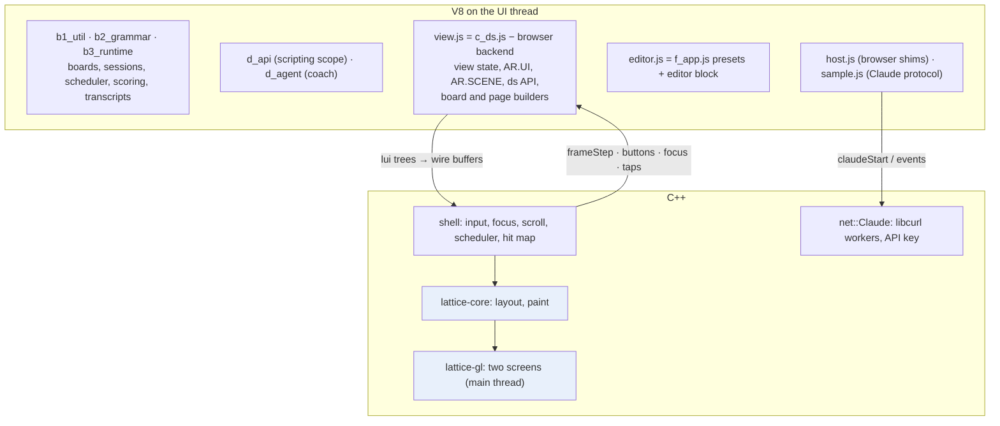
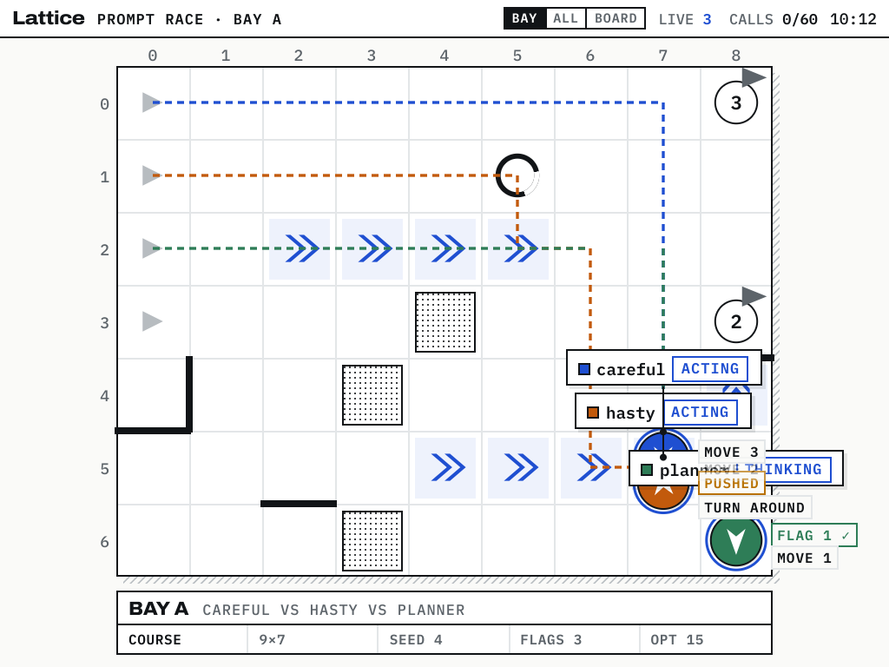
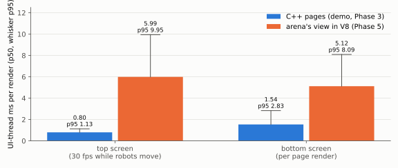
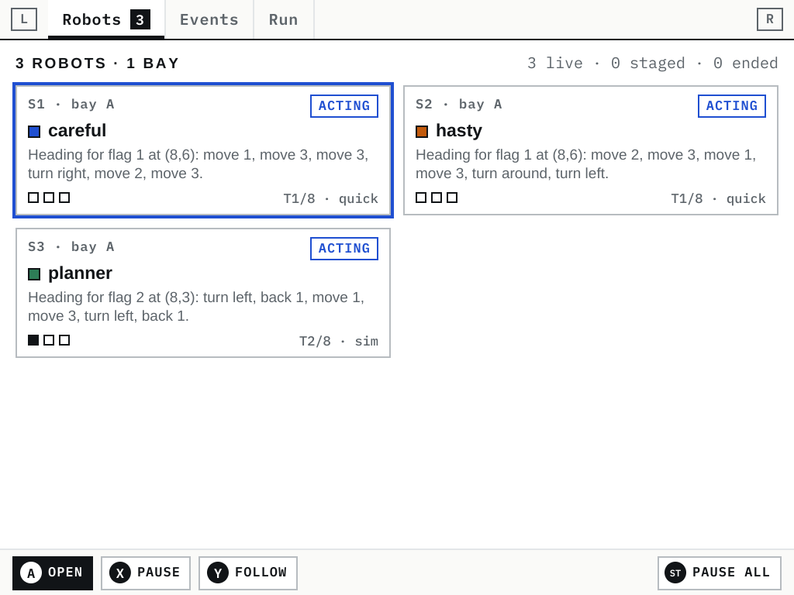
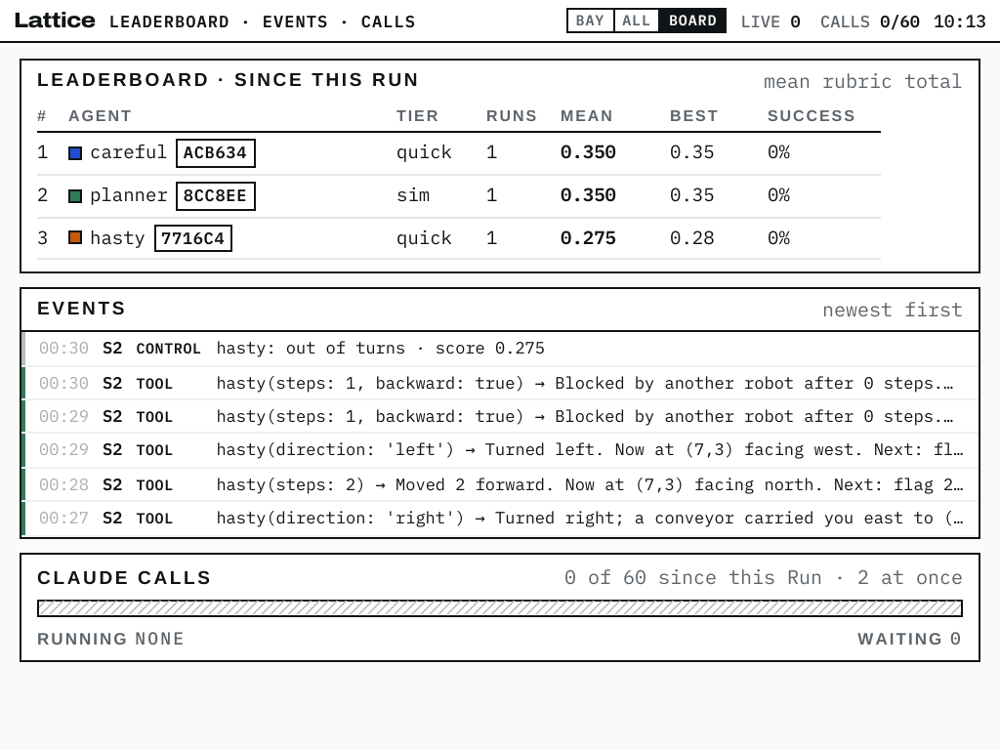
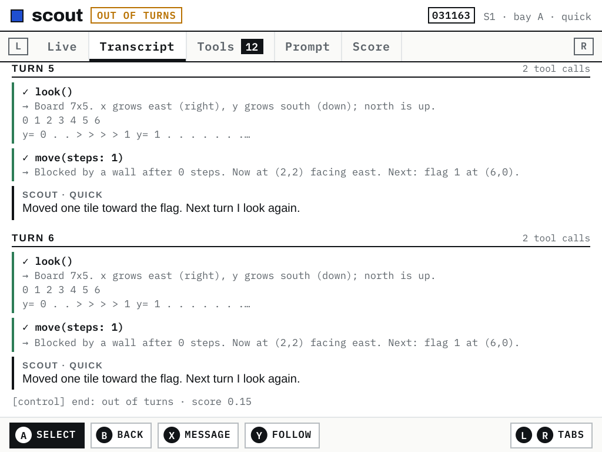

# Lattice DS Native, Part 3

[[PROJECT REPORT - Lattice DS Native - An Exact C++ Port of a Browser Layout Engine and a GPU Backend on the RG DS Plus|Part 1]] replaced lattice-ui's layout engine and SVG output with C++ and OpenGL ES. [[PROJECT REPORT - Lattice DS Native, Part 2 - A Two-Thread Shell and a Thin V8 Layer on the RG DS Plus|Part 2]] added the native *shell*, which handles input, focus, scrolling and scheduling, and an embedded V8 that runs lattice-ui's builders and scripts.

This report covers Phase 5 of ticket `DSUI-001`: the arena application itself, Lattice Arena DS, running on the RG DS Plus with its own JavaScript. The runtime, the scripting scope, the coach and the handheld module all run in V8. The native layers from Parts 1 and 2 replace the browser underneath. A three-robot race now runs from the START button to the leaderboard on the device's two screens, at 30 frames per second.

The report explains three things:
- how the handheld module was moved off the browser without being rewritten;
- what a browser-era runtime expects from its host;
- how the arena reaches Claude, including a library conflict that a single process could not load both sides of.

> [!summary]
> - **The arena runs its own code.** Most of the files load unchanged: b1_util, b2_grammar, b3_runtime, d_api and d_agent. The handheld module c_ds.js is *derived* by a generator that applies 25 listed exact edits, so roughly 300 of its 1,212 lines of browser backend are replaced by the C++ shell and the rest runs as written.
> - **It holds 30 fps on the device.** The top screen renders every 33.1 ms (p50) during a race. The JavaScript view costs about 6 ms of UI-thread time per frame against 0.8 ms for C++ pages. That makes it the next thing to port, with the JavaScript as the oracle.
> - **Claude is reached through a native transport that keeps the key.** libcurl carries the Messages API; the key file is read in C++ and never enters JavaScript, where coach-generated code also runs.
> - **One process, one OpenSSL.** libnode needed a symbol ROCKNIX's OpenSSL omits, and ROCKNIX's libcurl needed a newer OpenSSL than Debian's. Of 483 OpenSSL symbols libnode imports, exactly one was missing; a two-line stub library supplies it, and the whole process uses the system's OpenSSL.

## 1. What runs where

Lattice Arena DS is a browser application with three parts:
- **A runtime.** Boards with walls, conveyors, pits and gears; robots ("sessions") driven by Claude or by a scripted planner; a scheduler that rations Claude calls; scoring; and a transcript store.
- **A coach.** A chat agent that can run JavaScript in the page.
- **A handheld module, c_ds.js.** It draws both screens with lattice-ui and implements the API that scripts and the coach use to control the handheld.

In the browser, a React application hosts all three.



The rule from Part 2 still decides the boundary: everything that scales with screen size runs in C++, everything that decides *what* to show stays in JavaScript. Phase 4 showed that a whole page described in JavaScript costs about three times its C++ equivalent, so in principle the arena's pages belong in C++. Phase 5 nonetheless runs c_ds.js's builders in V8, deliberately, for the reason given next.

## 2. Moving c_ds.js off the browser without rewriting it

### 2.1 Why not port it straight to C++

c_ds.js's builders do not read a data structure; they read the runtime's live objects:
- the robots page calls `s.info()` and reads `s.events` and `s.liveText`;
- a dossier button calls `s.start()`;
- the board reads `bay.env.conv`, `bay.env.pits` and the robots' positions.

Its view state is tied to those objects in the same way: the selected robot, the robot being followed, short-lived "floats", speech bubbles, annotations and coach cards.

A C++ port would need a mirrored data model updated from JavaScript, plus a port of about 900 lines of builders and view logic. Nothing would check the result. Part 1 faced the same problem with lattice-core and solved it with an oracle: the original JavaScript, run on the same inputs, compared exactly. Running c_ds.js first gives a complete, faithful arena on the device now, and it gives every later C++ port of a hot layer the same kind of oracle.

### 2.2 The browser backend is a separable part

c_ds.js contains a browser backend that the native shell already implements:
- painting lattice-ui output into SVG groups, and patching the DOM frame to frame;
- mapping pointer, keyboard and gamepad input to buttons and taps;
- focus, D-pad navigation, scrolling in two passes with anchoring, and hit testing;
- the `requestAnimationFrame` loop that decides when to redraw.

It amounts to roughly 300 lines. Everything else is view logic and builders that never touch the browser.

### 2.3 A generator of exact edits

`tools/make-arena-view.js` reads the reference c_ds.js and writes `js/arena/view.js`. It applies a list of 25 edits. Each edit is either an exact text match that must occur exactly once, or a region between two marker lines, and each carries its reason, which the generated file lists in its header. Representative edits:

| Edit | Before (c_ds.js) | After (view.js) |
|---|---|---|
| measuring | opentype fonts, `ui.measure` | `__native.measure` (lattice-core's shaper) |
| the top screen | `renderTop` paints three SVG groups | `topPlan` once per render, then the layers `top.stat` (cached by the plan's key), `top.dyn`, `top.hud` |
| the bottom screen | `renderBottom`: layout, scroll correction, redraw, focus ring | `bottomLayer`: one description per pass; the shell does the rest |
| focus | `DS.focus[pk] = k` | `focusSet` (a plain write) or `focusMove` (a user move that scrolls into view) |
| ds.press | `press(b); renderBottom()` | through the shell, as a real button |
| input and frame loop | 96 lines of DOM handlers and `frame()` | `frameStep(now)`: tweens, decay, motion flags for the shell's scheduler |

The generator fails if any edit does not apply exactly once, or if any browser reference survives (`renderTop(`, `DS.hits`, `DS.focus[`, `document.create`, …). With `--check` it writes nothing and fails if the committed file differs from a fresh run; that check is a CTest. The same generator extracts f_app.js's presets-and-editor block, which has no React in it, verbatim into `js/arena/editor.js`; only the preset source changes, from a DOM element to text the app passes in.

Two of the edits required matching changes in the shell, because c_ds.js has semantics the Phase 3 shell did not:
- **Two kinds of focus write.** c_ds.js sometimes writes the focus without the user moving it: the events feed keeps its focus on the newest event while it builds the page. At other times the focus changes because the user acted, and then the box must scroll into view. The shell now offers both.
- **The select-first tap rule.** On the robots page, the first tap on an unfocused card selects the robot without activating the card; the second tap opens the dossier. The shell's `tapAt` always activated. A new app hook, `onTapFocus`, lets the view consume the tap. Its default keeps the Phase 3 demo's behaviour.

### 2.4 The C++ host

`apps/arena/main.cpp` is small:
- **Loading.** It loads the JavaScript files in the browser build's order.
- **Layers.** It registers four layers, each built by calling into the view.
- **Hooks.** It routes the shell's app hooks to the view:
  - `advance(now)` → `frameStep(now)`, plus due timers; the motion flags returned set the scheduler's 33/50/90 ms rule;
  - `beforeRender(top)` → `topPlan(now)`, which places the camera once per frame and provides the board's offset and cache key;
  - `onButton` → c_ds.js's own `press(b)`, for B, X, Y, L, R, START, SELECT, and A when nothing was activated;
  - `onFocus`, `onTapFocus` → the view's selection rules;
  - `pageKey()` → the view's page key, under which the shell keeps focus and scroll.

## 3. The browser a runtime expects

The runtime files were written for a page. `js/arena/host.js` provides what they reach for:
- `window` and `self`;
- a `document` without elements, so that `addEventListener` is accepted and never fires and `document.hidden` is false;
- `requestAnimationFrame` over the shell's timers;
- `AbortController`/`AbortSignal`, which a session uses to stop a Claude call, plus `URLSearchParams`, `Blob`, `atob` and `btoa`;
- `localStorage` backed by files under the data directory, written atomically;
- `window.claude.use(name)`, the artifact runtime the arena was built against.

The last item is how storage and Claude enter the arena without touching its code. b1_util's `STORE` asks for `use('db')` and `use('user')`. Both return nothing on the handheld, so it falls back to `localStorage` exactly as in a browser without an account, and transcripts persist in files. d_agent asks for `use('sample')`; with a key configured it receives the handheld's implementation, and without one the arena behaves as in a browser without Claude: robots on Claude tiers fall back to the scripted planner and say so in their transcripts.

All timing uses one clock, the shell's live application clock:
- `performance.now()`;
- the tween start times c_ds.js records;
- the frame times the shell passes to `frameStep`.

Part 2 found a timer firing early on a stale clock; one time base removes that class of error.

## 4. Results on the device

A full race on the handheld, governor at `performance`, started by a real press of START through the kernel's input device:

```text
CTL run 1 = {"ended":3,"board":[["careful","quick",1,0.35],["planner","sim",1,0.35],["hasty","quick",1,0.28]]}
CTL perf top detail ... motion_gap_p50=33.1 p10=32.7 p90=33.1 n=569
CTL perf top renders=695 ... ui_ms_p50=6.009 p95=9.905 max=25.573 ops=436 nodes=224
CTL perf bottom renders=195 ... ui_ms_p50=5.069 p95=7.407 max=12.510
```

The race result comes from the arena's own scope: `await arena.waitAll()`, then `store.leaderboard()`. The top screen held its 30 fps for all 569 measured frames.





| UI-thread ms per render (device) | p50 | p95 |
|---|---|---|
| top screen, C++ demo pages (Phase 3) | 0.80 | 1.13 |
| top screen, arena view in V8 | 5.99 | 9.95 |
| bottom screen, C++ demo pages | 1.54 | 2.83 |
| bottom screen, arena view in V8 | 5.12 | 8.09 |

The comparison is not like for like. The arena's board shows more than the demo's: speech bubbles with full status lines, trails, annotations and pennants, 224 nodes on the top screen against 163. The direction is the one Phase 4 measured, though. A JavaScript layer costs 2.7 ms at p50: 1.4 ms in the builders, 0.8 ms encoding, and 0.1 ms decoding in C++. The top screen builds two such layers per frame, since the board's static layer is cached.

At 6 ms per 33 ms frame, the top screen uses about 18% of one core while robots move. That works, and it is the obvious next port: `top.dyn`, the dynamic layer (robots, bubbles, floats), rebuilt every frame.

Memory grew during the race, from 108.8 MiB staged to 143.8 MiB at the end; the high-water mark was 152.9 MiB. V8's heap accounted for 14.6 MB of it. The rest is not explained yet, and is Phase 6 work.





## 5. Claude on the handheld

### 5.1 The contract

The arena calls Claude through one function, `sample(turns, opts)`, from the artifact runtime it was written for:
- **Turns.** A list of `{role, content}` messages.
- **Options.** `signal` to cancel, `onText({text})` for streaming text, `tools` (each with `name`, `description`, `inputSchema` and an `execute(input, {signal})` function), and a model tier (`quick`, `default`, `complex`) or an explicit model.
- **The tool loop.** `sample` runs it itself: when Claude calls a tool, `sample` executes it, returns the result, and continues until Claude ends its turn.
- **Result.** `{text, modelTierApplied, truncated}`.
- **Failures.** They carry a `code` the coach knows how to explain: `rate_limited`, `refused`, `prompt_too_large`, `cancelled`, and so on.
- **`sample.json(prompt)`** returns parsed JSON, for the judges and the reflection step.

### 5.2 Transport in C++, protocol in JavaScript, the key in neither script nor page

The implementation splits along one line: everything that touches the network or the key is C++, everything that interprets the API is JavaScript.
- **`net::Claude` (C++).** It reads the key from a file outside the repository: `<data>/anthropic-api-key` on the device. It runs each request with libcurl on its own worker thread, and adds the key and `anthropic-version` headers itself. Response bytes are posted to the UI thread as they arrive, and cancellation goes through libcurl's progress callback.
- **`sample.js` (JavaScript).** It builds the request and parses the stream: server-sent events, with text deltas and partial tool-input JSON. It runs the tool loop and maps errors to the arena's codes.

The placement of the key is the point of the split. The coach runs JavaScript in the same V8 isolate as everything else. d_agent's single tool is `eval`, whose code is written by a model. If the key were visible to JavaScript, that code could read it. As it is, scripts can ask for a completion, but they cannot see, change or send the key.

Two lifetime rules make the worker threads safe:
- Results reach JavaScript only on the UI thread, through a task queue.
- A new `teardown()` hook runs on the UI thread before the shell is destroyed. There the app disposes V8, which is now destroyed on the thread that created it, and joins the network workers. A worker can therefore never post through a destroyed shell.

### 5.3 One process cannot load two OpenSSLs

The first device test of ROCKNIX's libcurl failed before any request was made:

```text
curl: /storage/apps/lattice-ds/lib/libssl.so.3: version `OPENSSL_3.2.0' not found (required by /usr/lib/libcurl.so.4)
```

The cause went back to Phase 4:
- libnode had refused to load with ROCKNIX's OpenSSL (`undefined symbol: SSL_trace, version OPENSSL_3.0.0`), so Debian's OpenSSL 3.0 shipped beside it.
- The executable's `DT_RPATH` makes that copy the process-wide `libssl.so.3`, the one every library in the process resolves to.
- ROCKNIX's libcurl was built against OpenSSL 3.2 and needs symbols 3.0 does not have.

A process loads one `libssl.so.3`, so one of the two consumers had to adapt.

Measuring the gap settled which one. libnode imports 483 versioned OpenSSL symbols, and ROCKNIX's libssl and libcrypto export all of them but one, `SSL_trace`. ROCKNIX builds OpenSSL without ssl-trace; Node uses the function only for its `--trace-tls` diagnostic option. The handheld never runs Node's TLS code at all: it embeds V8 directly and never starts Node.

So the fix is a library of one function:

```c
// src/net/ssl_trace.c (linked first, with a version script: OPENSSL_3.0.0 { global: SSL_trace; local: *; };)
void SSL_trace(int write_p, int version, int content_type, const void* buf, size_t len, void* ssl, void* arg) {}
```

glibc resolves a versioned reference by symbol name and version string across the process's global scope. The stub is a direct dependency of the executable, so it comes first in that scope. libnode, libcurl and everything else now share ROCKNIX's OpenSSL, and Debian's copy no longer ships. The deploy script removes libraries that are no longer listed.

### 5.4 Verified up to the key

No API key existed on the development machine or the device, so the check was built as a ladder of tests, each step adding one real component:
1. **Mock API, host.** A local Node server implements the Messages API's streaming format. It answers a robot's turn with a short text and two tool calls (`look`, `move`), with the tool input split across stream chunks as the API sends it. A Claude-tier robot completed 6 turns with 6 `sample` calls and 12 tool calls. The server's log shows the key and version headers added in C++. A wrong key failed the session with the API's `authentication_error`. This is a CTest.
2. **Real TLS, device.** With a deliberately invalid key against the real `api.anthropic.com`, the request completed TLS in-process through libcurl on ROCKNIX's OpenSSL. The API's 401 surfaced in the robot's transcript: `not_granted: authentication_error: invalid x-api-key`. No tokens were spent.
3. **Mock API, device.** With the mock on the development host, reached over the LAN, a Claude-tier robot on the device completed 6 turns.



The remaining step, a real key and a real model, needs only a key file on the device. It is the one open criterion of Phase 5.

## 6. Engineering notes

- **`pkill -f` matched its own shell, twice.** Once on the device (ssh exit 255), once on the host (exit 144). The pattern was part of the command line of the shell running `pkill`. Use `pkill -x name`, or a bracket pattern such as `'[c]laude-mock.js'`, which cannot match itself.
- **A timing-dependent test.** The shell smoke test tapped a fixed point on the events page. When the race had produced only six events, that point lay below the list. It now taps the first rows. The first fix put a comment mid-line in a shell script, which silently removed the commands after it; the test still passed because the binary exits on its own timer.
- **Generated files in git.** A broad `git add` in Phase 3 had committed the clangd index (41 files). Explicit paths only, since then.
- **Tests must not assume a winner.** The scripted planner draws noise from `Math.random`, so the race result varies. The arena smoke test checks that every agent finished with one run, not who won.

## 7. What remains

- **Phase 5's last criterion.** One real Claude-backed robot completing turns, once a key file exists.
- **Phase 6, performance:**
  - port `top.dyn` to C++, then the board's static layer, each checked exactly against the JavaScript view;
  - explain the RSS growth during a race;
  - a V8 code cache for the 130–167 ms load;
  - registration in the ROCKNIX Ports menu;
  - a ten-minute thermal check.

## 8. Reproducing the results

```bash
cd ~/code/wesen/2026-10-15--nintendo-ds-ui
node tools/make-arena-view.js --check              # the derived view and editor match their sources
cmake --build build && (cd build && ctest)          # 15 tests, including arena-smoke and arena-claude-mock
scripts/build-device.sh lattice-arena && scripts/deploy-device.sh build-device/lattice-arena
ssh root@192.168.0.202 sh /storage/apps/lattice-ds/scripts/run-arena.sh /tmp/ar     # a race, START to end
node tests/arena/claude-mock.js 18765 /tmp/m.jsonl 0.0.0.0 &
ssh root@192.168.0.202 sh /storage/apps/lattice-ds/scripts/claude-device.sh /tmp/cl http://<host>:18765
```

| Path | What it is |
|---|---|
| `tools/make-arena-view.js` | derives `js/arena/view.js` (c_ds.js, 25 edits) and `js/arena/editor.js` (f_app.js block) |
| `js/arena/host.js`, `js/arena/sample.js` | the browser a runtime expects; `sample()` over the Messages API |
| `apps/arena/main.cpp` | `lattice-arena`: load order, layers, app hooks, control commands |
| `src/net/claude.{hpp,cpp}`, `src/net/ssl_trace.{c,map}` | the libcurl transport; the one missing OpenSSL symbol |
| `src/shell/` | per-page focus/scroll API, `onTapFocus`, `beforeRender`, `teardown`, UI-thread tasks |
| `tests/arena/` | the race smoke test, the mock Messages API and its test |
| `ttmp/2026/10/15/DSUI-001…/` | diary Step 13 and the evidence cited here (`scripts/evidence/phase5`) |

## Related notes

- [[PROJECT REPORT - Lattice DS Native - An Exact C++ Port of a Browser Layout Engine and a GPU Backend on the RG DS Plus]]: Part 1, the exact layout port and the GPU backend.
- [[PROJECT REPORT - Lattice DS Native, Part 2 - A Two-Thread Shell and a Thin V8 Layer on the RG DS Plus]]: Part 2, the shell and the V8 layer, with the measurements that put pages in C++.
- [[PROJECT REPORT - Falllinie JavaScript Embedding - ARM64 Qualification, V8 Ownership and Bounded Rules]]: the libnode108 qualification on this device.
