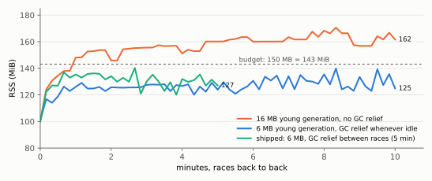
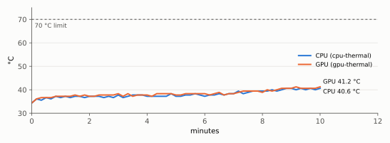
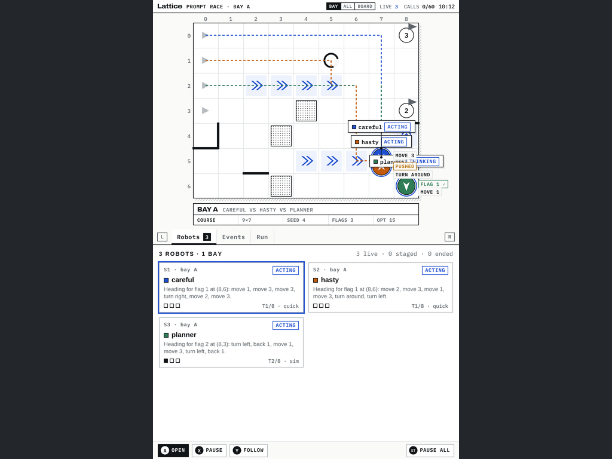

# Lattice DS Native, Part 4

[[PROJECT REPORT - Lattice DS Native, Part 3 - Running a Browser Application's Own Code over a Native Shell|Part 3]] ended with Lattice Arena DS running its own JavaScript on the RG DS Plus over the native shell. Correctness was complete, but the cost was high:
- the top screen spent 6 ms of the UI thread on every 30 fps frame;
- memory grew by 36 MiB during a single race;
- start-up compiled about 5,000 lines of JavaScript on every launch.

This report covers Phase 6 of ticket `DSUI-001`, which brought those numbers within the design guide's budgets. Each measure was chosen from a measurement and verified by one:
- a cache keyed by exactly what a layer shows;
- a native port of the one layer that changes every frame, checked against the JavaScript builder it replaces;
- a limit on glibc's per-thread memory arenas, set early enough to matter;
- V8's code cache;
- a ten-minute soak with the temperature sampled every 10 s.

The arena also became an entry in the device's Ports menu.

> [!summary]
> - **The top screen dropped from 6.0 to 2.2 ms per frame** (p50, performance governor). Caching the hud layer gave 6.0 → 4.3; building the board's dynamic layer in C++ gave 4.3 → 2.2. The native builder produces exactly the JavaScript builder's output, checked frame by frame on x86 and on the device.
> - **Memory was mostly glibc and V8 holding on to freed memory.** Limiting glibc to two malloc arenas cut a race's growth from 29 to 10 MiB, but only when set before the GPU driver's threads exist. A 6 MB V8 young generation and a full GC between races brought the peak over a run of races from 170.6 to 140.3 MiB, under the 150 MB budget.
> - **Ten minutes of back-to-back races** held 30 fps over 13,286 frames. The CPU reached 40.6 °C from a cold start and 48.3 °C at most in any soak, against a 70 °C limit.
> - **Start-up to both screens is 810–905 ms.** V8's code cache cut the arena's script loading from 157 to about 50 ms.

## 1. Where the time went

The top screen shows the race board. While robots move, it redraws every 33 ms, so its cost is paid 30 times a second. It is built from three layers:
- `stat`: the board's tiles, walls and flags, cached until the board changes;
- `dyn`: robots, bubbles, trails, floats and annotations, which change every frame;
- `hud`: the header, the bay's title block, the zoom badge and coach notes.

After Part 3 the `dyn` and `hud` layers were both described in JavaScript on every frame: about 2.7 ms each to build and encode on the Cortex-A55, plus layout and paint in C++.


### 1.1 A cache key made of everything a layer shows

The hud changes when the clock changes minute, when the call budget or live count changes, when the user follows a robot, zooms, or the coach posts a note. It does not change when a robot moves.

The shell already caches layers by a key: a layer is rebuilt only when its key changes. The view's per-frame plan now returns a second key, `hudKey`, built from exactly what the hud's builders read in board view:

```javascript
// js/arena/view.js (generated), topPlan → hudKey
[THEME, DS.top, !!DS.cards.top, ARENA.title, VIEW.follow, liveCount, budget.used, budget.limit, clock(), DS.zoom,
 PL.bw, PL.bh, PL.oy, bay.id, bay.w, bay.h, bay.label, spec.title, spec.goal, spec.seed, spec.optimal,
 spec.flags.length, spec.crates.length, robotNames, note ? [note.md, note.title, note.tone] : ''].join('\u0002')
```

The list follows the hud's builders line by line: `topHeader`, `titleBlock`, the zoom badge, `noteCard`. Its failure mode is a missed input, which would leave the hud stale until another input changes, so the list is reviewed against those functions. The gain was immediate: top-screen time went from 6.0 to 4.3 ms per frame.

### 1.2 Porting the hot layer, with the original as the oracle

`boardDynamic`, the function that builds the dynamic layer, is about 110 lines of c_ds.js. It reads live runtime objects: robots' animated positions, sessions' statuses and scores, floats with their age, speech bubbles, annotations attached to robots. Part 3 had kept it in JavaScript for exactly that reason.

The port splits it along the line that matters for cost. The *data* stays in JavaScript; the per-frame *work* moves to C++:
- **`dynInputs()` in the view (JavaScript).** It gathers, as plain values, everything `boardDynamic` reads: robot positions and headings, status tones, bubble texts, the floats to show, the target ring's pulse. Gathering allocates no nodes and encodes nothing.
- **`boardDynamic` in `apps/arena/dyn.cpp` (C++).** A line-by-line port: placement arithmetic, text measurement, bubble collision avoidance, node construction.
- **Annotation labels.** They are markdown cards and rare; the view encodes them, and the C++ builder splices them in through the wire format.

Two details make the port *exact*, not merely close:
- **Transcendental functions are evaluated once, in JavaScript.** The thinking pulse uses `sin(now/160)` and the target ring `sin(now/260)`. V8's `Math.sin` and glibc's `sin` may differ in the last bit, and the comparison below is exact, so these values are inputs.
- **Text widths come from one measurement function.** The JavaScript view's `measure()` already calls lattice-core's native shaper, so both builders compute identical bubble widths.

The check is `dyncheck`, a control command:
1. It builds the current frame twice, once through the JavaScript builder and once through `dyn.cpp`.
2. It lays both out with lattice-core.
3. It compares them as the same JSON documents the parity suite uses: every box, every drawing operation, every hit-map entry.

It reported identical output on every frame tried:
- staged and racing boards;
- frames with markdown annotations;
- follow mode at 2× zoom with a moving camera;
- compact bubbles;
- six racing frames on the device;
- one frame after ten minutes of racing.

A deliberately perturbed JavaScript layer, shifted by one pixel, gives `DIFF at 35`. The arena's smoke test runs `dyncheck` on five frames per run.

Building the dynamic layer natively took the top screen from 4.3 to 2.2 ms per frame at p50 (p95 7.6 → 5.4), within the guide's 4 ms budget. Under the device's default `ondemand` governor, which runs the CPU slower when it can, the same work measures 3.8–4.3 ms.

## 2. Where the memory went

### 2.1 Measuring the split

During a race the arena's RSS grew from about 98 to 127 MiB. `/proc/PID/smaps_rollup` splits RSS into file-backed and anonymous pages. The file-backed part, libraries and fonts mapped from disk, stayed at 42 MB throughout; all of the growth was anonymous memory, the process's heap.

Three variants of the same race separated the causes:

| Variant | RSS start → end of one race |
|---|---|
| default | 98.3 → 127.4 MiB |
| `MALLOC_ARENA_MAX=2` | 88.1 → 103.1 MiB |
| V8 young generation 2 MB semi-spaces | 98.1 → 116.8 MiB |

### 2.2 glibc's arenas

glibc gives each thread that allocates its own *malloc arena*, a separate heap. That avoids contention, but freed memory stays in the arena of the thread that freed it. The arena process has many allocating threads:
- the UI thread;
- the main (GL) thread;
- the Mali driver's threads;
- V8's two platform workers;
- libcurl's request workers.

Each kept its own high-water mark. Two arenas saved 24 MiB per race. There was no separate speed comparison; the race timings measured afterwards, in Section 4, met their budgets with the limit in place.

The first attempt put `mallopt(M_ARENA_MAX, 2)` at the top of the runtime's `run()` and measured 128.6 MiB at the end of a race, barely better than the default. SDL and the GPU driver create their threads while the windows are created, which is before `run()` reaches that line, and a thread keeps the arena it was given. The setting now lives in a static initializer, which runs before `main`:

```cpp
// src/shell/runtime.cpp
const int kMallocArenas = mallopt(M_ARENA_MAX, 2);   // before any thread exists
```

A race then grew from 89.1 to 98.8 MiB.

### 2.3 What a series of races holds

One race is not the real load: a player runs one after another. The soak test runs races back to back for ten minutes, staging the preset again whenever a race ends, and samples RSS and temperature every 10 s.

In the first soak, with two arenas, memory rose to about 148 MiB in the first minute, then wandered between 145.8 and 170.6 MiB. Growth to a level, not without bound, points at retention rather than a leak. The arena's runtime keeps the transcripts of up to 60 past runs and re-serialises them to JSON after every race. That is its design, in the browser too. V8's heap and glibc then hold that peak.

Two measures bounded it:
- **A smaller young generation.** V8 allocates new objects in a *young generation* that it collects often. Cutting it from 16 to 6 MB (2 MB semi-spaces) reduced committed heap with no measurable cost in speed.
- **A full GC between races.** When no robot is live and nothing moves, at most every 10 s, the app calls V8's `LowMemoryNotification`, a full collection that also shrinks the heap, and then glibc's `malloc_trim(0)`, which returns free pages to the system. On the A55 this takes 35–56 ms.

  The first version ran it whenever nothing was tweening. That included the pauses while robots think, where it measurably slowed the race's JavaScript and could delay a status pulse. It now runs only between races, where no frame is waiting.



With both measures the peak over a series of races is 140.3 MiB, under the guide's 150 MB (143.05 MiB) budget, though with little margin.

A note on method: every RSS figure here is a peak over all 10 s samples. A first pass read only one sample per minute, and its peaks were up to 5 MiB low. The diary records the correction.

## 3. Start-up

Start-up has two parts. Process start, SDL and Wayland windows, the GL context, the font atlas and V8 itself take about 470 ms. The arena's own scripts then take 157 ms to compile and run: about 5,000 lines across twelve files.

V8 can serialise the code it compiled for a script into a *code cache* and reuse it next time. `V8Host::loadFile` now does so:
- **Location and key.** Each script has a cache file under the data directory, keyed by a hash of the script's source and V8's version.
- **Timing.** The cache is written after the script has run, so it also holds the functions compiled during start-up.
- **Maintenance.** It is rewritten if V8 rejects it; older keys are removed.

The scripts' share fell from 157 ms to 48–54 ms. Start-up to both screens shown is 905 ms cold and 810–845 ms warm, within the guide's one-second budget.

## 4. Ten minutes at 41 °C

The guide's Phase 6 gate asks for its budgets over a ten-minute race and a CPU below 70 °C. The soak ran 28 races in ten minutes under the default governor:
- **Frame rate.** Frames every 33.1 ms at p50 (p10 30.3, p90 33.2) over 13,286 frames, with 0 dropped packets.
- **Top screen.** UI time p50 3.8 ms, p95 7.9 ms.
- **Exactness.** `dyncheck` was still identical at the end.
- **Temperature.** The CPU rose from 34.4 to 40.6 °C and the GPU reached 41.2 °C. The highest CPU temperature in any later soak, each started on an already warm device, was 48.3 °C.

For comparison, the Falllinie project's 3D game ran at 68–72 °C on the same device. A UI that redraws only what changed, at 30 fps, leaves the device cool.



| Budget (guide 8.9) | Result | Status |
|---|---|---|
| top screen during a race, 4 ms | p50 2.19 ms (performance), 3.8–4.3 ms (ondemand) | met |
| robots and events pages, 3 ms | p50 5.5–7.8 ms (pages still in JavaScript) | not met |
| GPU per screen, 2 ms | 1.83 / 1.34 ms (Phase 2) | met |
| idle | 0 renders (Phase 3) | met |
| start-up to first frame, 1 s | 810–905 ms | met |
| memory, 150 MB | peak 140.3 MiB over a race series | met |
| CPU after 10 minutes, 70 °C | 40.6–48.3 °C | met |

The page budget is the one not met. Bottom-screen pages are still described in JavaScript, and a page change costs 5.5–7.8 ms. That is responsive, since a page renders only when something on it changes, but it is double the budget. Porting them follows the pattern of Section 1.2, with the JavaScript pages as the oracle. It remains a follow-up task.

## 5. On the menu

ROCKNIX lists ports from `/storage/roms/ports` through EmulationStation's `gamelist.xml`. The arena's registration follows the Falllinie project's:
- a launcher script that starts the arena on both screens (SELECT+START quits);
- a menu image showing both screens stacked;
- a merge script that adds the entry and keeps every other one, backing up the gamelist first.

EmulationStation reads gamelists when it starts, so the entry appears after its next restart.



## 6. What remains

- **The pages budget.** Port the bottom pages to C++, checked against the JavaScript pages.
- **A real Claude robot.** It needs only an API key file on the device; the client is verified up to that point (Part 3).
- **The Phase 4 target.** JavaScript robots-page time under 2 ms p95, which needs a newer V8 or memo nodes.

## 7. Reproducing the results

```bash
cd ~/code/wesen/2026-10-15--nintendo-ds-ui
cmake --build build && (cd build && ctest)          # 15 tests; arena-smoke runs dyncheck on 5 frames
scripts/build-device.sh lattice-arena && scripts/deploy-device.sh build-device/lattice-arena
ssh root@192.168.0.202 sh /storage/apps/lattice-ds/scripts/run-arena.sh /tmp/ar           # one race, dyncheck, timing
ssh root@192.168.0.202 sh /storage/apps/lattice-ds/scripts/mem-arena.sh /tmp/m "" "MALLOC_ARENA_MAX=2"
ssh root@192.168.0.202 sh /storage/apps/lattice-ds/scripts/soak-arena.sh /tmp/soak 10    # 10 minutes, temperature
ssh root@192.168.0.202 sh /storage/apps/lattice-ds/scripts/startup-arena.sh /tmp/st 4    # cold and warm start
scripts/register-ports.sh                                                                 # RESTART_ES=1 to show it now
```

| Path | What it is |
|---|---|
| `apps/arena/dyn.cpp` | the board's dynamic layer, built natively |
| `tools/make-arena-view.js` | `dynInputs`, `hudKey`, `frameStep`'s idle flag in the generated view |
| `apps/arena/main.cpp` | `nativeDyn`, `dyncheck`, the hud cache key, memory relief between races |
| `src/js/v8host.cpp` | the code cache (`evalCached`), `lowMemory` |
| `src/shell/runtime.cpp` | `M_ARENA_MAX` in a static initializer |
| `scripts/ports/`, `scripts/register-ports.sh` | the Ports menu entry |
| `scripts/device/{mem,soak,startup}-arena.sh` | the measurements in this report |
| `ttmp/2026/10/15/DSUI-001…/` | diary Step 14 and `scripts/evidence/phase6` |

## Related notes

- [[PROJECT REPORT - Lattice DS Native, Part 3 - Running a Browser Application's Own Code over a Native Shell]]: the arena on the native shell, and the JavaScript view this phase ported from.
- [[PROJECT REPORT - Lattice DS Native, Part 2 - A Two-Thread Shell and a Thin V8 Layer on the RG DS Plus]]: the shell, its layer cache and its scheduler.
- [[PROJECT REPORT - Lattice DS Native - An Exact C++ Port of a Browser Layout Engine and a GPU Backend on the RG DS Plus]]: Part 1, where the oracle method began.
- [[PROJECT REPORT - Falllinie at 60 FPS - Geometry, Presentation and a Crisp 512x384 Release on a Single-Core Mali-G52]]: the same device under a 3D game's load.
