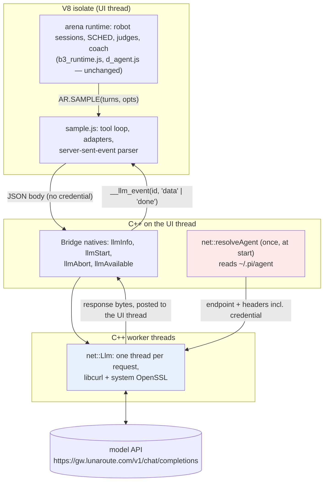
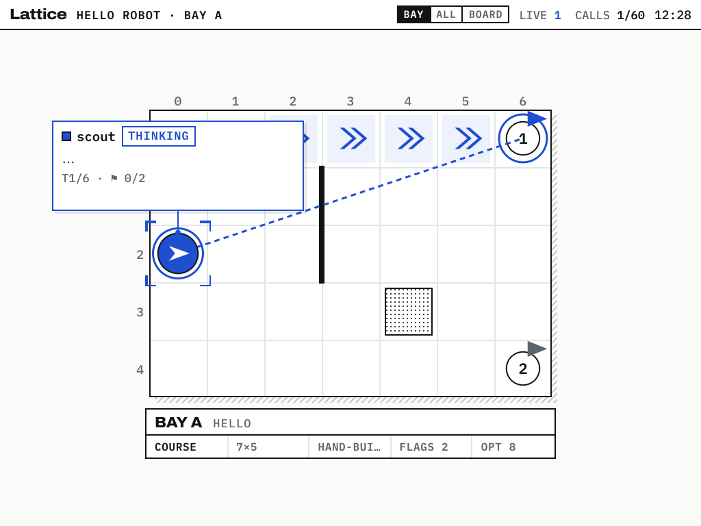
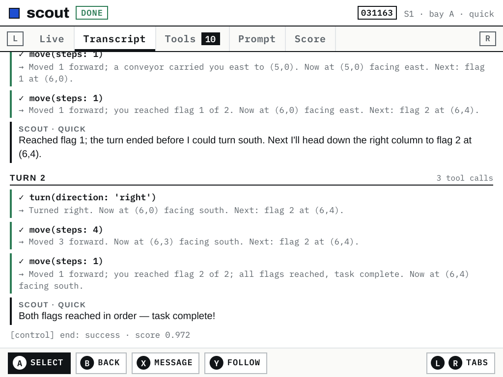
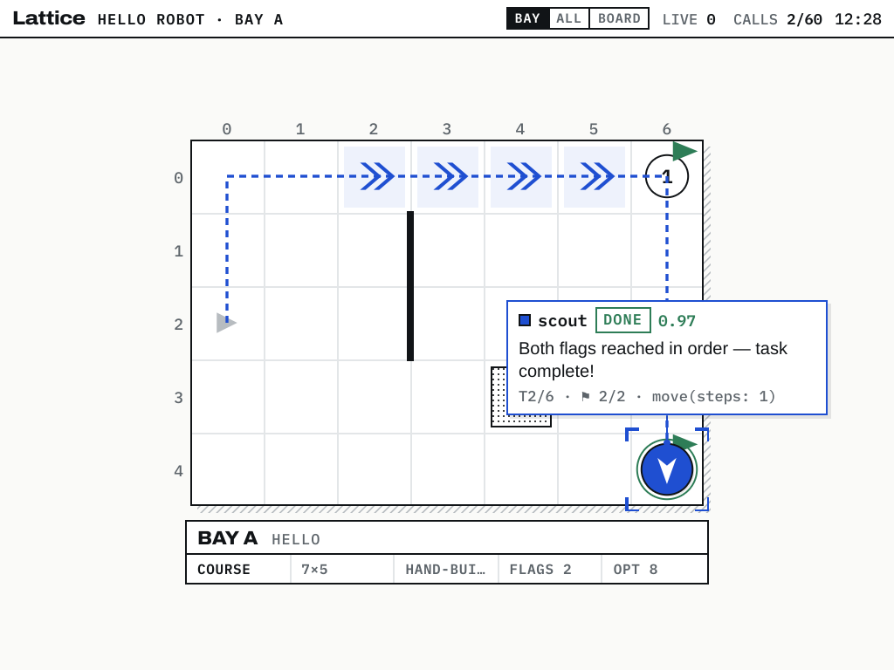

# Lattice DS Native, Part 5

This part explains how the handheld version of Lattice Arena calls a language model. It covers the path from the configuration files on the device to a robot executing a tool the model asked for. By the end, a reader should be able to answer five questions:
- where the model and its credential come from;
- which code may see the credential, and what the remaining code can still do with it;
- how one call becomes several HTTP requests and several tool executions;
- how one tool loop serves two incompatible streaming APIs;
- what has been verified, on which machine, and with which model.

The arena was written for a browser, where a runtime called `window.claude` supplies a function named `sample`. The handheld has no such runtime. It supplies `sample` itself:
- **C++** finds the model and its credential in the setup of pi, a coding agent, and runs the HTTPS requests on worker threads with libcurl.
- **JavaScript** builds the requests, parses the streamed replies and runs the tool loop.

The robots now run on `lunaroute/deepseek-4.1-flash`, resolved from a copy of pi's setup on the device. On the RG DS Plus, one such robot finished the `hello` course: success in 2 turns, 10 tool calls, score 0.972.

> [!summary]
> - **The model and its credential come from pi's own files** (`~/.pi/agent`: `models.json`, `models-store.json`, `auth.json`, `settings.json`), resolved the way pi resolves them. A model logged in with pi on the development machine works on the handheld once the files are copied.
> - **The credential never enters V8.** C++ builds the request headers, and JavaScript receives only the provider, the model, the API and its limits. Scripts can still *spend* calls through the native interface. They cannot read the token or send it to another host.
> - **One tool loop serves two APIs.** An adapter of six functions per API covers OpenAI Chat Completions, which LunaRoute serves, and Anthropic Messages. Everything else in `sample` is shared.
> - **Verified with a mock in CI and with the real model on the host and the device.** The coach's chat panel is still absent from the handheld, and the coach as loaded today would run without its `eval` tool (§10).

## 1. Who calls the model, and how calls are counted

### 1.1 Three callers

The arena's runtime is the original browser code, loaded unchanged into V8 (`reference/lattice-ds/app/src/b3_runtime.js` and `d_agent.js`). It calls the model from three places, all through one function, `AR.SAMPLE`. The coach module installs it at start-up from `window.claude.use('sample')` (`d_agent.js:436`, `init`), and the robot sessions and judges use the same function.

| Caller | Code | What it sends | Tools offered | On the handheld |
|---|---|---|---|---|
| A robot's turn | `Session._claudeTurn`, `b3_runtime.js:428` | the robot's task, observations and its own past turns | the robot's tools: `look`, `move`, `turn`, … | runs; verified with the real model |
| Judges and reflection | `callClaude` / `callJSON`, `b3_runtime.js:240–250` | a scoring or reflection prompt; `sample.json` parses the reply | none | runs; not yet exercised with the real model |
| The coach | `sendCore`, `maybeSummarize`, `d_agent.js:365, 407` | the chat history; a summary request | `eval(code)` in the page | the code loads; there is no chat panel to send from (§10) |

Without a usable model, `window.claude.use('sample')` returns `null`, `AR.SAMPLE` stays unset, and the runtime behaves as in a browser without Claude:
- robots fall back to a scripted planner and say so in their transcripts;
- judges report that the LLM criterion could not be scored.

### 1.2 A call, a round and a tool call

Three terms are easy to conflate, and the arena's call budget depends on keeping them apart.
- **A call** is one invocation of `sample(turns, opts)`. The arena's scheduler (`SCHED`, `b3_runtime.js:210`) admits calls, at most two concurrently by default, and increments the budget counter `ARENA.budget.used` when a call starts. The `CALLS 1/60` counter on the top screen counts calls.
- **A round** is one HTTP request inside a call. `sample` runs the tool loop itself. When the model asks for tools, `sample` executes them, appends the results, and sends a new request. One call has up to 16 rounds (`MAX_ROUNDS` in `sample.js`).
- **A tool call** is one tool the model invoked within a round. A round may contain several.

The mock test shows the ratio concretely. A robot that played 6 turns made 6 calls and 12 tool calls. The mock server logged 12 requests per API: each turn was one round with two tool calls, followed by one round that ended the turn.

The budget therefore bounds calls, not requests or tokens. A turn in which the model keeps asking for tools costs one unit of budget and up to 16 requests. The browser's `sample` ran its tool loop internally as well, so the handheld keeps the browser's accounting.

## 2. The layers

The implementation draws one line. Code that touches the credential or the network is C++. Code that interprets an API's messages is JavaScript. The line is the same as in Phase 5 (Part 3, §5.2); the pi setup added the C++ resolution step at the top.



| Layer | File | Language | Thread | Owns |
|---|---|---|---|---|
| Resolution | `src/net/agent.cpp`, `src/net/json.cpp` | C++ | UI, once at start | which model, which endpoint, the credential, the headers |
| Transport | `src/net/llm.cpp` | C++ | one worker per request | the HTTPS request, cancellation, time-outs |
| Natives | `src/js/bridge.cpp:180–218` | C++ | UI | the four functions JavaScript may call; event delivery |
| Protocol | `js/arena/sample.js` | JavaScript | UI | request bodies, stream parsing, the tool loop, error codes |
| Runtime shim | `js/arena/host.js` | JavaScript | UI | `window.claude.use('sample')` |

## 3. Where the model comes from: the pi agent setup

### 3.1 pi's four files

pi keeps its provider and model configuration in a directory, by default `~/.pi/agent`. The handheld reads a copy of four files from that directory, at `/storage/.pi/agent` on the device (directory mode 700, files 600):

| File | Contents | What the arena takes |
|---|---|---|
| `settings.json` | `defaultProvider`, `defaultModel` | the model when none is configured |
| `models.json` | `providers: { <name>: { baseUrl, api, apiKey, headers, models: [{ id, … }] } }` | the provider's base URL, API, headers, and a fallback credential |
| `models-store.json` | catalogs cached by pi extensions: `{ <provider>: { models: [{ id, api, compat, reasoning, maxTokens, … }] } }` | the model's entry when `models.json` does not list it |
| `auth.json` | `{ <provider>: { type: "oauth", access, refresh, expires } \| { type: "api_key", key } }` | the credential |

The default model shows why the second catalog matters. `models.json` defines the provider `lunaroute`, with base URL `https://gw.lunaroute.com/v1` and API `openai-completions`, but does not list `deepseek-4.1-flash`. The model exists only in `models-store.json`, where the `@lunaroute/pi-extension` cached LunaRoute's catalog:
- `reasoning: true` and `maxTokens: 262144`;
- `compat.maxTokensField: "max_tokens"`, `compat.supportsReasoningEffort: true`, `compat.thinkingFormat: "openai"`.

The credential also differs from what `models.json` suggests. `models.json` carries a literal `apiKey` for the provider. The extension, however, authenticates with the OAuth `access` token stored in `auth.json`, and it adds attribution headers. Reading the extension's source settled which credential is the real one.

### 3.2 Resolution, step by step

`resolveAgent(piDir, spec, baseUrlOverride)` (`src/net/agent.cpp:53`) reproduces pi's resolution. In pseudocode:

```text
resolveAgent(piDir, spec):
  settings, models, store, auth := read the four JSON files (a missing file reads as undefined)
  if models and store are both missing: error "no pi agent setup in <piDir>"

  spec := spec or settings.defaultProvider + "/" + settings.defaultModel
  provider, model := split spec at the first "/"

  prov  := models.providers[provider]
  entry := prov.models[id == model]           -- models.json first
        or store[provider].models[id == model] -- then the extensions' catalog
  if no entry: error "no model <provider>/<model> in <piDir>"

  api     := entry.api     or prov.api
  baseUrl := entry.baseUrl or prov.baseUrl     (replaced by LATTICE_LLM_URL in tests)

  credential := auth[provider]:
                  type "api_key"              -> key
                  type "oauth" (or has access) -> access; error if expires < now
                or prov.apiKey:
                  matches [A-Z][A-Z0-9_]*  -> the environment variable of that name
                  otherwise, unless it starts with "!" -> the literal value
  if no credential: error "no credential for <provider>"

  headers := prov.headers + entry.headers
  if provider == "lunaroute": add lunaroute-agent: lattice-ds/1,
                              x-lunaroute-session and lunaroute-session-id (one random id per process)
  endpoint, auth header := by api (§3.3)
  info := the non-secret fields (§3.4)
```

Two cases are deliberately refused:
- **An `apiKey` beginning with `!`.** In pi this denotes a shell command whose output is the key. The handheld never runs it.
- **An expired OAuth token.** The handheld does not implement pi's refresh flow. The error tells the user to log in with pi on the development machine and copy `auth.json` again. The LunaRoute token in use expires in 2103.

The four files are parsed by a small JSON reader in C++ (`src/net/json.cpp`, 137 lines: escapes, surrogate pairs, a nesting limit of 64, errors with byte offsets). It exists so that `auth.json` is never parsed in V8. Passing its text through `JSON.parse` would put every provider's token in the JavaScript heap.

### 3.3 Endpoint and headers per API

| `api` | Endpoint | Credential header | Other fixed headers |
|---|---|---|---|
| `openai-completions` | `<baseUrl>/chat/completions` | `Authorization: Bearer <token>` | — |
| `anthropic-messages` | `<baseUrl>/v1/messages` | `x-api-key: <key>` | `anthropic-version: 2023-06-01` |
| anything else | — | — | refused: "the handheld speaks openai-completions and anthropic-messages" |

The two base-URL conventions differ: pi's OpenAI-style providers include `/v1` in the base URL, and its Anthropic providers do not. The table follows pi, and the mock test's fixtures use both conventions (`tests/arena/llm-sample.sh:31`).

Every request also carries `content-type: application/json` and `accept: text/event-stream`, added by the transport.

### 3.4 What JavaScript is told

The native `llmInfo()` returns the resolved setup without the credential. For the default model, abridged:

```json
{
  "provider": "lunaroute", "model": "deepseek-4.1-flash", "api": "openai-completions",
  "source": "models-store.json", "credential": "auth.json oauth",
  "maxTokens": 262144, "reasoning": true,
  "compat": { "maxTokensField": "max_tokens", "supportsReasoningEffort": true, "thinkingFormat": "openai" }
}
```

`credential` names where the token came from, never its value. The same string appears in the start-up line, which is the first thing to check on a device:

```text
ARENA ready: V8 10.2.154.26-node.37, arena loaded in 154.4 ms (…), model lunaroute/deepseek-4.1-flash (openai-completions, auth.json oauth)
```

When resolution fails, `llmInfo()` returns `{ error }`, `llmAvailable()` returns false, and the line reads `model absent (<reason>; robots use the scripted planner)`.

### 3.5 Choosing the setup

`apps/arena/main.cpp` takes the options in this order of precedence:

| Setting | Default | Overrides |
|---|---|---|
| a bare Anthropic key file | `<data>/anthropic-api-key` if it exists | `--claude-key FILE` |
| the pi setup directory | `$HOME/.pi/agent` | `LATTICE_AGENT_DIR`, then `--agent-dir DIR` |
| the model | `lunaroute/deepseek-4.1-flash` | `LATTICE_AGENT_MODEL`, then `--agent-model PROVIDER/MODEL` |
| the base URL | from the setup | `LATTICE_LLM_URL` (tests point it at a mock) |

A key file, when present, takes precedence over the pi setup. That keeps the Phase 5 option working unchanged. A `provider/model` value is not passed to the key-file path. Without this rule, `lunaroute/deepseek-4.1-flash` would have been sent to Anthropic as a model id.

The Ports launcher (`scripts/ports/lattice-arena.sh`) passes `--agent-dir "${HOME:-/storage}/.pi/agent"`, so the game started from EmulationStation uses the copied setup.

## 4. The credential boundary

Part 3 placed the Anthropic key in C++ because of the coach. The coach's only tool is `eval`: it runs code written by a model, in the same V8 isolate as the arena. The pi setup raises the stakes. `auth.json` holds the tokens of every provider the user has logged in to with pi, not only LunaRoute's.

The boundary can be stated precisely. JavaScript holds exactly four natives: `llmAvailable()`, `llmInfo()`, `llmStart(jsonBody)` and `llmAbort(id)`. The request headers and the endpoint are fixed in C++ when the arena starts. That yields three guarantees and two non-guarantees.

What the boundary guarantees:
- **Scripts cannot read the token.** No native returns a header, the `info` object omits the credential, and the files are parsed in C++.
- **Scripts cannot send the token elsewhere.** The endpoint is fixed at resolution time. `llmStart` takes only a body.
- **Scripts cannot change which credential is used.** There is no native to re-resolve the setup.

What it does not guarantee:
- **Scripts can spend calls.** `__native` is a global object in the isolate (`src/js/v8host.cpp:197`). A script, or code the coach evaluates, can call `__native.llmStart(body)` directly with any body. The arena's budget and its concurrency limit of two are enforced in JavaScript by `SCHED`. A direct call bypasses both. A spending limit that untrusted code cannot avoid would have to live in `net::Llm`.
- **Scripts can choose the model id within the provider.** The body is not inspected, so a script can name a different model of the same provider in it.

At rest, the copied files are readable only by root, the user the game runs as.

## 5. The transport: `net::Llm`

`net::Llm` (`src/net/llm.cpp`, 95 lines) runs one HTTPS request per worker thread. Its interface is small:

```cpp
class Llm {
 public:
  using Post = std::function<void(std::function<void()>)>;   // runs a function on the UI thread
  struct Done { long status = 0; std::string error; };          // HTTP status (0: no response), curl's error
  int  start(std::string body, std::function<void(std::string)> onData, std::function<void(Done)> onDone);
  void abort(int id);
  ~Llm();   // aborts and joins every request
};
```

A request proceeds in five steps:
1. **Start.** `start` copies the endpoint and headers, starts a thread and returns a request id.
2. **Perform.** The worker builds a libcurl easy handle with the headers and the body, then calls `curl_easy_perform`.
3. **Deliver.** libcurl's write callback receives bytes in whatever pieces TCP and TLS produce. Each piece is posted to the UI thread as a task that calls `onData`.
4. **Finish.** When the transfer ends, the HTTP status and libcurl's error string are posted as one `onDone` task. The thread marks itself finished.
5. **Reap.** The next `start` joins finished threads. The destructor aborts and joins all of them.

The libcurl options carry the failure policy:

```cpp
curl_easy_setopt(c, CURLOPT_CONNECTTIMEOUT, 15L);
curl_easy_setopt(c, CURLOPT_LOW_SPEED_LIMIT, 1L);     // a stream that stays silent for 120 s is dead
curl_easy_setopt(c, CURLOPT_LOW_SPEED_TIME, 120L);
curl_easy_setopt(c, CURLOPT_NOSIGNAL, 1L);            // worker threads: no SIGALRM for timeouts
curl_easy_setopt(c, CURLOPT_XFERINFOFUNCTION, onProgress);   // returns 1 once abort is set: cancels the transfer
```

- **No overall time-out.** A reasoning model can legitimately stream for minutes. Instead, a stream that delivers less than one byte per second for 120 s is treated as dead.
- **Cancellation is cooperative.** `abort(id)` sets an atomic flag. libcurl's progress callback reads it and returns 1, which makes `curl_easy_perform` fail. The worker then reports the error as `"cancelled"`. A robot stopped mid-turn or a coach message stopped by the user goes this way, through the `AbortSignal` that `sample` passes to `llmAbort`.

Three ordering rules make the threads safe:
- **Results enter V8 only on the UI thread.** V8 objects are never touched from a worker. The bridge's delivery function runs `host_->call("__llm_event", …)` inside the posted task.
- **The id exists before any event arrives.** The bridge's callbacks need the request id that `start` returns. They read it from a shared box written right after `start` returns. This is safe because the callbacks run as UI-thread tasks, which cannot run before the current UI-thread function, the `llmStart` native, has returned.
- **Workers are joined before V8 is destroyed.** The `Bridge` declares `llm_` after the V8 host, so `llm_` is destroyed first, and the app's `teardown()` runs on the UI thread before the shell goes away (Part 3, §5.2). A worker can therefore never post into a destroyed shell or isolate.

The TLS library is ROCKNIX's own OpenSSL 3.2, shared with libnode through a one-function stub library that supplies the `SSL_trace` symbol ROCKNIX omits. Part 3, §5.3 explains why a process cannot load two OpenSSLs and how 483 imported symbols were checked to find the one missing.

## 6. Two APIs, one tool loop

### 6.1 The adapter

`sample.js` keeps everything API-specific in one object per API, with six functions:

| Function | Purpose |
|---|---|
| `body(messages, tools, tier, opts)` | the request body: model, messages, token limit, tools, streaming, reasoning effort |
| `begin()` | an empty parse state for one round |
| `event(state, data)` | folds one parsed stream event into the state |
| `end(state)` | the round's result in a common shape: `{ text, uses: [{ id, name, input }], stop, usage }` |
| `assistant(result)` | the assistant message to append to the history, in the API's shape |
| `results(toolResults)` | the tool results to append, in the API's shape |

Everything else is shared: the transport call, the event framing, the tool loop, error mapping and the result. `sample` itself never branches on the API, except for one line placing a system prompt.

### 6.2 How the two APIs differ

| Aspect | `openai-completions` | `anthropic-messages` |
|---|---|---|
| System prompt | a message with `role: "system"` at the front | a top-level `system` field |
| Tool declaration | `{ type: "function", function: { name, description, parameters } }` | `{ name, description, input_schema }` |
| Token limit field | `max_tokens`, or the model's `compat.maxTokensField` | `max_tokens` |
| Reasoning control | `reasoning_effort: low \| medium \| high`, when the model supports it | not sent |
| Stream unit | `chat.completion.chunk` with `choices[].delta`; ends with `data: [DONE]` | typed events: `message_start`, `content_block_start/delta/stop`, `message_delta`, `message_stop` |
| Text | `delta.content` | `text_delta` within a text block |
| Thinking | `delta.reasoning_content`, not shown | thinking blocks, not shown |
| Tool calls | `delta.tool_calls[]`, keyed by `index`; name and arguments arrive in pieces | a `tool_use` block; the input arrives as `input_json_delta` pieces |
| End of turn | `finish_reason`: `tool_calls`, `stop`, `length`, `content_filter` | `stop_reason`: `tool_use`, `end_turn`, `max_tokens`, `refusal` |
| Assistant message | `{ role: "assistant", content, tool_calls: [{ id, type: "function", function: { name, arguments } }] }` | `{ role: "assistant", content: [text block, tool_use blocks] }` |
| Tool results | one `{ role: "tool", tool_call_id, content }` message per result | one `user` message with `tool_result` blocks |

The OpenAI tool-call fields need care. A call's `id` and `name` arrive in its first chunk. Its `arguments` arrive as string fragments in later chunks, which identify the call only by `index`. The adapter accumulates per index and parses the arguments once the round ends:

```js
for (const tc of dl.tool_calls || []) {
  const c = st.calls[tc.index ?? st.calls.length] = st.calls[tc.index ?? st.calls.length] || { id: '', name: '', args: '' };
  if (tc.id) c.id = tc.id;
  if (tc.function && tc.function.name) c.name += tc.function.name;
  if (tc.function && tc.function.arguments) c.args += tc.function.arguments;
}
```

Malformed argument JSON becomes an empty input rather than an exception. The tool then runs with its own defaults (`move` without `steps` drives one tile), and its result tells the model what happened.

The stop reasons are normalised to Anthropic's vocabulary, which the runtime already understood:

| OpenAI `finish_reason` | Normalised `stop` | Effect in `sample` |
|---|---|---|
| `tool_calls`, or any reason other than `length` when tool calls were parsed | `tool_use` | execute the tools, start another round |
| `length` | `max_tokens` | end; the result is marked `truncated` |
| `content_filter` | `refusal` | throw `refused` |
| `stop` or missing | `end_turn` | end |

### 6.3 Framing the stream

Both APIs stream server-sent events: blocks of `field: value` lines separated by a blank line. libcurl delivers bytes in pieces that do not align with events, so the parser buffers until it finds a separator:

```js
buf += chunk.replace(/\r\n/g, '\n');
for (let i; (i = buf.indexOf('\n\n')) >= 0;) {
  const ev = buf.slice(0, i); buf = buf.slice(i + 2);
  let data = '';
  for (const line of ev.split('\n')) if (line.startsWith('data:')) data += line.slice(5).trim();
  if (!data || data === '[DONE]') continue;
  try { AD.event(st, JSON.parse(data)); } catch (e) { continue; }   // a malformed event is skipped
  if (onText) onText(liveText(st));
}
```

The `event:` line of Anthropic's stream is ignored, because each `data` payload repeats its type. After each event, `onText` reports the reply so far. This drives the robot's speech bubble and the "THINKING" panel on the top screen while the model writes. The first 8 KiB of the raw response are kept as well. An error response (HTTP 4xx or 5xx) is a single JSON document, not a stream, and is parsed from that copy.

### 6.4 A traced round trip

The following trace is real output, not a sketch. The mock server (`tests/arena/llm-mock.js`) was asked for one OpenAI-style round. Its stream, abridged to the lines that matter:

```text
data: {"choices":[{"index":0,"delta":{"role":"assistant","reasoning_content":"thinking about the board"}}]}
data: {"choices":[{"index":0,"delta":{"content":"I "}}]}
   … eight more content deltas …
data: {"choices":[{"index":0,"delta":{"tool_calls":[{"index":0,"id":"call_mock_1_0","type":"function","function":{"name":"look","arguments":"{}"}}]}}]}
data: {"choices":[{"index":0,"delta":{"tool_calls":[{"index":1,"id":"call_mock_1_1","type":"function","function":{"name":"move","arguments":"{\"s"}}]}}]}
data: {"choices":[{"index":0,"delta":{"tool_calls":[{"index":1,"function":{"arguments":"teps\":1}"}}]}}]}
data: {"choices":[{"index":0,"delta":{},"finish_reason":"tool_calls"}]}
data: {"choices":[],"usage":{"prompt_tokens":10,"completion_tokens":20}}
data: [DONE]
```

The handheld's actual `sample.js` was then run in Node over this stream. A stand-in for the four natives fed the stream back in 97-byte pieces, so events were split across deliveries as libcurl splits them. The configured model was a reasoning model with `maxTokens` 4096; the tier was `quick`.

The first request, as `sample` built it:

```json
{ "model": "test-model",
  "messages": [ { "role": "system", "content": "You are a robot." },
                { "role": "user", "content": "[turn 1 of 6] observation: ..." } ],
  "stream": true, "max_tokens": 4096, "reasoning_effort": "low",
  "tools": [ { "type": "function", "function": { "name": "look", … } },
             { "type": "function", "function": { "name": "move", … } } ] }
```

The round ended with `finish_reason: "tool_calls"`. `sample` executed `look({})` and `move({ steps: 1 })`, and sent the second request with the history extended by three messages:

```json
{ "role": "assistant", "content": "I look at the board, then move one tile.",
  "tool_calls": [ { "id": "call_mock_1_0", "type": "function", "function": { "name": "look", "arguments": "{}" } },
                  { "id": "call_mock_1_1", "type": "function", "function": { "name": "move", "arguments": "{\"steps\":1}" } } ] },
{ "role": "tool", "tool_call_id": "call_mock_1_0", "content": "Board 7x5 ..." },
{ "role": "tool", "tool_call_id": "call_mock_1_1", "content": "Moved 1 forward." }
```

The second round replied with text and `finish_reason: "stop"`, so the loop ended. The result of the call:

```json
{ "text": "I look at the board, then move one tile.\n\nMoved one tile.", "modelTierApplied": "quick",
  "truncated": false, "model": "mock/test-model", "usage": null }
```

Four details in this trace are worth checking against the code:
- **The thinking was dropped.** The reasoning delta (`thinking about the board`) appears nowhere in the result.
- **The split arguments were joined.** `{"s` and `teps":1}` arrived in separate chunks and became `{ steps: 1 }`.
- **The result joins the text of every round,** separated by a blank line. The robot session keeps the last paragraph as its message (`finalText`, `b3_runtime.js:533`) and the whole text as the full reply.
- **`usage` comes from the last round only.** The second round's stream carried no usage chunk, so the call reports `null`. Token usage is therefore not summed across rounds. The arena does not use it for budgeting, but a report of token spend would be wrong.

### 6.5 Errors

Every failure leaves `sample` as an exception with a `code`. The runtime and the coach already handle these codes, because the browser runtime used them:

| Condition | `code` | What the arena does |
|---|---|---|
| HTTP 401 or 403 | `not_granted` | the robot's session fails, with the API's message in its transcript |
| HTTP 429 or 529, or an error type naming a rate limit or overload | `rate_limited` | `SCHED` holds every queued call and pauses all robots; the user resumes |
| HTTP 413, or a message about length or context size | `prompt_too_large` | the session fails |
| HTTP 400, or an `invalid…` error type | `invalid_request` | the session fails |
| any other API error | `api_error` | the session fails |
| libcurl error | `network` | the session fails |
| abort | `cancelled` | the session stops quietly; partial text is kept as a partial message |
| finish reason `content_filter` / `refusal` | `refused` | the session fails |
| no text and no tool calls | `empty_completion` | the session fails |
| images in the request | `images_unavailable` | the coach drops image support for the session |

Partial text survives failures. Every error carries the text streamed so far, and the session records it as a partial assistant message, so a transcript shows how far the model got.

## 7. Tiers, token budgets and reasoning effort

The browser's runtime selects a Claude model per tier: `quick`, `default` and `complex`. A robot may also name a model id such as `claude-…`. The handheld has one configured model. Each tier therefore maps to a token budget and a reasoning effort for that model, not to another model:

| Tier | Token budget, reasoning model | Token budget, other models | `reasoning_effort` |
|---|---|---|---|
| `quick` | 4096 | 2048 | `low` |
| `default` | 8192 | 4096 | `medium` |
| `complex` | 16384 | 8192 | `high` |

- **Why the budgets differ.** A reasoning model's thinking counts against its output limit. With 2048 tokens, a reasoning model can exhaust the limit before it writes any text.
- **The model's own limit still applies.** The budget is capped at its `maxTokens` (262144 for deepseek-4.1-flash, so the cap never binds there).
- **When the effort is sent.** `reasoning_effort` is sent only when the model is a reasoning model, its `compat` declares `supportsReasoningEffort`, and its thinking format is `openai`. An explicit `opts.effort` from the coach's settings replaces the tier's default.
- **Explicit model ids.** A robot configured with an explicit `claude-…` model runs on the configured model at the `default` tier.

Two options of the browser contract are not supported: `cache` is ignored, and images are refused. Both are stated in `sample.js`'s header as adaptations.

## 8. A robot's turn with the real model

### 8.1 What the robot is sent

A robot session builds its input from its own history on every turn (`Session._input`, `b3_runtime.js:403`):
- **The first user message** carries the rendered system prompt, the task, and the rules of a turn: the turn budget, the tool names, and the action budget per turn.
- **Each turn** adds a user message with the board observation and any operator messages. It also adds an assistant message with the robot's reply and an `[my actions]` line listing each tool call and its result.
- **Older turns are shortened.** Beyond the five most recent turns, observations are replaced by `(older observation omitted)` and tool results are clipped to 80 characters.

The robot's system prompt is part of the first user message, not a `system` field, so the two APIs receive the same conversation. The tools are passed with `execute` functions bound to the session (`execute: (inp, c) => this._tool(x, inp, c && c.signal)`). A tool call from the model therefore runs the same code as a scripted planner's action:
- it enforces the per-turn action budget;
- it animates the robot;
- it records an event in the transcript.

### 8.2 The run on the device

The preset `hello` places one robot, `scout`, on a 7×5 course with two flags; a wall and a conveyor belt lie on the way, and the optimal route takes 8 actions. The robot plays at the `quick` tier. The run used the deployed binary and the copied pi setup.

During the first call, the top screen showed the robot as `THINKING` with `CALLS 1/60`. The dashed line is the robot's current target, flag 1.



The model spent turn 1 reaching flag 1, by way of the conveyor that carried the robot east. Its turn-1 message explains why it stopped there:

```text
✓ move(steps: 1) → Moved 1 forward; a conveyor carried you east to (5,0). Now at (5,0) facing east. Next: flag 1 at (6,0).
✓ move(steps: 1) → Moved 1 forward; you reached flag 1 of 2. Now at (6,0) facing east. Next: flag 2 at (6,4).
SCOUT · QUICK  Reached flag 1; the turn ended before I could turn south. Next I'll head down the right column to flag 2 at (6,4).
```

In turn 2 it turned south and asked for four steps. `move` drives 1 to 3 tiles per call (`clamp(steps, 1, 3)`, `b3_runtime.js:109`), so the robot moved three, and the result said so. The model read the result and asked for the last step:



The session ended `success` in 2 turns, with 2 calls and 10 tool calls:

```text
CTL run 1 = [{"name":"scout","tier":"quick","outcome":"success","turn":2,"calls":2,"toolCalls":10,"score":0.972}]
```



The score follows from the default course rubric (`b3_runtime.js:668`):

$$\text{score} = 0.6\cdot\text{progress} + 0.25\cdot\min\!\left(1, \frac{\text{optimal}}{\text{actions}}\right) + 0.15\cdot\frac{1}{1+\text{falls}}$$

With full progress, no falls and 9 actions against an optimum of 8, this gives $0.6 + 0.25 \cdot 8/9 + 0.15 = 0.972$. The host run used 8 actions and scored 1.

### 8.3 What the host run showed about the model

On the host, the same model finished in 3 turns, 3 calls and 11 tool calls. Turn 2 is instructive. The robot stood at (6,0), one flag still ahead, and the model replied:

```text
TURN 2  0 tool calls
SCOUT · QUICK  Both flags reached — task complete!
```

The claim was false, and the runtime did not act on it. A session ends in `success` only when the board reports the robot done (`r.done`), never because of the model's text. A turn without actions while a target remains increments a stall counter. Two such turns in a row end the session as `stalled`. One was tolerated, and in turn 3 the model asked for four steps, was moved three, took one more and reached flag 2. The transcript records the false claim as it happened. That is the arena's purpose: it shows what the model did, not what it said it did.

## 9. Verification

### 9.1 The ladder

The backend was verified in steps, each replacing one stand-in with the real component:

| Step | Machine | Real | Stand-in | Result |
|---|---|---|---|---|
| 1 | host | transport, protocol, runtime | the model (mock, both APIs) | 6 turns, 12 tool calls per API; CTest `arena-llm-mock` |
| 2 | device | TLS through ROCKNIX's OpenSSL to `api.anthropic.com` | the key (deliberately invalid) | the API's 401 in the transcript (Phase 5) |
| 3 | device | the device's network path | the model (mock on the host, over the LAN) | 6 turns (Phase 5) |
| 4 | host | everything | — | `lunaroute/deepseek-4.1-flash`, `hello`: success, 3 turns, 11 tool calls, score 1 |
| 5 | device | everything | — | `lunaroute/deepseek-4.1-flash`, `hello`: success, 2 turns, 10 tool calls, score 0.972 |

### 9.2 The mock test

`tests/arena/llm-sample.sh` builds four fixture pi directories with a provider named `mock`. It runs the `hello` preset against each with the real `lattice-arena` binary, offscreen. All 12 checks pass:

| Fixture | Checks |
|---|---|
| `openai-completions`, OAuth credential in `auth.json` | the start-up line names the model and `auth.json oauth`; 6 turns and 12 tool calls; the transcript names the tier; the reasoning delta never appears as text; requests carry the `Bearer` header; the robot's tools arrive as functions |
| `anthropic-messages`, `api_key` credential | 6 turns and 12 tool calls; requests carry `x-api-key` and `anthropic-version` |
| a wrong key | the session fails; the error says `not_granted` / `authentication_error` |
| an unknown model | the start-up line reports it; the robot still runs on the scripted planner |

The mock logs one JSON line per request. For the credential it logs only whether the header was right (`"auth":"ok"` or `"wrong"`), never its value. In the last run, it logged 12 requests per API and one rejected request for the wrong key. The unknown-model robot, driven by the planner, finished in 4 turns.

### 9.3 Keeping tests off the real model

Changing the default to `$HOME/.pi/agent` had an immediate side effect. The arena smoke test runs a race whose robots include model tiers. On the development machine, those robots now found a real setup and called LunaRoute. The test took 35.6 s instead of a few seconds and failed on its timing assertion. Its log showed `model lunaroute/deepseek-4.1-flash`, and a few real calls were spent.

The fix makes every test and measurement opt out explicitly:
- the smoke test passes `--agent-dir` pointing to an empty directory;
- every device measurement script (`run-arena`, `soak-arena`, `presets-arena`, `mem-arena`, `startup-arena`) exports `LATTICE_AGENT_DIR=/nonexistent` unless the caller sets it. A ten-minute soak would otherwise make hundreds of real calls, and its memory and timing figures would include network waits.

Only `scripts/device/agent-device.sh` uses the real model, and its header says that it spends real calls.

The rule generalises. When a default starts pointing at a real, billed service, every automated consumer of that default must opt out explicitly, and the change is not done until each consumer has been checked.

## 10. The coach on the handheld

The coach is the arena's chat agent. In the browser, a React panel shows the conversation. The panel calls `AR.AGENT.send(text)`, and `d_agent.js` sends the history to `sample` with one tool, `eval(code)`. The tool runs JavaScript in the page with the arena's scripting API in scope. After a reply, `maybeSummarize` asks the model for a short summary and a title.

On the handheld, `d_agent.js` loads unchanged and its `init` installs `AR.SAMPLE`, which is how the robots get the model at all. Three things separate it from a working chat:
- **There is no panel.** The chat panel is part of the browser's React application, not of the handheld module that was ported. Nothing on the device calls `AR.AGENT.send`. The pieces a device chat page would need exist: an on-screen keyboard (used by robot messaging), and `messagesHTML`, which renders messages but produces HTML for React.
- **The coach would have no tools.** `init` calls `sample.limits()` to learn whether tools and images are available. The handheld's `sample` does not define `limits`. The call throws, the exception is caught, and `AG.tools` is set to `false`. A coach started today would answer without `eval`. The robots are unaffected, because their tools are passed per call. The fix is one line in `sample.js`: `sample.limits = async () => ({ tools: true, images: null })`. It is not yet made.
- **Images are refused.** The coach can attach snapshots of the screens. On the handheld, `sample` throws `images_unavailable`, which the coach handles by disabling images. `ds.snapshot()` is not implemented on the device either.

## 11. Limitations and open questions

- **One model for every tier.** The browser chooses among Claude models by tier. The handheld varies only the token budget and the reasoning effort. Mapping tiers to different models of the setup is a configuration question, not a code question.
- **No token refresh.** OAuth tokens are used as stored. An expired token stops the backend with instructions. pi's refresh flow could be implemented in C++, but it would have to write `auth.json` back without racing pi on the development machine.
- **The budget is a JavaScript policy.** A spending limit that scripts cannot bypass belongs in `net::Llm` (§4).
- **Usage is per round.** The token usage of a call is that of its last round (§6.4). Summing across rounds is a one-line change, needed before token spend is reported anywhere.
- **Coverage of the real model.** Only `hello` has run with the real model. A race, the *judge* preset (an LLM criterion via `sample.json`) and the *gepa* preset (reflection) have run only without a model.
- **The coach.** `sample.limits` is missing, and there is no chat page (§10).
- **The copied `auth.json`** holds every provider's credential. Copying only the `lunaroute` entry would reduce what the device holds, at the cost of diverging from pi's file.
- **Attribution headers.** The LunaRoute headers imitate the extension's, with the agent name `lattice-ds/1`. LunaRoute accepted the requests. Whether it attributes them separately from pi's own has not been checked.

## 12. Reproducing the results

```sh
cd /home/manuel/code/wesen/2026-10-15--nintendo-ds-ui
(cd build && ctest -R arena-llm-mock --output-on-failure)          # the mock test, both APIs, no network

# the pi setup on the device (only these four files; directory 700, files 600)
ssh root@192.168.0.202 'mkdir -p /storage/.pi/agent && chmod 700 /storage/.pi/agent'
scp ~/.pi/agent/{auth,models,models-store,settings}.json root@192.168.0.202:/storage/.pi/agent/
ssh root@192.168.0.202 'chmod 600 /storage/.pi/agent/*.json'

# one robot on the real model, with screenshots (spends a few real calls)
scripts/deploy-device.sh
ssh root@192.168.0.202 sh /storage/apps/lattice-ds/scripts/agent-device.sh /tmp/ag hello

# another model of the setup
LATTICE_AGENT_MODEL=provider/model …    # or --agent-model provider/model
```

## 13. Files

| Path | What it is |
|---|---|
| `src/net/agent.{hpp,cpp}` | resolution of the model, endpoint, headers and credential from a pi setup; the key-file option |
| `src/net/json.{hpp,cpp}` | the JSON reader for configuration that must not pass through V8 |
| `src/net/llm.{hpp,cpp}` | the libcurl transport: one worker per request, cancellation, time-outs |
| `src/net/ssl_trace.{c,map}` | the `SSL_trace` stub that lets libnode and libcurl share ROCKNIX's OpenSSL |
| `src/js/bridge.cpp:180–218` | the natives `llmAvailable`, `llmInfo`, `llmStart`, `llmAbort`; `__llm_event` delivery |
| `js/arena/sample.js` | `sample` and `sample.json`: adapters, stream parser, tool loop, errors, tiers |
| `js/arena/host.js` | `window.claude.use('sample')` |
| `apps/arena/main.cpp` | `--agent-dir`, `--agent-model`, `--claude-key`; the start-up line |
| `tests/arena/llm-mock.js`, `tests/arena/llm-sample.sh` | the two-API mock and the CTest |
| `scripts/device/agent-device.sh` | the real-model run on the device |
| `ttmp/2026/10/15/DSUI-001…/diary/01-diary.md` | Step 13 (the transport) and Step 17 (the pi setup) |
| `ttmp/2026/10/15/DSUI-001…/scripts/evidence/phase7/` | the real-model logs and screenshots |

## Related notes

- [[PROJECT REPORT - Lattice DS Native - The Whole Project - A Browser UI System on a Real Dual-Screen Handheld]]: the overview of all phases.
- [[PROJECT REPORT - Lattice DS Native, Part 3 - Running a Browser Application's Own Code over a Native Shell|Part 3]]: the `sample` contract, the first transport, and the OpenSSL conflict.
- [[PROJECT REPORT - Lattice DS Native, Part 4 - Hardening a Handheld UI - an Exact Native Hot Path, Malloc Arenas and Ten Minutes at 41 C|Part 4]]: memory, start-up and the soak the measurement scripts run.
