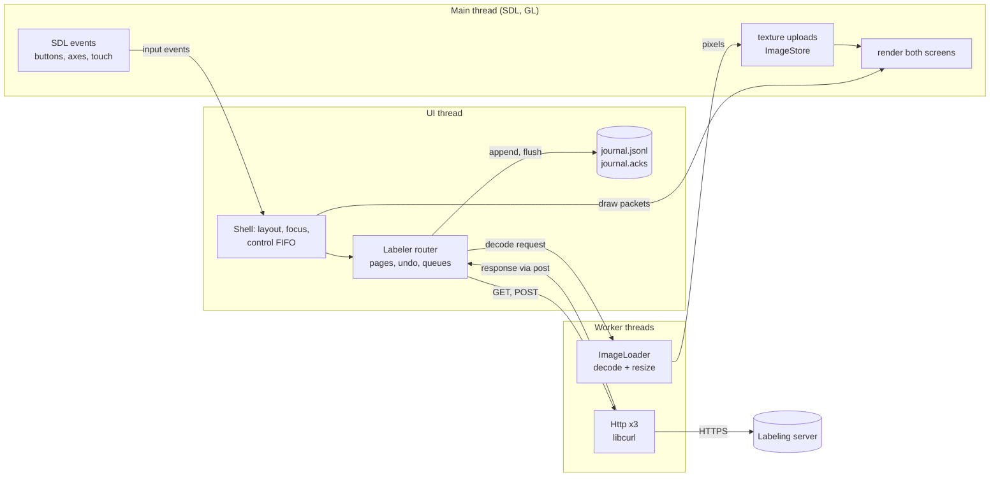
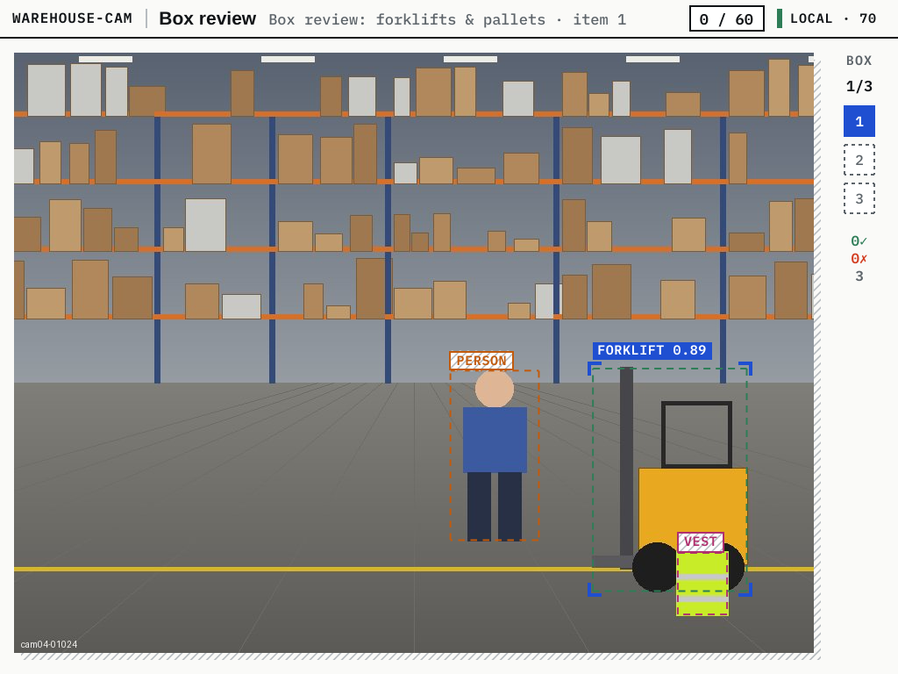
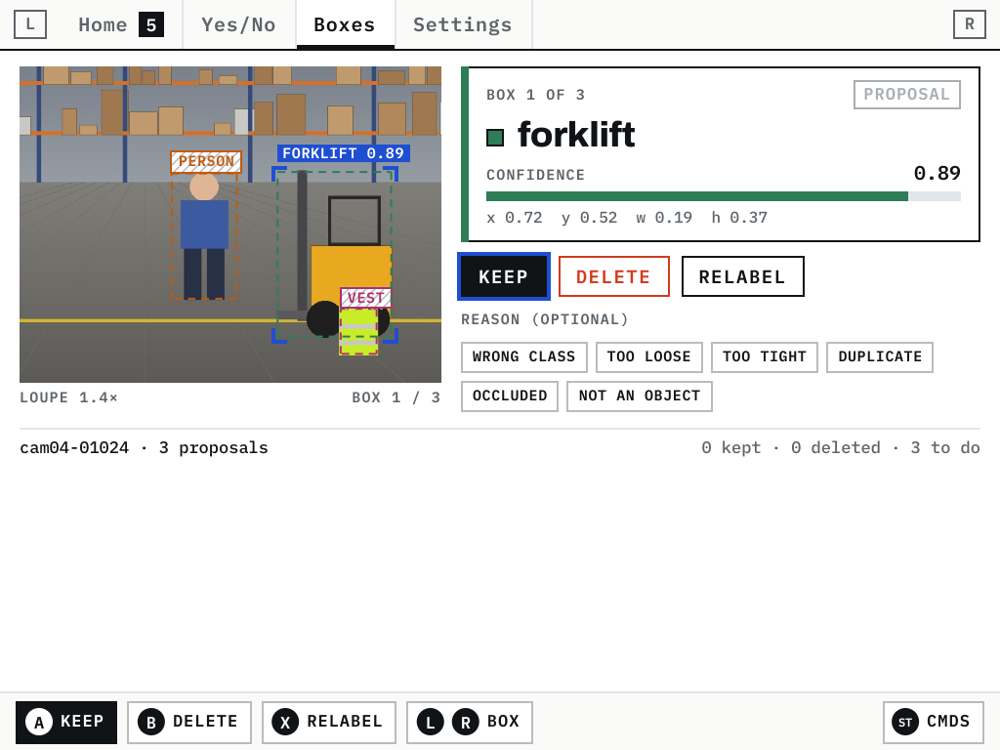
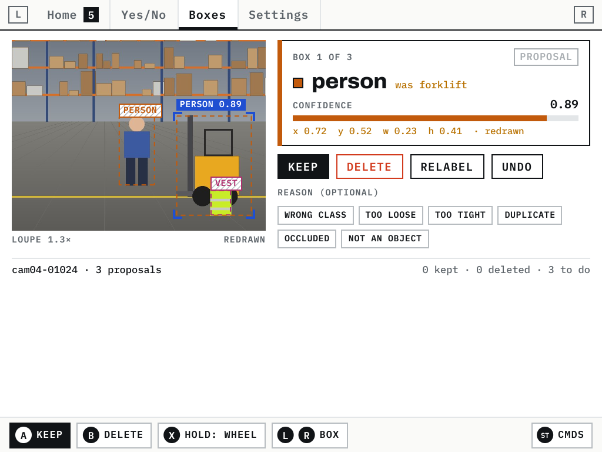
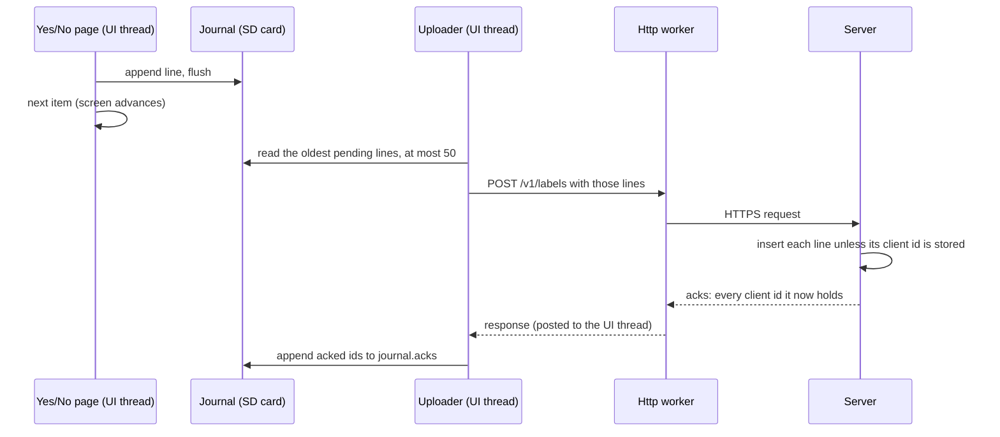
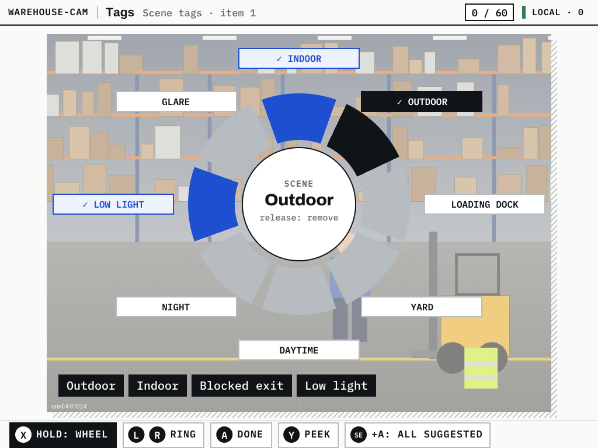
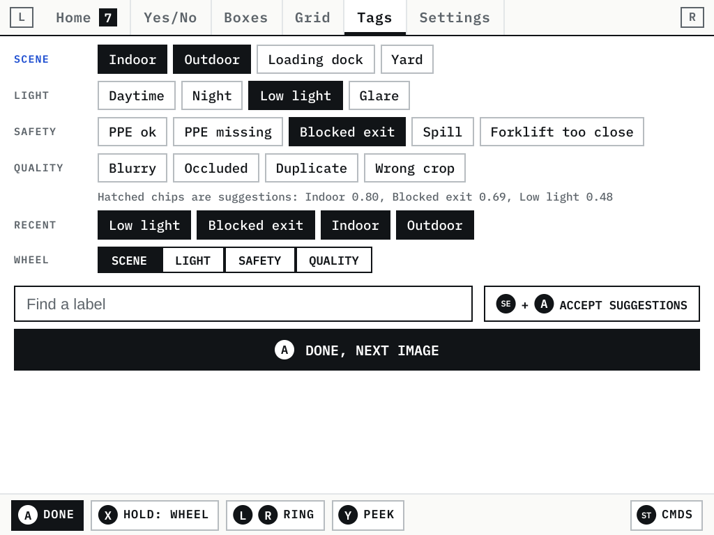
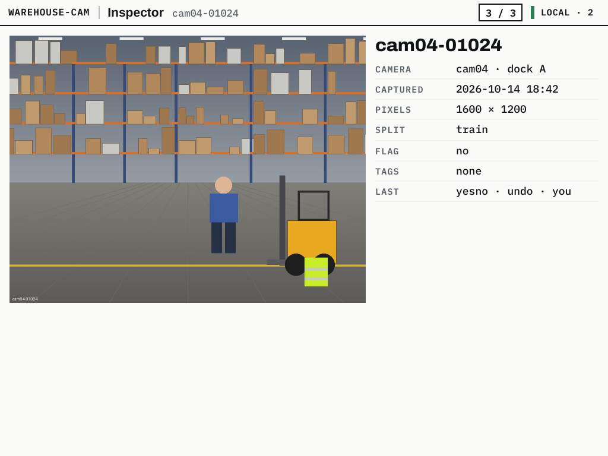
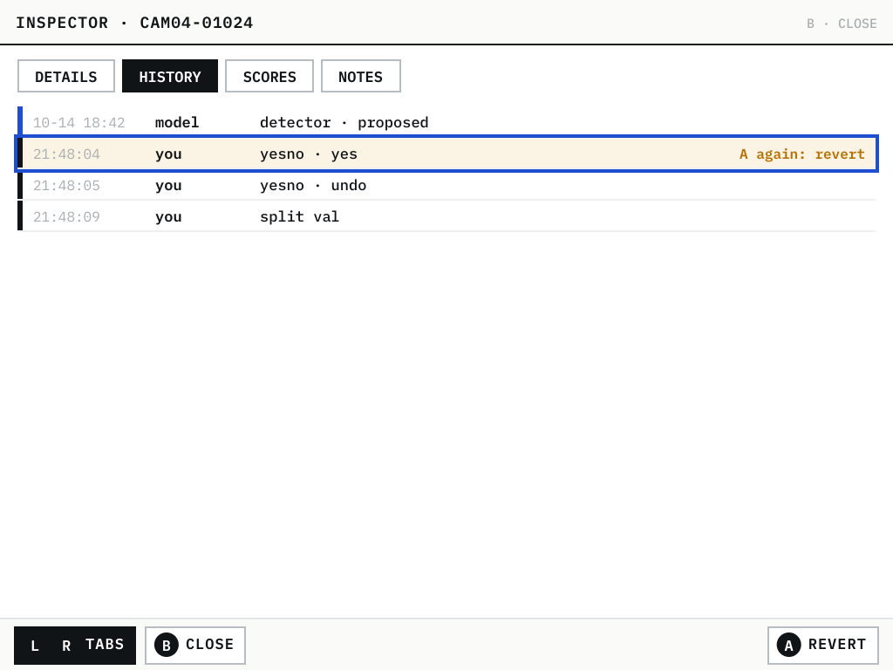

# Lattice DS Native, Part 6: The Handheld Labeler

This part covers the second application built on the Lattice DS engine: a client for labeling images, running natively on the RG DS Plus. Its job is narrow. It shows people images and the model's guesses about them, takes their decisions with one press each, and delivers those decisions to a server without losing any, including while the Wi-Fi is down.

The work started from a designer's handoff: a written brief, eighteen screen sheets and a skeleton app (milestone M0). It ended, thirty commits later, with:
- a client that has six of the eighteen screens working on the device;
- a server stub written in Go;
- one test suite that holds two server implementations to the same contract.

By the end of this report, a reader should be able to answer six questions:
- how a second application was added to the engine's repository without copying the engine, and without making the labeler link V8;
- how images entered a renderer that was built for vector user interfaces;
- what happens between a button press and a stored label, and why a 30-second network outage loses nothing;
- how the tool screens map the brief's controls onto two screens, a stick and one touch panel;
- what the server stub is, what is real in it and what is canned, and how the contract is tested;
- what has been verified on the device, with which numbers, and what remains open.

One image runs through the whole report: item `cam04-01024`, a synthetic warehouse photograph with a person, a forklift and a vest. It is the first item of every quest in the test dataset, so it appears in nearly every trace and screenshot below.

> [!summary]
> - **Journal first.** Every decision becomes one JSON line on the SD card before the screen advances. An uploader sends the lines in batches of at most 50, and the server stores each line at most once, keyed by a client id. On the device, 500 decisions with the server frozen for 30 seconds arrived 500 times, each exactly once.
> - **Images are a new node kind in the engine,** checked by the same parity oracle as every other node. Decoding runs on worker threads, uploads on the GL thread, and a byte budget with eviction keeps memory bounded.
> - **The tools are small state machines over a shared router.** Yes/no, box review, grid sweep, multi-label tagging and the metadata inspector each write their own kind of journal line. They share undo, the peek, the command palette and the uploader.
> - **The server stub is a deployable Go binary.** It has SQLite storage, hashed tokens and HTTPS with a private CA, the M2 endpoints in full, and the M3–M5 endpoints in the contract's shapes. One black-box suite tests it and the older Python fixture; it found two gaps in the fixture on its first run.

## 1. The task, its vocabulary and the plan

### 1.1 Terms

The brief and the code use a small vocabulary consistently. The rest of the report depends on it.

| Term | Meaning |
| --- | --- |
| **Item** | One image, with its pixel size, camera, capture time, and the model's output for it: a yes/no score, proposed boxes, suggested tags. |
| **Quest** | A queue of work with one tool: "Helmet check" (yes/no), "Box review: forklifts & pallets", "Grid sweep: helmets", "Scene tags". Every quest runs over items in an order the server chooses. |
| **Tool** | The screen pair that does one kind of labeling: yes/no, boxes, grid, tags. |
| **Decision** | One act of labeling: "yes", "keep box 2 as person", "these 16 tiles, two of them wrong", "these three tags". |
| **Journal line** | A decision written as one line of JSON in `DATA_DIR/journal.jsonl`, flushed before the screen moves on. |
| **Client id** | The line's identity, made on the device: device id, epoch milliseconds and line number. The server stores a client id at most once. |
| **Acknowledgement** | The server's answer listing the client ids it has stored. Acknowledged ids go to `journal.acks`, and those lines are no longer pending. |
| **Guideline** | The version of the labeling rules a decision followed (`g-1`), sent with every line. |

### 1.2 The brief's plan

The brief divides the system into eighteen screens (S-01 to S-18), six milestones and five workstreams.

| Milestone | Content | Exit test in the brief |
| --- | --- | --- |
| M0 Skeleton | five pages, placeholder images, fake queue, journal | starts from the Ports menu in under 1 s; one journal line per decision; both screens under 2 ms p95 |
| M1 Pixels | images and four input hooks in the engine | the image and hook checks pass on the device |
| M2 First tools | yes/no, grid sweep, box review, multi-label, metadata, against the real server | one person labels 500 real items in one session; a Wi-Fi drop loses no decision; RSS under 120 MiB |
| M3 Drawing | box drawing, masks, pose, pairwise | error against reference geometry measured |
| M4 Model loop | ask the model, similar, runs, confusion, adjudication | relabel a confusion cell from the device, retrain, see the new run |
| M5 Video, worlds | video timeline, hub world, data world | ten minutes of 30 fps scrubbing with flat memory |

The workstreams are:
- W1, images and input hooks in the engine;
- W2, the app;
- W3, the server API;
- W4, model services;
- W5, device and release.

This report covers W1, W2 through M2, W3 as a stub, and the parts of W5 the labeler needed.

### 1.3 The device

The RG DS Plus has two 4.3-inch panels, each 1024 × 768 pixels. The engine lays out each screen in 512 × 384 logical units and renders at twice that, so every screenshot below is 1024 × 768. The top panel has no touch input; the bottom one does. The GPU is a single-core Mali-G52, the OS is ROCKNIX, and the input is a joypad device with face buttons, shoulders, SELECT, START and two analog sticks. Parts 1 to 5 of this series describe the engine on this device; this part assumes them:
- the exact C++ port of the layout library;
- the GL renderer;
- the two-thread shell: GL and SDL on the main thread, layout on a UI thread.

## 2. One repository, two applications

The handoff contained its own copy of the engine, frozen at commit `d839c33`. A verification script confirmed the copy was identical to the repository at that commit, apart from the designer's notes and documents, so the labeler could be imported without the copy. The question was how to make room for a second application in a repository built for one.

Five refactoring steps, R1 to R5, did that. Each was gated by the existing tests and by byte-identical screenshots.

- **R1: `JsValue` without V8.** The JSON value type lived in the V8 layer. The labeler needs JSON (for the server, the queue dump and the configuration) but must not link V8: libnode is large, and the labeler has no scripts. The type moved to `src/net/json_value.{hpp,cpp}`. Afterwards, `ldd build/net_json_test | grep -c -E 'node|v8'` printed `0`.
- **R2: optional V8.** `cmake/LatticeDeps.cmake` detects whether V8 is available, and each application has its own `apps/*/CMakeLists.txt`. A configuration without V8 builds every target that does not need it. The project keeps two build directories, `build/` (with V8) and `build-nov8/`, and every feature boundary runs the tests in both.
- **R3: the labeler as `apps/labeler`.** The target is `lattice-labeler`. It came with its own smoke test (`tests/labeler/smoke.sh`) and screenshot script.
- **R4: `src/appkit`.** The labeler's type scale, chrome (status bar, hint bars, tab strip, page frame) and on-screen keyboard became the library `lattice_appkit`. The labeler's 16 screenshots were then compared with R3's: 15 were byte-identical, and the 16th differed only in a timestamp the settings page displays.
- **R5: application-aware device scripts.** `build-device.sh` builds V8 only when a target needs it. `deploy-device.sh` keeps the previous binary for rollback, and `register-ports.sh APP=` adds a launcher to the ROCKNIX Ports menu.

The device binary links only `libfreetype`, `libSDL2`, the C++ runtime and libc (`readelf -d`); libcurl came later with M2. From the Ports launcher to both screens presenting their first frame took 487, 524 and 482 ms in three runs. That meets M0's start-up target with room to spare.

## 3. The client's architecture

### 3.1 Threads and data flow

The labeler adds two kinds of worker threads to the shell's two threads: image decoders and HTTP workers. Every arrow in the diagram below crosses a thread boundary through a queue. No thread touches another thread's data structures.



- **The main thread** owns SDL and GL. It translates SDL events into input events, uploads decoded images to textures, and draws the packets the UI thread sends.
- **The UI thread** owns the application: the shell (layout, focus ring, the control FIFO), the router, the pages, the queues and the journal. A decision is journalled here, synchronously, before the page advances.
- **The image loader** decodes JPEG and PNG with `stb_image` on worker threads, and resizes with `stb_image_resize2` to the size the screen needs.
- **The HTTP workers** are three libcurl handles that serve requests in priority order. Each keeps its connection open. A response goes back to the UI thread through the shell's `post`, so every completion handler runs on the UI thread.

### 3.2 The router and its pages

The router (`apps/labeler/app.cpp`) holds the state that outlives a page:
- the queue, local or remote;
- per quest, the cursor, the decisions made, box states, grid marks and applied tags;
- the active quest of each tool;
- the undo stack;
- the journal and the uploader.

A page is a class with `top(Frame&)` and `bottom(Frame&)`, which build the two screens' trees, plus input hooks and a `debug()` line for tests. The pages are Home, Yes/No, Boxes, Grid, Tags, Inspector, Palette and Settings.

The router dispatches input in a fixed order: START opens the palette from anywhere, then the page handles the input, and B or the shoulders fall back to navigation if the page does not. Holding Y shows a metadata peek over the top screen on every tool page. SELECT combines with the next button into a chord: SELECT + L is the router's undo, and other chords go to the page's `chord()` hook.

### 3.3 Tap-only tool pages

The engine's shell has a focus ring: the D-pad moves it between focusable boxes, and A activates the focused one. Tool pages turn that off. Their buttons are keyed boxes with `focus = false`, so they react to taps but never take the focus, and A always reaches the page.

The reason is speed with certainty. On a yes/no page, A must mean "yes" whatever the D-pad did a second ago; a focus ring that drifted onto "No" would turn a fast labeler's habit into a wrong label.

Two pages use the focus ring on purpose, because their content is a set of things to pick from:
- the grid's sixteen tiles;
- the inspector's history entries.

### 3.4 The control FIFO

Every test in this project drives the labeler through a named pipe, `--control FIFO`. The shell's commands do the following:
- press, hold and release buttons (`press A`, `down X`, `up X`);
- move a stick (`axis X Y [STICK]`);
- tap at logical coordinates (`tap X Y`);
- list the keyed boxes on screen with their rectangles (`keys`);
- print the visible text of a screen (`look top`);
- capture a screen to a file (`capture bottom FILE`);
- report render timings (`perf`).

The labeler adds a few commands of its own:
- **`state`:** one line with the router's state: page, focus, sync status, pending and acknowledged lines, cursors, journal size;
- **`page`:** the current page's `debug()` line;
- **`images`:** the image store's counters;
- **`inspect`:** open the inspector for the item in use.

A test is a shell script that sends commands, marks positions in the log (`MARK name`), and checks the replies after each mark with `grep`.

Because the FIFO speaks the shell's own input path, the same script works offscreen on the development machine (`SDL_VIDEODRIVER=offscreen`) and on the device. The device versions add real input. `evinject.py` writes button, stick and touch events into the handheld's own evdev devices, so SDL receives them exactly as it receives hardware events.

## 4. Images in a vector renderer (W1)

### 4.1 A new node kind

The engine's layout library is a C++ port of `lui.js`, a JavaScript library that renders to SVG. The port is checked by a parity oracle: `lui.js` lays out a set of fixtures, the C++ core lays out the same fixtures, and every box, paint operation and hit region must be identical. The engine had no images, because the browser application it came from had none. Adding one could have bypassed the oracle; instead the image node was added to both sides:
- **In `lui.js`,** `image()` is a builder, and `toSVG` emits an SVG `<image>` with an alpha mask type and the opacity on the inner element.
- **In C++,** the node is `Kind::Image` with an `OpKind::Image` paint operation (wire kind 9).

After the change the oracle reported `parity: 1006/1006 identical (8096 boxes, 83973 ops, 1167 hits compared)`, with 138 fixtures containing image operations. The GL renderer's output for the new image fixture differed from resvg's rasterisation of the SVG by `0.000%` of pixels.

### 4.2 Textures, masks and a second shader program

`gl::ImageStore` keeps one texture per image id and draws from texture unit 4, which the existing text and glyph paths do not use. An image is drawn as one of two kinds:
- **`kImage`:** RGBA;
- **`kMask`:** A8 coverage, which is how a segmentation mask will be drawn in M3. A mask's coverage is the image's alpha if it has one, otherwise its grey value.

The first version drew images with the renderer's single shader, which already branched on primitive kind. On the device, the box review screen's top took 2.197 ms of GPU time at p50 and 3.616 ms at p95. A separate program for image-only ranges brought that to 1.730 and 3.145 ms. The image-free `board` fixture costs about the same per pixel, which shows that the general shader's per-pixel cost, not the images, sets the floor.

### 4.3 Decode on workers, upload on the main thread, evict by budget

Decoding a 1600 × 1200 JPEG and fitting it to 912 × 684 takes 25–32 ms on average on the device, 42–48 ms cold. That is far too long for the UI thread, so it runs on the image loader's workers. The pixels then wait in a queue until the main thread uploads them: 1.1–2.3 ms per texture, 5.5–6.8 ms for the first.

The store tracks texture bytes against a budget (`--image-budget MIB`). When the budget is exceeded it evicts textures that are not being drawn. A newly uploaded image that has not been drawn yet is protected for 2 seconds, so prefetched images are not evicted before their screen arrives.

A device run with 300 image swaps produced 435 uploads and 420 evictions, with the store holding 33.2 MB throughout. Process memory showed a plateau with no upward trend: 122.6 MiB warm, then between 123.8 and 128.7 MiB at every 50 swaps. The run also showed something worth stating directly: texture memory counts as process memory on this GPU driver. About 33 MB of textures took RSS from 79 to 122 MiB. The image budget is therefore the main lever on the M2 memory target (section 10).

### 4.4 One function maps every image

Every page draws images through one function, `imageSlot(ref, w, h, crop)`. It fits the item's pixels into the slot's box, letterboxing as needed, and returns the mapping from image-normalised coordinates to slot units. The model's boxes are stored in image-normalised coordinates (0 to 1), so the same mapping places them on the top screen and in the loupe.

The guide's worked example for `cam04-01024` follows box 3 (a vest, confidence 0.3614):
- **Top screen:** the image is drawn at scale 0.2850, and the box lands at x = 377.97, y = 284.50, w = 29.08, h = 36.06 units.
- **Loupe:** the crop is (0.7606, 0.7844) to (0.9609, 0.9847), a 4.99× magnification, and the box lands at x = 73.61, y = 38.37, w = 68.77, h = 85.26 units.

When M1 replaced placeholders with real images, only the body of `imageSlot()` changed. The pages and their overlays were untouched, as the guide had planned.





## 5. Input: from hardware events to page hooks

### 5.1 Four hooks

M0's pages received only button presses, which suits the D-pad and face buttons. The brief needs more:
- holding a button (the peek, the label wheel);
- releasing it (the wheel applies on release);
- the analog stick (aiming the wheel);
- fingers on the bottom panel (dragging a box corner in the loupe).

W1 added four hooks to the shell's `App` interface, with defaults that keep the old behaviour. The demo and arena tests confirmed the defaults: they passed unchanged.

| Hook | Called with | Used for |
| --- | --- | --- |
| `onButtonDown(b)` | the button, at press | hold-Y peek, SELECT chords, opening the wheel |
| `onButtonUp(b, heldMs)` | the button and how long it was held | closing the peek, applying the wheel |
| `onAxis(stick, x, y)` | a stick position in −1..1, after a radial dead zone of 0.15 | aiming the wheel |
| `onPointer(e)` | finger down / move / up on the bottom panel | dragging a corner of the selected box in the loupe |

### 5.2 The label wheel

Box review relabels with a wheel. Holding X opens it over the top screen with the five classes. The stick or the D-pad aims, and releasing X applies the aimed class. A quick press of X without aiming steps to the next class instead. That was M0's behaviour, and it remains the fastest way to fix a two-class confusion.

The aim converts a stick position to a sector. Sector *k* of *n* is centred at −90° + *k* · 360°/*n*: the first label is at the top, and the rest follow clockwise, because the screen's *y* axis points down.

```cpp
// the stick's angle, rotated so that "up" is 0, rounded to the nearest sector
const double a = std::atan2(double(y), double(x)) + kPi / 2;
const int k = (int(std::lround(a / (2 * kPi / n))) % n + n) % n;
```

Positions closer to the centre than 0.5 are ignored. When the stick springs back, it passes through small positions, and those must not re-aim the wheel.



### 5.3 A case study: the diagonal that read as straight right

The multi-label tool (section 7.3) has eight labels on its wheel, so diagonals matter. Box review's five classes had been aimed only straight up in the device tests. The first device check of the tag wheel held X and pushed the real stick up and to the right, which should aim at the second label, "Outdoor". The wheel aimed at "Loading dock", the label straight to the right:

```text
FAIL X held with the real stick up-right: the wheel aims at the second label
CTL tags ... wheel=1 sel=Loading dock
```

The first probe varied the direction. Up, down, left and right each aimed at the correct label, so both axes reached the application, and only diagonals failed.

The second probe read the joypad's evdev node while the injection ran, with kernel timestamps:

```text
1792103110.428384 ABS_X 1260
1792103110.428384 ABS_Y -1260
1792103110.435266 ABS_Y 0
1792103110.435266 ABS_X 0
```

The joypad driver (`rocknix-singleadc-joypad`) polls the analog-to-digital converter for the physical stick, which was at rest. It reported the real position again 7 ms after the injected one, and it reported Y before X.

The runtime handled every axis event on its own. The application therefore saw four positions in turn:
1. (0.7, 0), when the X event arrived alone;
2. (0.7, −0.7), when the Y event completed the injected position;
3. (0.7, 0) again, when the driver re-centred Y first;
4. (0, 0), which was ignored.

The last strong position pointed right. A real thumb letting go of a diagonal faster than one poll produces the same sequence, so this was a real defect in the client, not a flaw in the test harness. Injection had only made it visible.

The fix coalesces stick positions per SDL drain on the main thread. A driver reports both axes of one poll in one frame, and SDL delivers that frame's events in one drain. Keeping only the last position per stick, and flushing it before any other event so that a button release after a stick move keeps its order, gives the application whole positions:

```cpp
do {
  if (raw.type == wakeEvent) continue;
  platform::InputEvent ev;
  if (!plat.translate(raw, ev)) continue;
  if (ev.kind == platform::InputEvent::Kind::Axis && ev.stick >= 0 && ev.stick < 2) {
    axis[ev.stick] = ev;          // the latest position of this stick in this drain
    axisPending[ev.stick] = true;
    continue;
  }
  flushAxes();                    // a button after a stick move keeps its order
  UiEvent u;
  u.input = ev;
  in.push(u);
} while (SDL_PollEvent(&raw));
flushAxes();
```

The injection tool had a related weakness. An injected position lived only until the driver's next poll, about 7 ms. `evinject.py stick` now asserts the position every 2 ms for the whole hold; the kernel's input core drops repeats that change nothing. After both changes, the tag wheel's device check passed 8 of 8 with real touch, chord and stick input, and the earlier input-hooks check still passed 9 of 9.

The lesson generalises. An axis event is half of a stick position, and any consumer of SDL joystick axes needs the other half from the same driver frame. SDL has no frame marker, so the drain is the smallest unit that contains both.

## 6. The journal-first data path (M2)

### 6.1 Three rules

The guide states three rules that keep labeling working on a bad connection:

1. **Journal first.** Every decision is journalled before the screen advances; uploads are batched and idempotent.
2. **Prefetch.** The device keeps items and their images ahead of the cursor, and caches image bytes on the SD card by ETag.
3. **Timing fields.** Each label carries `shown_at`, `decided_at` and the guideline version.

Rule 1 is what makes a dropped network harmless. Persisting a decision costs a write and a flush to local storage. Waiting on the network would cost a round trip of unknown length, and could fail outright.

### 6.2 One decision, traced

A press of A on the yes/no page for `cam04-01024` in the "Helmet check" quest produced this line during the M2 device run over HTTPS:

```json
{"client_id":"c7e28e63-1792108645420-1","item":"cam04-01024","tool":"yesno","decision":"yes","ms":1808,
 "shown_at":"2026-10-15T23:57:23.612Z","decided_at":"2026-10-15T23:57:25.420Z","guideline":"g-1","quest":"q-helmet"}
```

- **`client_id`** is the device id (`c7e28e63`), the epoch milliseconds of the decision and the journal's line number. Two decisions on one device cannot collide. A retried upload of the same line carries the same id.
- **`ms`** is how long the item was shown before the decision (1808 ms), and `shown_at` and `decided_at` bound it. These fields let the server measure labeling speed and detect rushed decisions.
- **`guideline`** names the rules version the server announced in `/v1/me`.

The sequence from the press to the acknowledgement:



The uploader runs from the router's frame tick.
- **Batching:** a decision arms an upload 400 ms ahead, so a fast labeler's decisions travel in groups of a few.
- **Backoff:** a failed upload backs off from 1 second, doubling up to 30.
- **Status:** the status bar shows "synced", "sync" (lines in flight) or "offline · N" (N pending).
- **Restarts:** pending lines survive a restart because they are in the file. At start-up the journal subtracts `journal.acks` from `journal.jsonl` to find them, and the uploader starts at once.

A host test checks the restart path: it quits the labeler with three lines pending, starts it again, and expects `acked=13`.

### 6.3 Why duplicates happen, and why they are harmless

Consider a batch whose request reached the server but whose response was lost: the server stored the lines, and the device never learned it. The device sends the batch again after its backoff. The server recognises every client id and stores nothing new, but acknowledges the ids again, so the device can mark them done. The server counts such lines as duplicates.

In the first M2 device run (Python fixture over HTTP, server frozen with `SIGSTOP` for 30 seconds), the server dropped 45 duplicates. Every journal line was on the server exactly once.

### 6.4 Images over the network

A remote item's image is `GET /v1/images/{id}?size=full`. The client keeps the bytes in `DATA_DIR/cache` with the response's ETag. Before reusing the bytes it asks the server with `If-None-Match`, and a `304` answer means the cached copy is still current. Grid tiles use `size=thumb` (240 × 180) and the image id `<id>@thumb`, so a thumbnail and its full image are separate textures.

An early device run found a bug here. After an eviction, the router asked again for the on-screen image as a file, which was the M1 path, even though a server was configured. The log said `cannot open /cam04-01024.jpg`. One function now serves both paths. The host test runs with a 4 MiB image budget to force evictions, and checks that no image is looked for as a file.

### 6.5 The exit test

`scripts/labeler/m2-device-run.sh` runs the fixture server on the development machine, with the token in a file and never printed. The handheld labels 500 items over Wi-Fi, five yes for every no and every unsure. Sixty seconds in, the server is frozen for 30 seconds. Afterwards, the script compares the device's journal with the server's stored lines by client id.

| Run | Server | Lines on server | Duplicates dropped | RSS during the run |
| --- | --- | --- | --- | --- |
| Step 8 | Python fixture, HTTP | 500 of 500, each once | 45 | 116.1–120.7 MiB |
| Step 13, first | Go stub, HTTPS | 500 of 500, each once | 0 | 130–148 MiB |
| Step 13, after the prefetch fix | Go stub, HTTPS | 500 of 500, each once | 0 | 118.6–122.7 MiB |

The server log of the first HTTPS run shows the freeze as a gap from 19:38:18 to 19:38:48. During it the device kept labeling, with its status going offline. Of the image requests, 846 got `304 Not Modified`, which shows the ETag cache working over HTTPS. Section 10 discusses the memory column.

## 7. The tools

### 7.1 Yes/no and box review

The two M0 tools gained real images in M1 and real data in M2. Yes/no is the fastest tool: A, B and X decide (yes, no, unsure), L and R step back and forward, and the bottom screen shows the last six decisions.

Box review shows every proposed box on the top screen, with the selected box bracketed. The bottom screen is the box's workspace:
- the loupe follows the selected box;
- the box card shows the class, the confidence and the geometry;
- below it are Keep, Delete and Relabel, and the delete reasons.

A keep or a delete journals the box index, the class and, after a relabel, the model's original class. An excerpt from the input-hooks device run, without the timing fields:

```json
{"item":"cam04-01024","tool":"boxes","decision":"keep","quest":"q-boxes","box":0,"class":"person","from":"forklift",
 "bbox":[0.72275,0.52483,0.95728,0.93866]}
```

The `bbox` member appears only when a corner was dragged. The `from` member is what makes a confusion matrix possible on the server (section 8.4).

### 7.2 Grid sweep (S-06)

The grid is for bulk cleanup. It shows sixteen thumbnails, all proposed with the quest's label (for example "helmet"). The labeler marks only the exceptions, then commits the page with one press:
- B marks the focused tile wrong;
- X marks it unsure;
- a tap toggles wrong;
- A commits the page.

A commit writes sixteen journal lines, one per tile, each with `"class":"helmet"`, and turns the page.

Marks are kept per absolute item index, not per tile, so turning pages back and forth without committing preserves them. Undo of a grid page restores the cursor, removes the sixteen decisions with sixteen `undo` lines, and brings back the marks exactly as they were.

Sixteen thumbnails at 240 × 180 take about 2.7 MiB of texture memory. One full image at 912 × 684 takes 2.4 MiB.

### 7.3 Multi-label tagging (S-07)

Tagging assigns several labels to one image. The brief puts eight labels under the thumb on a wheel and the full set on the bottom screen. The taxonomy belongs to the quest, not to the page: rings (Scene, Light, Safety, Quality), each with its labels, plus labels on no ring, which only search finds. The server decides the taxonomy and its order. The fake queue and the server stub are two sources of the same structure.

A ring on the wheel holds eight labels: the ring's own first, then the labels used most this session, with taxonomy order breaking ties. This keeps the wheel predictable, because a ring's own labels never move, while still bringing frequent labels under the thumb. A release without aiming does nothing. Box review's wheel applies its current class in that case; for tags, that would toggle the top label by accident.

The model's suggested tags are hatched chips until confirmed: a tap confirms one, and SELECT + A confirms all of them. Done writes one line with the tags as left and the suggestions that were shown. The server can then measure how often suggestions are accepted. From the device run, without the timing fields:

```json
{"client_id":"b774e821-1792103199171-1","item":"cam04-01024","tool":"tags","decision":"tags","ms":10496,
 "quest":"q-tags","tags":["Indoor","Blocked exit","Low light"],"suggested":["Indoor","Blocked exit","Low light"]}
```

In that run, the device check applied "Outdoor" with a tap, accepted the three suggestions with the real SELECT + A chord, and removed "Outdoor" again with the stick-aimed wheel. The line records the result.





### 7.4 Metadata and history (S-15)

The inspector shows one item's provenance and history, and offers the quick edits people make most:
- the split (train, val, test);
- a "second look" flag;
- tags.

It opens from an Inspect button or from the palette. The palette asks the page in use for its `subject()`, a hook a page may implement; the grid returns its focused tile. B returns to the page it came from.

Edits are journal lines with the tool `meta`. Making them ordinary lines gave them the journal's offline safety, retries and idempotency at no cost; a separate `PATCH` endpoint would have needed its own offline queue. Two lines from the inspector's device run, without the timing fields:

```json
{"client_id":"c987d368-1792100889887-3","item":"cam04-01024","tool":"meta","decision":"meta","guideline":"g-local","split":"val"}
{"client_id":"c987d368-1792100893995-4","item":"cam04-01024","tool":"meta","decision":"revert","guideline":"g-local","to":"c987d368-1792100884289-1"}
```

History entries are focusable rows. The first A on an entry arms a revert, shown as an amber row reading "A again: revert"; the second A journals it. A revert names the client id of the entry it returns to, which is unique and stable. It is recorded, not applied. Whether reverting a decision also reverts later edits, and how a revert combines with undo, is the server's to define, and the stub does not define it yet.

Without a server, the history is the journal's own lines for the item, read with `Journal::linesFor`. With a server, it is `GET /v1/items/{id}`, which lists the model's proposal first and then every stored line.





The first offscreen captures of the inspector showed three defects that 23 passing checks had not caught:
- a capture time overflowed its column;
- edits read "meta · meta";
- tabs without a revert showed an empty A in the hint bar.

Each check verified state, and none verified layout. Every screen since has been inspected by eye from captures before its commit.

### 7.5 Chrome: hint bars and class washes

Every tool has a hint bar on the top screen, under the image, listing its controls. Box review got its hint bar last: the bar needed 24 units, so its image slot shrank from 456 × 342 to 436 × 327, which is still 4:3.

The brief named tokens the theme lacked: washes of the eight class colours, `a1-w` to `a8-w`. It gave no values, and the sheets use no literal wash colours either; every unknown colour in them belongs to the painted photographs. The values were derived from the theme's own washes:
- **Light theme:** a wash is the class colour blended at 9.3 % over `sheet`. That single blend reproduces the existing `sig-w`, `ok-w`, `warn-w` and `bad-w` to within 3/255 per channel.
- **Dark theme:** 12.4 % over `paper` fits the dark washes to within 12/255.

The tokens went into both the C++ theme and `lui.js`, so the parity oracle knows them.

## 8. The server stub (W3)

### 8.1 Why a stub, and why Go

Until Step 13, the only server was `tools/labeler-server.py`: a few hundred lines of Python, a JSONL file and a hand-written list of quests, written to test the client. M2's exit test names "the real server", and the guide's contract names HTTPS. The stub implements that contract for a real deployment:
- real storage, authentication and HTTPS;
- the M2 endpoints complete;
- the later endpoints in their contract shapes.

Go was chosen for four reasons:
- **One static binary,** which runs on a laptop or a small LAN box.
- **TLS in the standard library.**
- **A pure-Go SQLite driver** (`modernc.org/sqlite`), which needs no cgo.
- **Typed structs for the contract.**

The newest releases of the SQLite driver and of `x/image` require Go 1.26, while the installed toolchain was 1.25.5. They were pinned to v1.59.0 and v0.45.0. Without the pin, `go get` would have raised the module's Go version and triggered a silent toolchain download.

### 8.2 Structure

| Package | Responsibility |
| --- | --- |
| `internal/store` | SQLite: items, quests, users (SHA-256 of each token only), labels (`client_id` unique) |
| `internal/dataset` | import the labeler's queue dump with its images, or any directory of photos with sidecar JSON |
| `internal/imaging` | decode, fit to an exact box, crop, encode JPEG, an 8 × 6 colour-layout embedding |
| `internal/api` | the HTTP contract: M2 endpoints in `api.go`, M3–M5 stubs in `stubs.go` |
| `internal/tlsutil` | a private CA and a server certificate for the machine's names and addresses |
| `cmd/labeler-server` | `import dump\|dir`, `token`, `serve [--tls]`, `fixture` |
| `contract` | the black-box contract suite (section 9) |

The `token` command writes a new token to a file with mode 0600 and prints only where it went. The request log never contains the Authorization header.

### 8.3 Labels and done counts

Idempotency is one SQL clause:

```sql
INSERT INTO labels(client_id, user, item, quest, tool, decision, decided_at, body, received_at)
  VALUES(?, ?, ?, ?, ?, ?, ?, ?, ?) ON CONFLICT(client_id) DO NOTHING
```

A row counts as new when the insert affected one row; otherwise it is a duplicate. Either way the client id is acknowledged.

A quest's `done` count, shown on the device's Home page, must honour undo: an undone decision makes its item not done again, and a later decision makes it done again. The rule is "the latest line for this quest and item is not an undo":

```sql
SELECT COUNT(*) FROM (SELECT item, decision FROM labels l WHERE quest = ? AND n = (
    SELECT MAX(n) FROM labels WHERE quest = l.quest AND item = l.item)) WHERE decision != 'undo'
```

Each new label is also appended to `DATA/labels.jsonl` with its user. The file is an audit log beside the database, and it lets the client's existing tests check stored labels without knowing which server ran.

### 8.4 Images, exact sizes and the cache

The contract asks for "JPEG bytes at an exact size". `size=full` fits the source into 912 × 684, which matches the client's decode size, and `size=thumb` into 240 × 180.

The first request for a size generates it with Catmull-Rom scaling and writes it to `DATA/cache`. Two concurrent requests for the same uncached size must not encode twice or read a half-written file, which takes three measures:
- a mutex per cache key;
- a second check of the cache after taking the mutex;
- writing to a temporary name, then renaming.

Every answer carries an ETag, and `If-None-Match` with that ETag returns `304`.

### 8.5 The later endpoints: what is real and what is canned

| Endpoint | Milestone | In the stub |
| --- | --- | --- |
| `GET /v1/images/{id}?crop=x0,y0,x1,y1&w=&h=` | M3 | real: a crop from the full-resolution source, exactly w × h |
| `POST /v1/segment` | M3 | canned: the box's ellipse plus disks around positive points, as an 8-bit grey PNG |
| `GET /v1/runs`, `/runs/{id}/curves` | M4 | canned: three fixed runs, smooth curves ending at their metrics |
| `GET /v1/runs/{id}/confusion` | M4 | real data: box review's latest keep/delete per box; rows are the labeler's class (or background), columns the model's, with the items of each cell |
| `GET /v1/items/{id}/neighbors` | M4 | real data: nearest by the colour-layout embedding |
| `POST /v1/search` | M4 | real data: every word must match the item's id, camera, time, question, classes, suggested or applied tags |
| `POST /v1/ask` | M4 | canned: the item's own proposals, and a question about the least certain one |
| `GET /v1/world` | M5 | canned: items placed by mean lightness and warmth |
| `GET /v1/videos/{id}/proxy` | M5 | `501`: no videos |

The confusion matrix shows why real data in a stub is worth the small cost. When a labeler relabels a box from forklift to person, the cell (truth person, prediction forklift) gains that item, and the M4 doorway screen can be tested against the device's own corrections.

### 8.6 HTTPS on a LAN

A LAN server has no publicly trusted certificate, and turning certificate verification off on the device would make HTTPS meaningless. The stub's `serve --tls` makes two things on first start:
- a P-256 CA;
- a server certificate signed by that CA, for `localhost`, the machine's hostname, every non-loopback address, and any `--tls-host` names.

Keys are written with mode 0600. The certificate is regenerated when it does not cover the requested hosts. The device receives only `ca.pem`.

The client side needed one curl option. `net::Http` takes a CA file and sets `CURLOPT_CAINFO`; verification is never switched off. The labeler accepts `--ca-file`, or `"ca_file"` in `DATA_DIR/config.json` relative to the data directory. Its start-up line names the CA in use, never the token:

```text
SERVER https://192.168.0.39:8787 token=set ca=/storage/labeler-m2/ca.pem
```

Without the CA file the labeler refuses the server, gets no quests, and Home shows the reason: `Last error: SSL peer certificate or SSH remote key was not OK`. A host test checks both cases.

## 9. One contract, two servers

Two implementations of one contract drift apart unless the same tests run against both. The contract suite (`server/contract`) is a black-box Go test with thirteen tests, grouped by milestone:

| Group | Tests |
| --- | --- |
| M2 | authentication (401 without or with a wrong token), `/v1/me` fields and tools, queue paging (no overlap, n capped at 100, 404 for an unknown quest), images (fit inside the exact box, aspect kept, ETag and 304, 400 for an unknown size), idempotent labels (a retry acked and stored once, a line without `client_id` not acked), at most 50 labels (413), done counts through a decision and its undo, item history (model proposal first, a meta line's split applied) |
| M3 | a crop of exactly 320 × 240 and a 400 for an inverted crop; a segment mask with the box's centre and a point on and a corner off |
| M4 | runs, curves, and a relabel appearing in its confusion cell; neighbours nearest first; search finding an item by a word of its camera; ask returning proposals |
| M5 | video 501; world tiles present |

Without configuration, the suite starts the Go server in-process over HTTPS, on a generated dataset of 12 images. With `LABELER_URL` and `LABELER_TOKEN_FILE`, it tests any running server, and `LABELER_LEVEL=m2` skips the endpoints the Python fixture never had. `scripts/labeler/contract.sh python|go` starts either server and runs the suite against it.

On its first run against the Python fixture, the suite failed twice:

```text
contract_test.go:404: size=huge: 200, want 400
--- FAIL: TestM2Images
contract_test.go:437: 51 labels in one request: 200, want 413
--- FAIL: TestM2LabelsLimit
```

The fixture had been the de facto contract, and writing the contract down as tests showed where it was looser than the guide. Both gaps were fixed in the fixture. The suite then passed 13 of 13 against the Go stub (in-process, and as a separate process over HTTPS), and 8 of 8 against the fixture at the M2 level.

The client's existing server tests were reused as well. The stub's `fixture` subcommand takes the Python fixture's exact command line. The tests now read the server command from `LABELER_SERVER`, and ctest runs the server, inspector and tags tests a second time against the stub.

Wiring this into ctest produced one instructive failure. The stub's binary was first built at `build/labeler-server-go`, which was also the work directory of the test named `labeler-server-go`. That test begins with `rm -rf "$W"; mkdir -p "$W"`, so it replaced the binary with a directory ("Permission denied"). The labeler from that broken run then kept the engine's single-instance lock (`/tmp/lattice-ds.lock`) and failed the next test. The binary now lives in `build/go-bin/`.

## 10. Memory across the project

The brief's M2 target is RSS under 120 MiB. Memory was measured at each milestone and the values were kept, but the user's priority was functionality, and RSS was never tuned for its own sake. The measurements tell a coherent story.

| Point | Images | RSS |
| --- | --- | --- |
| M0 on the device (Step 4) | placeholders only | 65.0–68.7 MiB |
| W1, 300 image swaps (Step 6) | 32 MiB budget | 122.6–128.7 MiB, plateau |
| M2 exit run, HTTP (Step 8) | 24 MiB budget | 116.1–120.7 MiB |
| M2 exit run, HTTPS, first (Step 13) | 24 MiB budget | 130–148 MiB |
| Same build over HTTP, for comparison | 24 MiB budget | 129–134 MiB |
| M2 exit run, HTTPS, prefetch fixed | 24 MiB budget | 118.6–122.7 MiB |

The rise in Step 13 looked at first like the cost of TLS. The comparison run over plain HTTP with the same build ruled that out: TLS costs at most a couple of MiB.

The cause was prefetch. It filled the look-ahead of every tool's active quest: four full images for each linear tool and a page of sixteen thumbnails for the grid. With two tools that had been affordable; with four, the look-ahead of tools nobody was using sat in decoded and uploaded memory.

Prefetch now serves the tool that last showed an item: its next four images, or the grid's page. Every other tool gets only its current item, and the grid gets nothing until it opens. The grid test, which checks that a page's sixteen thumbnails and the focused image are loaded on opening, still passes. Memory returned to the Step 8 level. That level sits right at 120 MiB, not clearly under it, and the image budget remains the obvious next lever.

## 11. How the work was verified

The verification ladder had four rungs, and every feature boundary climbed it.

1. **Host tests through the FIFO,** offscreen. At the end, ctest ran 28 tests with V8 and 23 without:
   - the core parity and GL pixel tests;
   - the demo and arena smoke tests;
   - the labeler's eleven tests, which include the HTTPS test and three runs against the stub;
   - the contract suite.

   The labeler tests together hold 589 lines of shell. Each test states its checks as sentences, for example `ok   SELECT + A accepts every suggestion`.
2. **Offscreen captures inspected by eye.** State checks cannot see layout, and the inspector's three defects (section 7.4) proved it.
3. **Device runs with FIFO-driven input:** the M2 exit run, the inspector run, the image checks.
4. **Device runs with real input through evdev,** where input semantics matter: the hooks check (9 checks) and the tags check (8 checks). These found the stick-coalescing defect (section 5.3), which the host tests could not, because the offscreen driver has no joypad.

Two recurring lessons are worth recording.

- **Tests that anchor on line formats break on harmless changes.** The `state` line ends with `box=N journal=N`, and three tests anchored on it. Each time a field was appended to the line, those tests failed. New fields now go earlier in the line.
- **Killing processes by pattern is dangerous inside test scripts.** `pkill -f` with a pattern that also matches the invoking shell's command line killed the shell itself once. Processes started by a script are now stopped by their PID.

## 12. Where the project stands

| Part of the plan | State |
| --- | --- |
| M0 | done; the 2 ms p95 target missed on two bottom screens (box review 2.48 ms, palette 3.56 ms) |
| M1 (W1) | done and checked on the device: images, the four hooks |
| M2 screens | done: yes/no, box review, grid sweep, multi-label, metadata and history, hint bars, washes |
| M2 exit test | passed on the device over HTTPS against the stub; synthetic images, not real photographs; RSS at the 120 MiB line |
| W3 | a stub: M2 complete, M3–M5 in the contract's shapes |
| W4 (model services) | not started; the stub's segment, ask, runs, neighbours and world stand in |
| M3–M5 screens | not started; 6 of 18 screens work |

In code, the work since the handoff comprises:
- about 3,600 lines of C++ in `apps/labeler`, besides the engine changes for images, input hooks and HTTP;
- 2,700 lines of Go in `server/`, including the contract suite;
- 589 lines of shell tests in `tests/labeler`.

## 13. Limitations and open questions

- **Real photographs and real labelers.** The stub imports any directory of photos (`labeler-server import dir`), but every run so far used synthetic images. Nobody has labeled with the device in their hands, and the physical stick and multitouch have not been checked by hand.
- **Undo and revert semantics.** The server stores them and honours undo in its done counts. What a revert means for later edits is undefined.
- **Labels for unknown items** are stored and acknowledged. Rejecting them would leave a line on the device that is retried forever; the real server should report such lines without blocking the queue.
- **Token lifetime and roles.** Tokens never expire, and there are no roles and no adjudication queue.
- **The CA key sits next to the server.** Whoever has the data directory can issue certificates the devices trust.
- **Memory** is at the target, not under it. The image budget and the look-ahead depth are the levers.
- **M0's 2 ms p95 target** is missed on two bottom screens. By the user's priorities, snappy enough is the bar, and it was measured once and left.

## 14. Reproducing the results

```sh
# host: build both configurations, run every test (the Go stub is built when go is found)
cmake -S . -B build && cmake --build build && (cd build && ctest)
cmake -S . -B build-nov8 -DLATTICE_WITH_V8=OFF && cmake --build build-nov8 && (cd build-nov8 && ctest)

# the contract suite against either server
cd server && go test ./...                         # in-process, HTTPS
scripts/labeler/contract.sh python /tmp/c-py      # the Python fixture, M2 level
scripts/labeler/contract.sh go /tmp/c-go          # the Go stub over HTTPS

# device: cross-build (docker, no QEMU), deploy, and the M2 exit run against the stub over HTTPS
scripts/build-device.sh lattice-labeler && scripts/deploy-device.sh build-device/lattice-labeler
IMPL=go scripts/labeler/m2-device-run.sh /tmp/m2 500 30

# device checks with real input (on the handheld)
sh /storage/apps/lattice-ds/scripts/tags-labeler.sh /storage/labeler-s07
sh /storage/apps/lattice-ds/scripts/hooks-labeler.sh /storage/labeler-hooks

# a LAN deployment with real photos
server/labeler-server import dir --data /srv/labeler --images ~/photos
server/labeler-server token --data /srv/labeler --user NAME --out NAME.token
server/labeler-server serve --data /srv/labeler --tls     # give /srv/labeler/tls/ca.pem to the device
```

## 15. Files

| Path | What it holds |
| --- | --- |
| `apps/labeler/app.{hpp,cpp}` | the router: pages, quests, undo, journal, uploader, prefetch, FIFO commands |
| `apps/labeler/pages/*.cpp` | the pages: yesno, boxes, grid, tags, inspector, palette, home, settings, peek |
| `apps/labeler/data/journal.{hpp,cpp}` | the journal: lines, client ids, pending, acknowledgements |
| `apps/labeler/data/remote_queue.cpp` | the server's queue: `/v1/me`, paged items |
| `apps/labeler/ui/image_slot.hpp` | the one function that maps images into slots and crops |
| `src/net/http.{hpp,cpp}` | libcurl workers, ETags, the CA file |
| `src/image/`, `src/gl/` | decode and resize; `ImageStore`, textures and the image program |
| `src/shell/runtime.cpp` | the FIFO, the input drain and the stick coalescing |
| `server/` | the Go stub: `internal/{store,dataset,imaging,api,tlsutil}`, `cmd/labeler-server`, `contract/`, `README.md` |
| `tools/labeler-server.py` | the Python fixture |
| `tests/labeler/*.sh` | host tests: smoke, images, server, grid, inspector, tags, hooks, https |
| `scripts/device/*-labeler.sh`, `scripts/device/evinject.py` | device checks and real-input injection |
| `ttmp/2026/10/15/LABEL-001-…/` | the ticket: the intern guide, the diary (Steps 1–13), and the evidence these figures come from |

## Related notes

- [[PROJECT REPORT - Lattice DS Native - The Whole Project - A Browser UI System on a Real Dual-Screen Handheld]]: the overview of the engine this application runs on.
- [[PROJECT REPORT - Lattice DS Native, Part 2 - A Two-Thread Shell and a Thin V8 Layer on the RG DS Plus|Part 2]]: the two-thread shell whose threads section 3.1 extends.
- [[PROJECT REPORT - Lattice DS Native, Part 4 - Hardening a Handheld UI - an Exact Native Hot Path, Malloc Arenas and Ten Minutes at 41 C|Part 4]]: the memory and soak methods section 10 reuses.
- [[PROJECT REPORT - Lattice DS Native, Part 5 - The Language Model Backend - from a pi Agent Setup to a Robot's Tool Call|Part 5]]: the libcurl transport whose pattern `net::Http` follows, and the credential boundary the bearer token respects.
- [[PROJECT REPORT - DS Demo Game - Dual-Screen SDL2 App Anatomy and the Compositor Placement Problem - A Technical Deep Dive]]: how two windows land on the two panels.
