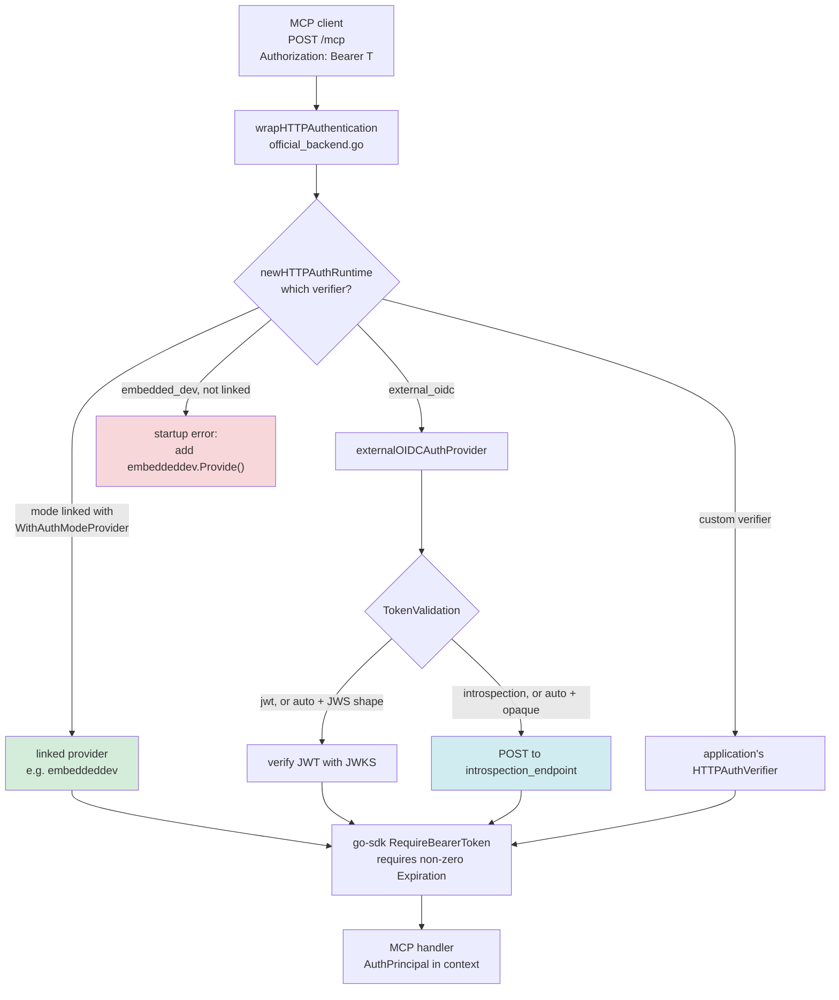
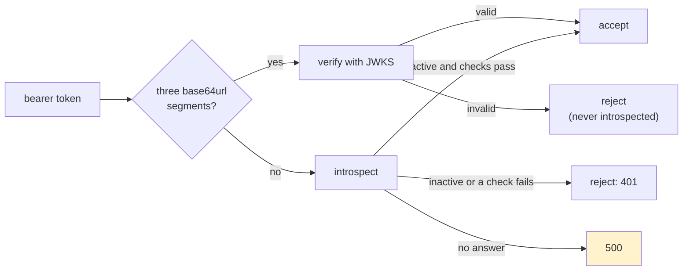

# go-go-mcp Embeddable Auth: Linking the Embedded OIDC Server on Request and Verifying Opaque Tokens

go-go-mcp's `pkg/embeddable` is the package a Go application imports to become a Model Context Protocol (MCP) server: it registers tools, serves them over stdio or HTTP, and, for HTTP, protects the `/mcp` endpoint with OAuth bearer tokens. This report describes three changes to that package's authentication, made because a concrete application — the Francois catalog, which plans an MCP server behind the ZITADEL identity provider — could not reasonably use it as it stood. The first change stops `pkg/embeddable` from linking a development authorization server into every program, which reduced its compiled dependency graph from 318 to 65 non-standard packages. The second fixes a bug that made one of its auth modes reject every token. The third teaches the production auth mode to verify *opaque* access tokens by asking the identity provider, which is what ZITADEL requires.

> [!summary]
> - **Weight came from one import.** `pkg/embeddable/auth_provider.go` imported `pkg/auth/oidc`, a Fosite-based development authorization server, and with it go-sqlite3, ory/x, gRPC and three tracing exporters. Moving that provider into a new package, `pkg/embeddable/embeddeddev`, linked through an explicit server option, removed 253 packages from every program that does not ask for it.
> - **`embedded_dev` was broken over HTTP.** Its verifier returned principals without an expiration, and the official Go SDK's bearer middleware rejects those with `401 token missing expiration`. No existing test exercised the real middleware with the real provider. A test that does now fails without the fix.
> - **Opaque tokens need introspection.** `external_oidc` could only verify JWTs locally. It now has a `TokenValidation` setting — `jwt`, `introspection` or `auto` — and implements RFC 7662: it posts the token to the identity provider with the resource server's credentials and accepts it only if the answer is active, unexpired, from the right issuer, for the right audience and carries the required scopes.
> - **An outage is not a bad token.** When the identity provider cannot answer, `/mcp` now responds `500` instead of `401`, so MCP clients do not restart their sign-in flow because a server is down.

## How to read this report

Chapter 1 defines the terms. Chapter 2 explains why the work was done and where the code stood, with the measurements. Chapter 3 shows how a request is authenticated, before and after. Chapters 4 to 6 cover the three changes in turn. Chapter 7 records verification, Chapter 8 the failures and corrections made along the way, Chapter 9 the open work. Readers who want only the outcome can read the summary, Chapter 2 and Chapter 10.

## 1. Concepts

These terms are used throughout. They are defined in the order they depend on each other.

- **MCP server and resource server.** An MCP server exposes tools to an AI application (the MCP client). When it is reached over HTTP and protected by OAuth, it is, in OAuth terms, a *resource server*: every request carries an access token, and the server must decide whether that token is valid before doing anything.
- **Authorization server (identity provider).** The service that signs a user in and issues access tokens: Keycloak, ZITADEL, or a development server embedded in the application.
- **Bearer token.** An access token sent as `Authorization: Bearer <token>`. Possession is sufficient to use it.
- **JWT access token.** A token that is itself a signed JSON document (a JSON Web Signature, JWS). A resource server verifies the signature with the authorization server's public keys, published as a **JWKS** (JSON Web Key Set), and then reads the claims — issuer `iss`, subject `sub`, expiry `exp`, audience `aud`, `scope` — without contacting anyone.
- **Opaque access token.** A random string. Only the authorization server that issued it knows what it stands for.
- **Token introspection (RFC 7662).** The resource server posts `token=<token>` to the authorization server's introspection endpoint, authenticating as itself. The answer is JSON: `{"active": false}`, or `{"active": true, "sub": …, "exp": …, "scope": …, …}`.
- **Discovery document.** `/.well-known/openid-configuration` on the issuer, naming its endpoints (`jwks_uri`, `introspection_endpoint`, …).
- **Protected resource metadata (RFC 9728).** `/.well-known/oauth-protected-resource` on the MCP server, telling clients which authorization server protects it. A `401` response's `WWW-Authenticate` header points to it.
- **Auth mode.** go-go-mcp's choice of verifier for HTTP transports: `none`; `embedded_dev`, where go-go-mcp runs its own development authorization server in the same process; or `external_oidc`, where it trusts an external issuer.
- **`HTTPAuthVerifier`.** The interface every mode implements: validate a bearer token into an `AuthPrincipal`, return protected-resource metadata, format the challenge header (`pkg/embeddable/auth_provider.go`).

## 2. Why the work was done, and the starting point

### 2.1 The triggering application

The Francois catalog (FRANCOIS-007) needs an MCP server so that agents can manage its storefront through the same API and permission checks as people. Choosing a library, its analysis compared the official Go MCP SDK (`github.com/modelcontextprotocol/go-sdk` v1.7.0) with go-go-mcp's `pkg/embeddable`, which is built on that same SDK. The comparison counted the non-standard-library packages each import compiles:

| Import | Packages | Notable modules |
| --- | --- | --- |
| go-sdk `mcp` + `auth` | 29 | jsonschema-go, segmentio encoding, x/oauth2 |
| go-go-mcp `pkg/embeddable` | 318 | grpc (66), protobuf (37), OpenTelemetry with Jaeger, Zipkin and OTLP exporters, ory/fosite, ory/x, mattn/go-sqlite3, watermill, testify, logrus |

The second finding came from the identity provider. Remote MCP clients such as claude.ai connectors register themselves with the authorization server at runtime (Dynamic Client Registration), and ZITADEL gives such clients opaque access tokens by default ([zitadel#12658](https://github.com/zitadel/zitadel/issues/12658)). go-go-mcp's `external_oidc` mode could verify only JWTs. The owner asked for both to be fixed in go-go-mcp itself rather than worked around in Francois.

### 2.2 Where the weight came from

`go list -deps` was run on the packages `pkg/embeddable` imports, with and without one of them:

| Measurement | Packages |
| --- | --- |
| `./pkg/embeddable` | 318 |
| `./pkg ./pkg/protocol ./pkg/session ./pkg/tools ./pkg/tools/providers/tool-registry` (everything `embeddable` imports except `pkg/auth/oidc`) | 61 |

The difference is one import in `pkg/embeddable/auth_provider.go`: `embeddedoidc "github.com/go-go-golems/go-go-mcp/pkg/auth/oidc"`. That package is a complete OAuth 2.1 / OIDC authorization server built on Fosite, with optional SQLite persistence for clients, keys, users and development tokens. Fosite depends on `ory/x`, which depends on OpenTelemetry, its exporters and gRPC. The only code in `pkg/embeddable` that used it was the `embedded_dev` provider. Everything else about that mode — the `AuthModeEmbeddedDev` constant, the `EmbeddedOIDCOptions` struct, the `mcp start` flags — is plain data.

go-sqlite3 needs cgo. Francois builds a static binary with `CGO_ENABLED=0`, so in Francois that package would compile to a stub that fails at run time: code carried and scanned by GoSec and govulncheck, but unusable.

### 2.3 A bug found while reading

The `embedded_dev` provider built its `AuthPrincipal` with subject and client ID but no expiration. The HTTP middleware hands the verifier's result to go-sdk's `auth.RequireBearerToken`, which contains this check (`go-sdk@v1.7.0/auth/auth.go:162-166`):

```go
if tokenInfo.Expiration.IsZero() {
	if !opts.AllowMissingExpiration {
		return nil, "token missing expiration", http.StatusUnauthorized
	}
}
```

A throwaway test sent the configured static development key through the middleware on `main` (`86db8ed`):

```text
status=401 body="token missing expiration\n"
```

The existing tests did not catch this because one called the provider directly and the others used a stub provider that set `Expiration`. Every token the embedded server issued took the same path.

## 3. How a request is authenticated

The request path is the same before and after; what changed is which verifier sits in the middle and where its code lives.



The verifier returns an `AuthPrincipal`; the middleware converts it to go-sdk's `TokenInfo{UserID, Scopes, Expiration}`, enforces required scopes and the expiration rule, and on success places the principal in the request context, where tools read it with `embeddable.GetAuthPrincipal(ctx)`.

## 4. Linking the embedded server on request

### 4.1 The seam

The question was how a program could still say `--auth-mode embedded_dev` when `pkg/embeddable` no longer contains the code for it. The answer is that `pkg/embeddable` keeps the *name* of the mode and its options, and receives the *implementation* from the application:

```go
// pkg/embeddable/auth_provider.go
type AuthModeProvider func(opts AuthOptions) (HTTPAuthVerifier, func(*http.ServeMux), error)

// pkg/embeddable/server.go
func WithAuthModeProvider(mode AuthMode, provider AuthModeProvider) ServerOption
```

A provider returns the verifier and, when the mode runs its own authorization server, a function that mounts that server's routes (login, authorize, token, registration, discovery, JWKS) on the same `http.ServeMux` as `/mcp`. `ServerConfig` keeps a map from mode to provider, and `newHTTPAuthRuntime` consults it before its built-in cases:

```go
if linked, ok := cfg.authModeProviders[cfg.authOptions.Mode]; ok {
	provider, mount, err := linked(cfg.authOptions)
	if err != nil {
		return httpAuthRuntime{}, err
	}
	return httpAuthRuntime{provider: provider, mountAuthorizationServer: mount}, nil
}
switch cfg.authOptions.Mode {
case AuthModeEmbeddedDev:
	return httpAuthRuntime{}, errEmbeddedDevNotLinked
case AuthModeExternalOIDC:
	...
}
```

`errEmbeddedDevNotLinked` says exactly what to do: `auth mode embedded_dev is not linked into this program; add embeddeddev.Provide() from github.com/go-go-golems/go-go-mcp/pkg/embeddable/embeddeddev to the server options`.

### 4.2 The new package

`pkg/embeddable/embeddeddev` holds the provider that used to live in `pkg/embeddable`, and offers two options:

```go
// Provide links the embedded server, so --auth-mode embedded_dev works.
func Provide() embeddable.ServerOption {
	return embeddable.WithAuthModeProvider(embeddable.AuthModeEmbeddedDev, newAuthMode)
}

// WithOIDC links the embedded server and selects embedded_dev with these options.
func WithOIDC(opts embeddable.EmbeddedOIDCOptions) embeddable.ServerOption
```

`WithOIDC` composes `Provide()` and `embeddable.WithAuth(...)` into one option, so the order in which a caller lists options does not matter. The old `embeddable.WithOIDC` and its `OIDCOptions` type alias were removed rather than kept as aliases: the repository's agent guidelines forbid compatibility layers unless they are requested, and a `WithOIDC` left in `pkg/embeddable` would select a mode the package can no longer run.

Two previously unexported helpers became exported because the moved provider needs them and any application writing its own verifier needs them too: `ProtectedResourceMetadataURL(resourceURL)` and `BearerChallenge(resourceMetadataURL)`.

### 4.3 Why an explicit option

Three mechanisms could have kept the embedded server out of the import graph.

| Mechanism | Effect | Problem |
| --- | --- | --- |
| Build tag | Compile the provider only with `-tags embedded_dev` | Invisible at the call site; easy to omit in CI; behaviour depends on build flags |
| Blank import with `init` registration (the `database/sql` driver pattern) | `import _ ".../embeddeddev"` fills a global registry | Hides the dependency in a side effect; global state couples tests |
| Explicit `ServerOption` | `embeddeddev.Provide()` in the option list | One more line for programs that use the mode |

The option was chosen because it makes the dependency visible where the server is configured, is scoped to one `ServerConfig`, and matches the package's existing style (`WithAuth`, `WithHTTPAuthVerifier`). `external_oidc` stays built in: it needs only go-jose and the standard library, and it is what production deployments use.

### 4.4 Keeping it that way

A test in `pkg/embeddable` runs the Go tool on the package and fails if any forbidden dependency reappears:

```go
out, err := exec.Command(goTool, "list", "-deps", ".").CombinedOutput()
...
for _, forbidden := range []string{
	"github.com/go-go-golems/go-go-mcp/pkg/auth/oidc",
	"github.com/ory/fosite",
	"github.com/mattn/go-sqlite3",
	"google.golang.org/grpc",
} { ... }
```

After the change, `go list -deps ./pkg/embeddable` reports 65 non-standard packages; `./pkg/embeddable/embeddeddev` reports 319, which is the previous cost, now paid only by programs that import it.

## 5. Fixing `embedded_dev` expiration

The embedded server's token check changed from returning `(subject, clientID string, ok bool, err error)` to returning a description that includes the expiry:

```go
type AccessTokenInfo struct {
	Subject   string
	ClientID  string
	ExpiresAt time.Time
}

func (s *Server) IntrospectAccessToken(ctx context.Context, token string) (AccessTokenInfo, bool, error)
```

For tokens issued by Fosite, the expiry is `requester.GetSession().GetExpiresAt(fosite.AccessToken)`. For development tokens stored in SQLite, it is the stored `expires_at`. The provider copies it into `AuthPrincipal.Expiration`.

The static development key has no lifetime of its own. The provider reports `now + 1 minute` for it. The value does not grant anything: the middleware re-validates the key on every request, so it only records that the key was valid when this request was authenticated. The alternative, setting `AllowMissingExpiration` for embedded mode, was rejected because it would also stop checking the real lifetimes of the tokens the embedded server issues.

The regression test drives the real stack — `embeddable.MountHTTPHandlers` with the streamable HTTP transport, the real provider and go-sdk's middleware — and posts an MCP `initialize` request:

```go
if rec := post("STATIC_TOKEN"); rec.Code != http.StatusOK {
	t.Fatalf("static key: status %d, body %q", rec.Code, rec.Body.String())
}
```

With the expiration line removed from the provider, the test fails with the same message the probe produced on `main`; with it restored, the test passes.

## 6. Verifying opaque tokens by introspection

### 6.1 Configuration

```go
type TokenValidation string

const (
	TokenValidationJWT           TokenValidation = "jwt"           // default
	TokenValidationIntrospection TokenValidation = "introspection"
	TokenValidationAuto          TokenValidation = "auto"
)

type ExternalOIDCOptions struct {
	IssuerURL, DiscoveryURL, Audience string
	RequiredScopes                    []string

	TokenValidation           TokenValidation
	IntrospectionURL          string // default: discovery's introspection_endpoint
	IntrospectionClientID     string
	IntrospectionClientSecret string
}
```

The `mcp start` command gained `--oidc-token-validation`, `--oidc-introspection-url`, `--oidc-introspection-client-id` and `--oidc-introspection-client-secret-file`. The secret is read from a file so that it appears neither in the process list nor in shell history.

Everything that can be checked before the first request is checked when the provider is built: the validation value must be known; for `introspection` and `auto` an endpoint must exist (explicit, or advertised by discovery) and satisfy the same rules as the other OIDC endpoints (absolute, HTTPS or loopback HTTP, no user information, no fragment); and the client ID and secret must be set. A misconfigured server fails to start instead of failing every request.

### 6.2 The request

The resource server authenticates with `client_secret_basic`. RFC 6749 §2.3.1 specifies that the client ID and secret are form-URL-encoded *before* being combined into HTTP Basic credentials, which matters for secrets containing `:` or `&`:

```go
form := url.Values{"token": {token}, "token_type_hint": {"access_token"}}
req, _ := http.NewRequestWithContext(ctx, http.MethodPost, p.introspectionURL, strings.NewReader(form.Encode()))
req.SetBasicAuth(url.QueryEscape(clientID), url.QueryEscape(clientSecret))
req.Header.Set("Content-Type", "application/x-www-form-urlencoded")
```

The test identity provider records the decoded credentials: a client ID `mcp resource` arrives as `mcp+resource`, and a secret `s3cr:et&` as `s3cr%3Aet%26`, which is what a conforming server expects to decode.

### 6.3 Deciding whether to accept

The response body is limited to 1 MiB and decoded into a struct whose `exp`, `nbf` and `aud` fields use go-jose's `jwt.NumericDate` and `jwt.Audience`, which already handle numeric dates and an audience given either as a string or as an array. The checks run in this order:

1. `active` must be `true`.
2. `iss`, if present, must equal the discovered issuer.
3. `exp` must be present and in the future.
4. `nbf`, if present, must not be in the future.
5. If an audience is configured, `aud` must contain it.
6. The response must identify a bearer access token: `token_type` must equal `Bearer`, compared case-insensitively. A missing `token_type` is rejected unless the operator opts out; a Keycloak-style `typ` other than `Bearer` is always rejected.
7. Every required scope must appear in the space-separated `scope`.

Rule 6 was a one-line denylist in the first version of the pull request and was rewritten after review; Chapter 8 explains why. RFC 7662 makes `exp` optional. Requiring it does not change which tokens are accepted, because go-sdk's middleware rejects a principal without an expiration anyway; checking it here produces a precise error message instead of a generic one.

The accepted response becomes an `AuthPrincipal` from `sub`, `client_id`, `iss`, `scope` and `exp`, plus the profile claims `email`, `email_verified`, `preferred_username` (or `username`), `name` and `picture` when the identity provider includes them.

### 6.4 `auto`

`auto` exists so that one deployment can accept both kinds of token. A compact JWS has exactly three base64url segments separated by dots, and an opaque token almost never has that shape. Tokens with the JWS shape are verified locally; all others are introspected. A JWS that fails local verification is rejected, not passed on to introspection, so a forged JWT never reaches the identity provider. The test signs a JWT with a key the JWKS does not contain and asserts both the rejection and that the introspection endpoint received no call.



### 6.5 Outages are server errors

Before this change, every verifier error in the external-OIDC middleware was wrapped as go-sdk's `ErrInvalidToken`, which becomes `401` with a challenge. For a JWT that is correct: the only possible failures are about the token. With introspection, a failure can also mean the identity provider is unreachable or returned garbage. A `401` in that situation tells the MCP client to restart sign-in, which cannot succeed while the provider is down. Such failures now wrap a distinct error, `errAuthorizationServerUnavailable`; the middleware logs it and returns it unwrapped, and go-sdk answers `500`.

### 6.6 No cache, for now

With stateless Streamable HTTP, each JSON-RPC message is its own HTTP request, so introspection adds one round trip to the identity provider per message. A cache keyed by the token's hash would remove most of them, at the cost of accepting a revoked token until its entry expires. Without a cache, revocation takes effect on the next request. The right trade-off depends on the deployment, so the change ships without a cache; one can be added as an option later without changing the interface.

## 7. Verification

| Check | Result |
| --- | --- |
| `GOWORK=off go test ./...` | all packages pass |
| `GOWORK=off go test -race ./pkg/embeddable/ ./pkg/embeddable/embeddeddev/` | pass, no data races |
| `golangci-lint run` | 0 issues |
| `make logcopter-check` (generated per-package loggers) | clean |
| `go run ./cmd/go-go-mcp help embedded-oidc` | renders the new sections |
| Regression check | the HTTP test fails with `401 token missing expiration` when the fix is removed |
| Pull request CI (GitHub Actions) | `test`, `lint` and `TruffleHog Secret Scan` pass |

The new tests:

- **Seam:** the not-linked error, a linked provider supplying verifier and routes, invalid arguments, and the import-graph guard.
- **Embedded:** static-key and development-token expiry, the HTTP round trip with and without a token, and the authorization server's discovery route mounted next to `/mcp`.
- **Introspection:** mapping of an active token, including the Basic credential encoding and the form body; sixteen rejection cases (inactive, wrong issuer, expired, missing `exp`, future `nbf`, wrong audience as array and as string, missing scope, unknown token, and seven token-type cases: explicit `refresh_token`, missing `token_type`, `Refresh_Token`, `DPoP`, `N_A`, and Keycloak `typ` `Refresh`/`Offline`); the missing-type opt-out; identity-provider `500` and invalid JSON; `auto` routing; `looksLikeJWS`; startup checks; the middleware returning `204`, `401` and `500`; and flag parsing including the secret file.

One path is covered by reading rather than by a test: the expiry of tokens issued through Fosite's full authorization-code flow, which a unit test cannot obtain without driving the login and token endpoints end to end.

## 8. Failures and corrections

- **A name that cannot exist.** The first draft of the introspection tests declared a package-level type named `url`. Other files in the package import `net/url`, and Go forbids declaring the same identifier in a file's import block and in the package block. The type was renamed to `introspectionCall` before the first compile.
- **A lint finding.** `staticcheck` flagged the negated character-class condition in `looksLikeJWS` (`QF1001: could apply De Morgan's law`). It was replaced by a small `isBase64URLRune` function with a `switch`, which reads more directly than either form of the boolean expression.
- **A shell modifier.** While relating ticket files, an argument written as `$DD:P…` was interpreted by zsh as the `:P` path modifier on `$DD`. Writing `${DD}:…` fixed it. The same pitfall applies to any `--file-note "$VAR:note"` argument in zsh.
- **A token-type denylist that could not fail closed.** The first version rejected an introspected token only when `token_type` was the literal `refresh_token`. A Codex review on the pull request pointed out that RFC 7662 makes `token_type` optional, and that the request's `token_type_hint=access_token` is only a hint to the issuer's lookup, not a constraint on its answer. An issuer may therefore report an active refresh token with no type, and if that response also carried the configured audience and scopes, the server would have accepted a refresh token as an access token. The check became an allowlist:
  - `token_type` must equal `Bearer`, compared case-insensitively as RFC 6749 §5.1 specifies.
  - A missing `token_type` is rejected unless `IntrospectionAllowMissingTokenType` (`--oidc-introspection-allow-missing-token-type`) is set for an issuer that never reports refresh tokens as active.
  - A Keycloak-style `typ` of `Refresh` or `Offline` is rejected even then.
  - DPoP-bound tokens are rejected because their proofs are not verified.

  ZITADEL documents `token_type` as always `Bearer`, so the default works with it. With the old check restored, all six new test cases were accepted, including the review scenario; with the allowlist, all are rejected. The general lesson: when a protocol field is optional, a check that rejects one bad value of it accepts every response that omits it.
- **An assumption about dependency weight.** The earlier comparison in FRANCOIS-007 attributed go-go-mcp's weight to geppetto, clay and bubbletea, read from `go.mod`. `go.mod` lists modules in the build graph, not packages that are compiled. Measuring with `go list -deps` showed that bubbletea and clay are not compiled through `pkg/embeddable` at all, and that the weight came from the OIDC import.

## 9. Status and open work

The changes are in pull request [#89](https://github.com/go-go-golems/go-go-mcp/pull/89) on `go-go-golems/go-go-mcp`, from the branch `task/embeddable-auth-introspection`. Its CI passes; it is not merged.

- **Breaking changes for upgraders:** `embeddable.WithOIDC` and `embeddable.OIDCOptions` are gone; `embedded_dev` needs `embeddeddev.Provide()`; `IntrospectAccessToken` returns `AccessTokenInfo`. The workspace's known users, smailnail and jesus, pin v0.0.19 and are unaffected until they upgrade.
- **Remaining weight:** `pkg/tools` imports `geppetto/pkg/helpers` (22 packages, including watermill) for two reflection helpers. Removing it would bring `pkg/embeddable` close to the go-sdk baseline of 29.
- **Introspection options:** a TTL cache, and `private_key_jwt` client authentication, which ZITADEL also offers for API applications.
- **The identity-provider side:** whether ZITADEL's dynamic client registration is enabled and released in the version Francois runs is unverified; it determines whether hosted connectors can sign in at all.
- **Francois:** with these changes merged, FRANCOIS-007's choice between go-sdk directly and go-go-mcp can be revisited for the remote-MCP phase.

## 10. Key points

- A package's dependency cost is set by what it compiles, not by what its `go.mod` lists; `go list -deps` measures the former.
- An auth mode with heavy dependencies can be offered without imposing them: keep the mode's name and options in the core package, and let the application link its implementation through an explicit option.
- A test that calls a component directly can pass while the component is unusable in its real pipeline; the `embedded_dev` bug survived because no test went through go-sdk's middleware.
- Opaque access tokens can be verified only by the issuer. Introspection must authenticate the resource server, encode its credentials as RFC 6749 requires, and apply the same issuer, audience, lifetime and scope rules as JWT verification.
- Check optional protocol fields with an allowlist that fails closed: a denylist on an optional field accepts every response that omits it.
- Distinguish "the token is invalid" from "the issuer could not answer": the first is a `401` that leads to sign-in, the second a `500` that does not.

## Appendix A. Commits

| Commit | Summary |
| --- | --- |
| `db0cc5d` | Ticket GO-GO-MCP-EMBEDDABLE-AUTH and design guide |
| `83d18b8` | `embeddable`: link `embedded_dev` only through `embeddeddev.Provide()`; expiry fix; import-graph test |
| `84388d1` | `embeddable`: verify opaque access tokens with RFC 7662 introspection |
| `34c6555` | Docs: help pages, README, changelog |
| `351968e` | Diary: pull request step |
| `7383665` | Diary: vault report step |
| `bffcc39` | Review fix: accept only bearer access tokens from introspection |

## Appendix B. Where things are

- `pkg/embeddable/auth_provider.go` — `AuthModeProvider`, `newHTTPAuthRuntime`, `BearerChallenge`.
- `pkg/embeddable/server.go` — `WithAuthModeProvider`, `TokenValidation`, `ExternalOIDCOptions`.
- `pkg/embeddable/auth_provider_external.go` — `configureTokenValidation`, `validateBearerToken`, `introspect`, `looksLikeJWS`, `errAuthorizationServerUnavailable`.
- `pkg/embeddable/official_backend.go` — `officialExternalOIDCMiddleware` (500 on outage).
- `pkg/embeddable/command.go` — the four introspection flags.
- `pkg/embeddable/embeddeddev/embeddeddev.go` — `Provide`, `WithOIDC`, the embedded provider.
- `pkg/auth/oidc/server.go` — `AccessTokenInfo`, `IntrospectAccessToken`.
- Tests: `pkg/embeddable/auth_test.go`, `import_graph_test.go`, `auth_provider_introspection_test.go`, `pkg/embeddable/embeddeddev/embeddeddev_test.go`.
- Ticket: `ttmp/2026/10/15/GO-GO-MCP-EMBEDDABLE-AUTH--keep-the-embedded-oidc-server-out-of-pkg-embeddable-and-add-token-introspection/` (design guide and implementation diary).

## Related notes

- [[PROJECT REPORT - Francois Catalog - Hosted Subscriber Platform with Isolated Instances, Launch Grants and Metered Model Calls - A Technical Deep Dive]]
- [[PROJECT REPORT - Francois Yolo Deployment - Shipping a Multi-Origin Go Service to K3s with Argo CD, Vault, ZITADEL and Stripe - A Technical Deep Dive]]
- [[PROJECT REPORT - Francois Storefront - Creator Pages, Plans, Demos, a Studio, Videos and Release Attachments - A Technical Deep Dive]]
- [[ARTICLE - Paper Desktop MCP - AppImage Sandboxing, Browser Callbacks, and Agent Integration]]
