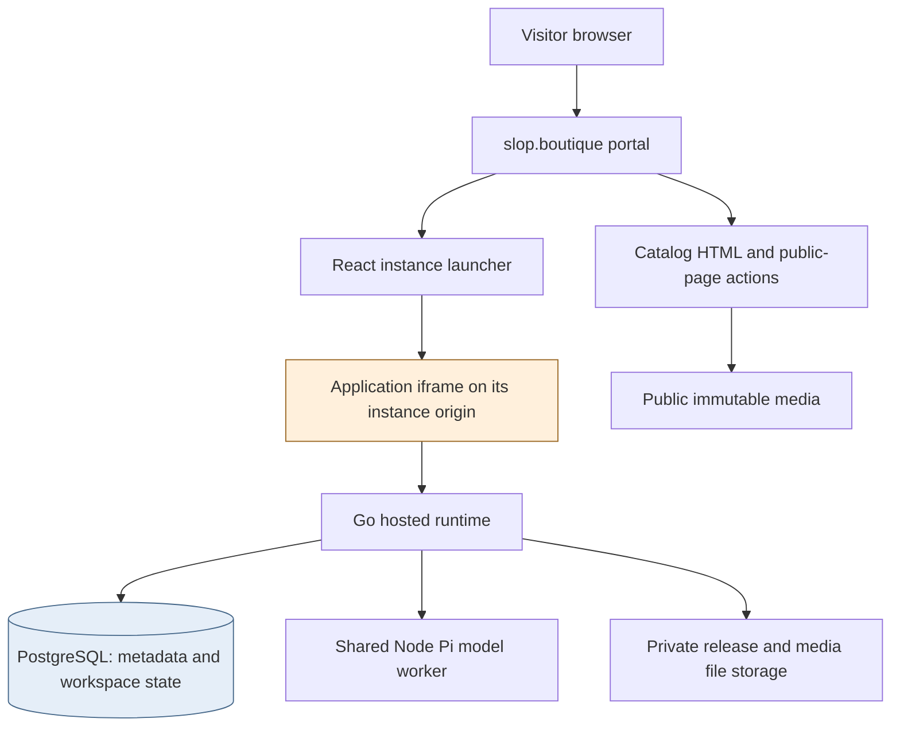
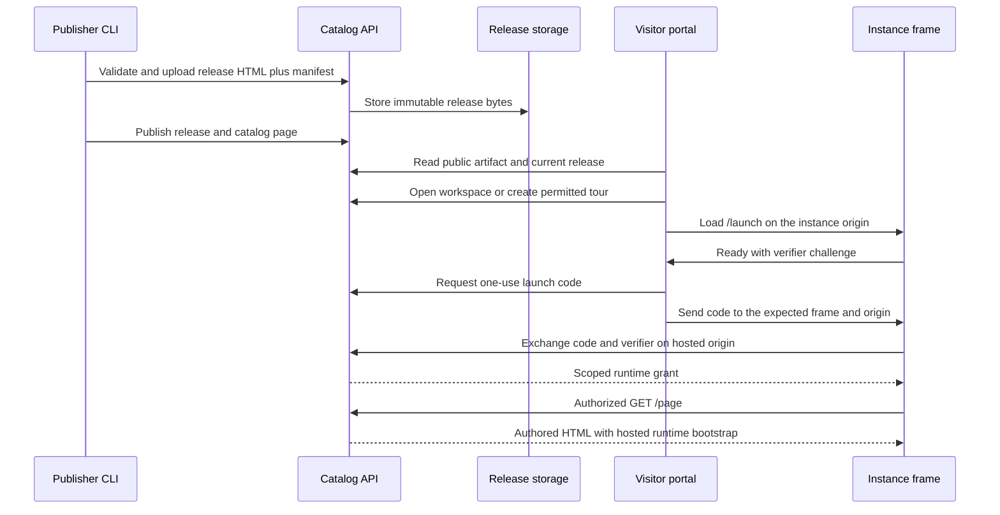
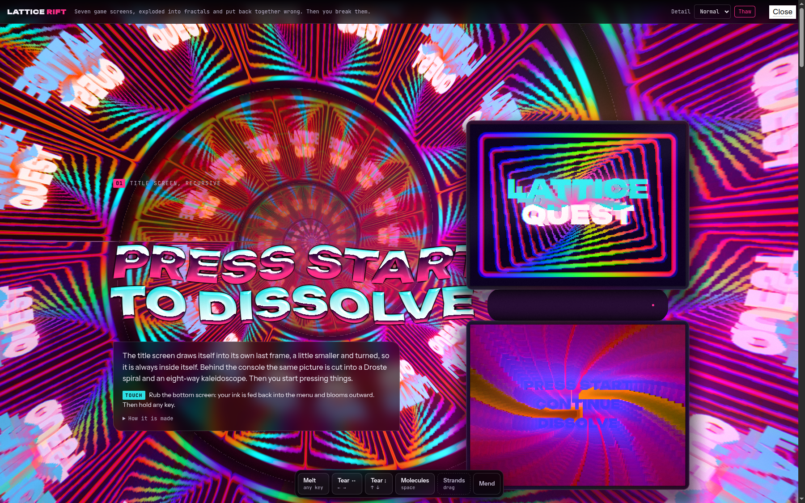
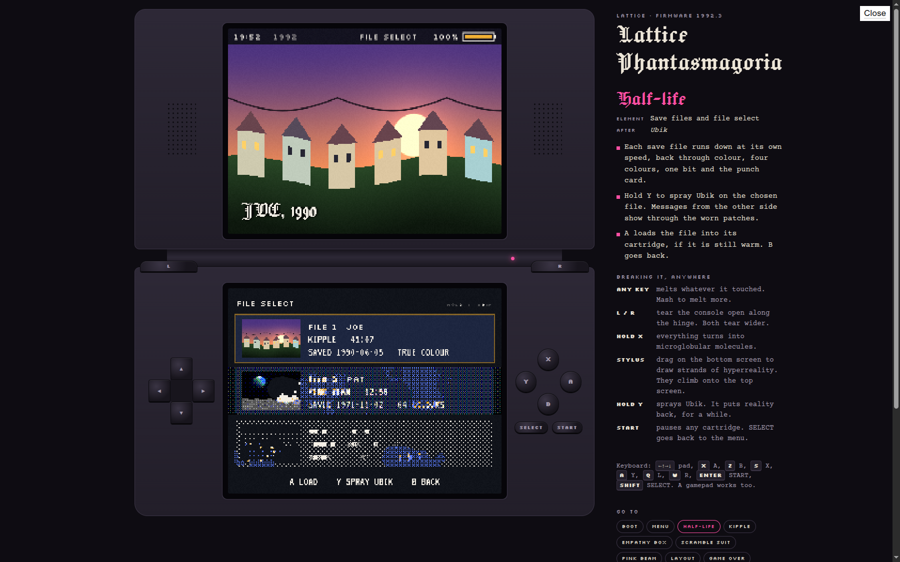
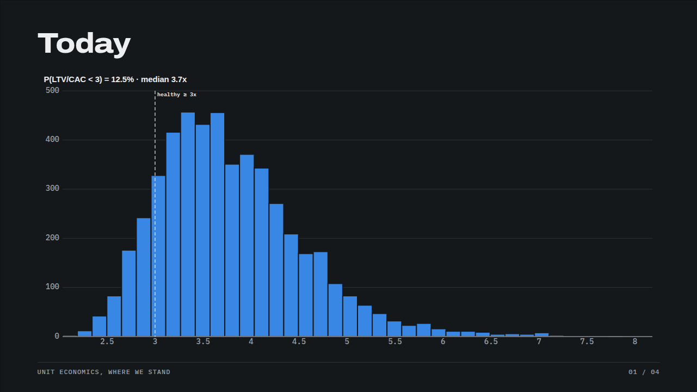
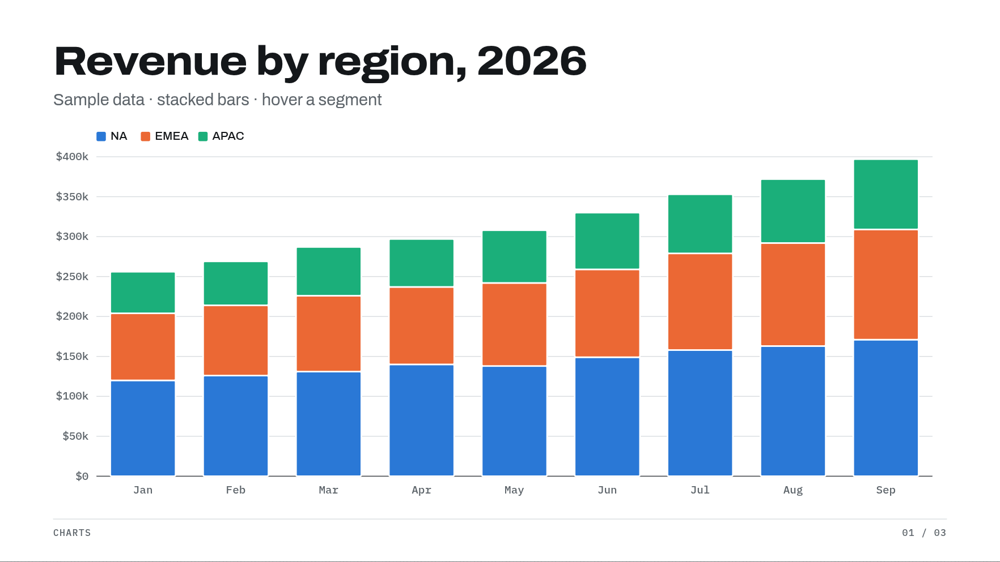
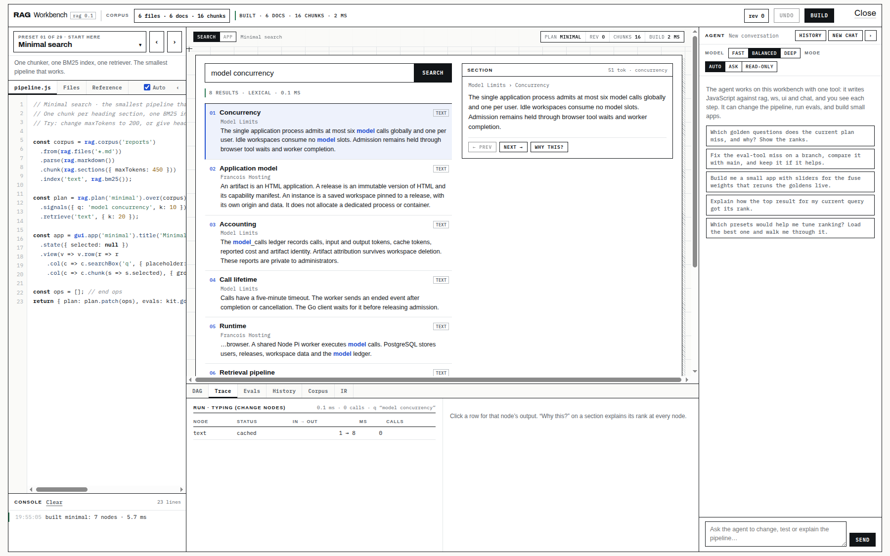
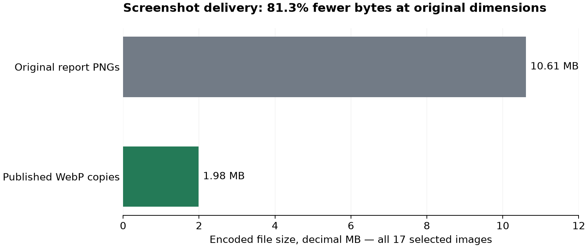
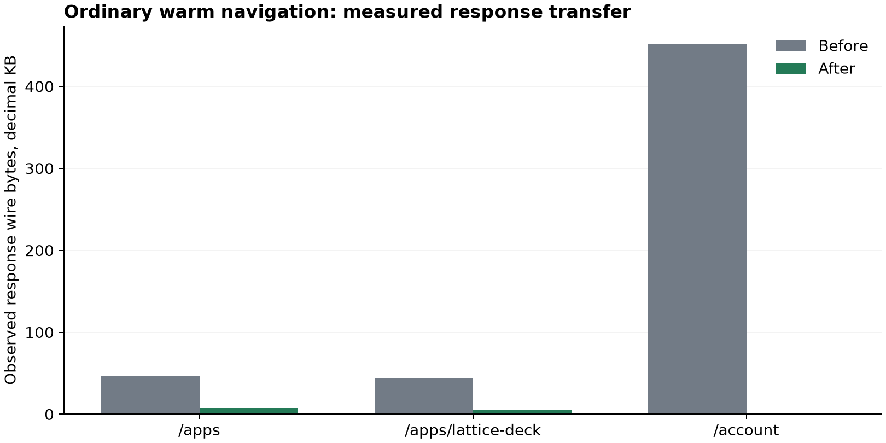
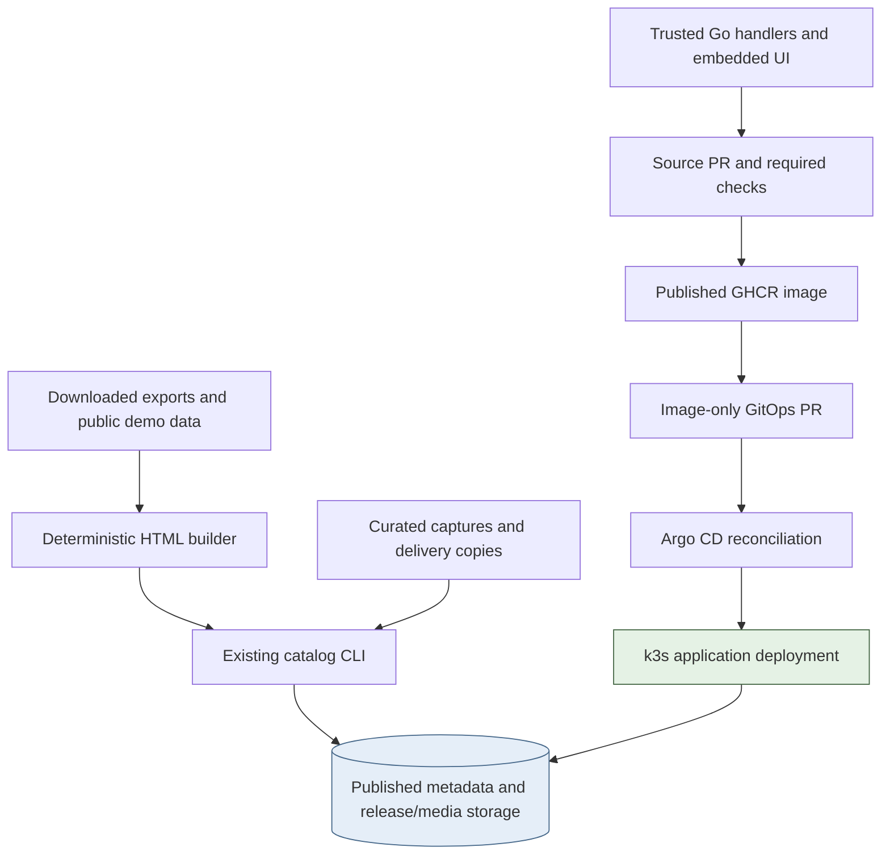

# Francois: from HTML exports to public applications on k3s

Francois publishes browser applications as immutable HTML releases, gives each saved workspace an isolated browser origin and exposes a controlled set of server capabilities to that application. This project took five actual exports from Downloads, adapted them for that model, published them on slop.boutique and then corrected measurable delivery problems in the surrounding site. The result is a working public catalog with downloadable HTML, bounded anonymous tours, seventeen curated screenshots and a production runtime deployed on k3s.

The implementation stayed close to the existing system. A Python script packages the exports; the existing catalog CLI publishes releases and media; the existing Go handlers serve public pages and isolated application origins. Two small service changes correct release selection and instance browser titles. Another prepares compressed, versioned public assets so repeat visits can reuse them. Application imports do not require a new backend service or a new model scheduler.

> [!summary]
> - **Publication preserves content identity.** Original program files, generated HTML hashes, immutable release IDs and ordered media selections remain independently inspectable.
> - **Public access remains bounded.** The five applications are discoverable and downloadable, while tours retain their duration, start-rate, concurrency and allowance limits.
> - **Performance work follows measured behavior.** Portal JavaScript changes from 413,644 identity bytes to 124,245 gzip bytes; all measured warm static transfers become zero. Screenshot delivery copies are 81.3% smaller.
> - **The production result has a specific revision.** The final recorded rollout runs image `sha-393bf35`, with Argo CD Synced/Healthy and one ready replica. Mixed cold timing samples and unmeasured app-start latency remain explicit.

This final report synthesizes **FRANCOIS-009**, the application-import work, and **FRANCOIS-010**, the delivery-speed work. It describes the completed result rather than the earlier design checkpoints. The production receipt was captured at **2026-10-17 00:47 UTC**, corresponding to the evening of 16 October in the project's local timezone. Source evidence was reviewed from repository snapshot `17645c6`; the deployed service revision is `393bf35`. The repository is `/home/manuel/code/wesen/go-go-golems/francois`.

## 1. Establish the objects before following a request

An **artifact** is the public identity of an application. Its catalog metadata includes a title, description, tags, write-up and media selections. A **release** is an immutable version of that artifact's HTML and capability manifest. These objects have different lifetimes: an author can revise a write-up or choose another cover without changing the executable HTML release.

An **instance** is a workspace pinned to a particular release. It has an owner, membership, an instance hostname and workspace data. Its JavaScript executes in the browser. Creating an instance inserts workspace records; it does not allocate a dedicated container or a dedicated model worker. An idle instance therefore has retained-data costs but does not reserve one of the shared model execution positions.

A **capability manifest** declares which hosted facilities an application requests. The imported workbenches use combinations of model sampling, documents, user profile, rooms and downloads. A declaration is only one input to authorization. The server still checks the caller, membership, plan, current operational policy and allowance when an operation is performed.

The **portal** is the trusted site origin, `https://slop.boutique`. An application executes on its separate instance origin, such as `https://i-….slop.boutique`. The portal session cookie remains on the portal. A browser-bound exchange establishes a scoped runtime grant for the selected instance. This separation lets the site serve application-authored JavaScript while keeping the portal's administrative and session context distinct.



The existing operating constraint is model concurrency: at most six admitted calls globally and one per user in the configuration used for this work. A large token allowance does not remove that constraint. A retrieval preset that launches three model requests concurrently can encounter admission limits even when its total token count is small. The imports preserve the platform's accounting and admission behavior and choose a lower default concurrency where the exported application had assumed more parallelism.

## 2. Inspect the downloaded format before choosing a build process

The downloaded inputs fall into two groups. Rift, Phantasmagoria and RAG Workbench are ZIP archives containing an HTML entry point and classic JavaScript files. Tabula Workbench and Lattice Deck are already bundled HTML exports. The archives are not package-manager source projects: they do not contain a package.json/Vite application that needs a framework build.

The required transformation is therefore local resource embedding. The builder preserves script order, embeds the resources that would otherwise be fetched relative to the document and writes a single release HTML. Choosing this transformation avoids introducing an unrelated frontend build system into the applications.

| Artifact | Input | Generated HTML bytes | Main behavior exercised |
| --- | --- | ---: | --- |
| Lattice Rift | ZIP with classic scripts | 113,708 | WebGL rendering and Freeze/Thaw control. |
| Lattice Phantasmagoria | ZIP with classic scripts | 152,468 | Dual-screen canvas interaction and cartridge selection. |
| Tabula Workbench | Bundled HTML | 1,067,849 | Reactive workbook, browser-local persistence and slides. |
| Lattice Deck | Bundled HTML | 426,040 | Programmable presentation stage, charts and scripted manipulation. |
| RAG Workbench | ZIP with scripts, presets and corpus | 502,491 | Retrieval, hosted document persistence and model sampling. |

The sizes above are exact generated file sizes from `sources/builds.json`. They describe authored application HTML, not the portal bundle. In particular, the later 414 KB portal-JavaScript optimization does not imply that Tabula's 1.07 MB application HTML has become a 124 KB application.

## 3. Keep original sources, publication data and generated bytes distinct

The source-copy script records each original input path, size and SHA256. It copies program files under `examples/imports/<artifact>/source/` and refuses to overwrite a source copy if its bytes have changed. For archives, it checks resolved path containment, rejects symbolic-link entries and bounds the declared aggregate expanded size below 32 MiB. These checks support a reviewable import of the named exports; the script is not presented as a general archive-processing service.

The original RAG archive included a private corpus with records marked `publish:false`. That file is excluded before program files are copied into the public repository. The published release instead receives five authored public guides covering hosting, model limits, storage, tours and retrieval. This exclusion is more reliable than copying the private dataset and trying to remove it from the final HTML later: the private corpus never becomes a tracked build input.

The resulting directory layout expresses the relevant identities:

```text
examples/imports/rag-workbench/
  source/                  original program files; private corpus excluded
  demo-corpus.json          five public guides
  manifest.json             declared hosted capabilities
  release.html              exact generated upload

FRANCOIS-009/sources/
  inventory.json            original input identity
  builds.json               generated HTML identity
  showcase.json             original screenshot identity and captions
  showcase-web.json         smaller delivery-copy identity and captions
```

The private source dataset and runtime uploads are also different concepts. A user may upload documents into an authorized workspace after launch; those are workspace data, not part of the public release. The tests use an intentionally public Markdown fixture for that path. A later fresh anonymous RAG tour observes five bundled files and zero uploaded files from the earlier test workspace.

## 4. Make the application adaptations explicit and bounded

`02-build-imports.py` reads each original HTML entry point, performs a small number of expected substitutions and inlines local scripts in their original order. Its `replace_once` helper asserts that a known fragment occurs exactly once. The Deck presence correction asserts two replacements. These checks make a changed export fail visibly instead of silently producing an incomplete package.

The essential algorithm is:

```text
for each selected application:
    read original entry HTML
    apply the application's few explicit hosting edits
    replace each local script reference with its inline source, in order
    if RAG:
        embed the public corpus, preset sources and retrieval-library source
        replace the four known local resource fetches
    assert no local script references remain
    write release HTML, manifest and SHA256 receipt
```

RAG needs more than script inlining. Its interface reads the preset index, individual preset scripts, the corpus and its own retrieval-library source through relative fetch calls. A single uploaded HTML document cannot provide those companion paths. The builder embeds their values in one JSON script block and replaces the four specific read sites. It leaves global `fetch` behavior intact. Embedded less-than signs and closing-script sequences are escaped so the HTML parser cannot terminate a block unexpectedly.

The initial RAG preset is lexical retrieval with the query `model concurrency`. This produces meaningful results from the public guides without consuming a model call. The other 28 presets remain selectable. The asynchronous map default changes from three to one concurrent call to align with the existing per-user model limit; explicitly requested higher concurrency still encounters the server's actual admission rule.

Deck has a narrower initialization defect. The export calls `.catch` on two `room.presence(...)` results, but the supported runtime method is fire-and-forget. Wrapping those results in `Promise.resolve(...)` allows the existing application code to continue when the return value is undefined. This changes two application call sites; it does not add a host API adapter or claim to convert synchronous throws into rejected promises.

Several exports place controls in the top-right corner, where the host provides Close. A 96px right-side clearance separates the application toolbar from that control. This small layout correction is included in the generated application, so the screenshots and the real hosted page use the same layout.

External React/ReactDOM, Three, HTM and font dependencies retained by the exports remain external. “Single-file release” means the local application companion files have been embedded. It does not mean that every imported application is fully offline or independent of third-party network performance.

## 5. Follow one application through publication and launch

RAG Workbench is a representative example because it exercises packaging, public data, hosted persistence and a model capability. Its builder produces 502,491 HTML bytes and records SHA256 `8807b71b229d48dd0a71cd6feea285015ee5dd008cb9aa46f97aae125428e580`. The publication receipt carries the same HTML identity for public version `0.1.2`. A read-only consistency check during this report verified that the tracked release, build inventory and publication receipt agree for all five applications.

Publication creates an immutable release, makes it published and updates catalog metadata. The public page can then advertise the application and offer the current free-sample HTML download. Opening a saved workspace or a tour still establishes runtime authorization before the hosted page is returned.



The client code lives in `ui/catalog/instances.tsx`, `launch.ts` and `launch-protocol.ts`. The last generates a verifier and SHA256 challenge, accepts a response only from the expected parent/origin, and exchanges the one-use code. The hosted handler authenticates `/page`, reads the pinned release and injects bootstrap JSON plus the shared runtime script.

The bootstrap includes the runtime grant, user/role information and instance context. It must retain its non-cacheable policy. The public runtime JavaScript is the same trusted code for many launches, so it can have a different cache policy. This is the distinction that makes the later static optimization possible without caching authorized application responses.

## 6. Public listing, public downloads and tours are separate controls

The public-access request changed three parts of the existing policy. Each artifact is listed, eligible for the free plan and demo-enabled. Its current `0.1.2` release is marked as a free sample so the HTML is downloadable without a paid entitlement. Finally, the existing global demo switch is enabled. Changing only one of these would not establish the complete visitor experience.

The release's free-sample property belongs to immutable release metadata. The publisher therefore created new public releases of the same HTML bytes rather than mutating an older release. A saved workspace's release pin is preserved until an explicit upgrade. Publishing a new catalog version does not silently change the running code of an existing workspace.

The approved global settings update changed only `demo.enabled`, at revision 2. Its recorded limits remain:

| Limit | Recorded value |
| --- | ---: |
| Tour lifetime | 20 minutes. |
| Starts per user per hour | 3. |
| Starts per network address per hour | 3. |
| Maximum active tours | 20. |
| Per-tour allowance | 5 credits. |
| Shared daily allowance | 200 internal budget units. |

Content publication used a one-day Studio token and the Francois CLI. The separate one-day administrative token was explicitly approved for the global setting operation. Token values, browser cookies and runtime grants are absent from the report evidence. The recorded command syntax uses `--format json`, not `--output json`.

A later performance probe received `429 rate_limited` because the network had already consumed its allowed tour starts. The limit was preserved. That response is operationally useful evidence: the public entry point is constrained even while the applications remain discoverable and downloadable.

## 7. Keep the public page consistent with publication semantics

The original public page rendered every published release as another HTML/Manifest download row. The imported Deck application had multiple versions, which exposed the duplication. The correction presents the current release's HTML and attachments; release history and manifests remain available to the relevant authoring/API workflows.

“Current” has a specific meaning: greatest publication time. The store's release listing is ordered by creation time, and drafts can be published in a different order. The first patch chose the first returned record; automated review identified that mismatch before merge. The final code scans the published releases for the maximum `PublishedAt` and renders that selection.

```text
published = load published releases for the artifact
current = release with greatest PublishedAt
offer current HTML when the visitor is entitled or current is a free sample
offer current attachments under the same access rule
retain historical release APIs and workspace pins
```

The regression creates two drafts and publishes the earlier-created draft last. It also makes the older-published release a free sample while the current one requires entitlement. This verifies both publication ordering and the absence of an accidental stale free-download fallback. It checks observable access behavior rather than merely reproducing the loop in a test.

Instance browser titles now follow the current artifact title and site brand, such as `Lattice Deck · slop.boutique`. The authorized detail response returns `artifactTitle` separately from the workspace's private custom title. The launcher sets `document.title` while it owns the view and restores the previous value when leaving. A rename regression preserves the private workspace name while observing the current artifact name.

These corrections shipped in source [PR #8](https://github.com/go-go-golems/francois/pull/8), merge `0440798`. They were deployed independently of the content archive and retained by the later cache release.

## 8. Treat screenshots as evidence and as delivery assets

The gallery contains seventeen real application captures: five covers and twelve additional views. Capture work uses actual controls and built-in examples, not generated mockups. The image manifest records each file's dimensions, caption, SHA256 and corresponding application HTML hash. This allows a future reader to connect a visual figure to the version that produced it.

Rift and Phantasmagoria demonstrate rendering and input without model use. Tabula and Deck provide clean slide-element captures as well as workbench views. RAG provides query, trace and corpus views. A screenshot proves what rendered at that viewport; the functional receipt supplies the additional assertions about persistence, interaction or sampling.



Rift's rendering and the actual Freeze/Thaw interaction were exercised. Its other retained views show the arcade and world sections. These figures do not depend on model calls.



Phantasmagoria's qualification advances from Boot to the cartridge view with real input. The image captures the two-screen UI rather than a replacement design.



Tabula's slide is an application-generated view of its sample workbook. A separate functional test changes a workbook input, reloads and observes the retained value before restoring it. The workbook draft uses browser-local persistence; its manifest does not declare hosted documents.



The chart is Deck's built-in sample presentation data. The scripted stage-agent test changes a stage parameter; that action is distinct from the separate real model-sampling probe and must not be described as model-generated output.



This RAG test workspace contains the five public bundled guides plus an intentionally public uploaded fixture, which explains the six-file count in the capture. A fresh anonymous tour separately verifies zero inherited uploads. The trace's visible lexical retrieval is not a model completion.

The full figure inventory at the end links the remaining views, so the note can serve both as a technical explanation and as a self-contained source of images for later writing.

## 9. Diagnose transfer behavior separately from rendering and model work

The speed investigation began after the public application pages were working. A small HTML page can still load slowly because its scripts, fonts or media dominate delivery. An instance adds another sequence of requests for authorization, authored HTML and application-specific libraries. A useful measurement must identify which part of this path is expensive.

The public storefront uses a 3,298-byte `public.js` for actions. Account, instance, Studio and administration pages use a 413,644-byte React bundle, `catalog.js`. These files are the site's own interface; they are separate from the scripts embedded in the application releases. This explains why a portal optimization can help opening workspaces without changing a graphics application's WebGL code.

The original portal static handler set `Cache-Control: no-cache` and wrote the embedded bytes directly. That policy allows storage but requires revalidation. With no ETag or Last-Modified validator, the handler returned another full `200` body on repeat navigation. Live curl with compression negotiation transferred all 413,644 bytes; its observed total was 3.869698 seconds. Browser measurements independently confirmed that a warm account visit downloaded the bundle again.

Uploaded media already had immutable caching, SHA256 ETags and standard conditional/range serving. Warm image responses transferred zero body bytes. However, a cold catalog visit fetched a 3,213,622-byte Rift cover. A correct cache cannot remove the first download's bytes. That cost required a smaller delivery file.

The browser test uses a fresh context for each route and revisits the route normally in that context. It records response cache metadata, navigation timing, paint timing and observed response bytes. It does not disable the cache, create tours or make model calls. It strips query strings from recorded resource paths and saves only a small allowlist of response headers, excluding credentials.

**Cold** and **warm** are cache-state definitions. **Time to first byte** ends when the first response byte arrives, while the **load event** waits for the navigation's load completion. Neither establishes full hosted-application readiness. Chrome-observed response wire bytes also differ from an exact file size because transport-visible response overhead is included. The report keeps those quantities separate.

## 10. Give fixed public code a complete cache contract

`pkg/catalog/web/assets.go` adds one type for the existing embedded public-file allowlists. At package initialization, each `Asset` receives its source bytes, SHA256 and a gzip copy when compression saves space. No per-request compressor or extra runtime service is introduced.

Each HTML producer emits a content-versioned reference:

```text
/static/catalog.js?v=<source SHA256>
```

The angle-bracket notation above describes the URL format; actual HTML contains the complete hexadecimal digest. A matching digest receives `public, max-age=31536000, immutable`. A bare URL or a mismatched version receives `public, no-cache` with a validator. A new build that changes the file bytes produces a new URL immediately, so the long freshness lifetime does not require a visitor to wait for an old script to expire.

The actual serving method selects an encoding and supplies a validator to Go's standard handler. Its central statements are:

```go
data, etag := a.data, a.hash
if len(a.compressed) > 0 && acceptsGzip(r.Header.Values("Accept-Encoding")) {
    data, etag = a.compressed, a.hash+"-gzip"
    w.Header().Set("Content-Encoding", "gzip")
}
w.Header().Add("Vary", "Accept-Encoding")
w.Header().Set("ETag", strconv.Quote(etag))
http.ServeContent(w, r, a.name, time.Time{}, bytes.NewReader(data))
```

The complete method additionally sets type, length and the version-dependent cache policy. The gzip and identity representations have distinct strong validators. `Vary` preserves the encoding-selection dimension. The encoding parser honors explicit gzip quality zero, and HEAD/conditional responses use `ServeContent` rather than bespoke body-writing branches.

Versioned references appear in four places: the server-rendered layout, the embedded portal shell, the isolated `/launch` document and the runtime script inserted into `/page`. Updating only the portal's static route would leave the hosted bootstrap on its old behavior. Conversely, changing the runtime's default `no-store` globally would give protected responses an inappropriate policy. Only a successful lookup in the fixed public static allowlist overrides that default.

| Resource | Final policy and purpose |
| --- | --- |
| Versioned public JS/CSS/icon | Immutable year-long freshness, encoding variant and ETag. |
| Unversioned public asset | Revalidate with ETag. |
| Uploaded public media | Existing immutable media ID, SHA256 ETag and range support. |
| Session and private APIs | Existing `no-store`; account/authorization state remains current. |
| Instance `/launch` document | `no-store`; it is regenerated for the selected instance context. |
| Authorized `/page` | `no-store`; its bootstrap contains a runtime grant and user context. |

Caches remain separated by origin. A previously loaded runtime under one instance hostname does not become the same cached URL under a different instance hostname. This optimization makes reloads within an instance cheaper and lets portal routes reuse their common code. It does not remove the cold-cache consequence of creating another isolated origin.

The main detail cover also changes from lazy loading to `loading="eager"` with `fetchpriority="high"`. Gallery images remain lazy. The change affects fetch eligibility and priority, not encoded size; it is a browser hint rather than an elapsed-time guarantee.

## 11. Publish smaller images without discarding the original captures

The web-delivery encoder writes quality-85 WebP copies with the original dimensions and captions. Original PNGs remain untouched for the report. The image publisher reads a separate delivery manifest, uploads new immutable media IDs and changes the page's cover and ordered gallery metadata. It preserves the Markdown body and does not create another executable HTML version for this image-only change.

| Application | PNG bytes | WebP bytes |
| --- | ---: | ---: |
| Rift | 7,556,618 | 902,964 |
| Phantasmagoria | 948,518 | 330,520 |
| Deck | 872,902 | 157,478 |
| Tabula | 370,714 | 151,054 |
| RAG | 857,127 | 441,900 |
| **Seventeen-image total** | **10,605,879** | **1,983,916** |



The total reduction is 81.3%. A single page does not necessarily fetch all seventeen images: the catalog uses covers and each detail page has its own gallery. The particularly expensive Rift cover changes from 3,213,622 PNG bytes to 416,138 WebP bytes. The initial catalog therefore benefits even though its existing image-cache headers were already correct.

The delivery verifier opens all five public pages, decodes the images, checks counts and captions, fetches the actual image bytes and compares SHA256 with the delivery manifest. It also checks WebP media type, immutable policy and a bodyless conditional `304`. All seventeen pass. Because WebP is lossy at this setting, byte verification proves identity with the selected delivery file, not pixel identity with the original screenshot. Original report figures are used where small text or further export matters.

## 12. Read the measured results without converting them into a broader claim

The final HTTP check observes the same 413,644 JavaScript source bytes delivered as **124,245 gzip bytes**, approximately 70% smaller. All measured warm static transfers are **zero**. Explicit conditional requests return bodyless `304` responses, HEAD returns no body and bare URLs still revalidate. A live existing instance origin serves a versioned, compressed runtime while rejecting an unauthorized `/page` request with `401` and `no-store`.

The overall browser-observed response transfers are:

| Route | Cold wire bytes, before → after | Warm wire bytes, before → after |
| --- | ---: | ---: |
| `/apps` | 4,493,872 → 967,742 | 46,760 → 7,312 |
| `/apps/lattice-deck` | 1,045,827 → 299,964 | 44,468 → 4,938 |
| `/account` | 578,490 → 260,900 | 451,089 → 1,048 |



Lower transfer does not establish a uniform elapsed-time result. The corresponding single load-event samples are:

| Route | Cold load, before → after | Warm load, before → after |
| --- | ---: | ---: |
| `/apps` | 1,141 → 1,266 ms | 251 → 167 ms |
| `/apps/lattice-deck` | 1,221 → 1,131 ms | 262 → 147 ms |
| `/account` | 1,490 → 1,933 ms | 627 → 140 ms |

Warm samples improve on all three routes. Cold samples are mixed; the later account sample is slower even though it transfers far fewer bytes. Connection setup, network variation, browser scheduling and execution can all affect these observations. The test provides a strong transfer/caching result and a small set of timing observations, not a latency percentile or universal speed multiplier.

The headless browser is classified as a bot by the existing traffic middleware, so these samples also omit human document-view recording. Largest contentful paint was not collected in the initial baseline. End-to-end application startup was not established: the separate public-tour probe received the existing network rate limit. None of those absent measurements is inferred from the byte reduction.

## 13. Separate catalog publication from the production service rollout

There are two independently reviewable publication paths. New application HTML and media go through the catalog API into existing storage and metadata. Trusted portal/runtime changes go through a source PR, container image and GitOps deployment. This is why an image-only PR can deploy the cache fix without embedding the imported source archive and screenshot library in the application image.



The cache/eager-cover change passed the source checks in [PR #9](https://github.com/go-go-golems/francois/pull/9). Its exact reviewed head was `b52d97ba14ee7a182d5935a3b1ad5c665b6123d7`; the squash merge is `393bf35d51ab467081d7a09460937df66ba446b9`. The normal main-branch image workflow `38987577959` then published `ghcr.io/go-go-golems/francois:sha-393bf35`.

[GitOps PR #361](https://github.com/wesen/2026-03-27--hetzner-k3s/pull/361) changed one deployment image line from `sha-0440798` to `sha-393bf35`. Validation passed and the exact-head-guarded merge produced `e3ccf7b09784bb6fadef6dd847216badee7e2f2c`. Argo CD subsequently reported that revision Synced, Healthy and Succeeded. The recorded deployment generation is 13, with one desired, updated, ready and available replica; `kubectl rollout status` reports successful rollout.

Those observations establish a production k3s deployment, not just a locally running build. The speed release required no settings or schema change. The earlier public-tour switch is a separate catalog settings revision and is documented as such. The deployment receipt provides the precise image and GitOps identity without including credentials or secret values.

## 14. Validation needs observable behavior at each level

The import tests exercise actual hosted frames. Rift toggles Freeze/Thaw. Phantasmagoria moves from Boot to Cartridges. Tabula initializes 151 workbook nodes, changes input B2 from 420 to 421, reloads to observe 421 and restores the sample. Deck's scripted agent changes stage speed to 2.4. RAG retrieves the public concurrency guide and persists the public fixture across reload through hosted storage.

Model capability is qualified separately. Three short, sequential, uncached quick-tier sampling probes exercised the model-capable applications. A later fresh anonymous RAG tour returned `pong` from `lunaroute/glm-5.3-flash`, with five bundled documents and zero inherited uploads. These tests establish real model access and the observed data separation; they do not establish successful full model-driven workbook or pipeline authoring.

Service validation includes the full Go suite with local PostgreSQL enabled, affected integration suites after the final change, and normal source checks for tests, lint, frontend, dependencies, secrets, GoSec and CodeQL. Cache unit tests check gzip round trips, materially smaller representation, distinct validators, conditional responses, HEAD, changed bytes producing changed URLs and separate asset allowlists. Hosted tests preserve the uncached launch-document policy.

The live checks then validate the deployed contract rather than stopping at unit tests. They verify the current HTML download count and title behavior, actual public image bytes, cold/warm static reuse, the compressed bundle's source identity and the unauthorized hosted-page response. The source tests, content receipts and deployment receipt answer different questions; none replaces the others.

## 15. The failures explain several implementation choices

The first Deck boot exposed the `.catch` assumption on fire-and-forget presence. Fixing the application call sites was sufficient; changing the runtime API would have widened the work unnecessarily. The RAG test initially read its serialized result shape as though it were the live runtime object. The corrected test uses the actual `signals.q` and `top(n)` API, while recognizing that `toJSON()` exposes another representation.

Tabula reload also exposed a synchronization error in the test. Document ready-state completion did not mean its asynchronous workbook/capability initialization was finished. The test now waits for initialized application state. Deliberate reloads and upgrades abort old requests and event streams; those expected cancellations remain in the receipt rather than being silently removed from the record.

Automated review identified publication ordering as a real correctness issue. The regression now publishes drafts out of creation order. CodeQL later flagged the concatenation of JSON bootstrap and script markup as potentially unsafe quoting. The final revision separates the JSON bytes from the script element, escapes the generated script URL in its attribute and makes the intended less-than Unicode escape explicit. The final CodeQL check passed without suppressing that finding.

The first full local test command also hit a sandbox restriction: part of the Go build cache was read-only and local test/database sockets were prohibited. The same command passed with the required execution permission. That failure was environmental and is not presented as an application defect. Similarly, a blocked tour-start probe supplies a rate-limit observation, not a startup-duration measurement.

## 16. What is shipped, and what remains a useful next experiment

The five applications are public, their HTML downloads use current `0.1.2` releases, the pages have ordered multi-image galleries, instance tab titles match public artifact titles, and the production runtime serves compressed/versioned common assets. The site remains intentionally small. Private administrative reporting and operational limits remain separate from the visitor experience.

Several qualification limits remain specific. Full multi-user room collaboration was not stress-tested. Every advanced preset and export format was not exercised. A local Download book probe timed out, so that export is not described as verified. Browser/device coverage is bounded to the recorded Chromium checks. The retained external dependencies and the grant-bearing application HTML can still contribute to first-launch cost.

The next speed change should follow another measurement:

- If cold catalog image transfer remains dominant, compare a card-sized thumbnail at normal and high pixel density before adding a derivative-image path.
- If portal parse/transfer remains dominant, inspect an esbuild module-size report before separating Studio/admin routes. A lazy component declaration alone does not establish that the production bundle splits.
- If a permitted instance startup trace is dominated by external libraries, package or self-host the specific dependency that accounts for the delay.
- If server response time grows after controlling for network latency, measure the handler and query path before introducing shared application caching.

These are conditional follow-ups, not hidden unfinished components of the deployed change. The implementation already shipped the measured improvements through existing release and publishing workflows.

## 17. Implementation and evidence reference

| Source location | What a contributor should read there |
| --- | --- |
| `examples/imports/` | Original program copies, generated HTML, manifests and public RAG corpus. |
| FRANCOIS-009 `scripts/01-copy-sources.py` | Input identity, bounded copy and private-corpus exclusion. |
| FRANCOIS-009 `scripts/02-build-imports.py` | Script/resource embedding and explicit per-application edits. |
| `pkg/catalog/studio.go`, `releases/releases.go` | Validation, immutable release creation and publication. |
| `pkg/catalog/pages.go` | Publication-time selection, public download construction and immutable media serving. |
| `pkg/catalog/instances.go`, `ui/catalog/instances.tsx` | Authorized current artifact title and launcher ownership of document.title. |
| `ui/catalog/launch-protocol.ts`, `pkg/catalog/hosted/routes.go` | Browser-bound launch exchange and authorized runtime injection. |
| `pkg/catalog/web/assets.go`, `embed.go` | Prepared public assets, version identity, encoding and allowlists. |
| `pkg/catalog/web/templates/layout.tmpl` | Versioned public references and eager main cover. |
| FRANCOIS-009 `scripts/09-publish-galleries.py` | CLI publication of ordered covers/galleries and public metadata. |
| FRANCOIS-010 `scripts/01-measure-cache.mjs`, `05-verify-cache-contract.mjs` | Reproducible browser measurement and deployed HTTP assertions. |

The catalog API operations most relevant to this project are:

| API | Purpose |
| --- | --- |
| `POST /api/studio/releases/check` | Validate a proposed HTML/manifest upload. |
| `POST /api/studio/releases` and `POST /api/studio/releases/{id}/publish` | Create and publish an immutable release. |
| `PUT /api/studio/artifacts/{id}/draft` and its `/publish` operation | Publish artifact page content and selected media. |
| `GET /api/catalog`, `GET /apps/feed.xml` | Inspect discovery and release-feed output. |
| `GET /api/instances/{id}` | Return authorized workspace details and current artifact title. |
| `POST /api/instances/{id}/upgrade` | Explicitly move a workspace's release pin. |
| `POST /api/instances/{id}/launch`, hosted `POST /api/launch/exchange` | Establish browser-bound instance runtime authorization. |
| Hosted `GET /page`, `GET /static/{name}` | Serve protected authored HTML and separate public common code. |

For an initial reproduction, the deterministic builder runs entirely from tracked source and public demo data:

```bash
python3 ttmp/2026/10/16/FRANCOIS-009--import-real-html-artifacts-as-hosted-proofs-of-concept/scripts/02-build-imports.py
```

The publication commands intentionally mutate real catalog state and should not be run as ordinary tests. Use the guide and the existing scoped-token workflow when publication is actually intended. Model probes likewise consume capacity and tour probes consume the configured start allowance.

## 18. Figure inventory and self-contained evidence

The figures are original browser captures from the qualified application HTML. The five main figures above provide context; the remaining views below are retained alongside the note for closer inspection and reuse. The application model-sampling results are in the receipts rather than inferred from a screenshot.

| Application | Original retained views |
| --- | --- |
| Rift | [Title](_assets/francois-public-html/rift-title.png), [Arcade](_assets/francois-public-html/rift-arcade.png), [World](_assets/francois-public-html/rift-world.png). |
| Phantasmagoria | [Menu](_assets/francois-public-html/phantasmagoria-menu.png), [Cartridges](_assets/francois-public-html/phantasmagoria-cartridge.png), [Kipple](_assets/francois-public-html/phantasmagoria-kipple.png). |
| Deck | [Scene cover](_assets/francois-public-html/lattice-deck-cover.png), [Procedural slide](_assets/francois-public-html/lattice-deck-procedural.png), [Motion](_assets/francois-public-html/lattice-deck-motion.png), [Charts](_assets/francois-public-html/lattice-deck-charts.png). |
| Tabula | [Workbench](_assets/francois-public-html/tabula-overview.png), [Story slide](_assets/francois-public-html/tabula-story.png), [Sensitivity](_assets/francois-public-html/tabula-sensitivity.png), [Landscape](_assets/francois-public-html/tabula-landscape.png). |
| RAG | [Search](_assets/francois-public-html/rag-search.png), [Trace](_assets/francois-public-html/rag-trace.png), [Corpus](_assets/francois-public-html/rag-corpus.png). |

Copied build, publication, public-media, functional, browser and deployment receipts accompany the vault note. They preserve executable HTML identity, delivery-image identity, access-policy changes and the final deployed revision as separate facts. Their file list is included with the vault publication so the report remains useful outside the source checkout.

### Copied evidence files

| Evidence | What it establishes |
| --- | --- |
| [builds.json](_assets/francois-public-html/builds.json) | Exact generated HTML identity and manifests. |
| [showcase.json](_assets/francois-public-html/showcase.json) | Original screenshot captions and identities. |
| [showcase-web.json](_assets/francois-public-html/showcase-web.json) | Published delivery-copy identities. |
| [local-functional.json](_assets/francois-public-html/local-functional.json) | Local interaction, persistence and sampling evidence. |
| [production-functional.json](_assets/francois-public-html/production-functional.json) | Production application/model qualification. |
| [gallery-publication.json](_assets/francois-public-html/gallery-publication.json) | Current public releases/media and tour-policy change. |
| [public-tour-verification.json](_assets/francois-public-html/public-tour-verification.json) | Original anonymous download and RAG tour/model probe. |
| [page-title-verification.json](_assets/francois-public-html/page-title-verification.json) | Single-download, title and tour-lifetime verification. |
| [web-media-optimization.json](_assets/francois-public-html/web-media-optimization.json) | Exact source/delivery byte comparison. |
| [web-media-verification.json](_assets/francois-public-html/web-media-verification.json) | Actual public delivery-byte and conditional-response checks. |
| [cache-before.json](_assets/francois-public-html/cache-before.json) | Initial cold/warm browser response measurements. |
| [cache-after.json](_assets/francois-public-html/cache-after.json) | Same measurements after the deployed change. |
| [cache-contract.json](_assets/francois-public-html/cache-contract.json) | Live public/private HTTP cache assertions. |
| [deployment.json](_assets/francois-public-html/deployment.json) | Image, source/GitOps revisions and k3s rollout state. |
| [startup-probe.json](_assets/francois-public-html/startup-probe.json) | Explicit declined startup probe; no inferred latency. |

[Asset inventory](_assets/francois-public-html/asset-inventory.json) records every copied file and SHA256. The original anonymous-tour receipt precedes the later seventeen-image refinement; use the current publication and WebP verification receipts for current media identity.

Related: [[PROJ - Francois - Page Speed and Browser Cache Engineering - A Technical Deep Dive]]; [[PROJ - Francois - Private Analytics and Minimal Hosting - A Technical Deep Dive]].
