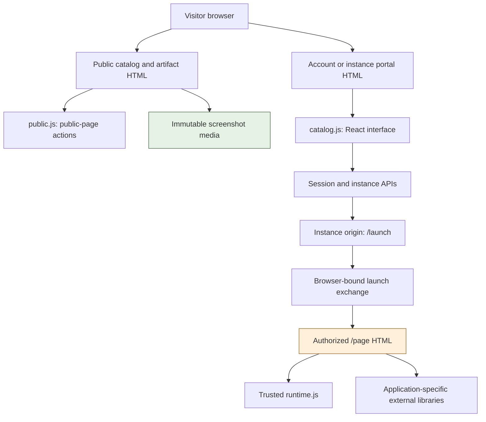
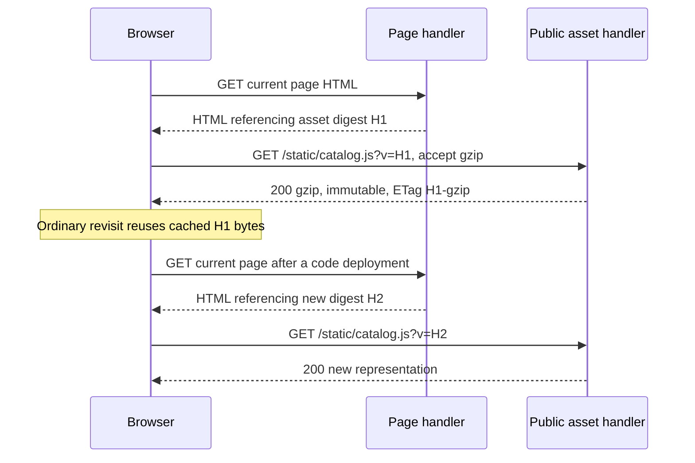
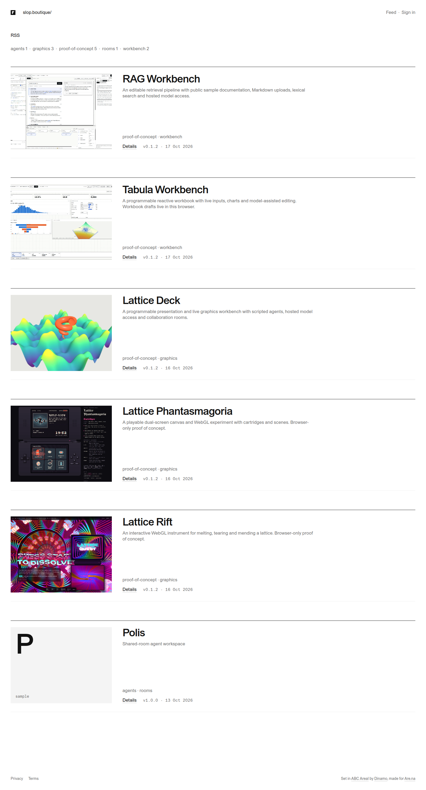
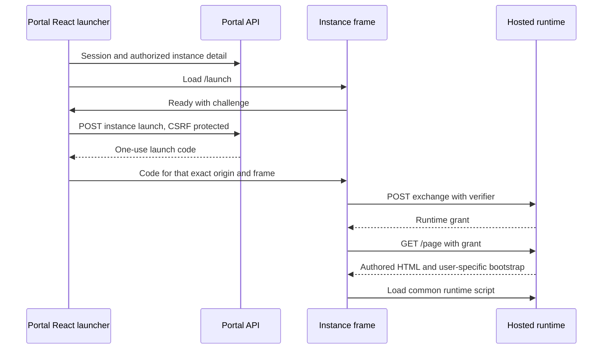

# Making slop.boutique faster: browser caches, image bytes and hosted application startup

Francois serves a small public application catalog at slop.boutique and runs the applications on separate browser origins. A visitor can read an application page, inspect screenshots, download its HTML and start a bounded public tour. The visible interface is intentionally minimal. The work in this report makes those existing actions cheaper to load without adding another service or turning the site into a usage dashboard.

The investigation began with a concrete symptom: the site felt slow even though a public detail page contained only a few kilobytes of HTML. Browser measurements identified two different causes. The account and instance interface repeatedly downloaded a 413,644-byte JavaScript bundle because the server provided neither a validator nor compression. The public catalog also downloaded a 3,213,622-byte screenshot as one cover. The image already had correct long-lived cache headers, so improving its headers would not reduce the first download. It needed a smaller delivery representation.

> [!summary]
> - Public code now has a narrowly scoped implementation of content-versioned URLs, precomputed gzip representations and ETags. The page HTML continues to obtain current authorization and settings.
> - Seventeen screenshot delivery copies shrink from 10,605,879 PNG bytes to 1,983,916 WebP bytes. Original PNGs remain available for reports and visual inspection.
> - The main detail-page cover is loaded eagerly. Gallery images continue to load lazily.
> - Deployment and before/after receipts establish which behavior is actually live. Application launch latency remains a separate measurement from portal transfer size.

This report accompanies **FRANCOIS-010** and [source PR #9](https://github.com/go-go-golems/francois/pull/9). At initial report publication, the smaller media copies are live and verified; the service change is implemented and awaiting final release checks. The final rollout section records the subsequent production result. Earlier import work and the original screenshots are preserved in FRANCOIS-009. The source repository is `/home/manuel/code/wesen/go-go-golems/francois`.

## 1. Three kinds of page participate in an application launch

An **artifact** is the catalog entry for an application, such as Lattice Deck. A **release** is an immutable HTML file and its capability manifest. An **instance** is a workspace pinned to one release, with an owner, membership, retained data and a hostname. An instance is a database object; it does not create a dedicated server process. Application JavaScript executes in the visitor's browser, while instances share the Go service, PostgreSQL and model worker.

The **portal** is the trusted site origin, `https://slop.boutique`. Its public catalog and article pages are rendered by Go templates. These public pages use a small `public.js` file, measured at 3,298 uncompressed bytes. Account, instance, Studio and administration routes use a React interface embedded in `catalog.js`, measured at 413,644 uncompressed bytes. “Portal JavaScript” refers to this site interface. It is separate from the JavaScript inside an uploaded application.

Opening an instance introduces its isolated application origin, such as `https://i-….slop.boutique`. Its initial `/launch` document obtains authorization through a narrow exchange with the portal. It then fetches `/page`, the uploaded application HTML with a hosted-runtime bootstrap inserted. An imported application may load additional libraries from external origins. The public post, the portal launcher and the uploaded application therefore have different dependencies and different caching requirements.



This distinction prevents an inaccurate diagnosis. A public artifact page does not load the full React portal bundle. Conversely, reducing `public.js` cannot materially improve an instance route that waits for `catalog.js`. Model throughput is another independent resource: the six shared model lanes matter after an application makes a model request, and do not explain the transfer of a public screenshot or static script.

## 2. Define the measurements before changing the implementation

A **cold visit** uses a new browser context with no previously cached resources. A **warm visit** revisits the same route in that context. This investigation uses ordinary navigation rather than explicitly disabling browser caching. A test with caching disabled would conceal the exact behavior being examined.

**Time to first byte** measures the interval from starting the HTTP request to receiving the first response byte. It does not include downloading the remainder of a large body. **Load time** is the navigation's load-event completion time. **First contentful paint** is the browser's first paint of visible content. **Largest contentful paint** concerns the largest visible content element; it was not collected in the initial baseline and must not be inferred from the load event.

The browser receipt combines navigation/resource timing with Chrome network events. `wireBytes` includes transport-visible response bytes reported by Chrome, while screenshot and bundle sizes elsewhere in this report describe exact file bytes. These are different quantities. Cross-origin resource timing may hide detail unless the origin permits it, and zero timing values alone are not a sufficient cache diagnosis. The [PerformanceResourceTiming documentation](https://developer.mozilla.org/en-US/docs/Web/API/PerformanceResourceTiming/transferSize) explains those timing visibility limits.

`scripts/01-measure-cache.mjs` opens `/apps`, `/apps/lattice-deck` and `/account` twice each. It records a fixed allowlist of cache headers, resource paths, status, navigation timing, paint timing and byte counts. It excludes cookies, response bodies and authorization headers. The test neither signs in nor starts tours or model calls. A separate curl request checks the actual text-asset response with compression negotiation enabled.

| Route | Cold load event | Warm load event | Baseline observation |
| --- | ---: | ---: | --- |
| `/apps` | 1,141 ms | 251 ms | Approximately 4.49 MB of observed response bytes on the cold pass; warm media transfers zero body bytes. |
| `/apps/lattice-deck` | 1,221 ms | 262 ms | Approximately 1.05 MB on the cold pass; the same styles and small action script are retransferred when warm. |
| `/account` | 1,490 ms | 627 ms | Approximately 578 KB cold and 451 KB warm; the large JavaScript bundle is downloaded again. |

These are single observations from one browser and network path. The observed same-origin time to first byte was approximately 116–133 ms after connection establishment. A separate curl fetch of the portal bundle took 3.869698 seconds in total and transferred all 413,644 bytes. The difference between the curl and browser timings demonstrates why an isolated elapsed-time sample is not a universal latency claim. The repeated byte transfer is the stronger correctness finding.

The headless browser is classified as a bot by the existing analytics middleware, so these visits omit its document-view recording work. They measure the browser delivery path, not the complete distribution of human visitor latency. Resource-size and header conclusions remain valid; percentile claims would require a representative sample and a defined environment.

## 3. The cache defect was an incomplete revalidation contract

A browser cache stores responses and later decides whether it can reuse them. Freshness allows reuse without contacting the origin. Revalidation contacts the origin with a validator and can receive a bodyless `304 Not Modified`. `no-cache` permits storage but requires revalidation; `no-store` prevents storage. `private` limits reuse to a private cache. These policies are defined in the [Cache-Control reference](https://developer.mozilla.org/en-US/docs/Web/HTTP/Reference/Headers/Cache-Control).

The original static handler set `Cache-Control: no-cache`, then wrote the embedded bytes directly. It provided no ETag or Last-Modified value. A repeat request therefore received another full `200` response. The browser was following the policy correctly; the handler had given it no usable validator. Hosted static assets had a different problem: they inherited the runtime router's default `no-store`, although the files contained only fixed trusted bootstrap code.

The baseline response for the portal bundle was:

```http
HTTP/2 200
Cache-Control: no-cache
Content-Type: text/javascript

[413644 bytes; no ETag, Last-Modified or Content-Encoding]
```

Uploaded storefront media was already different. `Server.media` sets a SHA256 ETag and `public, max-age=31536000, immutable`, then uses `http.ServeContent` for conditional/range handling. The warm browser pass reused those bytes. The initial image cost required a content change, not another cache directive.

The final policy deliberately follows the meaning of each response:

| Response | Policy | Reason |
| --- | --- | --- |
| Public fixed asset with matching content version | `public, max-age=31536000, immutable` | A content change produces a new URL. |
| Bare asset URL or mismatched version | `public, no-cache`, with ETag | The URL may resolve to a newer build. |
| Uploaded public image/video media | Existing immutable policy with SHA256 ETag | The media ID continues to identify the same bytes. |
| Session/account/instance JSON | Existing `no-store` | Authorization and account state must be current. |
| Hosted `/launch` document and `/page` HTML | Existing `no-store` | The application response contains a runtime grant and user-specific bootstrap data. |
| Storefront document | Existing session-aware policy | Navigation and available actions depend on the current session. |

The SPA shell now explicitly requires revalidation so a normal new navigation discovers the current asset URLs. Its contents do not become an immutable document merely because the scripts it references are immutable.

## 4. Content identity determines the public asset URL

The implementation prepares a bounded set of embedded assets when the Go package initializes. Each asset retains its name, media type, original bytes, SHA256 and a gzip representation if compression produces fewer bytes. Preparation happens once per process. There is no request-time compressor, generated-asset service, queue or shared cache to operate.

The version used in the URL is a SHA256 of the original asset bytes. For example, the actual URL emitted for the portal bundle has the form:

```text
/static/catalog.js?v=<64 hexadecimal SHA256 characters>
```

The source-hash notation above is a schema, not a literal requested URL. Fresh page HTML emits the actual digest. Changing one byte in the bundle changes that URL, so a browser with the prior bundle cached can still fetch the new release immediately. All static files remain under `/static/`.

The central implementation in `pkg/catalog/web/assets.go` is small enough to understand directly:

```go
func (a *Asset) URL() string {
    return "/static/" + a.name + "?v=" + a.hash
}

// Essential control flow; header details are abbreviated here.
func (a *Asset) ServeHTTP(w http.ResponseWriter, r *http.Request) {
    cache := "public, no-cache"
    if r.URL.Query().Get("v") == a.hash {
        cache = "public, max-age=31536000, immutable"
    }
    data, etag := a.data, a.hash
    if gzipIsAccepted(r) && len(a.compressed) > 0 {
        data, etag = a.compressed, a.hash+"-gzip"
        w.Header().Set("Content-Encoding", "gzip")
    }
    w.Header().Set("Cache-Control", cache)
    w.Header().Add("Vary", "Accept-Encoding")
    w.Header().Set("ETag", strconv.Quote(etag))
    http.ServeContent(w, r, a.name, time.Time{}, bytes.NewReader(data))
}
```

This is an explanatory excerpt: the real helper also sets media type and length and parses encoding quality values. `ServeContent` handles conditional requests and HEAD using the provided validator and seekable bytes. Its exact contract is documented in [Go's `net/http` API](https://pkg.go.dev/net/http#ServeContent).

The source hash identifies the asset, while the ETag identifies the selected wire representation. Identity and gzip have different strong ETags. A conditional request for gzip must not incorrectly match an identity validator. `Vary: Accept-Encoding` records which request header selected that representation. Requests that explicitly reject gzip receive the original bytes.

Only the existing portal and application allowlists construct these objects. They contain JavaScript, styles and icons. The handler cannot be used to fetch uploaded application HTML by supplying another path. The hosted router's general `no-store` remains its default; a successful static-file lookup is the narrow exception.

## 5. Every HTML producer must emit the versioned reference

Cache headers are only half of the change. If the server keeps emitting bare URLs, a browser still needs to revalidate them on every use. Four HTML producers therefore need to agree on the content identity:

- The shared storefront layout uses the `asset` template function for its stylesheet, icon and public action script.
- The portal SPA shell uses `web.PortalIndex`, whose known static references are versioned once from the embedded shell.
- The instance `/launch` document uses `AppURL` for its launch script and stylesheet.
- The authorized `/page` response injects a versioned reference to the common runtime script.



A mismatched query version does not earn immutable caching. The current implementation serves the current asset with revalidation in that case. This avoids caching a current response for a year under an unrelated or stale hash. The URL is a cache-version selector, not an archive endpoint for old embedded bundles.

The browser cache is also separated by origin. Assets loaded under one instance hostname do not automatically become available under a different instance hostname. The common portal bundle is reused across portal routes, but a newly created isolated origin still has a cold application cache. This is a property of the existing isolation design, not a reason to combine application origins.

## 6. Reduce screenshot bytes while preserving report originals

The seventeen curated screenshots are useful source material: they contain detailed workbench text, procedural graphics and complete slides. Their original PNGs are retained in FRANCOIS-009. The web site needs a delivery representation, while the later project report benefits from the original capture. These requirements can be met with separate files.

`scripts/13-optimize-web-media.py` in FRANCOIS-009 reads the original image-selection manifest, verifies every original SHA256, and invokes `cwebp -q 85` for each image. It preserves dimensions and captions, writes a separate delivery manifest and records byte comparisons. The script does not rewrite any original PNG or application release HTML.

| Application | Images | Original PNG bytes | Delivery WebP bytes |
| --- | ---: | ---: | ---: |
| Lattice Rift | 3 | 7,556,618 | 902,964 |
| Lattice Phantasmagoria | 3 | 948,518 | 330,520 |
| Lattice Deck | 4 | 872,902 | 157,478 |
| Tabula Workbench | 4 | 370,714 | 151,054 |
| RAG Workbench | 3 | 857,127 | 441,900 |
| **Total** | **17** | **10,605,879** | **1,983,916** |

The reduction across the full set is 81.3%. It is not a claim that every catalog visit previously downloaded all seventeen files: the catalog uses covers and the detail pages contain separate galleries. Rift's selected cover alone changes from 3,213,622 PNG bytes to 416,138 WebP bytes. That specific change reduces the first catalog visit's largest observed image transfer.


Publication uses the existing Francois CLI and the approved Studio token. `media upload` creates new immutable media IDs. `artifacts page-set` and `page-publish` change only the page's cover/gallery selection while preserving its Markdown. The current application release remains the same public version `0.1.2`, with the same HTML hash. The original media IDs remain valid historical objects; existing browser caches cannot return an old PNG for a newly selected WebP ID.

Pseudocode for the procedure is:

```text
for each original selected image:
    verify source SHA256
    encode WebP copy with quality 85 and unchanged dimensions
    record output SHA256 and byte count
    upload copy through existing media CLI

for each published application page:
    preserve published Markdown
    select new cover and ordered gallery IDs
    publish page metadata
    verify image bytes, content type, captions and conditional GET
```

The separate `14-verify-web-media.mjs` browser check validates actual public delivery. It opens every app page without credentials, decodes all images, verifies image count and captions, fetches the published bytes and compares them with the WebP manifest, checks immutable headers and tests a bodyless conditional `304`. All seventeen images passed. Lossy conversion still needs visual inspection for small text; functional verification does not establish pixel identity with the original PNG.



## 7. Prioritize the image that is already visible

The old shared image template applied `loading="lazy"` to both galleries and the main detail-page cover. Lazy loading is appropriate for images below the visible portion of a page, but it needlessly postpones discovery of the cover when it is already in view. The main cover now emits `loading="eager"` and `fetchpriority="high"`. Gallery and catalog thumbnail behavior remains independent.

This is a small template change with a direct purpose: make the first visible cover eligible for immediate fetching with higher browser priority. Priority is a browser scheduling hint; it does not reduce the encoded file size and does not by itself prove an LCP improvement. The image byte changes and the loading-priority change should therefore be assessed separately. The article's before/after results report the measurements actually collected.

## 8. Keep the hosted authorization sequence explicit

The application launcher waits for the session's CSRF token and authorized instance details. It then frames `/launch` on that instance's origin. The frame signals readiness with a verifier challenge. The parent obtains a one-use launch code from the portal, sends it only to the expected frame origin, and the frame exchanges it for a runtime grant. `/page` is requested with that grant.



Several steps are sequential, so their latency can remain visible even after the static bundle is cached. Their authorization purpose also matters: caching the grant-bearing page as a public asset would change an access boundary. This implementation accelerates the common code around the exchange and retains the exchange itself.

The optional startup probe in `scripts/02-measure-startup.mjs` creates one bounded Deck tour, then reloads that same tour. It makes no model call and defines readiness explicitly as a frame containing visible text and a nonempty canvas after two animation frames. This is a reproducible visual-start condition, not proof that every advanced feature is ready.

The initial baseline attempt could not establish startup timing. It timed out waiting for navigation after Try; a diagnostic pass captured HTTP `429`, `rate_limited`, with “Too many demos from your network; try again later”. The current network had already consumed its permitted public tour starts during earlier verification. The limit was preserved. No cache or image timing result in this report is presented as a measured application-start improvement.

## 9. A small implementation plan with explicit completion gates

The shipping scope has three changes: public asset delivery, screenshot delivery copies and eager main covers. Each addresses an observed transfer or loading behavior. All use existing handlers, templates and publishing APIs. The repository does not need a CDN migration, a background service or a new scheduling system to complete this work.

1. **Establish the baseline.** Retain raw cache/timing receipts and exact media byte counts. Distinguish cold from warm and file bytes from observed transfer bytes.
2. **Implement public asset identity and representation handling.** Prepare gzip once, emit content versions consistently and use standard conditional-response handling. Keep private responses outside that handler.
3. **Publish the delivery images.** Use immutable IDs and preserve release/source identity. Confirm actual bytes and captions from public URLs.
4. **Validate at the boundary.** Run cache negotiation tests and the full database-backed suite. Exercise the real templates and authorization tests, not only the helper in isolation.
5. **Ship through the existing release path.** Merge the focused PR after checks, publish the normal image, review its image-only GitOps change and confirm the application is Healthy and Synced.
6. **Repeat the same browser measurement.** Assert gzip on first requests and zero static response-body transfer on ordinary warm navigation. Record any remaining slow stage before adding another change.

The first full local test invocation failed for an environmental reason: the sandbox made part of the Go build cache read-only and prohibited local sockets. The identical command passed with the required execution permission. After the final template/injection edit, the PostgreSQL-backed catalog suite and the hosted/web unit suites passed again. GitHub independently runs its normal test, lint, frontend, dependency and security checks.

Automated CodeQL review flagged the newly concatenated JSON/script markup as potentially unsafe quoting. The revision assembles the already JSON-encoded bootstrap separately, escapes the generated script URL for its HTML attribute and makes the intended `<` replacement explicit as `\u003c`. The source did not gain arbitrary script URLs; the URL comes from the fixed runtime allowlist. The revision nevertheless makes the construction easier for both a reviewer and the scanner to assess.

## 10. Where another optimization would be justified

The next choices depend on the post-deployment measurements. A change with a plausible theoretical benefit is not yet an accepted shipping requirement. The decision should identify a remaining cost, a bounded implementation and a measurement that can show whether it helped.

| Candidate | What would justify it | Smallest useful next experiment |
| --- | --- | --- |
| Smaller catalog thumbnails | Cold catalog image transfer still dominates. | Encode one cover at the card's display scale and compare its bytes and legibility at normal/high pixel density. |
| Route-specific portal bundles | The gzip portal bundle or its parse time still delays the instance page. | Produce an esbuild module-size report and determine how much Studio/admin code is avoidable for the launcher. |
| Earlier dependency loading | The app frame is waiting on late external scripts. | Measure the finite request sequence for a permitted existing instance and identify serial dependency fetches. |
| Self-host selected dependencies | A retained external library consistently dominates or fails to load. | Pin and package that one dependency locally, then compare startup with unchanged app behavior. |
| Faster server rendering | Repeated document/API time to first byte grows after controlling for network latency. | Add bounded handler/query timing and inspect the slow query before introducing application-level caching. |

The current React bundle is produced as one minified IIFE by `scripts/build.mjs`. Loading routes separately would require an explicit build/output and asset-discovery change; adding a `React.lazy` call alone does not establish that the shipped bundle shrinks. Similarly, serving the existing full-size image with a smaller CSS width does not reduce download bytes. These are useful implementation constraints for the next contributor.

## 11. Code, API and evidence map

| File or interface | Responsibility |
| --- | --- |
| `pkg/catalog/web/assets.go` | Prepared public asset representations, version URLs, encoding negotiation and conditional serving. |
| `pkg/catalog/web/embed.go` | Embedded bytes, separate portal/application allowlists and the versioned SPA shell. |
| `pkg/catalog/routes.go` | Portal static route and SPA document cache policy. |
| `pkg/catalog/pages.go` | Template function registration and existing storefront/media handlers. |
| `pkg/catalog/web/templates/layout.tmpl` | Versioned public references and eager detail covers. |
| `pkg/catalog/hosted/routes.go` | Hosted static route, launch document and authorized application injection. |
| `pkg/catalog/web/assets_test.go` | Gzip identity, size reduction, validators, HEAD, version changes and allowlists. |
| `pkg/catalog/hosted/cache_test.go` | The public static exception and uncached launch document. |
| `ui/catalog/instances.tsx`, `launch.ts`, `launch-protocol.ts` | Parent/frame launch sequence and grant acquisition. |
| `scripts/build.mjs` | Existing single-bundle production build. |
| `catalog media upload`, `artifacts page-set`, `artifacts page-publish` | Existing CLI operations used to publish optimized delivery media. |

The ticket's `various/cache-before.json` is the initial browser receipt. The import ticket retains `sources/showcase.json` for original captures, `sources/showcase-web.json` for delivery copies, `various/web-media-optimization.json` for exact sizes, `various/gallery-publication-receipt.json` for active media IDs and `various/web-media-verification.json` for public byte/header checks. These are the primary local evidence sources. The detailed diaries describe failures and commit boundaries; this report explains the implementation and its meaning.

To reproduce the browser comparison from the repository:

```bash
node ttmp/2026/10/16/FRANCOIS-010--measure-and-improve-slop-boutique-page-and-application-startup-speed/scripts/01-measure-cache.mjs https://slop.boutique after
```

Use the database-backed Go command documented in the diary with the local test connection. Do not run the publication scripts as unit tests: they intentionally mutate catalog content. A report can use the original PNGs while the live site uses their WebP copies; compare source and delivery manifests when discussing byte identity.

## 12. Release evidence and measured outcome

The implementation is ready for its final production checkpoint. This section receives an append-only result after the source/GitOps rollout and repeated browser measurements. Until that checkpoint exists, the implemented asset behavior is validated by tests and the smaller public media is verified live; a production asset-speed improvement is not yet claimed.


### Self-contained evidence copied with this report

- [francois-010-cache-before.json](_assets/francois-010-cache-before.json)
- [francois-010-startup-before.json](_assets/francois-010-startup-before.json)
- [francois-010-web-media-optimization.json](_assets/francois-010-web-media-optimization.json)
- [francois-010-web-media-verification.json](_assets/francois-010-web-media-verification.json)

Related: [[PROJ - Francois - Private Analytics and Minimal Hosting - A Technical Deep Dive]].
