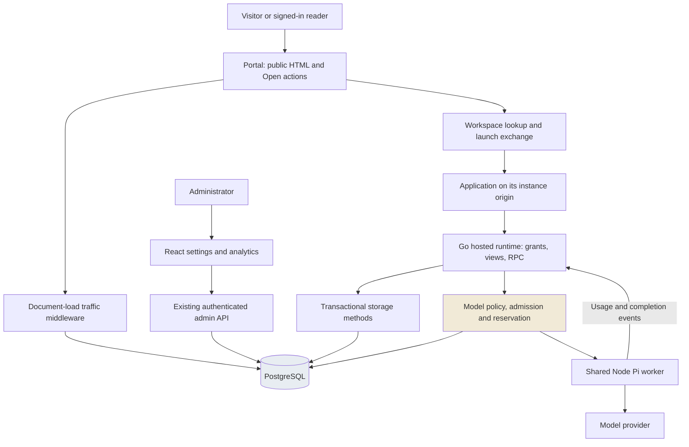
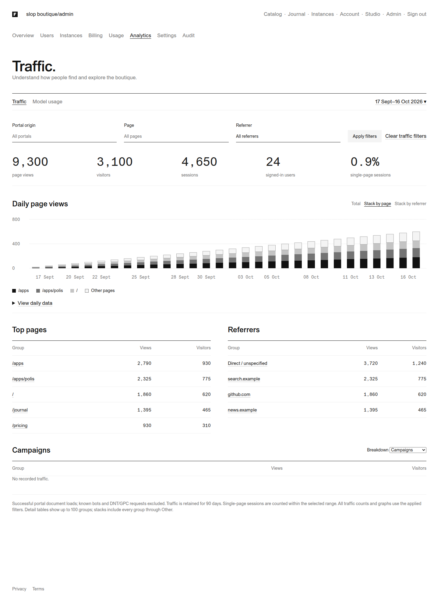
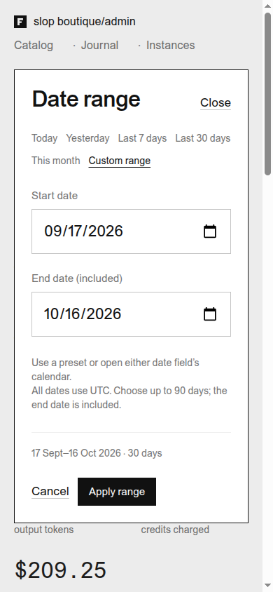
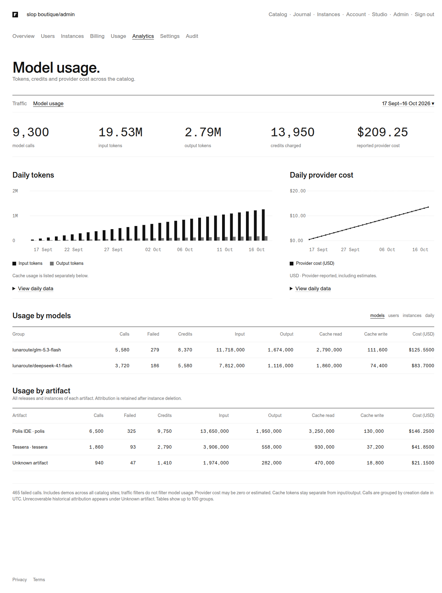
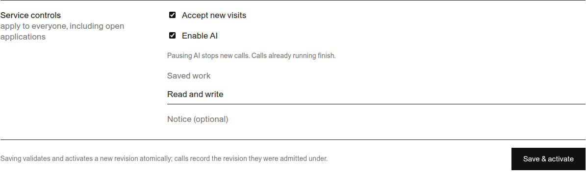
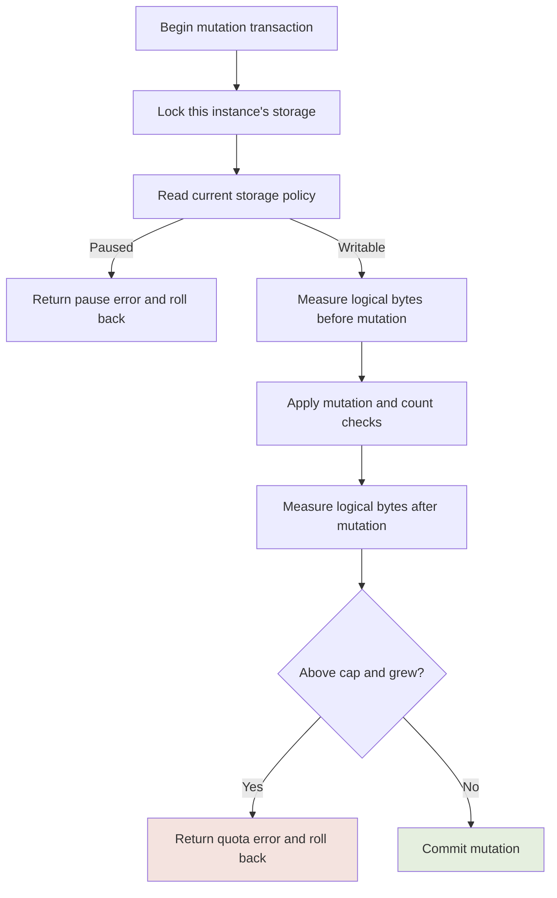
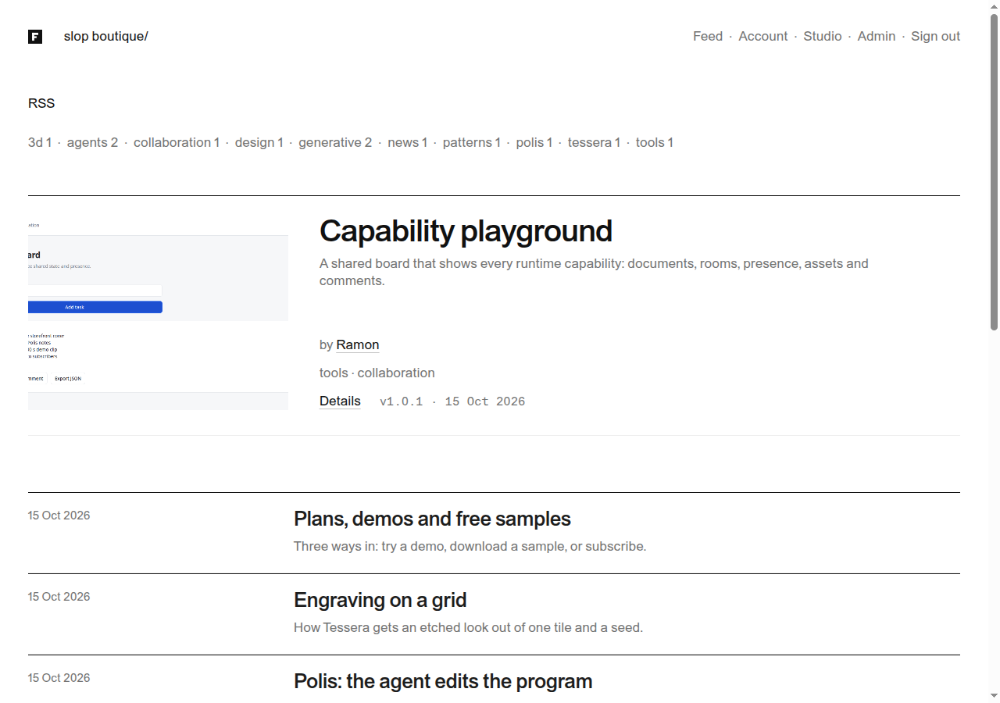

# Francois: Private Analytics and Minimal Hosting with Six Concurrent Model Calls

Francois hosts HTML applications that can save data and call language models through a shared server. Its public site, slop boutique, presents applications and writing. This work gives its operators traffic reports, model-usage reports and controls for limiting or pausing activity, while reducing the account and launch interface that visitors see.

The operating constraint is specific: the model service provides generous token access, but only six concurrent execution slots. A saved application workspace, a connected browser tab and an active model call therefore need different limits. Counting workspaces cannot establish the model concurrency bound, and recording token totals cannot establish how long all six calls remain occupied.

> [!summary]
> - **Analytics uses the data's authoritative source.** Portal document loads become first-party traffic rows; model reporting reads the existing reservation and settlement ledger. Artifact attribution survives workspace deletion.
> - **Resource limits follow actual lifetimes.** Model admission lasts through worker termination, storage limits are checked within mutation transactions, and tours retain their original expiry when resumed.
> - **The public interface stays small.** Open resumes saved work, applications and writing share a feed, and temporary restrictions appear as short notices. Operators retain detailed private settings and reports.

This is a report on the implementation at `aa9ca58`, reviewed in [PR #7](https://github.com/go-go-golems/francois/pull/7). The code was deployed and exercised locally; production was not deployed in this work. Automated review has completed with two unresolved correctness findings, examined below. The report distinguishes the implemented behavior from those remaining defects.

The earlier [[PROJECT REPORT - Francois Catalog - Hosted Subscriber Platform with Isolated Instances, Launch Grants and Metered Model Calls - A Technical Deep Dive]] explains the hosted platform. [[PROJECT REPORT - Francois Storefront - Creator Pages, Plans, Demos, a Studio, Videos and Release Attachments - A Technical Deep Dive]] describes its publishing and subscription features. This chapter follows their architecture into measurement, operational limits and a smaller public interface.

## 1. The objects and lifetimes we need to distinguish

An **artifact** is a catalog application, such as Polis. A **release** is an immutable version of its HTML and capability manifest. A manifest declares which server facilities the application may request, including stored documents and model sampling. Publishing a release makes that version eligible for the catalog's publication and access rules.

An **instance** is a saved workspace: an owner, a pinned release, a hostname, membership and instance-specific data. Creating one inserts database records. Application JavaScript executes in the browser; instances share the Go server and Node Pi worker. An idle instance reserves no model slot and starts no dedicated process or container.

A **view** is a live browser connection to an instance. Its event stream carries runtime events, model output and tool requests. Several tabs can open one saved instance, and one user can open tabs for different instances. The new per-user view limit counts these live connections across workspaces.

A **runtime grant** is the credential used on an instance's origin. The trusted portal's session cookie stays on the portal origin. A one-use launch exchange establishes the grant for the selected workspace; subsequent runtime requests check authorization, including current membership and access. The service can change policy while an existing browser retains a valid grant.

A **model call** is an admitted application request that can contain several provider rounds and browser tool executions. Its private ledger row records reservation, execution and settlement. A provider round and an application call have different durations: the application call retains admission while waiting for browser tools between rounds.

| Entity | Lifetime | Principal resource cost | Relevant bound |
| --- | --- | --- | --- |
| Saved workspace | Until removed or suspended | Metadata and retained payloads | Existing instance entitlement; aggregate storage cap |
| Browser view | While connected | HTTP/event-stream connection and event buffers | Three views per user by default |
| Application model call | Admission through worker completion | Shared worker and upstream generation | Six globally, one per user |
| Tour | Fixed interval from creation | Temporary workspace, views and any calls | Twenty minutes by default; start and active-tour limits |

The local investigation observed 13 instances, seven stored documents totaling 606 logical bytes and no assets. One idle snapshot measured about 85 MiB for the whole application container and 90 MiB for PostgreSQL. These observations describe a small development deployment. They establish neither a per-instance memory cost nor a tested capacity for active users.

## 2. The architecture and the scope of the change

The implementation extends the existing Go application, PostgreSQL store, React administration interface and shared Pi worker. Public pages use Go templates and a small browser script. Administration uses React, Redux Toolkit Query and the existing authenticated API. Browser bundles are embedded into the Go application and served under `/static/`.



The first implementation added release RSS and basic analytics. Paper designs then specified graphs, filters, a date dialog and model usage by artifact. A later clarification changed the public direction: keep measurement private, reuse saved work automatically, and provide direct operational controls for constrained model access and storage.

The initial capacity proposal included speculative scheduling and accounting mechanisms. The user rejected that expansion. The revised design maps requirements onto existing settings fields, request handlers, in-memory admission counters and PostgreSQL transactions. It introduces no queue, scheduling service or separate analytics deployment. The technical work concentrates on enforcing the existing boundaries consistently.

That decision also fixes the deployment assumptions. Concurrency and tour-start counters belong to one application process. PostgreSQL advisory locks coordinate the persistent operations that use them, but they do not turn the process-local model counter into a cluster-wide limit. Running additional application replicas would require revisiting admission before claiming the same global six-call bound.

## 3. Follow one application from discovery to a paused save

Consider a signed-in reader opening Polis. The names below are illustrative; the sequence follows the implemented handlers.

1. `GET /apps/polis` returns successful portal HTML. Traffic tracking records the configured portal origin, the path, pseudonymous visitor and visit IDs, and the authenticated user ID when resolution succeeds. A referrer such as `https://news.example/story?id=42` becomes the hostname `news.example`.
2. The reader presses **Open**. `POST /api/instances/open` resolves the artifact and eligible release, then asks `OpenWorkspace` for the owner's default saved workspace. Lookup and creation share a per-owner transaction lock. An existing workspace keeps its pinned release and stored data.
3. The launch exchange obtains an instance-origin grant. The browser establishes a view and the application requests capabilities through `await claude.use("db")` or `await claude.use("sample")`.
4. A model request checks current settings, allowed model and allowance. Successful admission increments the user's active-call count and the process-wide count, then reserves the call in `model_calls` with the authorized artifact ID.
5. The worker streams output and usage. The service settles the existing ledger and releases admission after worker completion. The model report groups that row by day, model, user, instance or artifact.
6. An administrator changes storage to `read-only`. The next persistent mutation from this already-open view is rejected. The browser displays the notice, marks saving blocked and refuses subsequent storage writes locally until reload. Reads remain available.

```mermaid
sequenceDiagram
  participant B as Browser
  participant P as Portal
  participant D as PostgreSQL
  participant R as Hosted runtime
  participant W as Pi worker
  B->>P: GET /apps/polis
  P-->>B: HTML and traffic cookies
  P->>D: Insert eligible document-load event
  B->>P: POST /api/instances/open
  P->>D: Lock owner; reuse or create workspace
  P-->>B: Workspace identity
  B->>R: Launch exchange and connect view
  B->>R: Request model call
  R->>D: Reserve allowance and artifact snapshot
  R->>W: Sample with private wire ID
  W-->>R: Output, usage, result, ended
  R->>D: Settle call
  Note over R: Release admission after worker completion
  P->>D: Activate read-only settings revision
  B->>R: Persistent write from existing view
  R-->>B: Storage pause error and plain notice
  Note over B: Stop further saves; show unsaved state
```

The sequence exposes two separate histories. Traffic records a portal document load. The model ledger records actual model activity in an authorized instance. A page view supplies no evidence that a model ran, and a model call supplies no reliable referring portal URL. The reports retain that separation.

## 4. First-party traffic measurement with explicit semantics

Traffic tracking wraps portal requests in [`pkg/catalog/analytics.go`][traffic]. An eligible event requires a GET request, a successful HTTP 200 response and HTML content. Auth paths, APIs, static files, media, feeds, health endpoints and isolated application content are excluded. The user-agent classifier rejects common bot markers and provides coarse browser/device categories. Requests with `DNT: 1` or `Sec-GPC: 1` bypass tracking.

Two host-only cookies supply pseudonymous identifiers. The visitor cookie lasts 90 days; the visit cookie is refreshed with a 30-minute lifetime. Secure deployments use the `__Host-` prefix. Successful session resolution can additionally associate the view with an authenticated user. Cookies identify browsers and visits under these rules; they cannot establish a count of distinct people across devices or cleared cookies.

Each event stores the portal site, bounded path, identifiers, referrer hostname, selected UTM fields, browser category and device category. The full referrer URL and arbitrary query parameters are discarded. The insert does not store model prompts. Traffic insertion has a 250 ms context budget detached from browser cancellation, performed directly after response handling. Failure logs a warning without changing the already-produced page response. Cleanup removes traffic older than 90 days at startup and hourly.

Headers require care. Cookies must be issued before the handler commits its response; successful HTML can only be recognized afterward. The response wrapper captures status and sets tracked HTML to `private, no-store`, preventing shared caching of cookie-bearing responses. An eligible request that ultimately fails can still receive identifiers, while contributing no traffic event. The design guide records this boundary explicitly.

The displayed metrics are precise database counts:

- **Page views** count eligible rows in the selected population.
- **Visitors** count distinct `(site, visitor)` pairs; **sessions** count distinct `(site, session)` pairs.
- **Signed-in users** count distinct nonempty user IDs recorded in those rows.
- **Single-page sessions** count sessions having one matching row within the selected range and filters.

The last metric can change when a page filter is applied: it describes the filtered population. It does not establish that a visitor ended a session after one page. There is no browser engagement timer, client-side route-event ingestion, geographic lookup or attribution model in this implementation.

## 5. One report snapshot and complete categorical stacks

The administrator endpoint `GET /api/admin/analytics` accepts a half-open UTC range and optional exact traffic filters. A request such as the following selects one included UTC day and direct traffic to Polis:

```http
GET /api/admin/analytics?from=2026-10-16&to=2026-10-17&path=%2Fapps%2Fpolis&referrer=
```

An absent `referrer` selects every referrer. A present empty value selects direct or unspecified traffic. The Go type preserves that distinction with `*string`: `nil` means no predicate and a pointer to `""` means an exact empty-category match. Paths contain no query or fragment; referring values are hostnames. The handler validates fields, limits ranges to 90 days and applies a five-second query budget.

[`store.Analytics`][report-store] opens a read-only repeatable-read transaction for totals, groups, categorical series and model aggregates. All reads therefore describe one database snapshot even if new traffic arrives between queries. Every traffic aggregate uses the same parameterized predicate:

```sql
FROM traffic_views
WHERE created_at >= $1 AND created_at < $2
  AND ($3 = '' OR site = $3)
  AND ($4 = '' OR path = $4)
  AND ($5::text IS NULL OR referrer = $5)
```

Dimension tables show at most 100 groups. A daily stacked chart requires a separate query because truncating the table first would lose traffic from less frequent categories. The query ranks the top three categories across the full filtered range, joins every filtered event against those keys and groups all unmatched keys into **Other**. Ranking across the whole range keeps categories stable from day to day.

The response includes `day`, `key`, `other` and `views` for each nonempty daily segment. The Boolean `other` is essential: direct traffic has an empty key too. The client keys a segment by `(other, key)`, preserving both identities. For each day, the four-or-fewer stack segments sum to that day's filtered total. This property remains true with more than 100 page or referrer categories; integration tests exercise that case.

Model aggregation shares the selected dates and database snapshot, but traffic filters do not constrain it. Historical model rows have no authoritative portal-site or referrer field. The interface states that model usage is catalog-wide rather than inferring unsupported attribution.

## 6. Paper designs, SVG graphs and dates that match the API

The user asked for design in Paper before implementation. A separate Analytics group in the unified design contains Traffic, Model usage and date-dialog artboards. It reuses the site's white background, black and gray marks, thin rules, ABC Areal text and monospaced values. The design exports are retained under the ticket's `sources/paper/` directory; the [Paper mapping guide][paper-guide] connects each control to its API behavior.



*Implemented Traffic view with synthetic browser-test data: page/referrer filters, daily stacks and exact grouping tables. This capture predates the later public-navigation simplification; its numbers are test fixtures.*

[`analytics-data.ts`][chart-data] converts sparse report rows into chronological UTC day arrays and zero-fills missing dates. [`analytics-charts.tsx`][charts] renders responsive SVG traffic bars, paired input/output bars and a provider-cost line. Exact daily tables accompany the figures. Values remain available without interpreting gray shades or positioning a pointer on a small mark. Empty ranges and single-day ranges have explicit rendering behavior.

A visible-width defect came from stroke geometry. The light Other segment had an outline extending beyond its rectangle, while white side strokes reduced the apparent width of darker segments below it. Equal rectangle coordinates did not produce equal visible edges. The correction removes side strokes and insets the Other outline; browser checks compare the boundaries including half-stroke extents.



*The shared native date dialog on a narrow viewport. The included end date is a UI convention; transport uses an exclusive end boundary.*

The date dialog uses native `<dialog>` and `<input type="date">`, with draft state isolated from the applied report range. Cancel or Escape discards edits; Apply validates and issues the new report request. Reopening initializes the draft from the applied range. Native dialog behavior supplies focus handling without another UI library.

The conversion is explicit. The following is the implemented range function, with formatting condensed:

```typescript
export function inclusiveRange(start: string, end: string): DateRange {
  const from = midnight(start), to = midnight(end) + DAY;
  if (to <= from || to - from > 90 * DAY)
    throw new Error("Choose a range of 1 to 90 days.");
  return { from: start, to: isoDay(new Date(to)) };
}
```

Here `midnight` parses and validates a UTC date, and `DAY` is 86,400,000 milliseconds. The chosen UTC convention makes adjacent dates uniform across local daylight-saving changes. Today, Yesterday, Last 7 days, Last 30 days and This month all use UTC. RTK Query's `currentData` prevents an old response from appearing beneath newly applied filter labels.

## 7. Model accounting and artifact history

Model usage already had a transactional source: `model_calls` and its allowance reservation/settlement path in [`store/usage.go`][usage]. Reusing it keeps analytics aligned with the execution system. A call reserves the applicable private allowance, records provider start, receives private usage events and settles with its final state. Started canceled calls still count under the existing accounting policy; reservations rejected before start are released.

Reports include calls, failures, charged credits, input tokens, output tokens, cache reads, cache writes and reported provider cost. Cache metrics remain distinct from input/output totals. The configured accounting period is an allowance identifier, which may be a demo-specific value such as `demo:<instance>`. Date reporting therefore filters call creation timestamps rather than parsing period names. The metrics describe creation-day cohorts even when settlement occurs later.



*Implemented Model usage view with synthetic browser-test data. Artifact grouping includes an explicit Unknown artifact row. The shown token and cost totals are fixtures, not measured local or production consumption.*

The requested artifact breakdown exposes a deletion problem. Model history survives instance deletion, while the live instance-to-release relationship does not. Joining historical calls through surviving instances would drop usage for deleted workspaces and expired tours.

Migration 010 adds a historical identity directly to the ledger:

```sql
ALTER TABLE model_calls ADD COLUMN artifact_id text NOT NULL DEFAULT '';
UPDATE model_calls c SET artifact_id = r.artifact_id
FROM instances i JOIN releases r ON r.id = i.release_id
WHERE i.id = c.instance_id;
```

New reservations copy `ArtifactID` from the server-authorized instance. Backfill copies only relationships the database still proves. Already-deleted relationships stay empty and appear as Unknown artifact. Display titles are resolved after aggregation through a one-to-one lookup; creator or membership joins cannot multiply the usage sums. Deleting a workspace consequently preserves new calls' artifact attribution.

Reported cost can be zero or estimated under the provider's access arrangement. Token counts remain useful for diagnosing application behavior, but neither cost nor token volume measures the duration for which a call occupies admission. Existing timestamps support duration investigation; this change adds no occupied-seconds quota or dedicated concurrency time-series dashboard. Model grouping tables remain bounded to 100 groups, which a future reader must consider before treating a displayed group sum as an exhaustive high-cardinality total.

## 8. Three operational controls in the existing settings document

Operators need independent responses to different incidents. Turning off new visits should preserve access to saved work. Pausing AI should preserve healthy storage. Pausing writes should preserve reads when storage itself remains usable. The settings document adds these direct controls:

```json
{
  "operations": {
    "acceptNewVisits": true,
    "samplingEnabled": true,
    "storageMode": "read-write",
    "notice": ""
  }
}
```

The existing versioned settings GET/PATCH API validates changes, checks the supplied revision through `If-Match`, activates a new revision and records normal administrative history. The notice is plain text, limited to 500 Unicode runes. It overrides the default short message when supplied.

| Control | Immediate effect on subsequent operations | State preserved |
| --- | --- | --- |
| `acceptNewVisits=false` | Refuse new workspace/tour creation | Existing resumable workspaces and live tours |
| `samplingEnabled=false` | Refuse new sampling before admission/reservation | Running calls drain; storage remains independent |
| `storageMode=read-only` | Refuse persistent mutations | Existing data can be read |
| `storageMode=off` | Refuse storage reads and writes, including signed blob access | Data remains stored |



*The controls in the actual locally deployed settings editor. Saving creates a revision through the existing settings flow.*

The checks happen where activity occurs. New model calls read the active sampling policy. Storage RPC dispatch and upload/blob handlers check storage policy. Mutation transactions also check it, protecting direct store callers and requests that reach persistence after an earlier handler check. An old grant cannot bypass these checks simply because it was issued before the policy changed.

There is still a concurrency boundary between an operation already in progress and a new settings revision. These controls govern subsequent checked operations; they are not a coordinated rollback of writes already committing. AI pause deliberately allows admitted calls to finish under their existing timeout. This behavior keeps the controls understandable and avoids adding a new cancellation subsystem.

## 9. Model admission and the completion boundary

[`hosted/sample.go`][sampling] maintains per-user and global active-call counters under the runtime mutex. Settings validation permits one active call per user and a global configured bound from one to six. The admission method is small enough to show in full:

```go
func (rt *Runtime) admit(user string, perUser, global int) bool {
    rt.mu.Lock()
    defer rt.mu.Unlock()
    if rt.active[user] >= perUser || rt.global >= global {
        return false
    }
    rt.active[user]++
    rt.global++
    return true
}
```

The surrounding handler checks grant/view authorization, manifest declaration, request validity, current policy, approved model and entitlement. It admits concurrency before reserving allowance. If reservation fails, admission is released immediately. If the call starts, its goroutine owns release through deferred cleanup. A seventh global call, or another call from the same user, receives the existing busy error.

The bounds also apply to work inside an admitted call. It has a five-minute timeout, at most the configured number of tool rounds, a 150-second browser-tool timeout and a per-round output cap no greater than 8,192 tokens. The default maximum is five tool rounds. Browser tool waiting continues to occupy application-call admission, which is conservative relative to a provider that counts only active generation.

The subtle defect was in cancellation. The old Go worker client could send cancel and return before the Node worker had terminated the call. Deferred cleanup would then admit another call while prior work was still ending. The new protocol emits a distinct `ended` frame from the worker's `finally` block after aborting and clearing outstanding tool waiters:

```typescript
  } finally {
    ctl.abort();
    controllers.delete(r.callId);
    for (const [key, p] of waiting) {
      if (key.startsWith(r.callId + "|")) {
        p.reject(new Error("Call ended"));
        waiting.delete(key);
      }
    }
    emit({ type: "ended", callId: r.callId });
  }
```

The [Go client][worker-client] now waits for that frame after a result or cancellation. A canceled call still forwards usage events required for accounting. If completion is not acknowledged within five seconds of cancellation, the client stops the shared worker and waits for termination before returning. This trades availability of the shared worker for a definite local termination boundary. Private random wire IDs additionally prevent equal caller-supplied call IDs from different users colliding in the worker's pending-call map.

The established invariant is a maximum of six admitted application calls in this service process, held until local worker completion. Provider-side cancellation timing and any other consumers of the upstream account remain external facts to verify. The completion acknowledgement alone does not measure those remote sessions.

## 10. Default workspaces and tours reuse identity

The normal Open action now calls an explicit open-or-create operation. [`Store.OpenWorkspace`][instances] takes the same per-owner PostgreSQL advisory transaction lock as explicit instance creation, searches for the oldest active workspace of the artifact, and creates one only when lookup finds none and current access permits creation. Simultaneous opens therefore return one workspace instead of creating several.

Existing workspaces keep their release pins. Existing additional instances and their URLs remain; the change does not merge stored data. The old explicit creation operation remains available as its own operation, while routine public navigation stops asking users to manage instance identities. New-visit pause allows reuse but rejects creation.

Tours have a different retention contract. [`LiveDemo` and `CreateDemo`][tours-store] search for an active, unexpired demo owned by the person for the artifact. The store repeats the lookup under its existing demo admission lock before checking active capacity and creating a new row. Repeated Try actions reuse the same expiry; refreshing the page or renewing a grant does not grant another twenty minutes.

Tour defaults are configurable: twenty-minute duration, three starts per address per hour, three per user per hour, twenty active demos, five demo credits and a shared daily demo budget of 200 credits. The handler adds user-ID limiting alongside network limiting, so changing an IP address does not bypass the signed-in user's limit. Counters remain process-local and reset on restart. Anonymous identity clearing still relies on the coarse network limit.

Expiry uses the existing minute sweep to suspend demos, revoke grants and close views. Expired demo data is deleted after seven days, while model-call history remains for accounting. Signed-in saved workspaces have a separate data lifetime: reaching a model allowance does not delete them. Cleanup of accumulated guest accounts remains a separate retention question.

Two reviewed defects qualify this section. Workspace lookup does not yet skip a pinned withdrawn release when policy forbids running it. Tour handler limiting also occurs before atomic store creation, so concurrent Try requests can consume several start hits while the store creates only one tour. Both are discussed with exact review links in Section 16.

## 11. Storage quotas enforced by the mutation transaction

The earlier document-count default allowed 5,000 documents of up to 256 KiB each: about 1.22 GiB of logical document bodies before assets or database overhead. A small site needs a tighter aggregate limit, not just a count of rows. The new defaults are 500 documents and 16 MiB of total logical payload per instance.

[`store/storage.go`][storage] defines a shared mutation boundary. `beginStorageWrite` starts a transaction, takes `pg_advisory_xact_lock(hashtext('storage:' || instance))`, reads current storage settings and refuses writes in paused modes. Every participating document, asset, comment and lease mutation uses this same instance lock.

Usage includes document sizes, asset byte lengths, thread-anchor JSON text, comment text and lease JSON text. These are logical payload bytes. The quota does not count PostgreSQL row headers, indexes, dead tuples, WAL or backups, so it is a bound on application payloads rather than physical disk size.

After mutation, the transaction recomputes usage and applies the following implemented check:

```go
func commitStorageWrite(ctx context.Context, tx pgx.Tx,
    instance string, before, limit int64) error {
    after, err := storageBytes(ctx, tx, instance)
    if err != nil {
        return err
    }
    if after > limit && after > before {
        return errors.Wrap(ErrLimit, "Saved work has reached its storage limit")
    }
    return tx.Commit(ctx)
}
```

The caller's deferred rollback removes a rejected growth mutation. The condition also preserves cleanup after an operator lowers the quota below existing use. For example, an instance at 20 MiB under a new 16 MiB cap may shrink to 18 MiB or delete content, but may not grow to 21 MiB. Read-only policy is stricter than quota exhaustion: it refuses persistent deletion too.



The lock prevents two writers from each measuring the same free capacity and jointly exceeding it. Document-count checks use the same transaction boundary, closing the previous concurrent-insert race. Counting directly inside the transaction keeps the implementation short at the current bounded dataset size. Its cost grows with stored rows and mutation frequency; current validation establishes correctness under concurrent writes, not a measured high-throughput storage limit.

## 12. Notices must reflect whether data was saved

The public interface needs a small, reliable account of a restriction. Paper's [Minimal site — service notices](https://app.paper.design/file/01M506DAH3CXP5QS28T2VQ4W3N/p-D-0) defines full-page and inline variants using the existing typography. Busy, AI-paused, visit-expired and storage-paused responses use the existing JSON error envelope and specific codes.

The shared [`service-notice.ts`][notices] constructs a status section and assigns the message through `textContent`. Operator text cannot become HTML. The hosted runtime supplies its own notice styling because authored applications execute on separate origins and cannot depend on portal CSS. The trusted launcher retains a Close action outside the application frame.

Storage errors also change client behavior. [`ui/src/runtime.ts`][browser-runtime] remembers a `storage_read_only` or `storage_unavailable` failure in `savingBlocked`. Subsequent persistent RPCs and uploads are rejected locally. The common notice tells the reader that changes cannot be saved and that reload is required to retry. Existing optimistic document operations roll back through their established error contract.

This is deliberately stronger than displaying an informational banner while continuing to acknowledge writes. A write rejected by the server must reject the capability promise. An application's own code may still render local edits, but the shared runtime does not report successful persistence. Reads continue under read-only policy. If storage is off, signed asset URLs are checked again too; a URL minted before the pause cannot bypass current storage policy.

The local browser test verifies the whole boundary: change policy in the real settings editor, issue a real capability write, observe rejection, issue another save and observe local refusal, confirm a clear unsaved notice, and independently confirm the rejected document was never stored. The check restores the original operation policy in `finally`, including when browser automation fails.

## 13. A smaller public site and one RSS subscription

The new public flow is a chronological stream of applications and writing. Home, catalog and journal listing paths share the stream implementation. The front-page hero and creator presentation were removed, ordinary navigation omits instance management and pricing, and Account focuses on subscription management and sign out. Staff retain API-token management. Administrator analytics remains an explicit private destination.



*The actual local deployment after public simplification. Application entries and journal entries share the stream; authored titles, summaries and tags remain content.*

Removing visible plan badges or resource comparisons does not remove access rules. Entitled downloads, release attachments, publication visibility and editor draft previews keep their existing checks. The Support destination retains subscription actions without turning ordinary browsing into an allowance comparison. Existing authored content may still discuss plans or demos; this work changes the service presentation rather than rewriting authors' prose.

RSS follows the same publishing boundary. [`feed.go`][feed] adds a release feed and then a combined `/feed.xml`, joining published releases of listed artifacts with published posts through `UNION ALL`. It sorts by publication time with an ID tie-breaker and returns at most 50 entries. The existing `/apps/feed.xml` and `/journal/feed.xml` remain useful specialized subscriptions.

A release item uses `urn:francois:release:<release-id>`; a post uses `urn:francois:post:<post-id>`. The GUID is an opaque stable identifier, explicitly marked as not a permalink. Multiple releases can link to the same artifact page while retaining distinct subscription identities. Go XML serialization escapes titles and descriptions; request-site configuration supplies the correct portal origin for links. Feeds use a five-minute public cache and are excluded from traffic measurement.

The HTML stream and RSS have corresponding publication tests: hidden artifacts, draft releases and draft posts are excluded, and chronological order is stable. The actual local combined feed contained eight items during validation. Its item count is a development fixture observation, not a production publishing claim.

## 14. Settings migration, local rollout and rollback

Three migrations define the persistence changes. Migration 009 introduces traffic records. Migration 010 snapshots historical artifact attribution. Migration 011 transforms stored settings to the current schema and supplies the operational policy.

The settings parser rejects unknown fields and validates required values, so a source-code default alone cannot migrate existing revisions. Following the repository's earlier settings migration convention, 011 updates stored settings documents explicitly. It adds enabled operations with writable storage and an empty notice, sets per-user concurrency to one, caps stored global concurrency at six, adds three views and 16 MiB storage, caps document count at 500, and caps existing tour duration at twenty minutes. Lower pre-existing global, document and duration caps are retained where the migration uses `LEAST`.

The migration does not delete accounts, saved payloads, releases or model history. It does introduce settings fields an old image cannot parse. Rollback across this boundary therefore requires the matching pre-migration database backup and previous image; changing only the image tag is insufficient.

Local rollout rebuilt the existing Compose application through the Dockerfile's Node 24 environment. A private PostgreSQL custom-format backup and previous image were retained before migration, then only the application container was recreated. Identity, database, release, provider configuration and font mounts were preserved. The dump stayed outside Git.

The deployed application revision was `42a1f3f`; the later `aa9ca58` checkpoint contains tests and delivery documentation. Health and readiness returned HTTP 200, model readiness was true and the container had zero restarts at final inspection. Independent counts matched before and after:

| Persistent records | Before | After |
| --- | ---: | ---: |
| Users | 7 | 7 |
| Instances | 13 | 13 |
| Releases | 5 | 5 |
| Model calls | 5 | 5 |
| Documents | 7 | 7 |

The real local service is at `http://localhost:8090/`, with controls at `/admin/settings` and analytics at `/admin/analytics`. These are local deployment receipts. Production was not accessed or deployed. The current implementation guide and rollout receipt were also delivered to reMarkable cloud under `/ai/2026/10/16/FRANCOIS-008`; the receipt does not establish physical tablet synchronization.

## 15. Validation that tests the boundaries

Database behavior was exercised against PostgreSQL, including disposable PostgreSQL 17 databases created by the existing integration harness. The full Go suite, Go build and repository lint passed. Frontend TypeScript checking, eight named contract/chart tests and the embedded browser build passed. The shell's older Node version emitted an engine warning; the deployment image independently built the web assets and worker using Node 24.

The important tests correspond to distinct correctness claims:

| Claim | Evidence in source |
| --- | --- |
| Traffic filters and stacks count one complete population | `TestAnalyticsFiltersAndCompleteStacks`, including more than 100 categories and daily reconciliation |
| Artifact history survives deletion and migration replay | `TestArtifactUsageSurvivesDeletionAndMigration` |
| Six calls globally and one per user hold under races | `TestSixCallsAndOnePerUser`, with twenty concurrent users |
| Cancellation waits for worker termination | `TestClientToolsCancellationAndWorkerExit`, with deliberately delayed completion |
| Open grants obey later policy changes | `TestOperationsAffectOpenViewsAndPreserveData` |
| Concurrent writes and reduced quotas preserve bounds | `TestStorageQuotaSerializesGrowthAndAllowsCleanup`, `TestDocumentCountIsAtomic` |
| Repeated opens and tours preserve identity and expiry | `TestOpenWorkspaceAndTourResumeUnderConcurrency` |
| User tour limiting survives address changes | `TestTourStartsFollowUserAcrossAddresses` |
| Minimal pages and feeds preserve publishing boundaries | `TestCombinedFeedAndMinimalPublicStream` |

Browser checks provide separate evidence. Eighteen synthetic-data analytics checks cover filters, stacks, date drafts, cancel/focus behavior, graph geometry and narrow layouts. Eighteen checks against the first local deployment exercise real analytics and feeds. The final controls script passes 21 assertions against the running service, including existing-view pauses, unsaved state, no persisted rejected write, workspace reuse while new activity is paused, minimal navigation and valid RSS.

The final browser checks make zero provider calls and create no application documents. They temporarily change real settings revisions, then restore enabled visits, enabled sampling, writable storage and an empty notice. This deliberately tests policy rejection before provider execution; it is not a six-generation upstream load test.

Several failures improved the implementation or evidence. A sequential demo-allowance test initially raced the asynchronous release of the prior call; it now retries only the transient concurrency rejection, while independent admission tests keep strict bounds. An obsolete plan-badge assertion was changed to verify retained access metadata and the intended absence of the badge. Browser automation initially used a nonexistent `claude.db` property; correcting it to the actual `claude.use("db")` capability contract allowed the runtime checks to execute. The first md-view launch also detached and then crashed during GTK initialization; the diary records the later verified window rather than equating process launch with a visible document.

## 16. What automated review found

PR #7's automated Codex review completed against `aa9ca58` with two P2 findings. Both are supported by the source and remain unresolved at this report's snapshot.

**Default workspace selection can prevent a usable launch.** `OpenWorkspace` filters instance kind, owner, artifact and active state. It does not filter whether the pinned release is runnable under current publishing policy. With `allowPinnedAfterWithdraw=false`, an active workspace pinned to a withdrawn release is repeatedly selected and then rejected by launch authorization with `release_unavailable`. Hiding routine upgrade/delete controls makes the loop particularly visible: repeated Open cannot recover. The next correction should select a workspace whose pinned release is permitted or provide an explicit path to the current published release while preserving old data. A regression test needs an existing withdrawn pin and the restrictive policy. [Review finding](https://github.com/go-go-golems/francois/pull/7#discussion_r4297572224).

**Concurrent tour reuse can overcharge the start limiter.** The handler performs an initial live-tour lookup, then consumes process-local user and network hits, then calls the locked store create/resume method. Three simultaneous requests can all miss the first lookup and consume all three user hits, while the store correctly coalesces them into one tour. Workspace identity is correct; start accounting is too restrictive. The next correction should coordinate start charging with the atomic create/resume outcome. A regression test must verify that concurrent requests for one artifact leave allowance for a genuinely new tour of another artifact. [Review finding](https://github.com/go-go-golems/francois/pull/7#discussion_r4297572241).

The CI results also require qualification. Frontend checks, Go tests, lint, vulnerability checks, GoSec, CodeQL and image publication succeeded. **Dependency Review failed because dependency review is unsupported or disabled for this repository**, according to its job error. **TruffleHog failed with one unverified URI result with HTML encoding** and reported zero verified secrets. The scanner log available during this report did not identify the exact source of that URI finding. It requires triage; zero verified secrets is not a passing secret-scan result. [Dependency job](https://github.com/go-go-golems/francois/actions/runs/38941532816), [secret-scan job](https://github.com/go-go-golems/francois/actions/runs/38941532847).

These results separate three statuses: local feature validation passed, external review found two correctness gaps, and the PR's check set is not fully green. The PR remains open and unmerged. No review finding was silently rewritten as completed work in this report.

## 17. Source map and continuation points

The repository is `/home/manuel/code/wesen/go-go-golems/francois`. The ticket directory is `ttmp/2026/10/16/FRANCOIS-008--rss-feeds-and-first-party-traffic-and-model-analytics/`. The linked source below is pinned to the reviewed commit, so later fixes cannot silently change what the report describes.

| Concern | Read first | Then follow |
| --- | --- | --- |
| Traffic ingestion and report HTTP contract | `pkg/catalog/analytics.go` | `store/analytics.go`, migration 009, analytics tests |
| Model history and artifact attribution | `store/usage.go` | migration 010, `hosted/sample.go`, reporting tests |
| Graphs, filters and UTC dates | `ui/catalog/analytics.tsx` | `analytics-data.ts`, `analytics-charts.tsx`, `date-range-dialog.tsx` |
| Operational policy and schema | `settings/settings.go` | migration 011, admin settings API and `ui/catalog/admin.tsx` |
| Model admission and termination | `hosted/sample.go` | `pkg/piworker/client.go`, `worker/src/main.ts`, client/admission tests |
| Workspace and tour reuse | `instances.go`, `demos.go` | Their store modules and the two review findings |
| Persistent byte/count limits | `store/storage.go` | `documents.go`, `assets.go`, storage-related operations tests |
| User notices and truthful saves | `ui/catalog/service-notice.ts` | `ui/src/runtime.ts`, hosted RPC/upload/blob handlers |
| Combined public publishing | `pages.go`, `feed.go` | Public templates, `ui/catalog/public.ts`, publication tests |

For the longer rationale, start with the ticket's [minimal-hosting design][minimal-design] and [Paper implementation mapping][paper-guide]. The [implementation diary][diary] preserves the chronological investigation, failed attempts, user corrections, commits and command receipts. The [local deployment receipt][receipt] and `scripts/04-local-controls-browser-check.js` document the reproducible runtime checks. Design snapshots and browser screenshots are evidence artifacts; the linked Go and TypeScript files define the execution behavior.

Near-term work is concrete: fix the two reviewed selection/accounting defects, identify the unverified URI scan finding, and resolve the repository's dependency-review configuration. After that, repeat the checks affected by those changes and obtain the next review result. Production rollout remains a separate operator action with the documented backup and settings-migration requirements.

The remaining operating questions are narrower than another service design. Verify what the upstream provider counts as one of its six slots and whether other applications share them. Observe real call durations and tool-wait behavior before changing allowance values. Define a guest-account retention policy. Measure report queries and quota transactions at representative data volume. Keep the current single-process assumption explicit until deployment requirements actually change.

[traffic]: https://github.com/go-go-golems/francois/blob/aa9ca58b90969803d28588538947d328902a01d4/pkg/catalog/analytics.go
[report-store]: https://github.com/go-go-golems/francois/blob/aa9ca58b90969803d28588538947d328902a01d4/pkg/catalog/store/analytics.go
[chart-data]: https://github.com/go-go-golems/francois/blob/aa9ca58b90969803d28588538947d328902a01d4/ui/catalog/analytics-data.ts
[charts]: https://github.com/go-go-golems/francois/blob/aa9ca58b90969803d28588538947d328902a01d4/ui/catalog/analytics-charts.tsx
[usage]: https://github.com/go-go-golems/francois/blob/aa9ca58b90969803d28588538947d328902a01d4/pkg/catalog/store/usage.go
[sampling]: https://github.com/go-go-golems/francois/blob/aa9ca58b90969803d28588538947d328902a01d4/pkg/catalog/hosted/sample.go
[worker-client]: https://github.com/go-go-golems/francois/blob/aa9ca58b90969803d28588538947d328902a01d4/pkg/piworker/client.go
[instances]: https://github.com/go-go-golems/francois/blob/aa9ca58b90969803d28588538947d328902a01d4/pkg/catalog/store/instances.go
[tours-store]: https://github.com/go-go-golems/francois/blob/aa9ca58b90969803d28588538947d328902a01d4/pkg/catalog/store/demos.go
[storage]: https://github.com/go-go-golems/francois/blob/aa9ca58b90969803d28588538947d328902a01d4/pkg/catalog/store/storage.go
[notices]: https://github.com/go-go-golems/francois/blob/aa9ca58b90969803d28588538947d328902a01d4/ui/catalog/service-notice.ts
[browser-runtime]: https://github.com/go-go-golems/francois/blob/aa9ca58b90969803d28588538947d328902a01d4/ui/src/runtime.ts
[feed]: https://github.com/go-go-golems/francois/blob/aa9ca58b90969803d28588538947d328902a01d4/pkg/catalog/feed.go
[minimal-design]: https://github.com/go-go-golems/francois/blob/aa9ca58b90969803d28588538947d328902a01d4/ttmp/2026/10/16/FRANCOIS-008--rss-feeds-and-first-party-traffic-and-model-analytics/design-doc/03-minimal-public-experience-and-operational-capacity-controls.md
[paper-guide]: https://github.com/go-go-golems/francois/blob/aa9ca58b90969803d28588538947d328902a01d4/ttmp/2026/10/16/FRANCOIS-008--rss-feeds-and-first-party-traffic-and-model-analytics/design-doc/02-analytics-paper-designs-and-implementation-mapping.md
[diary]: https://github.com/go-go-golems/francois/blob/aa9ca58b90969803d28588538947d328902a01d4/ttmp/2026/10/16/FRANCOIS-008--rss-feeds-and-first-party-traffic-and-model-analytics/reference/01-implementation-diary.md
[receipt]: https://github.com/go-go-golems/francois/blob/aa9ca58b90969803d28588538947d328902a01d4/ttmp/2026/10/16/FRANCOIS-008--rss-feeds-and-first-party-traffic-and-model-analytics/reference/02-minimal-hosting-implementation-and-local-deployment-receipt.md
