# DS Shaders: no_shade on a Handheld

**no_shade** is a website builder in which every pixel of a page comes from a GLSL fragment shader. The page's HTML
still exists for accessibility, but what the reader sees is a shader that takes the page's text and layout as input.
This project asks what the same idea does to a game console. The target is the Anbernic RG DS Plus, a dual-screen
Linux handheld, which already runs a native UI engine called **Lattice DS**. The question is concrete:

> If the console's own interface (boot screen, cartridge menu, save files, inventory, HUD, dialogue box, world map,
> pause, game over) is treated as material, and shaders are allowed to take it apart, what does the console become,
> and can the handheld's GPU afford it?

The project answers the first half in a browser and the second half on the device. It moved through four stages:
- **A browser twin.** A WebGL2 host that imitates the handheld's two screens, touch, buttons and shader contract.
- **Three browser artifacts.** A sketchbook, an arcade of game screens and a page of exploded game UIs (the Rift).
  They explore what shaders can do to game interfaces.
- **Lattice Phantasmagoria.** A ten-scene simulation in which each standard console interface element is
  reinterpreted according to an idea from a Philip K. Dick novel. Verbs such as melt, tear and Ubik break whatever is on screen.
- **lattice-shade.** A separate program built on the Lattice DS engine. It draws a real Lattice UI into a texture,
  runs shader passes over it on the device's Mali-G52, and is controlled from JavaScript.

> [!summary]
> - The **DS shader contract** is no_shade's `mainImage` contract with three changes:
>   - coordinates in logical pixels of one 512×384 screen;
>   - a coordinate system spanning both screens and the hinge;
>   - DS input in place of the mouse.
>
>   The same GLSL runs in the browser twin and on the device.
> - **Static analysis decides the device design before any device code exists.**
>   - The Mali Offline Compiler estimates every Phantasmagoria shader. 256×192 per screen fits the GPU; 512×384 costs
>     three to four times the frame budget.
>   - The shared composite pass is the dominant cost: 1.31 M cycles per frame when idle against 7.34 M with every verb
>     active. Compiling it per active verb set is the main optimization.
> - **lattice-shade is a separate program on the shared engine.**
>   - Existing applications see three inert changes: an optional screen hook, an optional colour override in the
>     renderer, and six font keys.
>   - A regression test guarantees that no shared startup requirement changes. It caught one real defect.
> - **On the device**, the first shaded application runs at a paced 60 fps:
>   - shade work costs 0.83 ms (p50) on the main thread;
>   - a lens compiles in 339 ms the first time and loads from the program-binary cache in 0.87 ms afterwards.
> - **All ten Phantasmagoria scenes and five verbs run on the device**, from the twin's unchanged scene files.
>   - A benchmark of every shader on the Mali-G52 measures 1.2–11 ms per pass at 256×192.
>   - The static estimates ranked the shaders correctly but were 1.5–2.3× too optimistic.
>   - Four targeted shader fixes cut the heaviest lens from 11.0 to 1.4 ms and the all-verbs composite from 9.7 to
>     7.1 ms. Every scene now runs at 53–60 fps on the device.

---

## 1. Terms

Every later section depends on these definitions.

**Graphics**
- **Fragment shader.** A GPU program run once per output pixel. It receives the pixel's position and returns a
  colour. The language is GLSL; this project uses GLSL ES 3.00 (`#version 300 es`).
- **Full-screen pass.** One triangle covering the render target, so the fragment shader runs for every pixel of it.
  Every effect in this project is one or more full-screen passes.
- **Render target.** An offscreen texture with a framebuffer object (FBO), so a pass can draw into it and a later
  pass can read it.
- **Ping-pong.** Two render targets that swap roles each step, so a pass reads its own previous output. Simulations
  (reaction–diffusion, stroke advection) and feedback effects (melt) use it.
- **Internal resolution.** The resolution effects are computed at (256×192 here), before a **nearest upscale** copies
  each internal pixel to a 4×4 block of the 1024×768 panel.
- **Cycles per fragment.** The number of GPU cycles one pixel of a shader costs. `malioc`, the Mali Offline Compiler,
  estimates it per shader without running it.
- **Work registers and occupancy.** How many GPU threads can run at once. On the Mali-G52 a shader using more than 32
  work registers runs at 50% occupancy.

**Systems**
- **no_shade.** The source system. A page is a document of layers; a **page shader** colours every pixel; text is
  rasterised into a coverage texture shaders can read (`typeAt`); simulations are **toys**; page changes are
  **transitions**.
- **Lattice DS.** The native UI engine on the handheld (Lattice DS Native, Parts 1–8). JavaScript or C++ builds a tree
  of parts; the engine lays it out, paints it into a display list and draws that with OpenGL ES.
- **Browser twin.** `dshost.js`, a WebGL2 host that imitates the handheld's two screens and runs the same shader
  contract.

**Phantasmagoria and lattice-shade**
- **UI texture.** One screen's interface drawn into a texture whose channels carry meaning: red is ink (text,
  icons), green is panels, blue is signal (focus, alternatives).
- **Lens.** The shader that decides how one screen of one page is seen. It usually reads the UI texture.
- **Memory.** A ping-pong simulation with its own size and steps per frame.
- **Machine.** One feedback pass per screen that every page goes through. It holds the verbs, the reality meter and
  the transitions. The browser twin calls it `COMP`.
- **Verb.** A way to break whatever is on screen: melt, tear, molecules, strands, Ubik. A verb is a block of GLSL in
  the machine plus a rule in JavaScript.
- **Plan.** The description of a page's passes (programs, memories, machine, state layout). JavaScript sends it to
  C++ when the page changes.
- **State block.** A small array of floats (knob values and verb state) that JavaScript sends about thirty times a
  second.

## 2. The problem and its constraints

no_shade shows that a document can stay a document while its rendering becomes entirely procedural. The HTML keeps
its semantics, links and accessibility. The shader treats the rendered text as input data: it can blur it, bend it,
grow simulations from it, or dissolve one page into the next. The question of this project is whether the same
separation works for the interface of a game console. The "document" there is the console's own interface rather
than a web page, and the shaders are allowed to break it.

Two constraints shape every answer.

**The device.**

| Item | Value |
|---|---|
| Device | Anbernic RG DS Plus (kernel reports `RK3566`), four Cortex-A55 cores, about 975 MB RAM |
| GPU | Mali-G52 r1p0, **one shader core**, 800 MHz, OpenGL ES 3.2, GLSL ES 3.20 |
| Panels | two 1024×768 panels at 60.171 Hz: top = sway output `DSI-2`, bottom = `DSI-1` |
| Input | Goodix touch on the bottom panel only, a joypad (`retrogame_joypad`) |
| OS | ROCKNIX with the sway Wayland compositor; GL entry points loaded at run time through a "Mali hook shim" |

At 800 MHz and 60 frames per second, the GPU has 800,000,000 ÷ 60 ≈ **13.3 million cycles per frame**. That budget
covers **both** screens together. A full-screen pass costs roughly its pixel count times its cycles per fragment, so
the internal resolution decides almost everything:

| Internal resolution | Pixels, both screens | Cycles per pixel available at 60 Hz |
|---|---:|---:|
| 256×192 | 98,304 | ~135 |
| 512×384 | 393,216 | ~34 |
| 1024×768 (panel) | 1,572,864 | ~8.5 |

**The engine.** Lattice DS draws only on change. Its shell rebuilds the top screen at most every 30–50 ms while
something moves and the bottom screen at most every 60 ms, and draws nothing when idle. That keeps a UI handheld cool
and its battery life long, but a shader that animates needs a frame every refresh. The engine also had no custom
programs, no float render targets and no shader API. It has a JavaScript layer (V8) with a UI language in which an
application is an immutable value of pages and parts.

A third, practical constraint governed the order of the work. For most of the project the device was in use by a
colleague, and nothing could run on it. The project was therefore designed so that every decision could be made from
evidence gathered on the host: a browser twin for the look, and static compiler analysis for the cost.

## 3. The DS shader contract

The transposition starts with a contract: the fixed header every shader is compiled with. It is no_shade's page
shader contract with three changes. The header lives in `lab/web/dshost.js` (lines 59–91) and is copied verbatim
into the device's JavaScript kit, so both hosts compile identical sources.

```glsl
#version 300 es
precision highp float; precision highp int; precision highp sampler2D;   // Mali: implicit precision bit Falllinie
uniform vec3  iResolution;   // screens: (512, 384, internal scale); offscreen targets: (w, h, 1)
uniform float iTime;         // seconds, wrapped at 600
uniform int   iFrame;
uniform int   iScreen;       // 0 top (DSI-2), 1 bottom (DSI-1)
uniform vec4  iTouch;        // bottom screen only: xy logical px y-up, z down, w smoothed 0..1
uniform ivec2 iButtons;      // x held, y pressed this frame
uniform vec3  u_ground, u_ink, u_hot, u_cool;     // the palette: four colours
const float DS_GAP = 92.;                          // the hinge, in logical px
vec2 dsCanvas(vec2 f){ return iScreen == 0 ? f + vec2(0., 384. + DS_GAP) : f; }   // both screens as one canvas
// + LIB: hash12 hash22 vnoise fbm toOklab fromOklab mixOk
...
out vec4 ns_out;
void main(){ mainImage(ns_out, gl_FragCoord.xy/iResolution.z); }
```

The three changes each solve a specific problem.

1. **`f` is in logical pixels of one screen** (512×384), whatever the internal resolution. The footer divides
   `gl_FragCoord` by `iResolution.z`, the internal scale. A shader written for 256×192 therefore also runs at 512×384
   without edits, and coordinates in GLSL agree with Lattice's layout coordinates.
2. **`dsCanvas(f)` places both screens on one canvas.** The bottom screen covers y 0..384, the hinge the next 92
   logical pixels, and the top screen sits above it. An effect that should cross the hinge (sand falling from the top
   screen into the bottom, a stroke that climbs upward) evaluates the same function of canvas coordinates on both
   screens. The two halves then agree at the seam.
3. **Input is DS input.** `iTouch` exists only on the bottom screen, in the same logical pixels as `f`. `iButtons`
   carries held and just-pressed bit masks, which give shaders one-shot events.

The precision line is not a stylistic choice. The Falllinie port (an earlier project on the same device) found that a
sampler declared without precision defaulted to low precision on Mali and produced false edges on 25–42% of pixels.
The contract declares `highp` for floats, integers and samplers, and its hash functions use `fract` arithmetic rather
than `sin`, which differs between GPUs.

## 4. The browser twin and three explorations

`dshost.js` implements the contract in WebGL2 with one shared context, as on the device. A sketch is a JavaScript
`frame(h)` function that calls a small API:

| Call | Does |
|---|---|
| `h.screen(which, name, o)` | run program `name` as the top or bottom screen at the internal resolution, then upscale |
| `h.sim(key, name, w, h, {steps, float, linear, uniforms})` | a ping-pong memory; `float` means RGBA16F |
| `h.pass(name, target, o)`, `h.target(w, h)` | a pass into an offscreen target |
| `h.touch`, `h.pressed(b)`, `h.held(b)` | input |

Three artifacts used the twin to find out what shaders do to game interfaces, before the console itself became the
subject.

- **The sketchbook** has twelve dual-screen sketches. Each shows its GLSL, its `frame(h)` code and the Lattice API call
  it would need. It established the contract in practice: sand flows through the hinge, a card drops from one screen
  to the other, page transitions run between two live pages.
- **Lattice Arcade** is a scrolling page in the style of no_shade's presets, with twelve game-screen genres:
  - a title screen with hyperspace across the hinge;
  - a Mode 7 map;
  - a battle screen with rolling HP;
  - a raymarched inventory;
  - a fighter select;
  - a rhythm highway through the hinge;
  - a racer;
  - a dialogue with typewriter reveal;
  - a shattering pause menu;
  - a level select;
  - a fire-effect game over;
  - a credits crawl.
- **Lattice Rift** takes the same genres and explodes them into fractals and simulations. It introduces the four
  **verbs**: keys melt the page, the joypad tears it, a held button turns it into molecules, and touch draws strands.
  The verbs act on the composited page, so they reach every section, including its text.

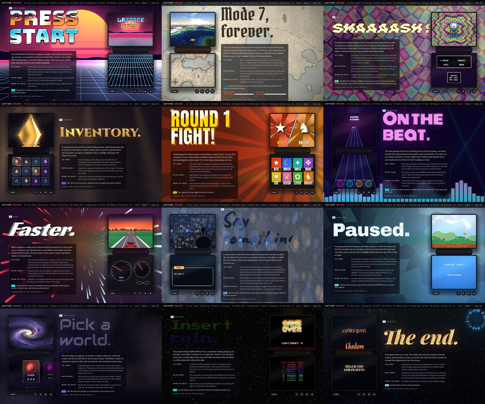

*Lattice Arcade: twelve game-screen genres, each a live two-screen console on a scrolling page.*

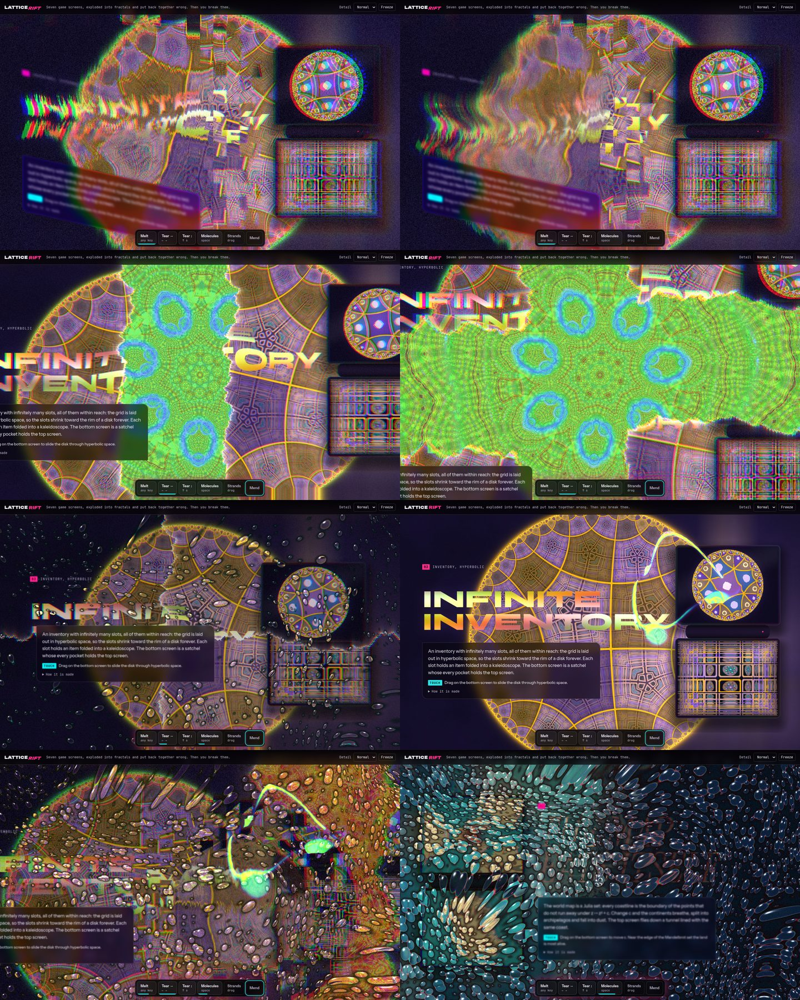

*Lattice Rift: the verbs (melt, tear, molecules, strands) applied to the whole page.*

The Rift's verbs became the vocabulary of the next stage. Its page backgrounds and section layout did not: the
project owner redirected the work toward the device itself ("I want to focus on the DS itself. not the stuff around
it"). The idea became deconstructing the console's own interface, the way no_shade deconstructed the web page.

## 5. Lattice Phantasmagoria

Phantasmagoria (`lab/web/phant.js`, `phant-a.js`, `phant-b.js`, `phant-c.js`, `phant.html`) simulates the handheld
with ten scenes. Each scene takes one interface element that every console has and reinterprets it according to a
Philip K. Dick novel.

| Scene | Console element | Source | What happens |
|---|---|---|---|
| BOOT | boot screen and health-and-safety warning | *The Electric Ant* | a punched paper tape runs through both screens; tapping it flips bits of the logo; the warning sign is a Sierpinski triangle |
| HOME | cartridge menu | *Time Out of Joint* | the cursor warps the screen around it with a radial gravitational-lens distortion; ignored tiles decay into paper slips naming the element ("SAVE FILES") |
| HALF-LIFE | save files | *Ubik* | each save slot ages back through older hardware; decayed slots show messages from beyond |
| KIPPLE | inventory | kipple | junk breeds through the grid as a reaction–diffusion simulation; the stylus sweeps it away |
| EMPATHY BOX | HUD | the empathy box | Julia-set hearts, a fractal HP tree; holding A fuses both screens into one hill |
| SCRAMBLE SUIT | dialogue box | *A Scanner Darkly* | the speaker is a Voronoi mosaic of faces; each screen shows a different person |
| PINK BEAM | world map | *VALIS* | a beam from the ichthys shrinks a hyperbolic {7,3} prison on the map |
| LAYOUT | console in a room | *The Three Stigmata of Palmer Eldritch* | a room holds a console showing this console; holding A zooms in without end |
| PAUSE | pause | cold-pac | the frozen frame frosts over |
| GAME OVER | game over | — | coral grows out of the GAME OVER letters |

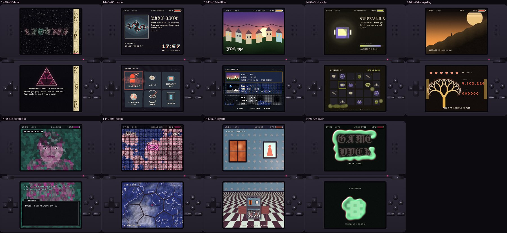

*Phantasmagoria, every scene rendered headless at 256×192 per screen.*

### 5.1 The frame

A Phantasmagoria frame is a fixed sequence of passes. The order matters, because each pass reads what the previous
ones produced.

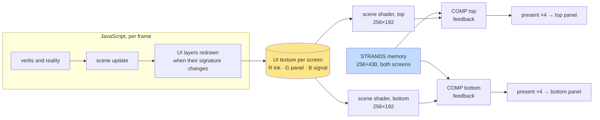

Each scene draws its UI by hand into a 2D canvas layer, in three channels: red for ink, green for panels, blue for
signal. The layer is redrawn only when the scene's *signature* (a string of the values it depends on) changes, then
uploaded with mipmaps. The scene shader reads that texture through `ui(f)` and decides how the screen is seen. COMP,
the composite pass, then applies everything global:
- the hinge tear, with a hyperbolic world in the gap;
- the drag of the strands;
- the regression of reality through older hardware;
- the transition between two live scenes;
- the status bar, melt, molecules, strand glow, Ubik and film grain.

COMP reads its own previous frame; that is how melted pixels keep sliding down.

### 5.2 Verbs, reality and eras

The verbs are rules in JavaScript that write a few uniforms, and blocks in COMP that read them.

| Verb | Input | State | Effect in COMP |
|---|---|---|---|
| melt | any key | up to 12 heat splats (x, y, start time, strength) | pixels near a splat keep sliding down their own previous frame |
| tear | hold L / R | a spring `u_tear` | the screens are pushed away from the hinge; the gap shows a kaleidoscopic world |
| molecules | hold X | `u_mol` rises 0.9/s | every pixel joins a bead holding a small inverted copy of the screen |
| strands | stylus | the STRANDS memory | strokes advect along themselves and climb toward the top screen |
| Ubik | hold Y | `u_ubik` | restores reality, cools melt, damps the tear |

**Reality** is a meter that drains at 0.0032 + 0.006 × chaos per second, where chaos is
min(3, 0.5 × heat + 2 × tear + 1.5 × molecules). As it falls, `eraAt()` assigns each region of the canvas an era,
with noise so the regression arrives in patches:

| Era | Looks like |
|---|---|
| 0 | true colour |
| 1 | 64 colours with a 4×4 Bayer dither |
| 2 | the four palette tokens, pixelated by 4 |
| 3 | one bit, pixelated by 8 |
| 4 | a punch card, 40 columns × 12 rows |
| 5 | snow |

At zero the console goes to GAME OVER. Only Ubik restores the meter.

### 5.3 A defect found by looking: the melt

The first full headless run (four contact sheets of scenes, scripted play and verbs) showed a problem no compiler
reports. One or two presses of the D-pad left the bottom screen dripped and tile-scattered for seconds. Three things
caused it:
- each press splatted heat at strength 0.25 + 0.22 × the number of recent presses;
- the heat decayed slowly, at `exp(-age*0.3)`;
- the "cooling" effect, which brings tiles back in the wrong places, fired at `re*1.6` regardless of how hot the
  pixel was.

The fix made the response a curve rather than a line, because players press buttons constantly. One press must be
nearly free; only mashing should cost the interface.

```js
const heat = [0, .05, .13, .26, .4][mash];   // one press barely drips; mashing melts
```

The decay became `exp(-age*0.5)` in both the shader and the JavaScript filter, the splat window shrank from 14 to 9
seconds, and the tile scatter became `re*min(1., h*4.)`, gated by heat. After the fix, one press leaves a few drips
around the cursor, and mashing melts the screen, which heals within about three seconds.

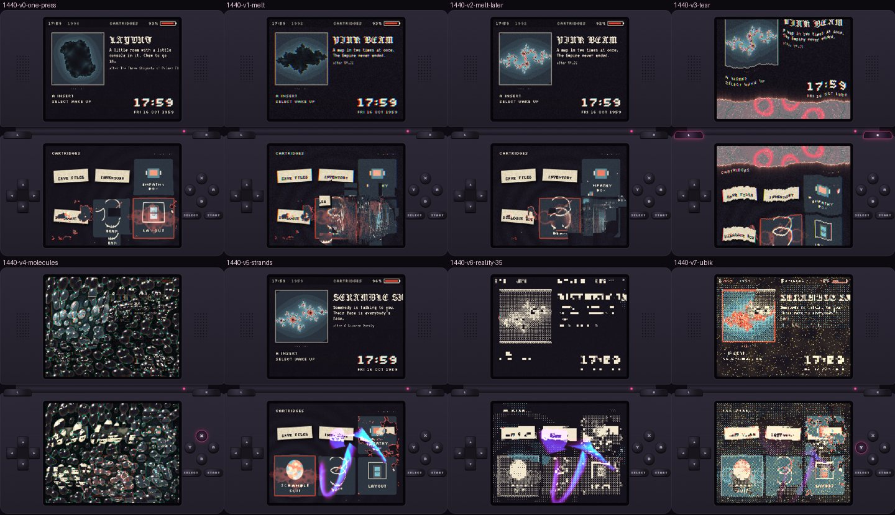

*Verbs on the cartridge menu: one press, mashing, three seconds later, tear, molecules, strands, reality at 35%,
Ubik.*

## 6. Measuring before porting

Phantasmagoria answered what the console could become. The next question was whether the Mali-G52 can afford it, and
at the time the device was unavailable. Arm's Mali Offline Compiler answers a narrower question that is enough to
make design decisions: for a given fragment shader, how many cycles per fragment does the G52 need on its longest
path, and how many registers does it use?

`scripts/05-malioc-phant.py` loads the browser twin headless. It maps every program name to the **exact** source
the twin compiles; `dshost.js` caches programs by their full assembled source. It then runs
`malioc --core Mali-G52 --opengles --format json` on each. Two practical details mattered:
- When a loop has no static bound, malioc reports the longest path as `[null, null, null, null]`. The script reports
  such shaders as "unbound" and budgets them by total arithmetic cycles.
- Register use is reported as `work_registers_used` with `thread_occupancy`. Every shader above 32 registers ran at
  50% occupancy.

The most expensive programs:

| Program | Longest path (cycles/fragment) | Registers | Occupancy |
|---|---:|---:|---:|
| `comp` (all verbs) | 74.67 | 64 | 50% |
| `empathy.bot` (the fused hill) | 89.00 | 64 | 50% |
| `halflife.top` | 54.83 | 63 | 50% |
| `scramble.bot` | 46.67 | 64 | 50% |
| `home.bot` | unbound (41.0 total) | 64 | 50% |
| `present` | 0.50 | 19 | 100% |

COMP runs on both screens every frame, so its cost was measured in more detail. `scripts/06-malioc-comp-variants.py` tested
that. It takes the exact COMP source and removes verbs by text substitution, the way a device build would compile
variants with `#define`s. Each substitution must match exactly once, or the script aborts, so the variant table
cannot silently measure the wrong program.

| COMP variant | Longest path | Registers | Both screens at 256×192 |
|---|---:|---:|---:|
| idle (eras, status, grain) | 13.37 | 30 | **1.31 M cycles** |
| + strands | 14.83 | 54 | 1.46 M |
| + melt | 21.33 | 32 | 2.10 M |
| + tear | 30.17 | 32 | 2.97 M |
| + molecules | 42.50 | 32 | 4.18 M |
| everything | 74.67 | 64 | **7.34 M cycles** |

Combined with every scene shader, the frame budget per scene (percent of a 60 Hz frame):

| Scene | All-in-one COMP | Idle COMP | + molecules (heaviest single verb) | At 512×384 |
|---|---:|---:|---:|---:|
| boot | 83% | 29% | 51% | 288% |
| home | 99% | 45% | 67% | 352% |
| halflife | 110% | 56% | 78% | 396% |
| empathy | 117% | 63% | 85% | 424% |
| layout | 86% | 32% | 53% | 299% |

Three conclusions followed, and they shaped the device design.
- **512×384 is a browser-only setting.** It costs three to four times the GPU's frame budget.
- **The composite pass must be compiled per active verb set.** Idle costs 5.6 times less than all-in-one. Every
  single-verb variant except strands fits in 32 registers at full occupancy.
- **Two lenses need their loops bounded and several need fewer registers** before they port.

These are static estimates. Falllinie's work on the same GPU found that malioc ranks shaders reliably but mispredicted
absolute frame times twice. The numbers decide the design; measurements on the device decide the details.

## 7. Where the device version lives

Phantasmagoria's material is a real interface: text, layout, fonts, focus, buttons and touch, driven by JavaScript.
On the device, only Lattice DS has all of that. The earlier plan of this ticket was a standalone native shader lab,
which would have needed a second UI engine. It was replaced by a decision to build on Lattice. That raised the
question of whether the work would affect the applications that already run on the engine: a native labeler, a
JavaScript labeler, an arena and a demo.

The inspection found four places where a naive integration would have touched them:
- **Engine code.** All applications link the same static engine libraries. A change to the main loop or the renderer
  changes every binary.
- **The GL loader.** A generator script scans `src/`, `apps/`, `tools/` and `tests/` for calls matching `gl` followed
  by a capital letter and an opening parenthesis. It writes one header, `src/platform/gl_api.hpp`, whose `load()`
  throws `missing GL entry: …` if any listed function is absent. A new GL call anywhere in the scanned folders would
  become a startup requirement of every application.
- **The program.** The JavaScript labeler runs as `lattice-js`. Adding shaders to that program changes the labeler's
  binary.
- **The install.** `deploy-device.sh` copies everything into one directory, `/storage/apps/lattice-ds`, including the
  font metrics file `assets/facepack.bin`.

The resulting design separates by construction:

| Layer | Shared | Owned by the shader work |
|---|---|---|
| Program | engine libraries | a new executable, `lattice-shade` (`apps/shade/`) |
| C++ | `src/core`, `gl`, `shell`, `platform`, `js` | a new library, `lattice_shade` (`src/shade/`), linked only by `lattice-shade` |
| GL entry points | the generated loader, unchanged | its own loader, `src/shade/gl_shade.hpp` |
| JavaScript | `app.js`, `host.js`, `lui.js` unchanged | kits `shade.js` (and `phantasmagoria.js`), loaded only when an `app.json` lists them |
| Install | the pinned V8 libraries (copied) | `/storage/apps/lattice-shade/` with its own `bin`, `lib`, `assets`, `jsapps`, `data` |

An existing application can opt in by linking the library, listing the kit, and putting a lens on a page. Without
all three it behaves exactly as before. A page without a lens keeps the engine's "draw only on change" behaviour.

## 8. lattice-shade: the implementation

All engine work happens in a git worktree of the Lattice repository on branch `dsshade/lattice-shade`. The colleague's
checkout stays untouched.

### 8.1 Two threads and three messages

Lattice already runs two threads:
- a **UI thread** that owns V8, the application, layout and painting;
- a **main thread** that owns SDL, the GL context and presentation.

lattice-shade keeps that split and adds three messages from the UI thread to the main thread.

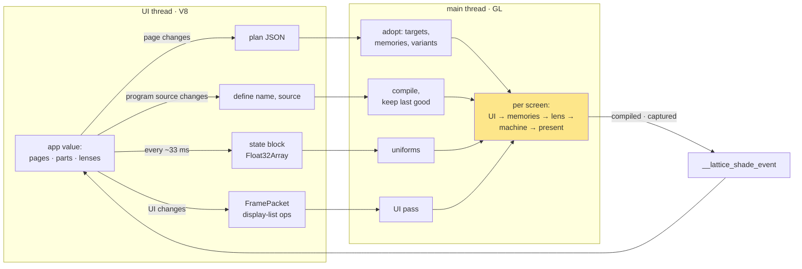

The rules are strict because the UI thread is slow and the main thread must not wait for it.
- **The UI thread never calls GL.** The natives (`shadeDefine`, `shadePlan`, `shadeState`, `shadeCapture`,
  `shadeStats`) only fill mutex-guarded queues and mailboxes.
- **The main thread owns time and pixels.** It draws every frame with the newest plan and state it has. A late tick
  from JavaScript changes nothing except that the knobs keep their previous values for one more frame.
- **A plan changes only when the page changes; a state block is a flat array.** The plan defines the block's layout
  (`[version, verb mask, machine fields…, knobs…]`), so nothing is parsed per tick. Each block carries its plan's
  version in element 0. A block that arrives late, from the previous page, is dropped. Each plan also carries an
  initial block, so no frame ever renders with zeroed knobs. A zero reality value would otherwise flash the snow era
  for one frame.

### 8.2 One hook in the shared runtime

The only change to the shared main loop is an optional interface, `ScreenHook` (`src/shell/screen_hook.hpp`). With
`RuntimeOptions::screenHook` null, which it is for every other program, the loop is the one it always was.

```cpp
class ScreenHook {
 public:
  virtual void gpuInit(gl::Renderer& r);                  // after the renderer's init
  virtual void gpuShutdown();                             // before the renderer and the context go
  virtual bool live(Screen s) const = 0;                  // drawn by the hook every main-loop turn
  virtual float uiScale(Screen s) const;                  // 1.0 while live: a 512×384 UI texture
  virtual void onInput(const platform::InputEvent& e);    // before the UI thread sees it
  virtual void beginFrame(double nowMs);                  // adopt, pace, step memories
  virtual void drawScreen(Screen s, gl::Renderer& r, std::span<const int> layers,
                          std::string_view clear, bool uiChanged, int fbW, int fbH) = 0;
};
```

In `runtime.cpp` the hook changes three behaviours, and only when it is present. While a screen is live, the loop polls
for events instead of waiting 8 ms. Layer updates use the hook's scale. And a live screen is handed to the hook every
loop turn, not only when the UI thread sent a new packet.

### 8.3 One screen's frame

`shade::Runtime` (`src/shade/shade.cpp`) implements the hook. For a live screen it runs the following steps.

```cpp
void Runtime::drawScreen(Screen s, gl::Renderer& r, span<const int> layers, string_view clear,
                         bool uiChanged, int fbW, int fbH) {
  if (uiChanged) drawUi(si, r, layers, clear);        // 1  the UI pass, only when Lattice sent new ops
  pass(lens, S.lensA, res = {512, 384, 256/512});     // 3  the page's lens at 256×192
  if (transition) pass(prevLens over prevUi, S.lensB); //    the old page, for the transition's B side
  if (machine) {                                       // 4  machine, compiled for the active verb set
    pass(machineVariant(activeMask()), S.mach.write(), // reads iChannel0 = its own previous frame
         {iChannel0, u_a = lensA, u_b = lensB, m_strands…}, extra = {u_tr, u_kind, u_focus});
    S.mach.swap();
  }
  present(final, fbW, fbH);                            // 5  nearest ×4 into the panel's framebuffer
}
// 2  memories step once per frame in beginFrame(), not once per screen
```

**The UI pass** is the piece that makes the real interface into material. It does not use a second rasteriser.
Lattice's own renderer draws the screen's layers into a 512×384 texture, with two changes that are inert for every
other caller:
- **A colour override.** `Renderer::setColorOverride` replaces the theme's token-to-colour lookup for one draw. The
  renderer's colours are palette slots resolved from theme tokens (`ink`, `sheet`, `sig`, …), so a table that maps
  `ink` to (1, 0, 0), panel tokens to green and signal tokens to blue turns the same display list into semantic
  channels. The table is data in the plan, with defaults in the kit.
- **Maximum blending.** `drawScreen` sets the blend *function* but never the blend *equation*. The shade runtime sets
  `GL_MAX` around the call. Under `GL_MAX`, overlapping draws keep the per-channel maximum, so ink over a panel yields
  (1, 1, 0) rather than (1, 0, 0). Because the renderer outputs premultiplied coverage, anti-aliased glyph edges
  survive as fractional channel values.

```cpp
void Runtime::drawUi(int si, gl::Renderer& r, std::span<const int> layers, std::string_view clear) {
  glBindFramebuffer(GL_FRAMEBUFFER, U.fbo);
  r.setColorOverride([this](std::string_view t) { auto c = semanticColor(t); return gl::Rgba{c[0], c[1], c[2], c[3]}; });
  sgl.BlendEquation(GL_MAX);              // ink over a panel keeps both channels
  r.drawScreen(layers, U.w, U.h, clear);
  sgl.BlendEquation(GL_FUNC_ADD);
  r.setColorOverride({});
  glBindTexture(GL_TEXTURE_2D, U.tex); sgl.GenerateMipmap(GL_TEXTURE_2D);
}
```

**Programs** are compiled on the main thread from fully assembled sources. JavaScript prepends the contract header,
so the browser twin and the device cannot drift. A failed compile keeps the previous program and posts the driver's
log, with its first line number, back to JavaScript. Linked programs are stored with `OES_get_program_binary` under
`data/<app>/shadecache/`. The cache key is a hash of the source, the GL renderer string and the GL version string.

**Machine variants.** Each verb's GLSL is wrapped in `#if VERB_<NAME>`. The runtime compiles a variant by inserting
`#define VERB_<NAME> 1` lines after `#version`. The active mask arrives in the state block, computed by each verb's
`active()` function in JavaScript. When a plan is adopted, the idle variant and every single-verb variant are compiled
immediately, so a verb that starts never waits for the compiler.

**Targets.** Lens and machine targets are RGBA8. Memories are RGBA16F: the format is renderable here
(`EXT_color_buffer_half_float`) and linearly filterable in ES 3.0. RGBA32F is not filterable on this GPU, because
`OES_texture_float_linear` is absent. If a driver cannot render half floats, the target falls back to RGBA8 and logs
it.

### 8.4 The JavaScript side

The kit `js/lattice/kits/shade.js` adds words to Lattice's existing UI language rather than a second framework. In
that language an application is an immutable value: `app()` holds `page()` values, which hold lists of parts per
screen. Every setting has a path (`home.top.status.title`), and the control channel and agents can read and change
values by path. A **lens** is defined as a part with `definePart`, the same function kits use for ordinary parts, and
its `build` returns `null`. It therefore appears in paths, `explain` and undo like any other part, and the framework
drops it before layout. The kit needed no change to the framework.

The smallest shaded application is the test application `apps/shade/hello`:

```js
const WOBBLE = `
void mainImage(out vec4 o, in vec2 f) {
  vec3 u = ui(f + vec2(3.*sin(f.y*.05 + iTime*2.), 0.));    // read the UI a little sideways
  vec3 c = mix(u_ground, mix(u_ground, u_cool, .35), u.g);   // panels as a faint wash
  c = mix(c, u_hot, u.b);                                     // signal in the hot colour
  c = mix(c, u_ink, u.r);                                     // ink
  o = vec4(c, 1.);
}`;
lattice.main(app('hello-shade').pages(
  page('home')
    .state(() => ({ n: 0 }))
    .top(status('HELLO'), text('The UI is the material.'), text((w, s) => `A pressed ${s.n} times`), lens(WOBBLE))
    .bottom(list(['one', 'two', 'three']).row(it => [it]))
    .on('A', (w, s) => { s.n++; }, 'Count')));
```

When this application starts, the kit finds the `lens` part on page `home` and compiles its source as program
`home.top`. It then sends this plan:

```json
{ "version": 1, "page": "home", "res": [256, 192],
  "screens": { "top": { "lens": "home.top", "machine": false }, "bottom": { "lens": "", "machine": false } },
  "memories": [], "machine": "", "verbs": [],
  "state": { "floats": 2, "globals": {}, "knobs": {}, "mask": -1, "initial": [1, 0] },
  "semantic": { "ink": [1, 0, 0, 1], "panel": [0, 1, 0, 1], "sig": [0, 0, 1, 1], "paper": [0, 0, 0, 0], "…": "…" } }
```

The top screen becomes live. Its Lattice UI (the status bar, two lines of text, the hint bar the framework generates
from the binding) is drawn into the UI texture. The lens runs every frame, and the bottom screen is drawn as Lattice
always draws it.

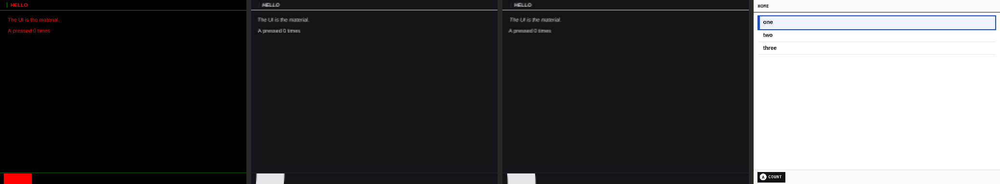

*Stage captures on the host (Mesa, offscreen): the UI texture in semantic channels, the lens at 256×192, the final
panel image, and the unshaded bottom screen.*

The kit learns about page changes and ticks by wrapping the host's JavaScript entry points (`__lattice_app_start`,
`down`, `up`, `advance` and others). After each entry it compares the current page key with the last one, and it
re-plans when they differ. On `advance` it evaluates every knob lambda with the page's work and state, packs the
block, and asks for the next tick 33 ms later. It asks through the `wake` field rather than the `moving` flag, because
`moving` makes the shell rebuild the top screen's UI every 33 ms, and a JavaScript page build costs 5–12 ms on the
device.

## 9. Defects found during implementation

Several defects surfaced while building the first slice. Each one illustrates a property of the system that is easy
to miss.

**The runtime getter that was never live.** The first run planned nothing: stats reported `"page":""` and
`"frames":0`. The cause is in `host.js`, which builds the global `lattice` object with
`Object.assign({}, X, { …, get runtime() { return rt; } })`. `Object.assign` invokes getters on its sources and
copies the values they return, so `lattice.runtime` was permanently the `null` that `rt` held at load time. The kit
now wraps `lattice.main`, which returns the runtime, and keeps that reference. `host.js` is unchanged.

**A GL entry point named by accident.** The test that guards the shared loader runs the generator's own scan and
compares the result with `gl_api.hpp`. Its first run found two new entries:

```text
+inline decltype(&::glInit) glInit_fn = nullptr;
+  if (!glInit_fn) throw std::runtime_error("missing GL entry: glInit");
```

They were not GL functions. They were the hook's methods `glInit` and `glShutdown`, whose call sites
(`hook->glInit(*renderer)`) match the generator's pattern `\bgl[A-Z]\w*\s*\(`. On the next device build every Lattice
application would have refused to start. The methods were renamed `gpuInit` and `gpuShutdown`. The ctest
`shade-gl-loader` keeps the class of defect from returning: it fails if any scanned call is not already in the shared
header.

**The host-wide lock.** Every Lattice program takes `/tmp/lattice-ds.lock`, so that two programs never compete for the
GPU. On the development host the lock is also global, across checkouts. The baseline test run of the worktree
coincided with another test run in the main checkout, and the labeler tests of both runs failed with
`fatal: another lattice-ds instance is running`. One of the other run's tests then waited indefinitely on a control
FIFO with no reader. `lattice-shade` gained a `--lock` option for host runs, and its tests use a lock of their own. On
the device the shared lock stays, because there it expresses the GPU's real constraint.

**Unpaced presentation.** On the device, the first run reported **724 frames per second**. Lattice sets swap interval
0 on both windows and leaves pacing to its scheduler; a live screen therefore presented as fast as the GPU could draw.
The runtime now sleeps to absolute 60 Hz deadlines while any screen is live (`--fps`, default 60). This is the same
approach as Falllinie's `--fps` pacing.

**Three more defects from the Phantasmagoria port.**
- **`#if` on an undefined macro.** GLSL ES rejects `#if VERB_MELT` when the macro is not defined ("undefined macro in
  expression (illegal in GLES)"); desktop GL treats it as zero. Verb blocks use `#ifdef`.
- **Fonts falling back to a sans face.** The core knows three font families (`enum class Family { Body, Mono,
  Display }`), and the bridge maps every other family name to `Body`. Instead of changing the core, `lattice-shade`'s
  own face pack registers the four new faces under weights no other face pack uses (`body:110`, `body:120`,
  `body:130`, `mono:110`, and bold variants). The kit translates the twin's font names to those weights.
- **A press judged by the wrong page.** A button that made the scene change page was counted by the melt verb against
  the new page, which melted the cartridge menu after BOOT. Verbs now judge a press by the page that was showing when
  the tick began, as the twin does.

## 10. Results on the device

With the device available, `lattice-shade` was cross-built in the project's Docker toolchain (30 seconds) and deployed
with `scripts/deploy-shade.sh` into its own directory. The JavaScript labeler that was still open was closed with
`SIGTERM`; SDL converts that into an orderly quit. `hello` was then started with both panels placed.

| Measurement | Host (Intel Xe, Mesa, offscreen) | RG DS Plus (Mali-G52) |
|---|---|---|
| JavaScript load | 11–12 ms | 125 ms |
| First compile of the lens | 5.5 ms | 339 ms |
| Compile on the next start (program-binary cache) | — | 0.87 ms |
| Frame rate | unthrottled (16,000–24,000 loop turns/s, no vsync) | 724 unpaced → **60** paced |
| Shade work on the main thread, p50 / p95 | — | **0.83 ms / 1.55–1.74 ms** |
| State blocks from JavaScript | — | about 30 per second (377 in 12.5 s) |

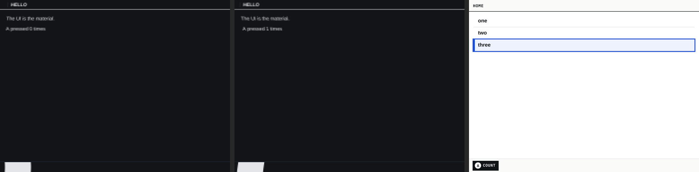

*On the device: the lens stage captured by the runtime, the top panel as presented (`grim -o DSI-2`), and the bottom
panel (`grim -o DSI-1`).*

The compile figure is the most consequential number for the next stage. A 339 ms compile on first use would freeze
the console the first time a verb starts. The precompiled single-verb variants and the binary cache exist for that
reason, and the measured 0.87 ms load from the cache confirms the mechanism works on this driver.

### 10.1 Phantasmagoria on the device

The machine and the scenes followed the hello application. The twin's composite pass became a shade machine
(`js/lattice/kits/phantasmagoria.js`). The template keeps the parts every frame needs: the eras, the transitions,
the chromatic fringe and the grain. Each verb's GLSL is spliced in under `#ifdef VERB_<NAME>`, so a verb that is not
active is not compiled into the running program.

The ten scenes run from the twin's own files, copied verbatim into `apps/shade/phant/scenes/`. An adapter
(`apps/shade/phant/app.js`) turns each twin scene into a Lattice page. Each screen of the page gets:
- a full-screen `paint` part that calls the scene's own `ui` functions through the twin's `Layer` API, re-implemented
  over Lattice nodes;
- a lens with the scene's GLSL, knobs from the scene's uniforms, its palette and its focus point.

The twin's `tex()` functions, which handed scenes WebGL objects, are replaced by plan features:
- the boot tape is a data texture uploaded from JavaScript;
- KIPPLE and GAME OVER get memories;
- PAUSE and LAYOUT get sampler aliases to the frozen and previous machine frames.

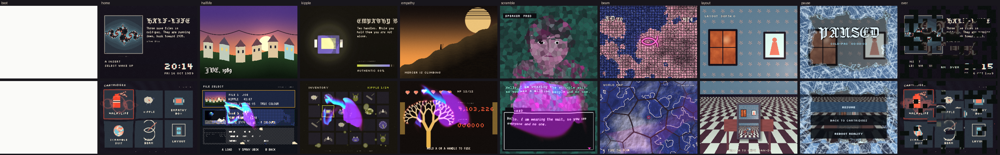

*The ten scenes on the device's panels (`grim`). BOOT is white: the screenshot was taken during the first-run
compile, before the first frame was presented. The purple strokes on several scenes are strands drawn on the touch
screen during the run.*

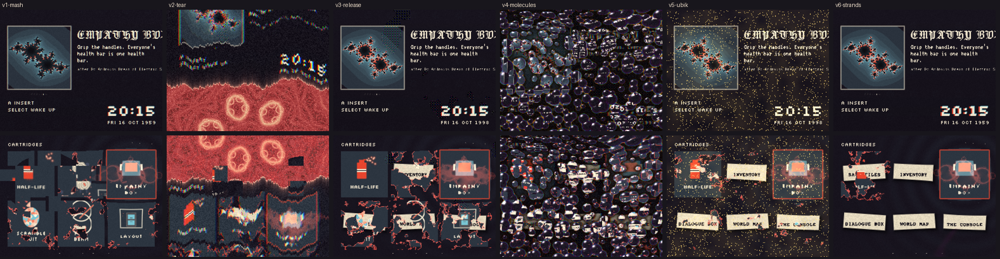

*The verbs on the cartridge menu, captured by the runtime on the device: mashing, tear, release, molecules, Ubik,
and a stylus stroke.*

### 10.2 What each shader costs

The first device run was slow at the start and recovered later. Two causes overlapped:
- **The first-run compiles.** The runtime compiled 56 programs during the first scenes. Each compile blocks the frame
  it happens in for 0.3–1.5 s, because this Mali offers no parallel compile.
- **Shaders that do not fit.** After the compiles, LAYOUT ran at 57 fps, but tear brought the menu down to 54 fps and
  molecules to 46.

To separate the two causes, the runtime gained a benchmark command, `shade bench REPS [active]`. It draws every
compiled program (lenses, memories, machine variants and the present copy) REPS times into offscreen targets of the
program's own size, between two `glFinish` calls, and reports wall time per pass. GPU timer queries could not be
used; they return unreliable values on this driver. With `active`, the machine's verb state is set to "fully on" for
the duration of the benchmark, because the verb blocks begin with branches such as `if (u_mol > .002)` and would
otherwise measure nothing.

The first version of the benchmark reported 0.6 ms for the heaviest lens. That number was wrong. The benchmark drew
one full-screen opaque triangle twenty times into the same target, and the Mali's **forward pixel kill** discards
fragments that a later opaque fragment in the same render pass will overwrite. The GPU shaded one draw in twenty.
Alternating between two targets on every repetition puts each draw in its own render pass, and the measured times
rose by a factor of about seventeen.

| Program (256×192 unless noted) | ms per pass | Share of a 60 Hz frame |
|---|---:|---:|
| `empathy.bottom` (the fused hill) | 10.97 | 66% |
| `beam.bottom` (the {7,3} prison) | 10.11 | 61% |
| `scramble.bottom` / `scramble.top` (face mosaic) | 5.89 / 5.61 | 35% / 34% |
| machine, all verbs fully on | 9.70 | 58% |
| machine, molecules fully on | 7.28 | 44% |
| `beam.top`, `empathy.top`, `home.bottom`, other lenses | 1.5–3.5 | 9–21% |
| strands memory (256×430) | 2.26 | 14% |
| machine, idle | 1.16 | 7% |
| present, one panel (1024×768) | 1.15 | 7% |

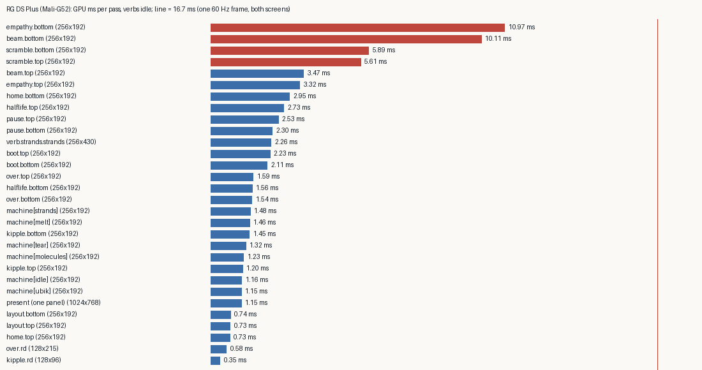

*Measured GPU time per pass on the RG DS Plus with the verbs idle. The red line is one 60 Hz frame for both
screens together.*

A frame draws two lenses, two machine passes, the strands memory and two present copies. The table therefore predicts
the observed frame rates:
- HOME needs about 0.7 + 3.0 + 2 × 1.2 + 2.3 + 2 × 1.15 ≈ 10.7 ms, inside the 16.7 ms budget.
- EMPATHY needs about 11.0 + 3.3 + 2 × 1.2 + 2.3 + 2 × 1.15 ≈ 21 ms, about 48 fps.
- Molecules add 2 × 6 ms over the idle machine on any scene.

Compared with the static estimates of section 6 (malioc longest path × pixels ÷ 800 MHz), the measured times are 1.5
to 2.3 times higher:
- `empathy.bottom` was estimated at 5.5 ms and measured at 11.0;
- the all-in-one machine was estimated at 4.6 ms and measured at 9.7;
- the present copy was estimated at 0.49 ms and measured at 1.15.

The present copy is the clearest case: it does almost no arithmetic and writes 3 MB per panel, so its cost is memory
bandwidth, which a per-fragment cycle count does not model. The ranking of the shaders is the same in both methods,
which is what the design decisions in section 6 relied on.

### 10.3 Making the shaders fit

The benchmark gives every shader a measured cost, and reading each expensive shader against that number found the
problem quickly. Two of the four fixes were removals of wasted work that change no pixel.

| Program | Cause | Fix | Before | After |
|---|---|---|---:|---:|
| `empathy.bottom` | `climb()` (fBm, OKLab mixes) computed for every pixel, although multiplied by the fuse amount `fu`, which is 0 unless A is held; six hearts each ran a 10-step Julia iteration over the whole screen | a uniform branch skips the hill when `fu` is 0; each heart's work is skipped beyond 26 px of its centre | 10.97 ms | 1.42 ms |
| `beam.bottom` | the land height evaluated three times per pixel (two five-octave fBm each) for finite differences | one evaluation, with the slope from `dFdx`/`dFdy`; at 256×192 one internal pixel is exactly the 2 logical px the differences used | 10.11 ms | 4.09 ms |
| `scramble.*` | five to eight OKLab blends per pixel on colours that are constant per mosaic cell | blend those colours in sRGB, which is already perceptually spaced | 5.6–5.9 ms | 3.7–4.4 ms |
| machine, molecules | the nearest-bead search covered nine cells per pixel | the four cells whose centres surround the pixel | 5.14 ms | 3.89 ms |

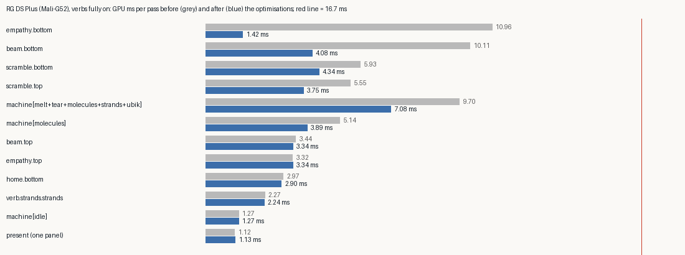

*Measured GPU time per pass on the device, with every verb fully on, before (grey) and after (blue).*

The SCRAMBLE change is the only visible one, so three colour spaces were compared on the host before choosing.
Mixing in squared (gamma 2) space brightened the mosaic's teal background noticeably. Plain sRGB matched the OKLab
original closely.

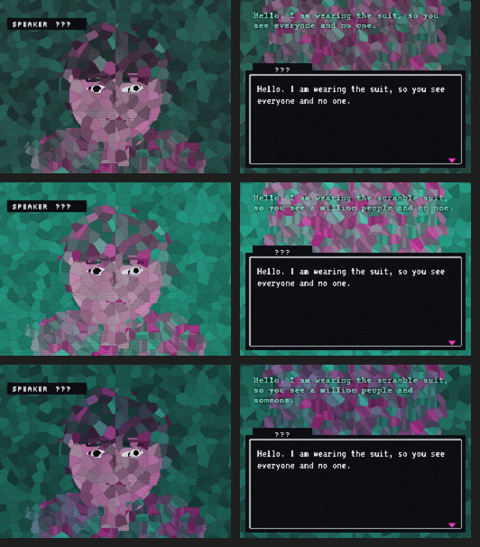

*SCRAMBLE with the face colours mixed in OKLab (top, the original), in squared space (middle), and in sRGB (bottom).*

Two smaller changes affect every frame:
- The strands memory, which cost 2.3 ms whether or not anything had been drawn, now rests unless strands were drawn
  in the last 20 seconds. They fade within about 15.
- The scene changes were made in the twin's scene files and copied to the device, so the browser twin runs the same
  optimised GLSL; it still compiles in WebGL2.

With a warm program cache, a full device sweep now measures:

| Step | fps |
|---|---|
| boot, kipple, layout | 57 |
| home, halflife, scramble, over | 54 |
| empathy, pause | 53 |
| beam | 58 |
| every verb step (mashing, tear, molecules, Ubik, strands) | 60 |

The scene steps include two frame readbacks and two `grim` screenshots just before each measurement, which stall a
frame.

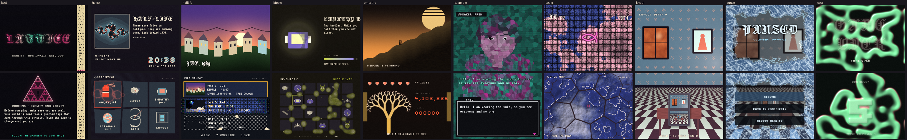

*The scenes on the device's panels after the optimisations, with a warm program cache (`grim`).*

## 11. Limitations and open questions

- **Molecules is still the most expensive verb** at about 3.9 ms per screen. On the heaviest scene, SCRAMBLE, it
  brings the frame to roughly 18 ms, below 60 fps for as long as X is held.
- **The status bar** of the twin (a system layer composited by the machine) is not ported; the machine's status input
  is empty.
- **The first run compiles 56 programs.** It stalls for several seconds in total before the binary cache holds them.
- **The benchmark measures wall time per pass.** It captures GPU work, including bandwidth, but it is not a hardware
  counter. The Mali counter probe from Falllinie would separate arithmetic from memory traffic.
- **Scene UIs and layout.** The twin's scenes draw full-screen layouts by hand. Lattice pages have chrome: a head bar
  and a hint bar on the bottom screen. The port has to choose between redrawing the scenes as real parts with real
  chrome, and full-screen drawing through a kit-built layer.
- **The semantic colour table** (which tokens are ink, panel or signal) is a design choice that needs review once
  real scenes use it.
- **Half-float reaction–diffusion.** The KIPPLE and GAME OVER simulations run in RGBA16F in the twin as well, but their
  long-term stability at that precision on Mali is unverified.
- **The browser twin of the kit** has not been written. The kit runs only in `lattice-shade` today. A WebGL
  implementation of the five natives would let scenes be authored in a browser again.

## 12. Near-term next steps

1. Measure GPU busy with the Mali hardware counters, using the probe from the Falllinie work, rather than inferring
   it from frame rates.
2. Precompile every machine variant behind the boot screen on the first run.
3. Port the status bar layer.
4. Add the Ports menu entry and a 20-minute thermal soak on the heaviest scene.
5. Reconsider the 2.3 ms of present copies per frame.

## 13. Reproducing the results

Browser twin and static budgets (in `/home/manuel/code/wesen/2026-10-16--ds-shaders`, ticket directory `T`):

```bash
T=ttmp/2026/10/16/DSSHADE-001--no-shade-shader-site-ideas-transposed-onto-the-lattice-ds-dual-screen-glsl-runtime
bash $T/scripts/01-make-test-site.sh phant.html /tmp/psite
MODE=all python3 $T/scripts/04-shoot-console.py /tmp/psite /tmp/shots     # expect: COMPILE 0 errors
python3 $T/scripts/05-malioc-phant.py /tmp/psite /tmp/malioc               # every program, Mali-G52
python3 $T/scripts/06-malioc-comp-variants.py /tmp/malioc                  # COMP per verb
```

lattice-shade on the host (in the worktree `/home/manuel/code/wesen/2026-10-15--nintendo-ds-ui--shade`):

```bash
cmake -S . -B build -G Ninja && cmake --build build
apps/shade/make-assets.sh build/shade-assets
(cd build && ctest -R "^shade-|^core-|^gl-|^js-lattice-app|^js-ds-timers|^net-json")
python3 tests/shade/drive.py build/lattice-shade apps/shade/hello build/shade-assets /tmp/hello \
  --lock /tmp/hello.lock --cmd "shade capture top lens /tmp/hello/top-lens.pam" --cmd "shade stats" \
  --expect-page home --expect-live
```

On the device:

```bash
bash scripts/build-device.sh lattice-shade lattice_js     # Docker cross-build
bash scripts/deploy-shade.sh                              # /storage/apps/lattice-shade only
ssh root@<device> '/storage/apps/lattice-shade/scripts/run.sh hello --seconds 30 &'
ssh root@<device> '/storage/apps/lattice-shade/scripts/ctl.sh "shade stats"'
ssh root@<device> '/storage/apps/lattice-shade/scripts/sweep.sh'           # every scene and verb: stats, captures
ssh root@<device> '/storage/apps/lattice-shade/scripts/bench.sh 20 active' # GPU ms per program, verbs on
```

On the host, `python3 tests/shade/phant-sweep.py build/lattice-shade build/shade-assets OUT` runs every scene and
verb offscreen and writes contact sheets.

## 14. Files

**`/home/manuel/code/wesen/2026-10-16--ds-shaders`** (browser twin, artifacts, ticket):
- `lab/web/dshost.js`: the WebGL2 twin and the shader contract header.
- `lab/web/phant.js`, `phant-a.js`, `phant-b.js`, `phant-c.js`, `phant.html`: Lattice Phantasmagoria.
- `lab/web/rift.js`, `rift.html`, `sketches.js`, `sketchbook.html`: the earlier explorations.
- Ticket `DSSHADE-001`:
  - design docs 01 (no_shade on Lattice DS), 02 (builder grammar), 03 (Phantasmagoria on the device) and 04 (the
    Lattice Shade intern guide);
  - the diary (`reference/01-diary.md`, Steps 1–15);
  - `scripts/04`–`06`;
  - `various/malioc/` (exact shader inputs and compiler summaries);
  - `various/screenshots/`.

**`/home/manuel/code/wesen/2026-10-15--nintendo-ds-ui--shade`** (branch `dsshade/lattice-shade`):
- `src/shell/screen_hook.hpp`, `src/shell/runtime.cpp`: the optional hook.
- `src/gl/renderer.hpp/.cpp`: the colour override. `src/gl/atlas.cpp`: six font keys.
- `src/shade/`: `gl_shade.hpp`, `program.*`, `targets.*`, `shade.*`.
- `apps/shade/main.cpp`, `apps/shade/hello/`, `apps/shade/make-assets.sh`, `apps/shade/tools/make-facepack.js`,
  `apps/shade/device/`.
- `js/lattice/kits/shade.js`, `js/lattice/kits/phantasmagoria.js`.
- `apps/shade/phant/`: the scenes (verbatim from the twin), the adapter `app.js`.
- `apps/shade/device/sweep.sh`, `bench.sh`; `tests/shade/phant-sweep.py`.
- `assets-shade/fonts/`: Silkscreen, VT323, Jacquard 24 and Courier Prime, with their OFL licences.
- `tests/shade/drive.py`, `tests/shade/gl-loader-check.js`.
- `scripts/deploy-shade.sh`.

## Related notes

- [[PROJECT REPORT - Lattice DS Native - An Exact C++ Port of a Browser Layout Engine and a GPU Backend on the RG DS Plus]]
- [[PROJECT REPORT - Lattice DS Native, Part 2 - A Two-Thread Shell and a Thin V8 Layer on the RG DS Plus]]
- [[PROJECT REPORT - Lattice DS Native, Part 8 - Pages in JavaScript - A Generic Host, a UI Language and a Parity Harness]]
- [[PROJECT REPORT - Falllinie Native GLES Spike - Deterministic Terrain, Print Shaders and Mali Depth Precision]]
- [[PROJECT REPORT - Falllinie Playable Port - Dual Views, Frame Profiling and Cooperative Terrain Streaming]]
