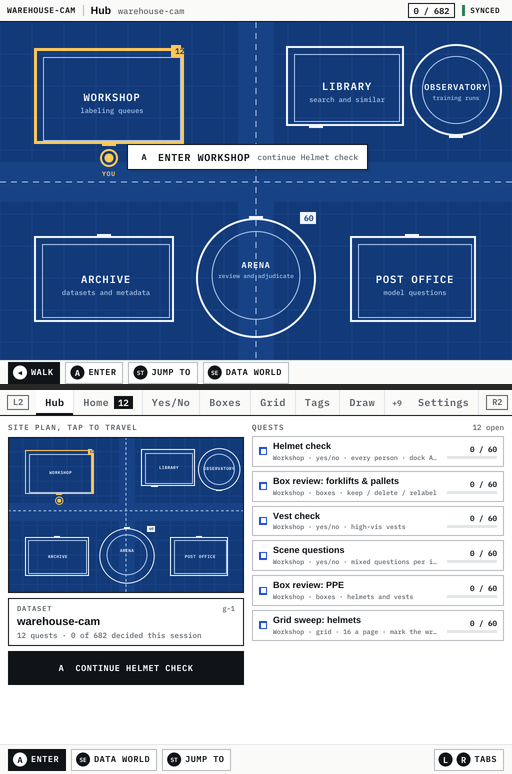
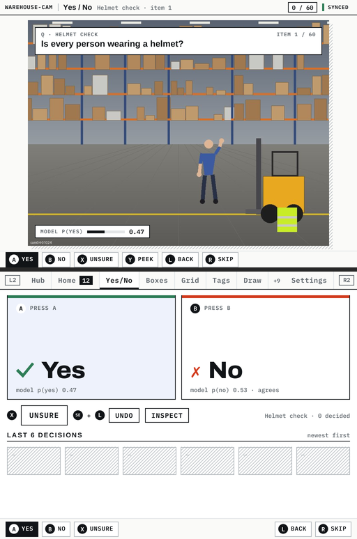
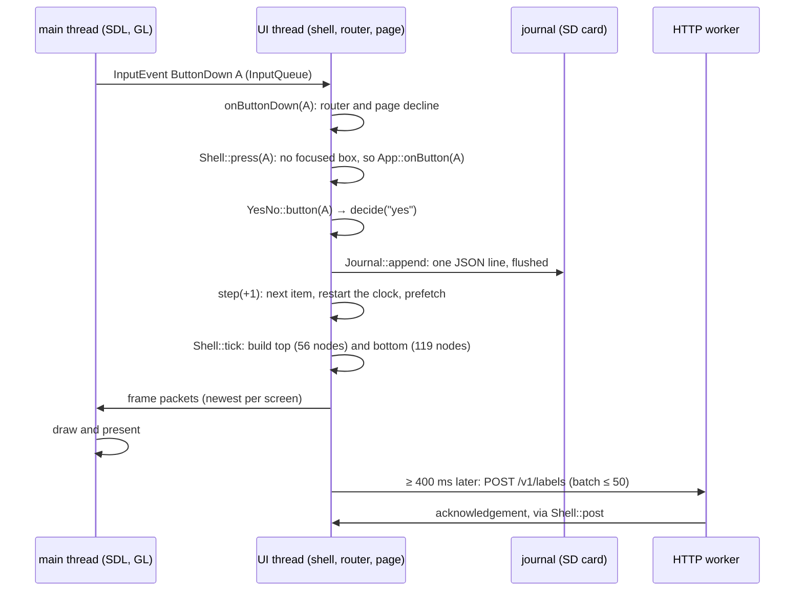
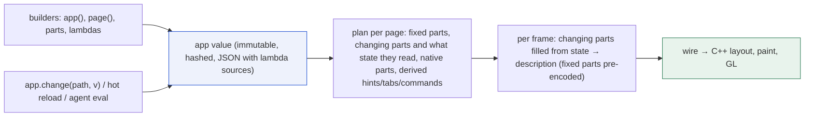
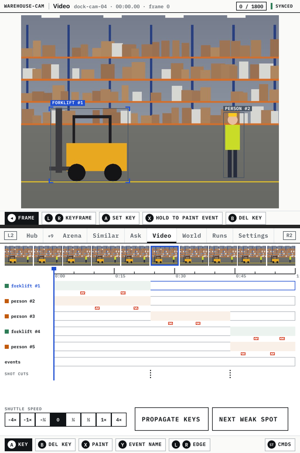
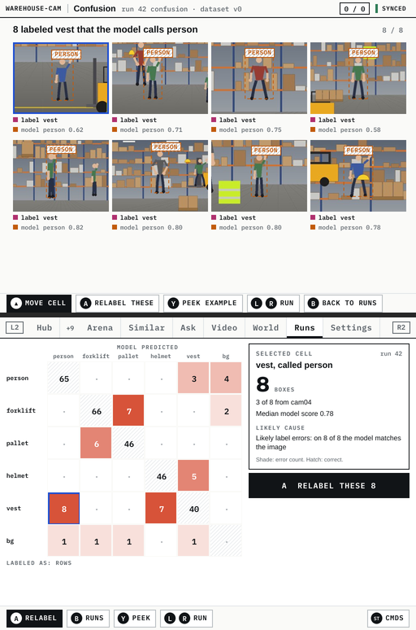

# Lattice DS Native, Part 7: From an Engine to a Framework

Parts 1 to 6 built things. Part 1 ported a browser layout engine to C++, and Part 2 put it behind a two-thread
shell. Parts 3 to 5 ran a browser application's own JavaScript and a language-model backend on top. Part 6 built a
labeling client of twenty pages. This part takes stock of all of it. The team wants to turn the engine into a
framework that other people build applications on, with a JavaScript API. Before designing that API, someone had to
establish exactly what the code does today, which parts are general and which belong to one application, and what
is broken.

That work produced three things, and this report explains each:

1. **A textbook.** 28 chapters and five appendices, about 23,000 lines, every claim tied to a file and line,
   illustrated with screenshots and control-channel traces taken from the current build. It is in the repository
   under `docs/lattice-ui-framework/` and on the reMarkable as a 575-page PDF.
2. **An issue list.** 154 entries, each with its location, its effect, its evidence and a suggested fix. Read as a
   whole, they say where the framework's boundary is drawn wrong.
3. **A design** for moving application logic into JavaScript while keeping C++ for the work that must be fast. It
   is grounded in a grammar that already exists in the repository, for language-model agents rather than screens.

By the end of the report a reader should be able to answer four questions. How was a 575-page technical book
written in a day without losing consistency? What does the code say about where a framework's boundary should be?
Why do the "compiler" and "runtime" designs for a UI language turn out to be one design? And what, concretely,
stays in C++?

> [!summary]
> - The engine core and the shell are sound. Of 33 bugs found, one is in the core and one in the shell. 23 are in
>   the labeler's application layer, exactly where mechanisms are duplicated across pages.
> - Generic mechanisms living in application code can be counted by their copies. Examples: routing in 3 apps,
>   hold-button handling about 12 times, region touch handling 8 times, request state 6 times.
> - The arena's `b2_grammar.js` already implements the model a JS-first framework needs. It has immutable values
>   with addressable parameters, and lambdas only fill slots. That model makes the compiler view and the runtime
>   view of a UI language the same system.
> - Device measurements put the line between the languages. JavaScript decides what and when; C++ does anything
>   per frame or per pixel.

## 1. Terms

The report uses a small vocabulary, defined here before any claim depends on it.

- **Description.** A tree of nodes built by builder calls (`col()`, `row()`, `text()`, `image()`), describing one
  layer of one screen. It is rebuilt from scratch whenever its screen is redrawn.
- **Layout, paint, display list.** Layout turns a description into positioned boxes. Paint turns boxes into a flat
  list of drawing operations, the display list, and also collects the *hit map*: the rectangles of nodes that carry
  a key. The GPU backend draws display lists.
- **Shell.** `lattice::shell::Shell`: the two screens, their layers, when to redraw, the hit map, the focus moved by
  the D-pad, and scrolling. It knows a *page key*, a string under which it remembers focus and scroll. It does not
  know what a page is.
- **App.** The class an application implements for the shell (`shell::App`): set-up, input hooks, `advance` (what
  moves, when to wake), `pageKey`.
- **Router and page.** In the labeler, the `App` is a router (`labeler::Labeler`) that owns twenty `Page` objects
  and shows one at a time. A page has two builders (top and bottom screen) and input hooks.
- **Wire format.** The binary encoding with which a description built in JavaScript reaches C++ (`LUI1`).
- **Native part** (proposed). A user-interface component implemented in C++ and used from JavaScript through a
  declared schema of parameters and events.
- **App value** (proposed). The whole application as one immutable value, addressable by path.

## 2. How the book was written

### 2.1 Reading before writing

The first step was not writing. Four readers worked in parallel. I read the engine core, the shell, the runtime and
the app chrome myself, because every chapter would depend on them. Three agents wrote *dossiers*, structured notes
of 1,700 lines each:

- one on the nine labeling-tool pages;
- one on the model, video and world pages and their data services;
- one on the JavaScript bridge and the wire format.

The dossiers are kept in the ticket as sources, labelled as notes and not as authority. Every chapter was later
checked against the code.

At the same time, a script (`scripts/labeler/textbook-figures.py`) started the labeler headless against the Go
stub server. It visited every page the way a person would: by tabs, buttons and the command palette. For each page
it captured both screens and the control channel's replies: `state`, `page`, `look` (the text on the screens,
grouped into rows) and `keys` (the hit map). The figures and the traces in the book are therefore the current
build, not a drawing of it.



*The hub, the labeler's start page with a server: a site plan of six buildings on the top screen, the same plan at
46 % with tappable buildings and the quest log on the bottom.*

### 2.2 A reference chapter before any parallel writing

Seven agents then wrote 26 of the 34 files in parallel. Parallel authors drift in voice, depth and format unless
they share a concrete example, so the order mattered. I wrote the navigation chapter first, Chapter 17: routes,
tabs, back, the command palette and the hub. I rendered it to PDF and fixed what the render showed before any agent
started:

- **Clipped code.** Code lines longer than about 88 characters were cut off at the margin. The rule became 86
  characters per line inside fenced blocks, checked by a script.
- **Figure numbering.** pandoc numbered images on its own, so captions read "Figure 2: Figure 17.2: …". The rule
  became an image without alt text, sized `{width=60%}`, followed by an italic caption that carries the book's own
  number.
- **Diagrams.** Mermaid is not installed in the PDF toolchain, so diagrams are plain text.

These rules went into the book's README together with the style rules (direct prose, no analogies, *why* before
*how*, every claim anchored to `path:line`). Chapter 17 was named as the reference. Each agent also received an
ID range for the issues it found and wrote them to a separate fragment file, so that seven writers never edited one
file.

### 2.3 Cross-checking is where parallel writing paid off

The most valuable effect of parallel writing was not speed. Agents read each other's fragments and chapters, and
reported contradictions they found in the code. Five statements in chapters I had written myself were corrected
that way:

| Statement | Correction | Found by |
|---|---|---|
| the tab strip's room is 512 − 2·34 − 2·24 = 376 | the arithmetic is 396, and only 396 reproduces the windows seen in the traces | two agents independently |
| the labeler added 11 colour tokens to the engine | 18: eight class washes, a four-step red ramp, six blueprint tokens | the text and colour agent, confirmed with `git log -S` |
| adding a page touches seven places | eleven edits in seven files, eighteen for a tool | the page-abstraction agent |
| only the inspector discards late network answers | the inspector, Box drawing and Masks do, by comparing item ids | the data agent |
| the unused part of `lui.js` is about 60 % | about three quarters | the JavaScript agent |

One claimed anomaly was checked and rejected. A trace was said to be missing a key, but it does list the key
(`mk:brush:±` at y = 195). The rule that came out of this is simple: count with `grep` before writing a number, and
check a reported contradiction in the code before acting on it.

### 2.4 The book's structure

| Part | Chapters | Subject |
|---|---|---|
| I | 1–2 | what the framework is; repository, libraries and build |
| II | 3–7 | describing UI, layout, paint and the hit map, text and colours, GPU and images |
| III | 8–12 | threads, layers and scheduling, input, focus and scrolling, testing |
| IV | 13–14 | app chrome (status bar, tab strip, hint bar, page frame, keyboard), the kit |
| V | 15–22 | anatomy of an app, the page abstraction, navigation, input policy, data and async, two page catalogues, recurring techniques |
| VI | 23–25 | the V8 host and bridge, the wire format, JavaScript builders |
| VII | 26–28 | the engine/app boundary, a proposed JavaScript API, gaps and a roadmap |

## 3. One press of A, end to end

The book's orientation chapter follows one decision through the system, because every later chapter refers back to
it. The person is on the Yes/No tool, item 1 of the Helmet check quest, and presses A.



*The Yes/No tool: the item's image with the question pinned on it and the model's p(yes) on the top screen; the Yes
and No halves, Unsure, Undo and the last six decisions on the bottom screen.*



The chain shows the division of labour the framework provides. Application code does three things: it describes
its screens, changes its state in a handler, and asks for a redraw. The framework does everything else: input
translation, routing, scheduling, layout, painting, drawing, image upload and threading.

On the host, building, laying out and painting the Yes/No page takes 0.039 ms for the top screen and 0.083 ms for
the bottom (`traces/bench.txt`). The most expensive screen in the application is the confusion matrix's top, at
0.160 ms for 226 nodes.

## 4. Where the boundary between engine and application is wrong

### 4.1 The method: count the copies

A mechanism belongs in a framework when more than one application needs it. The code shows that directly: a
mechanism that a second application needs is one that already exists twice. The textbook's boundary audit (Chapter
26) therefore counts copies.

| Mechanism | Lives in | Copies |
|---|---|---|
| Page registry and routing (`go`, `enter`, page key) | the labeler's `Labeler`, the demo, the arena | 3 apps |
| Hold buttons, chords, repeat filtering | pages and the router | ~12 |
| Hint bars written separately from the handlers they describe | pages | 20 |
| Touch handling that restates the layout's geometry | pages | 8 |
| Image fitting, fallbacks, progressive crops | `image_slot`, pages | 6 |
| A stack used as a canvas with hand-written coordinate maps | pages | 7 |
| Charts built from rectangles and lines | Runs, Confusion, Similar, Video | 4 |
| A text field with the on-screen keyboard | palette, Tags, Similar, Ask | 4 |
| Request state (loading flag, error, stale answers) | pages, `Models` | 6 |
| Page state lines for tests (`debug()`) | pages | 16 |

The engine has one boundary violation in the other direction. The labeler needed colours the engine did not have:
eight class washes, a four-step red ramp for the confusion matrix and a blueprint palette for the hub. They were
added to the engine's theme table and to the reference JavaScript library. There was no other place for them.

### 4.2 What the duplication costs

The issue list shows the cost of duplication. Every copy of a mechanism is a chance to get it slightly wrong, and
the defects cluster in exactly those copies.

- **Hold buttons.** A tapped hint calls `Shell::press`, which reaches only `App::onButton`, never the press and
  release hooks. Every hint for a button that acts on press and release (hold to peek, hold to paint, hold to
  remove a point) is therefore inert when tapped: four pages, PG-2.
- **Chords.** The router claims a chord's second button when it goes down but forwards its release to the page.
  Pages that guard their release handler with a flag are safe; Masks is not, so SELECT + B adds a prompt point
  (NAV-4).
- **Repeats.** The D-pad's auto-repeat goes to the press hook. Pages that decide on Up or Down (Pairwise,
  Adjudicate) decide several items when the direction is held (PG-1, PG-23).
- **Request state.** Without a shared notion of a request's generation:
  - a late answer can be applied to a different item (APP-18);
  - a late answer can navigate after the person has left (APP-20);
  - a failing request can be re-sent in a tight loop (APP-11, APP-12).
- **Routing as code.** Adding a page takes eleven edits, and the command palette's list was missed for six pages
  (NAV-1).

### 4.3 The issues in aggregate

| Area | Bug | Gap | Quirk | Smell | Drift | Total |
|---|---|---|---|---|---|---|
| Router, data services | 10 | 5 | 7 | 2 | 3 | 27 |
| Navigation | 1 | 1 | 3 | 0 | 0 | 5 |
| Individual pages | 12 | 6 | 18 | 5 | 1 | 42 |
| Core, layout, text, GL, images, build | 1 | 6 | 8 | 9 | 4 | 28 |
| Shell and runtime | 1 | 2 | 8 | 4 | 1 | 16 |
| App chrome and kit | 2 | 2 | 0 | 0 | 0 | 4 |
| V8 bridge, wire, JS library | 6 | 6 | 5 | 2 | 0 | 19 |
| Documents and comments | 0 | 0 | 0 | 0 | 13 | 13 |
| **Total** | **33** | **28** | **49** | **22** | **22** | **154** |

Three readings follow.

- **The bugs are in the application layer.** Of 33, one is in the core (a cycle check) and one in the shell (an
  image decode writing into a destroyed store at exit). The other 31 are in the application layer and the bridge:
  23 in the labeler's router, data services, navigation and pages, 6 in the JavaScript bridge and 2 in the kit.
- **The JavaScript bridge is not ready for a public API.** Five of its bugs end the process: an exception in a tap
  handler, a rejected wire buffer, a script that fails to load, a read-back native called from a builder, and a
  throwing getter during value conversion.
- **The design documents have drifted from the code.** The 13 documentation entries record places where the
  original design guide describes a binding, a loader or a format that was built differently.

Two bugs matter for anyone using the device today. Both come from comparing timestamps taken from two clocks. The
queue's retry time is taken from `steady_clock` (milliseconds since boot) and compared with the shell's clock
(milliseconds since process start). A labeler started while the server is down therefore never retries, and a "run
finished" notice never leaves the status bar (APP-1, APP-2). Each fix is one line.

None of the 154 issues was reproduced on the device. All were established by reading, and each entry says so. The
roadmap therefore starts each fix by reproducing the issue.

## 5. A JS-first design

### 5.1 The question

The next question was how to move the application's logic into JavaScript, so that an application, and a coding
agent, can describe and change it, while keeping C++ for what must be fast. Three shapes were on the table:

- a fluent builder API over a grammar of opinionated components, customised with lambdas;
- a compiler pipeline (an intermediate representation, a dependency graph);
- a runtime system that an agent can mutate while it runs.

### 5.2 The grammar already exists, for agents

The arena, the second application in the repository, contains `b2_grammar.js`. It is a set of immutable fluent
builders for language-model agents: prompts made of sections and slots, tools, agents and game boards. Its header
states one rule:

> Every builder method returns a new value. Anything an optimizer may change is data (sections, tool descriptions,
> settings); lambdas only fill slots at runtime.

An `AgentSpec` value built under this rule has five properties a UI framework needs:

1. **Addressable parameters.** `get('system#strategy')`, `set(path, value)`, `params({ mutable: true })` list and
   change exactly what a tool may change.
2. **Comparison.** `diff(other)` lists differing paths; `merge(other, { base })` is a three-way merge with conflict
   detection.
3. **Identity.** `hash` is a content hash; `derive(name)` makes a variant that records its parent.
4. **Serialisation.** `toJSON()` writes the value, recording each lambda by its source.
5. **Separation of data and code.** Sections are data an optimizer may rewrite; slots are functions of the run
   context, filled at runtime.

Around it, `d_api.js` builds a script scope in which every mutating call is wrapped by a proxy that refuses it in
read-only mode. `d_agent.js` gives a coach agent exactly one tool, `eval(code)`, run in that scope in auto, ask or
read-only mode, with `ds.look/press/tap/show` as its eyes and hands on the handheld.

### 5.3 Why the compiler and the runtime designs are one design

The difference between a compiled UI language and a mutable runtime looks fundamental, but it disappears when the
program is an immutable value held in a mutable place:

| Concern | Compiler view | Runtime view |
|---|---|---|
| What is the program | the app value | the app's current value |
| A change | a new value | `app.change(path, v)` swaps the current value |
| Cost of a change | re-plan the changed page | the same; plans are memoised by hash |
| Undo | keep the old value | `app.undo()` |
| Persistence | source files | named patches `{ path, before, after }` plus source files |
| Safety | validation when a value is made | the same, plus read-only and ask modes for agents |

Mutating parts in place would lose all of this. There would be no hash, so plans could not be memoised. There would
be no cheap undo and no diff, and for an agent, no review of what changed. The runtime model is therefore "a
mutable reference to an immutable value", and the compiler is what happens when the reference changes.



### 5.4 Opinionated parts, customised with lambdas

The API avoids compiler words. An application author writes `page`, `part`, `when`, `on`, `hold`, `change`, `keep`.
The plan, frozen fragments and native parts appear only in the tooling (`app.explain()`). A part arrives with its
layout, keys, buttons and hints decided; lambdas customise it at named places. The Yes/No page becomes three parts:

```js
page('yesno').work(s => s.quest('yesno'))
  .top(question(w => w.question).on(w => w.item).score(w => w.item.score))
  .bottom(choice('yes', 'no').extra('unsure').decide((w, d) => w.decide(d)),
          strip(w => w.history.slice(-6)))
```

`choice` binds A, B and X, draws the two halves and generates the hint bar. `w.decide(d)` belongs to the *work*
object: it writes the journal line, records undo and moves to the next item. The application never writes the
timing field, undo or prefetch, which removes two of the issues found (the wrong timer, decisions on items that have
not loaded) by construction.

Customisation has four depths, and each stays data where it can, so that tools and agents can see it:

1. a setting (`question(...).size(14)`) is data with a path;
2. a lambda at a named place (`.score(fn, { label: p => … })`);
3. replacing a named piece of a part (`.piece('footer', w => row(...))`);
4. dropping the part and writing the page with today's builders.

### 5.5 What stays in C++

The device measurements from the engine's original design work decide the split. On the RG DS Plus, V8 builds and
encodes a 94-node description in about 1.4 ms and a 120-row list in about 9.2 ms. Laying the same descriptions out
in JavaScript is 13 to 16 times slower than the C++ core. JavaScript can therefore own the logic and the
descriptions, rebuilt when state changes, but not per-frame layout or pixel work.

| Stays in C++ | Why |
|---|---|
| layout, paint, hit map, GL | 13–16× faster than V8 on the device |
| the image component with overlays and the loupe | per-touch and pinch interactions in image coordinates |
| video playback and scrubbing | 30 frames a second from atlas strips |
| the map camera (data world, hub plan) | movement and tile culling every frame |
| the mask brush and rasters | CPU A8 buffers re-uploaded every 40 ms |
| image decode, store, eviction | worker threads and GPU memory |
| journal writes, HTTP, credentials | durability, worker threads, secrets never in JavaScript |



*The video timeline: a playing video on the top screen and the lanes, keyframes and shuttle on the bottom. Its
playback is one of the native parts, because it redraws the top screen every frame.*

A native part is registered in C++ with a schema: the parameters JavaScript may set, the events it hears back, and
the C++ functions that build it and handle its touches. JavaScript sees it as one more part, and `explain()` marks it
native. Its schema is what makes it as inspectable to an agent as a part written in JavaScript.

### 5.6 The agent, carried across

The arena's agent concepts map one to one onto screens:

| Arena (today) | UI framework (proposed) |
|---|---|
| `agent(name)` value, `derive`, `hash` | `page(key)` value, `derive`, `hash` |
| `section(name, text, { mutable })` | a data setting with a path |
| `slot(ctx => …)` | a lambda at a named place |
| `get/set('system#strategy')` | `app.get/change('yesno.top.question.size')` |
| `evaluate(agents, { rubric })` | `experiment(...).variants(...).measure(...)` |
| a rubric or an LLM judge | measures from journal lines: time per decision, undo rate |
| `reflect(spec, { path })` | an agent proposing one path change |
| `makeScope({ agent, readonly })` | the same scope, guarding `change`, `keep`, `experiment` |
| the coach's `eval` in auto, ask, read-only | unchanged |

The most complex example in the design is an agent that runs a measured experiment on the device. Half the items
get variant B of the Yes/No page, with a larger question. The agent measures the median time per decision from the
journal and keeps the winner only if it is better with high confidence. Every step goes through the guarded scope;
in ask mode, the person approves each one.

## 6. The migration plan

The labeler must keep working throughout, so the migration is page by page:

1. **A JavaScript host with native pages.** The host runs the router. Every existing C++ page is registered as a
   native page that forwards its builders and input hooks unchanged. Routing, tabs, the palette and bindings now
   come from the registry.
2. **Shell pages in JavaScript:** Home, Settings, the palette, the inspector. These are lists and forms with small
   trees.
3. **Simple tools:** Yes/No, Grid, Tags, Pairwise. Each port is checked against the C++ page with one scripted
   session: equal `look` and `keys` output and equal journal lines.
4. **Native parts, then the heavy tools.** The image component, the timeline, the map and the mask brush are
   extracted, and Boxes, Draw, Pose, Masks, Adjudicate, Video and World are ported onto them.
5. **Data logic in JavaScript;** durable writes, HTTP and images stay native.
6. **Agent tooling:** paths, `explain`, `change`, `keep`, `undo`, experiments and the coach's `eval` on the
   handheld.

Before any of this, the bridge has to stop ending the process on a JavaScript error, so step 0 is the five
process-ending bugs.

## 7. Limitations and open questions

- **The issues are unreproduced.** Some will turn out to be wrong or harmless when run.
- **The JavaScript cost per labeler page is estimated, not measured.** The 1–3 ms per page on the device is scaled
  from one measured screen. Building a Yes/No page in JavaScript on the device is the first measurement to take.
- **V8 becomes mandatory.** The labeler runs without V8 today. A JS-first labeler adds about 40 MiB of memory and a
  24 ms first call.
- **Which parts exist is a product decision.** If the opinionated parts cannot express a page, authors fall back to
  raw builders and lose generated hints and bindings. The labeler's twenty pages are the test of whether the part
  set is right.
- **The parity oracle.** The core's layout is tested against the original JavaScript library to 10⁻⁶. New layout
  features would need a decision: does the browser version still matter?

## 8. Reproducing the results

```bash
cd /home/manuel/code/wesen/2026-10-15--nintendo-ds-ui
# figures and traces of every page (needs build/lattice-labeler and the Go stub)
python3 scripts/labeler/textbook-figures.py build/lattice-labeler assets \
    build/go-bin/labeler-server docs/lattice-ui-framework
# the PDF
python3 ttmp/2026/10/16/UIFW-001--*/scripts/03-build-book.py docs/lattice-ui-framework /tmp/book
remarquee upload bundle "/tmp/book/Lattice UI Framework.md" \
    --name "Lattice UI Framework Textbook" --toc-depth 2 --non-interactive
```

## 9. Files

- `docs/lattice-ui-framework/README.md`: contents and the authors' conventions.
- `docs/lattice-ui-framework/17-navigation.md`: the reference chapter.
- `docs/lattice-ui-framework/26-engine-versus-app.md`, `27-proposed-js-app-api.md`, `28-gaps-defects-roadmap.md`:
  the framework argument.
- `docs/lattice-ui-framework/issues.md`: the 154 issues.
- `docs/js-first-ui-design.md`: the JS-first design with 11 examples.
- `reference/lattice-ds/app/src/b2_grammar.js`, `d_api.js`, `d_agent.js`: the arena's grammar, script scope and
  coach.
- `ttmp/2026/10/16/UIFW-001--…/`: the ticket, its dossiers and the diary. `ttmp/2026/10/16/JSUI-001--…/`: the
  implementation ticket.



*The confusion matrix: example tiles of the selected cell on the top screen; the matrix as a heat map from a colour
ramp on the bottom. Its four red shades are among the eighteen colour tokens the labeler had to add to the engine.*

## Related notes

- [[PROJECT REPORT - Lattice DS Native - An Exact C++ Port of a Browser Layout Engine and a GPU Backend on the RG DS Plus]]
- [[PROJECT REPORT - Lattice DS Native, Part 2 - A Two-Thread Shell and a Thin V8 Layer on the RG DS Plus]]
- [[PROJECT REPORT - Lattice DS Native, Part 3 - Running a Browser Application's Own Code over a Native Shell]]
- [[PROJECT REPORT - Lattice DS Native, Part 4 - Hardening a Handheld UI - an Exact Native Hot Path, Malloc Arenas and Ten Minutes at 41 C]]
- [[PROJECT REPORT - Lattice DS Native, Part 5 - The Language Model Backend - from a pi Agent Setup to a Robot's Tool Call]]
- [[PROJECT REPORT - Lattice DS Native, Part 6 - The Handheld Labeler - A Native Labeling Client, an Offline Journal and a Server Stub]]
