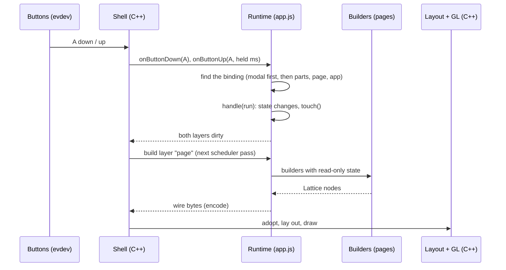
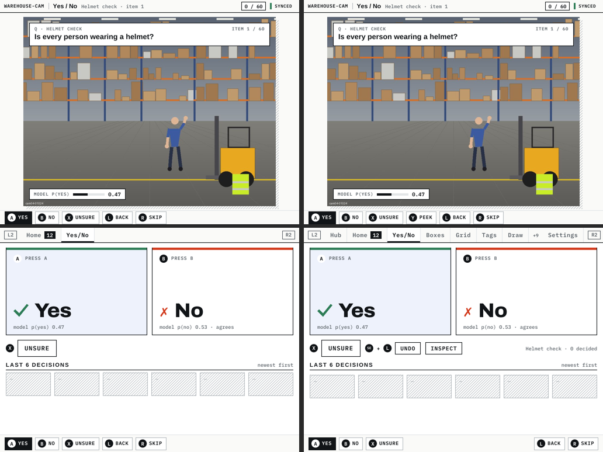
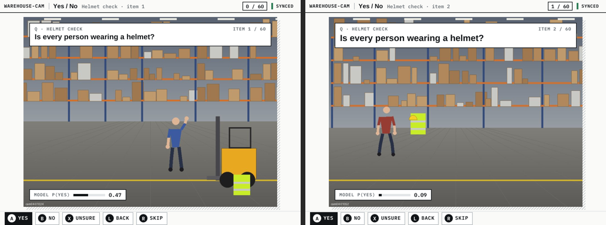
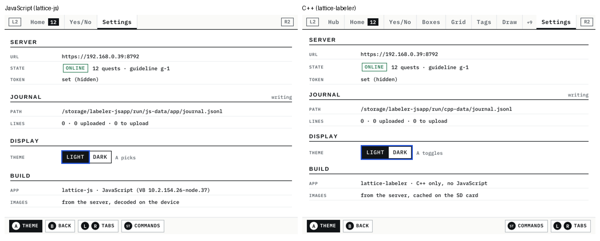
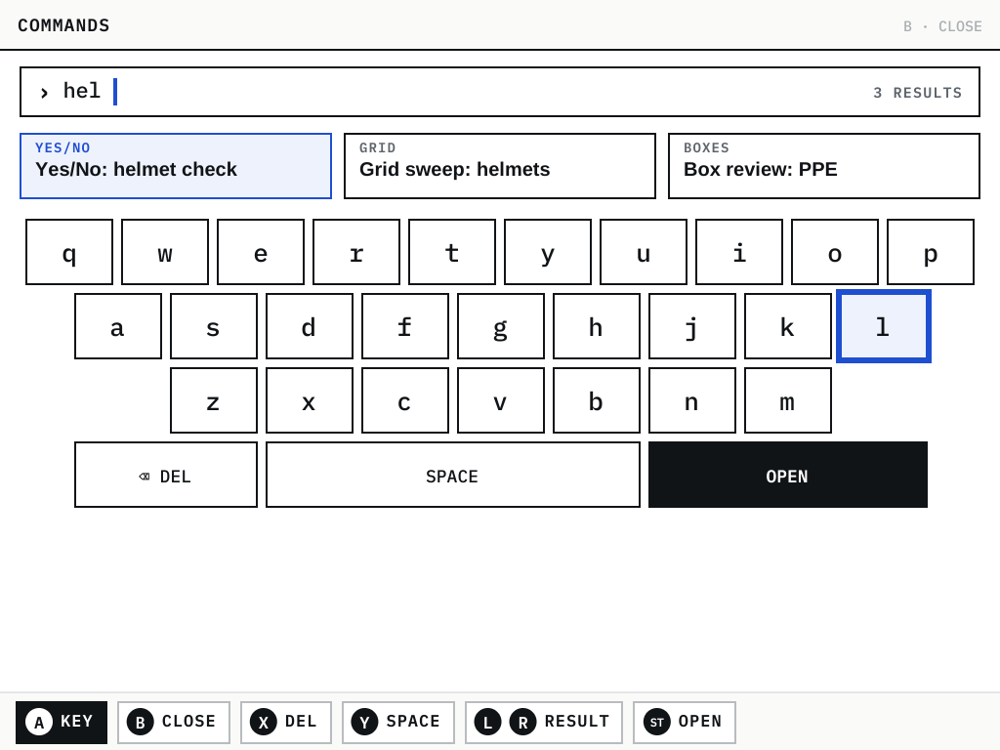
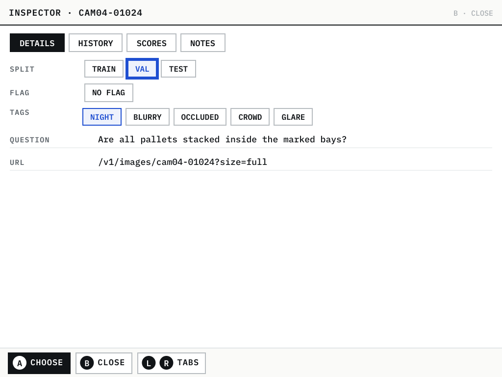

# Lattice DS Native, Part 8: Pages in JavaScript

Part 7 ended with a design. Application logic would move from C++ into JavaScript, and C++ would keep only the work
that must be fast: layout, drawing, images, the network and durable writes. A design is a claim; this part reports
what happened when it was built and measured on the RG DS Plus. Two tickets carried the work:
- **JSUI-001** built the first slice: a JavaScript framework in which an application is a value, a generic C++ host
  that runs any such application, and the labeler's Home and Yes/No pages ported onto it.
- **JSUI-002** asked whether the remaining eighteen labeler pages can be written the same way. It designed the UI
  language that would need, checked the runtime for memory leaks, and carried out the first phase of the port:
  Settings, the command palette and the metadata inspector.

The report follows one question through both tickets: what does it take for a JavaScript page to be as good as the
C++ page it replaces, and how do you prove it? "As good" turns out to have three parts:
- the page must not be able to crash the process;
- it must behave the same, which needs a test that compares the two applications under the same input;
- it must be fast enough, which needs measurements on the handheld rather than on the development machine.

> [!summary]
> - An application is an **immutable value** with **paths**. Builders may read state but not assign to it; a proxy
>   enforces this, and the same proxy records what each part reads. Change, undo and diff are a few lines each
>   because they operate on values.
> - One C++ binary, **`lattice-js`**, runs any application directory. Secrets and side effects stay on the C++ side
>   of a small set of natives: the token never enters JavaScript, and the journal is written with `fsync` in C++.
> - A **parity harness** runs the C++ and JavaScript labelers on the same stub server with the same taps and presses,
>   and compares page, tappable keys, screen words and journal lines after every step. All five ported pages pass.
> - On the device a JavaScript page costs **5–12 ms per render** at the median, against 1–2 ms in C++. That is within
>   the scheduler's interval and feels immediate, but two pages exceed the design's 15 ms p95 target. A ten-minute
>   soak shows **no leak**.

## 1. Terms

The report relies on a small vocabulary; each term is defined before anything depends on it.

- **Lattice.** A browser UI layout library, ported exactly to C++ in Part 1. A *tree* of nodes (rows, columns,
  text, images) is laid out and drawn with OpenGL ES on the handheld's two 512×384 screens (1024×768 pixels each).
- **Shell.** The C++ runtime around Lattice, built in Part 2. It owns the main loop, input, focus, scrolling and a
  scheduler that redraws a screen when something changed, at most every 30–60 ms.
- **Layer.** A tree that the shell asks for when a screen must be redrawn. In `lattice-js`, JavaScript builds the
  layers: one for the top screen and one for the bottom.
- **Wire format.** The binary encoding in which JavaScript hands a tree to C++. The C++ side decodes it (*adopt*),
  lays it out and draws it. The cost of a JavaScript layer splits into *build* (running builders), *encode* and
  *adopt*.
- **Part.** A reusable piece of a page with a kind (`list`, `kv`, `select`, `table`…). A part carries *settings*
  (plain values such as a label width), *slots* (functions of state, such as the text to show) and children.
- **Page.** A key, a top and a bottom list of parts, an optional tab entry, and *bindings*.
- **Binding.** What a button does, when it does it (press, release, tap, hold, chord), and the hint shown for it.
  The hint bar is generated from bindings, never written separately.
- **Path.** The address of a setting or slot inside an application value, for example
  `settings.bottom.display.theme.options`. Paths let a tool or an agent read and change one detail of an application.
- **Key.** A name on a tappable box, such as `yn:yes` or `key:q`. The control channel's `keys` command lists them
  with their rectangles, and tests tap them by name.
- **Control channel.** A named pipe through which tests send commands to a running app (`press A`, `tap yn:yes`,
  `look`, `app explain`) and read the replies from its log.
- **Native.** A function implemented in C++ and callable from JavaScript, such as `http` or `fileAppend`.
- **Kit.** A JavaScript file of part definitions that an application loads by name, such as the `labeling` kit
  with `question`, `choice` and `strip`.
- **Journal.** The labeler's append-only file of decisions, one JSON line each, uploaded to the server and
  acknowledged by it (Part 6).

## 2. Where Part 7 left off

Part 7's audit found the engine core and the shell sound, and the application layer full of copies: routing in
three applications, hold-button handling about twelve times, request state six times. Its design proposed to make
those mechanisms generic in a JavaScript framework and to keep in C++ "anything per frame or per pixel". Two numbers
in that design were estimates, not measurements: the cost of a JavaScript page on the device, guessed at 1–3 ms,
and the memory cost of V8. The plan was a migration page by page, with a parity check per page.

JSUI-001 implemented the first slice in six phases:

| Phase | Content | Commit |
|---|---|---|
| 0 | the JavaScript bridge stops ending the process on a JavaScript error | `0f5302f` |
| 1–3 | the framework, the generic host `lattice-js`, the labeler's Home and Yes/No | `697697b` |
| 5 | the JavaScript labeler on the device with real input, against the C++ one | `74ec08b` |
| 4 | an agent's guarded `eval` scope and a measured page experiment | `47d8775` |

JSUI-002 then designed the language for the rest and implemented its first phase:

| Step | Content | Commit |
|---|---|---|
| design | a UI language for most of the labeler; a page inventory; five phases | `5394cf3` |
| soak | ten minutes of real input on the device; memory after forced collection | `b8bf098` |
| Phase A | containers, controls, modal layer, `definePart`, kits; Settings, palette, inspector | `dbd9adb` |
| Ports | the JavaScript labeler in the handheld's Ports menu | `da73fc2` |

## 3. Phase 0: a JavaScript error must not end the process

A framework whose application code can kill the process is not a framework anyone can build on. Before a single
page moved, the bridge between V8 and C++ had six known paths from a JavaScript mistake to a dead process or a
corrupted state. Each was taken from Part 7's issue list, and two were reproduced on the old code before being fixed.

| Issue | Path to failure | Fix |
|---|---|---|
| JS-1 | a tap or A handler throws; the C++ exception escapes the event loop (`terminate called after throwing … JsError`) | `Bridge::dispatch` catches, logs `JS handler error (<scope>)`, counts it, still redraws |
| JS-2 | a malformed wire buffer is rejected by the decoder outside any `try` | decoding moved inside the `try`; the failure becomes a "failed to draw" node |
| JS-3 | `clearTimeout` of a timer due in the same pass runs it anyway and removes an unrelated timer (`splice(-1, 1)`) | the timer loop in `ds.js` skips a timer an earlier callback cleared |
| JS-4 | an `App::setup` that throws leaves a half-built application | the run ends in order: `fatal: setup failed`, exit 1 |
| JS-5 | `look`, `keys` or `press` called inside a builder renders recursively | refused inside a builder |
| JS-7 | a throwing getter or Proxy trap during value conversion aborts V8 (`ToLocalChecked`) | `ToLocal`, so it becomes a JavaScript exception |

The principle behind all six is the same. JavaScript is application code, and application code fails. The boundary
must turn every failure into a reported error on the screen and in the log, and keep the shell, the control channel
and the journal alive. The same principle shaped `lattice-js` later: a script that fails to load shows its error on
both screens, and the process stays up so that a developer or an agent can repair it through the control channel.

## 4. An application is a value

### 4.1 Values, paths and the runtime

The framework (`js/lattice/app.js`, 1,144 lines after Phase A) represents an application as nested immutable
objects: `App` contains `Page`s, which contain `Part`s. Every method returns a new value. This is the Yes/No page as
it is written today:

```javascript
const yesno = page('yesno')
  .tab('Yes/No', { order: 10, when: s => s.quests.some(q => q.tool === 'yesno') })
  .work(s => s.quest('yesno'))
  .top(status('Yes / No', w => w ? `${w.title} · item ${w.cursor + 1}` : '').progress(w => w ? [w.done, w.total] : null),
       question(w => w ? w.question : '').on(w => w ? w.item : null).score(w => w ? w.item.score : 0.5)
         .title(w => w ? w.title : '').position(w => w ? `item ${w.cursor + 1} / ${w.total}` : ''))
  .bottom(choice('yes', 'no').extra('unsure').decide((w, d) => w && w.decide(d, 'yesno')).score(w => w ? w.item.score : 0.5).key('yn'),
          strip(w => w ? w.history : []).title('Last 6 decisions'),
          row(button('Undo').set('tiny', true).key('yn:undo').on(null, w => w && w.undo()).as('undo'),
              button('Inspect').set('tiny', true).key('yn:inspect').on(null, (w, s) => w && s.inspect(w.item)).as('inspect'),
              text(w => w ? `${w.title} · ${w.done} decided` : '', 'meta').grow(1).as('decided')).set('align', 'center').as('tools'))
  .on('L', w => w && w.move(-1), 'Back')
  .on('R', w => w && w.move(+1), 'Skip')
  .enter(w => { if (w) w.move(0); });
```

The page does not draw anything. It describes what is on the screen as a function of state: `w` is the page's *work
object* (the current quest, item and cursor), produced from the app state by `.work()`. The C++ Yes/No page it
replaces is a class with `top()`, `bottom()` and input hooks, and its hint bar is written by hand next to the code
that handles the buttons.

Because the application is a value, three operations come almost for free. The runtime holds a *mutable reference
to an immutable value*: a `current` application and a `history` array.
- **`change(path, value)`** builds a new application with one setting or slot replaced, and pushes the old one.
- **`undo()`** pops the history.
- **`diff(a, b)`** flattens both values to path–value pairs and compares them.

Each value also has a short FNV hash of its JSON, and `toJSON` records functions by their source text, as the
arena's grammar does (Part 7, §5.2). An agent can therefore ask what a page is, change one detail, see the effect,
and take it back, all through the control channel:

```text
app get yesno.top.question.size        -> 12.5
app change yesno.top.question.size 15
app diff                               -> yesno.top.question.size: 12.5 -> 15
app undo
```

### 4.2 Builders describe, handlers change state

The most important rule of the framework is that the functions that build a screen may not change state. If a
builder changes state, the next redraw shows something different from the one before, and the number of redraws
starts to matter for correctness. In the C++ labeler the rule was a convention that nothing enforced. In JavaScript,
builders receive the state through a proxy:

```javascript
function readOnly(target, where, reads, prefix = '') {
  if (target === null || typeof target !== 'object') return target;
  return new Proxy(target, {
    get(t, k, recv) {
      if (typeof k === 'symbol') return Reflect.get(t, k, t);
      const v = Reflect.get(t, k, t);
      if (isFn(v)) return v.bind(t);   // methods run on the real object (they may request data)
      if (reads && prefix.split('.').length <= 2) reads.add(prefix ? prefix + '.' + k : String(k));
      return v !== null && typeof v === 'object' ? readOnly(v, where, reads, prefix ? prefix + '.' + k : String(k)) : v;
    },
    set(t, k) { throw new Error(`builders describe, handlers change state: '${String(k)}' was assigned while building ${where}`); },
    deleteProperty(t, k) { throw new Error(`builders describe, handlers change state: '${String(k)}' was deleted while building ${where}`); },
  });
}
```

Two details matter here.

The first is that methods are bound to the real object, not the proxy. A work object's `item` getter may start an
image request and cache the result; that is an internal write the framework must allow. The builder's own
assignment, `s.cursor = 3`, still throws, with a message that names the rule and the part.

The second is that every read is recorded. `app explain` uses the record to say what each part depends on, which an
agent needs before it changes anything. The record costs time on every property access, and §11 returns to that
cost.

Handlers are the other half of the rule. A binding's `run`, a tap or a timer runs through `handle()`, which catches
exceptions (Phase 0's rule, repeated at the framework level) and then asks both screens to redraw.

### 4.3 Hints are generated from the bindings that dispatch

A page declares `.on('L', fn, 'Back')`. The same binding record is used to dispatch the button and to generate the
hint bar, in hardware order (A, B, X, Y, L, R, …). Two C++ issues from Part 7 belong to a class this design rules
out. In PG-2, tapping a hint for a hold button did nothing. In NAV-4, a chord's release reached the page. In the
framework, a tapped hold hint performs the whole hold, and the release of a chord is swallowed. The Node test checks
both. The class is ruled out because there is only one record, not because each page is careful.

## 5. The generic host: what stays in C++

`lattice-js` (`apps/jsapp/main.cpp`, 348 lines) is one binary that runs any application directory. A directory has
an `app.json` naming its kits and scripts:

```json
{ "name": "labeler-js", "api": 1, "kits": ["labeling"],
  "scripts": ["session.js", "settings.js", "palette.js", "inspector.js", "pages.js"] }
```

The host loads the Lattice JavaScript library, the wire encoder, `ds.js`, then `lattice/app.js` and `lattice/host.js`,
then the kits, then the application's scripts. It registers two layers that JavaScript builds. It forwards every
input event: a button down with repeat detection, a button up with the hold time, a stick axis, and the scheduler's
`advance`. Everything that only the host should do is a native:

| Native | What it does | Why it is in C++ |
|---|---|---|
| `http` | a request to the configured server; the answer arrives later through a callback | the bearer token is added in C++ and never enters JavaScript |
| `imageWant`, `imageReady` | fetch, decode on worker threads, keep in a 16 MiB store; parts draw by id | decoding is per pixel |
| `fileRead`, `fileAppend`, `fileWrite` | plain names under `<data>/app`; append with `fsync`, write atomically | the journal must survive a power cut |
| `pageChanged`, `focusSet` | tell the shell the current page and set its focus | the shell keeps focus and scroll per page |
| `themeSet`, `hostInfo` | switch the theme; report app, server, whether a token is set, engine | process-level state |

One press of A therefore crosses the boundary twice: once inward as an event, once outward as two new trees.



The labeler application on top of this is small. `session.js` (170 lines) holds quests, paged items, work objects
per tool, the journal and the uploader with acknowledgements and backoff. The pages are 39–112 lines each (§10).

## 6. The first device run, and a bug only the device showed

The first comparison on the handheld ran both labelers against the same HTTPS stub with real input injected through
the kernel's event device: Home, then Yes/No, then 40 decisions, a tap on the "X Unsure" hint, and SELECT + L
to undo. Every functional check passed, and 42 of 42 journal lines were acknowledged. The render counts were wrong:

```text
run 1   perf top renders=533 (JS)   vs 133 (C++)        jsperf layers=1136
```

The cause was a single line. The shell calls `advance()` on every scheduler pass, and the runtime ran the
application's tick (the session's connection and upload clock) through `handle()`, which always asks for a redraw.
Both screens therefore redrew at their minimum interval for the whole session. The host test had not shown it:
`layers=204` looked plausible without a C++ baseline next to it. Ticks now run quietly:

```javascript
// ticks run on every scheduler pass: they do not ask for a redraw by themselves (a redraw per pass redrew both
// screens about 20 times a second on the device, JSUI-001 Phase 5). State that changes asynchronously is redrawn by
// the host when the answer arrives; motion is redrawn through moving(); a tick that changes what is shown calls touch.
const quietly = fn => handle(fn, false);
```

After the fix, run 2 rendered 127 times against the C++ labeler's 134, and gave the first measured cost of a
JavaScript page on this hardware:

| | JavaScript (`lattice-js`) | C++ labeler |
|---|---|---|
| top screen, ms per render p50 / p95 | 5.35 / 9.93 | 1.04 / 2.56 |
| bottom screen, p50 / p95 | 7.53 / 11.68 | 2.31 / 6.17 |
| JavaScript layer, p50 | build 3.70 + encode 1.19 + adopt 0.18 ms | — |
| resident memory at the page | 103 MiB | 81 MiB |

The design's estimate of 1–3 ms was too low by a factor of two to three. The result is still well inside the
scheduler's 50–60 ms idle interval. The lesson is about method rather than JavaScript: a cost or a count means little
without the C++ page measured under the same input on the same device.



*Yes/No on the device: the JavaScript page and the C++ page on the same item, captured from the compositor. The
question card, the model score and the hint bar match.*

## 7. An agent changes a page and measures it

Part 7 carried the arena's agent model over to the UI: an agent may run code in a *scope* that refuses mutating calls
in read-only mode, and an *experiment* compares variants of a page. JSUI-001 implemented both. The scope gives `app`
(explain, get, paths, diff, and guarded change, undo, keep), `ds` (the shell's API) and `parts`; in read-only mode the
guarded calls throw `ReadOnlyError`. An experiment is declared as a value:

```javascript
const a = app.page('yesno'), b = app.variant('yesno.top.question.size', 15);
return app.experiment({ name: 'bigger question', page: 'yesno', variants: { a, b },
                        assign: w => (w.cursor % 2 ? 'b' : 'a'), stopAfter: 10 });
```

`app.variant` returns a copy of the page with one path changed; the live application is untouched until the agent
adopts a winner. The runtime asks `assign` for a variant the first time an item is drawn and keeps it while the item
is shown, so that each person sees both variants and the clock never measures a mix.
It starts a clock when the item appears and stops it when a binding marked `decision` fires. On the device, with 16
real presses, the medians were 2,194 ms for variant a and 1,409 ms for variant b. A bootstrap over the medians gave
b a confidence of 0.987, and the agent adopted b with one `change`. With 5–8 samples per variant this is a
demonstration of the mechanism, not a result an experimenter should trust.



*The two variants on the device: item 1 drawn with variant a (question at 12.5 pt), item 2 with variant b (15 pt).*

## 8. From two pages to a language

### 8.1 The page inventory

JSUI-002 started from the labeler's twenty C++ pages and asked of each one what it would need from a JavaScript
language. The answer splits the pages into two groups.
- **About fifteen pages** need no C++ of their own. Besides Home and Yes/No, already ported, these are Hub,
  Settings, the palette, the inspector, Runs, Confusion, Data world, Grid sweep, Similar, Ask, Tags, Pairwise and
  Adjudicate: lists, forms, tables, grids and charts. They need
  a richer language than JSUI-001's eleven parts: nestable containers, form controls, chrome as parts, a canvas with
  coordinate systems, pointer events on regions, stick bindings and a modal layer.
- **Five pages** do work per frame or per pixel: Box review, Box drawing, Pose, Masks and Video. Examples are a loupe
  with corner drags, a mask brush and video playback from atlas strips. They need *native parts*, C++ components with
  a declared schema that JavaScript uses like any other part. Their page logic still moves to JavaScript.

The port plan orders the language work so that every phase ports real pages and checks them against the C++ pages:

| Phase | Language work | Pages |
|---|---|---|
| A | containers, leaves, form controls, modal layer with keyboard, `definePart`, kits | Settings, Palette, Inspector |
| B | canvas with domains, stick bindings, page layers for motion | Hub, Runs, Confusion, Data world |
| C | pointer regions and gestures, tile grids | Grid sweep, Similar, Ask, Tags, Pairwise, Adjudicate |
| D | native parts: `imageEditor`, `maskBrush`, `videoPlayer` | Box review, Box drawing, Pose, Masks, Video |
| E | the JavaScript labeler becomes the default; C++ pages retired | — |

### 8.2 Before building more: is the runtime leaking?

The first device run had shown resident memory growing by 34 MiB over 40 decisions. Building three more phases on a
runtime that leaks would multiply the problem, so a soak came first. Its method answers a specific difficulty: in a
garbage-collected runtime, memory that is merely uncollected looks the same as memory that is leaked.

The host gained a control command, `jsgc`, that forces a full V8 collection that shrinks the heap and then returns
freed memory to the operating system with `malloc_trim(0)`. The soak script drove Yes/No with real input for ten
minutes: 24 decisions per round, back and skip, an undo, and a tab switch. It sampled resident memory, the V8 heap,
the image store and the journal every 30 seconds, and called `jsgc` at the halfway point and at the end. The verdict
uses the slope between the two post-collection samples, not the raw peak, because the raw value swings by ±4 MiB as
textures come and go.

| | Start | After GC, half | After GC, end | Slope |
|---|---|---|---|---|
| JavaScript labeler, resident | 107.8 MiB | 133.7 MiB | 134.0 MiB | 0.09 MiB per 100 decisions |
| JavaScript labeler, V8 heap | — | 3.16 MiB | 3.27 MiB | — |
| C++ labeler, resident | 82.1 MiB | 109.9 MiB | 105.9 MiB | −0.98 MiB per 100 decisions |

Both applications made 840 decisions in about ten minutes. Neither leaks; the early growth in both is warm-up: the
image store filling its 16 MiB budget, allocator arenas and, for JavaScript, V8's heap. At steady state the
JavaScript labeler sits about 28 MiB above the C++ one. The V8 heap holds only 3 MiB of it, so the rest is V8 itself:
code space, the isolate and snapshots. All 875 journal lines were acknowledged and no JavaScript error occurred.

## 9. Phase A: the language

### 9.1 Defining a part

JSUI-001 had a private `defPart`. Phase A made it public as `definePart`, because a framework whose part set is
closed forces authors back to raw builders for anything the set lacks, and they then lose generated hints and
bindings. A definition names the part's settings and slots, how it builds, and which bindings it contributes:

```javascript
const choice = definePart('choice', {
  data: ['labels', 'extra', 'buttons'], slots: ['decide', 'score'], defaults: { buttons: ['A', 'B', 'X'] },
  init: (yes = 'yes', no = 'no') => ({ settings: Object.freeze({ labels: [yes, no] }) }),
  build(p, ctx) { /* two halves keyed `${ctx.key}:${d}`, an optional third button */ },
  bindings(p) {
    const [yes, no] = setting(p, 'labels'), extra = setting(p, 'extra'), [bA, bB, bX] = setting(p, 'buttons'), decide = slotOf(p, 'decide');
    const run = d => (w, s) => decide && decide(w, d, s);
    return [binding(bA, { run: run(yes), hint: cap(yes), decision: yes }), binding(bB, { run: run(no), hint: cap(no), decision: no })]
      .concat(extra ? [binding(bX, { run: run(extra), hint: cap(extra), decision: extra })] : []);
  },
});
```

Defining a part generates one method per setting and slot on every part: `choice(...).extra('unsure')`. A subtle bug
from JSUI-001 shaped how those methods work. `title` is a slot of `status` but a setting of `strip`. The first
version generated the method from whichever kind defined `title` first, so `strip(...).title('Last 6 decisions')`
silently set the wrong thing; a screenshot caught it. The generated method now dispatches on the part's own kind and
throws a message listing the kind's settings and slots when the name is neither.

Parts that only one application needs belong in a *kit*. `question`, `choice` and `strip` moved out of the core into
`js/lattice/kits/labeling.js`, which the manifest loads with `"kits": ["labeling"]`. The core keeps parts that any
handheld application needs.

### 9.2 What Phase A added

| Group | Parts and mechanisms |
|---|---|
| containers | `col`, `row`, `stack`, `grid(cols, …)`, `section(title, …)` |
| layout on every part | `w`, `h`, `grow`, `mt`, `mb`, `key`, `at(x, y)`, `when(fn)` (skips the build when false) |
| leaves | `kv`, `stats`, `badge`, `input`, `table` (columns, tone bar, `open` per row, meters in cells) |
| controls | `toggle`, `select` (one key per segment), `slider`, `chips`, in-page `tabs`, `keyboard`, `field` |
| runtime | a return trail, a modal layer with `confirm`, part-local state by path, a cap of 100 stored errors |
| chrome | a head bar for pages that are not tabs; `.chrome({ note, hints })`, `.focus(k)`, `.transient()` |

### 9.3 The modal layer

Three pages needed something on top of the page: the palette's keyboard, the inspector's "Revert to …?" and every
future confirmation. Without a shared mechanism each page would build its own overlay, its own focus handling and
its own rule for which button closes it. Part 7 counted this kind of duplication across the C++ pages. The runtime
now has one modal at a time: a list of parts with its own state and bindings, drawn over the bottom body. Its
bindings are consulted before the page's. B closes it unless it binds B itself, and L2, R2 and START are swallowed
while it is open, so a tab switch cannot leave a dialog behind.

`confirm` is a modal built from the same parts as any page:

```javascript
function confirm(question, o = {}) {
  const yes = o.yes || 'Yes', no = o.no || 'Cancel', w = workOf(pg(), stateOf(pageKey)), s = stateOf(pageKey);
  openModal({
    name: 'confirm', title: o.title || 'Confirm', note: 'B · ' + no.toLowerCase(), state: {},
    parts: [text_(question, 'title').lines(3).as('question'),
            rowPart(button(yes).set('kind', 'primary').key('confirm:yes').on(null, () => { closeModal(false); if (o.run) o.run(w, s); }).as('yes'),
                    button(no).key('confirm:no').on(null, () => closeModal()).as('no')).as('buttons')],
    bindings: [binding('A', { run: () => { closeModal(false); if (o.run) o.run(w, s); }, hint: yes }),
               binding('B', { run: () => closeModal(), hint: no })],
  });
}
```

The focus problem has a short solution. The C++ shell remembers the focused key per page key. The runtime reports
the page key as `inspector` while no modal is open and as `inspector~confirm` while one is. The modal therefore gets
its own focus memory, and when it closes the shell's remembered focus for `inspector` is still there. No code saves
or restores focus.

### 9.4 State that belongs to a part

Which tab of the inspector is open, or how far the palette's result chips are scrolled, is state, but it is not the
application's data. If it lived in the app state, an agent's `app diff` would report a tab switch as a change. Phase
A keeps it in the runtime, keyed by the part's path (`localOf('inspector.bottom.view')`), and clears it when the page
is entered, as a C++ page's `enter()` resets its fields.

## 10. The three ports

Each port replaced one C++ page with a JavaScript page that uses the language and nothing else:

| Page | C++ lines | JavaScript lines | Notes |
|---|---|---|---|
| Settings | 89 | 39 | sections of key–value rows; the theme as a `select` |
| Palette | 193 | 68 | the scoring function ported; result chips; the keyboard |
| Inspector | 261 | 112 | four in-page tabs; edits and reverts as journal lines |

The line counts understate the difference, because the JavaScript pages contain no input handling, no focus code and
no hint bar. Settings shows the shape of a typical page. Each section is a part with a path, so
`settings.bottom.display.theme` is addressable:

```javascript
section('Display',
  select('Theme', [['light', 'Light'], ['dark', 'Dark']], s => s.theme()).on((v, w, s) => s.setTheme(v)).key('set:theme').note('A picks').as('theme')).as('display'),
```



*Settings on the device, JavaScript on the left and C++ on the right. The JavaScript labeler has fewer tabs because it
has fewer pages; the sections and values match. The C++ theme control is one key that toggles; the JavaScript
`select` keys each segment (issue KIT-4).*

**The palette** ports the C++ scoring function: a prefix of the title scores 100, the start of a word 80, a
substring 60, a keyword 40, and the query's letters in order 20. It also fixes one C++ issue. In the C++ palette the
page consumed UP and DOWN to move between results, so the D-pad could not leave the keyboard row it was on (KIT-1).
The JavaScript palette moves results with L and R and leaves the D-pad to the shell, which moves the focus between
keyboard rows. On the host, DOWN from `key:q` now reaches `key:a` and then `key:bs`. The palette is also the
first page whose hint depends on the focus. The A hint reads Key, Del or Open according to the focused key, because a hint
may be a function of the runtime.



*The palette after three real taps on h, e and l: three result chips and the keyboard, with the focus on `l`.*

**The inspector** shows one item's metadata and history. Its edits are journal lines with the tool `meta`: a split,
a flag or a set of tags. A revert is also a journal line, with `decision: "revert"` and `to` set to the client id of
the entry it reverts to. The page records the revert but does not apply it, because what a revert undoes is for the
server to define. The history table opens a confirmation per row:

```javascript
const history = table(w => w.hist).cells((e, i, w) => [clock(e.at), e.who, w.label(e)])
  .columns([{ w: 62, style: 'meta' }, { w: 52, style: 'mono' }, { grow: 1, style: 'mono' }]).bar(e => who(e))
  .open((e, i, w, s) => s.confirm(`Revert to ${w.label(e)} · ${e.who}?`, { title: 'Revert', yes: 'Revert', run: w => w.revert(i) }))
  .hint('Revert').empty(w => w.loading ? 'Loading …' : 'No history.').key('in:h').as('history');
```

The confirmation's `run` closes over the row index at the time the row was opened. If the history grows while the
question is on screen, A still reverts the entry the person was asked about.



*The inspector's Details tab after real taps on the `night` tag and the `val` split. Both taps wrote journal lines.*

## 11. The parity harness

### 11.1 What "the same" means

A port is finished when it behaves like the page it replaces. Comparing pixels would fail on every intended
difference: the JavaScript labeler has fewer tabs, and some controls are keyed differently. `tests/jsapp/parity.py`
compares behaviour instead. It starts the C++ labeler, gives it a scenario of taps and presses, and takes a snapshot
after every labelled step. It then quits it and does the same with the JavaScript labeler. The two run one after the
other because the runtime allows one Lattice application at a time, and they use the same port because the server
URL appears on the screen. Four things are compared:

1. **The page** the application is on after the step.
2. **The tappable keys** of the bottom screen, by name, minus declared differences such as the C++-only tabs.
3. **The words** on both screens. Every C++ word should appear on the JavaScript screens, and a step fails below a
   coverage floor of 75%. Words from the data path and the labels of C++-only tabs are excluded.
4. **The journal lines** at the end of the scenario, without the fields that differ by nature: client id, the times
   shown and decided, the milliseconds, the guideline.

The journal is the comparison that matters most. Screens can differ in ways nobody notices, but a journal line that
differs is a different decision recorded for a training set.

### 11.2 What the harness found

The first runs failed in three places, and none was in the ports themselves.
- **The two apps start on different pages.** The C++ labeler with a server starts on the Hub, which the JavaScript
  labeler does not have yet. A palette closed with B returned to different pages. The palette scenario now starts by
  tapping the Settings tab, which both have.
- **Key names differed on pages ported earlier.** The JavaScript Yes/No keyed its buttons `choice:*` where C++ uses
  `yn:*`, and Home keyed its quests `quests:*` against `quest:*`. Yes/No also lacked the Undo button and the
  "N decided" line. These are real parity gaps from JSUI-001 and were fixed in `pages.js`.
- **A revert names its target by client id**, which is generated per run and differs by side. Dropping the field
  would hide a wrong revert, so the harness instead maps a client id to the line number it names:

```python
J = [json.loads(l) for l in open(j) if l.strip()]
# a revert names its target by client id, which differs by side: compare the target's line number instead
line = {x.get('client_id'): i for i, x in enumerate(J) if x.get('client_id')}
return [{k: (f'line {line[v]}' if k == 'to' and v in line else v) for k, v in x.items() if k not in VOLATILE} for x in J]
```

Both sides then report `"to": "line 2"`, so the comparison checks that they reverted to the same entry.

### 11.3 Declared differences

Some differences are intended, and a harness that cannot express them forces its floors down for every step. The
inspector's revert is the example. C++ arms a history entry in place on the first A and reverts on the second. The
JavaScript page opens a confirmation, so the same two presses do the same thing, but at the intermediate step only
`confirm:yes` and `confirm:no` are tappable. A step may therefore carry options with a stated reason:

```python
('revert armed', {'both': ['press DOWN', 'press A'], 'keys': False, 'floor': 0.5,
                  'why': 'JS asks in a modal (only confirm:yes / confirm:no are tappable); C++ arms the entry in place'}),
```

The final run passes 62 checks across the three scenarios. Word coverage is 85–100% per step, and 58% at the
confirmation step. All three journals match, including the revert. The words the JavaScript Settings page lacks are
the C++ build section's descriptions of itself ("C++ only", "cached on the SD card").

## 12. The cost on the device

The Phase A device run used the same real input on both applications and measured the shell's own per-render timing
over twelve redrawing presses per page:

| Page | Bottom p50 / p95, JS | Bottom, C++ | Top p50 / p95, JS | Top, C++ |
|---|---|---|---|---|
| Yes/No (JSUI-001) | 7.5 / 11.7 ms | 2.3 / 6.2 | 5.4 / 9.9 | 1.0 / 2.6 |
| Settings | 11.1 / 17.7 ms | 1.6 / 1.8 | 5.3 / 12.8 | 0.6 / 0.8 |
| Palette | 12.2 / 18.6 ms | 1.8 / 2.1 | 7.7 / 10.7 | 0.7 / 0.8 |
| Inspector | 7.8 / 12.3 ms | 0.8 / 1.2 | 7.0 / 9.4 | 0.7 / 0.7 |

JavaScript costs five to ten times as much as C++ per render. In absolute terms every page stays far under the
scheduler's 50–60 ms idle interval, and none feels slow. The design had set a rule of 15 ms at the 95th percentile
for a page without motion. Settings and the palette exceed it on the bottom screen. The project's priority is
function first, and "snappy enough" counts as enough. The device script therefore prints a warning for a page over
the target, and the design records the numbers rather than a fix.

The cost tracks the number of nodes and the number of state reads more than the page's logic. The inspector, a
table and tabs, is cheaper than Settings, four sections of rows. Where the time would go if it ever matters is known:
- the read-tracking proxy runs on every property access, though only `app explain` needs the record;
- the palette's filtered and sorted result list is recomputed by every part that shows it or its count, several
  times per render;
- the bindings are walked several times per render (hints, focus, `explain`);
- the tab strip is measured on every render instead of when the tabs change.

## 13. In the Ports menu

The JavaScript labeler now has its own entry in the handheld's Ports menu, "Lattice Labeler (JS)", next to the C++
labeler. Its launcher reuses the C++ labeler's server settings from `data/labeler/config.json`. `lattice-js` takes the
token as a file, so the launcher writes it to a temporary file created with mode 0600 and removes it when the
application exits:

```bash
umask 077
TOK=$(mktemp /tmp/lattice-labeler-js.XXXXXX)
trap 'rm -f "$TOK"' EXIT
CONF=$(python3 -c '
import json, sys
c = json.load(open(sys.argv[1]))
open(sys.argv[2], "w").write(c.get("token", ""))
print(c.get("server", "")); print(c.get("ca_file", ""))' "$CFG" "$TOK")
```

The token goes from the configuration file to the temporary file without passing through a shell variable or the
log. The JavaScript labeler journals to `data/labeler-js/`, so its decisions never mix with the C++ labeler's
journal while both exist. A 14-second run of the launcher on the device connected to the server, loaded the quests,
exited cleanly and left no token file behind.

## 14. Limitations and open questions

- **Two pages miss the render target.** The numbers are recorded; the optimisations in §12 are listed but not done.
- **The JavaScript labeler covers five of twenty pages.** Phases B to D are designed, not built. The hardest are the
  native parts of Phase D, which change the wire format.
- **The chrome is still derived.** The design proposed the status bar and hint bar as parts a page can place.
  Phase A kept them generated by the runtime and tuned with `.chrome({ note, hints })`; Pairwise, whose bottom screen
  has neither, will force the change in Phase C.
- **Two C++ issues are fixed only in JavaScript.** KIT-1 (the palette's D-pad) and KIT-4 (keyed segments) remain
  open in the C++ kit.
- **The experiment's statistics are thin.** A bootstrap of medians over 5–8 samples per variant demonstrates the
  mechanism; it is not a method to trust without many more decisions.
- **`explain` misreports some dependencies.** A part that reads state through a function (`s.theme()`) is
  reported as fixed, because read tracking sees property reads only.
- **V8 is mandatory for the JavaScript labeler.** It costs about 28 MiB of resident memory at steady state.

## 15. Reproducing the results

```bash
cd /home/manuel/code/wesen/2026-10-15--nintendo-ds-ui
# the language (Node)
node tests/js/lattice-app.test.js                         # 88/88
# parity, C++ against JavaScript, on the host (needs build/ with V8 and the Go stub)
GOTOOLCHAIN=local python3 tests/jsapp/parity.py build/lattice-js build/lattice-labeler . /tmp/parity \
    build/go-bin/labeler-server                           # settings, palette, inspector: PASS
# on the device: build, deploy, then the Phase A run and the soak
scripts/build-device.sh lattice-js lattice-labeler
scripts/deploy-device.sh build-device/lattice-js build-device/lattice-labeler
SCRIPT=jsapp-pages.py scripts/labeler/jsapp-device-run.sh /tmp/pages
SCRIPT=jsapp-soak.py  scripts/labeler/jsapp-device-run.sh /tmp/soak 10
# the Ports entry
APP=labeler-js RESTART_ES=1 scripts/register-ports.sh
```

## 16. Files

- `js/lattice/app.js`: the framework, including values, paths, parts, bindings, the runtime and the modal layer.
- `js/lattice/host.js`: the JavaScript half of the host, with `env`, `lattice.http`, `app …` commands and the agent scope.
- `js/lattice/kits/labeling.js`: the labeling kit (`question`, `choice`, `strip`).
- `apps/jsapp/main.cpp`: `lattice-js`, the generic host and its natives.
- `apps/jsapp/labeler/`: the JavaScript labeler (`session.js`, `pages.js`, `settings.js`, `palette.js`,
  `inspector.js`).
- `tests/js/lattice-app.test.js`, `tests/jsapp/parity.py`, `tests/jsapp/labeler-js-smoke.py`,
  `tests/jsapp/agent-smoke.py`: the tests.
- `scripts/device/jsapp-labeler.py`, `jsapp-agent.py`, `jsapp-soak.py`, `jsapp-pages.py`: the device runs.
- `scripts/ports/lattice-labeler-js.sh`: the Ports launcher.
- `ttmp/2026/10/16/JSUI-001--…/` and `ttmp/2026/10/16/JSUI-002--…/`: the tickets, with the design document, the
  diaries and the device evidence.

## Related notes

- [[PROJECT REPORT - Lattice DS Native, Part 7 - From an Engine to a Framework - A Textbook, 154 Issues and a JS-first Design]]
- [[PROJECT REPORT - Lattice DS Native, Part 6 - The Handheld Labeler - A Native Labeling Client, an Offline Journal and a Server Stub]]
- [[PROJECT REPORT - Lattice DS Native, Part 3 - Running a Browser Application's Own Code over a Native Shell]]
- [[PROJECT REPORT - Lattice DS Native, Part 2 - A Two-Thread Shell and a Thin V8 Layer on the RG DS Plus]]
- [[PROJECT REPORT - Lattice DS Native - The Whole Project - A Browser UI System on a Real Dual-Screen Handheld]]
