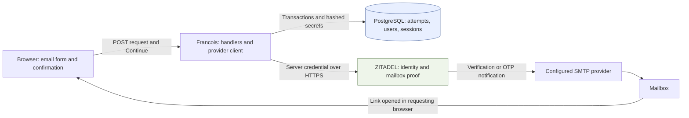
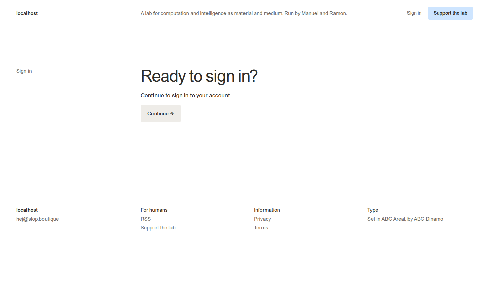
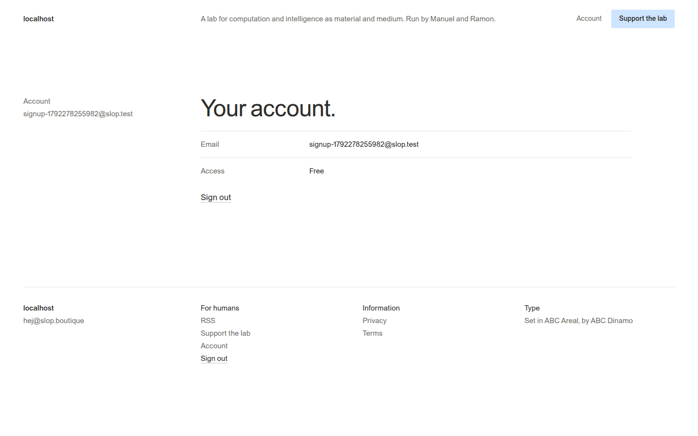
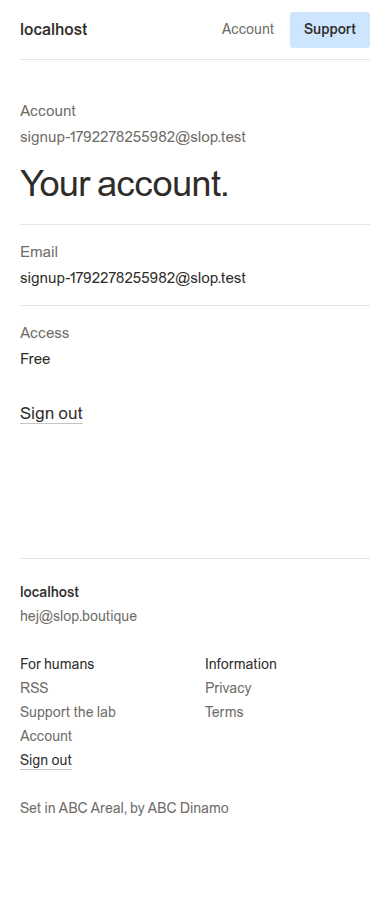
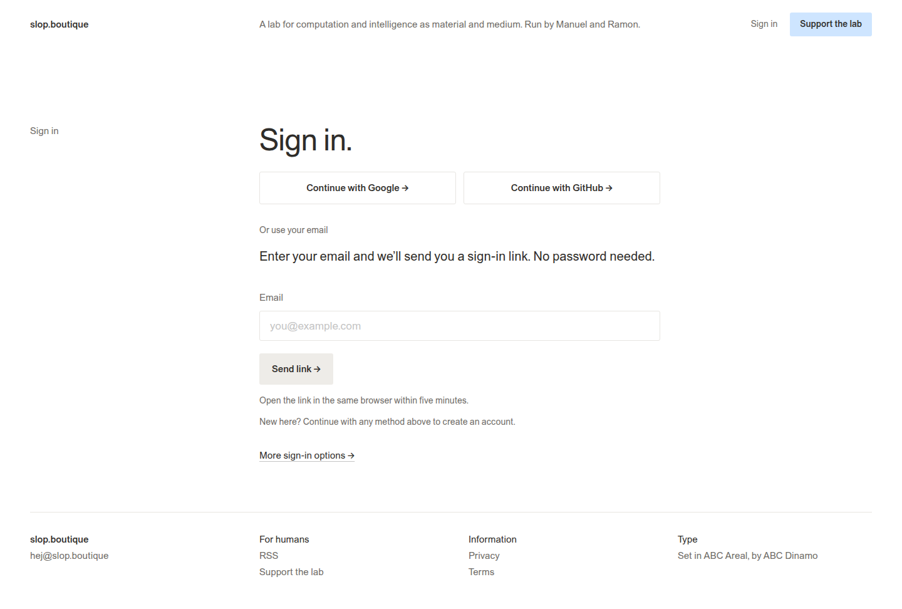
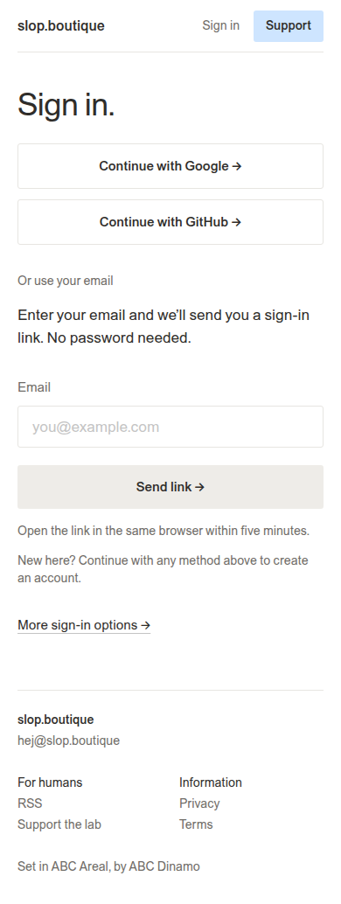

# Passwordless email signup in slop.boutique: verification, local accounts and production delivery

slop.boutique is the public interface of Francois, a Go application that publishes downloadable HTML artifacts and runs hosted application instances. Its public interface is intentionally small. A visitor should be able to enter an email address, confirm an emailed link and obtain an ordinary account without choosing a password or understanding an identity provider. This report explains the implementation that makes that interaction possible, including the separate responsibilities of ZITADEL, PostgreSQL, the browser and the k3s deployment.

The work began with a specific behavior: submitting a new address produced a check-email page but sent no message. The page's generic acknowledgement was working as designed, but the server only supported existing local accounts. Google and GitHub could create new identities; email could only authenticate an existing identity with a verified address and an enrolled email factor. Adding email signup required a new account-creation path, not a different message on the existing form.

> [!summary]
> - The same form now supports registration when public signup is enabled and ordinary email sign-in for existing accounts.
> - ZITADEL verifies the first email before Francois creates a local user and session. Email OTP is then enrolled for subsequent sign-ins.
> - One new PostgreSQL table reserves the provider identity and holds its current browser-bound attempt. No additional service, queue or worker is introduced.
> - A real isolated ZITADEL v4.16.1 and Mailpit journey verified first signup, read-only confirmation GETs, replay rejection and a subsequent login to the same account.

## 1. Identity, mailbox ownership and application access are separate facts

An **identity** is the stable pair consisting of the provider's issuer and its user identifier, called the subject. The issuer identifies the authority that created the identifier. The subject identifies a user within that authority. Email is profile data associated with the identity; it can change and does not establish that two provider accounts represent the same application identity.

A **verified email** means that the provider accepted evidence of control over the address. It is not equivalent to a current authenticated browser session. A **session** is a time-limited authorization context established after the application accepts a fresh authentication proof. The browser receives a random session token, and PostgreSQL stores its digest. Later requests use that token to resolve the local user.

An **email OTP factor** is an enrolled authentication method that allows ZITADEL to challenge a user through the user's verified email address. OTP means one-time password. In this implementation the code travels inside a link, so the visitor does not need to type it. The first email-verification code and a subsequent session OTP are different provider operations even though the visible browser interaction is similar.

Finally, a **local account** is Francois's own user record. It stores the issuer, subject, current email, verification status, display name, role and disabled flag. Its role is distinct from payment entitlement. The schema's ordinary role is named `subscriber`, but a newly created account is free until the billing/access rules establish another entitlement. Registration never assigns creator or administrator privileges.

These distinctions determine the implementation order. An address submitted in an anonymous form is unproven input. The application must obtain mailbox proof before it creates an authenticated local account. It must then create the account and its first session together, so a partially committed operation cannot leave an inconsistent local result.

## 2. The existing architecture already owns most of the interaction

Francois renders the sign-in page on the server. The email form posts directly to the application and does not require a React bundle or client-side JavaScript. Google and GitHub use the existing OpenID Connect integration, while a neutral native-provider option remains available for accounts that need another configured authentication method. There is one public sign-in surface for all roles.

ZITADEL owns identity records, verification codes, temporary authentication sessions, email-factor enrollment and outbound SMTP delivery. Francois owns the registration attempt, browser binding, local account and application session. PostgreSQL provides persistence and atomic updates. Kubernetes runs the existing application container; this feature adds neither an SMTP component nor an authentication microservice.



The trusted portal origin comes from site configuration. It is not reconstructed from an arbitrary forwarded host. That origin appears in both the pending record and the generated confirmation URL. This matters because the production application serves two configured public hostnames. A link issued for one portal origin must not be redeemed on another simply because both reach the same backend.

The production identity integration uses a dedicated service account with ZITADEL's built-in `IAM_LOGIN_CLIENT` role. Its personal access token is read from a mounted secret file. The existing Vault and Vault Secrets Operator setup delivers that file; the browser receives neither the token nor provider-management access. The isolated provider test used the same role class and demonstrated the required registration, verification, factor and session operations.

## 3. One form selects an existing-account or new-account path

The request handler normalizes the address by trimming surrounding whitespace and converting it to lowercase. It validates the result with Go's mail parser, rejects a display-name wrapper and control characters, and limits the address to 200 characters to match the pinned provider contract. The form's `maxlength` matches that server limit.

Before identity lookup, the handler validates the request's browser origin and double-submit CSRF value. CSRF means cross-site request forgery: a different site attempts to cause the browser to submit a sensitive request. The server requires the form's hidden value to match a valid host-only HttpOnly cookie. A narrow browser-declared same-origin navigation case handles an Origin of `null` caused by the authentication page's no-referrer policy; it does not remove the independent cookie/form check.

The handler then spends the existing rate limits. They allow three attempts per normalized recipient per hour, twenty per client address per hour and one hundred per process per hour. The limiter stores address digests rather than address strings. These limits are process-local, consistent with the current single-replica deployment. Recipient suppression still produces the generic acknowledgement; broad client/global exhaustion returns a retry response.

The local lookup deliberately includes disabled and unverified users. Filtering those records out would make them look like unused addresses and would let a blocked account reach registration. A bounded query returns at most two matches, because the decision only needs to distinguish zero, one and more than one.

```text
users = lookup_all_local_records(normalized_email, limit=2)

if count(users) == 1:
    require enabled, verified, non-guest, expected issuer
    issue existing-account email OTP
else if count(users) == 0 and public_signup_enabled:
    issue registration verification or recovery OTP
else:
    do not issue authentication material

return generic check-email acknowledgement
```

An ambiguous address is never resolved by choosing the first result. A disabled record cannot be bypassed by a second registration. A provider identity found only by email is not adopted. These are distinct decisions: looking up an address helps select or reject an operation, while authenticating an identity requires a proof tied to its expected issuer and subject.

The acknowledgement now says that, if the address can be used, the site will send a link to continue. That wording covers registration, existing-account sign-in, blocked addresses and provider failures without disclosing which state exists. The shared three-second request deadline also bounds the provider work and provides a consistent acknowledgement boundary. It is not a guarantee that SMTP delivery or inbox placement has completed.

## 4. A durable reservation makes account creation recoverable

The new table, `email_registrations`, serves two related purposes. It assigns a stable provider subject to a normalized address and issuer, and it stores the current browser-bound registration attempt. The unique `(issuer,email)` key makes another click reuse the same reserved identity. The reservation is created before contacting ZITADEL.

This ordering addresses an unavoidable failure boundary. A provider request can succeed while its response is lost or the application request times out. If every retry chose a new subject, that uncertainty could produce multiple provider accounts. Persisting the subject first lets the next attempt inspect the exact identity it previously intended to create.

| Field or constraint | Purpose |
| --- | --- |
| `subject` primary key | Application-generated provider identifier reserved before network I/O. |
| `issuer,email` unique pair | One reservation per normalized address in that provider namespace. |
| `flow_hash` unique nullable digest | Identifies the current local link without storing its plaintext secret. |
| `binding_hash` | Binds redemption to the browser that requested the link. |
| `portal_origin`, `return_path` | Preserve the trusted origin and a restricted local destination. |
| `provider_session_id` | Empty for email verification; nonempty for an OTP recovery proof. |
| `ready` | Distinguishes completed issuance from a reserved but incomplete attempt. |
| `created_at`, `expires_at` | Establish freshness and enforce the five-minute local lifetime. |

There is no user foreign key because the local user does not yet exist. A registration reservation grants no application access. The record remains after its attempt is consumed so an interrupted completion can recover the same provider identity. This is deliberate retained state, not an in-memory queue awaiting a worker.

Replacing an attempt uses a short database transaction. It inserts the reservation if absent, locks the existing row, returns any displaced provider-session ID, and writes a fresh flow digest, browser digest, origin, return destination and timestamps. The caller deletes a displaced temporary provider session outside the transaction. Network calls never hold this row lock.

The new attempt starts with `ready=false`. After the provider call succeeds, the application attaches the provider-session ID, or the empty verification marker, only if the same flow remains current and unexpired. A slow response for an older request therefore cannot make a newer attempt ready. If an obsolete OTP session was created, it is deleted instead.

## 5. First issuance creates an unverified provider identity

`EmailLogin.SendRegistration` starts by reading the reserved subject. If ZITADEL reports that it does not exist, the client searches for an email collision within the configured organization. The search is bounded to one result and uses case-insensitive exact equality. Any result blocks creation; the search never selects a subject for authentication or links another identity.

If the collision check is empty, the client creates a human user with the explicit reserved ID, configured organization and an unverified email carrying the custom verification URL. It does not supply `isVerified:true` and does not set a password. ZITADEL requires profile names, so the implementation uses the neutral `New` and `User` values with the display name `New user`. It does not infer a person's name from the address.

The URL template points to Francois's existing confirmation route and includes the local random flow secret plus ZITADEL's substituted code. Only the digest of the flow secret is stored locally. The provider generates, stores and validates the mailbox code; Francois does not implement another code generator or SMTP client.

If the reserved identity already exists but its email is unverified, the client validates the subject, organization, address, human type and allowed state before resending verification. An inactive identity or a changed address fails closed. If a concurrent request creates the reserved identity first, the current request re-reads that exact subject and validates it before resending the current link. The same recovery applies if the scoped email search now sees the reserved subject. Unrelated creation conflicts fail closed rather than switching to an identity found by email.

The browser interaction is the same for the first request and an unverified retry. A new link replaces the earlier local flow. The earlier email may still exist in the mailbox, but its local secret no longer names the current attempt.

## 6. Confirmation GETs cannot authenticate

Mail security systems often open links before a person reads a message. Consequently, the emailed URL is handled in two stages. The GET verifies only that the local flow is ready, browser-bound, origin-matched and unexpired, then renders a form with a Continue button. It does not submit the provider code or create a session.

The confirmation page has `Cache-Control: no-store` and `Referrer-Policy: no-referrer`, and contains no application script. Hidden form fields carry the flow, provider code and CSRF value to the POST handler. Keeping authentication material out of script execution and referrers reduces unnecessary exposure, while the server still treats every submitted value as untrusted input until validation succeeds.

```mermaid
sequenceDiagram
    participant B as Requesting browser
    participant F as Francois
    participant D as PostgreSQL
    participant Z as ZITADEL
    participant M as Mailbox
    B->>F: POST email and CSRF
    F->>D: Reserve subject and replace current hashed flow
    F->>Z: Create unverified human with confirmation URL
    Z->>M: Verification notification
    F->>D: Mark current flow ready
    F-->>B: Generic acknowledgement
    M-->>B: User opens link
    B->>F: GET confirmation URL
    F->>D: Read-only readiness check
    F-->>B: Continue form; no-store, no-referrer
    B->>F: POST Continue with browser binding and code
    F->>D: Claim flow exactly once
    F->>Z: Verify email and re-read matching identity
    F->>Z: Enroll email OTP if absent
    F->>D: Transactionally create ordinary user and session
    F-->>B: Session cookie and safe redirect
```



The same-browser requirement is intentional. Opening the message in another browser profile, mail application's isolated browser or another device does not possess the cookie from the request. The user must request a new link in the browser where they intend to sign in. This binding prevents a link alone from establishing the session in an unrelated browser.

## 7. A single SQL update grants one confirmation attempt

After validating CSRF, the POST first attempts to claim an existing-account sign-in. If no matching attempt exists and signup remains enabled, it attempts to claim a registration. Claiming is an atomic SQL update that clears `flow_hash` and marks the row not ready while returning the attempt's immutable identity and timing data.

```sql
UPDATE email_registrations
SET flow_hash = NULL, ready = false
WHERE flow_hash = $1
  AND binding_hash = $2
  AND portal_origin = $3
  AND expires_at > now()
  AND ready
RETURNING issuer, subject, email, provider_session_id,
          portal_origin, return_path, created_at, expires_at;
```

Only one concurrent request can receive the row. The code does not first read a row and later mark it consumed, because that would permit two confirmations to observe the same usable state. A wrong code consumes the local attempt as well. The user requests another email after an invalid code, expiry or interrupted confirmation.

For a first-use verification proof, the handler submits the supplied code to ZITADEL's email verification endpoint. For a recovery OTP proof, it uses the existing temporary-session verifier, which requires a fresh email factor for the exact expected subject and organization. Selecting a user in a provider session is insufficient; the email factor itself must have a recent verified timestamp and the provider session must still be alive.

After either proof, `CheckUser` reads the provider identity again and requires an active human, expected subject and organization, matching address and verified email. This catches a provider email or state change between issuance and redemption. Only after that readback may the registration path ensure the email OTP factor is enrolled.

## 8. Local user creation and session creation commit together

The final store method takes a verified registration result, acquires a transaction-scoped advisory lock derived from the normalized email, and rechecks expiry after obtaining the lock. Ordinary OIDC provisioning acquires the same lock and, after obtaining it, rejects an insertion or profile refresh when that address belongs to another issuer/subject. This check is required when signup commits first and OIDC was waiting, and when an existing provider identity changes its email. Matching identities may refresh their own noncolliding profile. A missing email claim is not an address and bypasses the ownership lock/check; native OIDC identities without email and demo guests can legitimately share the empty schema placeholder. The shared lock coordinates the narrow local account-creation interval; it does not serialize provider calls or all authentication requests.

Inside the transaction, registration rejects any local account that now has the email or the same issuer/subject. This includes an account that a concurrent social callback has just created. Registration does not update that account's role or verification state. The visitor can request an ordinary sign-in link afterward, using the now-existing account path.

If there is no collision, the transaction inserts a verified local user using the schema's ordinary default role, inserts a session token digest, and commits. Failure rolls back both inserts. The application then clears the email-binding cookie, sets the portal session cookie and redirects to the saved safe local destination. Email-created sessions have no OIDC ID token, so logout revokes the local session without requiring an upstream logout token.

```text
begin transaction
acquire normalized-email advisory lock
require attempt still unexpired
require no local email or issuer/subject collision
insert ordinary verified user
insert portal session digest
commit transaction
set session cookie
redirect to safe saved destination
```

The collision rule is intentionally strict. It avoids a second set of role-preservation rules in the signup path. Existing-account email sign-in retains its existing role-change protection: it compares the selected role with the locked role when issuing a flow, reads the role while claiming the flow, and compares it again before creating a session. Administration continues to revoke pending sign-ins, sessions and runtime grants on role changes.

## 9. Provider-side success must survive a local failure

Provider verification and local PostgreSQL commit cannot form one transaction. Consider a confirmation that verifies the address successfully but fails while enrolling OTP or creating the local session. The provider now records a verified address, while no local account exists. Repeating the original code is not the recovery strategy; the local attempt was already claimed.

The durable reservation identifies the same provider subject on the next request. The client validates its active verified email, ensures OTP is enrolled, and sends a fresh temporary-session challenge. That new link requires fresh mailbox proof before local account creation is attempted again. Enrollment is restricted to the identity owned by this registration reservation; unrelated existing human accounts are not enrolled merely because someone typed their address.

```mermaid
stateDiagram-v2
    [*] --> Reserved: Persist random subject
    Reserved --> VerificationPending: Create or resend unverified identity
    VerificationPending --> VerifiedProvider: Valid confirmation POST
    VerifiedProvider --> LocalAccount: Enroll OTP and commit user/session
    VerifiedProvider --> RecoveryPending: Local completion failed; request new link
    RecoveryPending --> LocalAccount: Fresh session OTP and successful local commit
    VerificationPending --> VerificationPending: Replace expired or failed attempt
    LocalAccount --> ExistingSignin: Later email request
```



`EnsureEmailOTP` reads the provider's methods before adding the factor. If addition returns an error, it re-reads the methods and accepts an already-present factor. This handles an enrollment that succeeded before a response was lost and concurrent enrollment attempts. It does not swallow an error when the required method remains absent.

The database claim prevents a second completion from using the same local attempt. The final transaction prevents multiple successful local creations even if independent verified completion calls race. The regression test submits eight concurrent claims and eight concurrent completions and expects one winner at each boundary.

## 10. The actual REST contract mattered more than the mock

The first full PostgreSQL-backed Go suite passed, and the binary built successfully. The real-provider journey then failed before receiving its first email. The generic page intentionally did not disclose the reason. The server's status-only diagnostic identified an upstream HTTP 405, indicating that the requested method was not valid for that route.

The implementation had assumed `POST /v2/users/_search`. The fake used the same assumed route, so its tests could not detect the mismatch. The pinned v4.16.1 proto declared `POST /v2/users` for `ListUsers`. Correcting the implementation, fake and design reference resolved the real-provider failure. The exact failure and repair are preserved in diary Step 14.

| Operation | Pinned v4.16.1 REST endpoint |
| --- | --- |
| Read user | `GET /v2/users/{id}` |
| Search users | `POST /v2/users` |
| Create unverified human | `POST /v2/users/human` |
| Resend verification | `POST /v2/users/{id}/email/resend` |
| Verify email | `POST /v2/users/{id}/email/verify` |
| Inspect methods | `GET /v2/users/{id}/authentication_methods` |
| Enroll email OTP | `POST /v2/users/{id}/otp_email` |
| Issue/verify/read/delete OTP session | `POST /v2/sessions`; `PATCH/GET/DELETE /v2/sessions/{id}` |

The provider client refuses redirects, bounds response bodies to 256 KiB and returns status-only upstream errors. It excludes full URLs, response bodies and transport details from diagnostics because codes or other sensitive material could appear there. The incorrect route therefore produced enough information to investigate without copying a live link or provider credential into the diary.

The public ZITADEL registration and MFA guides explain the concepts, but the deployed version's protobuf HTTP annotations establish the exact payload and route contract. The older boolean `returnCode` examples for email session challenges are another reason to retain the pinned source. This application uses the deployed `sendCode` object with a URL template.

### Review found the other transaction order

Automated review of source PR #13 identified a second concurrency issue before release. Registration checked for a local collision after acquiring the shared email lock, but OIDC originally performed an unconditional upsert after acquiring it. If signup committed first, a waiting OIDC callback could insert another identity with that email. Serializing transactions did not itself enforce the desired uniqueness decision.

The repair adds a post-lock OIDC collision check against any different issuer/subject pair. Profile refresh remains possible when the requested email is not owned by another account. A regression test executes both transaction orders, asserts that the second identity is rejected and that exactly one local user remains, then verifies that the winning identity can refresh its display name without losing its creator role. Legacy ambiguous-account tests insert their deliberate bad fixtures directly rather than asking the newly guarded provisioning method to create them.

Renewed review exposed two related edges. The first repair exempted an existing OIDC identity too broadly, allowing it to refresh onto another account’s email; the final predicate checks the owner of the requested email instead. A second finding concerned concurrent provider creation: the superseded request could win account creation and send an obsolete link while the current request received a conflict. The final provider client re-reads only the reserved subject on that conflict, validates its identity/state and resends the current flow. Tests cover successful recovery and rejection for changed organization, address, subject or inactive state. A final review case preserved valid OIDC identities with no email: empty guest placeholders must not be interpreted as owned addresses. The reviewer also proposed preserving historical duplicate-email OIDC refreshes; a read-only production query found zero duplicate human-email groups, and this deployment adds no legacy duplicate-account exception.

## 11. Validation followed complete implementation

The work was committed in meaningful units: design (`2464600`), implementation (`19dc040`), provider-route repair plus qualification (`f51ebc1`), OIDC insertion protection (`8d84420`), refresh/conflict recovery (`f8e97b3`) and the missing-email guard (`113b097`). Source PR #13 merged the final implementation as `5068ad1c9d35adf10ac143dc00a56d81907ad018`; its package tree matches the final qualified source revision. After the user clarified the testing cadence, the remaining feature was completed before the combined qualification run. The already-passing full suite was not repeated after every documentation or constant change.

The database-backed regression cases cover wrong browser and code, link replacement, enrollment failure and recovery, disabled signup, disabled/unverified/ambiguous local records, provider-email collisions, changed provider address or organization, expiry, a local account appearing during confirmation, and concurrent claim/completion. Existing tests continue to cover the ordinary email sign-in and role-revocation behavior.

The real integration uses a fixed loopback ZITADEL v4.16.1, PostgreSQL and Mailpit stack. It creates only a synthetic `slop.test` address and sends into the local mail sink. The browser test requests the email through the actual page, finds its delivered link in memory, confirms that GET does not authenticate, presses Continue, resolves the resulting session, checks replay rejection, logs out and requests a second email. That second email exercises the existing enrolled-OTP path against the same provider and local identity.

The retained receipt reports five observations:

- A real provider verification email arrived while the local user count remained zero.
- Repeated scanner-style GETs remained read-only and returned no-store/no-referrer authentication pages.
- Confirmation created exactly one ordinary account and authenticated the requesting browser.
- Reusing the first signup link was rejected.
- A subsequent real session-OTP email authenticated the same account without another local creation.

The build, full database-backed suite and final lint/logger checks passed. After the review repair changed shared OIDC provisioning, the full database-backed suite and lint/logger checks were repeated once at that repair boundary and passed, including both transaction orders. Three initial lint findings were numeric HTTP status constants in the new fake; they were replaced with `net/http` constants. A first sandboxed test attempt could not open a loopback listener and was rerun with the required execution permission. These environment and lint failures are recorded separately from product failures.





These screenshots are local integration evidence, not screenshots of a production customer's account. The receipt excludes codes, cookies, tokens and live authentication URLs.

## 12. Production release uses the existing image and GitOps pipeline

The application publishes an immutable image tag derived from the merged source revision. Source CI builds and tests a pull request without publishing its image; a trusted main-branch workflow publishes to GHCR and opens an image-pin PR in the k3s repository. That repository is the source of truth for the deployed image, and Argo CD reconciles the application package.

Production already enables `--email-signin-enabled`, the dedicated token file, the expected organization and `--signup-allowed`. The release therefore requires an image update rather than new credentials or identity-policy changes. The existing `--migrate` startup option applies migration 013, which adds the registration table without rewriting existing users, subscriptions, settings or artifacts.

The deployment has one replica and uses `Recreate`, matching the application's existing process-local views, worker and signing-key assumptions. Consequently, an image rollout can briefly interrupt service while the replacement pod starts. The readiness check must succeed before the public rollout is considered complete. The deployment's configured probe supplies the correct Host header because the application rejects unconfigured hosts.

Production verification completed on **2026-10-17 at 23:28 UTC**. Source PR [#13](https://github.com/go-go-golems/francois/pull/13) merged as `5068ad1c9d35adf10ac143dc00a56d81907ad018`. The official [main image release](https://github.com/go-go-golems/francois/actions/runs/39078802326) succeeded and opened GitOps PR [#369](https://github.com/wesen/2026-03-27--hetzner-k3s/pull/369). The generated manifest exactly matched the locally validated one-line image change; all 54 rendered packages passed with zero violations, and the PR's CI validation passed. The GitOps PR merged as `18cdb9dee94d3c2c49ab5adba2f7f5b82138077c`.

| Observed production property | Result |
| --- | --- |
| Running release | `ghcr.io/go-go-golems/francois:sha-5068ad1` |
| Deployment state | One updated replica and one ready replica. |
| Argo state | `Synced`, `Healthy`, operation `Succeeded`, at the GitOps merge revision. |
| Migration | `013_email_registrations.sql`, applied at `2026-10-17 23:27:52.788413+00`. |
| Both public sites | Health, readiness, artifact archive, Lattice Deck detail and combined RSS returned HTTP 200. |
| Sign-in contract | Google, GitHub, email, native fallback and signup guidance; email maxlength 200; no script; no-store/no-referrer headers. |
| Session metadata | Anonymous state and signup available on both hostnames; public journal remains disabled. |
| Real production email requests during verification | None. |

The verification script requires the exact expected image and checks the observed deployment generation, ready/updated replica counts, Argo state, applied migration and public routes. It does not infer the release from a successful merge alone. The accompanying browser capture checks the production form's new field limit and signup guidance at desktop and mobile widths without submitting an address.





Migration 013 is additive: it creates a new table and leaves existing schema/data intact. Reverting this feature to the prior image disables the new-registration path while leaving that table unused; existing accounts and their enrolled email factors remain identities in the provider and local database. Rollback should preserve those records rather than deleting identities or restoring an unrelated older database snapshot. The intended runtime image is controlled by its GitOps pin.

A successful deployment does not establish production mailbox delivery. The production checks in this release do not submit a real person's address or consume their link. Isolated end-to-end proof, deployed image/configuration proof and external inbox receipt are separate evidence levels. The report keeps those claims separate.

## 13. Code map for modification and review

The source repository is `/home/manuel/code/wesen/go-go-golems/francois`. Runtime manifests live in `/home/manuel/code/wesen/2026-03-27--hetzner-k3s`; identity and SMTP infrastructure ownership remains in `/home/manuel/code/wesen/terraform`. The design and chronological implementation diary are in ticket `FRANCOIS-013`.

| File | Responsibility |
| --- | --- |
| `pkg/catalog/email_signin.go` | Form validation, rate admission, existing/new routing, read-only inspection and confirmation dispatch. |
| `pkg/catalog/email_signup.go` | Reserve an attempt, invoke provider registration and conditionally mark issuance ready. |
| `pkg/catalog/identity/email.go` | Bounded authenticated provider calls, matching-user checks and fresh temporary-session email proof. |
| `pkg/catalog/identity/email_signup.go` | Reserved-user creation, scoped collision search, resend, first verification and OTP enrollment. |
| `pkg/catalog/store/email_registrations.go` | Full local-email lookup, stable reservation, replacement, attachment, claim and transactional completion. |
| `pkg/catalog/store/migrations/013_email_registrations.sql` | Reservation/attempt schema and uniqueness constraints. |
| `pkg/catalog/store/users.go` | Ordinary issuer/subject provisioning and its shared normalized-email transaction lock. |
| `pkg/catalog/store/email_signins.go` | Existing-account one-shot attempts and role-preserving session creation. |
| `pkg/catalog/web/templates/signin.tmpl` | Server-rendered form, acknowledgement, confirmation and signup guidance. |
| `pkg/catalog/email_signup_test.go` | Database-backed signup, failure, collision, retry and concurrency regressions. |
| `doc/production.md` | Operator contract, mail ownership, credentials, flags and rollout behavior. |

The reproduction entry points are ticket scripts `03-local-stack.yaml`, `04-provision-local.py`, `12-run-email-signup-preview.sh` and `13-verify-email-signup.mjs`. The last two run the signup-enabled preview at localhost:18795 and exercise its real mail/browser journey. Test credentials remain in a private temporary directory and must not be copied into reports.

## 14. Present limits and operational consequences

Disabling public signup blocks new registration attempts and pending registration confirmation while leaving existing-account sign-in available. Disabling email sign-in removes that authentication path, while ordinary application sessions retain their existing expiry/revocation rules. These flags affect authentication behavior; they do not grant or remove paid access from an existing account.

Recipient limits and generic acknowledgements mean that a successful form response cannot prove a notification was generated. Provider failures can occur before creation, during verification issuance or while attaching the attempt. A message can also be accepted by SMTP without reaching an external inbox. Investigation should correlate the application attempt, provider identity state and notification evidence without logging authentication material.

Registration reservations and unverified provider users persist after abandoned attempts. The current implementation deliberately uses durable retained state instead of adding a cleanup worker. Global issuance limits bound ordinary creation throughput, but they are process-local and reset on restart. That is a present operating property of the single-replica design, not a claim of globally enforced abuse prevention.

Existing provider identities discovered by email but absent locally fail the registration collision check. They can establish the local account through their existing native or social authentication flow. The new registration path does not implement automatic linking, account migration or factor enrollment for arbitrary pre-existing users. Similarly, an existing verified local account without an enrolled email factor continues to need its available provider sign-in method or deliberate enrollment.

The resulting implementation adds one persistent table, a small provider extension and a branch in the existing request/confirmation flow. Its correctness depends on explicit identity checks, atomic one-shot claims and the order of provider proof and local commit. The interface remains the same short form and confirmation page.

## Sources and related notes

The authoritative implementation evidence is ticket `ttmp/2026/10/17/FRANCOIS-013--implement-email-link-sign-in/`, especially `design-doc/02-email-only-signup-implementation-guide.md`, diary Steps 12 onward and the sanitized `sources/implementation/email-signup-*` receipts. The pinned upstream proto is retained under `sources/zitadel-email-login/v4.16.1/proto/zitadel/user/v2/user_service.proto`.

- [ZITADEL: custom registration and email-verification URL](https://zitadel.com/docs/guides/integrate/login-ui/username-password).
- [ZITADEL: verify email API](https://zitadel.com/docs/reference/api/user/zitadel.user.v2.UserService.VerifyEmail).
- [ZITADEL: email OTP enrollment prerequisite](https://zitadel.com/docs/reference/api/user/zitadel.user.v2.UserService.AddOTPEmail).
- [Pinned ZITADEL v4.16.1 user-service proto](https://github.com/zitadel/zitadel/blob/v4.16.1/proto/zitadel/user/v2/user_service.proto).
- [[PROJ - Francois - Hosting Claude Artifacts with Go and Pi]].
- [[PROJ - Francois - Private Analytics and Minimal Hosting - A Technical Deep Dive]].
- [[PROJ - Francois - Page Speed and Browser Cache Engineering - A Technical Deep Dive]].
