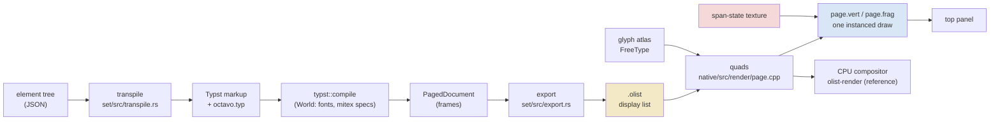

# Octavo, Part 1: Typst on a Handheld

**Octavo** is a reading program for mathematics on the Anbernic RG DS Plus, a Linux handheld with two 1024 × 768 screens. The top screen shows a definition, a theorem or an exercise set like a printed book. The bottom screen is for handwritten scratch work, a tutor and notes. The buttons follow a fixed grammar: A opens, B goes back, X opens an action menu, Y asks the tutor. A design session produced the visual design, a scripting API and a browser IDE in which 25 example books run on a drawn model of the device. This report covers the first implementation phase: the spike that tested the three assumptions the native program depends on.

The design keeps typesetting out of the device's drawing path. A typesetter (Typst) lays out each page once. Its output is converted into a **display list**: a few kilobytes of positioned glyphs, rules and the rectangles of every place the cursor can stop. The device draws display lists with one GPU program and changes what the reader sees, such as the focused link or a struck hypothesis, by changing a small texture of **span states**. The spike asked whether the place each glyph belongs to can survive Typst's output, whether Typst is fast enough on the handheld's Cortex-A55 cores, and whether a shader can draw book-quality type on the panel. All three answers are yes, with numbers below.

> [!summary]
> - **Span ids travel as text colours.**
>   - Every focusable span is typeset with a fill colour that encodes its id.
>   - Typst keeps the fill on every glyph it produces: inside maths, and across line breaks.
>   - The exporter reads the id back from each glyph. All 13 spans of three test cards come back on exactly their glyphs.
> - **Typst is fast enough to run on the device.**
>   - A changed paragraph re-lays out in 5.5–8.1 ms (p50) on the A55 cores; an unchanged page comes back from memoization in about 1 ms.
>   - A first layout in a fresh process costs 120–166 ms.
>   - Display lists computed on the device and on an x86 workstation are byte-identical.
> - **One shader program draws a page.**
>   - Glyphs and rules are instanced quads on the pixel grid over a FreeType coverage atlas.
>   - Their colour comes from a per-span state texture, so moving the cursor costs two texel writes and one redraw: 2.4–4.7 ms on the Mali-G52.
>   - The device's screenshot matches a CPU reference renderer to within one level per channel.

## 1. Terms

The rest of the report uses these terms. They are listed in the order in which they depend on each other.

- **Card.** One unit of mathematics: a definition, theorem, example, counterexample and so on. A card has an id (`kc`), a kind, a number (`5.3`), a title and a body in Markdown with LaTeX maths. Cards link to other cards with `[[target]]` or `[[target|label]]`.
- **Span.** A piece of a card's text that the cursor can stop on: a link, a hypothesis of a theorem, a proof step, a condition row. Every span has a numeric **span id**, unique within one page.
- **Element tree.** A JSON tree in a small closed vocabulary (`page`, `head`, `card`, `p`, `b`, `i`, `m` for inline maths, `dm` for display maths, `span`, `cond`, `steps`, `prompt`, …). It describes a page's content without any layout. In the full program, JavaScript views produce element trees; in this phase they are written by hand.
- **Typst.** A typesetting system written in Rust, with paragraph layout, hyphenation and OpenType maths. Here it is used as a library (the `typst` crate, version 0.14.2).
- **mitex.** A converter from LaTeX maths to Typst maths syntax (the `mitex` crate, 0.2.4). Its output calls Typst definitions that live in mitex's Typst package.
- **octavo-set.** The program that turns an element tree into a display list: transpile to Typst markup, compile with Typst, export.
- **Display list.** octavo-set's output. It contains:
  - a page size;
  - a list of glyph records (x, y, glyph id, font and size, span id, flags);
  - a list of rules (filled rectangles);
  - a list of paths;
  - a span table giving each span's kind, target and rectangles.

  The binary form is called `.olist`.
- **Tag.** The colour octavo-set gives text and shapes in Typst. Red holds a palette index, and green and blue hold the span id. Tags are never drawn as colours; the exporter decodes them.
- **Glyph atlas.** One single-channel texture holding the rasterized coverage of every glyph in use, at its exact pixel size.
- **Span state.** A small record per span id (state: normal, link, focus, dimmed, unread; bits: focus, struck), stored in a 256 × 256 texture that the vertex shader reads.
- **octavo-p0.** The Phase 0 device program: it shows display lists on the top panel and moves the focus with the D-pad.

## 2. The problem

The design that came out of the design session is a book. It has Latin Modern type, hairline rules, real maths layout, and no chrome beyond a running head and a line of button hints. The browser IDE imitates this with a TeX approximation: it maps LaTeX commands to Unicode characters and lets the browser lay them out. The handheld has no browser engine, and an approximation of maths typesetting does not produce the book the design asks for.

Three facts about the device shape the solution. They were measured in earlier projects on the same handheld:

| Fact | Value | Consequence |
| --- | --- | --- |
| CPU | four Cortex-A55 cores | layout must happen rarely, not per frame |
| Compiling one shader program on the Mali-G52 | median 435 ms (107–993 ms) | the renderer gets one program for pages |
| Loading a program binary from a cache | about 1 ms | compile once, cache the binary |
| RAM | 975 MiB, no swap | the typesetter's memory must be bounded and measurable |
| JavaScript pages in Lattice vs C++ pages | 6.4–6.6 ms vs 1.67 ms per render | scripts must stay off the drawing path |

The design's answer is a seam between layout and drawing: lay out once into a display list, draw display lists cheaply, and express every visual change that does not move glyphs as a change of span state. Three things had to be true for that to work, and Phase 0 tested each:

1. Typst's output must say which span every glyph belongs to, including glyphs inside maths and spans that break across lines (decision D7 in the project's guide).
2. Typst must be fast enough on the A55 cores to lay out at least tutor answers and custom views on the device, with a target of under about 50 ms for a warm paragraph (decision D6).
3. A shader program over a coverage atlas must draw thin Latin Modern strokes acceptably on a 298 ppi panel.

## 3. The pipeline



The left half runs in `octavo-set`, a Rust program that can lay out pages at build time, as a helper process on the device, and later as WebAssembly in the browser IDE. The right half runs in the device program. The two halves share nothing but the `.olist` format. The renderer does not know whether a page was laid out on a workstation or on the handheld, and in this phase the result was the same byte for byte.

## 4. One card from source to panel

The definition of a KC space is short and has three links, so it exercises every step. In the content format it reads:

```markdown
::: definition {#kc title="KC space" terms="KC"}
A space is **KC** if every [[compact]] subset of it is closed. Every [[Hausdorff]]
space is KC by [[compact-closed|Theorem 5.4]], and every KC space is $T_1$, because
finite sets are compact.
:::
```

**The element tree.** A view turns the card into an element tree, giving each link a span id. This phase's fixture (`library/fixtures/phase0/kc.json`) writes it by hand; its card part is:

```json
{"t": "card", "kind": "definition", "n": "5.3", "title": "KC space", "c": [
  {"t": "p", "c": [
    "A space is ", {"t": "b", "c": ["KC"]}, " if every ",
    {"t": "span", "id": 1, "kind": "term", "target": "compact", "c": ["compact"]},
    " subset of it is closed. Every ",
    {"t": "span", "id": 2, "kind": "term", "target": "hausdorff", "c": ["Hausdorff"]},
    " space is KC by ",
    {"t": "span", "id": 3, "kind": "card", "target": "compact-closed", "c": ["Theorem 5.4"]},
    ", and every KC space is ", {"t": "m", "tex": "T_1"}, ", because finite sets are compact."
  ]}]}
```

**The Typst markup.** octavo-set transpiles the tree. Its actual output for this card is:

```typst
#import "/octavo.typ": *
#show: page-setup.with(width: 1024, style: "book")
#head("Read", "Topology and Sheaves · §5 Compactness")

#card("Definition", "5.3", "KC space")[#"A space is "#strong[#"KC"]#" if every "#span(1)[#"compact"]#" subset of it is closed. Every "#span(2)[#"Hausdorff"]#" space is KC by "#span(3)[#"Theorem 5.4"]#", and every KC space is "#mi("T _(1 )")#", because finite sets are compact."]

#prompt((("A", "peek"), ("B", "back"), ("X", "actions"), ("Y", "ask"), ("L/R", "5.2 · 5.4"),))
```

Every piece of text is a Typst string literal (`#"…"`), so nothing in a card is read as markup. A card that contains `*`, `$`, `#` or `[` cannot change the page's structure. The maths `T_1` became `T _(1 )` through mitex; `#mi` evaluates it in Typst's maths mode against mitex's definitions. `#span(1)[…]` is defined in the template, `set/typst/octavo.typ`:

```typst
#let tag(c, id) = rgb(c, calc.quo(id, 256), calc.rem(id, 256))
#let span(id, body, c: ink) = text(fill: tag(c, id), body)
```

**The display list.** Typst lays the page out at one point per device pixel. The exporter walks the result and writes 256 glyph records, 3 rules and 3 spans, which come to 4,522 bytes as `.olist`. The span table, in the JSON debug form without its `strike` field, is:

```json
{"1": {"kind": "term", "target": "compact",        "rects": [[687.92,  72.58,  98.98, 26.84,  94.18]]},
 "2": {"kind": "term", "target": "hausdorff",      "rects": [[237.79, 112.58, 114.24, 26.84, 134.18]]},
 "3": {"kind": "card", "target": "compact-closed", "rects": [[548.89, 112.58, 149.03, 26.84, 134.18]]}}
```

Each rectangle is x, y, width, height and the baseline. The first glyph of span 1, the "c" of "compact", is the record `[687.92, 94.18, 3, 43, 1, 0]`: x and y of its origin on the baseline, style 3 (LM Roman Ten at 27 px), glyph 43, span 1, flags 0. The three rules are focus underlines, one under each span, with the flag `SHOW_IF_FOCUS` (256).

**The draw.** The device program turns every glyph record into a quad that samples the atlas, and every rule into a quad that samples a solid block of the atlas. It sets spans 1 to 3 to the *link* state and draws the page in one instanced call. The D-pad changes span states. After two presses of RIGHT, span 3 is in the *focus* state, so its glyphs are red and its underline is visible:

![[_assets/octavo-001/octavo-p0-device-kc-focus.png]]

*The Mali-G52's framebuffer, read back with `glReadPixels` after two presses of RIGHT. Links are blue, the focused link is red with its underline, the running head is grey, the button letters are red.*

## 5. octavo-set

### 5.1 A world with no file system and no network

Typst compiles against a `World`. This is a trait that supplies the main source, any other files, the fonts, the standard library and today's date. Octavo's world (`set/src/world.rs`) is small on purpose. The main source is replaced for every request. Fonts are loaded once from one directory. Every other file is compiled into the binary:

```rust
const EMBEDDED: &[(&str, &str, &str)] = &[
    ("", "octavo.typ", include_str!("../typst/octavo.typ")),
    ("", "mitex/specs/mod.typ", include_str!("../vendor/packages/preview/mitex/0.2.4/specs/mod.typ")),
    ("", "mitex/specs/prelude.typ", …),
    ("", "mitex/specs/latex/standard.typ", …),
    ("xarrow:0.2.0", "typst.toml", …),
    ("xarrow:0.2.0", "lib.typ", …),
];
```

mitex ships as a Typst package with a WebAssembly plugin that converts LaTeX inside Typst. octavo-set does not need the plugin, because it calls the mitex crate directly. It still needs the Typst definitions the converted code calls (`specs/`), so those are embedded under `/mitex/` in the project root, where the template imports them. `standard.typ` imports one other package (`xarrow`), which is embedded as a package. Typst reads the package's `typst.toml` to find its entry point.

Because the world has no file system access beyond the font directory and no package downloads, octavo-set's output depends only on the tree, the binary and the fonts. Section 9 shows that this holds across architectures.

### 5.2 Why span ids are colours

The renderer needs to know, for every glyph, which span it belongs to. Typst has a query system that reports where labelled elements are. A label marks one location, though, not a set of glyphs: a span that breaks across two lines needs two rectangles, and a span containing maths needs the maths glyphs too.

A text fill has the properties needed. It is a style, so it is inherited by everything inside the span, including the glyphs of an equation, which take their colour from the surrounding text fill. Typst keeps the fill on each text item it emits, and a paragraph broken across lines produces separate text items that each carry it. Encoding the span id in the fill therefore labels every glyph without any query. The exporter decodes the tag:

```rust
fn decode(paint: &Paint, foreign: &mut usize) -> (u16, u16) {
    match paint {
        Paint::Solid(c) => {
            let [r, g, b, _] = c.to_vec4_u8();
            if r > 15 { *foreign += 1; (0, 0) }           // not an Octavo tag
            else { (r as u16, (g as u16) << 8 | b as u16) } // (palette, span)
        }
        _ => { *foreign += 1; (0, 0) }
    }
}
```

The red channel carries a palette index for text that has its own colour regardless of state: 0 ink, 1 grey for the running head, 2 the accent red of the button letters, 3 link blue. This was not in the original design, which put red at zero everywhere. It was added once the template needed grey and red text that are not spans. A fill that does not decode, for example a colour some package sets itself, is counted as "foreign". A correct page has none.

### 5.3 The exporter

The exporter walks Typst's frames recursively. A frame holds items at positions: groups (with a transform), text runs, shapes, images, links and introspection tags. Text runs carry a font, a size, the fill, the plain text and the glyphs. Each glyph has an id, an advance and offsets in em units.

```rust
FrameItem::Text(text) => {
    let (color, span) = decode(&text.fill, &mut self.out.foreign_fills);
    let size = text.size.to_pt() as f32 * ts.sy.get() as f32;
    let style = self.style(&text.font, size);               // (font file, size) -> index
    let mut cursor = Abs::zero();
    for g in &text.glyphs {
        let dx = cursor + g.x_offset.at(text.size);
        let dy = -g.y_offset.at(text.size);                 // Typst's y offset points up
        let [x, y] = pt(Point::new(pos.x + dx, pos.y + dy), ts);
        self.out.glyphs.push(GlyphRec { x, y, glyph: g.id, style, span, flags: color });
        if span != 0 { /* add a box to the span: x .. x + advance, baseline - ascent .. baseline + descent */ }
        cursor += g.x_advance.at(text.size);
    }
}
```

Shapes become rules when they are axis-aligned lines or filled rectangles: fraction bars, overlines, table rules, the template's horizontal rule. Other curves become paths, which this phase records but does not draw.

**Span rectangles.** After the walk, each span has a list of glyph boxes. They have to be merged into one rectangle per line, because the D-pad navigation and the focus underline both work per line. Merging by baseline would be wrong: a subscript has its own baseline, so `U_{x_1}` would split into three rectangles on one line. The exporter instead merges boxes whose vertical extents overlap by more than 30 % of the smaller box. A merged rectangle takes the baseline of its largest glyph, so the underline sits under the main text and not under a subscript.

For every span rectangle the exporter also adds a focus underline (1.5 px, 0.14 em below the baseline), and for every hypothesis a strike rule (0.25 em above the baseline). Both are flagged to be shown only in a matching state. Section 6.3 explains why the geometry is always present.

### 5.4 The binary format

| Section | Record | Fields (little-endian) |
| --- | --- | --- |
| header | 1 | `OLST`, version u16 = 1, flags u16, width f32, height f32, seven u32 counts |
| faces | per font face | file name (string offset) u32, face index u32 |
| styles | per (face, size) | face u16, padding u16, size in px f32 |
| glyphs | per glyph | x f32, y f32, glyph u16, style u16, span u16, flags u16 (16 bytes) |
| rules | per rule | x, y, w, h f32, span u16, flags u16 |
| paths | per path | point count u32, width f32, span u16, flags u16, points |
| spans | per span | id u16, rectangle count u16, kind u32, target u32, rectangles (x, y, w, h, baseline) |
| strings | once | NUL-terminated UTF-8 |

Flags: bits 0–3 are the palette index. Bits 8–11 are the show-if mask (1 = only when focused, 2 = only when struck). Paths also use bits 12 and 13 for closed and filled. The three test cards are 4.5, 8.7 and 8.3 KB.

## 6. Drawing a page

### 6.1 Quads on the pixel grid

`buildQuads` (`native/src/render/page.cpp`) turns a display list into instance records of 36 bytes: rectangle, atlas rectangle, span and flags. Two choices make the result exact:

- **Glyphs are rasterized at one of three horizontal sub-pixel phases.** The glyph's x is split into a whole pixel and a fraction, the fraction is rounded to 0, 1/3 or 2/3, and the atlas holds the glyph rasterized at that offset. The baseline y is rounded to a whole pixel. Every quad then starts on a pixel boundary and covers whole texels.
- **Rules are snapped to whole pixels**, at least one pixel thick. A hairline of 0.75 pt becomes one pixel of full coverage instead of two pixels at partial coverage.

With every quad on the grid, the atlas can be sampled with `NEAREST` filtering and no texel is ever blended with its neighbour. This is also what lets a CPU compositor reproduce the GPU's output (section 6.4).

### 6.2 The atlas

The atlas (`native/src/render/atlas.cpp`) is adapted from Lattice's. FreeType renders each glyph unhinted (`FT_LOAD_NO_HINTING`) at the exact pixel size of its style. The phase offset is applied by translating the outline by phase × 64 / 3 units of 1/64 px before rasterizing. Glyphs are packed on shelves in one 2048 × 2048 R8 texture, which is 4 MiB. A 4 × 4 block of full coverage is reserved at (1, 1). A rule's quad samples the centre of that block (u0 = u1, v0 = v1), so glyphs and rules share one program, one texture and one draw call.

### 6.3 State as colour

The span-state texture is 256 × 256 texels of `RGBA8UI`, one texel per possible span id. The vertex shader reads the texel of its instance's span with `texelFetch` and decides two things: whether the instance is visible, and which palette colour it gets.

```glsl
const uint STATE_COLOR[5] = uint[5](0u, 3u, 2u, 4u, 1u);   // normal, link, focus, dimmed, unread

void main() {
  uint span = a_spanFlags.x, flags = a_spanFlags.y;
  uvec4 s = texelFetch(u_state, ivec2(int(span & 255u), int(span >> 8u)), 0);
  uint need = (flags >> 8u) & 15u;
  float show = (need == 0u || (s.g & need) != 0u) ? 1.0 : 0.0;
  vec2 p = a_rect.xy + a_corner * a_rect.zw * show + u_offset;   // hidden quads collapse to a point
  v_uv = mix(a_uv.xy, a_uv.zw, a_corner);
  uint ci = s.r == 0u ? (flags & 15u) : STATE_COLOR[min(s.r, 4u)];
  v_color = u_palette[ci & 7u];
  gl_Position = vec4(p.x / u_screen.x * 2.0 - 1.0, 1.0 - p.y / u_screen.y * 2.0, 0.0, 1.0);
}
```

The fragment shader samples the coverage, applies an exponent (`u_contrast`, for tuning thin strokes on the panel) and outputs the colour with that coverage as alpha.

Why is the focus underline always in the vertex buffer, hidden by the shader, instead of being added when a span gains focus? If geometry depended on state, a focus change would mean rebuilding and uploading the instance buffer. With the underline always present and collapsed to a point unless the span's focus bit is set, a focus change is exactly two texel writes: the old span loses the bit and the new span gains it. The same holds for striking a hypothesis. On the device, the state work of a D-pad press measured 0.003–0.08 ms.

One kind of change is not a state change: anything that changes metrics, such as switching a word from roman to italic. Those need a new layout, and the design lays both variants out in advance.

![[_assets/octavo-001/octavo-p0-device-theorem-struck.png]]

*Theorem 5.4 on the device after pressing A on its first hypothesis. "a Hausdorff space" is a span broken across two lines. It is drawn in the dimmed colour with its strike rule visible, both selected by the span's state. The focus has moved to proof step 4, which also wraps, and both of its lines carry the underline.*

### 6.4 A CPU reference renderer

`olist-render` (`native/tools/olist-render.cpp`) composites the same quads with the same atlas and the same colour rules on the CPU and writes a PNG. It exists for two reasons: looking at pages without the device, and golden-image tests later. Whether it really computes what the GPU computes was checked directly. The device's screenshot of the KC card with span 3 focused was compared with `olist-render --links --state 3:2:1` at 1024 × 768. 471 pixels differ, each by exactly one level in one channel, and no pixel differs by more. The difference is rounding in the blend. A renderer change that moves a glyph or changes a colour will show up as a difference far above that.

### 6.5 One program, cached

The program cache is adapted from lattice-shade's: linked program binaries are stored under a name made from a hash of the driver and the sources. Octavo builds one program for pages here (three are planned), so the background compiler lattice-shade needed for 55 programs is gone. On the device the `page` program compiled in 146.7 ms on first start and loaded from the cache in 0.7 ms afterwards.

## 7. The Phase 0 program

`octavo-p0` (`native/src/app/p0.cpp`) uses Lattice's platform layer, copied unchanged: two SDL windows, one OpenGL ES context, the handheld's button table and placement on the panels through sway. It loads display lists, shows one on the top panel and responds to:

- **D-pad: move the focus.** The algorithm is the IDE's (`ide/src/runtime.js:625-653`), applied to span rectangles instead of DOM rectangles. Among spans in the pressed direction, it picks the one with the smallest distance along the direction plus a weighted distance across it (×3 for left and right, ×0.6 for up and down). Otherwise it steps to the neighbour in document order.
- **A on a hypothesis: toggle its strike.**
- **L and R: change the page. START: cycle the contrast exponent** (1.0, 0.85, 0.7, 0.55).

The main loop blocks in `waitEvent` and draws a screen only when it is marked dirty. A control FIFO (`/tmp/octavo.ctl`) accepts `press A`, `shot PREFIX`, `contrast 0.8`, `page 2`, `stats` and `quit`. That made every measurement below scriptable over ssh.

![[_assets/octavo-001/octavo-p0-device-sierpinski.png]]

*The Sierpiński counterexample on the device, with display maths and two condition rows. The focused row wraps, and its span includes its label "(T1)".*

## 8. Building for the handheld

The device runs ROCKNIX: a read-only squashfs root, glibc 2.44, and no compilers. Everything is cross-compiled on an x86 workstation.

- **octavo-set** is built as a static `aarch64-unknown-linux-musl` binary and linked with Rust's own `rust-lld`, so the Rust side needs no cross C toolchain. One dependency still does: `psm`, which Typst uses through `stacker` for deep recursion, assembles a few files with the target's C compiler. The first build stopped with `failed to find tool "aarch64-linux-musl-gcc"`. clang can assemble for aarch64 without a sysroot, so `set/.cargo/config.toml` sets `CC_aarch64_unknown_linux_musl = "clang --target=aarch64-linux-musl"`. The stripped binary is 28.6 MB.
- **The C++ program** is built in the Debian 12 arm64 toolchain image from the Lattice project, against `libSDL2` and `libfreetype` copied from the device. GL entry points are resolved at run time through `SDL_GL_GetProcAddress`, as Lattice and Falllinie do, because ROCKNIX's `libGLESv2` is a shim in front of Arm's driver.
- **git on the device.** The user asked for git on the handheld, so that books edited there can be versioned in place. git 2.56 is cross-compiled in the same image, linked against the device's own `libz` and `libcurl`, and installed as a relocatable tree in `/storage/.local/git`. It is on the PATH through `/storage/.config/profile.d/070-git`, a directory ROCKNIX's `/etc/profile` reads. git 2.56 builds Rust parts by default and needs `NO_RUST=1` to build without them.

## 9. Results

**Span ids.** `octavo-set set --check` requires every span of the tree to come back on glyphs with at least one rectangle. For spans without maths, the glyphs' text must also equal the tree's text in letters and digits. All 13 spans of the three fixtures pass:

| Fixture | Spans | Notable cases |
| --- | --- | --- |
| Definition 5.3 | 3 links | all on one line each |
| Theorem 5.4 | 2 hypotheses, 4 proof steps | hypothesis 1 breaks across lines (2 rectangles). Hypothesis 2 contains maths and comes back as glyphs `𝐾⊆𝑋 be compact`. Step 4 breaks across lines. |
| Sierpiński space | 2 links, 2 condition rows | one row wraps (2 rectangles) |

**Layout speed and memory.** `octavo-set bench` lays out a tree once in a fresh process, then once more unchanged, then 20 times with a number appended to the first paragraph's first string. That forces Typst to lay out a changed paragraph while reusing everything else. CPU governor `ondemand` at 1.99 GHz:

| Card | Device: first page, fresh process | Device: unchanged | Device: changed paragraph, p50 (max) | Workstation: changed, p50 |
| --- | --- | --- | --- | --- |
| Definition 5.3 (256 glyphs) | 120.5 ms | 0.58 ms | 5.49 ms (6.92) | 0.47 ms |
| Theorem 5.4 (500 glyphs) | 166.3 ms | 1.52 ms | 6.44 ms (7.89) | 0.84 ms |
| Sierpiński (483 glyphs) | 143.3 ms | 1.27 ms | 8.11 ms (10.02) | 0.83 ms |

Loading the fonts takes 11–15 ms. Peak resident memory of the whole process is 23.2–23.8 MiB. The first page is slow because it initializes Typst's standard library and evaluates the template and mitex's 1,130-line specification. Later pages reuse all of that through Typst's memoization (comemo). A long-running helper process therefore pays the 120–166 ms once, and every later page costs single-digit milliseconds.

**Determinism.** The three display lists computed by the static aarch64 binary on the device and by the x86 build on the workstation are byte-identical (`cmp`). That makes golden display lists usable as tests on either machine, and it means the browser IDE's WebAssembly build of the same code can be checked against the device.

**Drawing.**

| Measurement | Value |
| --- | --- |
| `page` program, first start | 146.7 ms compiled; 0.7 ms from the cache afterwards |
| Loading three display lists (parse, quads, atlas) | 14.3–15.1 ms, of which FreeType rasterizes 296 glyphs in 10.5 ms |
| First frame on both screens | 380 ms after process start without a cache; 220–268 ms with one, of which 177–208 ms is creating the SDL windows and the GL context |
| Redraw of the top screen after a focus move (with `glFinish`) | 2.4–4.7 ms |
| State work per D-pad press | 0.003–0.08 ms |
| Frames drawn while idle | 0 over 10 s (frame counter unchanged between two `stats` calls) |
| Peak resident memory of `octavo-p0` | 44–57 MiB |
| GPU against CPU reference | 471 pixels differ by 1 level, none by more |

## 10. Defects found on the way

- **Font family names.** The first compile failed with `no font could be found` inside the maths function. The bundled fonts are renamed builds: `fc-scan` reports their families as "LM Roman Ten" and "LM Math Ten", not "Latin Modern Roman" and "Latin Modern Math". Typst matches families by name, so the template names those families.
- **Deprecated symbols.** Typst 0.14 warned on every compile about `kai` (in mitex's `standard.typ`, used for the KaTeX logo) and `sect` (which mitex 0.2.4's built-in specification emits for `\cap`; Typst 0.14 renamed it `inter`). The vendored line is patched, and the transpiler renames the identifier `sect` in converted maths. Both changes are recorded in `set/vendor/README.md`.
- **The check, not the layout, was wrong for condition rows.** A condition row's span includes its label "(T0)" in the glyphs, and the check compared against the text without the label. The check now includes the label.
- **A C++ declaration that declared a function.** `std::vector<char> bin(size_t(len));` is parsed as a function declaration. It is now `static_cast<size_t>(len)`.

## 11. What Phase 0 decides

- **D7 (span ids as fills) is the mechanism.** The fallback, Typst labels plus position queries, is not needed.
- **D6 (every view goes through Typst) stands.** A changed paragraph at 5.5–8.1 ms leaves room for tutor answers set paragraph by paragraph, notes, and custom views that re-lay out on a state change.
- **octavo-set runs as one long-lived helper process** on the device. It pays the 120–166 ms of initialization once, and its memory (about 24 MiB) is measurable apart from the app's.
- **The CPU compositor is the reference renderer** for golden-image tests, because it agrees with the Mali to 1/255.

## 12. Limitations and open questions

- **The contrast exponent is not chosen.** Whether Latin Modern's thin strokes need darkening at 27 px on a 298 ppi panel can only be judged by looking at the panel. A screenshot shows the framebuffer, not the panel. `octavo-p0` cycles the candidates with START, and the default stays 1.0.
- **Running-head small caps fall back to regular letters.** The renamed LM Roman Ten face appears to lack the `smcp` feature Typst uses for `smallcaps`. The caps face in the font set (`lmromancaps10-regular.otf`) is not wired in yet.
- **Focus movement follows geometry.** From the second hypothesis of Theorem 5.4, RIGHT went to proof step 2, not step 1, which is correct for the algorithm. Whether the read view should prefer reading order is a design question for Phase 1.
- **The `.olist` format is version 1 and not frozen.** Paths are recorded but not drawn; the `stroke` program arrives with ink in Phase 4.

## 13. Next steps

Phase 1 is the reading loop on the device:

- port the IDE runtime's card parser, link graph, verb resolution, focus and prompt line into a DOM-free `js/core`;
- run it in V8 on a script thread;
- produce the read and peek views as element trees from parsed chapter files;
- keep `octavo-set serve` running as the layout helper.

The exit test is reading the `compact-hausdorff` preset on the device with the D-pad, A, B, L and R, with a correct prompt line on every span.

## 14. Reproducing

```bash
cd /home/manuel/code/wesen/2026-10-17--octavo
# lay out a fixture and check its spans (workstation)
cd set && cargo build --release && cd ..
set/target/release/octavo-set set --fonts mockups/fonts library/fixtures/phase0/compact-closed.json \
    --olist /tmp/cc.olist --json /tmp/cc.json --typ /tmp/cc.typ --check
# reference image with span 3 focused
cmake -S native -B build/native -G Ninja && ninja -C build/native
build/native/olist-render --fonts mockups/fonts --links --state 3:2:1 /tmp/cc.olist /tmp/cc.png
# device
device/build.sh && device/deploy.sh
ssh root@192.168.0.202 '/storage/apps/octavo/bin/octavo-set bench --fonts /storage/apps/octavo/fonts \
    /storage/apps/octavo/library/fixtures/phase0/kc.json --n 20'
ssh root@192.168.0.202 '/storage/apps/octavo/scripts/run-p0.sh --measure --seconds 60 &
    sleep 4; cd /storage/apps/octavo/scripts; ./ctl.sh press RIGHT; ./ctl.sh shot /tmp/p0'
```

## 15. Files

| Path (in `/home/manuel/code/wesen/2026-10-17--octavo`) | Role |
| --- | --- |
| `set/src/world.rs` | the Typst world: fonts from a directory, embedded template and packages |
| `set/src/transpile.rs` | element tree to Typst markup; mitex for maths |
| `set/typst/octavo.typ` | the book template and the tag encoding |
| `set/src/export.rs` | frames to display list; span rectangles; JSON and binary writers |
| `set/src/main.rs` | `set`, `bench`, `serve`, `version` |
| `native/src/olist/olist.cpp` | the binary reader |
| `native/src/render/atlas.cpp` | FreeType atlas with three phases and a solid block |
| `native/src/render/page.cpp` | quads, span states, CPU compositor |
| `native/src/render/gl_page.cpp` | textures and the instanced draw |
| `shaders/page.vert`, `shaders/page.frag` | the page program |
| `native/src/app/p0.cpp` | the Phase 0 device program |
| `native/vendor/lattice/` | Lattice's platform layer, with `PROVENANCE` |
| `device/build.sh`, `device/deploy.sh`, `device/scripts/` | cross-build, install, run and control |
| `device/tools/build-git.sh`, `install-git.sh` | git for the handheld |
| `ttmp/2026/10/17/OCTAVO-001--…/design-doc/01-…intern-guide….md` | the design: architecture, decisions D1–D10, phases |
| `ttmp/2026/10/17/OCTAVO-001--…/reference/01-diary.md` | the working diary (steps 1–4) |
| `ttmp/2026/10/17/OCTAVO-001--…/results/phase0/` | screenshots and benchmark data |

## Related notes

- [[PROJECT REPORT - DS Shaders - no_shade on a Handheld - A Browser Twin, a Deconstructed Console and a Shader Runtime inside Lattice]]: the shader runtime, the program cache and the first-start measurements this work builds on
- [[PROJECT REPORT - Lattice DS Native - The Whole Project - A Browser UI System on a Real Dual-Screen Handheld]]: the platform layer, the V8 host and the device build that Octavo reuses
- [[PROJECT REPORT - Lattice DS Native, Part 2 - A Two-Thread Shell and a Thin V8 Layer on the RG DS Plus]]: the two-thread structure that Phase 1 adopts
