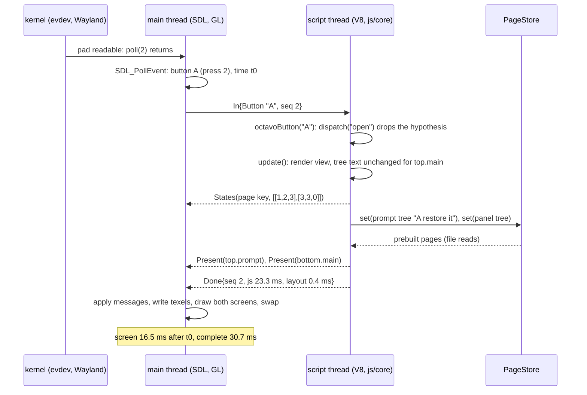
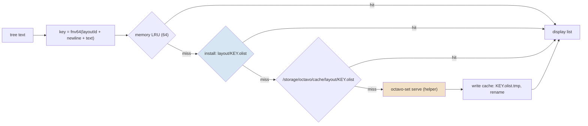
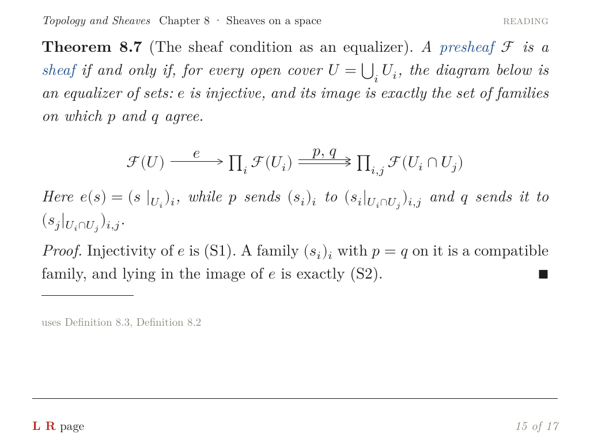
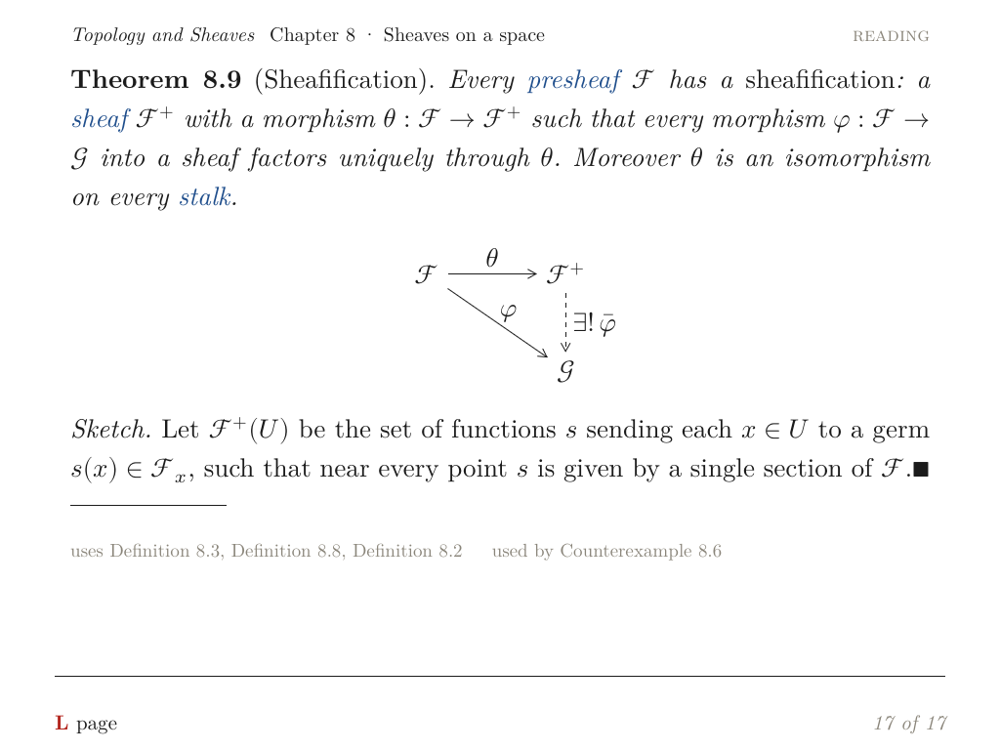
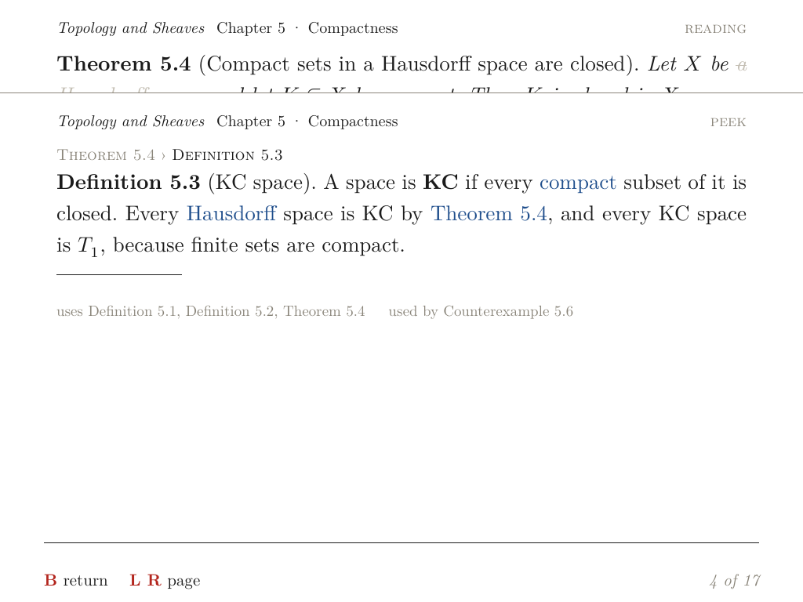
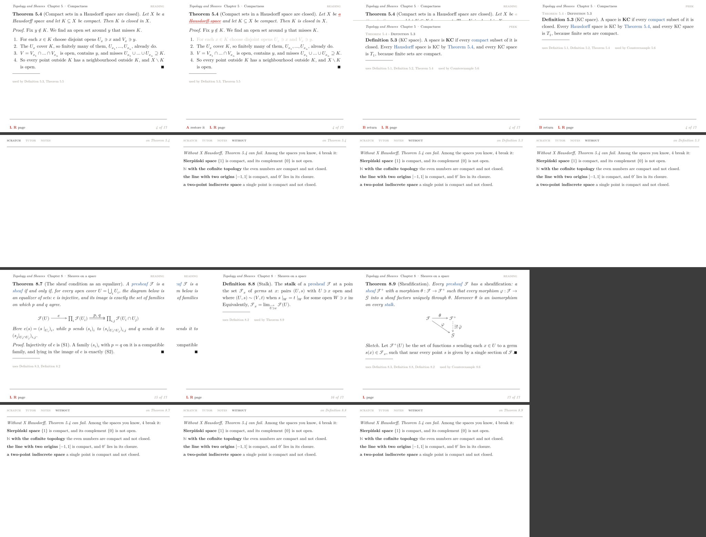
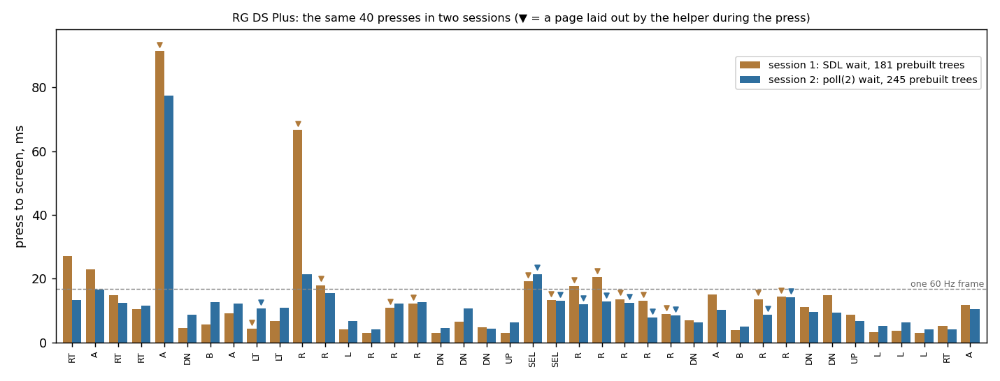
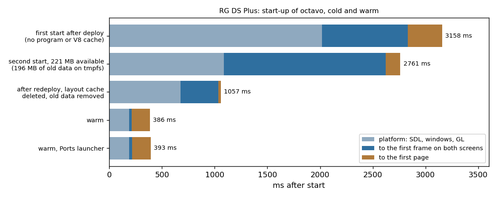
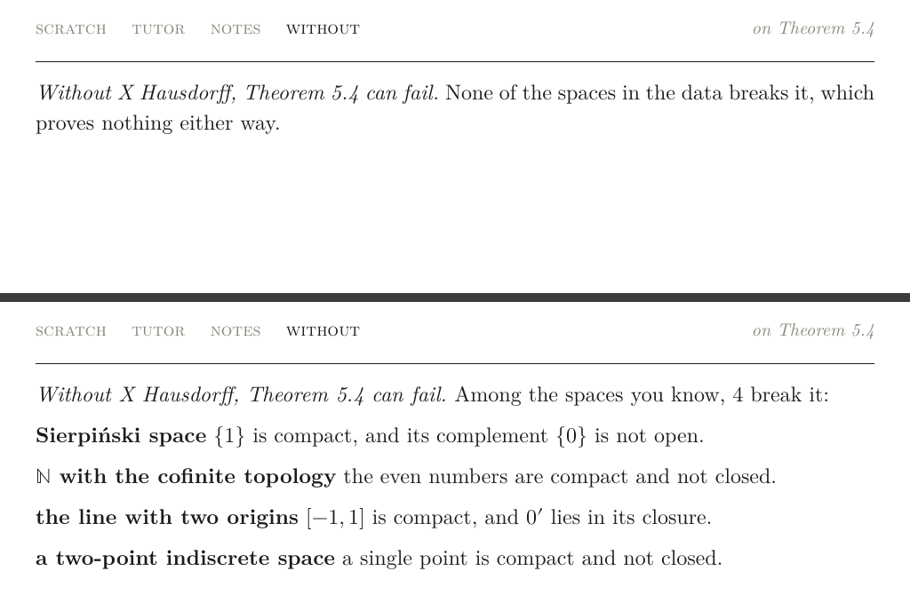

# Octavo, Part 2: The Reading Loop on the Handheld

**Octavo** is a reader for typeset mathematics on the Anbernic RG DS Plus, a Linux handheld with two 1024 × 768 screens and a Mali-G52 GPU. [[PROJECT REPORT - Octavo, Part 1 - Typst on a Handheld - Display Lists, Span Ids as Colours and a Page Shader on the RG DS Plus|Part 1]] covered the spike (Phase 0), which answered three questions about the drawing path:

- Typst lays out a page on the handheld in milliseconds.
- The identity of every focusable piece of text survives Typst as a fill colour.
- One shader program draws a page at book quality.

This report covers Phase 1, which built the program that a reader actually holds. Phase 1 had four exit criteria:

- two chapters of a topology text (compactness and sheaves) can be read with the D-pad, A, B, L and R;
- the line of button hints at the bottom of the top screen is correct in every state;
- an idle reader draws no frames;
- the time from a button press to the screen is measured.

All four hold on the device. The reading program runs the design session's JavaScript runtime in V8 on its own thread. That runtime describes each screen as an element tree, which is laid out once by Typst and drawn many times by the GPU. Most pages are laid out when the install is built, so the device rarely runs Typst at all. A press reaches the screen in 10.7 ms at the median and 15.4 ms at the 90th percentile. Between presses the program sleeps in the kernel and uses no measurable CPU. Two of the problems Phase 1 had to solve were not about reading at all: SDL 2's event loop wakes 883 times a second while a gamepad is open, and on this device start-up time is set by the page cache.

> [!summary]
> - **One description of a screen, three consumers.**
>   - The runtime ported from the browser IDE produces element trees instead of React elements.
>   - The same trees are laid out by octavo-set when the install is built, by a helper process on the device, and by Node in tests.
>   - A focus move or a struck hypothesis changes only a span-state texture, never the layout.
> - **Pages are content-addressed.**
>   - A page's key is a hash of the layout version and the tree's text.
>   - A walk over every reachable state lays out 245 pages before the device sees them.
>   - In a 40-press session, 45 page loads came from those files and 10 from the helper, which cost 8.6–13.2 ms each.
> - **The device waits in poll(2), not in SDL.**
>   - SDL 2 polls its queue every millisecond while a joystick is open: 883 wake-ups per second and about 5 % of a core for an idle reader.
>   - The main loop now sleeps on the window system's socket, its own descriptors of the gamepad, an eventfd and the control FIFO. Thirty idle seconds cost 30 ms of CPU and zero frames.
>   - SIGTERM writes the same eventfd, so a sleeping reader still exits on a signal.
> - **Measured on the device:**
>   - press to screen: p50 10.7 ms, p90 15.4 ms, max 77.4 ms over 40 presses;
>   - warm start: 214–238 ms to the first frame and 386–427 ms to the first page;
>   - memory: 72–90 MiB resident for the reader and 18–22 MiB for the layout helper.

## 1. Terms

Part 1 defined cards, spans, element trees, Typst, mitex, octavo-set, display lists and span states. This part adds the following terms, in dependency order.

- **View.** A JavaScript function that renders the current screen (a card being read, a peek, an error) as an element tree. The views here are ports of the browser IDE's React components.
- **Runtime.** The JavaScript object that holds the reading state: the card on screen, the peek stack, the focused span, the dropped hypotheses and the panel tab. It resolves button presses into **verbs** (`open`, `back`, `panel`, `left` …) and calls `update()` after each change. It is a port of the IDE's runtime (`ide/src/runtime.js`).
- **Prompt line.** The 76-pixel strip at the bottom of the top screen that names what each button does now: "A peek", "B return", "L R page", "4 of 17". It changes with every focus move.
- **Panel.** The bottom screen's content: tabs (scratch, tutor, notes, and an aside such as "without") and, when a hypothesis is dropped, the list of known spaces that break the theorem.
- **Slot.** A rectangle of a screen that shows one page:
  - `top.main` is the card, y 0–692 of the top screen;
  - `top.prompt` is the prompt line, y 692–768;
  - `bottom.main` is the panel.
- **Page key.** `fnv64(layoutId + "\n" + treeText)`: the identity of a laid-out page. The **layout id** is a hash of octavo-set's version and its embedded template and packages, so two builds that would lay out a tree differently give it different keys.
- **Prebuilt page.** A display list laid out when the install is built and stored under its key in the install's `layout/` directory.
- **Layout helper.** A long-running `octavo-set serve` process on the device that lays out trees no file holds.
- **Script thread** and **main thread.** V8 and the runtime run on the script thread. SDL, OpenGL ES and drawing run on the main thread. The script thread sends the main thread **UI messages**: Present (show a page in a slot, with an animation), States (a page's span states), Scroll, and Done (the press has been handled).
- **Press latency.** Measured inside the program, from the SDL button event to the return of the buffer swap that first shows a change ("screen"). A second time runs to the swap after the press's last message ("complete"). Neither includes the compositor or the panel's scan-out.

## 2. What happens when a button is pressed

The clearest way into the design is to follow one press. The reader is on Theorem 5.4 ("Compact sets in a Hausdorff space are closed"). The focus is on the hypothesis "a Hausdorff space", and the reader presses A. The runtime's reading of A on a hypothesis is "drop it": the hypothesis is struck through, the proof steps that use it are dimmed, and the panel lists spaces in which the conclusion fails.



The numbers in the last line are press #2 of the 40-press device session in section 10.

Three things in this trace carry the design.

First, the card itself is not laid out again. The view produces the same element tree for Theorem 5.4 whether or not a hypothesis is dropped: the strike and the dimming are span states, not text. The tree's text is unchanged, so its key is unchanged, so the page on the GPU stays. What changes is two entries of the span-state list, `[1, 2, 3]` (span 1, the hypothesis: state "focus", bits focus and struck) and `[3, 3, 0]` (span 3, proof step 1: state "dimmed"). The main thread writes them into the page's 256 × rows RGBA8UI state texture, and the page shader does the rest.

Second, the prompt line and the panel are separate pages. "A drop it" becomes "A restore it", and the panel gains the list of spaces. Each is a small tree of its own, with its own key. Because the prompt is its own page, a focus move costs at most one small cached layout, not a full card.

Third, the main thread never waits for the script thread. It applies whatever messages have arrived between frames and draws. The script thread does all layout work inside its synchronous `host.set` call, so a slow layout delays the script, never a frame.

## 3. js/core: the IDE runtime without a DOM

The design session produced a browser IDE in which books run on a drawn model of the device. Its runtime and views were React code. Phase 1 ported them to plain JavaScript that runs in three places:

- in V8 on the device;
- in V8 on a workstation under Xvfb;
- in Node for tests and for the walk that produces prebuilt pages.

The port keeps the runtime's behaviour and changes its output. A view returns an element tree, a JSON value in the closed vocabulary of Part 1, instead of React elements. This is the tree the boot screen produces, shortened:

```json
{"t":"page","w":1024,"style":"book","c":[
  {"t":"head","book":"Topology and Sheaves","section":"Chapter 5 · Compactness","mode":"reading"},
  {"t":"card","kind":"Theorem","n":"5.4","title":["Compact sets in a Hausdorff space are closed"],"c":[
    {"t":"p","style":"thm","c":["Let ",{"t":"m","tex":"X"}," be ",
      {"t":"span","id":1,"kind":"hypothesis","target":"compact-closed","c":["a Hausdorff space"]},
      " and let ",
      {"t":"span","id":2,"kind":"hypothesis","target":"compact-closed","c":[{"t":"m","tex":"K \\subseteq X"}," be compact"]},
      ". Then ",{"t":"m","tex":"K"}," is closed in ",{"t":"m","tex":"X"},"."]},
    {"t":"steps","qed":true,"c":[{"t":"step","id":3,"c":["For each ",{"t":"m","tex":"x \\in K"}, "…"]}, "…"]}]},
  {"t":"xref","c":[["used by ",{"t":"span","id":5,"kind":"card","target":"kc", "…"}]]}]}
```

The full tree is 1745 bytes. The 245 trees of the book average 534 bytes: 54 are card pages, 90 are prompt lines and 101 are panels. A prompt line is a tree of its own:

```json
{"t":"page","w":1024,"style":"chrome","c":[{"t":"prompt","items":[["L R","page"]],"status":"4 of 17"}]}
```

Span ids are assigned by a **Builder** while the view renders. `F(fid, spec, children)` registers a focusable span with a stable focus id (`fid`), its verbs (what A, B and the others do on it) and a numeric span id. The numeric id goes into the tree, and the focus id and verbs stay in JavaScript. After a layout, the page's span table maps each numeric id to its rectangles, and the runtime joins the two.

`update()` is the only function that talks to the screen. Abridged from `js/core/runtime.js`:

```js
update() {
  const b = new Builder();
  let tree = vd.render(this.ctx(b));                  // the view: an element tree
  this.fx = b.fx; this.byId = b.byId;                 // focus ids and span ids of this render
  let page = this.set(tree);                          // host.set, cached by the tree's text
  const fresh = !this.page || page.key !== this.page.key || this.shown['top.main'] !== page.key;
  this.page = page;
  this.syncStates();                                  // only if the state list changed
  if (fresh || this.focusId !== this.visibleFocus) { this.visibleFocus = this.focusId; this.ensureVisible(!fresh); }
  if (fresh) this.present('top.main', page, { anim: this.anim || '', scroll: this.scrollY, force: true });
  this.present('top.prompt', this.set(O.panel.promptTree(this)));
  this.present('bottom.main', this.set(O.panel.panelTree(this)));
}
```

Several decisions here are easy to miss:

- **Layout is synchronous in JavaScript.** `host.set(tree)` returns the laid-out page's span table directly. This keeps the runtime a direct port, without promises in the render path. The cost is that a slow layout blocks the script thread; the main thread is unaffected (section 7).
- **The runtime keeps its own cache of laid-out pages, keyed by tree text.** A tree it has already sent is never sent again. This is why the native page store's memory counter reads 0 in the device sessions: every repeat is answered in JavaScript.
- **A layout failure shows the error view.** It does not leave the previous page standing. An earlier version did leave it, and a press that failed to lay out looked like a press that did nothing.
- **Verbs without screens are absent.** The IDE's global verbs `hub`, `map`, `act`, `ask` and `talk` belong to screens that arrive in later phases. Until then they do not resolve, so the prompt line never offers a button that does nothing.

## 4. Moving the focus on a typeset page

The IDE moved its cursor with the browser's bounding boxes. It measures each focusable as one rectangle and picks the nearest one in the pressed direction. On the device, the first walk through Theorem 5.4 showed what that does to text that wraps. "a Hausdorff space" starts at the end of the first line and ends at the start of the second. Its bounding box covers both lines, and its centre lies to the right of the next hypothesis, "K ⊆ X be compact". RIGHT from one hypothesis went to the other, and RIGHT from that one came back, without end.

The display list has something the browser version did not use: one rectangle per line piece of a span. `js/core/focus.js` compares spans piece by piece:

- **The piece the cursor leaves from.** RIGHT and DOWN leave a span from its last piece, LEFT and UP from its first. Reading continues after the end of a span and goes back before its start.
- **LEFT and RIGHT** consider only pieces on the same line, meaning vertical centres closer than half the taller piece. They pick the nearest piece in the pressed direction.
- **UP and DOWN** use the IDE's measure: the gap along the direction plus 0.6 times the offset across it.
- **When nothing qualifies,** the cursor steps to the neighbour in document order.

```js
function cost(dir, a, b) {
  const dx = b.cx - a.cx, dy = b.cy - a.cy;
  if (dir === 'right' || dir === 'left') {
    if (Math.abs(dy) >= Math.max(a.h, b.h) / 2) return Infinity;   // another line
    if (dir === 'right') return dx > 2 ? Math.max(0, b.left - a.right) + Math.abs(dy) * 3 : Infinity;
    return dx < -2 ? Math.max(0, a.left - b.right) + Math.abs(dy) * 3 : Infinity;
  }
  if (dir === 'down') return dy > 2 ? Math.max(0, b.top - a.bottom) + Math.abs(dx) * 0.6 : Infinity;
  return dy < -2 ? Math.max(0, a.top - b.bottom) + Math.abs(dx) * 0.6 : Infinity;
}
```

A page can be taller than the 692-pixel view, and the browser scrolled for the IDE. The device scrolls itself, by three rules in `moveFocus`:

1. **A focus scrolled out of view does not pull the page back.** If the reader has scrolled the focus out of view with the stick, the next D-pad press starts from the first focusable span in view, or the last one, depending on the direction.
2. **A distant target scrolls instead of jumping.** If the next span is more than a quarter screen beyond the view, DOWN scrolls the page by three quarters of a screen instead of jumping to the span. DOWN never skips unread text.
3. **Scrolling follows only focus changes.** The page scrolls to the focus only when the focus changed, so a page the reader has scrolled stays where it was put.

The analog stick scrolls `top.main` on the main thread at the display rate, without the script. When the stick returns to the centre, the main thread tells the runtime where the page stopped (`octavoScrolled(y)`).

## 5. Laying out pages

### 5.1 Keys, and where a page can come from

Every `host.set(tree)` call on the device goes to the **PageStore** (`native/src/app/pages.cpp`) on the script thread. It computes the key and looks in four places, in order:



The helper's result is written to the cache through a temporary file and a rename, so a crash never leaves a partial page under a valid key. JavaScript computes the same key with the same FNV-1a in `js/core/olist.js`, and Rust computes it in `octavo-set`. That agreement is what lets pages laid out on a workstation be found on the device without starting Typst.

The layout id makes the scheme safe. It hashes octavo-set's version together with every file it embeds: the template and mitex's Typst package. A changed template therefore changes every key, and a stale prebuilt directory is never consulted for the wrong pages; its pages are ignored. `device/deploy.sh` compares the device's `octavo-set layout-id` with the id the install was built with, so the mismatch shows up at deploy time and not as a silent drop in hit counts.

### 5.2 Walking the book to lay it out in advance

A reader can only reach a finite set of screens in a book of 17 cards: every card, every focus on it, every peek one level deep, every hypothesis dropped, every panel tab. `js/tools/prewarm.js` drives the runtime under Node through that set with a recording host, and writes each distinct tree as one line of `trees.jsonl`. Its walk, per card:

```js
for (const fid of focusableSpans) {
  rt.setFocus(fid); rt.update();                 // the prompt line changes with the focus
  press('open');                                 // A
  if (peeked) { if (level < 1) visit(level + 1); press('back'); }
  else if (toggled) {
    if (level === 0 && rt.asideNode)             // a dropped hypothesis: its aside follows the reader
      for (const other of rt.order) { rt.show('read', { card: other }, { replace: true }); rt.update(); }
    press('open');                               // undo the toggle
  }
}
for (let i = 0; i < rt.tabs().length; i++) press('panel');   // SELECT through the tabs
```

`octavo-set build --out layout trees.jsonl` then lays all of them out in one process. For this book that is 245 trees in 209 ms on a workstation, because Typst's memoization shares work between trees that differ in one line.

The inner loop over every other card was added after the first device session. A dropped hypothesis stays on the panel while the reader turns pages, so every card can appear with that panel. Without the loop, 15 of 55 page loads in a 40-press session went to the helper. With it, 10 did. The remaining 10 come after SELECT presses that change the panel tab while an aside is open. That combination is not in the walk yet.

### 5.3 Maths that mitex cannot convert

The sheaves chapter exposed two gaps in mitex 0.2.4, the LaTeX-to-Typst maths converter:

- it does not know `\varinjlim` (Definition 8.8 writes the stalk as $\mathcal F_x = \varinjlim_{U \ni x} \mathcal F(U)$);
- its `\xrightarrow` calls a Typst function (`style`) that Typst 0.14 removed.

The first device walk through chapter 8 stopped at Definition 8.8: R did nothing, and the log said `unknown command: \varinjlim`. octavo-set now handles this at two levels:

- **`tex_compat`** rewrites the three commands before conversion:
  - `\varinjlim_{s}` → `\lim_{\substack{\longrightarrow \\ s}}`;
  - `\varprojlim` likewise, with a left arrow;
  - `\xrightarrow[b]{a}` → `\underset{b}{\overset{a}{\longrightarrow}}`.
- **A per-formula fallback.** Any formula that still fails is set as its TeX source in grey JetBrains Mono, with a warning on stderr. One bad formula can no longer prevent a page from existing.

### 5.4 Diagrams, and the stroke program

Chapter 8 has commutative diagrams: an equalizer with a pair of parallel arrows, and a triangle with a dashed arrow. Card files give them as YAML (nodes on a grid, edges with labels and styles). The template's `cd(nodes, edges)` function lays them out in Typst:

1. It measures each node.
2. It sizes columns and rows by the widest and tallest node.
3. It clips each edge at the node boxes.
4. It draws arrowheads as two short lines and dashes as separate segments.

As a result, the display list carries a diagram as nothing but straight segments.

Part 1 recorded paths but did not draw them. Phase 1 adds a second GPU program, `stroke`, that draws each segment as an anti-aliased capsule. Each segment is one instance: a quad that covers the segment's capsule plus one pixel, inside which the fragment shader computes coverage from the distance to the segment:

```glsl
vec2 pa = v_pos - v_seg.xy, ba = v_seg.zw - v_seg.xy;
float h = clamp(dot(pa, ba) / max(dot(ba, ba), 1e-6), 0.0, 1.0);
float c = clamp(v_half + 0.5 - length(pa - ba * h), 0.0, 1.0);
o = vec4(v_color.rgb, v_color.a * pow(c, u_contrast));
```

Segments carry a span id like glyphs do, and their colour comes from the same state texture. A diagram can therefore take part in focus and dimming without new machinery. The fragment shader runs at `highp`: positions reach 1024 pixels, and `mediump` cannot represent sub-pixel offsets that far from the origin.



*Theorem 8.7 on the device. The equalizer diagram is Typst's layout drawn by the stroke program; the paired arrow p, q is two segments with arrowheads.*



*Theorem 8.9: a diagonal edge, and a dashed edge with an arrowhead. This is the last card of the book: the prompt line offers only "L page".*

## 6. Two threads, and what a press costs

The native program `octavo` (`native/src/app/main.cpp`) owns three slots and two threads. The script thread (`native/src/js/script.cpp`) sleeps on a condition variable until a button arrives, the main thread reports a scroll position, or a JavaScript timer falls due. It then calls one of `octavoButton`, `octavoScrolled` or `octavoTimers`, and posts the resulting messages to the main thread:

```cpp
struct UiMsg {
  enum class Kind { Present, States, Scroll, Done } kind;
  std::string slot, anim, key;
  std::shared_ptr<const app::Page> page;   // Present, States
  float scroll;                            // Present, Scroll
  std::vector<std::array<uint16_t, 3>> states;
  uint64_t seq;                            // the press that caused it; 0 for start-up and timers
  double jsMs, layoutMs; int layouts;      // Done: what the press cost on the script thread
};
```

One press usually produces several messages, which can arrive across two wake-ups of the main loop: States, then Present for the card, then Present for the prompt and the panel, then Done. That is why latency needs a precise definition. Every press gets a sequence number, and every message carries the number of the press that caused it. The main thread keeps a record per press:

| Field | Set when |
| --- | --- |
| `tPress` | the SDL button event is read |
| `pendingFrame` | a message of this press changed something visible |
| `tFirst` | the first swap after any visible message of this press returned ("screen") |
| `tLast` | the swap after the last visible message returned ("complete") |
| `done` | the press's Done message arrived |

A press is retired when it is done and no frame is pending. Its line in the log reads, for example, `latency #2 A: screen 16.5 ms (complete 30.7 ms), script 23.3 ms (layout 0.4 ms, 0 by the helper)`.

Page changes animate. A peek rises over the card with a one-pixel grey edge, and B lowers it. L and R slide the next or previous card in. Each animation takes 140 ms with a cubic ease-out, and scroll tweens take 110 ms. Lattice's platform sets the swap interval to 0, so a loop that draws while animating runs as fast as the GPU allows. The first host walk drew 304 frames for seven presses, about 280 of them for three slides. New content is now drawn at once, and animation frames at most every 16.7 ms. The same walk then draws 44 frames.

Each page owns its span-state texture, sized to the page's highest span id. A slide draws the old page and the new one in the same frame. With one shared texture, the outgoing page would show the incoming page's states for 140 ms.



*A peek mid-slide on the device: Definition 5.3 rises over Theorem 5.4. Each page is drawn with its own span states, scissored to `top.main`.*

## 7. A main loop that sleeps

### 7.1 What SDL 2 does while a gamepad is open

The exit criterion "an idle device draws zero frames" was met on the first device run: the frame counters did not move over 10 idle seconds. The CPU counters did. Over those 10 seconds the reader used 48 ticks of 10 ms, about 5 % of one core. A per-thread sample put all of it on the main thread, and the main thread made 883 voluntary context switches per second.

SDL 2's `SDL_WaitEventTimeout` can block in the video driver only when no subsystem needs polling. An open joystick needs polling, and on the RG DS Plus the built-in pad is always open. SDL then waits in a loop that pumps events, finds none, and sleeps for one millisecond. A program that draws every frame never notices this. A reader that is idle almost all the time pays it almost all the time.

### 7.2 Waiting on descriptors

The fix leaves SDL in charge of reading input and replaces only the waiting. `native/src/app/waiter.cpp` collects every descriptor on which input can arrive, and the main loop sleeps in `poll(2)` on all of them:

| Descriptor | Readable when | Who reads it afterwards |
| --- | --- | --- |
| the Wayland connection (`wl_display_get_fd`), or X11's (`XConnectionNumber`) | window events, keys, touch | SDL, in `SDL_PumpEvents` |
| one extra descriptor per joystick evdev node | the pad has an event | the waiter drains and discards its copy; SDL reads its own |
| an eventfd | the script thread posted a message; a quit signal arrived | the waiter drains it |
| the control FIFO | a test command arrived | the main loop |

The joystick row depends on a property of evdev. Every open file description of an input device receives its own copy of each event. The waiter scans `/proc/self/fd` for the `/dev/input/event*` nodes SDL has open and opens each one a second time. Its descriptor becomes readable exactly when SDL's does, and draining it takes nothing from SDL.

The order of operations in `wait()` matters, because SDL may already have read input that has not been handled:

```cpp
void Waiter::wait(int timeoutMs, int extraFd) {
  if (timeoutMs == 0) return;
  SDL_PumpEvents();                                                     // let SDL read what is there
  if (SDL_PeepEvents(nullptr, 1, SDL_PEEKEVENT, SDL_FIRSTEVENT, SDL_LASTEVENT) > 0) return;
  // ... build the poll set: display, eventfd, FIFO, joystick duplicates
  // EINTR returns too: the caller pumps SDL's events, where a signal's SDL_QUIT appears.
  if (poll(fds.data(), fds.size(), timeoutMs) <= 0) return;
  // drain the eventfd and the joystick duplicates; the display and the FIFO belong to others
}
```

The main loop computes the timeout:

- 0 when a screen is dirty;
- the time to the next frame while a slot animates or the stick is held;
- the time to the next key repeat while a D-pad button is held (320 ms, then every 90 ms);
- otherwise −1, no timeout at all.

The first version of the waiter found no Wayland descriptor and fell back to SDL's wait. It looked up `wl_display_get_fd` with `dlsym(RTLD_DEFAULT, …)`. SDL loads libwayland-client itself, with `RTLD_LOCAL`, so its symbols are not in the global namespace. `dlopen("libwayland-client.so.0", RTLD_NOW | RTLD_NOLOAD)` returns a handle to the already loaded library without loading anything, and `dlsym` on that handle finds the function.

With the waiter, 30 idle seconds cost 3 ticks (30 ms) of CPU and no frames. The 150 wake-ups in that window are a 200 ms deadline check that only the `--seconds` test option enables.

### 7.3 Signals

A loop that sleeps without a timeout must still respond to signals. When a Ports program is stopped, it is stopped with a signal. SDL installs handlers for SIGTERM and SIGINT, but its handler only marks a quit as pending; the `SDL_QUIT` event is queued at the next `SDL_PumpEvents`. A reader asleep in `poll(2)` did not pump again until the next input. On the device it was still running three seconds after `kill -TERM`, and one line written to the control FIFO made it exit. A signal that arrives between the queue check and `poll(2)` does not even interrupt the call.

The waiter now installs its own handler for both signals after SDL has installed its handlers. The handler writes the eventfd, which is async-signal-safe, and then calls the handler it replaced. `poll(2)` returns at once, the loop pumps SDL's events, and `SDL_QUIT` is there. On the device the reader now exits 133–142 ms after SIGTERM, from either launcher, and the layout helper exits with it. A signal that was ignored when the waiter started stays ignored. A background job of a non-interactive shell, which is how the launch scripts start the reader, inherits SIGINT as ignored, and the process's `SigIgn` mask shows it (`0x1007`).

## 8. Building and installing on the handheld

`device/build.sh` cross-compiles in a Debian container and assembles a 110 MiB install tree:

| Part | Size | Contents |
| --- | --- | --- |
| `bin/` | 28 MiB | `octavo`, `octavo-p0`, `olist-render`, and `octavo-set` (statically linked for aarch64 musl, 27.4 MiB) |
| `lib/` | 77.6 MiB | `libnode.so.108` (41.5 MiB) for V8 10.2, its Debian dependencies (`libicudata.so.72` alone is 29.8 MiB), `liblattice_ssl_trace.so` |
| `js/`, `shaders/`, `fonts/` | — | js/core and the views, the page and stroke programs, Latin Modern and JetBrains Mono |
| `library/topology-and-sheaves/` | — | `05-compactness.md`, `08-sheaves.md`, `spaces.yaml`, `main.js` |
| `layout/` + `layout-id` | — | 245 prebuilt pages |

V8 comes from Debian's `libnode108`, linked as Lattice links it, with the same small shim library loaded first. js/core boots in V8 from a code cache in 175–198 ms; the first boot, without the cache, takes 269 ms. The GL programs come from a program binary cache: compiling `page` took 698 ms on the first start and loading it from the cache 0.7–1.1 ms afterwards.

Three scripts install and run it:

- `device/deploy.sh` copies the tree to `/storage/apps/octavo` and checks the layout id.
- `scripts/run-octavo.sh` starts the reader with the control FIFO for tests.
- The Ports launcher `/storage/roms/ports/octavo.sh` starts it without the FIFO.

`device/ports/register.sh` merges one entry, "Octavo" (genre "Reader"), into the Ports gamelist and leaves every other entry alone. It first copies the gamelist to a timestamped backup, so that a `gamelist.xml.bak` made by an earlier registration is not overwritten. The menu image is a device screenshot: Theorem 5.4 with its first hypothesis dropped, over the panel listing the four spaces that break it.

## 9. Testing on the device without touching it

Every device measurement in this report was driven remotely. The control FIFO accepts five commands:

- `press BUTTON` injects a button into the main loop as if SDL had read it;
- `shot PREFIX` saves both screens as PNG;
- `stats` prints the counters;
- `contrast` and `quit`.

FIFO presses do not exercise the path from the kernel to SDL to the waiter. For that, the input events have to come from the pad itself.

A virtual pad did not work. A uinput device with the RG DS Plus's key codes was created and pressed, and the reader logged nothing: Lattice's platform opens only the first joystick. What works is writing `struct input_event` records into the real pad's node:

```python
fd = os.open("/dev/input/event6", os.O_WRONLY)          # retrogame_joypad
def emit(t, c, v): os.write(fd, struct.pack("qqHHi", 0, 0, t, c, v))
emit(1, 545, 1); emit(0, 0, 0); time.sleep(0.08); emit(1, 545, 0); emit(0, 0, 0)   # BTN_DPAD_DOWN
```

The kernel delivers written events to every reader of the device, so the reader receives them exactly like a real press, and so does EmulationStation running behind it. The test scripts therefore press pairs that cancel out there, such as DOWN then UP. Injected presses reached the screen in 6.7–13.3 ms.

## 10. Results

### 10.1 Reading



*A walk on the device, top and bottom screens. First row, from the left:*
1. *Theorem 5.4 at boot.*
2. *The hypothesis "a Hausdorff space" dropped: struck, step 1 dimmed, the four counterexample spaces on the panel, and the prompt "A restore it".*
3. *A peek of Definition 5.3, mid-slide.*
4. *The peek, with "B return".*

*Second row: Theorem 8.7, a page-next slide mid-frame, and Theorem 8.9. The "without" aside stays open while the reader turns pages, as it does in the IDE.*

Both chapters read correctly, all 17 cards. Across the host and device walks, the prompt line was right in every state reached:

- at boot: "L R page", "4 of 17";
- on a hypothesis: "A drop it" / "A restore it";
- on a cross-reference: "A peek";
- in a peek: "B return";
- on the last card: "L page", "17 of 17".

### 10.2 Press latency

The same 40-press sequence was run in two sessions:

- **Session 1:** SDL's wait, 181 prebuilt trees, and the device under memory pressure from old experiment data on tmpfs.
- **Session 2:** the poll(2) waiter, 245 prebuilt trees, and the old data deleted.



| | Session 1 | Session 2 |
| --- | --- | --- |
| press to screen, p50 / p90 / max | 10.8 / 20.6 / 91.5 ms | 10.7 / 15.4 / 77.4 ms |
| complete, p50 / max | 15.8 / 173.8 ms | 13.6 / 80.3 ms |
| page loads: prebuilt / helper (helper time) | 40 / 15 (220 ms) | 45 / 10 (82 ms) |
| GPU page uploads | 55, 97.7 ms in total | 55, 74.2 ms in total |
| frames drawn, top / bottom | 249 / 27 | 244 / 27 |
| resident memory, reader / helper | 71.6 / 17.6 MiB | 85.8 / 22.3 MiB |

Three observations follow from the per-press chart:

- **Most presses fit in one 60 Hz frame,** whether they move the focus, toggle a hypothesis or turn a page.
- **A helper layout adds about 10 ms on a warm device** (8.6–13.2 ms of layout in session 2). In session 1 it added 8.5–18.5 ms, and once 94 ms.
- **The two long presses happened early in a cold process:** the first peek (#5) and the first page turn (#11). With a warm page cache, the same first peek took 23.7 ms: 13.7 ms of script, and 4.8 ms of GPU uploads that included rasterizing 94 new glyphs into the atlas. The 77.4 ms in session 2 belongs to a process that started cold. Which read was slow was not isolated.

For comparison, the same program on a workstation under Xvfb with llvmpipe reached the screen in 1.5–24.5 ms, p50 5.0 ms.

### 10.3 Idle

| Main loop | Frames over the idle window | CPU | Main-thread wake-ups |
| --- | --- | --- | --- |
| SDL wait, 10 s | 0 | 480 ms (about 5 % of a core) | 883 per second |
| poll(2) waiter, 30 s | 0 | 30 ms; helper 0 | 5 per second, from the `--seconds` test deadline only |

### 10.4 Start-up



A warm start reaches the first frame on both screens in 214–238 ms and the first page in 386–427 ms. The platform (SDL, two windows and GL) takes about 190 ms of that. The script thread starts once the platform is up, and boots V8 and js/core in 175–198 ms while the main thread draws its first, empty frame.

Cold starts took 2.6–2.9 s, and the variation is the point. Over a few minutes the time to the first frame ranged as follows. The only program change in between was the waiter, whose set-up is a few system calls.

- 2.6–2.9 s for several starts;
- 237 ms for a start that directly followed another;
- 748 ms for the start after that.

`octavo-p0`, which has no V8 and no helper, took 2.9 s at one of the slow points. When those slow starts were measured, the device had 221 MiB of memory available, and 268 MiB were held as shared memory, mostly the tmpfs `/tmp`. Of that, 196 MiB was data left by earlier shader experiments. The likely explanation is that under this pressure the 110 MiB install did not stay in the page cache between runs, so a start had to read libnode and ICU from storage again. This was not isolated further.

After the old data was deleted (available memory went from 238 to 404 MiB), one start after a fresh deploy took 1035 ms, and the next took 214 ms. The measurements point to start-up time on this device being mostly page-cache time. Either way, a start-up figure should not be quoted without saying what ran before it.

## 11. Defects found on the way

- **The counterexample list was empty on the device.** The build had copied `spaces.yaml` into the book as `05-spaces.yaml`, so the chapters would sort together. The library names data after its file, so the spaces were stored as `data['05-spaces']`, and the lookup reads `data.spaces`. The panel said, correctly given what it saw, "None of the spaces in the data breaks it, which proves nothing either way." The file keeps its name now.

  

  *The panel for the dropped hypothesis on the first device run (top) and after the fix (bottom).*

- **RIGHT cycled between two hypotheses forever.** The cause was one bounding box per wrapped span (section 4).
- **One formula blanked a card.** The cause was mitex lacking `\varinjlim` (section 5.3).
- **Slides drew 300 frames.** The cause was swap interval 0 (section 6).
- **Small caps in the running head rendered as roman.** The template named the caps font by the wrong family. The bundled file's family is "Latin Modern Roman Caps". This also resolves a limitation listed in Part 1.
- **An idle reader used 5 % of a core,** and the first fix fell back to SDL because of `RTLD_LOCAL` (section 7.2).
- **SIGTERM did not stop an idle reader** (section 7.3).
- **A measurement error.** `pgrep -f "bin/octavo-set serve"`, run inside `ssh '…'`, also matches the shell executing the command, whose command line contains the pattern. It reported a helper that had already exited. `pgrep -x octavo-set` matches the process name only.

## 12. What Phase 1 decides

- **The element-tree boundary holds.** The IDE runtime ran in the handheld's V8 with only its host object and its views replaced, and the same code runs under Node for tests and for laying out a book in advance. Later phases (ink, the tutor, flows) add views and verbs on the same boundary.
- **The device lays out little.** With prebuilt pages, the layout helper handles the states a build-time walk misses, plus everything that is genuinely new: tutor answers, notes, custom views. Its cost on a warm device, about 10 ms per page, fits inside a frame budget.
- **Idle means asleep in the kernel.** The reader's main loop does not use SDL's wait. Any later screen with a timer or an animation must express its next deadline through the loop's timeout, never through polling.
- **Start-up is a property of the device's memory, not only of the program.** Anything that holds tmpfs or page cache, including test data, changes start-up time by an order of magnitude.

## 13. Limitations and open questions

- **The contrast exponent is still not chosen.** It is the `u_contrast` power applied to glyph and stroke coverage. It has to be judged on the panel, not in a screenshot, and it waits for a session with the device in hand.
- **The Ports entry has not been seen in the menu yet.** EmulationStation reads its gamelists at start, and it was not restarted while the device was in use. The launcher itself was tested from a shell.
- **Some states are not in the walk:** a panel tab changed with SELECT while an aside is open, followed by page turns. Either the walk covers these combinations, or the panel is laid out independently of the card it accompanies.
- **The aside follows the reader across chapters.** Theorem 8.9 is shown with the counterexamples of Theorem 5.4 on the panel. This is the IDE's behaviour, ported faithfully; whether it is the right one is a design question.
- **The waiter relies on two implementation details:**
  - SDL's Wayland backend reads the display connection during `SDL_PumpEvents`;
  - the only input devices the process has open are SDL's joysticks.

  Both hold for SDL 2.32 on ROCKNIX and for this program.
- **Cold start reads about 76 MiB of V8 and ICU.** A smaller ICU data file, or a V8 build without the full ICU, would shrink it.
- **The layout id does not cover the fonts.** They are read from a directory, not embedded. A changed font file with an unchanged octavo-set would leave prebuilt pages valid that no longer match.
- **Latency stops at the buffer swap.** The compositor and the panel's scan-out add up to one refresh, which this measurement does not include.

## 14. Next steps

Phase 2 is the development loop:

- `octavo-dev` on the workstation, and `octavo --dev` on the device, so a book edited in the IDE appears on the handheld;
- a device target in the IDE;
- a WebGL2 twin of the device's renderer that runs octavo-set compiled to WebAssembly;
- a parity check between the twin and the device.

## 15. Reproducing

```bash
cd /home/manuel/code/wesen/2026-10-17--octavo
# tests: js/core under Node, octavo-set
(cd js && npm test) && (cd set && cargo test --release --lib)
# the reader on the workstation (Xvfb), driven through its control FIFO
cmake -S native -B build/native -G Ninja && cmake --build build/native
ttmp/2026/10/17/OCTAVO-001--*/scripts/01-host-run-octavo-xvfb.sh /tmp/run ide/presets/sheaves "press R;shot /tmp/run/a;stats"
# the device: build the install (prebuilt pages included), deploy, run, press, measure
device/build.sh && device/deploy.sh                       # prints "layout id matches"
ssh root@192.168.0.202 '/storage/apps/octavo/scripts/run-octavo.sh &
  sleep 2; echo "press RIGHT" > /tmp/octavo.ctl; echo stats > /tmp/octavo.ctl; sleep 0.5; tail -3 /tmp/octavo.log'
# presses through the real pad (DOWN then UP: they cancel out in EmulationStation)
scp ttmp/2026/10/17/OCTAVO-001--*/scripts/02-inject-pad-presses.py root@192.168.0.202:/tmp/ &&
  ssh root@192.168.0.202 'python3 /tmp/02-inject-pad-presses.py DOWN UP'
# the Ports entry (EmulationStation shows it at its next start)
device/ports/register.sh
# charts in this report
python3 ttmp/2026/10/17/OCTAVO-001--*/scripts/03-phase1-device-charts.py ttmp/2026/10/17/OCTAVO-001--*/results/phase1/device
```

## 16. Files

| Path (in `/home/manuel/code/wesen/2026-10-17--octavo`) | Role |
| --- | --- |
| `js/core/runtime.js` | the ported runtime: verbs, peeks, toggles, `update()`, focus and scrolling |
| `js/core/focus.js` | focus movement by line pieces |
| `js/core/elements.js`, `js/core/olist.js` | the Builder and span ids; the OLST reader and the key hash |
| `js/views/read.js`, `js/views/panel.js` | the read view, the peek trail, the prompt line, the panel |
| `js/tools/prewarm.js` | the walk that collects every reachable tree |
| `set/src/transpile.rs` | `tex_compat`, the per-formula fallback, diagrams |
| `set/typst/octavo.typ` | the template, including `cd` |
| `native/src/js/script.cpp` | the script thread: V8, natives, UI messages |
| `native/src/app/pages.cpp`, `native/src/setter/setter.cpp` | the PageStore and the layout helper |
| `native/src/app/main.cpp` | slots, slides, the main loop, latency, the control FIFO |
| `native/src/app/waiter.cpp` | poll(2) on the input descriptors; quit signals |
| `native/src/render/gl_page.cpp`, `shaders/stroke.vert`, `shaders/stroke.frag` | per-page state textures; the stroke program |
| `device/build.sh`, `device/deploy.sh`, `device/scripts/run-octavo.sh` | install tree, deploy with the layout-id check, launcher |
| `device/ports/` | Ports launcher, image, gamelist registration |
| `ttmp/2026/10/17/OCTAVO-001--…/reference/01-diary.md` | the working diary (Phase 1 is steps 5 and 6) |
| `ttmp/2026/10/17/OCTAVO-001--…/results/phase1/` | host and device logs, screenshots, charts |

## Related notes

- [[PROJECT REPORT - Octavo, Part 1 - Typst on a Handheld - Display Lists, Span Ids as Colours and a Page Shader on the RG DS Plus]]: the display list, span ids as colours and the page program this phase builds on
- [[PROJECT REPORT - DS Shaders - no_shade on a Handheld - A Browser Twin, a Deconstructed Console and a Shader Runtime inside Lattice]]: the program binary cache and the first-start measurements
- [[PROJECT REPORT - Lattice DS Native, Part 2 - A Two-Thread Shell and a Thin V8 Layer on the RG DS Plus]]: the two-thread structure and the V8 host that Octavo reuses
