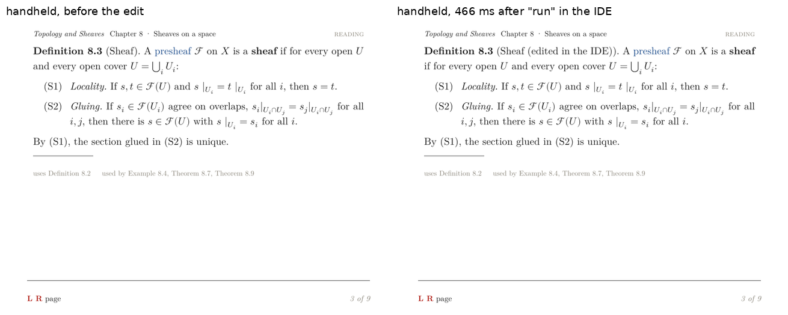
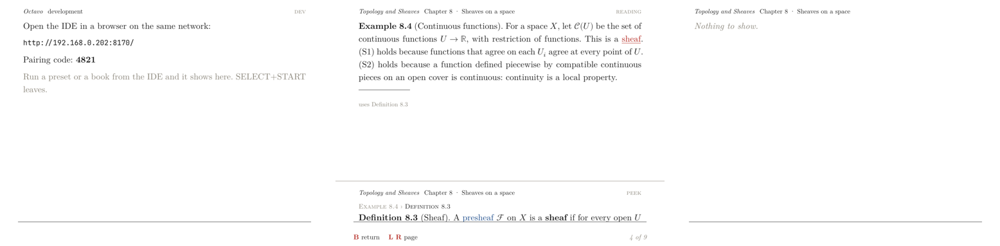
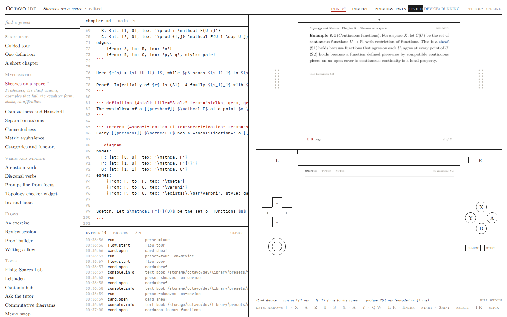
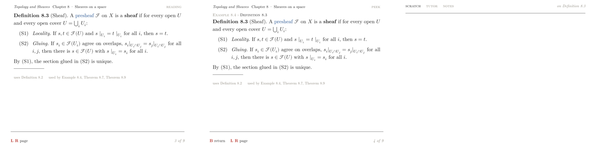
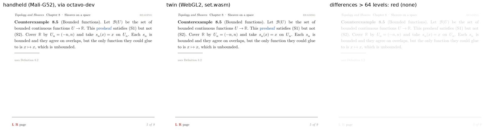
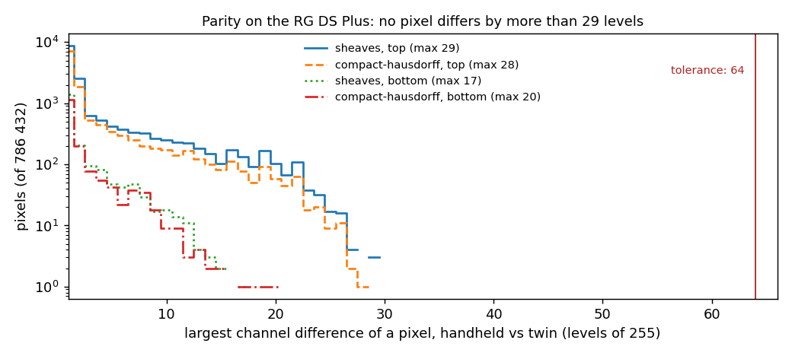

# Octavo, Part 3: The Development Loop

**Octavo** is a reader for typeset mathematics on the Anbernic RG DS Plus, a Linux handheld with two 1024 × 768 screens and a Mali-G52 GPU. Two earlier reports cover the first two phases:

- [[PROJECT REPORT - Octavo, Part 1 - Typst on a Handheld - Display Lists, Span Ids as Colours and a Page Shader on the RG DS Plus|Part 1]] showed that Typst can lay out a page on the handheld and that one shader program draws it at book quality.
- [[PROJECT REPORT - Octavo, Part 2 - The Reading Loop on the Handheld - Element Trees from V8, Prebuilt Pages and a Main Loop That Sleeps|Part 2]] built the reading program: V8 runs the IDE's runtime, describes each screen as an element tree, and the GPU draws the laid-out page.

This report covers Phase 2, the development loop. A book for Octavo is written in a browser IDE, and until this phase the IDE could only show its own React rendering of a card. Phase 2 connects the IDE to the handheld. It also adds a second, exact rendering inside the browser: the **twin**, which runs the device's JavaScript, its layout engine and its shaders.

The design guide set two exit criteria:

- editing a card in a desktop browser and pressing run shows the change on the device;
- a parity check, which replays a button sequence on the twin and on the device, passes on two presets.

Both hold on the handheld:
- **Editing:** the title of the open card was edited in the IDE and run was pressed. The handheld's picture showed the new title 466 ms after the click, over Wi-Fi.
- **Parity:** two presets were replayed with 15 presses each. Every message the device's JavaScript produced was identical on the twin: 59 of 59 for each preset, covering journal events, page keys, display-list digests, span states and scroll positions. No pixel of any screen differed by more than 29 of 255 levels.

> [!summary]
> - **A server on the handheld, a link into the app.**
>   - `octavo-dev` is a 5.8 MB Go binary on the device that uses only the standard library. It serves the IDE, pairs a browser with a six-digit code, keeps a development library on the SD card, relays a WebSocket to the app's unix socket, and restarts the app when it crashes.
>   - `octavo --dev` takes run, press and screenshot commands. It streams back everything the book's script does, with the file and line of any error.
> - **The twin runs the device's code, not a copy of it.**
>   - The browser loads the device's own `js/` tree.
>   - `set.wasm` is octavo-set (Typst plus the Octavo template) compiled to WebAssembly. It produces display lists byte-identical to the native setter's for all 245 trees of the book.
>   - A WebGL2 port of the renderer draws them with the device's shaders.
> - **Parity is checked message by message, then pixel by pixel.**
>   - Event streams, page keys and display-list digests must be equal.
>   - Screens must agree within 64 levels on 99.5 % of their pixels.
>   - On the handheld the largest difference is 29 levels, and it comes from the twin's glyph rasterizer, not from the GPU.
> - **The handheld changed one design decision.**
>   - A screenshot of both screens took about 615 ms there, so pictures queued behind each other and one arrived after the next run had started.
>   - Shots are now tagged with the run they follow, and they are not taken between a run and its first page.
>   - PNG encoding uses zlib at level 1 without row filters: 2.3 times faster end to end.

## 1. Terms

Parts 1 and 2 defined cards, spans, element trees, display lists, span states, slots, page keys, prebuilt pages and the layout helper. This part adds the following terms, in dependency order.

- **Preset.** A small book (two to five files: `chapter.md`, `main.js`, sometimes YAML or a view) that the IDE ships as an example. The IDE has 25. The two used for parity are *Sheaves on a space* (`sheaves`) and *Compactness and Hausdorff* (`compact-hausdorff`).
- **Library.** A directory on the handheld that holds the books the IDE has uploaded: `/storage/octavo/dev/library`. A run names a directory inside it, such as `presets/sheaves`.
- **octavo-dev.** The development server on the handheld. It serves HTTP on port 8170, owns the library, and starts the app as its child process.
- **Dev link.** The unix socket between octavo-dev and the app. It carries length-prefixed frames, each a JSON header optionally followed by a binary payload.
- **Run.** Loading a book directory into a fresh JavaScript engine and calling its `octavoStart` entry point. A run ends when `octavoStart` returns; the app then reports `ran`.
- **Isolate.** A V8 instance with its own heap and globals. Each run gets a new isolate.
- **Shot.** A screenshot of both screens, taken by the app after a frame, encoded as two PNGs, and sent over the dev link.
- **Pairing code.** Six random digits shown on the handheld's screen. A browser that sends the code receives a session cookie, and every API call after that needs the cookie.
- **set.wasm.** octavo-set, the Rust program that turns an element tree into a display list with Typst, compiled for `wasm32-unknown-unknown`. It also rasterizes glyphs from the font files.
- **Twin.** The browser-side reader. It is the device's `js/` code, given a browser implementation of the functions the native host provides (`__native`), and drawn by a WebGL2 port of the device's renderer.
- **Digest.** The FNV-1a 64-bit hash of a display list's bytes. A page's key identifies the tree that was laid out; its digest identifies the layout that came out.
- **Parity check.** A procedure that runs one preset on the twin and on the device, presses the same buttons on both, and compares the two message streams and the final screens.

## 2. One edit, followed through the system

The clearest way into the design is to follow the action from the first exit criterion. A browser on the desktop shows the IDE, served by octavo-dev from the handheld. The *Sheaves on a space* preset is open and paired to the device. The author changes the title of Definition 8.3 from "Sheaf" to "Sheaf (edited in the IDE)" and clicks run.

```mermaid
sequenceDiagram
    participant B as browser (IDE)
    participant D as octavo-dev (Go, on the handheld)
    participant A as octavo --dev (main thread)
    participant S as script thread (new V8 isolate)
    B->>D: PUT /api/dir?path=presets/sheaves {files}
    D->>D: write chapter.md, main.js atomically; delete files the IDE no longer has
    B->>D: WebSocket {op:"run", dir:"presets/sheaves"}
    D->>A: frame {op:"run", dir:"/storage/octavo/dev/library/presets/sheaves"}
    A->>A: stop the old script thread, clear the slots, runPending = true
    A->>S: start: load js/ (code cache), octavoStart(dir)
    S->>S: compile the book, render read view, set() changed card (layout helper)
    S-->>A: Present(top.main), Present(top.prompt), Present(bottom.main), dev messages
    S-->>A: Done{started}
    A->>D: {op:"ran", ms:141}
    D->>B: {op:"ran"} (WebSocket)
    B->>D: {op:"shot"}
    D->>A: frame {op:"shot"}
    A->>A: next frame of each screen: glReadPixels, PNG (zlib level 1)
    A->>D: frame {op:"shot", top:n, bottom:m} + payload (two PNGs)
    D->>B: {op:"shot", top:base64, bottom:base64}
    Note over B: picture tagged run N shown, 466 ms after the click
```

Each component in this diagram has one responsibility:
- The browser holds the source of truth for the book's files and sends all of them before every run, so the device's copy is never stale.
- octavo-dev translates a library-relative directory into an absolute path, after checking that it stays inside the library.
- The app owns the screens, the GPU and the script thread. It decides when a frame is drawn and therefore when a picture can be taken.

Two details carry most of the design:

- **A run builds a new isolate rather than resetting the old one.** A book's script can define globals, start timers and register views. Resetting all of that inside a live context would require knowing everything a script might have touched. A new isolate starts with nothing. V8's code cache makes it cheap: the 12 core scripts load with 12 cache hits, and a new isolate costs 8–13 ms.
- **The picture is not taken when `ran` arrives, but on the next frame after it.** The app draws only when something changed (Part 2, section 7). A shot request marks both screens dirty, the next frame draws them, and the PNG is made from that frame. Section 9 shows why this was not sufficient on the handheld.



*The handheld's top screen before and after the edit. The longer title moves "if for every open U" to the second line.*

## 3. `octavo --dev`: the app's half

### 3.1 Frames on a unix socket

The dev link uses one frame format in both directions:

```text
u32 little-endian n | n bytes of JSON header | header.payload bytes (optional)
```

Most messages are header-only. The screenshot is the exception: its header carries the two PNG sizes (`{"op":"shot","top":T,"bottom":B,"payload":T+B,"readMs":…,"encodeMs":…}`) and the payload carries both files back to back. A binary payload avoids base64 on the device, where CPU time is scarce. octavo-dev converts the payload to base64 for the browser, because WebSocket text frames are simpler for the IDE to handle than mixed binary frames.

The app's side (`native/src/app/devlink.cpp`, 110 lines) reads without blocking and returns all complete frames each time the main loop wakes. The main loop already sleeps in `poll(2)` on the window system's socket, the gamepad's evdev descriptors, an eventfd and a control FIFO (Part 2, section 7.2). The link's descriptor joins that set, so a command wakes an idle reader immediately and costs nothing while no command arrives.

### 3.2 What the app accepts and what it reports

| Direction | Message | Meaning |
| --- | --- | --- |
| to the app | `run{dir}` | clear the slots, start a new isolate on `dir` (empty: the dev screen) |
| | `press{button}` | the same as a button on the pad, by Lattice's button name |
| | `shot` | read both screens back after their next frame |
| | `stats` | memory, page sources, latency percentiles, as JSON |
| | `reset` | delete the dev journal (`events/*.jsonl` under the dev data directory) |
| | `pair{code, urls}` | what the dev screen shows |
| | `quit` | leave |
| from the app | `hello{pid, layoutId, gl}` | sent once at start |
| | `ran{ms, startMs, layouts}` | `octavoStart` returned; time since the command, the script's own time, pages the layout helper had to set |
| | `latency{seq, button, changed, screenMs, …}` | one per press, including presses that changed nothing |
| | `present{slot, key, digest, anim, scroll}`, `states{key, list}`, `scroll{slot, y}` | every UI message the script sent to the main thread |
| | `event{event}`, `console{level, text}` | journal events and `console.*` output |
| | `error{message, file, line, col, stack}` | an exception, with its place in the book's source |
| | `shot{top, bottom}` + payload | both screens as PNG |

The `latency` message for a press that changed nothing (`changed: false`) exists for clients that replay presses. Without it, a client cannot distinguish a press that has no visible effect from a press that is still being handled, and the parity check would have to wait for an arbitrary timeout after each press.

The `present` message carries both the page key and the digest. They are different hashes of different things:

- The **key** is `fnv64(layoutId + "\n" + treeText)`. Two runtimes that produce the same key built the same element tree.
- The **digest** is `fnv64(displayListBytes)`. Two setters that produce the same digest from the same tree laid it out to the same bytes.

The parity check needs both. A twin could build the correct tree and lay it out differently; only the digest would reveal that.

### 3.3 Errors with a file and a line

A book's script is compiled by the runtime with `new Function`, after a `sourceURL` comment that names the file. When it throws, V8's stack trace reports a line, but not the line of the author's file:

- `new Function` adds two header lines, and the runtime adds `"use strict"`, so a runtime error's stack line is the file line plus 3;
- for a syntax error, `__native.check(source, name)` compiles the source as a function expression and returns V8's message, whose line is the file line plus 1.

`js/host/device.js` finds the first stack frame whose file name has no directory, which is how book scripts are named, and subtracts the offset. On the host:
- a reference to an undefined name on line 11 of `main.js` arrives as `main.js:11 undefinedThing is not defined`;
- `let x = ;` on line 10 arrives as `main.js:10 … Unexpected token ';'`.

The handheld also shows the error itself, in the error view, so a broken book is visible even when no browser is connected.



*Three top screens from the host run of `octavo --dev`: the dev screen with the address and pairing code; the sheaves preset with a peek open; and the first broken run as it was found, "Nothing to show". That last case is now the error view with `main.js:11: …`.*

### 3.4 Screenshots of screens at rest

The app reads a screen back only when nothing on it is moving. A press that opens a peek starts a 140 ms slide, and a shot requested during the slide must not capture an intermediate frame. The rule in the frame loop is:

```cpp
bool still = true;
for (const Slot& s : slots) if (s.screen == sc && s.moving()) still = false;
if (shotDev && still && !runPending) {
  const std::vector<uint8_t> rgb = render::readPixels(w, h);
  shotPng[i] = render::encodePng(rgb.data(), w, h);
}
```

While a slide runs, the loop draws frames anyway. The first frame after the slide ends is the first one with `still` true, and that frame is captured. `runPending` was added on the handheld; section 9 explains it.

## 4. octavo-dev: the server on the handheld

### 4.1 Why a separate process

The guide placed the server in its own process for one reason: it must outlive the app. A book under development can crash the app, for example through an exception in native code, a GPU fault or a V8 out-of-memory. If the server lived inside the app, the browser would lose its connection at exactly the moment it needs to show what went wrong.

octavo-dev starts the app with `--dev SOCKET` and supervises it:

```go
for {
    t0 := time.Now()
    code, err := s.runApp(ctx, ln)
    if err == nil && code == 0 {           // SELECT+START: the user left
        s.setApp("exited", …); s.stop(); return
    }
    s.setApp("crashed", {"code": code, "stderr": s.out.last(40)})
    if time.Since(t0) > 30*time.Second { pause = time.Second }
    s.setApp("restarting", {"inMs": pause})
    <-time.After(pause)
    pause = min(pause*2, 16*time.Second)
}
```

An exit status of 0 means the user pressed SELECT+START. octavo-dev then exits too, so the Ports launcher returns to EmulationStation. Any other end is a crash. The browser receives the status code and the last 40 lines of the app's output, and the app is restarted after 1 s, 2 s, 4 s … up to 16 s. The delay resets once an instance has run for 30 s. A crash test on the host (SIGSEGV sent to the app) produced this sequence on the WebSocket:

```text
{"op":"app","state":"running","pid":3702821}
{"op":"app","state":"crashed","code":139,"stderr":[…]}
{"op":"app","state":"restarting","inMs":1000}
{"op":"app","state":"starting","pid":3703052}
{"op":"app","state":"running","pid":3703052}
```

### 4.2 Pairing

The handheld is on a home network, and the server can write files to its SD card and press its buttons. A browser therefore has to prove that its user can see the handheld's screen:

1. octavo-dev chooses six random digits at start and sends them to the app in a `pair` message. The dev screen shows them with the server's addresses.
2. The IDE sends `POST /api/pair {code}`. The comparison is constant-time. A wrong code waits 500 ms before the reply, and after 5 wrong codes the server chooses a new one and shows it on the handheld.
3. A correct code returns a random session token in a cookie marked `HttpOnly` and `SameSite=Strict`.
4. Every `/api/*` route except `pair` and `version` requires the cookie. Any request whose `Origin` header names a different host than its `Host` header is refused.

The last rule protects the WebSocket. Browsers open WebSockets across origins and send cookies with them unless the cookie's SameSite attribute forbids it. `SameSite=Strict` already prevents another site's page from using the session; the Origin check refuses such a request even when the cookie is absent or misconfigured.

Several browsers can pair at the same time, since sessions are per cookie. A successful pairing does not change the code. Sessions are kept in memory, so a restarted server forgets them, and the IDE then shows its pairing form again.

### 4.3 The library and its boundary

The IDE reads and writes files through `GET|PUT|DELETE /api/file?path=…` and `PUT /api/dir?path=…`. The last call makes a directory contain exactly the given files, which is what the IDE does before every run. Every path goes through one function, `libPath`. It refuses:

- absolute paths, backslashes and NUL bytes;
- any `..` component;
- any component beginning with `.` (no `.git`, no hidden files);
- any path whose deepest existing ancestor, after resolving symbolic links, lies outside the library.

The `..` rule is stricter than necessary. `path.Clean("/" + rel)` already clamps `../outside/x` to `outside/x`, which stays inside the library. The first test returned such a clamped path. It was not an escape, but a request that names a parent directory is a mistake or an attack, so it now fails with 400. Writes go to a temporary file followed by a rename, so a run never sees a half-written file.

### 4.4 A hand-written WebSocket

The server uses only Go's standard library, which has no WebSocket implementation. `dev/ws.go` (194 lines) implements the parts of RFC 6455 the IDE uses:

- the handshake (`Sec-WebSocket-Accept` = base64(SHA-1(key + GUID)));
- masked client frames, with unmasked ones refused;
- the three payload-length encodings;
- fragmented messages, ping, pong and close.

The tests check the RFC's example key and every length encoding.

The relay applies one policy. Each browser has a bounded outgoing queue, and a browser whose queue fills is disconnected. The alternative, blocking the relay until a slow browser reads, would block the app's link and with it the app's main loop, because `DevLink::send` waits until a frame is written. A disconnected IDE reconnects and probes again; a stalled main loop would freeze the handheld.

### 4.5 Two data directories, one install

The install on the SD card (`/storage/apps/octavo`, 143 MB, mostly V8 and ICU) now contains octavo-dev and the IDE as a single offline HTML page. A second Ports launcher, "Octavo Dev", starts:

```bash
./bin/octavo-dev -listen :8170 -root . -library /storage/octavo/dev/library \
  -socket /tmp/octavo-dev.sock -- \
  ./bin/octavo --fonts fonts --shaders shaders --js js --set bin/octavo-set \
  --data /storage/octavo/dev --layout layout --layout-id "$(cat layout-id)" --place
```

The reader's own data directory is `/storage/octavo`, which holds its journal and caches. The dev app uses `/storage/octavo/dev`. `reset` deletes the journal under `--data`, and it must never delete the reader's. The separation has one cost, measured on the first start: the dev data directory had no program binary cache, so the GL programs compiled in 2471 ms instead of loading from cache in 3.6 ms.

## 5. The device target in the IDE

The IDE has three targets, chosen at the top of the window:

- **preview** is its own React rendering, unchanged;
- **device** is the handheld;
- **twin** is section 7.

On the device target, the editor, the preset list and the console stay where they are. The device frame shows pictures from the handheld instead of React screens, and keys and on-screen buttons become `press` messages. The D-pad repeats while held, with the same 320 ms delay and 90 ms interval as the app.



*The IDE served from the handheld, on the device target, after the edit-and-run test and one press of R. The console lists the device's journal events. The line under the device reads "R → device · ran in 141 ms · R: 17.4 ms to the screen · picture 264 ms (encoded in 41 ms)".*

`DeviceTarget` (`ide/src/target.js`, 143 lines) keeps at most one shot in flight. It asks for a picture after every `ran` and after every `latency` with `changed: true`. If a picture is already on its way, it notes that another one is wanted and asks again when the first arrives. Under a fast sequence of presses, the IDE therefore shows the latest state at the rate the device can produce pictures, without building a queue.

Each picture also records which run it belongs to. `runs` counts `ran` messages, a shot request stores `shotRun = runs`, and the image element carries it as `data-run`. A picture requested before a run finished shows the screens before that run. Section 9 describes how this was found.

## 6. set.wasm: the setter in the browser

### 6.1 Building Typst for WebAssembly

The twin needs the same layout engine as the device. octavo-set is Rust: Typst 0.14 as a library, the Octavo template and packages embedded, and mitex for LaTeX maths. It builds for `wasm32-unknown-unknown` with two changes to its own code and none to its dependencies:

- **`OctavoWorld::from_files`** takes the fonts as `(name, bytes)` pairs in name order. There is no file system in the browser, so the twin fetches the fonts and passes them in. The directory loader now calls the same function.
- **`now_ms()`** replaces `std::time::Instant`, which panics on `wasm32-unknown-unknown`. It returns 0 there and is used only for timing reports.

rayon-core runs without threads on this target. psm and stacker, which Typst uses to grow the stack for deep recursion, built without extra tools. A release build takes about 4 minutes:

| Setting | Value |
| --- | --- |
| profile | `opt-level = "s"`, LTO, one codegen unit, `panic = "abort"`, `strip` |
| size | 20.6 MB, 7.4 MB gzipped |
| instantiate (Node, x86-64) | 45 ms |
| fonts and world | 9 ms |

octavo-dev sends `set.wasm.gz` with `Content-Encoding: gzip` when the browser accepts it.

### 6.2 A C interface over linear memory

The crate exports plain C functions instead of using wasm-bindgen. The JavaScript side is about 40 lines, and the interface is fixed by the functions themselves, not by a generated glue file:

| Export | Purpose |
| --- | --- |
| `oc_alloc(n)`, `oc_free(p, n)` | memory the caller fills before a call |
| `oc_font(name, bytes)` | one font file, before `oc_init` |
| `oc_init()` | build the Typst world from the fonts |
| `oc_layout_id()` | the layout id, which must equal the device's |
| `oc_set(tree)` | lay out one element tree (text form); the result is the display list |
| `oc_glyph(file, face, gid, px, phase)` | rasterize one glyph |
| `oc_result_ptr()`, `oc_result_len()` | where the last result is |

Typst memoizes intermediate results and never forgets them by itself. `oc_set` evicts the memo cache every 16 layouts, the same policy as `octavo-set serve` on the device.

### 6.3 Glyphs from outlines

A display list names glyphs by font file, face index and glyph id, not by character. A browser can draw text by character, but not a glyph by its id, so the twin cannot use canvas text. The guide left two candidates open: FreeType compiled to WebAssembly, or the browser's text rendering. Phase 2 chose a third option. set.wasm already holds every font parsed by Typst through `ttf-parser`, so `oc_glyph` takes the outline from that parsed face and fills it with `ab_glyph_rasterizer`, a small coverage rasterizer.

The difficulty is matching the device's atlas. Part 1's atlas rasterizes each glyph with FreeType at three horizontal sub-pixel phases. The twin must produce bitmaps of the same size, at the same origin, or every glyph shifts. `rasterize` follows FreeType's conventions:

```rust
// set/wasm/src/lib.rs, rasterize (abridged)
let size = (px * 64.0).round() / 64.0;                  // FreeType sizes are 26.6 fixed point
let dx = (phase as f32 * 64.0 / 3.0).round() / 64.0;    // the phase shift, in 1/64 px, as the atlas sets it
// bitmap box: the control box of the scaled, shifted outline, rounded outwards
let (x0, x1) = (min.x.floor(), max.x.ceil());
let (y0, y1) = (min.y.floor(), max.y.ceil());
```

With equal boxes and origins, the remaining difference is coverage: how much of each pixel the two rasterizers consider inside the glyph, after FreeType's own rounding. That difference is what the parity check measures on the screens (section 8.4).

### 6.4 The result: the same bytes

`07-set-wasm-check.mjs` loads set.wasm in Node and lays out every tree of the book. It compares each result with the page the native octavo-set prebuilt for the device:

```text
set.wasm: instantiated in 45 ms, fonts and world in 9 ms
layout id: wasm 0.1.0-d91e12e6c69b084f, native 0.1.0-d91e12e6c69b084f: same
245 trees: 245 byte-identical, 0 different, 0 without a native page, 0 failed
set per tree: p50 0.7 ms, p90 3.3 ms, max 115.2 ms   (Node, x86-64; cached memo)
```

The native pages were laid out on x86-64 when the install was built, and the device lays out new ones on arm64 with the same binary's source. All three targets produce the same display list for the same tree. The layout is deterministic across x86-64, arm64 and wasm32, which is the property the whole design depends on: a page key computed anywhere names the same bytes everywhere.

## 7. The twin

### 7.1 The device's JavaScript, with a browser host

The twin does not reimplement the reader. `Twin.create` fetches the device's `js/manifest.json` from octavo-dev and loads its files in order as script elements: the core runtime, the views, `host/device.js` and `main.js`. js-yaml is skipped because the IDE page already has it. The device's code then calls `__native`, the table of native functions the script thread provides on the handheld. The twin supplies a browser version of that table:

| `__native` function | On the handheld | In the twin |
| --- | --- | --- |
| `set(text)` | PageStore: prebuilt file, cache, or layout helper | set.wasm; result kept in a 400-page map |
| `present(slot, key, anim, scroll)` | UI message to the main thread | the twin's slot, slide and scroll state |
| `states(key, list)` | UI message; RGBA8UI texture | the same texels, uploaded per screen |
| `scroll(slot, y)` | UI message | the same tween |
| `readText`, `listDir` | the book directory | the IDE's files |
| `dev(json)` | dev link frame | the twin's message handler |
| `check(source)` | V8 compile | not implemented (returns null) |

The entry points (`octavoStart`, `octavoButton`, `octavoTimers`) are called exactly as the script thread calls them, with the same arguments and the same handling of the returned timer delay. The parity check compares two executions of one program that differ only in this table and in the renderer. A difference in the message streams therefore points either at this table or at set.wasm.

One change in `js/main.js` was needed. On the device, `main.js` replaces `console` so that output reaches the host's log. In the twin that would replace the IDE page's console, so the replacement now applies only when `globalThis.window` is undefined.

### 7.2 The renderer, ported

`ide/src/twin.js` (499 lines) ports the parts of the C++ renderer that decide where pixels go:

- **`TwinAtlas`** is the same shelf packer as the device's 2048 × 2048 R8 atlas, filled by `oc_glyph`.
- **`twinQuads`** places glyphs and rules. It uses the same rounding of positions to whole pixels and sub-pixel phases, and the same 36-byte instance layout: x, y, w, h, u0, v0, u1, v1 as f32, then the span id as u16.
- **`twinSegments`** builds the 24-byte instances for diagram strokes.
- **`TwinScreen`** is one WebGL2 context per screen. It compiles `page.vert`, `page.frag`, `stroke.vert` and `stroke.frag`, fetched unchanged from the device's `shaders/` directory, and draws instanced quads.

The shaders needed no changes. They are GLSL ES 3.00, which WebGL2 accepts. The one API difference is the span-id attribute: it is an integer, so it needs `vertexAttribIPointer(UNSIGNED_SHORT)` instead of `vertexAttribPointer`.

Each screen is a separate canvas, and WebGL contexts cannot share textures, so each screen has its own copy of the atlas texture. The CPU-side atlas is shared. It keeps one dirty rectangle per consuming screen, and each screen uploads the region it has not yet seen before drawing.



*The twin in headless Chromium (SwiftShader): Definition 8.3 open, the same card as a peek from Example 8.4, and the panel.*

### 7.3 When is a press finished in the twin?

The parity check waits after every press until the press is fully shown. On the device that is the `latency` message. The twin implements the same rule as the app's latency queue:

- An entry point runs synchronously and may call `present` and `states`, which mark screens dirty and count as "applied" for the current press.
- If nothing was applied, the press is retired at once with `changed: false`.
- Otherwise it is retired at the next drawn frame, which is scheduled with `requestAnimationFrame`.
- `still()` resolves when no slot is sliding or scrolling.

The twin starts in 721 ms on localhost. Started from the handheld over Wi-Fi it takes 2.9 s, most of which is the 7.4 MB download of set.wasm.

## 8. The parity check

### 8.1 Procedure

`runParity(device, twin, id, files, buttons)` in `ide/src/parity.js`:

1. Start recording the device's `event`, `error`, `present`, `states` and `scroll` messages, and the twin's.
2. Run the preset on the device, wait for `ran`, then run it on the twin.
3. For each button: press it on the device and wait for its `latency` message, then press it on the twin and wait until the twin is still.
4. Request a shot from the device and take the twin's canvases.
5. Normalize and compare the two streams, then compare the screens.

Normalization removes what legitimately differs between two executions:

- events lose their timestamp `t`;
- scroll positions are rounded to 0.01 px;
- errors keep only message, file and line.

Everything else must be equal message by message: slot names, page keys, digests, animation names, span-state lists and journal events.

### 8.2 Why screens need a tolerance

The streams can be exact because they are produced by the same code on the same data. The screens cannot, for two reasons:

- the GPUs differ (Mali-G52 on the handheld, SwiftShader in headless Chromium, llvmpipe for the host app);
- the glyph bitmaps come from two rasterizers (FreeType on the device, `ab_glyph_rasterizer` in the twin).

The check counts a pixel as different when any channel differs by more than 64 of 255 levels. It passes a screen when fewer than 0.5 % of its pixels are different. The thresholds were set before any measurement. They are chosen to catch a misplaced glyph, a wrong colour or a missing rule, each of which changes many pixels by far more than 64 levels, while accepting differences in anti-aliasing.

### 8.3 Results

| Preset | Where | Run | Messages (device / twin) | Streams | Top: pixels > 64, mean abs. diff. | Bottom |
| --- | --- | --- | --- | --- | --- | --- |
| sheaves | host (llvmpipe) | 21 ms | 59 / 59 | equal | 0, 0.0770 | 0, 0.0044 |
| sheaves | handheld (Mali-G52) | 124 ms | 59 / 59 | equal | 0, 0.0771 | 0, 0.0044 |
| compact-hausdorff | host (llvmpipe) | 25 ms | 59 / 59 | equal | 0, 0.0509 | 0, 0.0036 |
| compact-hausdorff | handheld (Mali-G52) | 163 ms | 59 / 59 | equal | 0, 0.0511 | 0, 0.0037 |

Each run's 59 messages consist of 13 events, 14 span-state lists and 32 presents. The two presets show different cards: Counterexample 8.5 and Definition 5.3 at the end of their sequences.



*Sheaves after 15 presses: the handheld's picture, the twin's canvas, and the difference picture, with no red pixels.*

The distribution of differences shows how much margin the tolerance leaves:



| Screen (handheld vs twin) | Largest difference | Pixels differing at all | > 8 levels | > 32 levels |
| --- | --- | --- | --- | --- |
| sheaves, top | 29 | 16 244 (2.1 %) | 2 357 (0.30 %) | 0 |
| sheaves, bottom | 17 | 2 033 | 70 | 0 |
| compact-hausdorff, top | 28 | 12 675 (1.6 %) | 1 536 (0.20 %) | 0 |
| compact-hausdorff, bottom | 20 | 1 656 | 51 | 0 |

The host and handheld rows answer a question the guide left open: whether the GPU contributes to the difference. The mean differences against the twin agree to within 0.0002 levels: 0.07697 against the host's llvmpipe and 0.07714 against the handheld's Mali. The Mali output is not bit-identical to llvmpipe's, but the twin's distance to both is the same. Essentially all of the difference therefore comes from glyph coverage, where the twin's rasterizer and FreeType disagree by small amounts on the edge pixels of glyphs. The positions, the rules, the colours and the span states are the same on both.

## 9. Pictures on the handheld

On the host, the first exit criterion passed at the first attempt: run to picture in 145 ms. The same test against the handheld also reported success, but for the wrong reason:

```text
3.02s opened "Sheaves on a space": new device picture after 658 ms
3.61s edited the title of #sheaf: "Sheaf" -> "Sheaf (edited in the IDE)"
3.65s run -> new device picture: 2 ms (34 ms after the click)
4.16s under the device: ran in 200 ms · picture 615 ms
```

A picture 2 ms after the click cannot be the run's picture. The saved files confirmed it: the "after" picture showed the old title, and the "before" picture was entirely white. The sequence was:

1. Pairing reported `app running`, and the IDE asked for a picture.
2. The test opened the preset. The app cleared its slots and started the run while that shot was still pending. The next frame was blank and still, so the shot captured the empty screens.
3. `ran` arrived and the IDE noted that another picture was wanted. That picture, the unedited card, took about 615 ms. It arrived 2 ms after the test clicked run, and the test accepted it as the run's picture.

On the host a shot took 71–90 ms, so this overlap never happened. On the handheld, two corrections were needed.

**Correctness.** Two changes, one in the app and one in the IDE:

- **App:** `run` sets `runPending`, and the run's `Done(started)` clears it. No screen is captured in between. A shot requested during that time remains pending, and `Done` marks both screens dirty so the next frame captures them. If a book fails to load, the script thread still posts `Done(started)`, so the flag cannot remain set.
- **IDE:** pictures are tagged with their run (section 5). The test waits for a picture with `data-run` greater than before the click. It also counts the pixels that changed in the card's first line, because a new picture is not proof of a correct one.

A tag was chosen over cancelling stale shots. A cancel message would race with a shot the app has already started encoding, while a tag only labels what arrives. A user sees the older picture for a fraction of a second, followed by the right one.

**Speed.** The shot's time on the device was mostly PNG encoding. stb_image_write, which the app used, compresses with its own deflate at level 8 and tries five row filters per row to pick the best. One device page, encoded five times on the host:

| Encoder | Time per 1024 × 768 page | Bytes |
| --- | --- | --- |
| stb deflate, level 8, best of five filters (before) | 40.4 ms | 98 594 |
| stb deflate, level 8, no filter | 24.3 ms | 89 820 |
| stb deflate, level 1, no filter | 17.7 ms | 90 262 |
| zlib, level 1, no filter (after) | 5.5 ms | 77 473 |
| zlib, level 1, best of five filters | 20.9 ms | 85 315 |
| zlib, level 6, no filter | 10.2 ms | 68 805 |

zlib at level 1 without filters is 7.3 times faster than the original encoder and produces a smaller file. A screenshot is decoded once by the browser and discarded, so compression ratio matters only through transfer time. stb accepts a replacement compressor through `STBIW_ZLIB_COMPRESS`; the app now passes `compress2` and links the handheld's `libz.so.1`. Files written for test results keep level 6 with the per-row filter choice. On the handheld, the time from request to picture fell from 615–622 ms to 264–273 ms, of which 41–42 ms is encoding both screens. The remaining time is the next frame, `glReadPixels` for two screens, base64, and the transfer of about 150 KB over Wi-Fi. The shot message now reports `readMs` and `encodeMs` separately to make the next step of this analysis possible.

## 10. Results

| Measurement | Host (x86-64, llvmpipe, localhost) | Handheld (Mali-G52, Wi-Fi) |
| --- | --- | --- |
| edit → run → picture with the edit | 145 ms | 466 ms |
| `run` → `ran` on the app | 23–29 ms | 124–163 ms |
| shot, request to picture | 71–90 ms | 264–273 ms (615–622 ms before section 9) |
| press R → screen (app's latency) | 6.1 ms | 17.4 ms |
| press R → new picture in the IDE | 195 ms | 302 ms |
| twin ready after the click | 721 ms | 2.9 s (set.wasm over Wi-Fi) |
| parity, sheaves and compact-hausdorff | pass, streams equal, 0 pixels > 64 | pass, streams equal, 0 pixels > 64 |
| set.wasm vs native display lists | 245 / 245 byte-identical | (same layout id) |
| app restart after a crash | 1 s, then running in 150 ms | — |

## 11. Defects found on the way

- **A broken book showed "Nothing to show".** A compile error stopped the boot, and the toast came only from the runtime's error path, not the host's. `octavoStart` now catches the error, reports it with file and line, and shows the error view.
- **The dev screen wrote `screen.show` events into the journal.** It now renders quietly.
- **A unix socket path was too long.** The scratchpad directory's path exceeds the 108-byte `sun_path` limit. The test scripts bind a relative name inside their working directory.
- **`..` in a library path was clamped instead of refused** (section 4.3).
- **The IDE test edited a card that was not on screen.** The first `title=` in `chapter.md` is not the card the preset opens with. The test now reads the card id from `main.js`'s `start('read', …)`.
- **A device picture showed a page in the middle of its slide.** Shots now wait for still screens (section 3.4).
- **gzip kept the file's modification time.** `gzip -k` preserves the original's mtime, so the server's check "the `.gz` is at least as new as the file" failed with `Before`. It now accepts equal times.
- **The device's console replacement would have replaced the IDE's console in the twin** (section 7.1).
- **On the handheld, a stale picture passed the first exit criterion, and a pending shot captured blank screens** (section 9).

## 12. What Phase 2 decides

- **The browser is a second runtime of the same program, not a model of it.** Layout runs in set.wasm and the book's script in the device's own `js/` files. The twin's code is limited to the host table and the renderer port, which keeps the surface that can drift small enough to check automatically.
- **Display lists are portable.** The same tree gives the same bytes on x86-64, arm64 and wasm32. A page key computed in the browser therefore names a page the device can draw. Pages laid out in the twin could be uploaded to the device's cache, although Phase 2 does not do this.
- **The server is part of the device.** The guide (section 7.12) placed octavo-dev on the handheld, and Phase 2 confirms that this works at an acceptable speed: 466 ms from run to picture over Wi-Fi. The only requirement for development is a browser on the same network: no toolchain, no SSH and no file synchronization. (Part 2's "next steps" described octavo-dev as running on the workstation; that was a misstatement of the guide.)
- **Every message a client waits for has an explicit end.** `ran` ends a run, and every press produces a `latency` message, including presses that change nothing. A shot's run tag says what it shows. Each of these was added because a client could not tell otherwise, and each made a test exact instead of timed.

## 13. Limitations and open questions

- **The tolerance is looser than needed.** The largest observed difference is 29 levels; the threshold is 64. A threshold of 32 would pass both presets. It stays at 64 until more presets, especially diagrams and dense maths, have run.
- **Syntax errors in the twin have no line number.** The twin's `check()` returns null. A browser can obtain the line from `new Function` in a try block, which is not implemented yet.
- **Holds and strokes are not relayed.** `press` is a tap. A long press of a direction, or the analog stick, cannot be sent from the IDE. The handheld's own pad works while the IDE is connected.
- **Sessions do not expire.** A paired browser stays paired until octavo-dev exits.
- **`DevLink::send` blocks the main loop if octavo-dev stops reading.** octavo-dev reads continuously and drops slow browsers instead of blocking, but a stopped server would freeze the app rather than disconnect it.
- **About 230 ms of a device shot is not encoding.** The next frame, two `glReadPixels`, base64 and Wi-Fi each take part of it; `readMs` in the shot message will show how much belongs to the GPU read-back.
- **The parity check covers two presets of the same shape.** Both sequences have 15 presses and produce 59 messages. Presets with timers, the tutor or ink will exercise parts of the host table that these do not.

## 14. Next steps

Phase 3 is the event log and derived state:
- the journal on the SD card is folded incrementally into what has been seen and mastered, and which card was last;
- the **Leitfaden** shows the book's dependency graph with the reading state in the type: roman for unread, italic for read, both variants laid out in advance;
- the contents hub.

The development loop of this phase is the tool for building it. Every new view can be edited in the IDE, checked in the twin, and run on the handheld with one click.

## 15. Reproducing

```bash
cd /home/manuel/code/wesen/2026-10-17--octavo
T=ttmp/2026/10/17/OCTAVO-001--octavo-on-the-rg-ds-plus-a-typeset-maths-reader-with-a-browser-ide-and-a-device-dev-server
# octavo-dev unit tests (paths, WebSocket frames, app frames)
(cd dev && go test ./... && go vet ./...)
# set.wasm against the native pages
(cd set/wasm && cargo build --release --target wasm32-unknown-unknown)
node $T/scripts/07-set-wasm-check.mjs set/wasm/target/wasm32-unknown-unknown/release/octavo_set_wasm.wasm \
  mockups/fonts build-device/trees.jsonl build-device/octavo/layout "$(cat build-device/octavo/layout-id)"
# the device: build, deploy, register both Ports entries (EmulationStation shows them after its next start)
device/build.sh && device/deploy.sh && device/ports/register.sh
# start "Octavo Dev" from Ports (or the launcher's command over ssh); the handheld shows the code
export CHROME=$HOME/.cache/ms-playwright/chromium_headless_shell-1234/chrome-headless-shell-linux64/chrome-headless-shell
node $T/scripts/06-ide-device-target.cjs http://192.168.0.202:8170 CODE $T/results/phase2/device/ide-device-target
node $T/scripts/09-parity.cjs            http://192.168.0.202:8170 CODE $T/results/phase2/device/parity
python3 $T/scripts/10-phase2-device-figures.py $T/results/phase2/device OUT   # figures in this report
```

## 16. Files

| Path (in `/home/manuel/code/wesen/2026-10-17--octavo`) | Role |
| --- | --- |
| `native/src/app/devlink.cpp` | the app's end of the dev link: frames, non-blocking reads |
| `native/src/app/main.cpp` | `devCommand`, `startScript`, `ran`, `latency`, shots at rest, `runPending` |
| `native/src/js/script.cpp` | `__native.dev`, `__native.check`, `Done(started)`, errors in dev mode |
| `native/src/render/page.cpp` | `encodePng` with zlib at level 1 |
| `js/host/device.js`, `js/main.js`, `js/views/dev.js` | dev messages, error lines, the dev screen |
| `dev/main.go`, `dev/app.go`, `dev/ws.go` | octavo-dev: HTTP, pairing, library, supervisor, WebSocket |
| `set/wasm/src/lib.rs` | set.wasm: the C interface and the glyph rasterizer |
| `ide/src/target.js` | the device target |
| `ide/src/twin.js` | the twin: set.wasm loader, atlas, quads, WebGL2 screens, `__native` |
| `ide/src/parity.js` | the parity check |
| `device/build.sh`, `device/ports/octavo-dev.sh`, `device/ports/register.sh` | install tree, the "Octavo Dev" launcher, gamelist entries |
| `ttmp/2026/10/17/OCTAVO-001--…/reference/01-diary.md` | the working diary (Phase 2 is steps 8–11) |
| `ttmp/2026/10/17/OCTAVO-001--…/results/phase2/` | host and device logs, pictures, parity reports |

## Related notes

- [[PROJECT REPORT - Octavo, Part 2 - The Reading Loop on the Handheld - Element Trees from V8, Prebuilt Pages and a Main Loop That Sleeps]]: the script thread, the page store, the poll(2) main loop and the latency measurement this phase extends
- [[PROJECT REPORT - Octavo, Part 1 - Typst on a Handheld - Display Lists, Span Ids as Colours and a Page Shader on the RG DS Plus]]: the display list, the atlas with sub-pixel phases and the page program the twin ports
- [[PROJECT REPORT - DS Shaders - no_shade on a Handheld - A Browser Twin, a Deconstructed Console and a Shader Runtime inside Lattice]]: an earlier browser twin of the same handheld, for shaders
- [[ARTICLE - Playbook - Self-Contained Go Wasm and JavaScript Browser Applications]]: serving a single-file browser application from a Go binary
