# Octavo, Part 4: Reading State

**Octavo** is a reader for typeset mathematics on the Anbernic RG DS Plus, a Linux handheld with two 1024 × 768 screens and a Mali-G52 GPU. Three earlier reports cover the first three phases:

- [[PROJECT REPORT - Octavo, Part 1 - Typst on a Handheld - Display Lists, Span Ids as Colours and a Page Shader on the RG DS Plus|Part 1]] showed that Typst can lay out a page on the handheld and that one shader program draws it at book quality.
- [[PROJECT REPORT - Octavo, Part 2 - The Reading Loop on the Handheld - Element Trees from V8, Prebuilt Pages and a Main Loop That Sleeps|Part 2]] built the reading program: V8 runs the runtime, each screen is described as an element tree, and the GPU draws the laid-out page.
- [[PROJECT REPORT - Octavo, Part 3 - The Development Loop - A Server on the Handheld, a WebGL2 Twin and a Parity Check|Part 3]] connected a browser IDE to the handheld and added the twin, an exact rendering of the device inside the browser.

This report covers Phase 3. Until this phase the reader wrote every event to a journal on the SD card and never read it back, so a restart forgot what had been read. Phase 3 reads the journal at start-up, derives the reading state from it, and shows that state in the type of every card title. A mastered card's title is set in roman, a card that has been seen but not mastered in italic, an unread card in grey, and the card where the reader is in red. Two new screens show the state: the **contents**, opened with START, and the **Leitfaden**, a chart of what depends on what in each chapter.

The design guide gives this phase no exit criteria. I set four, and all four hold on the handheld:

- **Resume.** The reader read on to Counterexample 5.6, peeked at Definition 5.1, and quit while peeking. The next start opened 5.6, the card being read, not the one peeked.
- **Cheap start-up with a year of history.** A synthetic year of daily reading is 43 800 events in 4.6 MB. Reading and folding all of it at start-up costs 580 ms on the handheld; with a snapshot it costs 8.0 ms. Three years cost 1618 ms and 7.3 ms.
- **State in type without layout.** Reading or mastering a card changes span states only; the pages of the contents and the Leitfaden keep their page keys. In a 33-press session on the device, the layout helper ran four times, each time for the one-line prompt at the foot of the screen.
- **Parity.** Four presets, two of them new for this phase, replay on the handheld and on the twin with identical message streams. No pixel differs by more than 34 of 255 levels.

> [!summary]
> - **Reading state is derived from the journal, never stored.**
>   - Folds over the event log compute seen, mastered and the last card, one event at a time.
>   - A snapshot of the folds records the journal position it covers, so a start reads only what was written after it.
>   - With a year of history the handheld starts the history in 8 ms instead of 580 ms.
> - **The journal reaches the SD card within half a second, off the input path.**
>   - `fdatasync` after every line cost 6.15 ms median and 32.6 ms worst on the card, and doubled the median press latency.
>   - A syncer thread now syncs at most 500 ms after the first unsynced line. Press latency has a median of 6.0 ms.
> - **Both variants of a title are laid out; the shader shows one.**
>   - An `alt` element sets the roman and the italic title in the same place. Their glyphs carry a show-if bit, and a span-state bit decides which variant is drawn.
>   - Element trees therefore do not depend on reading state, and a change of state is a texel write, not a layout.
> - **The Leitfaden is a layered graph drawing.**
>   - Each chapter's cards are placed in levels, edges implied by longer paths are removed, long edges pass through empty slots, rows are ordered by barycentric sweeps, and x positions come from an isotonic regression.
>   - The positions are computed in the runtime's JavaScript and passed to the Typst template.

## 1. Terms

Parts 1 to 3 defined cards, spans, element trees, display lists, span states, slots, page keys, prebuilt pages, the layout helper, presets, the twin and the parity check. This part adds the following terms, in dependency order.

- **Event.** A JSON object the runtime emits when the reader does something that matters later: `card.open`, `peek.push`, `mastered`, a hypothesis toggled, a screen shown. Every event has a type in `ev`; the journal adds the time `t`.
- **Journal.** The append-only file of events on the SD card, one JSON object per line, one file per month: `<data>/events/2026-10.jsonl`. It is the only durable record of what the reader has done.
- **Fold.** A function of the event sequence that can be updated one event at a time: `state' = apply(state, event)`. The cost of an update does not depend on how many events came before.
- **Reading state** of a card. One of *mastered* (a `mastered` event exists for it), *seen* (it has been opened but not mastered) or *unread*.
- **Where you are.** The card the reader is reading, or the last one read before the current screen. It is the fold `lastCard`, with peeks excluded.
- **Peek.** Opening a cross-referenced card on top of the one being read. B returns. A peek is not a move: the reader is still reading the card underneath.
- **Snapshot.** The folds saved as JSON together with the journal position they cover, the size of each month file at the time they were computed.
- **Alt pair.** Two variants of one text, laid out in the same place, each in a span of its own. A span-state bit decides which variant is drawn.
- **Contents.** The screen that lists every card of the book by chapter, with its reading state in type.
- **Leitfaden.** A chart of the dependencies between the cards of one chapter, earliest ideas at the top. The German word means a guide; mathematics books use it for the chart of chapter dependencies in their preface.
- **Slot.** A position in one row of the Leitfaden. A slot holds a card's title, or is empty and carries an edge through the row.
- **Group commit.** Writing the journal to stable storage once for several lines, at most a fixed time after the first of them.

## 2. The problem

Phase 3 has three requirements.

The first requirement is **memory across restarts**. The runtime already emits every event and journals it before the screen changes (guide section 7.10). To know at start-up which cards have been read, the reader must look at the journal. A year of daily reading produces about 44 000 events. Reading and parsing that much JSON on the handheld takes over half a second, and the cost grows every day the reader is used.

The second requirement is **state in type**. The guide's design rules say that "reading state is typographic (roman for mastered, italic for seen, grey for unread)". Grey and red are colours, and colour is already a span state: Part 1's renderer looks up each glyph's span in a state texture and colours it there, so a change of colour is a texel write. Roman and italic are different glyphs with different widths, and a change between them would normally require a new layout. On the handheld a layout is a call to a helper process, which Part 2 measured at about 10 ms on a warm device (8.6–13.2 ms, once 94 ms), so every state change would cost one.

The third requirement is **a chart of dependencies** that fits a 1024 × 692 view, whose edges do not run through titles, and whose layout also does not depend on reading state.

The guide's decision D5 already names the answer to the second requirement:

> **Consequences:** Changes of metrics (roman to italic on the Leitfaden) are not state changes; both variants are laid out in advance.

The rest of this report explains how each requirement was met, in the order the data flows: from the journal on the card, through the folds, into element trees that do not depend on the state, and onto the screen.

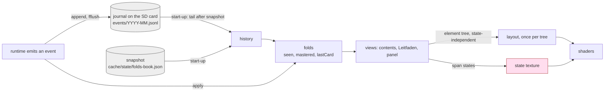

## 3. The event log and its folds

### 3.1 Events in the journal

Each journal line is the event as the runtime emitted it, with the time and the book added by the device host. Three lines from a host run, in which the reader opened Counterexample 5.6 (`sierpinski`) and peeked at Definition 5.1 (`compact`) from it:

```json
{"t":"2026-10-18T00:56:45.598Z","book":"topology-and-sheaves","ev":"card.open","card":"sierpinski"}
{"t":"2026-10-18T00:56:46.400Z","book":"topology-and-sheaves","ev":"card.open","card":"compact","peek":true}
{"t":"2026-10-18T00:56:46.400Z","book":"topology-and-sheaves","ev":"peek.push","card":"compact"}
```

Two fields are new in Phase 3:

- **`book`.** All books share one journal directory, and a reader of two books must not see the progress of one in the other. `parseJournal` skips lines of other books. Lines without a book, written in Phases 1 and 2, are kept, because only one book existed then. The in-memory event does not carry the book, so the dev link and the twin see the same events as before and the parity streams of Phase 2 are unchanged.
- **`peek`.** An open inside a peek is marked `peek: true`, so that the folds can tell reading from peeking (section 3.3).

### 3.2 Folds

`js/core/log.js` defines one class, `Folds`, whose `apply(ev)` updates every derived value at once:

| Fold | Updated by | Used for |
| --- | --- | --- |
| `seen` (set) | `card.open` | italic titles, counts |
| `mastered` (set) | `mastered` | roman titles, counts |
| `lastCard` | `card.open` without `peek` | where you are; resume |
| `opens` (card → count) | `card.open` | not used yet |
| `firstSeen`, `lastSeen` (card → time) | `card.open` | not used yet |
| `prevLast`, `lastOpen` | `card.open`, `peek.push`, any other event | the old journals' peek rule |

The views never scan the log. They ask `rt.readingState(id)`, which is three set lookups:

```js
state(id) {
  return this.mastered.has(id) ? 'mastered' : this.seen.has(id) ? 'seen' : 'unread';
}
```

`Runtime.emit` applies each new event to the folds before it journals it, so the folds always equal the fold of the journal plus the events of this session. This is the property that makes a snapshot possible: the folds are a pure function of the event sequence, so they can be saved after any prefix of it and continued from there.

### 3.3 Peeks and where the reader is

`lastCard` must be the card being read, not one peeked from it. Otherwise a reader who quits during a peek would come back to the definition they glanced at instead of the theorem they were reading. New journals mark the peek, and the fold ignores marked opens:

```js
case 'card.open': {
  ...
  this.lastOpen = c;
  if (!ev.peek) { this.prevLast = this.lastCard; this.lastCard = c; }
  break;
}
case 'peek.push':
  if (ev.card === this.lastOpen && ev.card === this.lastCard && this.prevLast) this.lastCard = this.prevLast;
  this.lastOpen = null;
  break;
```

Journals written before Phase 3 have no `peek` field, but the runtime has always emitted `peek.push` immediately after the `card.open` of a peeked card. The second case uses that order: an unmarked open that is immediately followed by `peek.push` of the same card is a peek, and `lastCard` reverts to the card before it. Any other event in between clears `lastOpen`, so the rule applies only to the adjacent pair. For the three lines above, the trace is:

| Event | `lastCard` | `prevLast` | `lastOpen` |
| --- | --- | --- | --- |
| `card.open sierpinski` | sierpinski | (previous card) | sierpinski |
| `card.open compact, peek` | sierpinski | (unchanged) | compact |
| `peek.push compact` | sierpinski (rule does not fire: `compact ≠ lastCard`) | | null |

With an old journal, the second line has no `peek`, so `lastCard` becomes `compact` and `prevLast` becomes `sierpinski`. The `peek.push` then matches both `lastOpen` and `lastCard`, and `lastCard` returns to `sierpinski`. Both journals give the same answer. `js/test/log.test.js` checks both.

### 3.4 The start-up sequence

`octavoStart` in `js/main.js` loads a book in five steps:

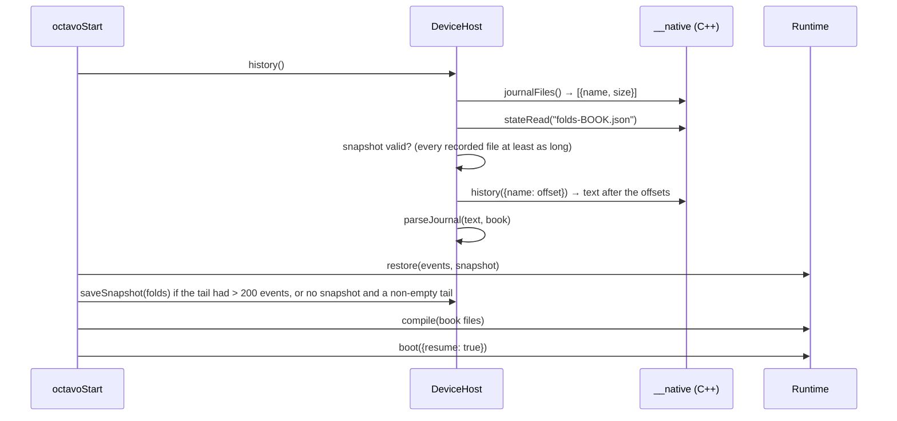

The order matters, and the first version had it wrong. History was read after `compile`. The leitfaden preset's `main.js` emits eight made-up events while it loads, to show the type states on a fresh install:

```js
for (const id of ['top', 'cat', 'cont', 'fun', 'psh']) log.emit({ ev: 'card.open', card: id });
for (const id of ['top', 'cat', 'cont']) log.emit({ ev: 'mastered', card: id });
start('map', { focus: 'sh' });
```

`emit` applied them to the folds and journaled them. `history()` then read them back from the journal and `restore` folded them a second time. The log line of the very first start already said `history: 8 events`. Reading the history before the book's scripts run removes the overlap: the journal is read before anything in this session has written to it.

`boot` then chooses the first screen with one rule:

1. A screen the book asks to open on with `start()`, such as `start('hub')` or `start('map')`, is always shown. These screens show where the reader is anyway.
2. Otherwise, the card the reader was reading when the log ends, `folds.lastCard`.
3. Otherwise, a start card named with `start('read', id)`. This is where a reader without a history begins.
4. Otherwise, the first card.

The rule was found by breaking a test. The first version let resume override everything, and the leitfaden preset then opened at `psh` instead of its map. The second version let `start()` always win, which broke `✖ a reader restores its history and resumes at the last card`, because the sheaves preset calls `start('read', 'sheaf')`. A start screen describes how a book opens; a start card describes where a new reader begins. Only the second should yield to a history.

On the handheld the device script checked the whole path. The first start, with an empty journal, opened the book's start card, Theorem 5.4. The script pressed R twice to reach Counterexample 5.6, then DOWN and A to peek at Definition 5.1, and quit while peeking. The second start logged:

```
history: 5 events, 513 bytes, 0 unreadable: read 1.8 ms, parsed 1.3 ms, folded 1.2 ms, snapshot saved; 4 seen, 0 mastered; first screen read sierpinski
```

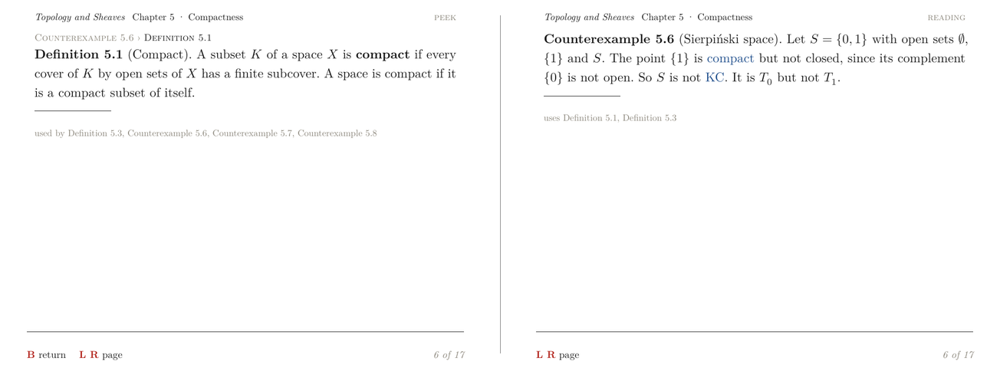

*Left: the last screen before quitting, a peek at Definition 5.1 from Counterexample 5.6 ("B return"). Right: the first screen after the restart, Counterexample 5.6, the card being read.*

## 4. The snapshot

### 4.1 What a full read costs

`scripts/11-synthetic-journal.py` writes a seeded, reproducible year of reading over the 17 cards of the device book: card opens with and without peeks, peek pushes and pops, hypothesis toggles, screen changes and `mastered` events. One session a day gives 43 800 events in 4 558 646 bytes; three sessions a day give 131 400 events in 13 681 191 bytes.

The cost of a start that reads the whole journal has three parts, each linear in the history:

$$T_\text{full} = T_\text{read}(B) + T_\text{parse}(N) + T_\text{fold}(N)$$

where $B$ is the size of the journal in bytes and $N$ the number of events. On both machines parsing dominates. It is 4.7 to 7.6 times the cost of reading the file, because every line goes through `JSON.parse` and becomes a V8 object. A faster parser would reduce the constant but not the growth. The only way to remove the growth is to not parse the old events at all.

### 4.2 What a snapshot records and when it is valid

A snapshot is a file `<data>/cache/state/folds-<book>.json`:

```json
{ "files": [{"name": "2026-10.jsonl", "size": 4558646}, ...],
  "folds": {"version": 1, "count": 43800, "seen": [...], "mastered": [...], "lastCard": "sheaf",
            "opens": [...], "firstSeen": [...], "lastSeen": [...], "prevLast": ..., "lastOpen": ...} }
```

`files` is the journal position the folds cover. At the next start, `DeviceHost.history()` accepts the snapshot only if every file it names is at least as long as recorded:

```js
const size = new Map(files.map(f => [f.name, f.size]));
const folds = snap && snap.files && snap.files.every(f => (size.get(f.name) || 0) >= f.size)
  ? O.Folds.fromJSON(snap.folds) : null;
const offsets = {};
if (folds) for (const f of snap.files) offsets[f.name] = f.size;
const text = this.n.history(JSON.stringify(offsets));   // every month file from its offset; new files from 0
```

The validity rule follows from the journal's one invariant: it is append-only. If every file is at least as long as recorded, the recorded prefix is still there, and the folds of that prefix are still correct. The tail is everything after the offsets, including any month file the snapshot does not name. A file that was truncated, deleted or replaced by a shorter one fails the test, and the whole journal is read again. So does a snapshot whose `version` differs from `Folds.VERSION`: `fromJSON` returns null. The version must be raised whenever `apply()` changes, because old folds would otherwise be continued with new rules.

The snapshot is a cache. Deleting it costs one slow start, never correctness, and the journal stays the only source of truth.

Two details decide when it is written:

- **It is saved at start-up, before anything new is emitted.** At that moment the folds are exactly the fold of the journal up to the sizes just read. Saving at exit would also work, but only if the process exits cleanly; a handheld whose battery runs out does not. Saving at start-up needs no clean exit.
- **It is saved when the tail had more than 200 events, or when there was no snapshot and the tail was not empty.** The tail read at start-up therefore stays below 200 events plus the events of the last session, and the snapshot is not rewritten on every start.

The natives behind this are small. `journalFiles()` lists `events/*.jsonl` with sizes; `history(offsetsJson)` returns the concatenated text of every month file from its offset; `stateRead` and `stateWrite` access files in `<data>/cache/state` whose names are restricted to `[A-Za-z0-9._-]`, and a write goes to a temporary file that is then renamed, so a crash during the write leaves the old snapshot intact.

### 4.3 Results

The first start reads the whole journal and saves a snapshot; the second reads the snapshot and the one event the first start emitted after saving it.

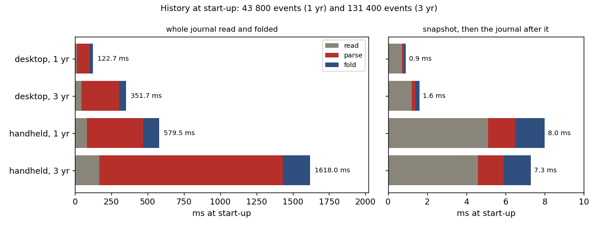

*History at start-up on the desktop and on the handheld. Left: the whole journal read, parsed and folded. Right: the snapshot, then the journal after it. The right panel's scale is 200 times finer.*

| Journal | Machine | Whole journal (read + parse + fold) | First page | With snapshot | First page |
| --- | --- | --- | --- | --- | --- |
| 1 year, 43 800 events, 4.6 MB | desktop | 12.9 + 87.2 + 22.6 = 122.7 ms | | 0.7 + 0.1 + 0.1 = 0.9 ms | |
| 3 years, 131 400 events, 13.7 MB | desktop | 42.8 + 260.8 + 48.1 = 351.7 ms | | 1.2 + 0.2 + 0.2 = 1.6 ms | |
| 1 year | handheld | 82.1 + 386.8 + 110.6 = 579.5 ms | 1220 ms | 5.1 + 1.4 + 1.5 = 8.0 ms | 586 ms |
| 3 years | handheld | 165.8 + 1264.9 + 187.3 = 1618.0 ms | 2226 ms | 4.6 + 1.3 + 1.4 = 7.3 ms | 660 ms |

With a snapshot, "read" includes listing the journal and reading and decoding the snapshot itself, which is why it dominates the right panel. Its size depends on the number of cards, not on the number of events, so a start with three years of history costs the same as one with one year. The handheld parses about 4.5 times slower than the desktop (386.8 against 87.2 ms for a year). For comparison, the first page of a start with a five-event history took 418 ms; the runs open different cards and the data directories differ in what the page store had cached, so the numbers are close but not directly comparable.

## 5. Durability: `fflush`, `fdatasync` and group commit

### 5.1 What `fflush` guarantees

Since Phase 1 the script thread appends each event to the month file and calls `fflush` before the screen changes. `fflush` moves the line from the C library's buffer into the kernel's page cache. From there it survives a crash of the process, but not a loss of power: the kernel writes dirty pages to the card later. On the handheld, `/proc/sys/vm/dirty_expire_centisecs` is 3000 and `dirty_writeback_centisecs` is 1500, so a page may stay in memory for 30 seconds before it is old enough to be written, and the writeback thread looks for such pages every 15 seconds. A handheld whose battery runs out can lose that much reading.

`fdatasync(fd)` returns only after the file's data is on the device. The question is what it costs on this SD card, and on which thread that cost is paid.

### 5.2 `fdatasync` per line, measured

The app's `--journal-sync` flag calls `fdatasync` after every line on the script thread and times each call. Forty page turns on the handheld wrote 41 lines:

```
journal: 41 lines with fdatasync: mean 7.83 ms, p50 6.15, p90 9.85, max 32.60 ms
```

Every press that emits an event pays this on its way to the screen. Press latency, measured by the app from the button event to the frame that shows the result, had a median of 12.7 ms and a worst case of 51.1 ms. The same 40 page turns without a sync on the script thread (section 5.4) have a median of 6.0 ms and a worst case of 17.7 ms. A page turn that takes 51 ms is visible.

### 5.3 Group commit

The fix separates the two guarantees. The script thread still appends and flushes every line before the screen changes, so the order of events and screen changes is unchanged and a process crash loses nothing. A second thread, the **syncer**, calls `fdatasync` at most `kSyncDelayMs` = 500 ms after the first line that has not been synced. Lines written in that interval join the same sync.

```cpp
void ScriptThread::journal(const std::string& line) {
  ... // open the month file; on a new month, replace syncFd_ with a dup of its descriptor (under sm_)
  std::fwrite(line.data(), 1, line.size(), journalFile_);
  std::fputc('\n', journalFile_);
  std::fflush(journalFile_);   // appended and flushed before the screen changes (guide 7.10)
  if (o_.journalSync) { ... fdatasync inline, timed ... }
  else {                       // on the card within kSyncDelayMs, by the syncer thread
    std::lock_guard<std::mutex> l(sm_);
    if (!syncWant_) syncDueMs_ = nowMs() + kSyncDelayMs;
    syncWant_ = true;
    scv_.notify_one();
  }
}

void ScriptThread::syncLoop() {
  std::unique_lock<std::mutex> l(sm_);
  for (;;) {
    scv_.wait(l, [&] { return syncWant_ || syncQuit_; });
    while (!syncQuit_) {   // until the first unsynced line is kSyncDelayMs old: later lines join this sync
      const double left = syncDueMs_ - nowMs();
      if (left <= 0) break;
      scv_.wait_for(l, std::chrono::microseconds(int64_t(left * 1000)));
    }
    if (syncQuit_) return;   // the destructor syncs what is left
    syncWant_ = false;
    const int fd = syncFd_ >= 0 ? dup(syncFd_) : -1;   // our own descriptor: journal() may switch months meanwhile
    l.unlock();
    if (fd >= 0) { fdatasync(fd); close(fd); }   // (timing of the sync omitted here)
    l.lock();
  }
}
```

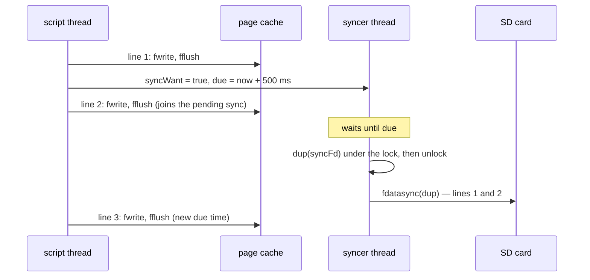

The difficult part is the month boundary. `journal()` closes the `FILE*` and opens a new file when the month changes, and the syncer must never call `fdatasync` on a descriptor that is being closed. The syncer therefore never uses the `FILE*`'s descriptor. It keeps `syncFd_`, a `dup` of the month file's descriptor, which `journal()` replaces under the lock. For each sync the syncer makes a second `dup` of `syncFd_` while it holds the lock, then releases the lock, syncs that private copy and closes it. `journal()` never waits for the card, and a descriptor is never closed while it is being synced. A sync of the old descriptor after a month change still syncs the old file, which is correct: the lines written to it are the ones that were pending. The destructor joins the syncer and syncs whatever was still pending.

### 5.4 Results

The same 40 page turns with group commit:

```
journal: 41 group syncs off the script thread: mean 8.80 ms, max 30.44 ms
presses, latency p50 6.0 max 17.7 ms
```

| Journal policy | Press latency p50 | max | Lost on power failure (at most) |
| --- | --- | --- | --- |
| `fflush` only (Phases 1 and 2) | not measured; the script thread's work equals group commit's minus one notify | | 30 s of writes, plus up to 15 s until writeback runs |
| `fdatasync` per line | 12.7 ms | 51.1 ms | nothing that reached the screen |
| group commit, 500 ms | 6.0 ms | 17.7 ms | 0.5 s plus one sync (≤ 30 ms measured) |

The syncs themselves cost about as much as before, 8.8 ms on average and 30.4 ms at most, but they no longer delay a press. In this run nothing was coalesced: the control script waits 0.5 s between presses, so each line had its own sync. Rapid presses, such as a held direction, would share syncs.

## 6. Reading state in type

### 6.1 Span states and show-if bits

Part 1's renderer draws the glyphs and rules of a page with one program in one draw call; path segments, such as the Leitfaden's diagonal edges, are drawn by a second program, `stroke`. Each vertex of either carries its span id and a 16-bit flags field: bits 0–3 are the palette colour, bits 8–11 are a show-if mask. Both vertex shaders read the span's state from the same texture, a 256-wide `RGBA8UI` texture with one texel per span, the state in `r` and the bits in `g`, and apply the same test (`shaders/page.vert`):

```glsl
const uint STATE_COLOR[5] = uint[5](0u, 3u, 2u, 4u, 1u);   // normal, link, focus, dimmed, unread
...
uvec4 s = texelFetch(u_state, ivec2(int(span & 255u), int(span >> 8u)), 0);
uint need = (flags >> 8u) & 15u;
float show = (need == 0u || (s.g & need) != 0u) ? 1.0 : 0.0;
vec2 p = a_rect.xy + a_corner * a_rect.zw * show + u_offset;
uint ci = s.r == 0u ? (flags & 15u) : STATE_COLOR[min(s.r, 4u)];
```

A geometry item with no show-if bits is always drawn. An item with show-if bits is drawn only if the span's state has one of those bits; otherwise `show` is 0, the quad collapses to its corner, and it produces no fragments. Phases 1 and 2 used two show-if bits: 1 for the focus underline and 2 for the strike rule through a dropped hypothesis. The span state chooses the colour: state 0 keeps the item's own palette colour, and states 1–4 replace it with link blue, focus red, dimmed or unread grey.

Phase 3 adds a third bit:

| Span bit | Value | Exporter flag | Shows |
| --- | --- | --- | --- |
| `BIT.FOCUS` | 1 | `SHOW_IF_FOCUS` = 1 << 8 | the focus underline |
| `BIT.STRUCK` | 2 | `SHOW_IF_STRUCK` = 2 << 8 | the strike rule |
| `BIT.SHOWN` | 4 | `SHOW_IF_ALT` = 4 << 8 | the glyphs of the variant shown now |

### 6.2 The `alt` element

octavo-set's transpiler turns an `alt` element with two span children into a call of a new template function:

```typst
// Two variants of one text in one place. Both are laid out; the span state shows one of them (the exporter
// marks their glyphs SHOW_IF_ALT). The box is as wide as the wider variant; the first variant is in the flow
// and sets the baseline, the second is placed over it.
#let alt(a, b) = context {
  let wa = measure(a).width
  let wb = measure(b).width
  box(width: calc.max(wa, wb), { place(top + left, b); a })
}
// The same in a block as wide as its container, so both variants wrap there (contents rows).
#let alt-block(a, b) = block(width: 100%, { place(top + left, block(width: 100%, b)); a })
```

The box takes the width of the wider variant, so the text after it does not move when the other variant is shown. A test layout of a roman and an italic title put both variants at baseline 46.44 and x 115.5.

After layout, the exporter adds a pass. Every span marked `alt` in the tree has its glyphs flagged `SHOW_IF_ALT`, and so do its rules and paths that carry no show-if bit yet:

```rust
let alt: HashSet<u16> = spans.iter().filter(|(_, m)| m.alt).map(|(id, _)| *id).collect();
for g in &mut ex.out.glyphs { if alt.contains(&g.span) { g.flags |= SHOW_IF_ALT; } }
for r in &mut ex.out.rules { if alt.contains(&r.span) && r.flags & 0xff00 == 0 { r.flags |= SHOW_IF_ALT; } }
for p in &mut ex.out.paths { if alt.contains(&p.span) && p.flags & 0xff00 == 0 { p.flags |= SHOW_IF_ALT; } }
```

The condition `flags & 0xff00 == 0` leaves the focus underlines alone. Each variant has its own underline flagged `SHOW_IF_FOCUS`, and only the shown variant can ever have `BIT.FOCUS`, so only its underline appears.

### 6.3 `altPair`: trees that do not depend on state

The runtime builds element trees with a `Builder` that allocates span ids in document order and keeps, for each id, the state and bits that will be sent to the state texture. `Builder.altPair` builds an alt pair:

```js
altPair(fid, spec, variants, which) {
  const ids = [this.next++, this.next++];               // always two ids, whichever variant is shown
  const els = variants.map((kids, k) => ({ t: 'span', id: ids[k], alt: true, kind, c: kids }));
  const shown = ids[which ? 1 : 0], hidden = ids[which ? 0 : 1];
  // the shown span is the focusable one, with BIT.SHOWN; the hidden one has state 0, bits 0
  this.fx.set(fid, e); this.byId.set(shown, { ..., state: spec.state, bits: spec.bits | BIT.SHOWN });
  this.byId.set(hidden, { id: hidden, fid: null, state: 0, bits: 0, focusable: false });
  return { t: 'alt', c: els };
}
```

The returned element does not contain `which` or the state. Both live only in the builder's entries, which become span states, never tree text. This is the invariant the whole phase depends on:

> **The element tree of the contents and of the Leitfaden is the same for every reading state.**

Three things maintain it:

- `altPair` allocates two span ids whatever variant is shown, so the ids of everything after it do not shift.
- The Leitfaden's edge spans are allocated in chain order, and the chains depend only on the dependency graph.
- The state of an edge (ink when the card it leads to has been read, grey while it is unread) is set with `b.tint(state)`, which allocates an id in build order and stores the state outside the tree.

Because the tree text is the same, its page key is the same, and the page store finds the page laid out before. A change of reading state turns into the following span-state changes, each one texel:

| Change | Span-state writes |
| --- | --- |
| a card read for the first time | roman span: state UNREAD → 0, bits SHOWN → 0; italic span: state 0 → FOCUS, bits 0 → SHOWN |
| a card mastered | italic span: state → 0, bits SHOWN → 0; roman span: state → NORMAL (FOCUS if it is where you are), bits 0 → SHOWN |
| where you are moves | the old card's shown span: FOCUS → NORMAL; the new card's: → FOCUS |
| an edge's target read | edge span: UNREAD → NORMAL |

`look(rt, id)` in `js/views/map.js` maps a card to the variant and the state:

```js
function look(rt, id) {
  const s = rt.readingState(id);
  return { which: s === 'seen' ? 1 : 0,
           state: id === current(rt) ? STATE.FOCUS : s === 'unread' ? STATE.UNREAD : STATE.NORMAL };
}
```

The italic variant is shown only for a card that is seen and not mastered. Mastered and unread cards both show the roman variant; grey distinguishes the unread one. Where you are is red in whichever variant its reading state selects.

### 6.4 The cursor as an underline

On these screens red means "where you are". Phases 1 and 2 drew the cursor as red text with an underline. On the contents, a red cursor would hide the state of the focused title. A focusable registered with `cursor: 'underline'` therefore keeps its state's colour under the cursor and gets only `BIT.FOCUS`, which shows its underline:

```js
if (e.fid && e.fid === this.focusId) { if (e.cursor !== 'underline') s = STATE.FOCUS; bits |= BIT.FOCUS; }
```

### 6.5 States for the bottom screen

Before Phase 3 only the top screen's main page had span states. The new screens show the focused card's titles on the bottom screen too, in their states. The bottom panel is now built with its own `Builder`, and `sendStates(page, byId, slot)` sends its states. Two details keep the message stream small: states are sent only when they differ from those last sent for the slot, and a panel page that never had states sends none. A panel that had states and now has none sends an empty list, which clears the old ones.

### 6.6 The test

`js/test/map.test.js` lays out real pages with octavo-set and asserts the invariant directly. On the leitfaden preset it masters a card that was seen, then checks that both page keys stay, that the shown variant changes, and that at most one new page appears:

```js
const key = rt.page.key, panelKey = host.presented['bottom.main'].key, pages = rt.pages.size;
rt.emit({ ev: 'mastered', card: 'fun' });
rt.changed(); rt.update();
assert.strictEqual(rt.page.key, key, 'same tree, same layout');
assert.strictEqual(host.presented['bottom.main'].key, panelKey, 'the bottom panel keeps its layout too');
assert.strictEqual(st('fun').alt, fun.alt - 1, 'mastered now: the roman variant is shown');
assert.ok(rt.pages.size <= pages + 1, 'at most the prompt line is new (its status counts mastered cards)');
```

The last assertion admits the one exception, which section 9 measures on the device.

## 7. The contents

START opens the contents from any screen, and START or B closes it. The view (`hubView` in `js/views/map.js`) builds one `toc` element: a chapter head per chapter, then one row per card with its number, its kind in grey small capitals and its title as an alt pair. The title uses `alt-block`, so a long title wraps within the third column in both variants. After the chapters comes a "Sessions" part with the Leitfaden and every flow that the book defined with a title. The template sets this as a three-column grid with `justify: false`. The cursor starts on where you are.

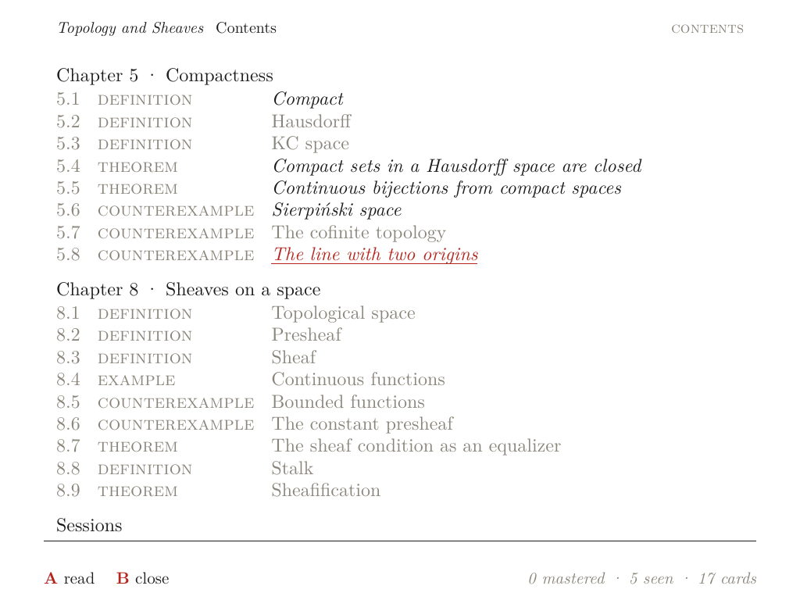

*The contents on the handheld after the device session of section 9. Counterexample 5.8 is where you are: red, italic because it has been seen, underlined because the cursor is on it. 5.1, 5.4, 5.5 and 5.6 are seen and set in italic; the rest are unread and grey. Nothing is mastered yet. The status counts the states.*

The bottom screen shows the focused card in place of the empty scratch tab, which is named "card" on these screens: its kind and number, its title in its state, its first sentence, the cards it needs and leads to (each title in its state), and a legend whose four words are themselves set in the four states.

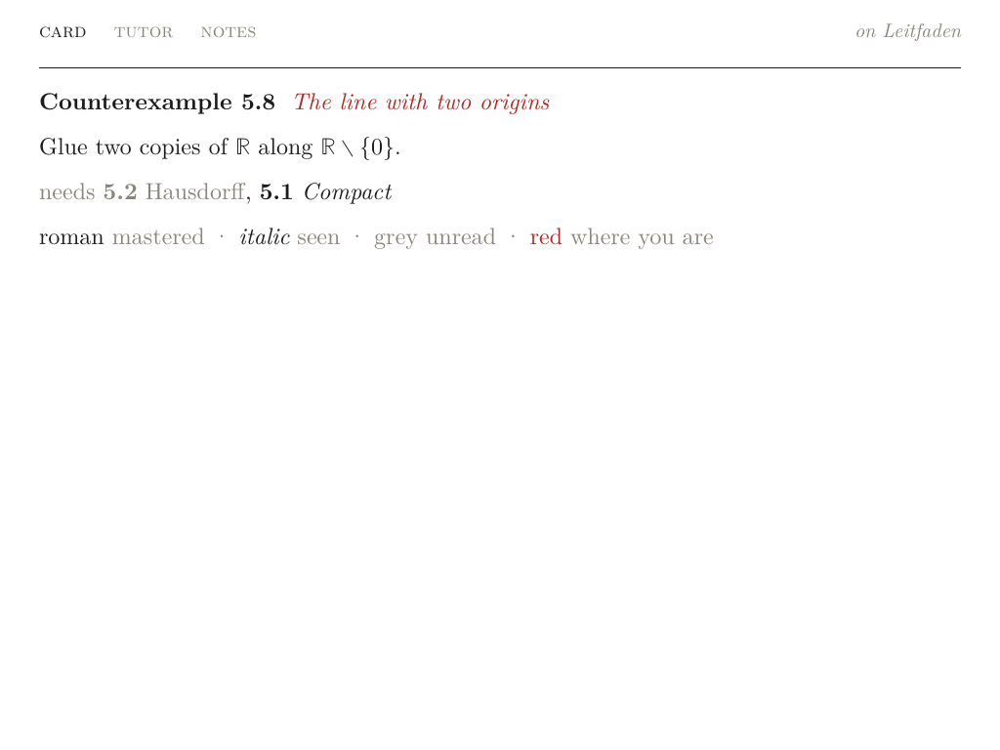

*The bottom screen for Counterexample 5.8. "needs 5.2 Hausdorff, 5.1 Compact": 5.2 is unread and grey, 5.1 is seen and italic. The legend is built from alt pairs as well.*

## 8. The Leitfaden

The Leitfaden shows one chapter at a time; L and R change chapter. The device book's 17 cards span 8 levels when drawn as one graph, too many for a 692-pixel view, while its chapters 5 and 8 have 3 and 5 levels. Requirements on cards of other chapters are named in the bottom panel instead. The drawing follows the standard method for layered graphs (Sugiyama's method), simplified for graphs of 8 to 15 cards. Steps 2 to 5 each remove a defect of the drawing that the steps before them produce.

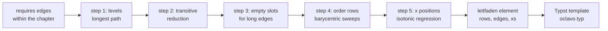

### 8.1 Levels

A card's level is one more than the highest level among the cards of the same chapter that it requires, and 0 if it requires none. This is the longest path from a source, computed by memoized depth-first search. It places every card below everything it depends on, which is the convention of a Leitfaden at the front of a mathematics book: earliest ideas at the top.

### 8.2 The transitive reduction

An edge is drawn only if no longer path implies it. Theorem 8.7 needs 8.2 and 8.3, and 8.3 needs 8.2. An edge 8.2 → 8.7 then says nothing that the path 8.2 → 8.3 → 8.7 does not already say, and it crosses a row. The implementation computes each card's set of ancestors and keeps an edge `p → id` only if no other requirement `q` of `id` has `p` among its ancestors. The result is the Hasse diagram of the dependency order restricted to the chapter. On the device book it removes 5.1 → 5.6 in chapter 5, and 8.2 → 8.7 and 8.2 → 8.9 in chapter 8. On the 14-card leitfaden preset it removes one edge of 20. The bottom panel still names every requirement.

### 8.3 Empty slots for long edges

An edge from level 1 to level 4 drawn straight passes through rows 2 and 3, and in the first drawing of the leitfaden preset such edges ran through titles. Each edge that spans more than one level is therefore split into a chain, with an empty slot in every row between its ends. An empty slot is named `~p>id@l` (edge `p → id` at level `l`). It takes part in ordering and placement in the same way as a card, with a width of 16 px. The template passes it at mid-row. The leitfaden preset gets 10 empty slots.

### 8.4 Ordering the rows

Each row is first spread evenly. Then the rows are sorted by the mean position of each slot's neighbours: every row by its neighbours in the row above (top to bottom), then by those in the row below (bottom to top), then by those above again. This is the barycentric heuristic. It keeps most edges short and reduces crossings without guaranteeing a minimum. Chapter 5's chart below has three crossings between its first two rows, and no order removes them: 5.1 and 5.2 both lead to 5.7, 5.8 and 5.3, and two cards in one row with three common successors in the next cross three times in any order.

### 8.5 Placement by isotonic regression

An order is not yet a drawing. Spreading each row in equal shares of the width makes a chain of empty slots zig-zag, because each row's shares are different. Each slot should be as close as possible to where its neighbours want it, without overlapping its row-neighbours and without changing the order.

For one row of $n$ slots, let $d_i$ be the wanted position of slot $i$ (the mean $x$ of its neighbours) and $w_i$ its width. The positions $x_i$ should minimise

$$\sum_{i=1}^{n} (x_i - d_i)^2 \quad\text{subject to}\quad x_{i+1} - x_i \ge \tfrac{1}{2}(w_i + w_{i+1}).$$

Define offsets $o_1 = 0$ and $o_{i+1} = o_i + \tfrac{1}{2}(w_i + w_{i+1})$, and substitute $y_i = x_i - o_i$. The constraints become $y_{i+1} \ge y_i$ and the objective becomes $\sum (y_i - (d_i - o_i))^2$. That is an isotonic regression of the values $e_i = d_i - o_i$: the closest non-decreasing sequence in least squares. The pool-adjacent-violators algorithm solves it exactly in one pass. It keeps a stack of blocks, each with a mean and a count; it pushes each $e_i$ as a block of its own, and while the top block's mean is smaller than the one below it, it merges the two into their weighted mean. Every slot then takes its block's mean, and $x_i = y_i + o_i$.

```js
function placeRow(d, w, W) {
  const o = [0];
  for (let i = 1; i < d.length; i++) o.push(o[i - 1] + (w[i - 1] + w[i]) / 2);
  const blocks = [];   // [mean, count]
  for (let i = 0; i < d.length; i++) {
    blocks.push([d[i] - o[i], 1]);
    while (blocks.length > 1 && blocks[blocks.length - 2][0] > blocks[blocks.length - 1][0]) {
      const [v, n] = blocks.pop();
      const top = blocks[blocks.length - 1];
      top[0] = (top[0] * top[1] + v * n) / (top[1] + n);
      top[1] += n;
    }
  }
  const x = [];
  for (const [v, n] of blocks) for (let k = 0; k < n; k++) x.push(v + o[x.length]);
  const lo = w[0] / 2 - x[0], hi = W - w[w.length - 1] / 2 - x[x.length - 1];
  const shift = lo > 0 ? lo : hi < 0 ? Math.max(hi, lo) : 0;
  return x.map(v => v + shift);   // the row moved inside 0..W as a whole
}
```

The rows are placed in five passes: down, up, down, up, down. In a downward pass a card wants the mean of its neighbours above, in an upward pass the mean of those below. An empty slot always wants the mean of both, which pulls a chain towards a straight line. The final shift into $[0, W]$ moves a row as a whole; it is feasible but not the constrained optimum when a row touches an edge. After the last pass the drawing as a whole is centred, and each slot's centre and width are passed to the template as fractions of the text width.

### 8.6 Widths

The placement needs widths before the layout exists. The runtime estimates a title at 10.5 px per character at 22 pt plus 30 px, at most 300 px (the template wraps it there), plus a 24 px margin:

```js
Math.min(300, 30 + 10.5 * (String(c.n).length + (c.title || c.kind).length)) + 24
```

A row whose estimates sum to more than the text width $W$ = 880 px must give some up. The first version scaled every width by the same factor. In chapter 5's second row the estimates then summed to 1141 px, the factor was 0.77, and "5.3 KC space", the shortest title in the row, wrapped onto two lines. The current version takes width from the widest titles first: it finds the largest cap $c$ with $\sum_i \min(e_i, c) \le W$ and gives each slot $\min(e_i, c)$. With the current estimates that row is 306, 324, 169.5 and 324 px. Sorted, 169.5 is below $880/4 = 220$, so it keeps its width; then $710.5/3 = 236.8$ is below 306, so the cap is 236.8 px. "KC space" keeps its 169.5 px and the three long titles get 236.8 px each and wrap. Hyphenation is off inside nodes, so they wrap at spaces ("Haus-dorff" was one result before).

### 8.7 The template

The `leitfaden` element carries the rows (an alt pair per card, `null` per empty slot), the edges as chains of `(row, index)` pairs with an edge span id at the end, and `xs`. The template measures each node, stacks the rows with a 56 pt gap, and draws each chain as line segments from the foot of one slot to the head of the next. The last segment gets an arrowhead. Each line is stroked with `tag(ink, id)`, which encodes the edge's span id in the colour, so that the exporter assigns the line to that span and its state colours it.

```typst
#let leitfaden(rows, edges, xs: none) = layout(size => {
  let W = size.width
  let cx(ri, i) = if xs == none { (i + 0.5) * W / rows.at(ri).len() } else { xs.at(ri).at(i).at(0) * W }
  let room(ri, i) = if xs == none { W / rows.at(ri).len() } else { xs.at(ri).at(i).at(1) * W }
  let node(w, body) = block(width: w, { set par(justify: false, leading: 0.4em)
    align(center, text(size: 22pt, hyphenate: false, body)) })
  // a card: both variants in a box of one width, the second placed over the first
  ... box(width: w, { place(top + left, node(w, n.b)); node(w, n.a) }) ...
  // where an edge leaves a slot (foot) and enters one (head); an empty slot is passed at mid-row
  let foot(ri, i) = if bodies.at(ri).at(i) == none { ys.at(ri) + rowh.at(ri) / 2 } else { ys.at(ri) + ms.at(ri).at(i).height + pad }
  let head(ri, i) = if bodies.at(ri).at(i) == none { ys.at(ri) + rowh.at(ri) / 2 } else { ys.at(ri) - pad }
  ...
  for (pts, id) in edges {
    let st = 0.9pt + tag(ink, id)
    ... place(top + left, line(start: a, end: b, stroke: st)) ...   // one segment per pair of slots, then the arrowhead
  }
})
```

The guide (section 9.1) planned the Leitfaden differently: a `layoutMap` step in the build, drawn with the fletcher package. The placement now runs in the runtime's JavaScript, in `js/views/map.js`, and the template uses only Typst's `line` and `place`. The same code therefore runs in the twin and on the device, and the parity check covers it.

### 8.8 The edge that covered no pixel

The first Leitfaden on the host showed two vertical edges as arrowheads only. `octavo-set --json` showed one of them as a rule:

```
[511.55, 234.94, 0.9, 44.0, 35, 0]      x, y, width, height, span, flags
```

The exporter turns horizontal and vertical lines into rules, and rules are filled without antialiasing. A pixel is filled if its centre lies inside the rectangle. This rule spans x = 511.55 to 512.45, which contains neither pixel centre 511.5 nor 512.5, so it filled nothing. Any interval of length 1 contains a pixel centre, so the exporter now makes every line shape at least 1 px wide. The minimum applies to diagonal lines too, which are exported as antialiased path segments and went from 0.9 to 1 px:

```rust
// Rules are filled without antialiasing: one thinner than a pixel can cover no pixel centre and
// vanish (a 0.9 px vertical edge at x = 511.55 does), so a line drawn as a rule is at least 1 px.
let thick = thick.max(1.0);
```

The layout id changed to `… export 3`, so every cached page was laid out again.

### 8.9 Three drawings of one chapter

`scripts/14-leitfaden-figures.cjs` draws the leitfaden preset (14 cards, made-up history) with the steps switched on one at a time. The span states are the runtime's; there is no cursor.

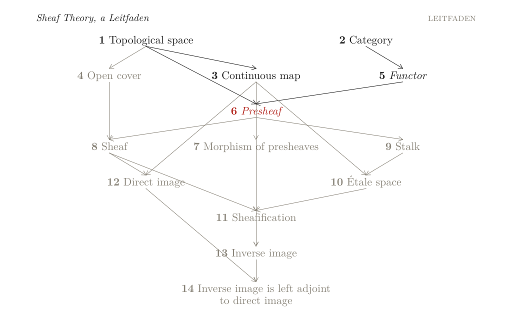

*(a) Every requirement as a straight edge, slots in equal shares of the width (how the IDE draws it). The edge 3 → 13, which the reduction removes, runs straight down through "6 Presheaf", "7 Morphism of presheaves" and "11 Sheafification"; the edge 12 → 14 crosses "13 Inverse image".*

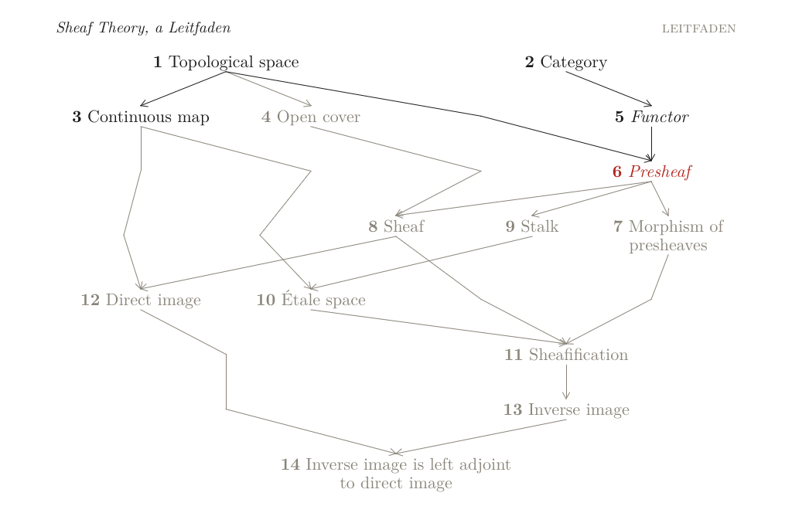

*(b) The transitive reduction and an empty slot per row for each long edge, still in equal shares. No edge crosses a title, but the chains zig-zag: 3 → 10 runs right, then left, then right again.*

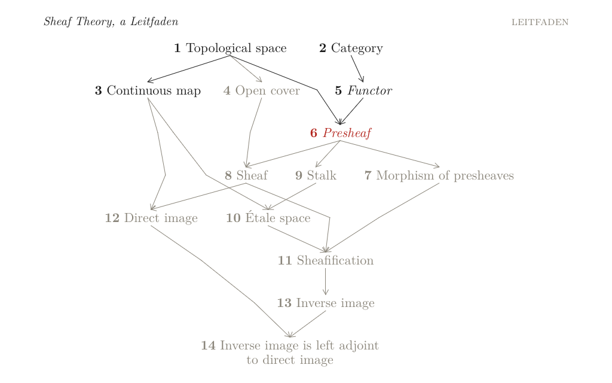

*(c) As (b), with slots placed by isotonic regression (what the handheld shows). The chains are shorter and run between the titles. They are not straight: 3 → 12 still bends at its empty slots.*

On the handheld, chapter 5 has three levels and chapter 8 five, and neither needs an empty slot:

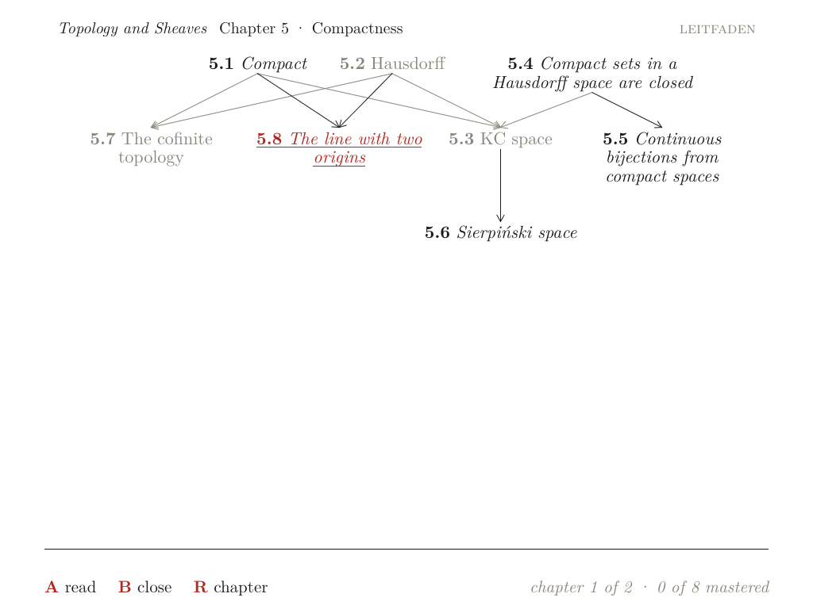

*Chapter 5 on the handheld. Edges into cards that have been read (5.8, 5.5, 5.6) are in ink; edges into unread cards are grey. The long titles of the second row wrap in slots of 236.8 px; "5.3 KC space" keeps its width.*

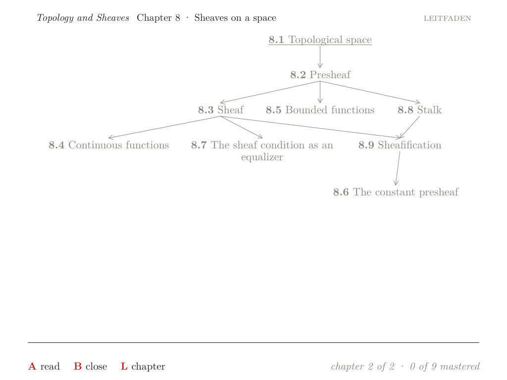

*Chapter 8, reached with R. Where you are (5.8) is not in this chapter, so the cursor starts on the first card of the top row, 8.1, underlined in its own grey.*

## 9. Prebuilt pages and what a press lays out

Part 2 introduced the prewarm walk: at build time, `js/tools/prewarm.js` walks through the book as a reader could, and every element tree it reaches is laid out on the desktop and installed with the app. On the device, the page store finds these pages by key, and the layout helper runs only for trees the walk did not reach.

The walk now ends with the new screens: the contents, and each chapter's Leitfaden, with every entry focused once, because the bottom panel changes with the focus. Since the trees of these screens do not depend on reading state, one walk covers every state. The device book now has 287 prebuilt trees, up from 245.

The first version of the walk reached only two of the Leitfaden's 17 panels. `RecordHost.set`, which records the trees and stands in for the layout during the walk, looked for span ids under the fields `c` and `head` only. Leitfaden nodes are under `rows`, so the walk found no focusable spans on the Leitfaden page and never moved the cursor. It now walks every field of a tree.

On the handheld, the device script ran one session on the device book: START to the contents, two cards down, A to read 5.8, START back, down to the Leitfaden row, A into the Leitfaden, R to chapter 8, L back, B out. The app reports for every press whether the layout helper ran:

| Press | Helper layouts | What was laid out |
| --- | --- | --- |
| #1 START (reading → contents) | 1 (13.0 ms) | the prompt line "A read B close" with "4 seen" |
| #2, #3 DOWN | 0, 0 | — (the panel of each card is prebuilt) |
| #4 A (read 5.8) | 1 (11.2 ms) | the read view's prompt line with "B back" |
| #5 START (back to the contents) | 1 (7.4 ms) | the prompt line with "5 seen"; the contents page is unchanged |
| #6–#14 DOWN | 0 each | — |
| #15 DOWN (onto the Leitfaden row) | 1 (10.0 ms) | the prompt line "A open B close" with "5 seen" |
| #16–#29 DOWN | 0 (no change: last row) | — |
| #30 A (into the Leitfaden) | 0 | — |
| #31 R, #32 L, #33 B | 0, 0, 0 | — |

Four of 33 presses called the helper, all for the prompt line, the one-line tree at the foot of the top screen. The contents page, both Leitfaden pages and every bottom panel shown in the session came from the prebuilt set. The four prompt lines were not in it for two reasons:

- **The status counts reading states.** "0 mastered · 5 seen · 17 cards" is text in a tree, so every change of the counts is a new tree. The prewarm walk reads every card before it reaches the contents, so its prompt lines say "17 seen"; the device had 4 and then 5.
- **"B back" appears only when there is a screen to go back to.** The walk opens each card directly, with an empty navigation history. The prebuilt set has the read view's prompt line for 5.8 without "B back" but not with it.

The diary's table for this session (Step 15) listed presses #1 to #5 and #30 to #33 and missed #15; the raw log above is complete.

One press is slower than the rest for a different reason: #30, A into the Leitfaden, took 37.9 ms of script time. `chapterGraph` runs once for each of the view's render, focus, verbs and status functions, and it is not memoized.

## 10. Parity

The parity check of Phase 2 replays a button sequence on the twin and on the app behind octavo-dev and compares the two message streams exactly, then the final screens within a tolerance. Phase 3 adds two presets that exercise the new screens:

- **leitfaden** (14 cards, 8 levels) opens on its Leitfaden, with a made-up history emitted by its `main.js`.
- **contents** includes two chapters from other presets with `@from` lines, opens on its contents, and defines a titled flow, which appears under "Sessions".

Under `--dev` neither the device nor the twin reads a journal: `DeviceHost.history()` returns nothing in dev mode. Both therefore start from the same state, the one the preset's own events create. Node's book loader learned to resolve `@from PRESET/FILE`, which only the IDE had done, so the contents preset also runs in the tests.

| Preset | Presses | Messages (event, states, present) | Largest pixel difference (top, bottom) | Result |
| --- | --- | --- | --- | --- |
| sheaves | 15 | 59 (13, 14, 32) | 29, 17 | pass |
| compact-hausdorff | 15 | 59 (13, 14, 32) | 28, 20 | pass |
| leitfaden | 11 | 57 (13, 19, 25) | 29, 20 | pass |
| contents | 11 | 52 (14, 17, 21) | 34, 17 | pass |

The message streams are identical on all four, on the handheld and on the desktop. The tolerance is 64 levels on 99.5 % of the pixels; no pixel exceeds 34. The number of pixels that differ by more than 8 levels between twin and device is the same on the handheld and on the desktop to within 2 pixels per screen (for example 1676 against 1677 on the contents' top screen). The differences come from the twin's glyph rasterizer, as in Phase 2, and not from the GPU.

## 11. Results

| Measurement | Desktop (x86-64) | Handheld (Mali-G52, SD card) |
| --- | --- | --- |
| history, 1 year, whole journal | 122.7 ms | 579.5 ms |
| history, 1 year, with snapshot | 0.9 ms | 8.0 ms |
| history, 3 years, whole journal | 351.7 ms | 1618.0 ms |
| history, 3 years, with snapshot | 1.6 ms | 7.3 ms |
| first page, 1 year, without / with snapshot | — | 1220 / 586 ms |
| resume after quitting during a peek | the card being read | the card being read |
| `fdatasync` per journal line | p50 2.35 ms | p50 6.15, p90 9.85, max 32.6 ms |
| press latency, `fdatasync` per line | — | p50 12.7, max 51.1 ms |
| press latency, group commit | — | p50 6.0, max 17.7 ms |
| a card mastered: page keys of Leitfaden and panel | unchanged (test) | — |
| helper layouts in a 33-press session | — | 4, all prompt lines (7.4–13.0 ms) |
| prebuilt trees, device book | 287 | 287 installed |
| parity, four presets | pass | pass, largest difference 34 levels |
| `npm test` in `js/` | 12 of 12 | — |

## 12. Defects found on the way

- **Vertical Leitfaden edges were invisible.** A 0.9 px rule covered no pixel centre (section 8.8). Lines are now at least 1 px wide.
- **A preset's made-up history was folded twice.** The history was read after the book's scripts had emitted events (section 3.4). It is now read first.
- **Resume overrode `start('map')`, and then `start()` overrode resume.** The rule now distinguishes a start screen from a start card (section 3.4).
- **A test hung for 300 seconds.** `while (rt.focusId !== 'hub/' + unread) press('down')` never ended: the first unread card was above the cursor. The test now presses UP to the top and then DOWN, at most 80 presses each, and fails with the focus ids it passed.
- **The prewarm walk reached two of 17 Leitfaden panels.** The recording host searched only two fields for span ids (section 9).
- **Short titles wrapped in the Leitfaden.** Width was taken from every title in proportion; it is now taken from the widest first (section 8.6). Hyphenation inside nodes is off.
- **An edit of the template left the old function body behind.** A scripted replacement ended at the first `})`, which was inside the function. Reading the file afterwards showed the remains, which were removed before any layout ran.
- **A process search killed its own shell.** `pkill -f "octavo-dev -listen 127.0.0.1:8171"` matched the shell whose command line contained the pattern (exit 144). Processes are now found with `pgrep -x`.
- **The first start-up chart was misleading.** It stacked read, parse and fold on a logarithmic axis, which made reading look larger than parsing although parsing is five to eight times larger. The chart now has two panels with linear axes.
- **The diary's press table omitted press #15** (section 9). It was found while checking this report against the raw log.

## 13. What Phase 3 decides

- **Reading state is derived, never stored.** The journal is the only durable record. The folds and their snapshot are caches that can be deleted at any time and recomputed from the journal. A new derived value, such as a review schedule in Phase 6, is a new fold and a new `Folds.VERSION`, not a new file format.
- **Anything that changes without moving text is span state.** The alt pair extends decision D5 from colour to a change of glyphs, as long as the variants occupy the same box. The cost is that view code must keep element trees independent of state, and that invariant is now tested.
- **The Leitfaden is placed by the runtime, not by the build.** The guide planned a build step and the fletcher package. Computing positions in `js/views/map.js` keeps one implementation for the twin and the device, and the template only draws what it is given.
- **Durability is bounded in time, not per line.** A line reaches the page cache before the screen changes and the SD card within 0.5 s. A power cut loses at most about the last half-second, and the input path never waits for the card.
- **A book's start screen wins over resume; a start card does not.**

## 14. Limitations and open questions

- **The prompt line's counts cost a layout per change** (7–13 ms on the handheld). They could become span states, for example a strip of per-card marks set in type, or they could leave the prompt line.
- **The prebuilt set lacks prompt lines with "B back"** for cards opened from the contents. A walk that opens cards from the contents would add them.
- **The width estimate does not know the font.** A title with mathematics or many wide letters may wrap where the estimate said it would not. Rows are measured after layout, so a wrap is safe, but rows can look uneven.
- **`chapterGraph` is not memoized.** A press into the Leitfaden costs 37.9 ms of script time on the handheld and R costs 28.0 ms. One graph per chapter and book version would remove most of it.
- **The snapshot's validity check compares sizes only.** A journal replaced by a longer file with different content would pass. Recording a hash of the bytes before each recorded offset would detect it at the cost of reading those bytes.
- **The barycentric sweeps reduce crossings but do not minimise them.** Chapter 5's three crossings are forced by its graph, but nothing checks whether the crossings of a larger chart are.
- **Empty slots are named `~p>id@l`.** This assumes that no card id starts with `~`.
- **Coalescing was not exercised.** The device run waited 0.5 s between presses, so each line had its own sync. A run with a held direction would show how many lines one sync covers.
- **The variance of the full parse was not investigated.** The first year3 run during development parsed in 631.4 ms on the desktop, the re-run in 260.8 ms. The snapshot makes the full parse rare, so this was left.
- **The contents leaves out exercises and the review session** until their flows exist on the device (Phase 6).
- **A correction to Part 3.** Its "next steps" described the type states as "roman for unread, italic for read". The guide's rule, implemented here, is roman for mastered, italic for seen and grey for unread.

## 15. Next steps

Phase 4 is ink. The guide lists "the ink layer and the `stroke` and `layer` programs; the lasso as a selection; the compass with its slots and diagonals; keeping notes; the memo swap (the card on the bottom screen, marked up in red)". In the guide's design, a finished stroke goes to the script thread, which writes it to an ink file and to the journal, so the journal and its group commit carry Phase 4's data as well.

Three small changes from this phase come first: memoize `chapterGraph`, take the reading-state counts out of the prompt line's text, and walk the contents with A in the prewarm.

## 16. Reproducing

```bash
cd /home/manuel/code/wesen/2026-10-17--octavo
T=ttmp/2026/10/17/OCTAVO-001--octavo-on-the-rg-ds-plus-a-typeset-maths-reader-with-a-browser-ide-and-a-device-dev-server
# the setter (alt, toc, leitfaden; export 3) and the runtime tests (folds, peeks, resume, contents, Leitfaden)
(cd set && cargo build --release) && (cd js && npm test)
# start-up with a synthetic year (1 session a day) and three years (3 a day) on the desktop
$T/scripts/12-history-startup.sh $T/results/phase3/host/year1 build-device/octavo/library/topology-and-sheaves 1
$T/scripts/12-history-startup.sh $T/results/phase3/host/year3 build-device/octavo/library/topology-and-sheaves 3
# the handheld: build, deploy (nothing else may hold the display), then the five steps
device/build.sh && device/deploy.sh
STEPS="1 2 3 4 5" $T/scripts/13-device-phase3.sh $T/results/phase3/device
# parity on the four presets, through octavo-dev on the handheld (start "Octavo Dev" from Ports; CODE is on its screen;
# CHROME points at a headless Chromium as in Part 3)
node $T/scripts/09-parity.cjs http://192.168.0.202:8170 CODE $T/results/phase3/device/parity
# figures in this report
node $T/scripts/14-leitfaden-figures.cjs $T/results/phase3/figures
python3 $T/scripts/15-phase3-figures.py $T
```

## 17. Files

| Path (in `/home/manuel/code/wesen/2026-10-17--octavo`) | Role |
| --- | --- |
| `js/core/log.js` | `Folds` (seen, mastered, lastCard, opens, times), the peek rules, `parseJournal`, `Folds.VERSION` |
| `js/host/device.js` | `history()` with the snapshot check, `saveSnapshot`, the book in every journal line |
| `js/main.js` | start-up order: history, restore, snapshot, compile, boot |
| `js/core/runtime.js` | `boot` (start rule), `hub` and `map` verbs, `sendStates` for both screens, the underline cursor |
| `js/core/elements.js` | `BIT.SHOWN`, `Builder.altPair` |
| `js/views/map.js` | the contents, the Leitfaden (`chapterGraph`, `placeRow`), the card panel and the legend |
| `js/tools/prewarm.js`, `js/node/hosts.js` | the prewarm walk over the new screens; `RecordHost` walks every field |
| `set/src/transpile.rs`, `set/src/export.rs`, `set/typst/octavo.typ` | `alt`, `toc`, `leitfaden`; `SHOW_IF_ALT`; rules at least 1 px |
| `native/src/js/script.cpp` | the journal natives, `journal()` and the syncer thread, `--journal-sync` |
| `js/test/log.test.js`, `js/test/map.test.js` | folds and resume; state changes without layout on real pages |
| `ttmp/2026/10/17/OCTAVO-001--…/reference/01-diary.md` | the working diary (Phase 3 is steps 13–15) |
| `ttmp/2026/10/17/OCTAVO-001--…/results/phase3/` | host and device logs, screens, parity reports, figures |

## Related notes

- [[PROJECT REPORT - Octavo, Part 3 - The Development Loop - A Server on the Handheld, a WebGL2 Twin and a Parity Check]]: octavo-dev, the twin and the parity check that this phase extends to two new presets
- [[PROJECT REPORT - Octavo, Part 2 - The Reading Loop on the Handheld - Element Trees from V8, Prebuilt Pages and a Main Loop That Sleeps]]: the script thread, the page store, prebuilt pages and the latency measurement used here
- [[PROJECT REPORT - Octavo, Part 1 - Typst on a Handheld - Display Lists, Span Ids as Colours and a Page Shader on the RG DS Plus]]: the display list, the state texture and the show-if bits that alt pairs extend
