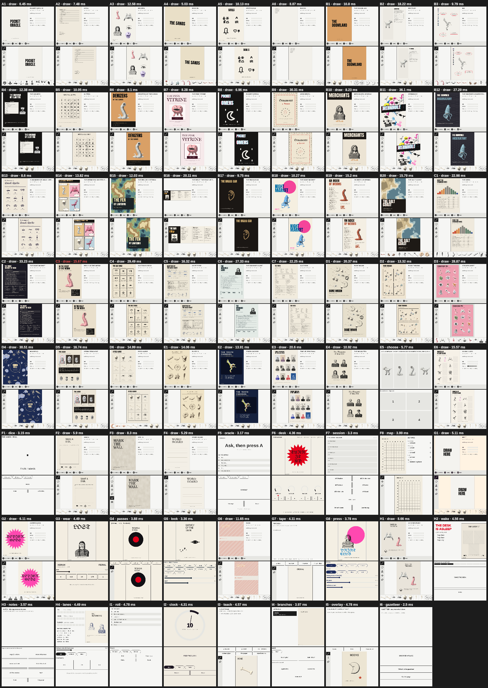
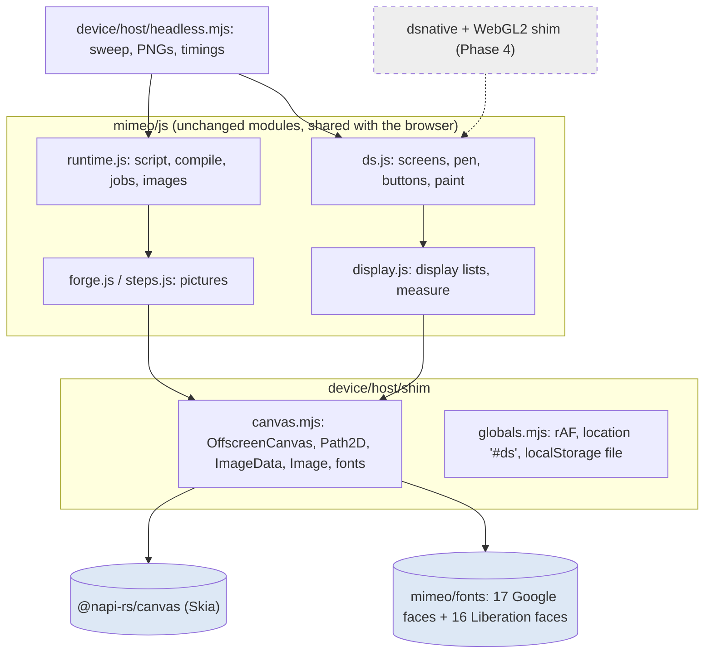
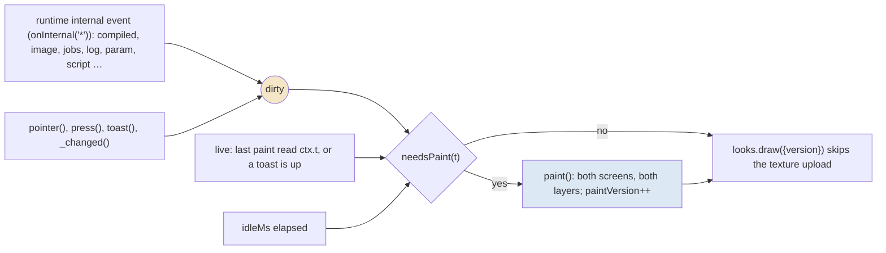
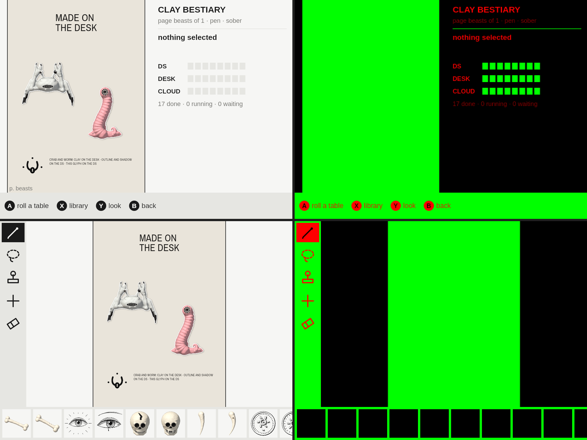
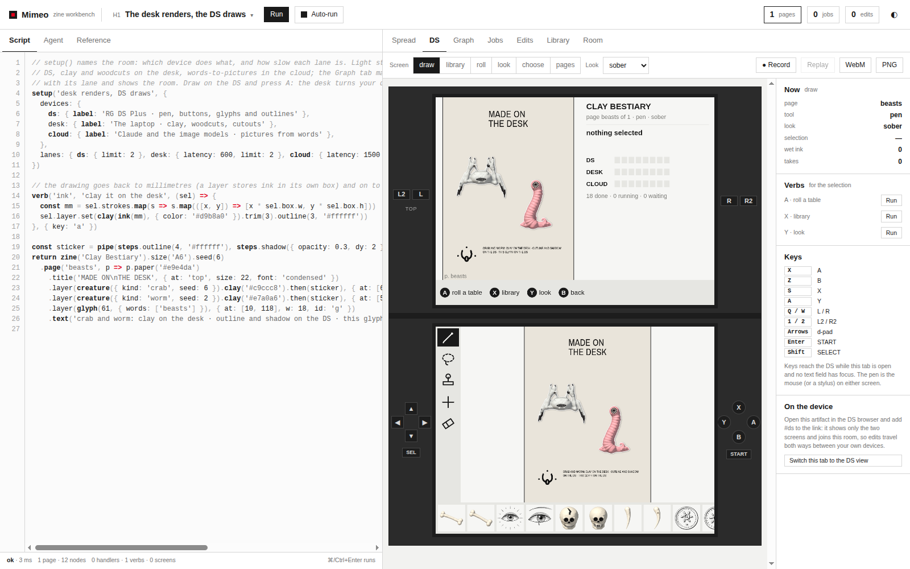
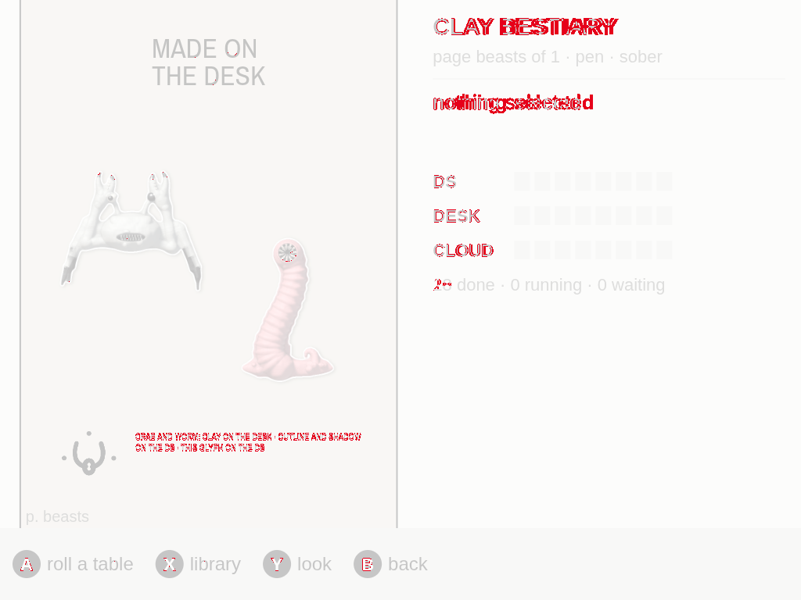
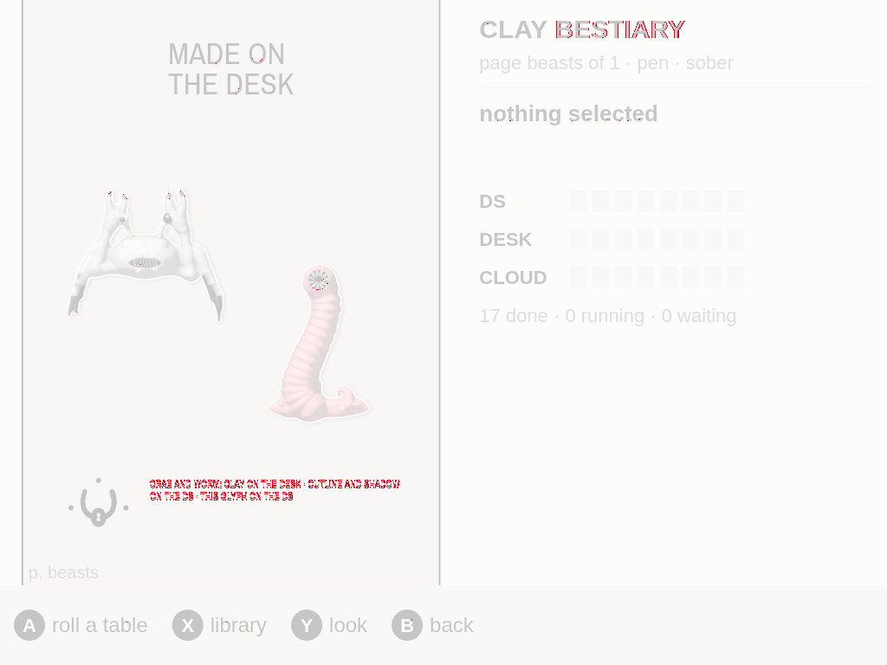
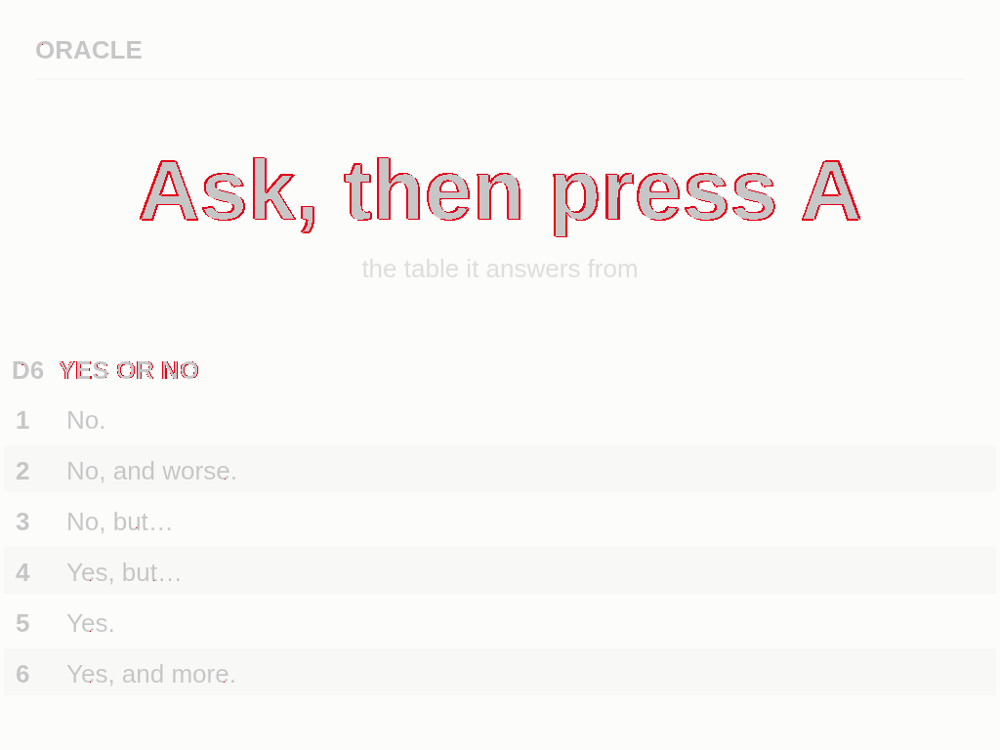
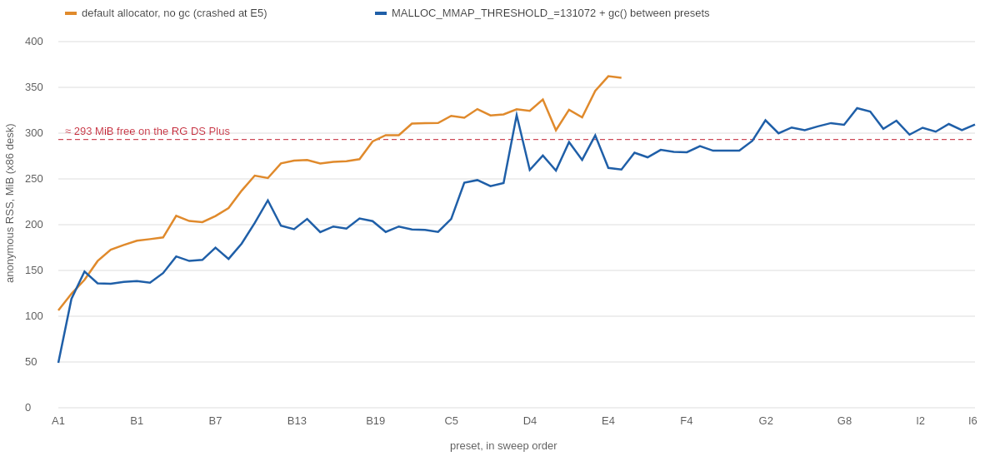

# Mimeo on the RG DS Plus, Part 1: The DS Twin Leaves the Browser

**Mimeo** is a zine workbench that runs in a browser. A script written in a fluent JavaScript grammar compiles to pages; pictures are recipes (a source plus steps) that an image store realises as jobs on three *lanes* (`ds`, `desk`, `cloud`); edits made by hand are recorded as lines of code and can be written back into the script. Next to the zine, the workbench shows a **DS twin**: two 512 × 384 screens with a pen, buttons, verbs and tools, drawn with Canvas 2D and then taken apart by WebGL2 *looks* (xerox, riso, melt …). The twin imitates a two-screen handheld. Project MIMEO-001 makes it real: Mimeo's runtime running on the **Anbernic RG DS Plus** (two 1024 × 768 panels, the bottom one a touch panel, a Mali-G52 GPU, Cortex-A55 cores, about 293 MiB of free memory under ROCKNIX Linux), and a link between the desk workbench and the device so that the twin and the handheld are the same session.

The project's design guide splits the work into eight phases:

| Phase | Builds |
| --- | --- |
| 0 | Mimeo imported into the repository, baseline checks |
| 1 | **`mimeo-ds` headless on the desk**: Mimeo's DS in Node, with the device's canvas, fonts and paint settings |
| 2 | `mimeo-link`, a Go hub on the device: pairing, the room relay, binary frames; Mimeo's `Room` over it |
| 3 | Real lanes: a picture job runs on the peer that serves its lane |
| 4 | `dsnative`, an N-API addon for SDL windows, input and GLES; a WebGL2 shim so the looks run unchanged |
| 5 | The aarch64 package and the Ports launcher |
| 6 | Bring-up and measurements on the handheld |
| 7 | Twin modes: follow, drive, parity |

This report covers Phases 0 and 1. The guide's exit check for Phase 1 is: "All 71 presets run and paint both DS screens without exceptions; PNGs look right; paint times recorded." It holds:

- **All 71 presets run and paint both screens** in Node with the device's settings. Seventy are clean. C3 reports that a frame overflows by 3.3 mm, and the browser workbench reports the same 3.3 mm for the same frame: it is the preset's overflow, measured identically on both sides.
- **Paint times are recorded.** Painting both screens (colour at 1024 × 768, plain layer at 512 × 384) takes p50 8.9 ms, p90 23 ms and at most 36 ms on the desk.
- **The screens look right**, and where they differ from the browser twin the difference was measured. Four of the eight screens compared pass the parity rule used by Octavo; the other four differ in glyph rasterisation and in timing, not in layout. One real bug was found that way: bold Arial was drawn with the regular face.



> [!summary]
> - **Mimeo's DS runs in Node unchanged except for two small edits.** A Skia canvas (`@napi-rs/canvas`) behind two small shim modules provides `OffscreenCanvas`, `Path2D`, `ImageData` and `Image`; `measure()` uses it for real text metrics. Nothing else in Mimeo's 12,900 lines needed to know it was not in a browser.
> - **The same font files on desk and device give the same layout.** The Google fonts Mimeo names are bundled as static TTFs, and Liberation stands in for Arial, Times and Courier. Widths agree with Chromium to the third decimal once every face is registered under its alias names; `setAlias` alone had dropped the bold.
> - **The DS paints only when something changed.** Runtime events, input and toasts mark the screens dirty; a paint that reads the clock stays live. The plain layer, which only steers the looks, is painted at 1×. The browser keeps painting every frame.
> - **Memory is the device's tightest budget, and Node does not see most of it.** Skia's pixel memory is invisible to V8, and glibc kept freed canvas buffers. A fixed mmap threshold and idle collection hold a single script at 130–240 MiB; a 71-script session still grows, for a reason not yet found.

## 1. Terms

- **Preset.** One of Mimeo's 71 example scripts (A1 "A first zine" … I6 "Ask Claude, or don't"). Some carry DS extras: the screen, look and tool the twin should show.
- **Screen.** A pair of widget trees, `top` and `bottom`, laid out in 512 × 384 units. Built-in screens are `draw`, `library`, `roll`, `look`, `choose` and `pages`; scripts add their own with `screen(name, {top, bottom, keys})`.
- **K.** The paint scale. Screens are laid out in 512 × 384 and painted at K = 2, so each screen is a 1024 × 768 canvas, the size of the device's panels.
- **Colour layer and plain layer.** Every screen is painted twice. The colour layer is what a reader sees with the `sober` look. The plain layer uses a fixed palette with meaning per channel: red is ink, green is a panel, blue is focus. Looks read it to decide where to smear, tear or dither.
- **Look.** A chain of fragment-shader passes over the two layers, drawn into the visible canvas by `createLooks(canvas).draw({color, plain, look, time, …})`.
- **Job and lane.** Every picture step is a job, cached by key, placed on a lane. In the browser all three lanes run in the same tab; later phases send `desk` and `cloud` jobs to the peers that serve them.
- **Device runtime (`mimeo-ds`).** Mimeo's own modules running in Node on the handheld, with a Skia canvas for Canvas 2D and, from Phase 4, an addon for windows, input and GL.
- **Headless.** The device runtime without the addon: it paints into canvases in memory and writes them to PNG files.
- **Parity.** Octavo's rule for "the same picture": a pixel differs if any channel is more than 64/255 apart, and two screens agree if fewer than 0.5 % of pixels differ.

## 2. The problem

The RG DS Plus has no browser that could run the workbench, and the design guide rejects porting one. Its decision record DR-2 runs Mimeo's JavaScript in Node 22 (arm64), with `@napi-rs/canvas` for Canvas 2D and a small native addon for SDL windows and GLES. Phase 1 tests the largest part of that bet on the desk: can Mimeo's runtime, its picture pipeline and its DS painting run on a canvas that is not a browser's, and will the result look the same?

A browser gives Mimeo more than a canvas. The project measured what Mimeo actually uses (a script that greps every Canvas 2D member, constructor and global across `js/` and the presets):

- **Canvas 2D members:** 29 methods and 13 properties, from `fillText` (78 call sites) to `globalCompositeOperation` with `destination-out`, `destination-in`, `source-atop` and `copy`. No gradients, patterns or shadows.
- **Constructors and globals:** `OffscreenCanvas` (as `makeCanvas`'s fallback), `Path2D` from SVG path strings, `new Image()` for uploads and SVG rasterising, `document.createElement('canvas')` (33 places, mostly the workbench UI), `requestAnimationFrame`, `localStorage`, `location.hash`, `performance.now`.
- **Fonts.** Mimeo names eleven Google families (Anton, Archivo, Archivo Narrow, Caveat, Courier Prime, IM Fell English, Literata, Silkscreen, Stardos Stencil, UnifrakturMaguntia, VT323) and uses Arial for the DS's own interface. Layout depends on text widths: a frame that overflows by a few millimetres is a compile warning.

A probe before the design (Step 4 of the project diary) showed that `@napi-rs/canvas` 0.1.80 implements every member on that list, keeps `letterSpacing`, parses SVG paths, and hands out the pixels of a 1024 × 768 canvas as a zero-copy buffer in 0.02 ms. What remained was to wire it in, and to find out where it differs.

The device adds constraints the browser twin never had:

| Constraint | Consequence for Phase 1 |
| --- | --- |
| The A55 is several times slower than the desk | Paint only when something changed; paint the plain layer at 1×; measure paint time for every preset |
| About 293 MiB free | Measure memory per preset, and distinguish memory the process owns from mapped files |
| No network fonts, no system Arial | Bundle the fonts; give the device metric-compatible stand-ins |
| Desk and device must lay out a zine identically | Same font files on both; compare widths and pixels with the browser |
| Input comes from SDL, not DOM events | Separate "where the looks draw" from "where the pointer comes from" in the DS |

## 3. The device runtime in Node

### 3.1 Layers



The shims are installed before Mimeo's modules are imported, but nothing depends on that order: `makeCanvas` and `measure()` look for a canvas when they are called, not when they load.

### 3.2 The canvas shim

Mimeo never asks what kind of canvas it holds; it calls `getContext('2d')` and reads `width` and `height`. That made the shim small:

```js
// util.makeCanvas falls back to `new OffscreenCanvas(w, h)` when there is no document;
// a constructor that returns an object makes `new` return that object
g.OffscreenCanvas = function OffscreenCanvas(w, h) {
  return C.createCanvas(Math.max(1, Math.round(w)), Math.max(1, Math.round(h)));
};
g.Path2D ||= C.Path2D; g.ImageData ||= C.ImageData; g.DOMMatrix ||= C.DOMMatrix;
g.Image = DataImage;
```

Sizes are rounded because `makeCanvas`'s DOM path rounds; a browser's `OffscreenCanvas` would truncate, and the desk is the reference.

`Image` needed one fix. napi's `Image` decodes Buffers and *base64* data URLs, but `rasterSVG` in Mimeo's image store passes `'data:image/svg+xml;charset=utf-8,' + encodeURIComponent(svg)`, which napi rejects with "Decode data url failed Base64Error". The shim subclasses `Image` and turns such URLs into a Buffer, which Skia's SVG decoder accepts:

```js
class DataImage extends C.Image {
  get src() { return super.src; }
  set src(v) {
    if (typeof v === 'string' && v.startsWith('data:') && !/^data:[^,]*;base64,/.test(v))
      v = Buffer.from(decodeURIComponent(v.slice(v.indexOf(',') + 1)));
    super.src = v;
  }
}
```

`globals.mjs` adds the rest: `requestAnimationFrame` as a 16 ms timer, `location.hash = '#ds'` (the hash by which the workbench recognises the device role), and a `localStorage` that writes through to one JSON file with an atomic rename, so the device keeps its last script across restarts.

### 3.3 Fonts

`device/scripts/fetch-fonts.mjs` asks Google's css2 API for exactly the URL in Mimeo's `index.html`, with a non-browser user agent. Browsers receive woff2 subsets split by Unicode range; any other client receives one static TTF per family, weight and style, which is what Skia and the device want. The script downloads the 17 faces and writes three things into `mimeo/fonts/`: the TTF files, a `manifest.json` with family, weight, style, file, SHA-256, source and aliases, and a `fonts.css` with `@font-face` rules for the workbench.

The workbench now loads `fonts/fonts.css` instead of Google's stylesheet, so desk and device read the same files. The single-file build (`tools/bundle.mjs`) has no `fonts/` folder next to it; it swaps the link back to Google Fonts.

The device has no system fonts to fall back on, and Mimeo's interface draws in Arial (`'700 13px Arial'` throughout the built-in screens). The manifest adds four Liberation families, metric-compatible with the fonts they replace, as device-only entries:

| Liberation family | Registered under |
| --- | --- |
| Liberation Sans | Arial, Helvetica, Helvetica Neue, sans-serif, Impact, Comic Sans MS, cursive |
| Liberation Sans Narrow | Arial Narrow |
| Liberation Serif | Times New Roman, Georgia, serif, Old English Text MT |
| Liberation Mono | Courier New, monospace, ui-monospace, Menlo, Consolas |

On the desk, Chromium resolves Arial through fontconfig to Arimo, which shares Liberation Sans's metrics. That is why the parity check below can compare widths at all. In total there are 33 files and 6.7 MB.

### 3.4 Real text metrics

`display.js` measures text for layout. In a browser it used a canvas from `document`; in Node it fell back to an estimate per character class (`0.28 em` for `i`, `l`, `j`, `0.85 em` for `m`, `w` …). The change is one function: ask for any 2D canvas, and estimate only when there is none.

```js
let measureCtx = null; // null: not looked for yet; false: no canvas here (plain Node), so estimate
const measurer = () => {
  if (measureCtx === null) {
    try { measureCtx = (typeof document !== 'undefined' ? document.createElement('canvas') : makeCanvas(8, 8))?.getContext('2d') || false; }
    catch (e) { measureCtx = false; }
  }
  return measureCtx || null;
};
```

Mimeo's own preset checker, which runs in plain Node without a canvas, keeps estimating, which is why it never saw C3's overflow (section 5).

## 4. Changes to the DS

All changes are in `mimeo/js/ds.js`, and the browser's behaviour is unchanged unless a caller opts in.

### 4.1 Two layers, two sizes

The constructor takes `plainScale` next to `scale`. The plain layer only steers the looks, which sample it by texture coordinates, so its size does not have to match the colour layer's. The device paints it at 1× (512 × 384), a quarter of the pixels; the browser keeps 2×. A second option, `lookScale`, is the fraction at which looks with passes are drawn (0.5 on the device, per DR-6); `sober` is a plain blit and stays at 1 so the interface stays sharp.

### 4.2 Paint on change

The browser twin repainted both screens, twice each (colour and plain), on every animation frame. On the A55 that would cost most of a frame for nothing. The DS now keeps a `dirty` flag and a `paintVersion`:



```js
needsPaint(t = now()) {
  return !this.paintOnChange || this.dirty
    || (this.live && t - this.lastPaint >= this.liveMs)
    || (this.idleMs > 0 && t - this.lastPaint >= this.idleMs);
}
render(t = now(), opt = {}) {
  if (opt.force || this.needsPaint(t)) this.paint();
  // … looks.draw({ color, plain, look, scale, version: this.paintVersion, … }) per output
}
```

The difficult part is that screens are functions of script state the DS cannot observe. The rules that came out of it:

- **Every runtime internal event marks the screens dirty.** The runtime already had a wildcard listener, `onInternal('*')`; compiles, finished pictures, job changes, logs and parameter changes all pass through it.
- **Input and toasts mark them dirty**, as does the DS's own `_changed()`.
- **A paint that reads the clock stays live.** Custom screens draw from `ctx.t` (the doom clock's hand in preset I2 turns with it). `ctx.t` is now a getter that sets a flag, so the DS knows after a paint whether the picture depends on time and repaints at `liveMs`. A toast on screen also keeps the DS live until it expires.
- **`idleMs` is a safety net** for what remains: a script variable changed inside `every()` without any API call would otherwise never be seen.

Looks already accepted a `version` and skipped the texture upload when the source canvas and version were unchanged; the DS now passes `paintVersion`, so an animated look over a still screen costs only its passes. In the browser `paintOnChange` is off, `paintVersion` changes every frame, and everything behaves as before.

### 4.3 Outputs and pointers

`attach(canvas, which)` created the looks for a visible canvas and bound DOM pointer events to it in one step. It is now `attachOutput(canvas, which, opts)` plus `bindPointer(canvas, which)`. The device will hand `attachOutput` a GL surface per panel and feed `pointer()` from the touch panel; the browser calls `attach`, which calls both.

### 4.4 Paint errors

A widget that throws while painting was drawn as red text in its box and otherwise ignored. The DS now also lists these in `paintErrors`, so the sweep can fail on them and the device can log them.

## 5. The sweep

`device/host/headless.mjs` runs presets in the device runtime:

```text
for each preset:
  rt = new Runtime({parse}); rt.device = 'ds'
  ds = new DS(rt, {scale: 2, plainScale: 1, looks})
  run the preset's script; apply its DS extras (screen, look, tool)
  paint once            # the first paint asks for the pictures on screen
  settle                # until no job can run and nothing has moved for 150 ms, at most 4 s
  paint 5 times         # report the first and the median of the rest
  check: run errors, compile warnings, error logs, paintErrors, unhandled rejections,
         a screen with < 0.2 % non-ground pixels on both layers
  write <code>.png      # colour top/bottom on the left, plain top/bottom on the right
  tear down: run disposers, cancel jobs, optionally gc()
write paint.csv and sweep.json; exit 1 if any preset had a problem
```

Of the 71 presets, 70 pass every check. C3 ("A d66 table") warns `frame "a" on page d66 overflows by 3.3 mm`. Mimeo's own preset checker says "all good" for C3 only because it estimates text widths. Loaded in the browser workbench through Playwright, C3 reports the same warning with the same 3.3 mm. The overflow is real, and it is the preset's.



Paint times for both screens, on an x86 desk with nothing else running:

| Measure | ms |
| --- | --- |
| p50 over 71 presets | 8.87 |
| p90 | 22.98 |
| max (B11, a glitch collage) | 36.1 |
| next slowest | C2 33.2, D4 30.5, B9 30.3, C4 29.5 |

The slow presets have many items or many pictures on a page, and the draw screen paints the page twice: once as the top preview and once as the bottom drawing canvas. A first run of the sweep with the browser tab still open reported a median of 18.6 ms; the workbench kept painting every frame in the background. The numbers above are from a run with nothing else running.

Canvas 2D painting is CPU work, and the handheld's Cortex-A55 cores are much slower than this desk's CPU; a full repaint of the slowest presets is likely to take several frames there (Phase 6 measures it). Paint on change keeps that cost to the frames where something changed. The third part of DR-5, a cache of the laid-out page, was deliberately not built: it adds a resampling step and its benefit depends on numbers from the device.

## 6. Parity with the browser twin

### 6.1 Method

The browser twin was loaded in Chromium through Playwright from a local static server. For each of four presets (H1, A1, F5, B9), the twin's colour canvases were exported as PNG after the preset settled. The same presets ran in the device runtime with the plain layer at 2× and per-screen PNGs. `device/scripts/compare-png.mjs` applies Octavo's parity rule and writes a difference picture: the reference faded, with every differing pixel in red.



### 6.2 A font that lost its weight

The first comparison failed on H1's top screen with 0.875 % of pixels different, and the difference picture showed why: every bold line of the interface was shifted, "nothing selected" visibly doubled.



Measuring the same string on both sides located it:

| Font | Chromium | Device runtime, before | after |
| --- | --- | --- | --- |
| `700 13px Arial` | 103.289 | 94.68 | 103.29 |
| `400 13px Arial` | 94.682 | 94.68 | 94.68 |
| `700 13px "Liberation Sans"` | 103.289 | 103.29 | 103.29 |
| `400 100px "Archivo Narrow"` | 601.799 | 601.8 | 601.8 |

Bold Arial measured as regular. The shim had registered each Liberation face under its own family and then called `GlobalFonts.setAlias('Liberation Sans', 'Arial')`. That alias points the name at one face, and weight selection is lost. The fix is to register every face file again under each alias name with `registerFromPath(file, alias)`, which makes "Arial" a real family with four faces. The 68 extra registrations cost no anonymous memory (20.8 MiB before and after), because Skia maps the files. After the fix, H1's top screen differs in 0.254 % of pixels and passes.



### 6.3 What remains

| Screen | Differing pixels | Verdict |
| --- | --- | --- |
| A1 top / bottom | 0.071 % / 0.188 % | pass |
| F5 bottom | 0.060 % | pass |
| H1 top | 0.254 % | pass |
| F5 top | 0.746 % | edges of large bold text |
| B9 top | 0.739 % | small italic and fraktur text in the page preview |
| H1 bottom | 1.778 % | tray order (timing), small text |
| B9 bottom | 2.881 % | small text, ornaments, tray order |



None of the remaining differences is a layout difference; the widths in 6.2 and C3's identical overflow show that layout agrees. Two kinds of difference remain. The first is *rasterisation*: Chromium draws Arimo through its own text stack, the device draws Liberation Sans through Skia's canvas, and the edges of large glyphs and the shapes of very small ones come out a pixel apart. The second is *timing*: the library tray shows pictures in the order their jobs finished, which varies from run to run, and in the first comparison the job counter read "20 done" on one side and "18 done" on the other.

The consequence for Phase 7 is that pixel parity for text has to compare like with like: the device with itself, or the headless runtime on the desk with the device, not Chromium with Skia.

## 7. Memory

### 7.1 What the numbers meant

The first preset reported 463 MiB of resident memory. `/proc/self/smaps_rollup` explained most of it: `Pss_File 280352 kB` against `Pss_Anon 21648 kB`. On load, `@napi-rs/canvas` lets Skia map every system font file it finds, 3150 on this desk. Those pages are file-backed, shared and reclaimable, and ROCKNIX ships few fonts. The sweep reports `RssAnon` from `/proc/self/status` instead, the memory the process itself owns.

### 7.2 Growth across presets

Anonymous memory then grew from 106 to 362 MiB over the first 45 presets, and the sweep crashed at E5 on an unhandled rejection from a job cancelled at teardown (section 9). The investigation separated four questions:

1. **Is the JavaScript heap growing?** No. With `--expose-gc` and a collection after each preset, `heapUsed` stays at 10–13 MB and `external` at 37–42 MB across all 71 presets, and a `FinalizationRegistry` confirms that every finished `Runtime` is collected.
2. **Does one script leak?** Running B11 eight times in one process, with collections in between, climbs from 162 to 232 MiB. The objects are gone, so the memory is held natively.
3. **Is it the allocator?** Largely. A loop that creates 200 canvases of 512² per round, with `gc()` between rounds, levels off at 220 MiB (create only) and 436 MiB (with `getImageData`/`putImageData`). glibc raises its mmap threshold dynamically after the first large frees, so later megabyte-sized pixel buffers come from the heap and are kept after they are freed. With `MALLOC_MMAP_THRESHOLD_=131072` the same loops return to 20 MiB and 236 MiB, and the eight B11 runs level off at about 165 MiB instead of climbing.
4. **What remains?** With the fixed threshold and `gc()` between presets, the full sweep still climbs from 82 to about 328 MiB. Without DS painting it levels at about 160 MiB. `clearAllCache()` (Skia's font caches) and clearing Mimeo's Path2D cache together bring it from 309 to about 280 MiB. Something in Skia's per-draw caches survives both; this was time-boxed and is open.



### 7.3 What it means for the device

V8 does not see Skia's pixel memory: `external` stays flat while hundreds of megabytes of canvases come and go. V8 therefore never collects dead canvases for memory reasons, and a busy session can hold many of them. The device host will run Node with `--expose-gc`, call `gc()` when idle (after jobs drain, on a screen change), and its launcher will set `MALLOC_MMAP_THRESHOLD_=131072`. With those settings, one preset at a time stays at 130–240 MiB on the desk. A long session that opens many scripts is the open case, and Phase 6 will measure it on the device.

## 8. Testing

- **`npm test`** runs `device/host/test/headless.test.mjs`, nine tests:
  - every bundled face registers
  - bold Arial measures 103.29 like the browser, and regular 94.68
  - Archivo Narrow measures 601.8
  - `OffscreenCanvas` rounds like the DOM path
  - SVG and PNG data URLs load
  - `measure()` uses real metrics once a canvas exists
  - the DS is clean once the tray's pictures have landed, and dirty after input, runtime events and toasts
  - a screen that reads `ctx.t` stays live, and the browser default paints every frame
  - the plain layer has its own size
- **The sweep** (`headless.mjs --all`) is the integration test: 71 presets, failing on errors, warnings, paint exceptions, unhandled rejections and blank screens.
- **Mimeo's own checks** still pass in plain Node: `check-presets.mjs` says "all good" and `test/core.mjs` runs. Both print 123 "no canvas implementation" errors for pictures, exactly as before Phase 1, because plain Node has no canvas.

The first version of the paint-on-change test asserted that the DS is clean after one paint, and failed. The first paint of the draw screen asks for the tray's thumbnails, which submits jobs and marks the screens dirty again, which is correct: those pictures will change the screen. The test now asserts the settled state.

## 9. Limitations and open questions

- **Unhandled rejections are fatal in Node and not in a browser.** Cancelling a waiting choice job rejects with `{code: 'cancelled'}`, and one chained promise has no handler. The sweep installs an `unhandledRejection` handler; the device host must do the same.
- **The memory growth across many scripts** (section 7.2, item 4) is not explained.
- **A Thing drawn directly on a DS screen keeps the screen live.** Its context is built by spreading the paint context, and the spread reads the `t` getter. This is conservative, not wrong.
- **The workbench now serves its own copies of the Google fonts.** The families and files are the same; caching and `font-display` now come from the project's CSS.
- **Fallback names are aliased but not all were tested.** Arial (all weights), monospace and the Google families were checked against the browser; Impact, Comic Sans MS and the other fallbacks only resolve to a Liberation face.
- **Text parity across engines is limited to layout** (section 6.3).

## 10. Next steps

Phase 2 builds `mimeo-link`, a Go hub that runs on the device. It serves the workbench, pairs the desk with a code and a cookie, and relays Mimeo's room messages (`m.op`, `m.param`, `m.script`, `m.hello`, `m.state`), with a binary frame for pictures. Mimeo's `Room`, which today talks only to claude.ai's room capability, gets a transport interface and a link transport. Phase 3 then sends `desk` and `cloud` jobs to the peer that serves them, checking recipes against an AST whitelist before running them. Both phases are tested with the headless runtime from this report standing in for the device, which is the main reason Phase 1 came first.

## 11. Reproducing

```bash
cd /home/manuel/code/wesen/2026-10-18--mimeo
npm install                                   # @napi-rs/canvas 0.1.80, acorn 8.11.3
node device/scripts/fetch-fonts.mjs           # only to refresh mimeo/fonts (needs the network)
npm test                                      # 9 tests
# the sweep, as the device will run it
MALLOC_MMAP_THRESHOLD_=131072 node --expose-gc device/host/headless.mjs --all --gc --out /tmp/sweep
node device/scripts/contact-sheet.mjs /tmp/sweep /tmp/sweep/contact.png
# one preset against the browser twin (export the twin's canvases first, e.g. with Playwright)
node device/host/headless.mjs H1 --layers --plain-scale 2 --out /tmp/h1
node device/scripts/compare-png.mjs browser-H1-top.png /tmp/h1/H1-top.png --diff /tmp/h1/diff-top.png
# Mimeo's own checks
node mimeo/tools/check-presets.mjs && node mimeo/test/core.mjs
```

## 12. Files

| Path (in `/home/manuel/code/wesen/2026-10-18--mimeo`) | Role |
| --- | --- |
| `mimeo/` | Mimeo, imported in Phase 0 (`d750c5d`); acorn vendored in `mimeo/vendor/` |
| `mimeo/js/ds.js` | plain and look scales, paint on change, `attachOutput`/`bindPointer`, `paintErrors` |
| `mimeo/js/display.js` | `measure()` with any 2D canvas; `clearPathCache()` |
| `mimeo/fonts/` | 33 TTF files, `manifest.json`, `fonts.css` |
| `mimeo/index.html`, `mimeo/tools/bundle.mjs` | local fonts in the workbench; Google Fonts in the single-file build |
| `device/host/shim/canvas.mjs`, `device/host/shim/globals.mjs` | the shims |
| `device/host/headless.mjs` | the sweep |
| `device/host/test/headless.test.mjs` | the tests |
| `device/scripts/fetch-fonts.mjs`, `compare-png.mjs`, `contact-sheet.mjs` | fonts, parity, contact sheets |
| `ttmp/2026/10/18/MIMEO-001--…/design-doc/01-…md` | the design guide (phases, decision records, protocol) |
| `ttmp/2026/10/18/MIMEO-001--…/diary/01-diary.md` | the working diary; Phases 0 and 1 are Steps 6 and 7 |
| `ttmp/2026/10/18/MIMEO-001--…/various/phase1-sweep/`, `various/screenshots/` | sweep CSV, JSON and logs; screenshots and difference pictures |

## Related notes

- [[PROJECT REPORT - Octavo, Part 3 - The Development Loop - A Server on the Handheld, a WebGL2 Twin and a Parity Check]]: the twin-and-parity approach and the tolerance used here; the dev server whose pairing `mimeo-link` follows
- [[PROJECT REPORT - Octavo, Part 1 - Typst on a Handheld - Display Lists, Span Ids as Colours and a Page Shader on the RG DS Plus]]: the same handheld, and a plain layer of a different kind (span ids as colours)
- [[PROJECT REPORT - DS Shaders - no_shade on a Handheld - A Browser Twin, a Deconstructed Console and a Shader Runtime inside Lattice]]: the shader budgets on the Mali-G52 that Mimeo's looks will have to meet
- [[PROJECT REPORT - Lattice DS Native, Part 2 - A Two-Thread Shell and a Thin V8 Layer on the RG DS Plus]]: the SDL/GLES platform code that `dsnative` will reuse in Phase 4
- [[PROJECT REPORT - Lattice DS Native, Part 8 - Pages in JavaScript - A Generic Host, a UI Language and a Parity Harness]]: another JavaScript-first host on the same device
