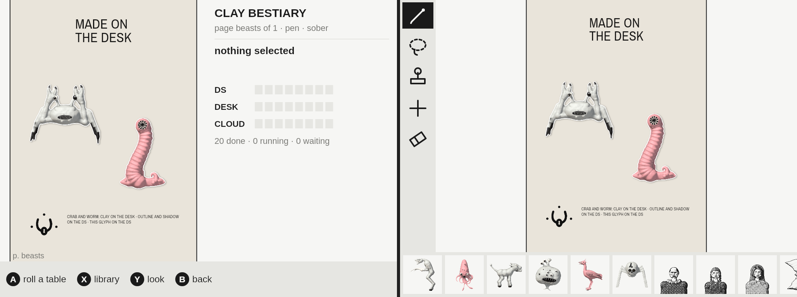
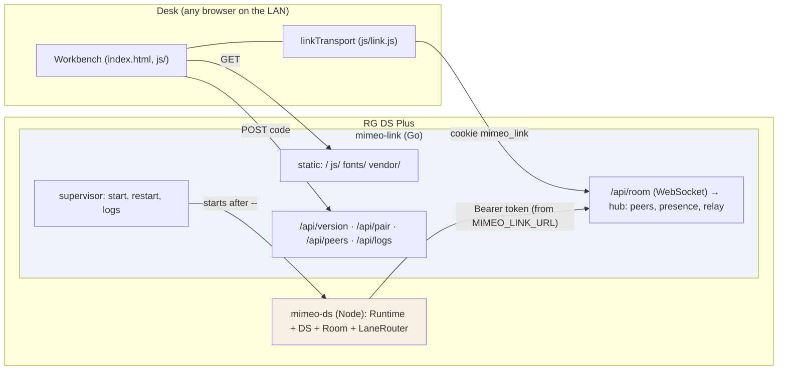
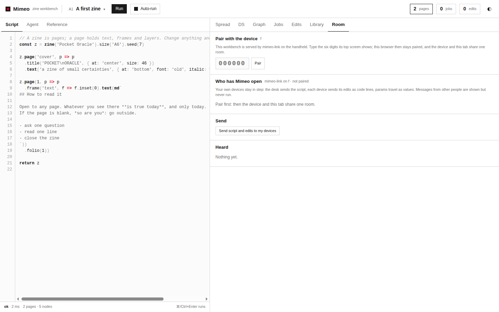
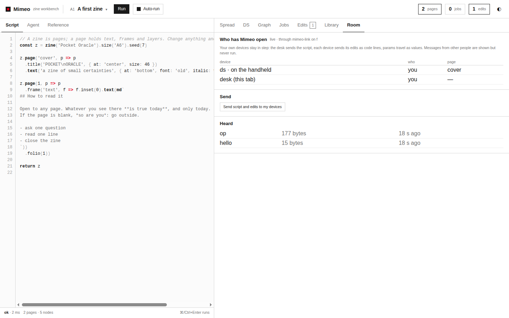
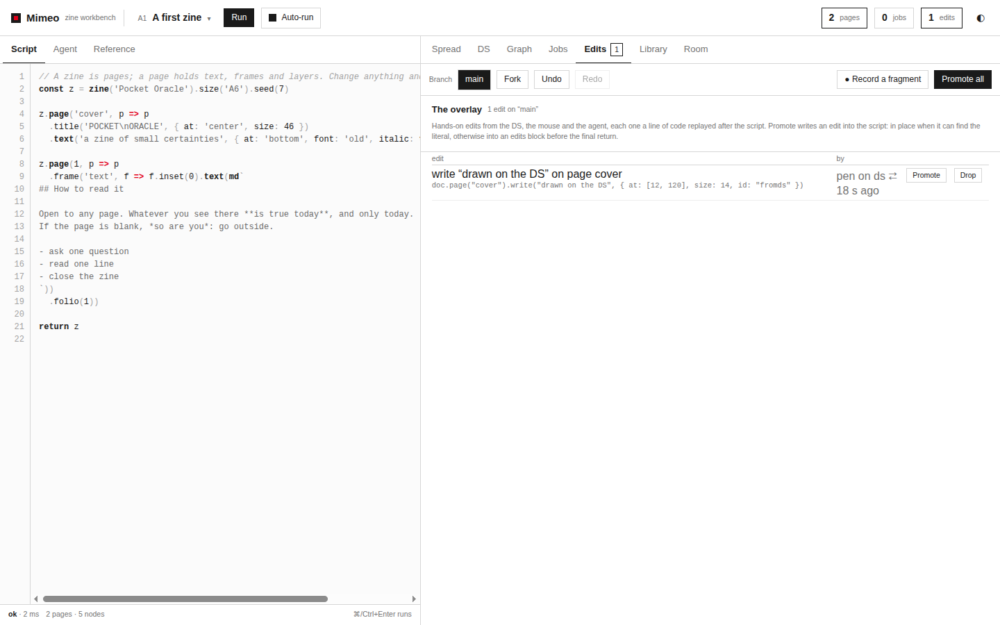
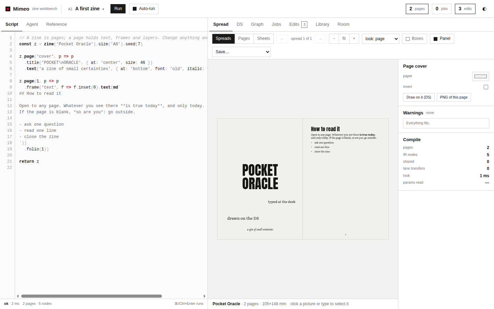
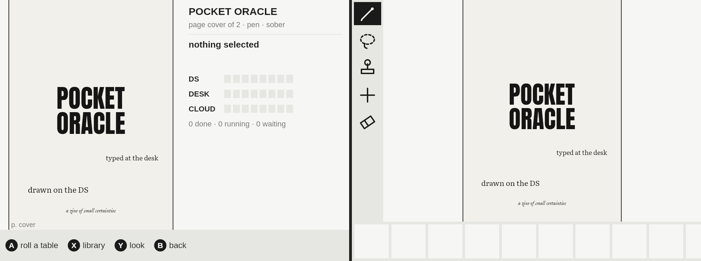
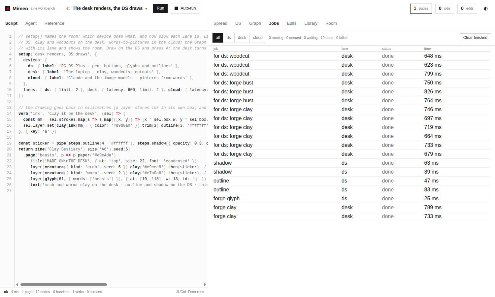

# Mimeo on the RG DS Plus, Part 2: One Room for Desk and Device

[[PROJECT REPORT - Mimeo on the RG DS Plus, Part 1 - The DS Twin Leaves the Browser - A Skia Canvas, Fonts That Measure Like Chromium and Paint on Change|Part 1]] moved Mimeo's DS twin out of the browser: the runtime, the picture pipeline and the DS screens run in Node on a Skia canvas, with the fonts and paint settings the handheld will use. That made a second program. This report covers the two phases that connect it to the first. **Phase 2** builds `mimeo-link`, a Go hub that will run on the Anbernic RG DS Plus. It serves the workbench to a browser on the desk, pairs that browser with a six-digit code, admits the device runtime by a token, relays Mimeo's room messages between them, and restarts the device runtime when it crashes. **Phase 3** makes Mimeo's lanes real. Until now `ds`, `desk` and `cloud` were labels with simulated latencies in one browser tab. Now a device sends each desk-lane picture to a desk in the room, as a line of checked code, and gets the pixels back as PNG under the same cache key.

Both phases were built and tested on the desk, with the headless runtime from Part 1 standing in for the handheld. The guide's exit checks hold:

- **Phase 2 — "edits and params flow both ways; a device that was alone gets its edits to the desk once".** In the browser, the workbench served by the hub pairs, shows the device in the room, and receives the device's pen edit; the desk's typed edit appears on the device's screens. Edits made on the device while no desk was there reach the desk exactly once, after the desk left and after the hub restarted.
- **Phase 3 — "desk-lane pictures are made by the desk, with the same keys; the device works without one".** Live, the desk made 14 pictures for the device with 0 key mismatches. In the integration test the pixels are identical on both sides. Under the `auto` policy the device makes its pictures itself when the desk is gone; under `remote` the lane goes offline and its jobs wait, then drain when the desk returns.



> [!summary]
> - **The hub is small and boring on purpose.** Go standard library only, about 1,100 lines: one WebSocket per peer, JSON messages plus one binary frame type, no echo, a slow peer is dropped rather than allowed to stall the others. Pairing is a code on the device and an HttpOnly cookie in the browser; the device runtime gets a bearer token from the hub that launched it.
> - **Mimeo's `Room` now takes a transport.** The same trust rules, message chunking and hello/state logic run over claude.ai's room capability or over the link. Handlers live in `Room`, so pairing (which replaces the transport) keeps every listener, including ones user scripts registered.
> - **Offline edits arrive once.** A device greets each desk that appears with its unsent edits, then asks for the desk's state, and adopts only the state that answers that hello. Getting this order right took more care than the guide's pseudocode suggested.
> - **Pictures travel as recipes, not as keys or scripts.** The requester writes an exact recipe, checks that it rebuilds its own cache key, and sends it; the server checks it against an AST whitelist before evaluating it. 301 of the presets' 354 pictures can travel; the rest stay where they are, and the requester makes them itself.

## 1. Terms

- **Desk.** The workbench in a browser on a computer. It holds the script and the overlay of hand edits; it is the source of truth.
- **Device.** A Mimeo runtime that is not the desk: on the handheld, `mimeo-ds` in Node; on the desk during development, the headless runtime from Part 1, or a browser page opened at `#ds`.
- **Hub (`mimeo-link`).** The Go program that runs on the handheld. Every desk and device is a *peer* connected to it by one WebSocket.
- **Room.** Mimeo's word for the set of a person's devices that share a session. Messages are topics named `m.*` (`m.op`, `m.state`, `m.job`, …). In the browser there are two kinds of room: claude.ai's room capability, for a published artifact, and the link.
- **Transport.** What `Room` talks to: an object with `presence`, `on`, `emit`, `onPeers` and, for a link, `onStatus` and `onPair`.
- **Overlay and op.** Hand edits are recorded as *ops* `{id, code, label, by, at}`, each a line of code such as `doc.page('beasts').write('drawn on the DS', {at: [12, 120]})`. The overlay is the list of ops on top of the script.
- **Pairing.** A browser proves that its user can see the device's screen by typing the six-digit code the device shows, and gets a session cookie in return.
- **Lane.** Where a job runs: `ds` (the handheld's own CPU), `desk` (the browser), `cloud` (Claude and image models, reached through the desk). Every picture step is a job on one lane.
- **Recipe.** A picture written as Mimeo code: `creature({ kind: "crab", seed: 6 }).clay("#c9ccc8").then({ step: "woodcut" })`.
- **Cache key.** `'src:' + hash(source spec)`, then `'op:' + hash(previous key + step)` per step. Two runtimes that hold the same recipe compute the same keys.
- **Policy.** Per lane, `local` (always here), `auto` (on a peer that serves the lane when there is one, else here) or `remote` (only on such a peer; while there is none, the lane is offline).

## 2. The problem

In the browser, the workbench and its DS twin share one tab. They share one runtime and one overlay, and "the desk lane" is a queue with a delay. Once the DS is a separate program on a separate machine, three things have to be built that the browser never needed.

**A wire that the desk can reach and that strangers cannot.** The handheld sits on a home network with no TLS and no accounts. The browser cannot open raw sockets, so the device has to serve HTTP and WebSockets. Pairing must be quick for the owner, and must not let another machine on the LAN join the room or drive the device. The design guide (DR-3, §7.5) follows Octavo's dev server here: a code on the device, a cookie in the browser.

**One session across two programs, including while they are apart.** The desk holds the truth, but the device is a pen: people draw on it on the sofa, away from the desk. When the desk comes back, those edits must join the desk's overlay exactly once. They must not be lost, and must not be applied twice. The device must then take the desk's state without losing anything it had not sent yet (DR-10).

**Work placed where it is cheap.** The A55 cores are several times slower than the desk. Clay, busts and woodcuts take hundreds of milliseconds each on the desk; on the device they would take seconds and memory it does not have. The desk should make them, but the device must still work when the desk is closed (DR-8, DR-9). The desk must also never run arbitrary code because a peer asked it to.

| Need | Built in |
| --- | --- |
| HTTP for the workbench, WebSockets for the room, pairing, supervision of the device runtime | Phase 2, `link/` (Go) |
| `Room` independent of claude.ai's capability | Phase 2, `mimeo/js/room.js`, `mimeo/js/link.js` |
| Offline edits that arrive once | Phase 2, `room.js` (`greet`, the `state` rule) |
| Jobs sent to the peer that serves their lane, results as pixels | Phase 3, `mimeo/js/lanes.js`, `jobs.js` |
| Recipes that rebuild the same picture and cannot run anything else | Phase 3, `recipeOf` in `doc.js`, `checkRecipe` |
| A pick made on one device resolving the other's choice | Phase 3, `images.js` (`answer`, `onChoice`), `m.choice` |

## 3. The hub

### 3.1 Shape



The hub is one Go binary built from the standard library only; `ws.go`, a minimal WebSocket implementation, comes from Octavo's dev server. It does four things.

1. **It serves the workbench.** `/` and the `js/`, `fonts/` and `vendor/` directories of Mimeo, with `.gz` siblings served when the browser accepts gzip. Anything else is a 404, including `/../main.go`.
2. **It pairs browsers.** `GET /api/version` returns `{name: "mimeo-link", link: 1, device, paired}`, and the workbench uses it to discover that it is being served by a link. `POST /api/pair {code}` checks the code and sets the session cookie.
3. **It relays the room.** `/api/room` upgrades to a WebSocket, and the hub keeps the peers, their presence and the relay.
4. **It supervises the device runtime.** Everything after `--` on the command line is the device program. The hub starts it with `MIMEO_LINK_URL` (the room URL with the token), `MIMEO_LINK_TOKEN` and `MIMEO_LINK_HTTP` in its environment, keeps its last 400 lines of output for `/api/logs`, and restarts it when it exits with a non-zero code.

### 3.2 Protocol

A peer's first message must be `hello`; anything else first is an error. The hub answers the newcomer with `welcome` and tells everyone else with `peers`.

| Direction | Message | Meaning |
| --- | --- | --- |
| peer → hub | `{op: "hello", device, tab, v: 1}` | join as a device (`desk`, `ds`, …) |
| peer → hub | `{op: "presence", patch}` | merge into this peer's presence (`null` deletes a key) |
| peer → hub | `{op: "emit", topic, data, to?}` | send to every other peer, or to one |
| peer → hub | `{op: "ping"}` | keep-alive |
| hub → peer | `{op: "welcome", peer, peers, v}` | your id and who is here |
| hub → peer | `{op: "peers", peers, joined, left}` | the room changed |
| hub → peer | `{op: "msg", topic, data, peer}` | a message from `peer` |
| hub → local peer | `{op: "pair", code, urls}` | the pairing code to show on the screen, and where to browse |
| hub → peer | `{op: "error", message}` | e.g. `hello first`, `emit: no peer "p99"` |

Pictures need bytes, and base64 inside JSON would add a third to every PNG. One binary frame type carries a JSON header and a payload:

```text
u32 little-endian header length | JSON header (an emit or a msg) | payload bytes
```

The hub never echoes a message to its sender and never interprets topics. Its one opinion is about speed. Each peer has a send queue, and a peer with more than 16 MiB or 4,096 frames waiting is dropped at once and the others are told it left. A peer that stops reading cannot hold up delivery to the rest, and its memory cannot grow without bound on a device with 293 MiB free. Frames above 8 MiB close the connection.

The first version of that rule did not work. `TestSlowPeerIsDropped` failed with the hub logging `dropping p1 (slow): 786645 bytes waiting` over and over for five seconds. The hub had closed the peer's `done` channel, but the peer's writer goroutine was blocked in a socket write for up to its 10 s deadline and never looked at `done`. The reader that removes peers was blocked on a read. Now "drop" removes the peer from the room immediately, and each connection has a goroutine that closes the socket when `done` closes, which also unblocks the stuck write.

### 3.3 Who may join

The handheld trusts its LAN (guide §7.9). Even so, a stranger on the same Wi-Fi must not be able to join the room, because room messages are code: an `m.op` is a line that the desk evaluates.

```mermaid
sequenceDiagram
  participant B as Browser (desk)
  participant H as mimeo-link
  participant D as mimeo-ds (screen)
  H->>D: {op:"pair", code:"482913", urls:["http://192.168.0.202:8180/"]}
  Note over D: shows the code on the top screen
  B->>H: GET /api/version
  H-->>B: {name:"mimeo-link", link:1, paired:false}
  Note over B: Room tab: "type the code the device shows"
  B->>H: POST /api/pair {code:"000000"}
  Note over H: wrong: wait 500 ms, count it (5 → new code)
  H-->>B: 403
  B->>H: POST /api/pair {code:"482913"}
  H-->>B: 200, Set-Cookie: mimeo_link=…; HttpOnly; SameSite=Strict; Max-Age=400 days
  B->>H: GET /api/room (WebSocket, cookie, Origin = Host)
  H-->>B: welcome
```

- **Code.** Six digits, compared in constant time. Each wrong code costs 500 ms, and after five wrong codes the code is replaced and the device is told the new one. That limits online guessing to five tries per code.
- **Cookie.** `mimeo_link`, HttpOnly (scripts cannot read it), SameSite=Strict, valid for 400 days. With `-data DIR` the hub keeps sessions in `sessions.json` as SHA-256 hashes of the cookie values, so a restart does not unpair every browser and the file does not hold usable credentials.
- **Origin.** A WebSocket request whose `Origin` is not the hub's own `Host` is refused (403). This stops a page on another site, opened in the paired browser, from using the cookie to join the room.
- **Token.** The device runtime is local and cannot type a code, so the hub passes it a bearer token, accepted from `Authorization` or `?token=`. Browsers cannot set headers on a WebSocket, hence the query form.
- **URLs.** The code comes with the addresses to browse to. The first live run listed 45 (every Docker and VM bridge on the desk) while the hub listened only on 127.0.0.1. Now a named `-listen` host is the only URL shown, and all interfaces are listed only when the hub listens on all of them.

### 3.4 Supervision

```text
start child after "--"
on exit:
  code 0           → the link stops too (the device runtime chose to quit)
  otherwise        → wait 1 s, doubling up to 16 s; back to 1 s after 30 s of healthy running
on SIGTERM to the hub → SIGTERM to the child, SIGKILL after 3 s
```

In the live session, `kill -9` of the device runtime produced `app: crashed map[code:-1 …]`, `restarting map[inMs:1000]`, `running`, and the new process rejoined the room as `p3`, adopted the desk's state and painted its screens.





## 4. A room over any transport

Before Phase 2, `Room` talked to `window.claude.use('room')` directly. Now it takes a transport and chooses one at start:

```text
new Room(rt, {device, transport, discover})
  transport given                     → use it (tests, the device runtime)
  claude.ai's room capability exists  → use it (a published artifact)
  GET /api/version says mimeo-link    → a link; 'unpaired' until room.pair(code)
  otherwise                           → alone
```

`linkTransport(url, {device, tab})` in `mimeo/js/link.js` (139 lines) gives the link the same shape as claude.ai's room. Every peer is `isMe`, because the link only admits the owner's paired browsers and its own device. On `welcome`, the peers already present arrive as `joined`, so `Room` handles a reconnect like a fresh join. It reconnects after 0.5 s, doubling to 8 s, and re-sends the merged presence each time. `maxMessage` is 8 MiB, which lets `Room` send state in parts of `(8 MiB − 1024) / 3` instead of claude.ai's 3,200 characters.

Pairing replaces the transport: an unpaired link has none, and the paired one is new. The first version registered topic listeners on the transport directly, so pairing would have lost them, including the ones user scripts register with `room.on`. A naive re-attach would have doubled the runtime hooks and sent every edit twice. Now:

- **Handlers live in `Room`.** `listen(topic, fn)` keeps them, and each transport gets one dispatcher per topic (`subscribe`).
- **Runtime hooks are installed once per `Room`** (`hook()`): the overlay and param events that send edits out.
- **Presence is merged in `Room`** (`this.me`), so a transport that attaches later is told everything at once, including `serves` from Phase 3.

The trust rules are unchanged and apply to every topic on every transport. A message from a peer that is not `isMe` is counted and dropped, and an op's code must start with `doc.page(` or `doc.table(` before the desk evaluates it.

## 5. Offline edits that arrive once (DR-10)

The device is useful alone. Someone draws on it with no desk around, and later opens the workbench. The device's edits must join the desk's overlay once, and the device must then show the desk's state, including those edits.

The guide's pseudocode had the device send its unsent edits when it saw the desk. That is not enough. Over the link, the desk sends its state as soon as it sees a device join, and the device's edits and the desk's state cross on the wire. If the device adopted the first state it received, the edits it had just sent would vanish from its overlay. They would come back with the next state, after a flash and a second re-run on the A55, or never if the desk ignored them. The rule that works in every order:

```mermaid
sequenceDiagram
  participant D as Device (has unsent edits)
  participant K as Desk
  Note over D,K: the desk appears in the room
  K-->>D: m.state {src, ops}  (reacting to the join)
  Note over D: holding unsent edits and not yet greeted: answer by greeting
  D->>K: m.offline {ops: [unsent]}
  D->>K: m.hello {want: "w7"}
  Note over K: applyOp each offline op (same trust rules)
  Note over K: 150 ms coalescing: one state for the join and the hello
  K-->>D: m.state {src, ops (now including the device's), re: ["w7"]}
  Note over D: re contains w7: adopt; mark every op remote
```

- **Greet each desk that appears**, by peer id. On claude.ai a desk's presence may say `desk` only later, so arrival is counted from presence and not from the join.
- **Unsent** means: made here (not `remote`) and not `sent`. An op is `sent` when its `m.op` went out while a desk was in the room. A relay with no acknowledgements cannot mean "handed to the hub", because the device is always connected to its own hub. `sent` resets when the op changes.
- **Adopt only the state that answers your hello** (`re` contains your `want`). A state that arrives while you hold unsent edits is answered by greeting. A 10 s fallback stops an older desk without `re` from stalling the device.
- **The desk coalesces.** The join and the hello arrive within milliseconds of each other, so the desk waits 150 ms and sends one state with all the `want`s it collected. That saves a full re-run on the device.

The coalescing also hides a mistake from the integration test. With the "adopt only the answer" check removed, the integration test still passes, because only one state ever arrives. A unit test on a fake transport (`room.test.mjs`) delivers two states in the wrong order and fails under that mutation.







## 6. Real lanes

### 6.1 What travels

A job on the desk lane needs something the desk can act on. There were three candidates:

- **The key** (`src:3f…`). It names a picture but does not describe it; the desk cannot make a picture from a hash.
- **The device's script.** The desk would have to run someone else's whole program to find one picture, and the script may not even be the desk's.
- **The picture's recipe.** A short line of Mimeo code that is easy to check.

The recipe it is. Mimeo already had a printer for pictures, `exprOf`, which writes the overlay's code. But it is a printer for people:

- it rounds numbers to three or two decimals;
- it leaves out options it does not show (`bust`'s, the options of `clay` on a creature, `generate.image`'s `guide`, everything of `generate.svg` but the prompt);
- it writes a string source as a truncated `pic("…")`;
- it writes anything it cannot print (a function, a canvas, a Thing) as `ref(n)`, an index into a table in the same process.

Each of these would give the desk a different picture under a different key. `recipeOf(pic)` uses the same printer in an exact mode: numbers keep every digit, options stay, and anything that cannot be written as code makes the whole recipe `null`.

```js
// doc.js — one flag, not a second printer
let exact = false, inexact = false;
const num = (n) => (exact || Number.isInteger(n) ? String(n) : String(+n.toFixed(Math.abs(n) < 2 ? 3 : 2)));
const ref = (v) => { if (exact) { inexact = true; return 'ref(-1)'; } refs.push(v); return `ref(${refs.length - 1})`; };
export function recipeOf(pic) {
  exact = true; inexact = false;
  try { const e = picExpr(pic); return inexact ? null : e; } finally { exact = false; }
}
```

Not every picture should travel. `travels(pic)` requires a source made from its own description, a forge (`creature`, `bust`, `clay`, `glyph`, `asset`) or a generator. Library items, uploads, canvases, fields and choices live in one process or need a person. Each source and step job of a travelling picture carries `remote: { pic }`: the picture *up to that step*, so the server makes exactly that intermediate. A step with code in it (`custom`, which holds a function) cuts the chain: it and every later step run where the picture is.

The guarantee does not rest on `recipeOf` being perfect. Before sending, the requester evaluates the recipe in its own runtime and checks that it rebuilds the job's own key; if not, the job runs locally. After receiving, it compares the server's key with its own and counts any mismatch. A gap in `recipeOf` therefore costs performance, never correctness.

### 6.2 The check

The server evaluates code that arrived over the network, so `checkRecipe` is the security boundary for "a peer made the desk run this". It parses with acorn and walks the tree against a whitelist. It never tries to block known-bad patterns:

```text
recipe     := chain                                  (exactly one expression, nothing else)
chain      := root '(' args ')' ( '.' method '(' args ')' )*
root       := glyph | asset | bust | creature | clay | ink | generate.image | generate.svg
method     := then | clay
arg        := string | number | boolean | null | undefined | '-' number
            | '[' arg, … ']'                         (no holes, no spread)
            | '{' key ':' arg, … '}'                 (plain keys; no computed, no shorthand, no __proto__)
            | chain
```

Everything else is refused, with a reason the requester logs, for example:

- `fetch(…)`;
- arrow functions, `this`, template literals, regular expressions, assignments, spread;
- `glyph(1)["then"](…)` and `glyph(1).constructor("…")`;
- a second statement, `new`, optional chaining.

The test lists 22 such refusals.

### 6.3 Router and server

```mermaid
sequenceDiagram
  participant J as Jobs (device)
  participant R as LaneRouter (device)
  participant H as mimeo-link
  participant S as LaneServer (desk)
  participant I as ImageStore (desk)
  J->>R: executorFor(job)  [lane desk, policy auto, a peer serves desk]
  R->>R: expr = recipeOf(job.remote.pic); rebuilds job.key here?
  R->>H: emit m.job {id, key, lane, expr, prio, label} to: desk
  H->>S: msg m.job
  S->>S: checkRecipe(expr), lane served?
  S->>I: realize(pic, {priority, for: "ds"})   (label "for ds: forge clay")
  I-->>S: canvas (+ matte)
  S->>H: binary emit m.job.done {id, ok, key, w, h, ms, sizes} | PNG | matte PNG
  H->>R: binary msg
  R->>R: decode PNG; key == job.key? (else mismatches++)
  R-->>J: canvas → cached under job.key; job.via = "desk"
```

`Jobs._start` now asks the router before running a job. Without an executor nothing changes; with one, the lane's simulated latency is skipped (the network is real now), and the executor runs the job:

```js
const ex = this.router?.executorFor(job) || null;
if (this.latency[job.lane] && !ex) await sleep(this.latency[job.lane]);
await new Promise(r => setTimeout(r, 0));
const res = ex ? await ex.run(job, ctx) : await job._fn(ctx);
```

The router decides per lane and per moment:

```text
executorFor(job):
  no job.remote, or this device serves the lane, or not on a link → null (run here)
  policy local                                                      → null
  policy auto and no peer serves the lane                           → null
  otherwise                                                         → run(job, ctx, policy)

run(job, ctx, policy):
  expr = recipe(job)                              # exact, and rebuilds job.key here
  if !expr: return inline(job)
  loop:
    peer = first peer whose presence.serves includes job.lane
    if !peer:
      if policy == remote: ctx.waiting(lane); wait until a server appears or the job is cancelled; continue
      return inline(job)
    try: return await send(job, peer, expr)
    catch left | timeout (120 s): remote → retry; auto → inline
    catch refused:                inline
    catch failed:                 the job fails
```

Policies follow presence. Under `remote`, the lane is *offline* while no peer serves it: the Jobs view shows "queued · desk is offline" and jobs wait. When a server appears the lane comes back online and the queue drains. The router puts back online only the lanes it took offline itself (`forced`), so it never overrides a lane a script switched off. A script's `setup({ lanes: { desk: { policy: 'remote' } } })` overrides the router's default, and a lane a device serves itself is always local. On the workbench, a DS page routes `desk` and `cloud` as `auto`, and the desk serves both.



### 6.4 Choices on two devices

`generate.choices(prompt, 3)` makes three candidates and waits for a person to pick one. With two devices, both compute the same choice and both wait. A pick on either should settle both. The pick goes out as `m.choice {key, index}`, and the other side resolves its pending choice with `resolve(index, {remote: true})`, which does not notify its listeners, so the pick is not sent back. If the answer arrives before the other side's choice exists (it may still be making its candidates), it is kept for a second. In the integration test the candidates come from the desk on the cloud lane, the pick is made on the device, and the desk's choice resolves to the same candidate.

## 7. Live sessions

**Phase 2.** The hub ran on 127.0.0.1:8180 with `-data`, the headless device under it, and the browser on the workbench it served.

- A wrong code showed "wrong code" (the browser's console logs the 403); the right one paired.
- The device's pen edit arrived as `pen on ds ⇄`. The desk's typed text was drawn on the device's screens.
- Stopping the hub sent SIGTERM to the device, which closed its room and exited 0. After a restart, the browser reconnected after 0.5 + 1 + 2 s of refused connections and was still paired.
- Unpaired `GET /api/peers` returned `{"error":"not paired"}`; `Origin: http://evil.example` returned 403.

**Phase 3.** The same setup, with the device running a `LaneRouter`.

- The device booted A1 and adopted the desk's state when the desk paired.
- The desk loaded H1 "Clay Bestiary" and sent it with "Send script and edits to my devices". As in the original Mimeo, loading a preset does not send it by itself.
- The device then sent 14 jobs: `{"sent":14,"done":14,"failed":0,"inline":0,"mismatches":0}`. Two matched pictures already in the desk's cache and came back in 44–120 ms. The other twelve took 623–826 ms on the desk and 683–885 ms as seen by the device, so transfer, PNG encoding and decoding cost about 60 ms on loopback.
- Most of the desk's time was not rendering. H1's `setup()` gives the desk lane a simulated latency of 600 ms, which the serving desk still applies (section 9).
- The device made its outline, shadow and glyph steps itself; they are on the `ds` lane.

## 8. Testing

`npm test` runs 34 Node tests in about 8 seconds; `go test -race` runs the hub's 12.

| File | What it shows |
| --- | --- |
| `link/main_test.go` (12) | pairing and code rotation, the wrong-code wait, sessions across a restart (the file holds hashes), cookie/token/Origin rules, static paths, relay (presence merge, broadcast without echo, directed, unknown `to`, a 300 KB binary round trip, leave), hello first, oversize frames, slow peers dropped, supervision until exit 0, stop on cancel, URLs |
| `device/host/test/linkjs.test.mjs` (3) | when a page counts as served by a link; the binary frame format |
| `device/host/test/room.test.mjs` (4) | `Room` on a fake transport: claude.ai vs link shape, greeting on desk arrival, `m.offline` before `m.hello`, the adoption rule |
| `device/host/test/link.test.mjs` (7) | the real hub on a random port, a desk (cookie) and a device (token), each a real Mimeo runtime: hello → state, edits both ways, params, offline edits after the desk left and after the hub restarted, each arriving once |
| `device/host/test/lanes.test.mjs` (6) | the recipe check (9 accepted, 22 refused), every preset picture's recipe, policies, early and late answers to choices, PNG round trip |
| `device/host/test/lanes-link.test.mjs` (5) | through the real hub: H1's clay made on the desk with identical keys and pixels, `auto` falling back, `remote` waiting and draining, a pick crossing devices |

The preset test is the widest check of `recipeOf`. For every picture in all 71 presets, and for every prefix of its steps, the recipe must pass the check and rebuild the same chain of keys:

```text
354 pictures in 71 presets: 301 can travel (475 recipes checked), 53 stay local;
stopped at code steps: {"custom":8}; runs that failed here: none
```

The integration tests were checked against deliberate breakage, each change restored afterwards:

| Mutation | Caught by |
| --- | --- |
| no offline edits offered | both offline-edit tests |
| adopted ops not marked `remote` | both offline-edit tests |
| any state adopted while waiting for the answer | `room.test.mjs` only (see section 5) |
| the server replies with a wrong key | the keys test, the `remote` test |
| remote-only lanes never go offline | the `remote` test, the choice test |
| picks not sent to the room | the choice test |

Two failures along the way were really Node-versus-browser problems. `lanes.test.mjs` passed and then never exited, for two reasons:

- `choose()` chained `job.then(resolve)` with no rejection handler, so a cancelled choice became an unhandled rejection. It is fatal in Node and silent in a browser; it was probably also behind Part 1's crash in the sweep.
- Runs that failed left their `every()` timers behind.

`choose()` now passes the rejection on, and `Runtime.stop()` clears what a run started and cancels its jobs. Eight presets also failed in that test until each runtime got a DS, because their scripts configure the DS screens.

## 9. Limitations and open questions

- **The recipe whitelist is evaluated in the desk's script scope.** A desk script that redefines `clay` changes what a recipe from the device means. The key check on the way back would catch a different picture, but the code would already have run.
- **No limit on work.** A paired peer can ask for any number of pictures. That is within the trust boundary (only the owner's devices are in the room), but unbounded.
- **Simulated latency on a serving desk.** Scripts set lane latencies to make the single-tab workbench feel like the real system. A desk that really serves a lane still applies them to the work it does for others. It probably should not.
- **No TLS, LAN trust.** The hub listens on all interfaces by default. The code, cookie and Origin rules keep strangers out of the room, but traffic is readable on the LAN (guide open question Q3).
- **`m.choice` on claude.ai's room.** Picks are now sent on every transport; on claude.ai `m.choice` is not in the declared topics.
- **A job is placed when it starts.** A job already running locally does not move to a desk that arrives.
- **Undo of an edit does not travel**, as before.
- **Unverified:** the single-file build (no esbuild on this machine), and a browser page at `#ds` as a lane client (the headless device stood in for it).

## 10. Next steps

Phase 4 gives the device runtime a window and a GPU. `dsnative` is an N-API addon around the SDL and GLES code from Lattice DS Native: two windows, touch and buttons. A WebGL2 shim over it lets Mimeo's looks (the xerox, riso and melt shaders) run unchanged. Phase 5 packages it for aarch64, and Phase 6 brings it up on the handheld. There the round trip of a lane job gets its real numbers: PNG size at DS scale, the A55's decode time, and Wi-Fi in between. Those decide whether `auto` is worth it for small pictures.

## 11. Reproducing

```bash
cd /home/manuel/code/wesen/2026-10-18--mimeo
npm install
npm test                                                   # 34 tests; the link tests build the hub (need Go)
(cd link && go vet ./... && go test -race ./...)           # 12 tests
# a live session: the hub, a headless device under it, the workbench in a browser
go build -o /tmp/mimeo-link ./link
/tmp/mimeo-link -listen 127.0.0.1:8180 -root mimeo -data /tmp/link-data -code 482913 -- \
  node ttmp/2026/10/18/MIMEO-001--real-nintendo-ds-client-and-twin-device-link-for-mimeo/scripts/05-phase3-lanes-device.mjs \
  --preset A1 --shot /tmp/ds.png
# open http://127.0.0.1:8180/, Room tab, code 482913; load H1; Room → "Send script and edits to my devices"
# the device logs each job and where it was made; /tmp/ds.png shows its screens
```

## 12. Files

| Path (in `/home/manuel/code/wesen/2026-10-18--mimeo`) | Role |
| --- | --- |
| `link/hub.go` | peers, presence, relay, binary frames, dropping slow peers |
| `link/main.go` | routes, pairing, cookies, token, Origin, sessions (`-data`), URLs |
| `link/app.go` | supervision of the device runtime |
| `link/ws.go` | WebSocket (from Octavo's dev server) |
| `mimeo/js/link.js` | `linkTransport`, `discoverLink`, `pairLink`, frame encoding |
| `mimeo/js/room.js` | `Room` over a transport; offline edits (`greet`, `stateSoon`, the `state` rule); `direct` |
| `mimeo/js/lanes.js` | `checkRecipe`, `LaneRouter`, `LaneServer`, PNG encoding |
| `mimeo/js/doc.js` | `recipeOf` (exact mode of the overlay printer) |
| `mimeo/js/images.js` | `recipeKeys`, `travels`, `remote` on jobs, choices answered elsewhere |
| `mimeo/js/jobs.js`, `mimeo/js/runtime.js` | the router hook in `_start`; `Runtime.stop()` |
| `device/host/test/*.test.mjs`, `device/host/test/lib/hub.mjs` | the tests above; hub and runtime helpers |
| `ttmp/2026/10/18/MIMEO-001--…/scripts/04-phase2-link-device.mjs`, `05-phase3-lanes-device.mjs` | the demo devices for the live sessions |
| `ttmp/2026/10/18/MIMEO-001--…/diary/01-diary.md` | Phases 2 and 3 are Steps 9 and 10 |
| `ttmp/2026/10/18/MIMEO-001--…/various/phase2-link-session/`, `phase3-lanes-session/` | the session logs |

Commits: `02df7ed` (Phase 2), `9ddd264` (Phase 3).

## Related notes

- [[PROJECT REPORT - Mimeo on the RG DS Plus, Part 1 - The DS Twin Leaves the Browser - A Skia Canvas, Fonts That Measure Like Chromium and Paint on Change]]: the headless device runtime used throughout this report
- [[PROJECT REPORT - Octavo, Part 3 - The Development Loop - A Server on the Handheld, a WebGL2 Twin and a Parity Check]]: the dev server whose pairing and WebSocket code `mimeo-link` follows
- [[PROJECT REPORT - Lattice DS Native, Part 2 - A Two-Thread Shell and a Thin V8 Layer on the RG DS Plus]]: the SDL/GLES code `dsnative` will reuse in Phase 4
