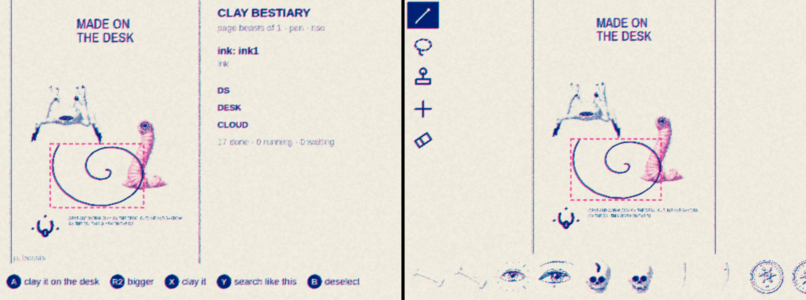
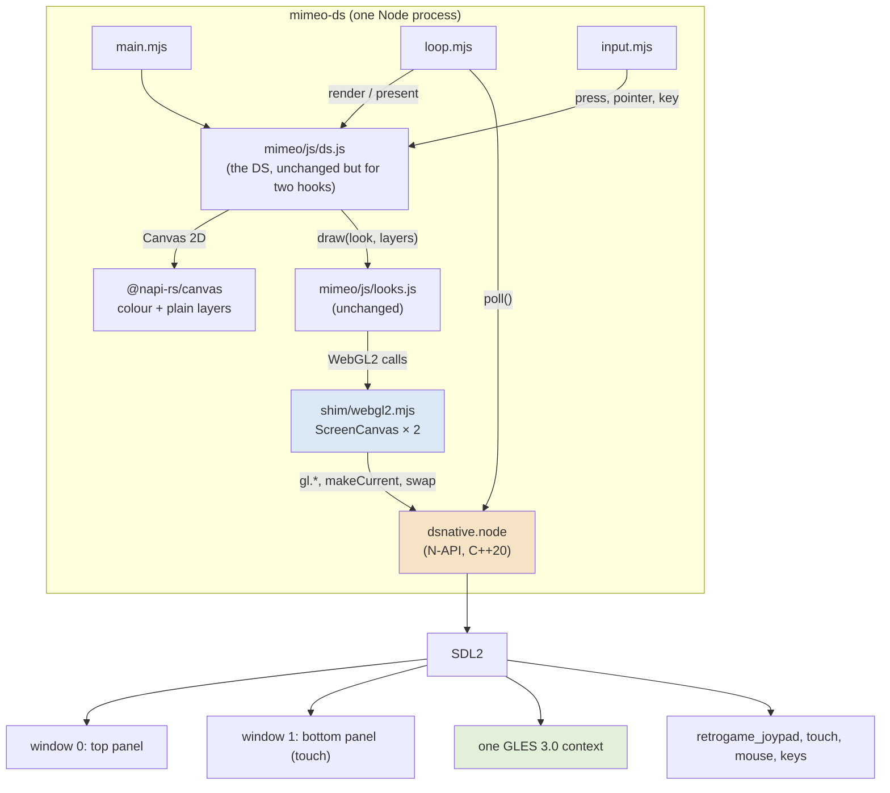
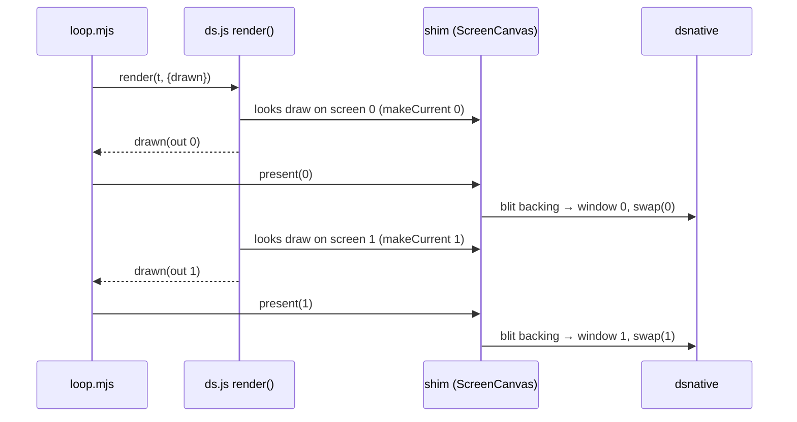
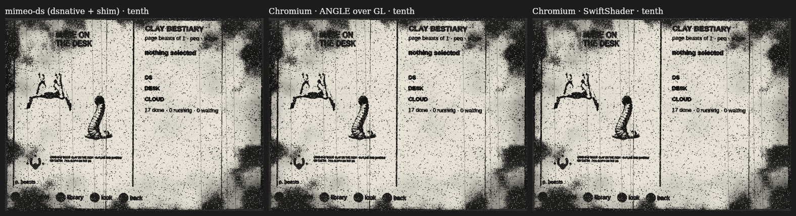
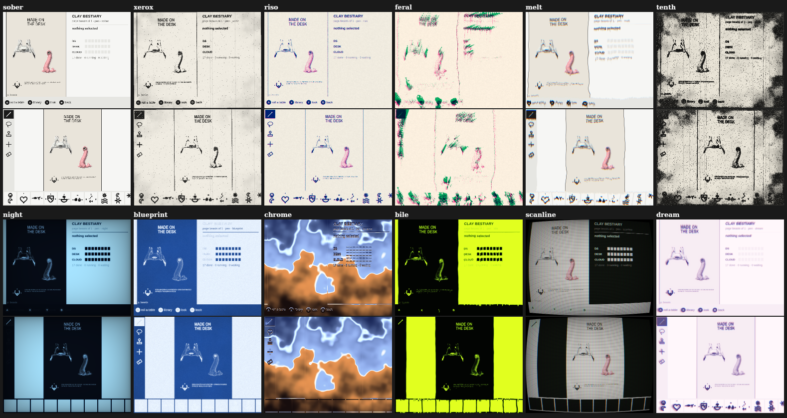
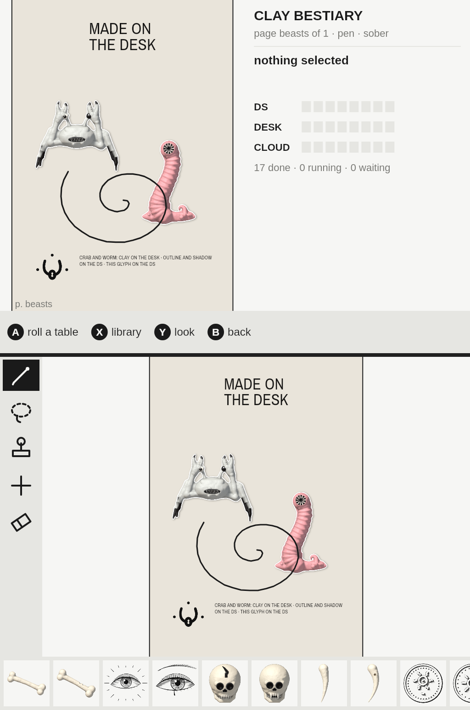

# Mimeo on the RG DS Plus, Part 3: Two Windows and a GPU

[[PROJECT REPORT - Mimeo on the RG DS Plus, Part 1 - The DS Twin Leaves the Browser - A Skia Canvas, Fonts That Measure Like Chromium and Paint on Change|Part 1]] ran Mimeo's DS twin in Node on a Skia canvas, with no screen at all. [[PROJECT REPORT - Mimeo on the RG DS Plus, Part 2 - One Room for Desk and Device - A Pairing Hub in Go, Offline Edits That Arrive Once and Pictures Made Where Their Lane Is|Part 2]] connected that headless runtime to the desk through a Go hub. This report covers **Phase 4**, which gives the device program its screens. `dsnative` is a small N-API addon over SDL2. It opens the handheld's two panels as two windows that share one OpenGL ES 3 context, and reads the buttons, sticks, touch panel and (on the desk) the mouse. `shim/webgl2.mjs` puts a WebGL2 context on each window, so Mimeo's looks — the xerox, riso, melt and other shader stacks — run on the GPU with the same `looks.js` the browser uses. `device/host/main.mjs` turns all of it into `mimeo-ds`, the program the handheld will run.

The handheld is shared with a colleague who is testing on it, so Phase 4 was built and checked on the desk only: Xvfb with Mesa's llvmpipe rasteriser, real SDL windows, real X input through `xdotool`. The guide's exit check is "`mimeo-ds` opens two windows on the desk, the pen works with the mouse, all 12 looks render; screenshots compared to the browser twin". All of it holds:

- **Two windows, both painted, about 200 ms after start** (190–270 ms across runs).
- **The pen works with the mouse.** A stroke dragged by `xdotool` across the bottom window shows as wet ink on both screens. About a second after release it becomes exactly one overlay edit, which `state.json` keeps.
- **All 12 looks render**, with no errors, at 14–26 fps on llvmpipe at half resolution.
- **Bit-identical to the browser.** Fed the same input layers, every look drawn by `mimeo-ds` matches Chromium's WebGL2 on the same Mesa exactly: 0 differing pixels and a mean difference of 0, on both screens. Against Chromium on SwiftShader, a different rasteriser, every look passes Octavo's 0.5 % bar; the worst is `tenth` at 0.397 %.



> [!summary]
> - **The addon is thin on purpose.** About 800 lines of C++ for windows, events and 57 GL calls, written against raw `node_api.h` with GL loaded through `SDL_GL_GetProcAddress`. It needs only SDL's and Node's headers to cross-build. Everything with a policy in it (the button table, the d-pad repeat, which screen takes touch) is in JavaScript.
> - **Two WebGL contexts share one GL context.** The shim makes the right window current before every call and keeps a backing framebuffer for looks that draw smaller than the window. It hands Skia's premultiplied pixels to `texImage2D` without copying them. Compiled programs are cached on disk, so the second screen and the next run skip the compiler.
> - **Present each panel right after its looks draw.** With Mesa on X11, a window's back buffer does not survive the shared context being made current on the other window. Drawing both and then swapping both left the top screen black. `DS.render()` now calls back after each output, and the loop presents that window at once.
> - **Parity is exact where the rasteriser is the same.** Bit-identical output against Chromium on the same Mesa shows the shim adds nothing of its own. Any difference on the handheld will come from its GPU.

## 1. Terms

- **Panel / screen / window.** The RG DS Plus has two 4:3 panels, each 1024×768. The top panel has no touch; the bottom one does. Each panel is one SDL window. "Screen 0" is the top and "screen 1" the bottom, everywhere in the code.
- **dsnative.** The N-API addon in `device/native/`: `dsnative.node`, loaded with `require`.
- **mimeo-ds.** The device program, `node device/host/main.mjs`. On the handheld, `mimeo-link` (Part 2) starts it.
- **Looks.** Mimeo's post-processing stacks (`mimeo/js/looks.js`). A look is a list of shader *passes* over two input layers that the DS paints with Canvas 2D: *colour* (what you see) and *plain* (ink and edges, which some passes smear or grain). `sober` is no passes at all.
- **lookScale.** The looks draw at a fraction of the window and are scaled up when presented. The device uses 0.5: 512×384 per screen.
- **Present.** Show what was drawn: blit the backing framebuffer (if any) to the window, then swap that window's buffers.
- **Shim.** An object that looks like a browser API to Mimeo's unchanged modules. Part 1's shims cover the DOM-free basics and Canvas 2D; this report adds WebGL2.

## 2. The problem

In the browser, the DS twin is a `<canvas>` per screen. Canvas 2D paints the screen and WebGL2 runs the looks over it, and the browser handles windows, input, vsync and GPU drivers. Part 1 replaced Canvas 2D with Skia (`@napi-rs/canvas`), but Skia has no WebGL. On the handheld, Mimeo needs four things that the browser used to provide.

**Two windows on one GPU.** The handheld runs Sway (a Wayland compositor) with one output per panel. A program that wants both panels opens two windows and asks Sway to put one on each, as Lattice and Octavo already do. Both windows must draw with the same GL context: two contexts would double the shader compiles and the texture memory, and the handheld's Mali-G52 (one core, Arm's blob driver) is not generous with either.

**WebGL2 for code that expects a browser.** `looks.js` is about 1,500 lines of WebGL2 written for Chromium. Rewriting it for the device would make two versions of every look, and they would drift. It must run unchanged, so something has to answer to `canvas.getContext('webgl2')`.

**Input as the DS expects it.** `ds.js` takes `press('a')`, `pointer('down', screen, x, y)` and `key('Enter')`. The handheld delivers raw joystick button indices from a device called `retrogame_joypad`, plus touch events with coordinates normalised to the window. On the desk there is no touch panel, only a mouse.

**A loop that does not burn the battery.** A browser repaints on its own schedule. The device loop must decide for itself when to paint (Canvas 2D on the A55 is the expensive part), when to run the looks (they move: grain, feedback, the pen) and how long to sleep.

| Need | Built in |
| --- | --- |
| Two windows, one GLES 3 context, Sway placement, input events | `device/native/src/platform.cpp` (from Lattice's platform layer) |
| JavaScript access to windows, events and GL | `device/native/src/addon.cpp`, `src/gl_api.hpp` (generated) |
| `getContext('webgl2')` on a window | `device/host/shim/webgl2.mjs` |
| Buttons, d-pad repeat, fingers, quit chord | `device/host/input.mjs` |
| When to paint, when to run looks, when to present, how long to sleep | `device/host/loop.mjs` |
| The script, the overlay, the look and the screen across restarts | `device/host/store.mjs` |
| The program, its flags, the room, a control channel for tests | `device/host/main.mjs` |

## 3. dsnative

### 3.1 Shape



The addon is two files plus a generated header. `platform.cpp` owns SDL and is adapted from Lattice DS Native's platform layer, which was already proven on this handheld. `addon.cpp` exposes it to JavaScript with raw `node_api.h`, the C API.

Two choices keep the cross-build (Phase 5) simple:

- **No node-addon-api.** It is a header-only C++ wrapper, but it is one more dependency to vendor. The C API is stable across Node versions at `NAPI_VERSION=8`, so the `.node` built against the shipped Node's headers keeps loading.
- **GL is not linked.** `tools/generate-gl-loader.mjs` scans the sources for `gl*` calls and writes `gl_api.hpp`: 57 function pointers, filled at `open()` with `SDL_GL_GetProcAddress`. The link line has SDL2 and nothing else, and the device's driver supplies GL at run time. On the handheld this is not optional: Arm's blob driver only hands out its entry points that way (Lattice found this first).

```bash
cmake -S device/native -B build-native/host -G Ninja -DCMAKE_BUILD_TYPE=Release
cmake --build build-native/host            # → build-native/host/dsnative.node
```

### 3.2 API

```js
const dn = require('dsnative.node');
const info = dn.open({ titles: ['mimeo:top', 'mimeo:bottom'], width: 1024, height: 768,
                       place: false, vsync: false, positions: [[0, 0], [1032, 0]], lock: '/tmp/mimeo-ds.lock' });
// info: { renderer, version, vendor, glsl, extensions, maxTexture, binaryFormats, sdl }
dn.poll();             // → events since the last call (below)
dn.makeCurrent(1); dn.current();          // which window the context draws to
dn.swap(0);            // make window 0 current and swap it
dn.size(0);            // drawable size
dn.startPlacement(); dn.placement();      // Sway: put each window on its panel (in the background)
dn.gl.texImage2D(...); dn.gl.getProgramBinary(p);   // 57 GL calls, GL's own argument order
dn.close();
```

`poll()` returns plain objects, each with `ms` (SDL ticks):

| Event | Fields |
| --- | --- |
| button | `{t:'button', down, index}`: the raw joystick index |
| finger | `{t:'finger', kind:'down'\|'move'\|'up', screen, x, y, id}`: x and y in 0..1 of that window |
| key | `{t:'key', down, key}`: DOM names (`ArrowUp`, `Enter`, `Shift`, `a`, …) |
| axis | `{t:'axis', stick, x, y}` |
| window | `{t:'window', screen, what:'exposed'\|'resized'\|'focus'\|'close'}` |
| quit | `{t:'quit'}` |

`open()` takes a lock file (`flock`, non-blocking) and refuses to start if another `mimeo-ds` holds it. Lattice learned this the hard way: a stale instance competing for the GPU halved another app's frame rate.

### 3.3 Input rules

The addon reports facts and JavaScript decides what they mean. The rules that do live in C++ are about which events are real:

- **Touch is fingers only.** `SDL_HINT_TOUCH_MOUSE_EVENTS=0` and `SDL_HINT_MOUSE_TOUCH_EVENTS=0`, and mouse events whose `which` is `SDL_TOUCH_MOUSEID` are dropped. Otherwise a tap on the handheld would arrive twice, once as a finger and once as a synthetic click.
- **On the desk, the left mouse button is a finger with id −1.** Motion counts only while the button is down. The drag stays on the window it started on, as a finger does, and x/y are normalised by that window's size. Every touch path can therefore be tested with real SDL events on a machine without a touch panel.
- **Buttons work regardless of focus.** `SDL_HINT_JOYSTICK_ALLOW_BACKGROUND_EVENTS=1`: on the device, keyboard focus may sit on either window.

Mapping happens in `input.mjs`. The button table is Lattice's, verified on the handheld's `retrogame_joypad`:

```js
// SDL joystick index → DS button
export const BUTTONS = ['b', 'a', 'x', 'y', 'l', 'r', 'l2', 'r2', 'select', 'start', null, null, null, 'up', 'down', 'left', 'right'];
```

A held d-pad button repeats after 380 ms and then every 110 ms (Lattice's values). Holding SELECT+START for one second quits, saving state first. If the handheld turns out to number something differently, the fix is this one line, without a rebuild.

## 4. The WebGL2 shim

`ScreenCanvas` is what `looks.js` gets instead of a `<canvas>`. It has `width`/`height`, `getContext('webgl2')` and no-op event listeners. It also has one method no browser canvas has, `present()`. The WebGL2 object behind it is about 300 lines. Most of it is direct translation, a WebGL call to the same-named GL call. Four parts are not.

### 4.1 Two contexts on one

WebGL gives each canvas its own context with its own state. Here both "contexts" are the same GL context drawing to two window surfaces, so the shim keeps track of which window is current and switches before any call that touches state:

```js
// one GL context, two window surfaces
_use() {
  if (shared.current !== this._screen) { this._n.makeCurrent(this._screen); shared.current = this._screen; }
  return this._g;
}
texImage2D(...a) { const g = this._use(); /* … */ }
```

`SDL_GL_MakeCurrent` is cheap when nothing changes, and the addon skips it then. In a frame, the looks draw one screen completely and then the other, so the switch happens about twice per frame. GL objects are wrapped (`{id, kind, deleted}`) so a texture can never be passed to the wrong context by accident.

### 4.2 The default framebuffer

`looks.js` sizes its output canvas to `lookScale × window`, here 512×384, and renders its last pass to framebuffer `null`. In a browser the compositor scales the small canvas up to its CSS size. Here a window's default framebuffer is always 1024×768. So when the canvas is smaller, the shim creates a *backing framebuffer* at canvas size and maps `null` to it:

```js
_fb(o) { return o ? o.id : this._backing ? this._backing.fbo : 0; }   // bindFramebuffer(t, null) → the backing FBO
_present(capture) {
  if (this._backing) {                                                  // scale up into the window
    g.bindFramebuffer(READ_FRAMEBUFFER, this._backing.fbo); g.bindFramebuffer(DRAW_FRAMEBUFFER, 0);
    g.blitFramebuffer(0, 0, w, h, 0, 0, W, H, COLOR_BUFFER_BIT, LINEAR);
  }
  if (capture) { /* readPixels from the window, flip rows to top-first */ }
  /* rebind whatever looks.js had bound */
}
```

The shim also tracks whether anything was drawn to the default framebuffer since the last present (`_drawn`), so a frame where nothing moved costs no swap.

### 4.3 Textures from Skia

The looks upload the DS's colour and plain layers as textures every frame. In the browser those are canvases, and the browser handles alpha and orientation according to two WebGL-only flags. `UNPACK_FLIP_Y_WEBGL` and `UNPACK_PREMULTIPLY_ALPHA_WEBGL` do not exist in GLES, so the shim intercepts `pixelStorei` for them and applies them itself.

The common case costs nothing. Skia's `canvas.data()` returns the pixels **premultiplied, RGBA, top row first**, and `looks.js` always uploads with premultiply on and flip off. So the bytes go to `glTexImage2D` as they are, and `data()` for 1024×768 takes 0.055 ms. Only an unpremultiplied or flipped upload would need a conversion.

### 4.4 A program cache

The handheld's Mali driver compiles shaders slowly, and every look has 1–4 passes per screen. GLES 3 can save a linked program as a binary blob and load it later, so the shim caches each program on disk:

```text
<state>/programs/<sha1(renderer | version | shader sources)>.bin   =   u32le format ‖ binary
```

WebGL calls `compileShader` before `linkProgram`, but the cache can only decide at link time, when it knows both sources. So when a cache is configured, `compileShader` only marks the shader *pending*. `linkProgram` hashes the sources and tries the cached binary first, and only on a miss compiles the pending shaders, links, and stores the new binary atomically (temp file, then rename). A binary the driver refuses (a driver update) counts as `stale` and is replaced.

The cost of deferring: until link time a pending shader reports `COMPILE_STATUS` true, so a compile error shows up as the program's link error, with the shader's log. `looks.js` checks both, so a broken shader is still reported, one call later.

On the desk, the looks sweep compiled 16 programs and loaded 15 from the cache (the second screen's), with nothing stale. A second run of `mimeo-ds` compiles nothing at all, which a test checks.

## 5. The frame loop

### 5.1 The black top screen

The first version of the loop did what a single-window program does. It painted, ran the looks on screen 0, then on screen 1, and at the end of the frame swapped both windows. Screen 1 was right. Screen 0 was black.

A small harness reproduced it without Mimeo:

```text
makeCurrent(0); clear(red)
makeCurrent(1); clear(blue)
makeCurrent(0); swap(0)          → window 0 shows black
makeCurrent(1); swap(1)          → window 1 shows blue
```

With Mesa on X11, a window's back buffer does not survive the shared context being made current on another window. Whatever was drawn to window 0 is gone by the time it is swapped. The fix is an ordering rule: **draw a panel, present it, then move on.** The loop cannot impose that order from outside, because `ds.render()` draws both outputs in one call. So `ds.js` got a callback:

```js
// mimeo/js/ds.js, in render(t, opt)
for (const o of this.outs) {
  o.looks.draw({ color: this.col[o.which], plain: this.pln[o.which], look, time, params, scale });
  opt.drawn?.(o);                       // the device presents this window now
}
```



The handheld runs Sway, which is Wayland rather than X11, so this may never have happened there. But the ordering is correct on every platform and costs nothing, so it stays.

### 5.2 Pacing

```js
function frame() {
  const events = native.poll();
  input.handle(events, t); input.tick(t);                 // buttons, fingers, d-pad repeat
  const paint  = ds.needsPaint(t);                        // Canvas 2D only when the DS changed
  const lookDue = animated && t - lastLook >= 1000 / lookFps;   // moving looks at 30 fps
  if (paint || lookDue || exposed || captureWanted)
    ds.render(t, { drawn: (out) => canvases[out.which].present({ capture, force }) });
  setTimeout(frame, delay(t));
}
// delay: 8 ms just after input or while the pen is down, else 50 ms;
//        never past the next look frame, the next d-pad repeat or a live screen's refresh
```

The DS paints with Canvas 2D only when something changed (`paintOnChange`, from Part 1). `sober`, the default look, has no passes, so an idle sober screen costs one `poll()` every 50 ms and nothing else. A look with passes moves (grain, feedback, the ink smear), so it is redrawn at 30 fps from the last painted layers, without repainting them. An `exposed` window event forces a redraw, because a compositor may have thrown the window's contents away.

## 6. mimeo-ds

`main.mjs` (183 lines) puts the pieces together in an order chosen so the screens show something early:

1. Install Part 1's shims (globals, Skia canvas, fonts), then import Mimeo's own modules unchanged.
2. **Open the windows first**, then configure the program cache.
3. Make the runtime and the DS (`scale: 2`, `lookScale: 0.5`, `paintOnChange`), attaching a `ScreenCanvas` per window as the DS's outputs.
4. Load the saved state if there is one (`state.json`: the script, the overlay with each edit's `remote`/`sent` flags, the look, the screen), else the preset. Then run the script.
5. With a hub (`--link` or `MIMEO_LINK_URL`, which `mimeo-link` sets for the program it runs): a `Room` over the link transport, a `LaneRouter`, and a banner at the foot of the top screen with the pairing URL and code while no desk is in the room.
6. Start the loop. On the first frame of both windows, log the time and, on the device, start Sway placement.

State is written half a second after the last change and flushed on quit (SIGTERM, SIGINT, or SELECT+START held). The overlay keeps each edit's offline flags (DR-10 from Part 2), so an edit made on the sofa still reaches the desk after a restart.

For tests and screenshots, `--control` reads one command per line from stdin and answers `ctl: {json}` on stdout: `press`, `key`, `pointer`, `look`, `screen`, `preset`, `shot FILE [--split]`, `layers DIR`, `stats`, `quit`. `stats` reports the loop's frame and paint times, program-cache counts, each look's frame rate, the ops, jobs, room state and RSS.

## 7. Parity and the looks sweep

### 7.1 Method

"Screenshots compared to the browser twin" needs both sides to draw the same thing. A screenshot of a running program depends on timing (grain moves, the pen blinks), so the parity script (`08-phase4-looks-parity.mjs`) compares frames, not runs:

1. `mimeo-ds` paints H1 and writes the colour and plain layers of both screens as PNGs (`layers DIR`).
2. In-process, with dsnative windows and the shim: for every look and screen, a fresh `createLooks`, one `draw` at time 2.5 s, frame 0, scale 1, then read back.
3. In Chromium (Playwright's build, headless): a page that imports the same `mimeo/js/looks.js`, loads the same PNGs and draws the same frames. It runs twice: on ANGLE over OpenGL, which on this machine is the same Mesa llvmpipe, and on SwiftShader.
4. Compare pairs with Octavo's rule: a pixel differs when any channel is more than 64 apart, and a pair passes when under 0.5 % of pixels differ.

### 7.2 Results

| look | vs Chromium · ANGLE-GL (same Mesa) | vs Chromium · SwiftShader |
| --- | --- | --- |
| sober | 0 % · mean 0 | 0 % · mean 0 |
| xerox | 0 % · mean 0 | 0.06 % · mean 0.16 |
| riso | 0 % · mean 0 | 0.001 % · mean 0.04 |
| feral | 0 % · mean 0 | 0.162 % · mean 0.46 |
| melt | 0 % · mean 0 | 0.003 % · mean 0.15 |
| tenth | 0 % · mean 0 | 0.397 % · mean 1.05 |
| night | 0 % · mean 0 | 0 % · mean 0.01 |
| blueprint | 0 % · mean 0 | 0 % · mean 0.02 |
| chrome | 0 % · mean 0 | 0.002 % · mean 0.25 |
| bile | 0 % · mean 0 | 0.064 % · mean 0.13 |
| scanline | 0 % · mean 0 | 0 % · mean 0.05 |
| dream | 0 % · mean 0 | 0 % · mean 0.08 |

Against the same rasteriser, the output is identical to the byte. That is a stronger result than "under 0.5 %": the shim translates WebGL2 exactly, including the backing framebuffer, the texture uploads and the blending state. Against SwiftShader, the differences come from noise looks (`tenth`, `feral`), whose hash functions round differently in another float implementation. The handheld's Mali GPU will be a third rasteriser, and its numbers belong to Phase 6.



### 7.3 Every look in a running mimeo-ds

The sweep script (`07-phase4-looks-sweep.mjs`) switches a running `mimeo-ds` through all twelve looks on H1 at `lookScale 0.5`. For each it records frame rates, draw times and errors, and takes a screenshot. These are llvmpipe numbers (software rendering on the desk's CPU), so they say nothing about the handheld's GPU. They do show every look working through the whole stack.

| look | passes | fps top / bottom | draw ms top / bottom |
| --- | --- | --- | --- |
| sober | 0 | 13.3 / 15.5 | 24.3 / 8.0 (full size, no passes) |
| xerox | 2 | 21.4 / 21.8 | 18.5 / 9.1 |
| riso | 1 | 26.2 / 26.3 | 9.9 / 6.8 |
| feral | 4 | 21.5 / 21.6 | 47.6 / 11.4 |
| melt | 2 | 26.3 / 26.2 | 10.9 / 9.0 |
| tenth | 3 | 24.3 / 24.0 | 10.9 / 11.2 |
| night | 4 | 16.4 / 16.1 | 41.1 / 27.3 |
| blueprint | 2 | 25.6 / 25.5 | 14.5 / 10.5 |
| chrome | 3 | 18.7 / 18.8 | 57.5 / 15.2 |
| bile | 4 | 14.3 / 15.7 | 87.9 / 46.8 |
| scanline | 4 | 15.2 / 15.4 | 37.3 / 25.4 |
| dream | 4 | 14.6 / 15.0 | 29.9 / 28.5 |

The top screen's first draw of each look includes compiling its programs; the bottom screen's comes from the cache, which is most of the gap between the two columns. Over the 20-second sweep, the loop drew 183 frames and painted 19 times (Canvas 2D for both screens: p50 13 ms, max 26.5 ms). It was idle 91 times.



## 8. Testing

`device/host/test/dsnative.test.mjs` runs `mimeo-ds` as a child process on a private Xvfb display and drives it through the control channel and `xdotool`. It skips when the addon is not built or Xvfb is missing.

| Test | What it shows |
| --- | --- |
| two windows, both painted, on the first frame | both 1024×768, mostly lit (the sober ground is paper), first frame in under 5 s |
| the mouse is a finger on the bottom screen | an `xdotool` drag → exactly one new overlay op, kept in `state.json` as `ink` |
| programs compiled by one run are loaded from the cache by the next | second run: `compiled: 0`, `cached ≥` the first run's `stored` |
| a restart resumes the script, the look and the screen | H1, `night`, `library` and the same ops after quit and start |



The whole suite is 38 tests and passes in about 12 s. Getting there turned up four bugs:

- the black top screen (§5.1), on the first run of `mimeo-ds`;
- `present()` returning `null` when not capturing, so the stats counted every frame as nothing presented;
- a WebGL constant that does not exist (`EXTENSIONS_STRING`);
- a bug in the test itself: the resume test asserted a screen called `book`, which does not exist. The restart was right to fall back to `draw`.

## 9. Limitations and open questions

- **Two swaps per frame and vsync.** vsync is off by default and the JavaScript loop sets the pace. With vsync on, two `SDL_GL_SwapWindow` calls per frame may each wait for a vblank and halve the rate; with it off, the panels may tear. This can only be measured on the handheld.
- **Memory.** On the desk, `mimeo-ds` used 651 MiB RSS during the sweep, 224 MiB of it anonymous. Much of the rest is llvmpipe and X mappings that the device will not have. The handheld needs its own number with its own driver, against the guide's memory budget. `--max-old-space-size` bounds only the V8 heap, not Skia's pixels or GL's buffers.
- **The program cache is driver input from disk.** A corrupt file is rejected by the driver and recompiled. A malicious one is a question of how robust the Mali driver's binary parser is. The cache lives in the device user's state directory, so it is not a privilege boundary, but it is worth knowing.
- **The control channel** can load presets and write files. It is on only with `--control`, which the launcher must not pass.
- **Unverified on the handheld:** the button table under `mimeo-ds` (it is Lattice's, which Lattice verified), Sway placement from this addon, touch coordinates on the real panel, and how Mali behaves with a shared context across two windows.
- **Chromium's context limit.** The parity page creates two dozen WebGL contexts in sequence and Chromium warns that the oldest are lost. They are no longer in use, and every pair passed. A long-running page should still reuse its canvases.

## 10. Next steps

**Phase 5** packages `mimeo-ds` for aarch64: Node 22 for arm64 with its checksum verified, the `@napi-rs/canvas` arm64 prebuild, `dsnative.node` cross-built against the shipped Node's headers, Mimeo's web files, the hub, a Ports launcher, and a deploy script that has only ever run as `--dry-run`. A background agent is preparing it in its own worktree while this report is written; it has no access to the handheld.

**Phase 6** is the first time any of this runs on the RG DS Plus. It waits until the colleague's tests are done and the go-ahead is given. It measures:
- first frame;
- the looks' frame rates on Mali;
- the vsync question;
- input;
- memory;
- the program cache with the real driver;
- the lane round trip from Part 2 over Wi-Fi.

## 11. Reproducing

```bash
cd /home/manuel/code/wesen/2026-10-18--mimeo
npm install
cmake -S device/native -B build-native/host -G Ninja -DCMAKE_BUILD_TYPE=Release && cmake --build build-native/host
npm test                                                           # 38 tests (the windowed ones need Xvfb, the pen test xdotool)
T=ttmp/2026/10/18/MIMEO-001--real-nintendo-ds-client-and-twin-device-link-for-mimeo/scripts
node $T/07-phase4-looks-sweep.mjs /tmp/sweep                       # every look in a running mimeo-ds, sheet.png
node $T/08-phase4-looks-parity.mjs /tmp/parity                     # needs Chromium from Playwright (--chrome, --playwright)
node $T/09-phase4-desk-shots.mjs /tmp/shots --parity /tmp/parity   # the screenshots in this report
# by hand, on a private X server:
Xvfb :77 -screen 0 2100x800x24 &
DISPLAY=:77 node device/host/main.mjs --preset H1 --no-link --desk --control
#   look riso · shot /tmp/a.png --split · stats · quit
```

## 12. Files

| Path (in `/home/manuel/code/wesen/2026-10-18--mimeo`) | Role |
| --- | --- |
| `device/native/src/platform.hpp`, `platform.cpp` | SDL: two windows, one GLES 3 context, lock file, input events, mouse as finger, Sway placement |
| `device/native/src/addon.cpp` | N-API surface: `open`, `poll`, `makeCurrent`, `swap`, … and `gl.*` |
| `device/native/src/gl_api.hpp`, `tools/generate-gl-loader.mjs` | GL entry points loaded through `SDL_GL_GetProcAddress` |
| `device/native/CMakeLists.txt` | the build (C++20, SDL2 by pkg-config, `NAPI_VERSION=8`) |
| `device/host/shim/webgl2.mjs` | `ScreenCanvas` and WebGL2 over dsnative; backing FBO; program cache |
| `device/host/loop.mjs` | the frame loop: paint on change, looks at 30 fps, present per panel, sleep |
| `device/host/input.mjs` | button table, d-pad repeat, fingers per id, SELECT+START quit |
| `device/host/store.mjs` | `state.json`: script, overlay with offline flags, look, screen |
| `device/host/main.mjs` | `mimeo-ds`: flags, boot order, room and lanes, control channel |
| `mimeo/js/ds.js` | `render(t, {drawn})` and `setBanner(m)` |
| `device/host/test/dsnative.test.mjs`, `test/lib/ds.mjs` | windowed tests on Xvfb; X server, `mimeo-ds` and `xdotool` helpers |
| `ttmp/2026/10/18/MIMEO-001--…/scripts/07-…`, `08-…`, `09-…` | sweep, parity and screenshot scripts |
| `ttmp/2026/10/18/MIMEO-001--…/various/phase4-looks/` | `sweep-looks.json`, `parity.json`, `desk-shots-stats.json` |
| `ttmp/2026/10/18/MIMEO-001--…/diary/01-diary.md` | Phase 4 is Step 12 |

Commits: `79332a5` (Phase 4), `97504fc` (diary and evidence).

## Related notes

- [[PROJECT REPORT - Mimeo on the RG DS Plus, Part 1 - The DS Twin Leaves the Browser - A Skia Canvas, Fonts That Measure Like Chromium and Paint on Change]]: the headless runtime and Canvas 2D shims this phase draws on top of
- [[PROJECT REPORT - Mimeo on the RG DS Plus, Part 2 - One Room for Desk and Device - A Pairing Hub in Go, Offline Edits That Arrive Once and Pictures Made Where Their Lane Is]]: the hub, the room and the lanes that `mimeo-ds` joins
- [[PROJECT REPORT - Lattice DS Native, Part 2 - A Two-Thread Shell and a Thin V8 Layer on the RG DS Plus]]: the SDL/GLES platform layer and button table `dsnative` comes from
- [[PROJECT REPORT - Octavo, Part 3 - The Development Loop - A Server on the Handheld, a WebGL2 Twin and a Parity Check]]: the parity rule used here
