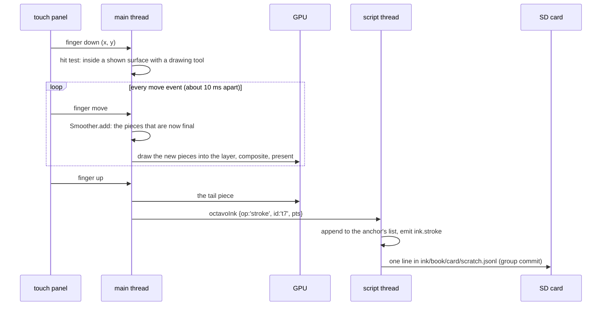
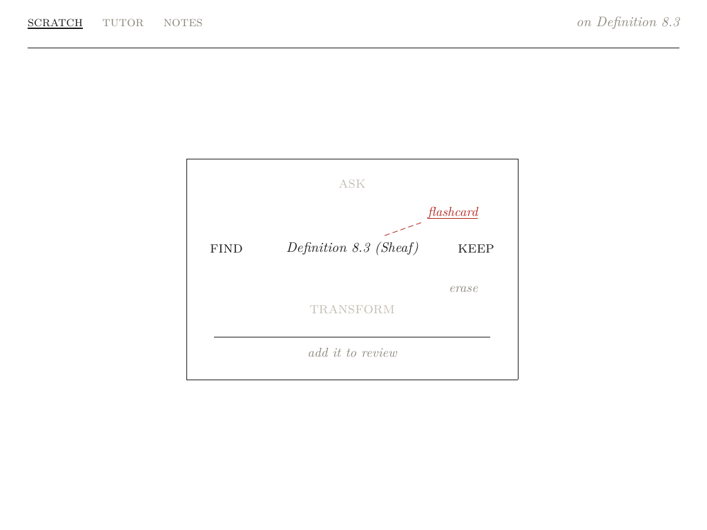
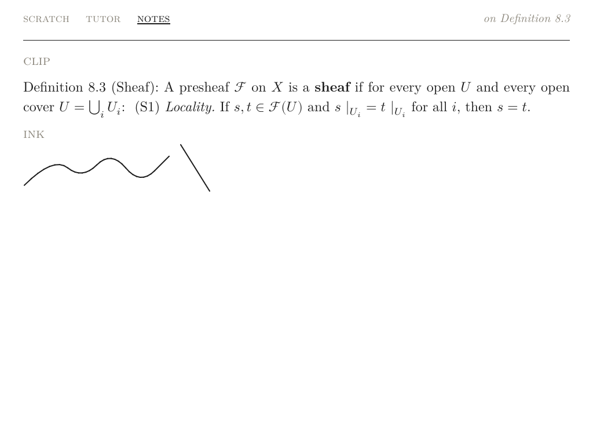
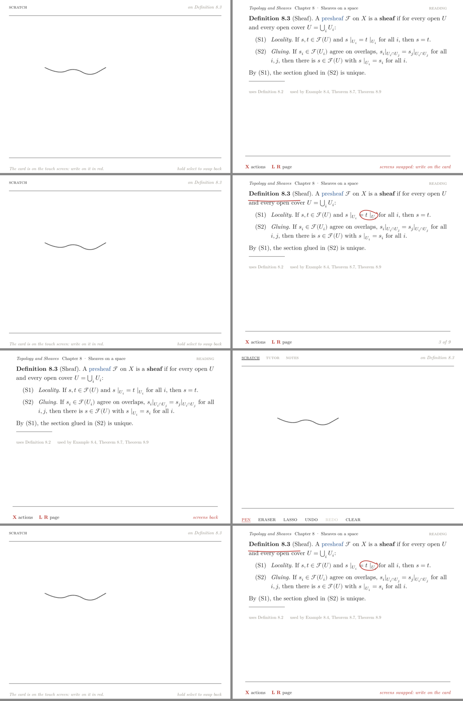
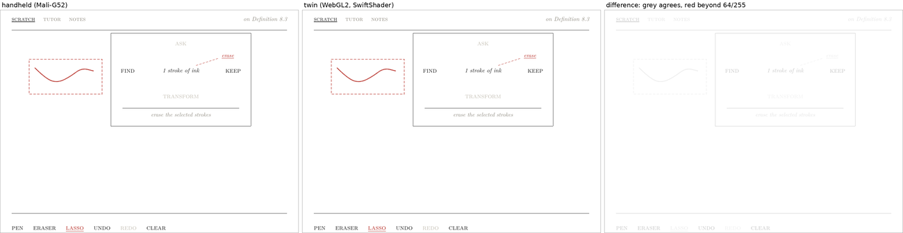
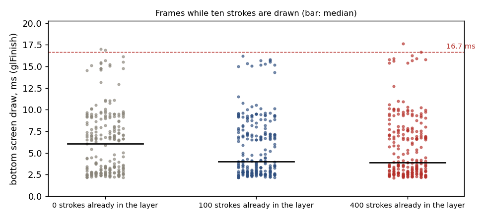
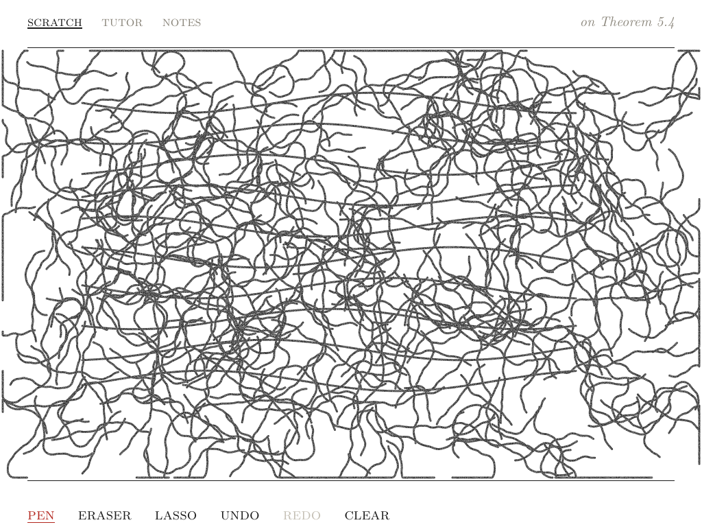
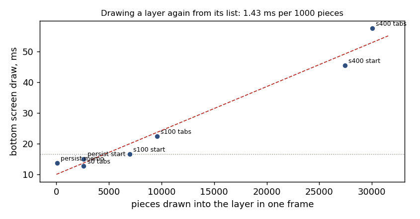
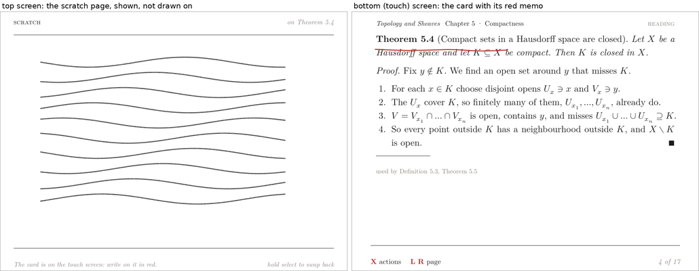
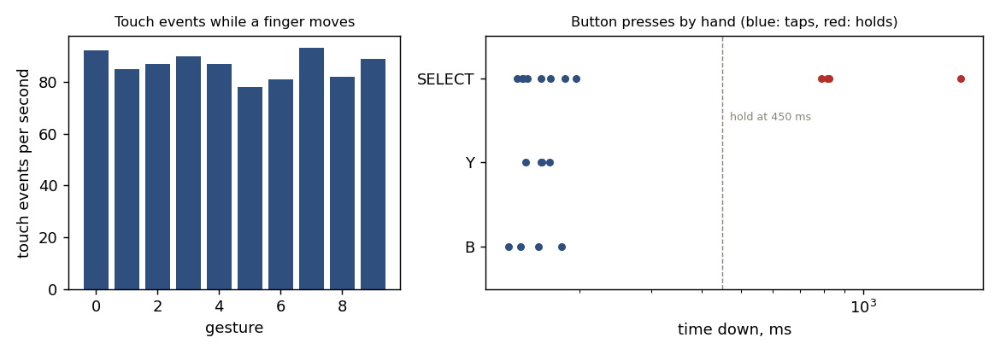

# Octavo, Part 5: Ink

**Octavo** is a reader for typeset mathematics on the Anbernic RG DS Plus. The RG DS Plus is a Linux handheld with two 1024 × 768 screens and a Mali-G52 GPU; the top screen only displays, and the bottom screen is a touch panel. Four earlier reports cover Phases 0 to 3:

- [[PROJECT REPORT - Octavo, Part 1 - Typst on a Handheld - Display Lists, Span Ids as Colours and a Page Shader on the RG DS Plus|Part 1]] showed that Typst can lay out a page on the handheld and that one shader program draws it at book quality.
- [[PROJECT REPORT - Octavo, Part 2 - The Reading Loop on the Handheld - Element Trees from V8, Prebuilt Pages and a Main Loop That Sleeps|Part 2]] built the reading program. V8 runs the runtime, each screen is described as an element tree, and the GPU draws the laid-out page.
- [[PROJECT REPORT - Octavo, Part 3 - The Development Loop - A Server on the Handheld, a WebGL2 Twin and a Parity Check|Part 3]] connected a browser IDE to the handheld. It also added the twin, an exact rendering of the device inside the browser, and a parity check that compares the two.
- [[PROJECT REPORT - Octavo, Part 4 - Reading State - An Event Log, Folds and Type That Changes Without Layout|Part 4]] made reading state durable. It is derived from a journal and shown in the type of every card title.

This report covers Phase 4, which is when the touch screen starts to do something. The design guide describes the phase in one sentence: "The ink layer and the `stroke` and `layer` programs; the lasso as a selection; the compass with its slots and diagonals; keeping notes; the memo swap (the card on the bottom screen, marked up in red)." The phase was built in seven steps, 4a to 4g. Each step has a commit and a diary entry in the repository.

The guide sets no exit criteria for Phase 4. I set four, and all four hold on the handheld:

- **The ink keeps up.** A replayed stroke reaches the screen in 4–5 ms at the median and in at most 27 ms. The bottom screen draws in 4–6 ms at the median. Both figures are the same whether the canvas already holds 0, 100 or 400 strokes.
- **The ink survives a restart.** A run that drew ten strokes and a red mark on the card was started again. Both came back from their files and were drawn.
- **Choosing an action lays nothing out.** In the compass, the menu of actions on a selection, choosing a word changes span states only. The panel keeps its page key, and a D-pad press over the compass costs what a focus move costs.
- **The twin draws the same ink.** The browser twin now has the device's ink. Three ink sequences (18, 5 and 5 inputs, 19 of them touches) replay on the handheld and on the twin with equal message streams, and no pixel differs by more than 64 of 255 levels. The four presets of Phases 2 and 3 still pass.

> [!summary]
> - **A stroke is drawn by the main thread and owned by the script thread.**
>   - The main thread smooths the points, draws each new piece into a persistent texture (the ink layer), and composites the layer over the page.
>   - The script thread hears of the stroke when the finger lifts. It keeps the stroke lists, writes them to append-only files, and handles undo.
>   - On the handheld, drawing costs the same with 0 and with 400 strokes on the canvas. Drawing a layer again from its list costs 1.43 ms per 1000 pieces.
> - **The compass is typeset, and choosing is a span state.**
>   - The eight words, their dashed lines and their hints are laid out once. A choice shows one line and one hint by span-state bits.
>   - The ink layer leaves the compass's box out with a discard in its fragment shader, so the box is readable over ink.
> - **The memo swap moves slots, not pages.**
>   - SELECT held for 450 ms swaps the screens. The card and its prompt line go to the touch screen, and a second ink surface, red and scrolling with the card, lies over it.
>   - B, Y and SELECT now act on release. A tap by hand keeps them down for 133–196 ms.
> - **Touch on the RG DS Plus arrives at 100 Hz.** Each gesture also has one gap of 96–145 ms, whose position within the gesture is not yet known.

## 1. Terms

Parts 1 to 4 defined cards, spans, span ids, span states, element trees, display lists, slots, page keys, prebuilt pages, the layout helper, the journal, folds, the twin and the parity check. This part adds the following terms, in dependency order.

- **Anchor.** What ink or a note is attached to. For the scratch canvas the anchor is the card's id, for example `sheaf`. For marks on the card itself it is `memo:` followed by the card's id.
- **Stroke.** A list of points in pixels, with an id and a colour index (0 pencil, 1 red). Strokes drawn by the finger have ids `t1`, `t2`, …; strokes added by a book's script have ids `a` followed by a hash.
- **Piece.** A straight segment of a smoothed stroke, about 3 px long. The GPU draws ink as pieces, one instance each.
- **Ink surface.** A rectangle over one slot's page where ink is shown and, depending on its tool, drawn. It has a name (`scratch` or `memo`), a slot, the page key it belongs to, an anchor, a tool (`pen`, `eraser`, `lasso` or `none`), a colour, a width, a grain and a stroke list.
- **Ink layer.** A texture as large as a surface into which its strokes are drawn. A frame shows the layer with one rectangle; it does not draw the strokes again.
- **Gesture.** A finger's path from touch-down to lift-off on a surface whose tool is not `none`. It becomes a stroke (pen), an erase (eraser) or a selection (lasso).
- **Tap.** A touch that moves less than 20 px and lifts within 800 ms, outside any surface that takes gestures. The main thread reports where it landed, and the script decides what it hit.
- **Selection.** What an action applies to. It is a typed value: `{kind: 'card' | 'term' | 'hypothesis' | 'ink-region', label, anchor, …}`.
- **Compass.** The box of actions on a selection. It has four words at the cardinal points (N ask, E keep, S transform, W find) and up to four on the diagonals.
- **Note.** A kept selection: a clip of a card's text, typed text, or a lasso's strokes. Notes are anchored to a card.
- **Memo swap.** The state in which the card is on the touch screen with a red ink surface over it, and the scratch page is on the top screen.
- **Hold.** B, Y or SELECT kept down for 450 ms. It is a different input from a tap of the same button.

## 2. The problem

Phase 4 adds input of a new kind. Until now every input was a button press: a discrete event that the main thread forwarded to the script thread, which decided what changed and sent back element trees and span states. A finger on the touch panel is a stream of positions at about 100 per second, and the reader expects the line under the finger to follow without delay.

The guide states the rule that decides the architecture (section 7.2): "nothing the user is waiting for may depend on JavaScript finishing: a stroke appears under the stylus because the main thread draws it, and the script thread learns of the stroke when it is finished." The script thread runs V8. A call into it can take milliseconds, more when it lays out a page, and it may be busy when a touch arrives. If the stroke waited for it, the latency of a stroke would be the latency of the slowest script call.

The rule divides ownership between the two threads:

| Concern | Owner | Reason |
| --- | --- | --- |
| The points of the gesture in progress, smoothing, drawing into the layer | main thread | must follow the finger within a frame |
| Which surfaces exist, where they are, which anchor and tool they have | script thread | depends on the view, the tab, the compass and the swap, which only the runtime knows |
| The stroke list of every anchor, the files, undo and redo | script thread | the list is book data; it is journaled and replayed like all reading state |
| What a tap hit | script thread | the script has the span rectangles of every page it laid out |

Two copies of the same list therefore exist, one on each thread. Section 4 explains how they are kept consistent without locking. The rest of the phase builds on this split. The compass is a page element that the script lays out, the notes are a file the script writes, and the memo swap is a second surface the script describes.

## 3. Strokes on the main thread

### 3.1 The protocol

The script describes surfaces in messages that it sends with `__native.ink(json)`. The main thread reports finished gestures by calling the script's global function `octavoInk(msg)`. The header `native/src/app/ink.hpp` is the specification:

```text
script -> main
  {op:'surface', name, slot, key, anchor, rect:[x,y,w,h], scrolls, tool, color, width, grain,
   hole:[x,y,w,h]|[], strokes?:[{id, pts:[x0,y0,...], c}], sel?:[ids], poly?:[x0,y0,...]}
  {op:'off', name}
  {op:'add', name, anchor, stroke}   {op:'remove', name, anchor, ids}   {op:'clear', name, anchor}
  {op:'select', name, anchor, ids, poly}   {op:'tool', name, tool}   {op:'swap', on}
main -> script
  {op:'stroke', surface, anchor, id, pts}   {op:'erase', surface, anchor, ids}
  {op:'lasso', surface, anchor, poly}       {op:'tap', slot, key, x, y}
```

A `surface` message places a surface over the page with page key `key` in slot `slot`, at `rect` in that page's coordinates. The main thread shows the surface only while that slot shows that page and is not sliding. A peek animation therefore hides the ink for its 140 ms, and a page laid out again under a new key hides it until the script sends the new key. Ops that name an anchor apply only while the surface shows that anchor. All coordinates are layer pixels.

A stroke from start to file passes through both threads:



### 3.2 From points to pieces

The panel reports raw positions. A line through them has corners at every sample, which shows at the slow end of a stroke, where samples are close together and change direction. The IDE smooths a stroke with quadratic Bézier curves through the midpoints of consecutive samples. The device reproduces this exactly, so that a stroke looks the same in the IDE, the twin and the device. `render::Smoother` (`native/src/render/ink_geom.cpp`) draws:

- one quadratic per inner point `p[i]`, with `p[i]` as its control point, from the midpoint of `p[i-1]` and `p[i]` to the midpoint of `p[i]` and `p[i+1]`;
- for the first point, a curve that starts at the point itself;
- at the end, a straight piece from the last midpoint to the last point.

The curve passes through the midpoints and is tangent to the sample polyline there, so it has no corners.

The construction is incremental. When point `k` arrives, the quadratic that ends at the midpoint of `k-1` and `k` is final, because no later point changes it. The smoother emits it at once, cut into pieces of about 3 px. Only the tail after that midpoint waits for the next point or for the lift:

```cpp
void Smoother::add(InkPt p, std::vector<InkSeg>& out) {
  if (n_ == 0) {
    cur_ = last_ = p;
    out.push_back({p.x, p.y, p.x, p.y, width_, color_});   // a dot, so a tap leaves a mark at once
  } else if (n_ >= 2) {
    const InkPt e = mid(last_, p);
    quad(cur_, last_, e, out);      // cur_ -> e with last_ as the control point: final now
    cur_ = e;
  }
  last_ = p;
  n_++;
}
void Smoother::end(std::vector<InkSeg>& out) {
  if (n_ >= 2) out.push_back({cur_.x, cur_.y, last_.x, last_.y, width_, color_});
}
```

`quad` cuts a curve into `ceil((|a−c| + |c−b|) / 3)` pieces, clamped to 1..16. The visible delay this adds is half a sample interval. The drawn line ends at the midpoint before the finger's last reported position, about 5 ms behind it at 100 Hz.

### 3.3 Drawing pieces into the layer

Each piece is drawn as an instance of the `ink` program. The vertex shader receives the piece's endpoints, width and colour index, and expands a unit quad into a rectangle around the piece's capsule plus one pixel. A capsule is the set of points within half the width of the segment. The fragment shader computes coverage from the distance to the segment:

```glsl
// ink.frag
vec2 pa = v_pos - v_seg.xy, ba = v_seg.zw - v_seg.xy;
float h = clamp(dot(pa, ba) / max(dot(ba, ba), 1e-6), 0.0, 1.0);
float c = clamp(v_half + 0.5 - length(pa - ba * h), 0.0, 1.0) * v_color.a;
o = vec4(v_color.rgb * c, c);      // premultiplied
```

The output is premultiplied, and it is blended into the layer with `glBlendEquation(GL_MAX)`. The reason is the overlap of consecutive pieces. Each piece's capsule covers the round end of the previous one, so their anti-aliased edges overlap at every joint. With ordinary blending (source over destination), two partly covered pixels at a joint combine to a darker value than either, and a stroke would show a bead every 3 px. With MAX, a pixel covered by several pieces takes the largest coverage, which is the coverage of the union of the capsules. That is exact for one colour. Where a grey stroke crosses a red one the result is the componentwise maximum, which is close enough for ink on paper.

The guide planned ink as triangle strips in the existing `stroke` program, which draws diagram paths and Leitfaden edges. The implementation uses a separate `ink` program of instanced capsules instead. A strip cannot be extended by appending an instance, and a strip's joins would need the same MAX treatment. Pieces are independent, so the main thread can append exactly the pieces that became final since the last frame.

### 3.4 Compositing the layer

The `layer` program draws a layer onto a screen as one rectangle. Two features of the reader live in its fragment shader:

```glsl
// layer.frag
if (u_hole.z > 0.0 && all(greaterThanEqual(v_px, u_hole.xy)) && all(lessThan(v_px, u_hole.xy + u_hole.zw))) discard;
vec4 c = texture(u_layer, v_uv);
float n = texture(u_noise, gl_FragCoord.xy / 64.0).r;
o = c * mix(1.0, 0.62 + 0.38 * n, u_grain);
```

- **Grain.** A 64 × 64 single-channel noise texture, sampled at the screen pixel, thins the pencil by up to 38 %, so grey ink reads as graphite. `u_grain` is 1 for the pencil and 0 for the red pen. The noise is fixed to the screen, not to the layer, so it does not move when a stroke is added.
- **The hole.** A rectangle in layer pixels in which nothing is shown. Section 5.3 explains its use.

The vertex shader maps a range of the layer's rows to the rectangle, `u_rows = (first, last + 1)`. A layer that scrolls with its page (the memo, section 7) shows the rows of the visible part; the scratch canvas shows all of them. `v_px`, the layer pixel used for the hole, is computed from the corner and the row range, not from `gl_FragCoord`, so the hole stays at the right place in a scrolled layer. The fragment shader uses `highp`: a memo layer has up to 4096 rows, and `mediump` texture coordinates would skip rows.

### 3.5 The order of GL work in a frame

Drawing pieces into a layer binds the layer's framebuffer and sets the viewport to its size. If that happened in the middle of drawing a screen, the screen's framebuffer would no longer be bound. A frame of one screen is therefore ordered:

```text
for each surface shown on this screen:
    prepare(layer): allocate if needed; if the surface is marked for redraw, clear and draw the whole list
                    (and the live gesture so far); else draw the pending pieces
bind framebuffer 0, set the viewport to the screen
clear; draw the slots' pages
for each surface shown on this screen:
    composite its layer, clipped to its slot's rectangle; draw the dashed lassos on top
present
```

A redraw can happen while a finger is down. An undo from the script, or a new selection, marks the layer for redraw. `prepare` then draws the list and the live stroke up to its last final midpoint. It also replaces the gesture's smoother with the one that has just drawn it, so the next point continues from the right place.

### 3.6 Pen, eraser and lasso

The surface's tool decides what a gesture does:

| Tool | During the gesture | At the lift |
| --- | --- | --- |
| `pen` | pieces into the layer as they become final | `stroke {id, pts}` to the script |
| `eraser` | every stroke within 14 px of the finger is removed from the main thread's list; the layer is redrawn | `erase {ids}` |
| `lasso` | the path is drawn as a dashed line on the screen, not in the layer | `lasso {poly}` when it has at least 5 points |
| `none` | no gesture starts; the touch goes the tap path | `tap {slot, key, x, y}` |

A pen stroke's id is chosen by the main thread. It is `t` followed by one more than the highest `t` number in the surface's list. The main thread needs the id before the script hears of the stroke, because an eraser gesture right after it removes strokes by id. A script's strokes have ids `a` followed by a hash of the anchor and the points, so the two sides never choose the same id. A book whose script adds the same sketch at every start also does not get it twice.

## 4. The script's side: lists, files and synchronisation

### 4.1 Lists and files

`js/core/ink.js` keeps one stroke list per anchor. It loads a list from its file on first use and writes every change as one appended line:

```text
{"add":"t1","pts":[100,130,140,160,180,180,230,190,300,180,360,150,400,130,430,120],"c":0}
{"add":"t2","pts":[120,330,200,350,300,330,400,380,500,350],"c":0}
{"add":"t3","pts":[600,230,650,250,700,230],"c":0}
{"del":["t3"]}
```

This is the scratch file of one card from the first host run, `<data>/ink/<book>/<card>/scratch.jsonl`. Red marks on the card go to `memo.jsonl` beside it. Undo and redo are ops on the list that are written the same way. Every change also emits a journal event: `ink.stroke`, `ink.erase`, `ink.clear`, `ink.undo` or `ink.redo`.

The guide's data tree has one file per stroke, `ink/<card>/<id>.ink.json`. A card with a full canvas would then be hundreds of small files on the SD card, and each stroke would need a file creation and a directory update. An append-only list makes every change a single appended line. The journal's group commit from Part 4 syncs these lines too: its syncer thread now also calls `fdatasync` on a duplicate of every data file descriptor written since its last pass. The duplicate keeps the file open for the sync even if the file was closed meanwhile, because only 8 data files are kept open.

A script's strokes are not written to the file. They are content of the book, added again at every start, so writing them would duplicate them. Their removal is written, otherwise an erased sketch would return after a restart.

### 4.2 Keeping two lists consistent

The main thread's list and the script's list for an anchor can differ for a short time. While a stroke is in flight, the main thread has it and the script does not. The script sends three kinds of updates:

- **The whole list** (`strokes` in a `surface` message), when a surface is shown for an anchor it did not show, or is shown again after it was off.
- **Incremental ops** (`add`, `remove`, `clear`), while a surface stays on the same anchor.
- **Nothing**, when only the main thread changed the list (the stroke it reports already is in its list).

Incremental ops commute with the main thread's own changes because ids are unique: adding `a3f…` and removing `t2` give the same list in either order. The whole list is sent only when the main thread's list cannot be newer, which is the case when it showed another anchor or nothing at all. `Ink.sync` decides this by comparing a signature of each wanted surface with what it last sent:

```js
const sig = JSON.stringify([w.slot, w.key, w.anchor, w.rect, w.scrolls, w.tool, w.color, w.width, w.grain, w.hole || null]);
if (st && st.on && st.sig === sig && st.selSig === selSig) continue;          // nothing changed
const msg = { op: 'surface', slot: w.slot, key: w.key, anchor: w.anchor, rect: w.rect, … };
if (!st || !st.on || st.anchor !== w.anchor) msg.strokes = this.strokes(w.anchor);
```

The condition `!st.on` was added in 4e, after writing a test for the swap exposed an older defect. `Ink.tell`, which sends incremental ops, sends nothing to a surface that is off. Before the fix, `sync` sent the whole list only when the anchor changed. A script that added a stroke while the notes tab was open, so that the scratch surface was off, changed the script's list. The main thread never heard of it, and the canvas showed the old list when the tab returned. The list is now resent whenever a surface comes back on. At that moment the main thread's list cannot be newer, because no gesture runs on a surface that is off.

### 4.3 Taps and the panel's tools

The scratch tab is now a 768 px page: tabs at the top, a 1024 × 630 canvas from y 70, and a row of tools at y 700 (pen, eraser, lasso, undo, redo, clear). The tabs and the tools are spans. A tap goes to the script with the slot, the page key and page coordinates. `rt.tapAt` finds the span under it, allowing 12 px of slack, and runs its handler. The open tab and the chosen tool are span states (`FOCUS` with `BIT.FOCUS`), so choosing a tool changes two texels and lays nothing out.

The hit test is the script's job because the script already has every page's span rectangles; it uses them to move the cursor. The main thread would need a copy of them to do the same.

## 5. The compass

### 5.1 What the compass offers

The compass is the reader's one way to act on a selection. X opens it on the focused span (a term, a hypothesis) or, with nothing focused, on the card. A lasso on the scratch canvas opens it on the selected strokes, those with at least half their points inside the polygon. The words come from the IDE's rules (`ide/src/runtime.js:723-775`), now in `js/core/compass.js`:

```js
const base = {
  N: tutor('ask', 'ask the tutor about it'),                                     // off until Phase 5
  E: { label: 'keep', hint: 'keep it as a note on this card', run: () => this.keepSel(sel) },
  S: kind === 'hypothesis' ? { label: 'transform', hint: 'drop it and see what fails', run: () => this.toggleHyp(sel.card, sel.key) }
                           : tutor('transform', …),
  W: { label: 'find', hint: 'show it on the Leitfaden', run: () => this.findSel(sel) },
};
// a book's verb with slot 'ask' | 'keep' | 'transform' | 'find' for this kind replaces the word at that point
const diags = this.verbs.filter(v => v.slot === 'diagonal' && on(v)).map(wrap);
if (kind === 'ink-region') diags.push({ label: 'erase', … });
if (card && (kind === 'card' || kind === 'term')) diags.push({ label: 'flashcard', … });   // emits review.add
```

The D-pad chooses a cardinal, L and R walk the diagonals, A runs the chosen word, and B or X closes. A tap on a word runs it, and a tap anywhere else closes the compass. Words that need the tutor (ask, and transform except on a hypothesis) are dimmed until Phase 5.

### 5.2 Choosing is a span state

The compass is a page element, `#compass(…)` in the Typst template, laid out by octavo-set like the rest of the panel. Every word has three spans: the word itself, a dashed line from the selection's name to the word, and a hint at the foot. The lines and the hints are alt spans in the sense of Part 4. They are in the layout from the start and drawn only when a span-state bit is set. A choice therefore sets states:

| Span | Not chosen | Chosen |
| --- | --- | --- |
| the word | `NORMAL` (or `DIMMED` if off) | `FOCUS` + `BIT.FOCUS`: red, underlined |
| its line | hidden | `FOCUS` + `BIT.SHOWN` |
| its hint | hidden | `BIT.SHOWN` |
| the idle hint "push a direction" | `BIT.SHOWN` | hidden |

Only running a word lays anything out. In the host run, RIGHT over the compass reached the screen in 3.4 ms with 0.0 ms of layout, the cost of any focus move.



The dashed lines must not cross the text they connect. The template measures the name and each word inside `context`. It takes the ray from the centre of the name to the centre of the word, starts the line where the ray leaves the name's box (plus a margin) and ends it where it enters the word's box. The length between is cut into whole 11 pt periods with 55 % drawn.

### 5.3 The box over ink, and the hole

On the scratch canvas the compass opens beside the lasso, not over it, so that the selection stays visible while the reader decides. `compassBox` places the 480 × 320 px box on the side of the lasso's bounding box with more room, on a 10 px grid and at least 10 px from the canvas edges; if neither side has room, it centres the box.

The box is drawn by the page and the ink by the layer, and the layer is composited after the page. Any stroke under the box would therefore cross its words. The runtime sends the box, converted to layer pixels, as the surface's `hole`, and `layer.frag` discards fragments inside it (section 3.4). The strokes themselves are not changed. Closing the compass sends an empty hole, and the strokes are whole again without a redraw.


### 5.4 A modal switch with no special case

While the compass is open, the scratch surface's tool is `none`. The main thread never starts a gesture on a surface without a drawing tool, so every touch takes the existing tap path, and the script decides what the tap means. The first design treated only touches inside the hole as taps. It was replaced for two reasons. A reader who touches outside an open compass most likely wants it gone, and a stroke drawn while the compass is open would change the selection it is about to act on.

## 6. Notes

### 6.1 Keeping

The E word, keep, writes a note: a clip of the card or term with its text, or the lasso's strokes. Notes go to one append-only file per book, `<data>/notes/<book>.jsonl`, with one complete JSON object per line:

```text
{"id":"n1","anchor":"sheaf","origin":"clip","body":"Definition 8.3 (Sheaf): A presheaf $\\mathcal F$ on $X$ is a **sheaf** if …","t":"…","about":"sheaf"}
{"id":"n2","anchor":"sheaf","origin":"ink","body":"","strokes":[{"pts":[…]},{"pts":[…]}],"t":"…"}
```

A note's id is `n` followed by the next free number, which depends only on the notes file, so the twin and the device give the same ids for the same history. Keeping emits `note.keep {note, anchor, origin}` to the journal. The guide's data tree has `notes/<card>/<id>.md`. The device uses the same append-only scheme as the ink files, synced by the same group commit.

### 6.2 The notes tab

The panel's notes tab lists the notes on the card being read first, newest first, then a rule, then the notes on other cards in grey with the name of their card. It shows at most 8 notes and counts the rest. A clip is typeset like the card it came from, with its inline mathematics, bold and italics. An ink note is drawn small.



The small drawing is part of the panel's layout, not an ink surface. `sketchElement` scales the strokes' bounding box down to fit 560 × 110 px and thins the points: a point closer than 1.5 px to the previous kept one is dropped, except that the last point of a stroke is always kept. The template draws each stroke as a Typst `curve`. It uses `curve.quad` through each inner point, ending at the midpoint of it and the next, and `curve.line` to the last point, which is the construction of section 3.2. The exporter flattens Typst's cubics into 8 pieces each, and the page renderer draws the resulting paths as it draws a diagram. A note is content of the panel page: it scrolls and is cached with the page, needs no layer, and the twin renders it with the page code it already has. The first version drew the raw polyline, and a zigzag that looked rounded on the canvas came back with sharp corners in the notes tab. That is why the template repeats the canvas's smoothing.

## 7. The memo swap

### 7.1 Holding a button

The guide's button table (section 3.1) gives three buttons a hold: B held goes home, Y held starts talking to the tutor, SELECT held swaps the screens. Until this phase every button acted when it went down. A button that can be held cannot act on press, because a hold would then also run the tap's action first. B, Y and SELECT now act on release when they were down for less than 450 ms, and as held when 450 ms pass with the button still down. A, X, L, R, START and the D-pad still act on press.

The hold is detected on the main thread. It already tracks which buttons are down, for SELECT+START and for the D-pad's repeat, and it computes how long the loop may sleep. A pending hold adds one deadline to that computation:

```cpp
auto buttonDown = [&](Button b, double t) {
  …
  if (b == Button::B || b == Button::Y || b == Button::Select) { holdBtn = b; holdDue = t + kHoldMs; return true; }
  press(b, t);
  …
};
auto buttonUp = [&](Button b, double t) {
  …
  if (b == holdBtn) { holdBtn = Button::Count; press(b, t); }       // released before the hold: a tap
};
// in the loop: the wait's timeout includes holdDue; when it passes with the button still down
if (holdBtn != Button::Count && now >= holdDue) { press(holdBtn, now, true); holdBtn = Button::Count; }   // "HOLD_SELECT"
```

The script receives `HOLD_SELECT` and looks it up in its button table. The control FIFO gained `down NAME` and `up NAME`, which go through the same two functions as SDL's events, so the timing behaviour can be tested on the desktop without a gamepad.

On the handheld, a tap of B, Y or SELECT keeps the button down for 133–196 ms (section 10.5). That is how much later those three buttons now act than they would on press. The press latencies the app reports are measured from the moment the press is sent to the script, which for these buttons is the release, so they do not include this delay.

### 7.2 Swapping slots

The main thread's three slots are `top.main` (the card), `top.prompt` (the prompt line) and `bottom.main` (the panel). The swap moves slots between screens; no page is laid out for it:

```cpp
auto setSwap = [&](bool on) {
  swapped = on;
  slots[0].screen = slots[1].screen = on ? Screen::Bottom : Screen::Top;   // the card and its prompt line
  slots[2].screen = on ? Screen::Top : Screen::Bottom;                     // the panel
  inks.cancel();
  dirty[0] = dirty[1] = true;
};
```

While swapped, the runtime describes two surfaces:

- **`memo`** lies over the card, in slot `top.main`, now on the touch screen. Its anchor is `memo:<card>`, its rectangle is 1024 wide and at least 768 high, and it scrolls with the card. It is red (#b3261e), 2.6 px wide and without grain. Its tool is the eraser if the scratch tool is the eraser, otherwise the pen.
- **`scratch`** keeps its canvas on the panel page, now on the top screen, with tool `none`. It is shown and cannot be drawn on.

The panel page while swapped is a scratch page without tools. Its foot says "The card is on the touch screen: write on it in red." on the left and "hold select to swap back" on the right. SELECT held again, or any view other than a card, swaps back. Because the main thread places surfaces by slot name, the memo surface is under the finger after the swap without any change to the touch code.



### 7.3 The memo layer's size and its memory

The memo layer is at most 1024 × 4096 px, which is 16 MiB at 4 bytes per pixel. Two limits apply:

- **Rows.** `MEMO_MAX_H` is 4096 rows. This is a memory choice: OpenGL ES 3.0 guarantees textures of only 2048 px, so the renderer reads `GL_MAX_TEXTURE_SIZE` and clamps every layer to it. The Mali-G52 reports 16384 (logged as "ink layers up to 16383 px"), and llvmpipe on the desktop reports the same.
- **Minimum height.** The first version used the card's height, 441 px for Definition 8.3, so the empty space under a short card took no ink. That space is where a reader most wants to write, so the height is now at least the screen's 768 px.

A layer of a surface that is not shown is given back after every ink message that changes visibility. It is redrawn from its list when the surface is shown again. GPU memory for ink is therefore bounded by what the screens show: the scratch canvas (1024 × 630 × 4 = 2.5 MiB) and, while swapped, the memo.

## 8. The twin's ink and parity with touches

### 8.1 A port in WebGL2

Part 3's twin runs the device's JavaScript in the browser against a WebGL2 rendering of the device's screens, and the parity check compares the two. Ink needs the same treatment, or the parity check would stop at the first stroke. `ide/src/twinink.js` (340 lines) ports the native ink code to WebGL2:

- `TwinSmoother` and the geometry functions;
- `TwinInkRenderer`, which compiles the same `ink` and `layer` shader files, blends with MAX, and fills the noise texture from the same seeded generator (seed `0x2545f491`);
- `TwinInkSurfaces`, which handles the same messages and gestures.

The native code is about 700 lines of C++ (`native/src/render/ink*`, `native/src/app/ink.*`). It runs per touch point on the main thread and could reach the browser only through a second wasm build. The port is small, and the parity check compares its output with the native code's, pixel for pixel.

The twin draws each screen in its own WebGL2 context, and a texture of one context cannot be used in another. The device has a single context, so its layers stay where they are through a swap. In the twin, `prepare(r, ctx, s)` notices when a surface is about to be drawn by another context than the one that holds its layer. It then releases the layer there and redraws the surface from its list in the new context. This happens only when the screens swap.

A detail of the twin's call order had to match the device. On the device, native functions called by the script run on the script thread, and anything the main thread sends back waits in the script thread's queue. In the twin, everything runs on one thread. When the script turns a surface off while a finger is down, `apply` ends the gesture and sends its stroke back to the script, inside the script call that is still running. The twin's `call()` now queues a call that arrives during another and runs the queue afterwards, so the twin sends messages in the same order as the device.

### 8.2 Touches over the dev link

octavo-dev, the development server on the handheld, now forwards `{op:'touch', screen, points, dt}` and `{op:'tap', screen, x, y}` to the app. The app plays them through the same path as real touches, one point every `dt` ms (8 by default). A replayed gesture is answered by a `latency` message, as a press is, so the parity check can wait for the device to finish one input before replaying it on the twin:

- the sequence number travels with the synthetic up event;
- when the up event is played, the main thread records the latency's start and sets `touchSeq`;
- whatever the gesture then sends to the script carries `touchSeq`, and the script thread's completion of that call produces the latency message;
- a gesture that sends the script nothing, such as an eraser stroke that erased nothing, is closed by calling `octavoInk(null)` with the sequence number, which the script ignores but completes.

Touch latencies are kept out of the press statistics. A touch's latency starts at the lift, and the stroke was already on the screen during the gesture.

The IDE gained the corresponding inputs. The pad sends `HOLD_B`, `HOLD_Y` and `HOLD_SELECT` after 450 ms. The twin's bottom canvas takes pointer events. In the device view, a gesture drawn on the picture of the touch screen is replayed on the handheld. The twin replays a whole gesture at once while the app plays one point every 8 ms. Neither the stroke nor the messages depend on this timing, because the geometry uses only the points and the script hears of a gesture only at its end.

### 8.3 Results

The parity check (`16-parity-ink.cjs`) runs three sequences on the `sheaves` preset. Each ends in a different state, and the screens are compared there:

- **all:** 18 inputs, 11 of them touches. It draws two strokes, lassos one, erases it from the compass, keeps the card as a note, visits the notes tab, swaps and writes on the card, swaps back, and erases. It ends with no ink shown.
- **compass:** two strokes and a lasso. It ends with the compass open, erase chosen, and one stroke under the hole.
- **memo:** a stroke, then swapped with three red strokes. It ends swapped.

A message stream comparison requires equal events, states, presented pages and ink messages, in order. The ink messages hold every stroke id and point the script was told about, which makes the comparison stricter than the pixels. A screen passes when fewer than 0.5 % of its pixels differ by more than 64 of 255 in a channel.

| Run | Target | Messages device / twin | Top: % beyond 64, mean \|d\| | Bottom: % beyond 64, mean \|d\| |
| --- | --- | --- | --- | --- |
| all | desktop (llvmpipe) | 59 / 59 | 0.000, 0.076 | 0.000, 0.007 |
| compass | desktop | 17 / 17 | 0.000, 0.075 | 0.000, 0.017 |
| memo | desktop | 17 / 17 | 0.000, 0.009 | 0.000, 0.081 |
| all | handheld (Mali-G52) | 59 / 59 | 0.000, 0.076 | 0.000, 0.008 |
| compass | handheld | 17 / 17 | 0.000, 0.075 | 0.000, 0.016 |
| memo | handheld | 17 / 17 | 0.000, 0.009 | 0.000, 0.081 |

The pencil grain matches because both sides fill the noise texture from the same seed and sample it at the same screen pixel. MAX blending makes the result independent of the order in which overlapping pieces are drawn. The four presets of Phases 2 and 3 pass on both targets with the new build, and their streams now include the ink surface messages (sheaves 79/79 messages, compact-hausdorff 77/77, leitfaden 65/65, contents 60/60, all 0.000 % beyond 64).



## 9. Prebuilt pages for the compass and the swap

Part 2 introduced prebuilt pages. `js/tools/prewarm.js` walks every state a reader can reach in a book, records each element tree, and octavo-set lays them out at build time, so the handheld starts the layout helper only for pages the walk missed. The walk did not know the compass or the swap, so the first X and the first swap on each card would have started the helper. That costs tens of milliseconds and would have distorted the measurements. The walk now ends each card with X then B, and two swaps.

Two defects in the walk showed up along the way:

1. **The tree count fell from 287 to 246.** The swap's toast ("screens back") never expired, because the recording host's clock moves only when the walk advances it. Every later prompt line was therefore the toast instead of the focus prompt, and those prompt lines were lost. The walk now advances the clock 3 s after the swaps.
2. **Only 8 of 17 cards had a compass page.** The existing walk can end inside a peek. There X correctly opens the compass on the peeked card, so "compact" got the compass of "Definition 5.3 (KC space)". The walk now shows the card again before X.

The device book now has 344 prebuilt trees instead of 287, none lost, including 17 compass pages and 17 swapped panels.

## 10. Measurements on the handheld

### 10.1 Setup

All measurements run the installed app with `--measure`, which calls `glFinish` after each screen so that draw times include the GPU's work. Data directories are under `/storage/octavo/bench` and are removed afterwards. The script `20-device-phase4.sh` drives the app over ssh through its control FIFO.

- **Synthetic runs:** for 0, 100 and 400 strokes already in the scratch file of Theorem 5.4, the script starts the app, replays ten 25-point strokes, presses SELECT three times (round the tabs, so the layer is given back and drawn again), holds SELECT and draws a red stroke, and holds SELECT again. The 100 and 400 strokes are written by `19-ink-strokes.py`: seeded random walks of 18–40 points about 6 px apart, about 69 pieces each.
- **Persistence:** the 0-stroke run is started again.
- **By hand:** the user drew on the touch screen, touched the top screen, tapped B, Y and SELECT, and held SELECT. The app logged one line per gesture and one per button release.

**Touch to frame** is measured from the moment the main thread handles the touch event that produced new pieces to the moment `present` returns for the frame that drew them. It does not include the time from the panel to SDL, or the time sway takes to put the frame on the panel. The guide lists the latter as a risk ("sway composites both windows, which probably adds a frame between stylus and screen; not measured"), and it is still not measured.

### 10.2 Drawing

| Strokes in the file | Bottom frames while drawing | Draw ms p50 / p90 / max | Touch to frame ms p50 / p90 / max (frames) |
| --- | --- | --- | --- |
| 0 | 229 | 6.05 / 10.13 / 17.00 | 5.0 / 14.7 / 23.6 (218) |
| 100 | 237 | 4.00 / 9.52 / 16.19 | 4.0 / 10.4 / 26.7 (225) |
| 400 | 236 | 3.89 / 9.93 / 17.61 | 4.0 / 11.2 / 22.7 (224) |

Three of the 702 frames reach the 16.7 ms of one display refresh (17.00 and 16.87 ms with 0 strokes, 17.61 ms with 400). The figures do not grow with the number of strokes. A frame while drawing adds a few dozen pieces to the layer and composites one texture, whatever the layer already holds. The 0-stroke run's slightly higher median is not explained by its content, which is the same as the others' while drawing; the GPU's clock state at the start of the session is a possible cause that was not measured.





### 10.3 Redrawing a layer

The cost of ink is in redraws. A layer is drawn again from its list at start-up, after a tab change (the scratch layer is given back while the notes tab is open), after a swap back, after an erase and after a change of selection. Seven redraw frames were measured:

| Frame | Pieces | Bottom draw, ms |
| --- | --- | --- |
| persistence run: the memo's red stroke | 66 | 13.7 |
| 0 strokes + 10: after the tabs | 2 600 | 12.7 |
| persistence run: at start | 2 600 | 15.1 |
| 100 strokes: at start | 6 953 | 16.6 |
| 100 strokes + 10: after the tabs | 9 553 | 22.4 |
| 400 strokes: at start | 27 457 | 45.5 |
| 400 strokes + 10: after the tabs | 30 057 | 57.5 |

A least-squares line gives 10.1 ms + 1.43 ms per 1000 pieces. The constant includes the rest of the frame: the page, the tools row and the composite. A redraw passes one refresh at about 4600 pieces, some 65 strokes. With 400 strokes on a card, a tab change or a swap back costs a visible 45–58 ms, during which the main thread draws no new touch.



### 10.4 Persistence

The restarted 0-stroke run read 10 lines from `scratch.jsonl` and 1 from `memo.jsonl`. It drew the ten strokes at start (2600 pieces, 15.1 ms) and, after SELECT was held, the red stroke on the card (66 pieces, 13.7 ms).



### 10.5 By hand

The user drew ten gestures (nine on the scratch canvas, one red on the swapped card) and pressed the buttons:

- **Touch rate.** Each gesture had 35–84 events, at 78–93 events per second. The median interval between events was 10.0 ms in every gesture, and the 90th percentile 10–11 ms: the panel reports at 100 Hz. A 600 ms stroke therefore has about 55 points.
- **One long gap per gesture.** Every gesture had one interval of 96–145 ms. The summary line does not say where in the gesture it falls. If it is the first interval, the controller waits about 100 ms after touch-down before it reports movement, and the beginning of every stroke is a straight piece over that distance.
- **The top screen.** Every touch event came from the bottom screen. The guide describes the top screen as display-only, and the run agrees.
- **Taps.** B was down 133–180 ms (median 150, 4 taps), Y 147–168 ms (median 160, 4 taps) and SELECT 140–196 ms (median 154, 8 taps), all well under the 450 ms at which a press becomes a hold. The holds of SELECT lasted 789–1744 ms.
- **Latency.** Touch to frame had a median of 3.8 ms, a 90th percentile of 7.5 ms and a maximum of 19.3 ms over 565 frames. Presses had a median latency of 11.2 ms and a maximum of 16.7 ms.



### 10.6 First start after an update

The first start after the deploy compiled the `layer` program in 1268.6 ms. In that run the first stroke took 201 ms from touch to frame. Later starts compiled the program in 42–48 ms. The app's own program cache reported no hits in either case, so the difference most likely comes from the Mali driver's shader cache, which fills on the first use of a new program. A reader meets this once after an update.

## 11. Results

| Measure | Value | Where |
| --- | --- | --- |
| Touch to frame, replayed strokes (handheld) | p50 4.0–5.0 ms, max 22.7–26.7 ms | 10.2 |
| Touch to frame, by hand (handheld) | p50 3.8 ms, p90 7.5 ms, max 19.3 ms | 10.5 |
| Bottom screen while drawing, 0 / 100 / 400 strokes | p50 6.05 / 4.00 / 3.89 ms | 10.2 |
| Layer redraw | 10.1 ms + 1.43 ms per 1000 pieces | 10.3 |
| Touch panel | 100 Hz; one gap of 96–145 ms per gesture | 10.5 |
| Button down for a tap | 133–196 ms | 10.5 |
| `GL_MAX_TEXTURE_SIZE`, Mali-G52 | 16384 | 7.3 |
| Prebuilt trees for the device book | 344 (was 287) | 9 |
| Ink parity, desktop and handheld | 3 of 3 pass, streams equal, 0.000 % beyond 64 | 8.3 |
| Phase 2 and 3 parity with the new build | 4 of 4 pass on both | 8.3 |
| JavaScript tests | 19 of 19 | — |

## 12. Defects found on the way

Each of these was found and fixed during the phase, and each is recorded in the diary with its diagnostic.

- **No ink on the screen, although pieces were drawn.** `ProgramCache::build` looks up uniform locations from a fixed list of names. The new uniforms (`u_ink`, `u_target`, `u_layerSize`, `u_noise`, `u_grain`, …) were not in it, so `glUniform*` went to location −1, which GL ignores, and every piece had colour (0, 0, 0, 0). The list now includes every name in use.
- **Inactive tabs had no span rectangles.** A `col(grey, …)` inside the span set the text fill and hid the span's id from the exporter. A span's id must be the innermost text fill of its glyphs.
- **The open tab was never underlined**, already in Phase 3: the template's bottom-stroked box is not exported as geometry. Tabs are now spans, and the open tab shows its focus underline.
- **The memo covered only the card's height**, so the empty space under a short card took no ink (section 7.3).
- **A list change while a surface was off was lost** (section 4.2).
- **octavo-dev refused the touch op:** `{"op":"error","message":"unknown op \"touch\""}`. Its list of ops forwarded to the app is fixed; `touch` and `tap` were added.
- **The first parity run differed at its second message.** The page keys differed for the same states: `"key":"3a1c957fe3b9b01f"` on the device and `"key":"119676cdd0e57dad"` in the twin. The layout id hashes the template, comments included. octavo-set had not been rebuilt after a comment changed, while set.wasm had.
- **The first device build of the phase failed:** `ink_geom.hpp:30:3: error: 'size_t' does not name a type`. The desktop's compiler provides `size_t` through `<vector>`; Debian's aarch64 GCC 12 does not. Phases 4a to 4f had been built only on the desktop.
- **The prewarm walk lost trees and put compasses on the wrong card** (section 9).
- **A measurement script sent 1 of 10 strokes.** `ssh` inside a `while read` loop read the rest of the gesture list from standard input. The log showed `26 touch events` after ten gestures of 26 events. `ssh` now reads from `/dev/null`.

## 13. Deviations from the guide

| Guide | Implementation | Reason |
| --- | --- | --- |
| ink strokes in the `stroke` program, as triangle strips | a separate `ink` program, one instance per piece | pieces can be appended one frame at a time; MAX blending needs its own pass |
| `ink/<card>/<id>.ink.json`, one file per stroke | `ink/<book>/<card>/{scratch,memo}.jsonl`, one line per change | one appended line per change, synced by the journal's group commit |
| `notes/<card>/<id>.md` | `notes/<book>.jsonl` | the same scheme as the ink files |
| the grain sampled at `gl_FragCoord` | as planned | — |
| the stroke to the ink file and the journal when the pen lifts | as planned; the journal gets `ink.stroke` with the point count, the file gets the points | the journal stays small |

## 14. What Phase 4 decides

- **The main thread draws ink; the script thread owns it.** The measurements bear this out: touch to frame stays at 4 ms at the median while the script thread lays out pages, writes files and runs the compass.
- **Ink is a texture per surface, not geometry per frame.** The cost of drawing is constant, and the cost of a redraw is linear in the pieces. That makes redraws the thing to avoid (section 15).
- **Menus on the device are typeset pages whose choices are span states.** The compass is the first such menu. The same pattern applies to the tutor's suggestions and the flows of Phases 5 and 6.
- **Touch input is replayable.** Gestures go through the control FIFO, the dev link and the parity check exactly as button presses do. Every later feature that uses touch can be tested on the desktop and checked against the twin.

## 15. Limitations and open questions

- **Redraws of large layers block the main thread.** 400 strokes take 45–58 ms to redraw. After a tab change this could be avoided by keeping the scratch layer (2.5 MiB) while the notes tab is shown, or the redraw could be spread over frames. The redraws at start-up and after a swap back would remain.
- **The long interval in every gesture is not located.** A per-event dump of one gesture would show whether it is the first interval. If it is, the beginning of every stroke is drawn as a straight piece.
- **Touch to frame stops at `present`.** The time sway adds before the panel shows the frame is not measured. A high-speed camera, or a test that toggles a pixel and reads it back from the compositor, would measure it.
- **The notes tab does not scroll.** Eight long clips overflow the 768 px panel and are cut off. Notes cannot yet be opened, edited or deleted, on the device or in the IDE.
- **A compass opened while swapped is on the top screen**, which is not touch-sensitive. The D-pad and A still work.
- **The memo is not shown when the card is on the top screen.** Showing it read-only there would cost a layer during all reading. The IDE does not show it either.
- **The prewarm walk can end inside a peek**, so it cycles the last tabs on the peek instead of the card. This was not changed.
- **The twin's ink is a port.** A change to the native ink code without the same change in `twinink.js` is caught only by a parity run that draws.

## 16. Next steps

Phase 5 is the tutor: the vendored network module, `tutor.js` with policy, context and citations, streaming answers typeset paragraph by paragraph, and the offline fallback. The compass's N word, ask, and Y held, talk, are the entry points this phase left dimmed. The tutor will also give transform its meaning on ink regions (transcribe to LaTeX) and on terms (unwind the definition).

Two items from this phase come first: keep the scratch layer while the notes tab is open, and log the touch events of one gesture to locate the long interval.

## 17. Reproducing

```bash
cd /home/manuel/code/wesen/2026-10-17--octavo
T=ttmp/2026/10/17/OCTAVO-001--octavo-on-the-rg-ds-plus-a-typeset-maths-reader-with-a-browser-ide-and-a-device-dev-server
# the setter, the app, the runtime tests (ink, compass, notes, swap)
(cd set && cargo build --release) && cmake --build build/native && (cd js && npm test)
# a host run with synthetic touches: two strokes, LASSO, a lasso, R (erase), A
$T/scripts/01-host-run-octavo-xvfb.sh OUT ide/presets/sheaves \
  "touch bottom 150,200 210,250 300,200;tap bottom 256 750;wait 0.5;touch bottom 120,170 330,170 330,280 120,280 120,175;wait 0.6;press R;press A;wait 0.5;shot OUT/c"
# the handheld: build and deploy (nothing else may hold the display), then the measurements and the analysis
device/build.sh && device/deploy.sh
$T/scripts/20-device-phase4.sh OUT          # synthetic runs and persistence
STEPS=3 $T/scripts/20-device-phase4.sh OUT  # by hand: draw, tap, hold; SELECT+START ends it
python3 $T/scripts/21-phase4-device-analysis.py $T
# parity with ink, through octavo-dev (start "Octavo Dev" from Ports; CODE is on its screen; CHROME as in Part 3)
node $T/scripts/16-parity-ink.cjs http://192.168.0.202:8170/ CODE OUT
node $T/scripts/09-parity.cjs http://192.168.0.202:8170/ CODE OUT
```

## 18. Files

| Path (in `/home/manuel/code/wesen/2026-10-17--octavo`) | Role |
| --- | --- |
| `native/src/app/ink.hpp`, `native/src/app/ink.cpp` | the ink protocol; surfaces, gestures, `prepare`, `overlay` |
| `native/src/render/ink_geom.{hpp,cpp}`, `native/src/render/ink.{hpp,cpp}` | the smoother, the eraser's hit test, dashes; the ink renderer |
| `shaders/ink.{vert,frag}`, `shaders/layer.{vert,frag}` | capsules with MAX blending; the composite with grain and the hole |
| `native/src/app/main.cpp` | touch input, synthetic gestures, the frame order, holds, the swap, `--measure` lines |
| `js/core/ink.js` | stroke lists, files, undo and redo, `sync` |
| `js/core/compass.js`, `js/core/notes.js` | the compass's words and verbs; keeping and reading notes |
| `js/core/runtime.js` | `inkSurfaces`, `tapAt`, `setSwap`, the `act` and `swap` verbs |
| `js/views/panel.js` | the scratch tools, `compassBox`, `compassElement`, `notesBlocks`, `sketchElement` |
| `set/typst/octavo.typ`, `set/src/transpile.rs` | `tools`, `compass`, `sketch` |
| `ide/src/twinink.js`, `ide/src/twin.js`, `ide/src/parity.js` | the twin's ink, its call queue, parity with touches |
| `js/tools/prewarm.js` | the walk over the compass and the swap |
| `js/test/{ink,compass,notes,swap}.test.js` | the runtime's tests for this phase |
| `ttmp/2026/10/17/OCTAVO-001--…/reference/01-diary.md` | the working diary (Phase 4 is steps 17–22) |
| `ttmp/2026/10/17/OCTAVO-001--…/results/phase4/` | host and device logs, screens, parity reports, figures |

## Related notes

- [[PROJECT REPORT - Octavo, Part 4 - Reading State - An Event Log, Folds and Type That Changes Without Layout]]: the journal and its group commit, which now also sync the ink and notes files; the alt spans the compass uses
- [[PROJECT REPORT - Octavo, Part 3 - The Development Loop - A Server on the Handheld, a WebGL2 Twin and a Parity Check]]: octavo-dev, the twin and the parity check, extended here to touches and ink
- [[PROJECT REPORT - Octavo, Part 2 - The Reading Loop on the Handheld - Element Trees from V8, Prebuilt Pages and a Main Loop That Sleeps]]: the two threads, the slots and the prebuilt pages
- [[PROJECT REPORT - Octavo, Part 1 - Typst on a Handheld - Display Lists, Span Ids as Colours and a Page Shader on the RG DS Plus]]: the display list, the span-state texture and the page shader
