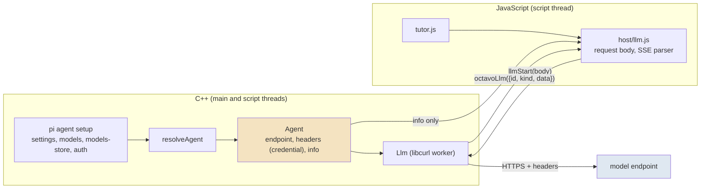
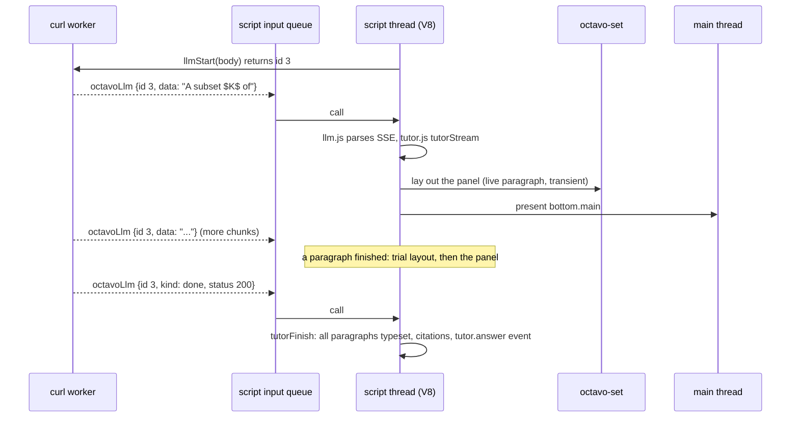
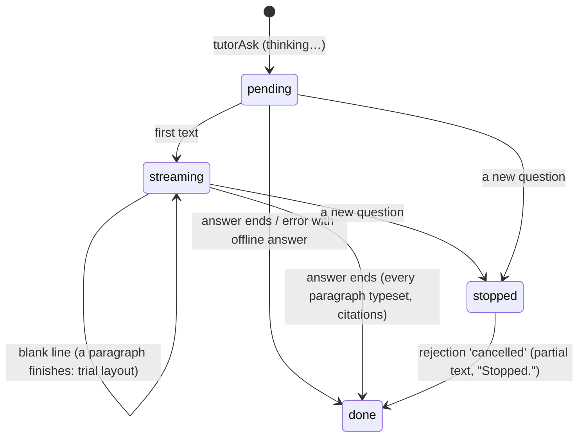

# Octavo, Part 6: The Tutor

**Octavo** is a reader for typeset mathematics on the Anbernic RG DS Plus. The RG DS Plus is a Linux handheld with two 1024 × 768 screens and a Mali-G52 GPU; the top screen only displays, and the bottom screen is a touch panel. Five earlier reports cover Phases 0 to 4:

- [[PROJECT REPORT - Octavo, Part 1 - Typst on a Handheld - Display Lists, Span Ids as Colours and a Page Shader on the RG DS Plus|Part 1]] showed that Typst can lay out a page on the handheld and that one shader program draws it at book quality.
- [[PROJECT REPORT - Octavo, Part 2 - The Reading Loop on the Handheld - Element Trees from V8, Prebuilt Pages and a Main Loop That Sleeps|Part 2]] built the reading program. V8 runs the runtime, each screen is described as an element tree, and the GPU draws the laid-out page.
- [[PROJECT REPORT - Octavo, Part 3 - The Development Loop - A Server on the Handheld, a WebGL2 Twin and a Parity Check|Part 3]] connected a browser IDE to the handheld. It also added the twin, an exact rendering of the device inside the browser, and a parity check that compares the two.
- [[PROJECT REPORT - Octavo, Part 4 - Reading State - An Event Log, Folds and Type That Changes Without Layout|Part 4]] made reading state durable. It is derived from a journal and shown in the type of every card title.
- [[PROJECT REPORT - Octavo, Part 5 - Ink - A Layer per Surface, a Compass of Span States and the Card on the Touch Screen|Part 5]] added ink on the touch screen, the compass of actions on a selection, notes and the memo swap.

This report covers Phase 5, the tutor. The design guide describes the phase in one sentence: "The vendored network module and agent setup; `tutor.js` with policy, context and citations; streaming answers with per-paragraph typesetting; the offline fallback from card headers." The phase was built in six steps, 5a to 5f, each with commits and diary entries in the repository.

The guide sets no exit criteria for Phase 5. I set five, and all five hold on the handheld:

- **No script can read the credential.** The key or token goes from the pi agent setup into request headers built by C++. JavaScript receives a description of the model without it.
- **An answer is shown while it arrives.** The first words appear as soon as the model sends them. Each finished paragraph is typeset, and the paragraph still being written is shown as plain text.
- **A formula that Typst rejects costs one paragraph, not the answer.** Each finished paragraph is laid out alone before it joins the conversation; a paragraph that fails stays plain text.
- **The tutor answers without a model.** With no setup, a refused connection, a refused credential or `--no-tutor`, the answer comes from the card's `tutor:` header, with a note that says why.
- **The cost is known.** On the handheld, the first text from a mock model on the desktop appears 10–35 ms after the mock begins to send it. A finished paragraph typesets in 2.5–22 ms. Three real questions were answered correctly, with first text after 1.6–2.3 s.

> [!summary]
> - **The model is resolved in C++ and reached from a worker thread.**
>   - Lattice's network module reads the pi agent setup, builds the endpoint and the headers, and streams the response with libcurl on its own thread.
>   - JavaScript gets `llmInfo()`, which describes the provider, model and API, and `llmStart(body)`, which takes a request body without credentials.
> - **Each piece of the answer is a script input.**
>   - The worker hands every chunk to the script thread's input queue as a call to `octavoLlm`. Chunks therefore reach JavaScript in order, between button presses, on the thread that owns all state.
>   - Promise continuations used to run after the frame was drawn. `octavoSettle`, called after every input, fixes that for the whole runtime.
> - **Paragraphs are the unit of typesetting.**
>   - The paragraph being written is grey plain text, laid out again at most every 150 ms.
>   - A finished paragraph gets a trial layout on its own page. It is shown typeset if Typst accepts it and as plain text if not.
>   - Pages made while an answer streams are transient: they are kept in memory only, four at a time, and never written to the layout cache.
> - **On the handheld a paragraph costs about 7 times what it costs on the desktop.** The mean is 10.6 ms against 1.5 ms. A live update takes 10–20 ms of script time, and a finished paragraph 27–44 ms. None of it is on the render thread.

## 1. Terms

Parts 1 to 5 defined cards, spans, span ids, span states, element trees, display lists, slots, page keys, prebuilt pages, the layout helper (`octavo-set`), the journal, the twin, the parity check, the compass and selections. This part adds the following terms, in dependency order.

- **Model.** A language model reached over HTTP that streams its answer. The handheld speaks two APIs: `openai-completions` (the chat completions format) and `anthropic-messages`.
- **pi agent setup.** The directory in which the pi coding agent keeps its provider configuration, by default `~/.pi/agent`. Its files are `settings.json`, `models.json`, `models-store.json` and `auth.json`. On the handheld, `HOME` is `/storage`, so the setup is `/storage/.pi/agent`.
- **Agent.** The C++ value that results from resolving a setup and a model name. It holds the endpoint, the request headers including the credential, an `info` object without the credential, and an error string when resolution failed.
- **Intent.** One of six kinds of question: explain, example, counterexample, unwind, why it matters, picture it. Each has a fixed wording with the selection's label filled in.
- **Chooser.** The row of six intents at the bottom of the tutor tab. L and R move along it, A asks, B closes it.
- **Chunk.** One piece of the HTTP response body as libcurl delivers it. A chunk can end anywhere, including inside a UTF-8 character or a server-sent event.
- **Server-sent events (SSE).** The response format of both APIs. Events are separated by a blank line, and each carries one or more `data:` lines with a JSON object.
- **Live paragraph.** The last paragraph of an answer that is still arriving. It is shown as grey plain text.
- **Finished paragraph.** A paragraph followed by a blank line, or the last paragraph once the answer has ended.
- **Trial layout.** A layout of one finished paragraph on its own page, used to find out whether Typst accepts it and how long it takes.
- **Transient page.** A page laid out while an answer is streaming. It is kept in a separate in-memory list of four and is never written to the layout cache on the SD card.
- **Offline answer.** The text in the card's `tutor:` header for the chosen intent, shown when no model answers.
- **Citation.** A card reference under an answer: the card the question was about, plus any required card whose title or terms appear in the answer.

## 2. The problem

Until this phase, every input to the runtime came from the person holding the device: a button, a touch, a timer that the runtime itself had set. A tutor adds an input that comes from the network. It arrives at unpredictable times, in pieces of arbitrary size, over several seconds, and it may stop with an error at any point. It also requires a credential, and the runtime executes book scripts that should never be able to read one.

The content of the answer causes a second difficulty. The model writes mathematics as LaTeX between dollar signs. Octavo lays out every page with Typst and converts LaTeX formulas with mitex. Most formulas convert, and a formula mitex cannot convert is already set as grey TeX source by `octavo-set`. Some formulas, however, convert to Typst that fails the whole compile. During 5b I tried several on the host:

| Formula in the answer | What happens |
| --- | --- |
| `\left( x` | Typst: "unclosed delimiter" |
| `\frac{a}`, `\over`, `\binom{a}` | Typst: "missing argument" |
| `\mathbb` alone | Typst: "missing argument: body" |
| `\sqrt` alone | mitex panics |

A model can write any of these by accident. If such a formula went into the page that holds the whole conversation, that page would not lay out, and the reader would see nothing at all.

The third difficulty is cost. Part 2 measured layout on the handheld at several to tens of milliseconds per page. An answer of 500 characters arrives in a few hundred chunks. Laying out the conversation once per chunk would keep `octavo-set` busy for the whole answer, and it would fill the layout cache with pages that are never shown again.

The requirements that follow from these three problems are:

| Requirement | Consequence for the design |
| --- | --- |
| No script reads the credential | The request is sent from C++, which also builds the headers |
| Chunks arrive at any time | They become inputs on the script thread, like button presses |
| A bad formula must not hide the answer | Each paragraph is laid out alone before it is shown typeset |
| Layout is expensive | Only finished paragraphs are typeset; the live paragraph is plain text on a timer |
| Streamed pages are short-lived | They bypass the disk cache |
| Some devices and tests have no model | The card's header provides an answer |

## 3. Where the credential lives

### 3.1 Resolving the agent

Lattice, the earlier project on the same handheld, already talks to models from C++. Its network module consists of `net/agent` and `net/llm`. Octavo vendors both files unchanged from Lattice commit 74fe2cbf into `native/vendor/lattice/net/`, and records them in `PROVENANCE`. Lattice's `net/http` module is not copied, because the tutor uses only `net/llm`.

`resolveAgent` reads a pi agent setup the way pi does. The model comes from `models.json` or from the cached catalog in `models-store.json`. The credential comes from `auth.json` first (an OAuth access token or an API key), then from the provider's `apiKey`. The result is an `Agent`:

```cpp
struct Agent {
  std::string provider, model, api;   // api: "openai-completions" | "anthropic-messages"
  std::string endpoint;               // the URL requests are POSTed to
  std::vector<std::pair<std::string, std::string>> headers;   // including the credential
  js::JsValue info;                   // non-secret: provider, model, api, maxTokens, reasoning, compat, source
  std::string error;                  // set when the setup could not be resolved
};
```

The split between `headers` and `info` is the security boundary. `headers` never leaves C++, and `info` is what the script thread may hand to JavaScript. Its `source` field names where the credential came from ("auth.json oauth", "models.json apiKey", "key file") but not the credential.

`main.cpp` resolves the agent once, before the script thread starts, and prints the result:

```text
tutor: lunaroute/deepseek-4.1-flash (openai-completions, credential from auth.json oauth)
tutor: offline (--no-tutor): answers from the cards
```

The options are `--agent DIR` (default `$HOME/.pi/agent`), `--model PROVIDER/MODEL`, `--claude-key FILE` (a bare Anthropic key file, `anthropic-messages` at api.anthropic.com), `--llm-url URL` (replaces the provider's base URL, for mock models) and `--no-tutor`. The environment variables `OCTAVO_MODEL` and `OCTAVO_LLM_URL` set the same values as `--model` and `--llm-url`.

The default model is `lunaroute/deepseek-4.1-flash`, not the default in pi's `settings.json`. On both the desktop and the handheld, the settings name `openai-codex/gpt-5.6-luna`, whose API the handheld does not speak. Lattice's arena chose `lunaroute/deepseek-4.1-flash` for this handheld, and the tutor follows that choice.

The agent is resolved once because the setup is large (`models-store.json` alone is 150 KB). A dev `run` from the IDE replaces the script thread, and parsing the setup again on every run would cost time for nothing. The script thread receives a `shared_ptr<const Agent>` and builds its own `Llm` from it.

### 3.2 The natives

JavaScript sees the model through four natives on `__native`:

| Native | Returns | Purpose |
| --- | --- | --- |
| `llmAvailable()` | boolean | whether an agent was resolved |
| `llmInfo()` | `{provider, model, api, maxTokens, reasoning, compat, source}` or `{error}` | what the request body needs to know about the model |
| `llmStart(bodyJson)` | request id | send a streaming request; the body has no endpoint and no credential |
| `llmAbort(id)` | — | stop that request |

The request body is built in JavaScript, because its shape depends on the API and on the question, and both belong to the runtime. The endpoint and the headers are added in C++. A book script that calls `llmStart` directly can therefore spend requests, but it cannot read or redirect the credential, because it can neither see the headers nor choose the URL.



## 4. Answers as script inputs

### 4.1 From the worker to the script thread

`Llm::start(body, onData, onDone)` sends the request on a worker thread and calls `onData` for every chunk and `onDone` once at the end. Lattice passes these callbacks to its UI thread with a post function. Octavo's script thread already has an input queue: `ScriptThread::call(fn, json)` appends a call that the thread performs between other inputs. The callbacks therefore run inline on the worker and append a call to `octavoLlm`:

```cpp
v8->define("llmStart", [this, &llm, &llmIds, &llmSeq](const std::vector<JsValue>& a) {
  const int id = ++llmSeq;
  auto carry = std::make_shared<std::string>();   // one request's callbacks run in turn on its worker thread
  llmIds[id] = llm->start(
      a[0].str,
      [this, id, carry](std::string chunk) {
        std::string text = *carry + chunk;
        const size_t tail = utf8Tail(text);          // an incomplete character waits for the next chunk
        carry->assign(text, text.size() - tail, tail);
        text.resize(text.size() - tail);
        if (text.empty()) return;
        call("octavoLlm", /* {id, kind: 'data', data: text} */);
      },
      [this, id](lattice::net::Llm::Done d) {
        call("octavoLlm", /* {id, kind: 'done', status: d.status, error: d.error} */);
      });
  return JsValue::number(id);
});
```

Treating each chunk as an input has three consequences. Chunks reach JavaScript in the order they arrived, because the queue is first in, first out. They never run concurrently with a button press, because the script thread performs one input at a time. And each chunk is followed by the same steps as a button press: the runtime updates, lays out what changed, and sends element trees to the main thread.



### 4.2 Three details that the inline callbacks require

**The id race.** The callbacks run on the worker thread as soon as data arrives. With an inline post, `onData` can run before `Llm::start` has returned its own id to the caller. Lattice's pattern, an id box that the callback reads, relies on the post deferring to another thread, which is not the case here. The script thread therefore issues its own id (`llmSeq`), which the callbacks capture by value, and keeps a map from that id to `Llm`'s id for `llmAbort`.

**Split characters.** libcurl cuts the stream at arbitrary bytes, including the middle of "∈" or "–". If half a character were handed to V8 as a string, it would become U+FFFD. `utf8Tail` returns the length of an incomplete sequence at the end of a chunk; that tail is kept in `carry` and put in front of the next chunk. Only one request's callbacks touch its `carry`, and they run one after another on one thread, so it needs no lock.

**Lifetime.** `Llm` is a local in `ScriptThread::run()`, declared after the V8 host, so it is destroyed first. Its destructor aborts and joins all transfers. The callbacks touch only `ScriptThread::call`, whose queue and mutex belong to the thread object, which outlives `run()`. When the IDE sends a new `run`, the old isolate's transfers are aborted before the new isolate starts.

### 4.3 Promise continuations ran after the frame

`js/host/llm.js` wraps a request in a promise, and `tutor.js` continues in `.then`. During 5a, a finished answer did not appear until the next button press. The cause was a defect that predates this phase.

V8's default microtask policy is `kAuto`: promise continuations run when the outermost call into V8 returns. Every entry point (`octavoPress`, `octavoTimer`, `octavoLlm`, …) is wrapped in `guard`, which calls `rt.update()` and computes the next timer before returning. The continuation ran after that, so a continuation that changed state was not drawn, and a timer it set was not known to the thread, which then slept until the next input. The IDE's flow runner had worked around this by calling `rt.update()` inside its own `.then`.

The fix applies to every entry point. After each call, the script thread calls one more function:

```js
globalThis.octavoSettle = function () {
  try { if (rt && rt.dirty) rt.update(); } catch (e) { if (host) host.error(e); }
  return host ? host.nextTimer() : -1;
};
```

By the time `octavoSettle` is called, the outer call has returned and V8 has run the microtasks. `octavoSettle` draws what they changed, and its return value replaces the timer computed by the entry point. The twin does the same in a microtask queued after each call (`Promise.resolve().then(() => this.settle())`), so the twin and the device stay in step.

## 5. The request

### 5.1 Rules, intents and context

The system prompt is `TUTOR_RULES`, the IDE's rules with one sentence added:

```text
You are the tutor inside Octavo, a mathematics reading app on a handheld with a 4.3-inch screen.
The student studies abstract mathematics (topology, sheaf theory, category theory).
Answer in at most 110 words of plain prose: no headings, no bullet lists, no Markdown emphasis.
Write inline mathematics as LaTeX between single dollar signs, e.g. $\mathcal F(U)$.
Separate paragraphs with a blank line.
Be exact. Use the notation and definitions of the card you are given.
When the student is working on an exercise, give the smallest useful hint, never the full solution.
If you use a fact that is not on the card, say briefly where it comes from.
```

The added sentence, "Separate paragraphs with a blank line.", is what makes paragraph-by-paragraph typesetting possible. Section 7 shows how often models follow it.

The question is one of six intents, each a template over the selection's label:

| Intent | Question |
| --- | --- |
| explain | Explain *label* in plain words, and say why it matters here. |
| example | Give one concrete example of *label*, checked against the definition. |
| counterexample | Give a near miss: something that is almost *label* but fails one condition. Say which. |
| unwind | Unwind the definition of *label* down to sets and functions, step by step. |
| why it matters | Why is *label* defined this way? What would go wrong otherwise? |
| picture it | Describe a picture I could sketch to understand *label*. |

`tutorContext(sel)` builds the user message from:

- the card the selection belongs to, with its kind, number, title and body;
- up to four cards it requires, each cut to 600 characters, under "It uses:";
- the exercise, if a quest is running;
- the selection, if it is narrower than the card;
- up to three of the reader's notes on the card.

The request is `{system: TUTOR_RULES, messages: [{role: 'user', content: context + '\nRequest: ' + question}], maxTokens: reasoning ? 4096 : 1024, effort: 'low'}`. For Definition 8.3 (Sheaf), the prompt is 557 tokens.

### 5.2 Two APIs in one adapter table

`js/host/llm.js` turns that request into a body for the model's API and parses the response. It is adapted from Lattice's `js/arena/sample.js`, without tools, tiers or images, which the tutor does not use. Each API is an adapter with four functions:

| | openai-completions | anthropic-messages |
| --- | --- | --- |
| system prompt | first message, role `system` | `system` field |
| token limit | `max_tokens`, or the field named by `compat.maxTokensField`; min(request, model) | `max_tokens`; min(request, model) |
| reasoning | `reasoning_effort` only when `compat` allows it | — |
| usage while streaming | `stream_options.include_usage` unless `compat` says it is unsupported | always sent |
| text | `choices[].delta.content` | `content_block_delta` with `text_delta` |
| end | `finish_reason` | `message_delta.stop_reason` |

The SSE parser keeps a buffer, splits it at blank lines, joins the `data:` lines of each event, skips `[DONE]`, and passes the JSON to the adapter. A malformed event is skipped. After every event that changed the text, `onText(text)` is called with the whole answer so far. The time from the request to the first change is recorded as `firstMs`.

Failures become one of nine codes, following Lattice's table:

| Code | Cause | What the reader sees |
| --- | --- | --- |
| `not_granted` | HTTP 401 or 403 | "The model did not accept this handheld's credential, so the tutor is offline." |
| `rate_limited` | 429, 529, or an error type naming rate limits or overload | "Too many requests for now. Try again in a little while." |
| `prompt_too_large` | 413, or a message about length | "The question was too long for the model." |
| `invalid_request` | 400 | the generic message |
| `api_error` | any other error | "The tutor could not answer just now. Try again." |
| `network` | curl reported an error, no response | "The network is not reachable, so the tutor is offline." |
| `cancelled` | `abort()` | "Stopped." |
| `refused` | the stop reason is a refusal or content filter | "The tutor declined that request. Try asking it differently." |
| `empty_completion` | the answer ended with no text | the generic message |

Whenever a card has an offline answer for the intent, a failure shows that answer with the message as a note.

## 6. From a stream to typeset paragraphs

### 6.1 The states of an answer

An answer is a message object in the card's conversation. It moves through these states:



`tutorStream(msg, text)` is called with the whole text so far. It splits the text into paragraphs at blank lines (`/\n[ \t]*\n/`), and the last element is the live paragraph. Every paragraph before it that has no entry in `msg.paras` gets a trial layout now:

```js
tutorStream(msg, text) {
  if (msg.done || msg.stopped) return;
  msg.text = text;
  const ps = paragraphs(text);
  const live = ps.pop();
  let grew = false;
  while (msg.paras.length < ps.length) { msg.paras.push(this.tutorPara(ps[msg.paras.length])); grew = true; }
  if (msg.pending || grew) {          // the first words, or a paragraph finished: at once
    msg.pending = false; msg.live = live; msg.gen++; this.changed(); return;
  }
  if (msg.liveTimer) return;          // the next layout of the live paragraph is already due
  const gen = msg.gen;
  msg.liveTimer = true;
  this.host.after(LIVE_MS, () => {    // LIVE_MS = 150
    msg.liveTimer = false;
    if (msg.done || msg.gen !== gen) return;
    msg.live = paragraphs(msg.text).pop();
    this.changed();
  });
}
```

Two kinds of change are shown at once: the first words, which end the "thinking…" state, and a finished paragraph. Any other growth of the live paragraph waits for a timer. The timer starts with the first chunk after a layout and fires 150 ms later. The generation counter `gen` lets a timer that is overtaken by an immediate update do nothing.

### 6.2 The trial layout

`tutorPara(text)` lays out one paragraph alone, in the panel's style and at the panel's width:

```js
tutorPara(text) {
  const tree = { t: 'page', w: 1024, style: 'panel', c: [{ t: 'p', c: O.md(text) }] };
  try {
    const page = this.set(tree, true);    // transient
    return { text, plain: false, ms: page.ms };
  } catch (e) {
    this.host.log('warn', `tutor: a paragraph did not typeset, shown as plain text: ...`);
    return { text, plain: true };
  }
}
```

The page itself is not shown. Its purpose is the outcome: if Typst accepts the paragraph, the same content goes into the panel's tree as typeset text; if not, the panel receives the paragraph as a plain string, which cannot fail. The panel is then laid out with only paragraphs known to compile. The trial costs one extra layout per paragraph, and in return its time is the per-paragraph typesetting cost that the guide asks about.

When the answer ends, `tutorFinish` splits the final text once more. It gives a trial layout to any paragraph that is new or whose text changed, which includes the last paragraph. It then finds the citations, emits the `tutor.answer` event and logs one line:

```text
[js info] tutor: mock/mock-tutor, first text after 422 ms, complete after 1552 ms, 504 chars in 3 paragraphs
          (typeset 11.1 + 17.2 + 4.8 ms), usage {"completion_tokens":84}
```

### 6.3 Transient pages

`PageStore::set(treeText, stats, transient)` gained a third parameter. A transient page is looked up only in memory and is kept in its own list of four (`kKeepTransient`). It is never read from the prebuilt pages or the disk cache, and never written to `cache/layout`. The runtime passes `transient` for the trial layouts and for the panel while `tutorBusy` is set:

```js
const chat = this.tab === 'chat' && !this.swapped() && !this.compass;
panel = this.set(O.panel.panelTree(this, pb), chat && !!this.tutorBusy);
this.present('bottom.main', panel, chat ? { scroll: Math.max(0, panel.h - 768) } : undefined);
```

Without this, every live update would have added a file to `cache/layout`, which is never pruned, and would have pushed the book's own pages out of the 64-page memory list. The final panel, laid out after `tutorBusy` is cleared, is an ordinary page, so returning to the tab later lays nothing out.

The panel is presented scrolled to its end, so the newest text is on screen. Its text is 24 pt on a 34 px line pitch, and the tab shows the last two exchanges; older ones are counted in a line such as "1 earlier question on this card".

## 7. The tutor tab

### 7.1 Entry points

| Input | Effect |
| --- | --- |
| Y | opens the chooser about the focused span, or about the card |
| Y held | the same, with the toast "no microphone here: choose a question with L and R" |
| compass N (ask) | opens the chooser about the compass's selection |
| compass S (transform) on a term | asks "unwind" directly |
| compass S on another selection (not a hypothesis, not ink) | asks "example" directly |
| compass S on an ink region | dimmed: "transcribing ink needs a model that reads pictures" |

The compass's N word and Y held were placeholders in Phase 4. The prompt line on the top screen now offers "Y ask".


The chooser is six spans in a typeset row. The chosen one carries the focus state, so L and R change span states and lay nothing out. On the handheld, R in the chooser reached the screen in 5.7–9.6 ms with 0 layouts. This is the same pattern as the compass in Part 5. While the chooser is open, `resolve()` asks `chatVerbs()` first, so L, R, A and B mean previous, next, ask and close.

### 7.2 What a conversation looks like

`chatBlocks` in `js/views/panel.js` builds the tab's content:

- each question in grey italic, led by "you" in small caps;
- each answer led by "tutor" in small caps;
- "thinking…" in grey italic while the answer is pending;
- the typeset paragraphs, the plain ones as text, and the live paragraph in grey;
- the citation line in grey italic ("— Definition 8.3, Definition 8.2"), with "from the card" for an offline answer;
- the note, if any ("Stopped.", or why the answer came from the card).

The live paragraph shows the model's raw text, dollar signs included. The two screenshots below show the same kind of answer while it streams and after it ends.


### 7.3 Offline answers and citations

Cards may carry a `tutor:` header with an entry per intent, as the IDE's presets already do. When no model answers, `tutorAsk` uses the entry for the chosen intent, marks the answer `offline`, and adds a note that says why:

- With no model configured: "No model is configured on this handheld, so the tutor answers from the card."
- After a failure: the message from the table in section 5.2.

When the card has no entry for the intent, the note is followed by "From the card:" and the card's first sentence. That sentence is cut at 240 characters if necessary. The cut is made at a word boundary and never inside a formula: it backs up before an unbalanced `$` and ends with "…". The first tutor parity picture showed a stray `$`, which exposed this defect in `firstSentence`. Notes kept with the compass had had the same defect since Phase 4.


A live answer cites the card it is about. It also cites every card in that card's `requires` list whose title or terms appear in the answer's text. All three real answers about Definition 8.3 were cited "Definition 8.3, Definition 8.2", because they use the word "presheaf", which is a term of Definition 8.2.

### 7.4 Events

The journal records `{ev: 'tutor.ask', about, intent}` and `{ev: 'tutor.answer', about, intent, paras, offline[, error]}`. The answer's text and timings are not journaled. Timings go to the log line, so the parity check, which compares events, is not affected by them. Conversations are kept per card for the session, as in the IDE.

## 8. Testing without a model

### 8.1 Unit tests

`js/test/tutor.test.js` has four tests:

- The offline chooser and answer.
- A live answer from a fake model. The live paragraph is plain and its page transient, a finished paragraph is typeset, a rejected one is plain, and the citations are found.
- Failure and cancellation.
- `host/llm.js` against a fake native. This covers both APIs, a stream cut every 7 or 13 bytes, a 401, a network failure and a cancel.

All 23 JavaScript tests pass.

### 8.2 Parity

The twin has no model, and a real model answers differently every time. The parity check therefore sends the device `run` with `tutor: false`, and both sides answer from the cards. Three new sequences pass on the host's octavo-dev:

| Run | Inputs | Messages compared |
| --- | --- | --- |
| ask-tutor, offline (Y R A Y A) | 5 | 25: 5 events, 7 states, 11 presents, 2 ink |
| sheaves, transform through the compass (DOWN X DOWN A Y L A) | 7 | 29 |
| sheaves, talk (HOLD_Y L B) | 3 | 15 |

The seven parity runs of Phases 2 and 4 also pass with the new prompt line. All ten show 0.000 % of pixels beyond the tolerance.

### 8.3 A mock model

`scripts/22-mock-model.py PORT` serves both APIs and streams a three-paragraph answer about the Heine–Borel theorem. It waits `--first-ms` (default 400) before the first piece and then sends `--words` words every `--chunk-ms`. It can instead answer with an error `--status`, or stream a different `--answer` file. It logs each request with its path, model, system-prompt length, last user message and header *names*, never header values.

On the host, `scripts/24-host-tutor.sh` ran the real app under Xvfb against four mocks. The scenarios covered both APIs, a 401, a paragraph containing `\left( x`, an unreachable server, `--no-tutor`, and a second question while the first was still waiting. Every path behaved as designed. On the desktop, a paragraph typesets in 0.6–3.7 ms.

## 9. Measurements on the handheld

### 9.1 Setup

`scripts/25-device-phase5.sh` runs the installed app on the handheld with `--measure`, driven over ssh through the control FIFO. Books, pi setups and data directories go under `/storage/octavo/bench/`, which is removed at the end. The mocks run on the desktop, bound to all interfaces, and the handheld reaches them over Wi-Fi at the desktop's address. This setup exercises the handheld's whole path: its libcurl 8.21.0 with OpenSSL 3.6.3, its TCP stack and Wi-Fi, and the SSE parsing in V8 on the Cortex-A55. Each scenario waits for the log line of a finished answer instead of a fixed time.

| Scenario | Configuration |
| --- | --- |
| notutor | `--no-tutor` |
| offline | a pi setup whose base URL is `http://127.0.0.1:1/v1` (connection refused) |
| badkey | `--claude-key` with a file that holds no valid key; api.anthropic.com over TLS |
| openai, anthropic | the desktop's mock, in each API |
| broken | an answer whose middle paragraph contains `\left( x` |
| fine | the mock sending one word every 15 ms |
| stop | the mock waiting 2.5 s; a second question is asked meanwhile |
| real | the handheld's own pi setup, three questions on Definition 8.3 |

### 9.2 Paths

| Scenario | Result on the handheld |
| --- | --- |
| notutor | the card's explanation, 354 characters, typeset in 8.6 ms |
| offline | `network: Could not connect to server` after 23 ms, then the card's example |
| badkey | `not_granted: authentication_error: invalid x-api-key` after 1316 ms, then the card's explanation |
| openai | first text 422 ms, complete 1552 ms, 3 paragraphs typeset in 11.1 + 17.2 + 4.8 ms |
| anthropic | 435 / 1558 ms, 13.6 + 15.1 + 4.5 ms |
| broken | "unclosed delimiter"; 3 paragraphs, 1 plain |
| fine | 415 / 1691 ms, 11.1 + 11.8 + 4.2 ms |
| stop | the first answer stopped after 3290 ms with 2 paragraphs shown; the second 2510 / 3643 ms |

The invalid-key request is the only test of TLS to the real API host with the handheld's OpenSSL and CA bundle. The 401 shows that the handshake, the certificate check and the request completed, and an invalid key spends no tokens. Its 1316 ms covers DNS, TCP, the handshake, the request and the response together.


In the stop scenario, the second question arrived 3.3 s after the first, because each press over ssh takes about 0.6 s. By then two paragraphs of the first answer had arrived. They are kept, typeset, with the note "Stopped.", and the second answer follows.


### 9.3 Latency


Against the same mock, the handheld shows the first text 10–35 ms after the mock begins to send (the mock waits 400 ms, or 2500 ms in the stop run); the host shows it after 2–4 ms. That difference covers the LAN, the connection and the parsing. Completion differs by about 20–25 ms. The transport adds nothing a reader would notice.

The real model, `lunaroute/deepseek-4.1-flash`, was faster on the handheld (first text 1.6–2.3 s) than on the desktop a few hours earlier (2.3–4.7 s). The handheld's own share is the same 10–35 ms as with the mock, so the difference lies on the model's side: its reasoning, which used 270–557 completion tokens for answers of about 150 tokens, and the gateway. While the model reasons, the reader sees "thinking…".

### 9.4 Typesetting a paragraph


A finished paragraph costs 2.5–22 ms to lay out on the handheld, with a mean of 10.6 ms over 13 paragraphs. On the desktop the range is 0.6–3.7 ms and the mean 1.5 ms. The cost grows with length: about 4–5 ms for 120 characters, 11–17 ms for 157–223 characters, and 22 ms for 555. The 2.5 ms point is the first paragraph of the second answer in the stop run, whose text had been laid out earlier in the same run. I did not determine why the second layout was faster.

### 9.5 The script's work while an answer streams


During the 1.3 s in which the mock streams its answer, the script thread performs nine calls that lay something out:

- **Six live updates.** Each takes 10–20 ms, of which 3–11 ms is layout of the panel.
- **Three calls that finish a paragraph.** Each takes 27–44 ms, of which 22–37 ms is layout. The call lays out the paragraph alone and then the panel, which now contains it typeset.

The throttle allows up to eight or nine live layouts in 1.3 s; six happened, because the timer starts only with the first chunk after a layout. The real answer shows the same pattern: four live updates of 11–20 ms and two paragraph calls of 35–36 ms.

None of this work is on the main thread. The bottom screen drew in 2.2–5.1 ms per frame throughout. The calls do delay input: a button pressed during a 40 ms call waits for it, because the script thread handles inputs in order. That delay was not measured.

### 9.6 The real answers

| Question on Definition 8.3 | First text | Complete | Answer | Paragraphs, typeset | Completion tokens |
| --- | --- | --- | --- | --- | --- |
| explain | 1801 ms | 2631 ms | 588 characters | 2: 16.6 + 4.8 ms | 270 |
| example | 2331 ms | 3412 ms | 555 characters | 1: 22.1 ms | 557 |
| unwind | 1577 ms | 2641 ms | 678 characters | 3: 10.0 + 9.9 + 9.2 ms | 346 |

The example is the sheaf of continuous real functions, with (S1) and (S2) checked. The unwinding ends with $\mathcal F(U)$ as the equalizer of $\prod_i \mathcal F(U_i) \rightrightarrows \prod_{i,j} \mathcal F(U_i \cap U_j)$. Both are correct.


The number of paragraphs varies. On the handheld the model gave 2, 1 and 3 paragraphs; on the desktop it had given 1 and 1. When an answer comes as one paragraph, the reader sees grey plain text until the end and the typeset form only then. With this model that wait is short, because most of the delay is reasoning before the first text: the text itself streams in 0.5–1.1 s.

### 9.7 Buttons and memory

Y, which opens the chooser and lays out the tab, reached the screen in 19–44 ms the first time and in 5–8 ms when the chooser's page had already been laid out. A, which asks and shows "thinking…", took 15–20 ms for a first question and 8–16 ms later. After the three real questions, the app's resident memory was 107 MB (peak 115 MB) and the helper's 29 MB.

## 10. Results

| Measure | Value | Section |
| --- | --- | --- |
| First text after the mock begins to send, handheld / host | 10–35 ms / 2–4 ms | 9.3 |
| Refused connection reported | 23 ms | 9.2 |
| Invalid key against api.anthropic.com (TLS, 401) | 1316 ms | 9.2 |
| Typesetting one paragraph, handheld | 2.5–22 ms, mean 10.6 ms | 9.4 |
| Typesetting one paragraph, host | 0.6–3.7 ms, mean 1.5 ms | 9.4 |
| Live update on the script thread, handheld | 10–20 ms (layout 3–11 ms) | 9.5 |
| Finished paragraph on the script thread, handheld | 27–44 ms (layout 22–37 ms) | 9.5 |
| Real model, first text / complete, handheld | 1.6–2.3 s / 2.6–3.4 s | 9.6 |
| Y (chooser) / A (ask) / R in the chooser, to screen | 19–44 (5–8 again) / 15–20 / 5.7–9.6 ms | 7.1, 9.7 |
| Prebuilt trees, compact-hausdorff and sheaves | 171 → 208 and 147 → 185 | 11 |
| Parity, host | 10 of 10 runs, 0.000 % beyond tolerance | 8.2 |
| JavaScript tests | 23 of 23 | 8.1 |

## 11. Prebuilt pages for the tutor tab

The prewarm walk of Part 2 visits every focusable span and records the trees the runtime would lay out. It now also presses Y and then B on each span before opening it, with the tab restored afterwards. This records the chooser's page and the empty tutor tab for every selection. The trees for compact-hausdorff grew from 171 to 208, and those for sheaves from 147 to 185. The chooser's text is the same with or without a model, so the build's pages serve both cases.

## 12. Defects found on the way

Each of these is recorded in the diary with its diagnostic.

- **Promise continuations ran after the frame** (section 4.3). This defect predates the phase; the IDE's flow runner had worked around it.
- **Two test assertions described Phase 4's placeholders.** The prompt line now offers Y, and compass N is no longer dimmed.
- **`tutor.answer` carried `error: undefined`.** The key is now set only when there is an error.
- **A double rule.** With the chooser open on an empty conversation, its rule sat under the tabs' rule. The rule is now drawn only when something precedes it.
- **`firstSentence` cut inside a formula** (section 7.3).
- **The host scenarios answered nothing on the first run:** `octavo: another lattice-ds instance is running (lock /tmp/octavo.lock)`. My own octavo-dev on the desktop held the lock.
- **The log line of a network error said "network:" twice.** The rejection's message carried the prefix, and the log line added the code again. This is fixed in the repository, but not yet on the handheld.

## 13. Deviations from the guide

| Guide | Implementation | Reason |
| --- | --- | --- |
| "each finished paragraph is sent to `octavo-set` and replaced by its typeset form" | each finished paragraph gets a trial layout alone; then the panel is laid out with it typeset or plain | one formula Typst rejects would otherwise fail the whole panel |
| the plain live paragraph | as planned, laid out again at most every 150 ms | one layout per chunk would keep `octavo-set` busy for the whole answer |
| answers from `tutor:` headers when no model is available | also after any failure, with the reason as a note | a failed request should not leave the reader with nothing |
| — | transient pages, kept out of the disk cache | streamed pages would fill the cache and push out the book's pages |
| — | `octavoSettle` after every call | promise continuations were not drawn (section 4.3) |
| the IDE's tutor | the same rules plus "Separate paragraphs with a blank line." | the per-paragraph design depends on blank lines |

## 14. What Phase 5 decides

- **The network is an input source like the buttons.** Chunks enter the script thread's queue and are handled in order between presses. Every later feature that talks to a server can use the same path without locks in JavaScript.
- **The credential boundary is the request body.** JavaScript builds the body; C++ chooses the URL and adds the headers. A script can spend requests but cannot read or redirect the credential.
- **A layout that may fail gets a trial first.** Content that Octavo does not control, here a model's answer, is laid out in small units whose failure is contained. The same rule applies to any user-written text that later phases display, such as proof steps.
- **Short-lived pages stay out of the cache.** The `transient` flag is now part of the page store's interface, available to any view that changes many times a second.

## 15. Limitations and open questions

- **Answers that come as one paragraph are shown plain until they end.** If longer single-paragraph answers become common, a sentence boundary could serve as a second split point for the live part.
- **Each finished paragraph lays out the whole panel again.** The panel's tree contains every paragraph, so the cost of a finished paragraph grows with the conversation. Laying out each paragraph as its own page and stacking the pages would make the cost constant.
- **A button pressed during a paragraph call waits up to about 40 ms.** This was not measured on the handheld.
- **Conversations are not kept across a restart.** They could be stored per card under `dataAppend`, as notes are.
- **The tab is always scrolled to its end.** The bottom panel cannot yet be scrolled by hand, so an earlier part of a long answer cannot be reread while a new one streams.
- **No picture input.** Transcribing ink to LaTeX and checking a proof page need a model that takes images. Both stay dimmed or answer from the card.
- **The cause of the faster repeated layout (2.5 ms) is not known.**

## 16. Next steps

Phase 6 is flows: the quest and review flows, resuming them from the event log, and the proof builder. The tutor's `check` entry point, which today answers offline, belongs to the quest flow. A quest's hints are the first flow whose position must survive a restart, which is what resumption from the event log means.

## 17. Reproducing

```bash
cd /home/manuel/code/wesen/2026-10-17--octavo
T=ttmp/2026/10/17/OCTAVO-001--octavo-on-the-rg-ds-plus-a-typeset-maths-reader-with-a-browser-ide-and-a-device-dev-server
# the app with libcurl, the runtime tests (tutor.test.js among them)
cmake --build build/native && (cd js && npm test)
# a mock model, then the real app under Xvfb against it
python3 $T/scripts/22-mock-model.py 18441 --host 127.0.0.1 &
$T/scripts/24-host-tutor.sh OUT                       # all host scenarios; REAL=1 adds two real questions
# the handheld: build and deploy (nothing else may hold the display), then the scenarios and the figures
device/build.sh && device/deploy.sh
$T/scripts/25-device-phase5.sh OUT                    # SCENARIOS="openai stop" for a subset; 'real' spends 3 requests
python3 $T/scripts/26-phase5-analysis.py $T
# parity with the tutor offline on both sides, through octavo-dev (CODE on its screen; CHROME as in Part 3)
node $T/scripts/23-parity-tutor.cjs http://192.168.0.202:8170/ CODE OUT
```

## 18. Files

| Path (in `/home/manuel/code/wesen/2026-10-17--octavo`) | Role |
| --- | --- |
| `native/vendor/lattice/net/{agent,llm}.{hpp,cpp}`, `native/vendor/lattice/PROVENANCE` | the vendored network module |
| `native/src/js/script.{hpp,cpp}` | the `llm*` natives, `utf8Tail`, `octavoSettle` after every call |
| `native/src/app/pages.{hpp,cpp}` | transient pages |
| `native/src/app/main.cpp` | agent options and resolution, the `tutor` field of the dev link |
| `js/host/llm.js` | request bodies for both APIs, the SSE parser, error codes |
| `js/core/tutor.js` | rules, intents, context, `tutorAsk`, `tutorStream`, `tutorFinish`, `tutorPara`, offline answers |
| `js/views/panel.js` | `chatBlocks`: the tutor tab and the chooser |
| `js/core/runtime.js`, `js/core/compass.js`, `js/main.js` | the verbs, the compass's N and S, `octavoLlm` and `octavoSettle` |
| `ide/src/twin.js`, `ide/src/parity.js`, `ide/src/target.js` | settle in the twin; parity with `tutor: false` |
| `js/test/tutor.test.js` | the runtime's tests for this phase |
| `ttmp/2026/10/17/OCTAVO-001--…/scripts/22-mock-model.py`, `24-host-tutor.sh`, `25-device-phase5.sh`, `26-phase5-analysis.py` | the mock, the host and handheld scenarios, the analysis |
| `ttmp/2026/10/17/OCTAVO-001--…/reference/01-diary.md` | the working diary (Phase 5 is steps 24–26) |
| `ttmp/2026/10/17/OCTAVO-001--…/results/phase5/` | host and handheld logs, screens, figures, `device/summary.txt` |

## Related notes

- [[PROJECT REPORT - Octavo, Part 5 - Ink - A Layer per Surface, a Compass of Span States and the Card on the Touch Screen]]: the compass whose N and S words now reach the tutor; choosing as a span state, reused by the chooser
- [[PROJECT REPORT - Octavo, Part 4 - Reading State - An Event Log, Folds and Type That Changes Without Layout]]: the journal that records `tutor.ask` and `tutor.answer`
- [[PROJECT REPORT - Octavo, Part 3 - The Development Loop - A Server on the Handheld, a WebGL2 Twin and a Parity Check]]: the twin and the parity check, run here with the tutor offline
- [[PROJECT REPORT - Octavo, Part 2 - The Reading Loop on the Handheld - Element Trees from V8, Prebuilt Pages and a Main Loop That Sleeps]]: the script thread's input queue and the page store
