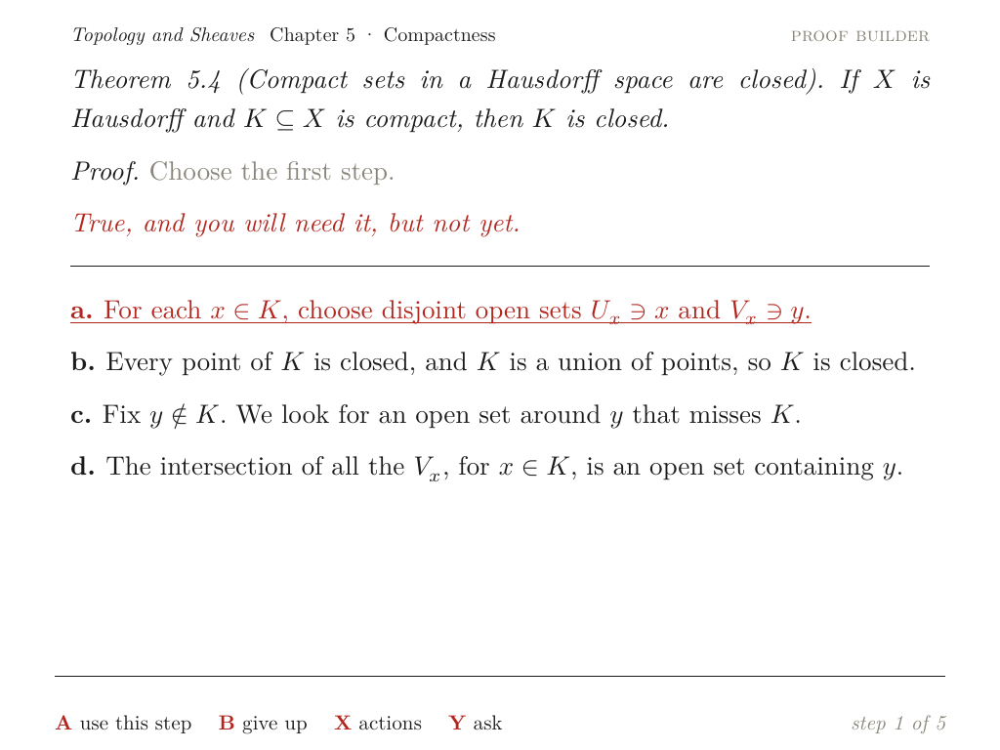
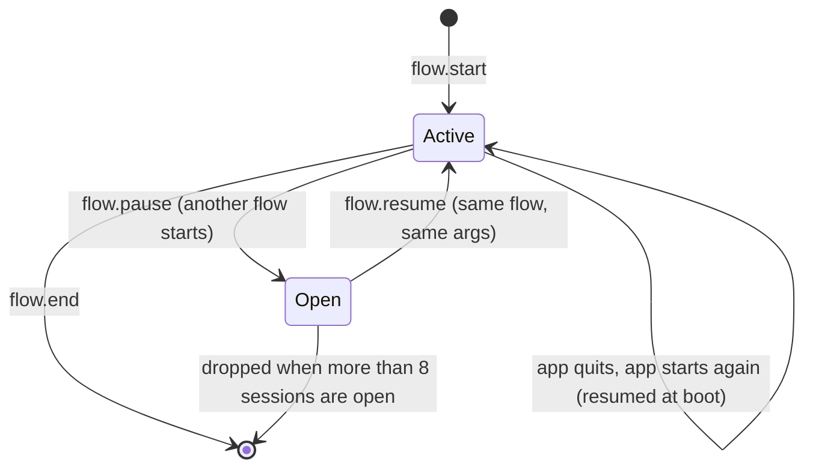
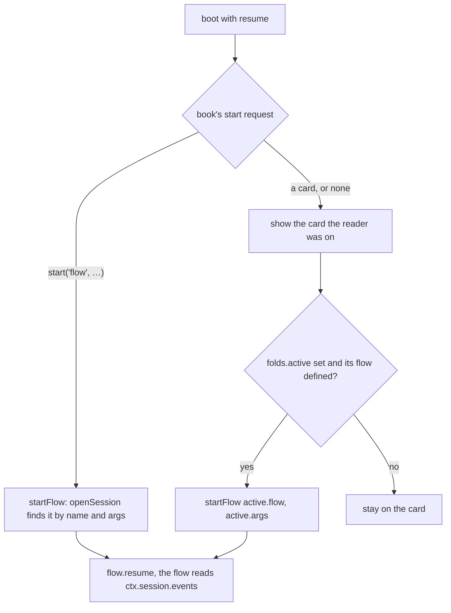
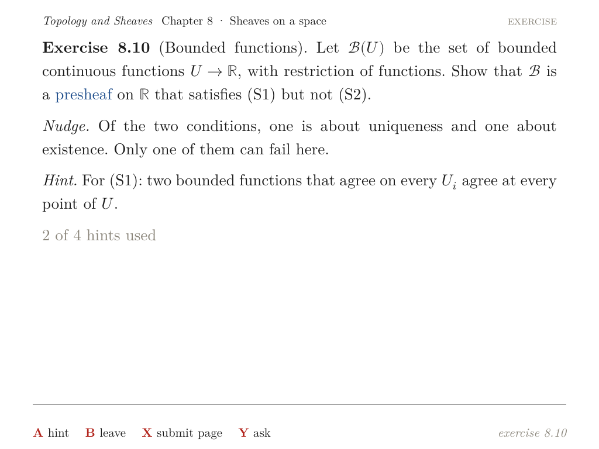
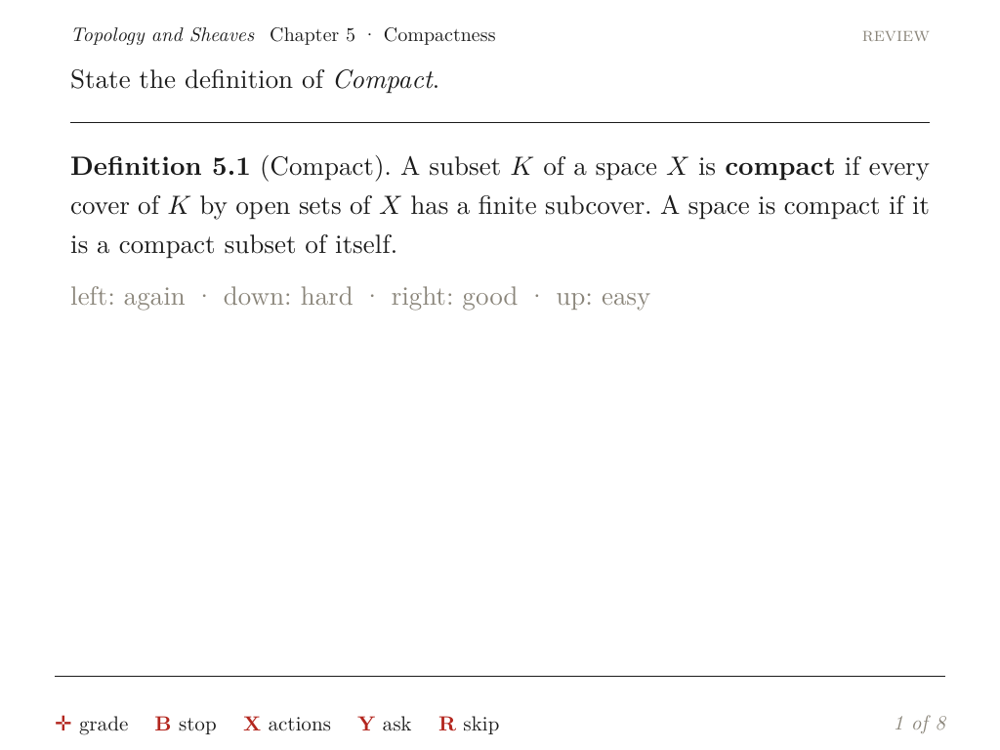
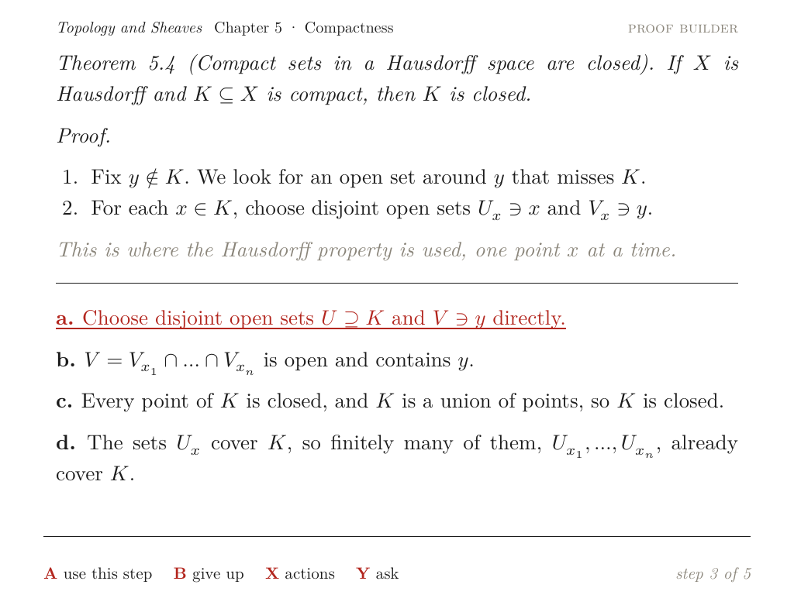
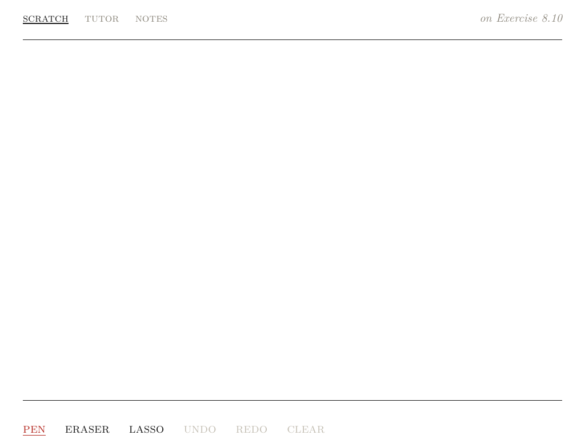
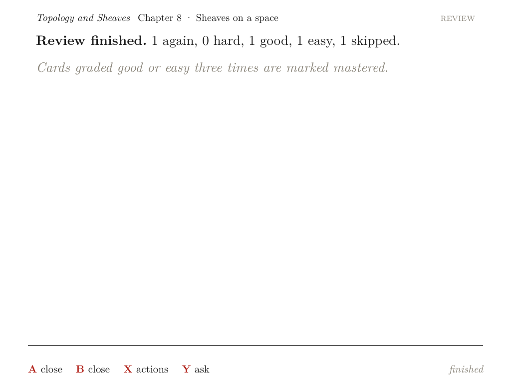
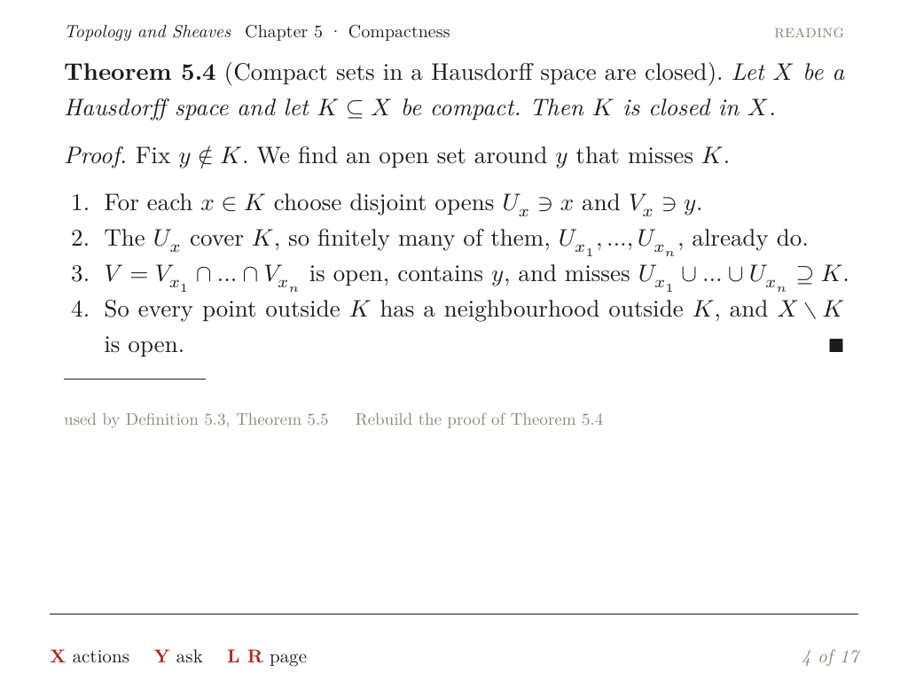
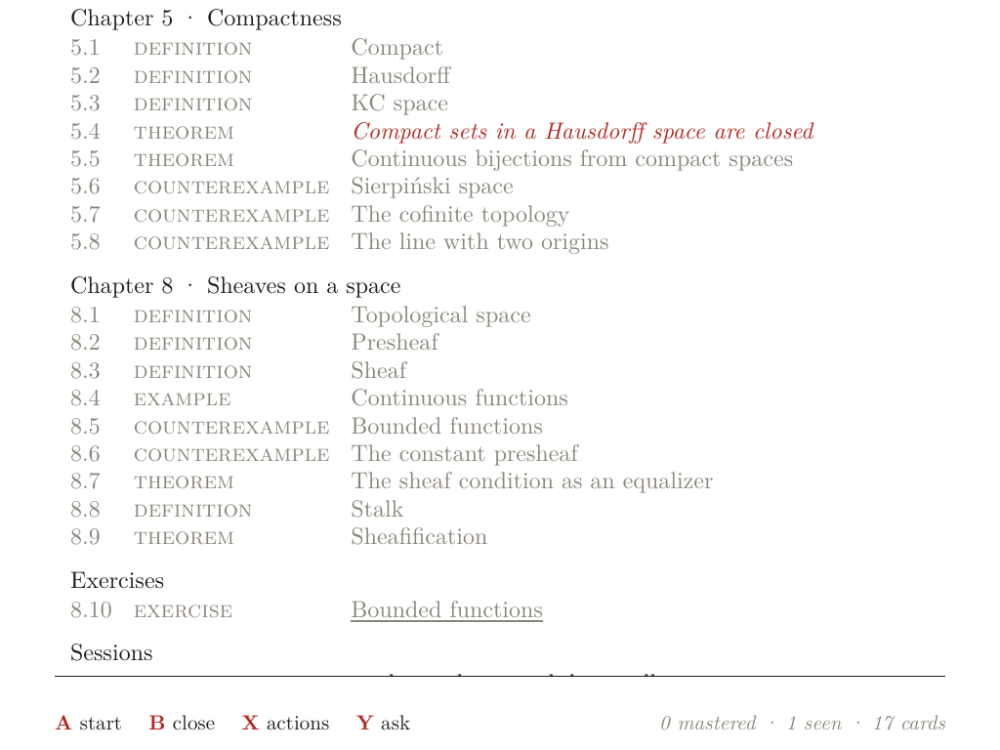

# Octavo, Part 7: Flows

**Octavo** is a reader for typeset mathematics on the Anbernic RG DS Plus. The RG DS Plus is a Linux handheld with two 1024 × 768 screens and a Mali-G52 GPU; the top screen only displays, and the bottom screen is a touch panel. Six earlier reports cover Phases 0 to 5:

- [[PROJECT REPORT - Octavo, Part 1 - Typst on a Handheld - Display Lists, Span Ids as Colours and a Page Shader on the RG DS Plus|Part 1]] showed that Typst can lay out a page on the handheld and that one shader program draws it at book quality.
- [[PROJECT REPORT - Octavo, Part 2 - The Reading Loop on the Handheld - Element Trees from V8, Prebuilt Pages and a Main Loop That Sleeps|Part 2]] built the reading program. V8 runs the runtime, each screen is described as an element tree, and the GPU draws the laid-out page.
- [[PROJECT REPORT - Octavo, Part 3 - The Development Loop - A Server on the Handheld, a WebGL2 Twin and a Parity Check|Part 3]] connected a browser IDE to the handheld. It also added the twin, an exact rendering of the device inside the browser, and a parity check that compares the two.
- [[PROJECT REPORT - Octavo, Part 4 - Reading State - An Event Log, Folds and Type That Changes Without Layout|Part 4]] made reading state durable. It is derived from a journal and shown in the type of every card title.
- [[PROJECT REPORT - Octavo, Part 5 - Ink - A Layer per Surface, a Compass of Span States and the Card on the Touch Screen|Part 5]] added ink on the touch screen, the compass of actions on a selection, notes and the memo swap.
- [[PROJECT REPORT - Octavo, Part 6 - The Tutor - A Credential Kept in C++, Answers as Script Inputs and a Trial Layout per Paragraph|Part 6]] added the tutor: a language model reached from C++, answers that stream in as script inputs, and paragraphs typeset one at a time.

This report covers Phase 6, flows. The design guide describes the phase in one sentence: "The quest and review flows; resumption from the event log; the proof builder." Its section 9.7 adds what resumption means: "a flow's position is rebuilt by folding its own events". The phase was built in five steps, 6a to 6e, each with commits and diary entries in the repository.

The guide sets no exit criteria for Phase 6. I set five, and all five hold on the handheld:

- **A flow left in the middle continues where it was.** This holds whether the flow was left by quitting the app, by starting another flow, or by killing the process. The exercise came back at two of four hints, the review at card 3 of 8, and the proof builder at step 2 of 5.
- **No flow saves its position.** Each rebuilds it from the events of its own session, and the snapshot of the journal's folds keeps those events, so resuming needs no full read of the journal.
- **The built-in flows and a book's own flow run on the device.** All of their screens are element trees. A book view can be written once for the IDE's React preview and once as a tree for the device.
- **Every flow screen is prebuilt.** Over 99 presses on the handheld, the layout helper laid out no page.
- **The twin and the handheld agree.** Parity passes for the exercise, the review and the proof builder, on the desktop and on the handheld.



> [!summary]
> - **A flow's session lives in the journal.**
>   - `flow.start`, `flow.pause`, `flow.resume` and `flow.end` carry a session id, and so does every event the flow emits while it runs.
>   - The snapshot's folds keep the open sessions with their events, at most 8 sessions of 1000 events each.
>   - Starting a flow with the same name and arguments as an open session resumes that session.
> - **Positions are rebuilt, not stored.**
>   - The exercise's hint tier is a fold over every `quest.hint`.
>   - The review's position and tally are its session's grades and skips.
>   - The proof builder's proof is its session's `proof.step` events, and the note under the proof comes from the last step or wrong turn.
> - **Book views are element trees on the device.** A view def may carry `tree` next to `render`. Three functions build the tree:
>   - `F` makes a focusable span;
>   - `tex` makes a formula;
>   - `parts` supplies markdown, cards and the running head.
> - **On the handheld, every press in a flow reaches the screen in 4.9–25.6 ms, all from prebuilt pages.** The one exception is leaving an exercise, which takes 39.2 ms. A start into a resumed flow shows its first page in 450–457 ms. A process killed right after a step loses nothing.

## 1. Terms

Parts 1 to 6 defined cards, spans, span ids, span states, element trees, display lists, slots, page keys, prebuilt pages, the layout helper (`octavo-set`), the journal, folds, the snapshot, the twin, the parity check, the compass, the tutor and the prompt line. This part adds the following terms, in dependency order.

- **Generator.** A JavaScript function declared with `function*`. Calling it returns an iterator, and each `next(v)` runs the body to its next `yield` and passes `v` in as the value of the previous `yield`.
- **Flow.** A multi-step activity written as a generator, for example an exercise, a review session or the proof builder. It is registered by name with `flow.define(name, fn, meta)` or built into the runtime.
- **Effect.** A value a flow yields. `ui.waitFor(verbs)` pauses the flow until the reader presses a button that resolves to one of `verbs`. A promise pauses it until the promise settles. The runner, `FlowRun`, performs the effect and resumes the generator with the result.
- **Session.** One run of a flow, from `flow.start` to `flow.end`, possibly across several starts of the app. It has a numeric id.
- **Open session.** A session that has started and not ended.
- **Active session.** The open session whose flow is running. At most one is active at a time. A session stops being active when another flow starts (`flow.pause`) or when it ends; quitting the app leaves it active.
- **Resume.** Starting a flow whose session is still open. The flow receives that session's events and continues from the position they describe.
- **Built-in flow.** A flow that the runtime provides: `quest` (an exercise) and `review` (a review session).
- **Book flow.** A flow defined by a book's script, such as the proof builder.
- **Exercise (quest).** A statement with tiers of hints and a list of checks, kept in a book's YAML. Its **hint tier** is the number of hints the reader has seen.
- **Box.** A card's level in the review: 0 after "again", raised by 1 for "good" and by 2 for "easy". At box 3 a card is marked mastered.
- **Proof builder.** A book flow that offers four candidate next steps of a proof at a time: the right one, one that comes later, and two traps. A wrong choice is explained in red under the proof.
- **Tree view.** A view def's `tree` function, which returns an element tree. A view def's `render` function returns HTML for the IDE's React preview.

## 2. The problem

The IDE runs flows with a small runner (`ide/src/runtime.js:367-398`). It keeps a flow's position where the generator keeps it, in local variables, plus two pieces of per-session view state: `tier:<id>` for an exercise and `box:<id>` for a card's review box. Reloading the page loses all of it. The guide accepted that for the IDE and deferred resumption to this phase. On the handheld it is not acceptable. The reader closes the lid, the battery runs out, or the Ports launcher ends the app, and an exercise half done must not start over.

The brainstorm's answer was a fold at the start of the flow:

```js
let tier = log.fold(hintsUsed(quest.id), 0)   // resume where you left off
```

On the handheld, that line has a cost that the brainstorm did not see. Part 4 made start-up cheap by reading a snapshot of the folds plus the journal's tail, not the journal. A fold over all events needs the whole journal, and Part 4 measured what that costs on the handheld: 580 ms for a synthetic year of daily reading (43 800 events), against 8 ms with the snapshot. Every flow start would pay the 580 ms again, once per app run.

The second difficulty is what "position" means for different flows. For an exercise it is one number, the hint tier, and it belongs to the exercise more than to any session: a reader who comes back to an exercise a week later has still seen those hints. For a review it is the list of cards fixed when the session began, an index into it, and a tally. For the proof builder it is the steps placed, the number of wrong turns, and the note shown under the proof. A design that stores "the position" as an opaque value would need a format for each, and a way to keep it consistent with the journal.

The third difficulty is the screens. The IDE's flow screens are React components that return HTML. The device's runtime builds element trees and has no HTML. The built-in screens can be ported by hand. A book's own flow comes with its own view, though, and book scripts run unchanged in the IDE preview, the twin and the device.

| Requirement | Consequence for the design |
| --- | --- |
| A flow survives a quit or a kill | Its position must be derivable from the journal, which is written before the screen changes |
| Resuming must not read the whole journal | The events a flow needs travel in the snapshot's folds |
| Positions differ per flow | Each flow rebuilds its own position from its own events; the runtime stores events, not positions |
| Several flows can be open | Events carry the session they belong to |
| The twin and the device must agree | Session ids are deterministic |
| Book views run on the device | A view can be an element tree, built with helpers that need no HTML |
| Flow screens should not wait for the helper | The prewarm walk must reach them |

## 3. Sessions in the journal

### 3.1 The events of a session

A session is delimited by four events. Every other event emitted while the session's flow runs carries the same `session` field.

```text
{ev:'flow.start',  flow, args, session}    a new session
{ev:'flow.pause',  flow, session}          another flow started; this session stays open
{ev:'flow.resume', flow, session}          an open session continues
{ev:'flow.end',    flow, result, session}  the flow returned (or threw: result 'error')
```



The flows' own events are small and named after what the reader did:

```text
{ev:'quest.start', quest}              {ev:'quest.hint', quest, tier, kind}
{ev:'quest.end',   quest, how}         {ev:'quest.done', quest, how, hints}    {ev:'quest.leave', quest, tier, done}
{ev:'review.start', cards}             {ev:'review.grade', card, grade, box}   {ev:'review.skip', card}
{ev:'proof.step', step}                {ev:'proof.wrong', step, trap | later}  {ev:'proof.built', theorem, wrong}
```

### 3.2 Tagging

Flows do not add the session to their events themselves. The runtime's `emit` does it for every event while a flow runs, except the `flow.*` events, which name their session explicitly:

```js
emit(ev) {
  const rec = Object.assign({ t: new Date(this.host.now()).toISOString() }, ev);
  // an event of a running flow carries its session, so the flow can find its own events when it resumes
  const fr = this.flowRun;
  if (fr && fr.session != null && rec.session === undefined && !/^flow\./.test(rec.ev)) rec.session = fr.session;
  this.events.push(rec);
  this.folds.apply(rec);
  this.host.journal(rec);
  return rec;
}
```

The runtime emits the `flow.*` events itself, always with an explicit `session`, and the test `rec.session === undefined` leaves an explicit session alone. The `flow.` exclusion is a second guard: a lifecycle event is never attributed to the running flow, even if a future caller omits its session. When a second flow starts, `pauseFlow` clears `flowRun` before `flow.start` is emitted, so the new session's events cannot pick up the old id either.

`host.journal` appends the line and flushes it before the screen changes (Part 4). `emit` returns the record, which the proof builder uses in section 4.3.

### 3.3 Open sessions in the folds

The folds are the summary of the journal that the snapshot stores. This phase adds the open sessions to them, with the events of each:

```js
applySession(ev) {
  const id = ev.session;
  if (typeof id === 'number' && id >= this.nextSession) this.nextSession = id + 1;
  switch (ev.ev) {
    case 'flow.start':
      this.sessions.delete(id);
      this.sessions.set(id, { flow: ev.flow, args: ev.args || {}, events: [] });
      while (this.sessions.size > Folds.MAX_SESSIONS) this.sessions.delete(this.sessions.keys().next().value);
      this.active = id;
      return;
    case 'flow.resume': {
      const s = this.sessions.get(id);
      if (s) { this.sessions.delete(id); this.sessions.set(id, s); this.active = id; }   // the most recent last
      return;
    }
    case 'flow.pause':
      if (this.active === id) this.active = null;
      return;
    case 'flow.end':
      this.sessions.delete(id);
      if (this.active === id) this.active = null;
      return;
    default: {
      const s = this.sessions.get(id);
      if (s && s.events.length < Folds.MAX_SESSION_EVENTS) s.events.push(ev);
    }
  }
}
```

A `Map` keeps insertion order, so deleting and re-inserting on `flow.resume` moves the session to the end. When more than `MAX_SESSIONS = 8` are open, the oldest one is dropped. A session keeps at most `MAX_SESSION_EVENTS = 1000` events.

Three other folds hold state that belongs to an exercise or a card rather than to a session:

| Fold | Built from | Used by |
| --- | --- | --- |
| `questTier: Map<quest, tier>` | the highest `quest.hint` tier per exercise | the exercise flow, the contents |
| `questState: Map<quest, 'started' \| 'done'>` | `quest.start`, `quest.done` | the contents |
| `boxes: Map<card, box>` | the last `review.grade` per card | the review flow |

The snapshot's version went from 1 to 2. A start that finds a version-1 snapshot ignores it and reads the whole journal once, as Part 4 designed for any change to the folds.

### 3.4 Session ids

A session's id is `max(folds.count, folds.nextSession)`: the number of events folded so far, or one more than the largest id seen, whichever is larger. It is a function of the journal, not of a clock or a random source. The twin and the handheld therefore assign the same ids for the same presses, so the parity check can compare events with their `session` fields included. The second term guarantees that no id is used twice.

### 3.5 Starting and resuming

`startFlow(name, args)` is the one way to start a flow. It serves the contents, a card's link, a book's `start('flow', …)` and a script's call alike.

```js
startFlow(name, args, opts) {
  const fn = this.flowFn(name);                 // a book flow, else a built-in one
  args = args || {};
  if (this.flowRun) this.pauseFlow();           // emits flow.pause for the running one
  let id = opts && opts.fresh ? null : this.folds.openSession(name, args);
  const resumed = id != null;
  if (resumed) this.emit({ ev: 'flow.resume', flow: name, session: id });
  else { id = this.folds.sessionId(); this.emit({ ev: 'flow.start', flow: name, args, session: id }); }
  const s = this.folds.sessions.get(id);
  const session = { id, resumed, events: s ? s.events : [] };
  const ctx = Object.assign({ rt: this, args, session }, this.api);
  this.flowRun = new FlowRun(this, fn.call(null, ctx, args), name, id);
  this.flowRun.step(undefined);
}
```

`openSession` returns the most recent open session of the same flow whose arguments serialize to the same JSON. Matching on name and arguments means that every way into a flow comes back to the open session. Starting Exercise 8.10 from the contents, from the Sheaf card, or from a script resumes the same session, and no separate "continue" entry is needed. `opts.fresh` starts a new session regardless; the prewarm walk uses it (section 7).

### 3.6 At boot

The app's start differs in one point from a start through `startFlow`: nothing has asked for the flow. Two cases arise.

- **The book opens on a flow** (`start('flow', 'build')`). The first screen is the flow, and starting it finds the open session by name and arguments. Nothing else is needed.
- **The book opens on a card.** The folds' `active` field says whether a flow was running when the journal ends. If it was, the runtime first shows the card the reader was on and then starts that flow again, which resumes it. Leaving the flow then returns to the card, as it would have before the quit.



A flow that was paused by another flow is not brought back at boot. Its session stays open, and the reader resumes it from the contents or from its card. A flow left with B has returned, so its session has ended.

### 3.7 A trace

The following is the handheld's journal for the exercise scenario, without `screen.show` events. The app was quit after the second hint and started again on the same data:

```text
card.open      {"card": "compact-closed"}                    first start, the book's first card
flow.start#2   {"flow": "quest", "args": {"id": "bounded-glue"}}
quest.start#2  {"quest": "bounded-glue"}
quest.hint#2   {"quest": "bounded-glue", "tier": 1, "kind": "nudge"}
quest.hint#2   {"quest": "bounded-glue", "tier": 2, "kind": "hint"}
                                                             quit
card.open      {"card": "compact-closed"}                    second start: the card first
flow.resume#2  {"flow": "quest"}                             then the active session, resumed
quest.hint#2   {"quest": "bounded-glue", "tier": 3, "kind": "hint"}
quest.leave#2  {"quest": "bounded-glue", "tier": 3, "done": null}
flow.end#2     {"flow": "quest", "result": "left"}
```

The second start's log line shows what boot read: `history: 7 events, 841 bytes … folded 1.6 ms, snapshot saved … first screen quest`. There is no second `quest.start`, because the flow emits it only for a new session.



## 4. Rebuilding a position

### 4.1 The exercise

```js
*quest(ctx, args) {
  const { rt, ui, state, session } = ctx;
  const q = rt.lib.findQuest(args.id);
  let tier = rt.folds.questTier.get(q.id) || 0;      // every hint ever taken on this exercise
  let done = null;
  for (const e of session.events) {                  // only this session
    if (e.ev === 'quest.end') done = 'shown';
    if (e.ev === 'quest.done') done = e.how || 'self';
  }
  rt.show('quest', { quest: q, tier, done });
  if (!session.resumed) rt.emit({ ev: 'quest.start', quest: q.id });
  while (true) {
    const ev = yield ui.waitFor(['hint', 'submit', 'leave', 'yes', 'no']);
    // hint: tier++, emit quest.hint; submit: the tutor's check or the self-check; leave: quest.leave, return
  }
}
```

The two parts of the position have different scopes. The hint tier is a property of the exercise, so it comes from a fold over the whole history, which the snapshot keeps up to date at no cost. Whether this session has already finished, by showing the solution or by a passed check, is a property of the session, so it comes from the session's events. A new session after a finished one starts unfinished but keeps the hints.

### 4.2 The review

```js
const st = session.events.find(e => e.ev === 'review.start');
if (st) ids = st.cards;                       // resumed: the cards this session began with
else {
  ids = args.cards || rt.folds.reviewAdded.slice();
  if (!ids.length) ids = /* the first 8 definitions and theorems */;
  rt.emit({ ev: 'review.start', cards: ids });
}
let from = 0;
for (const e of session.events) {
  if (e.ev === 'review.grade') { tally[e.grade]++; from++; }
  else if (e.ev === 'review.skip') { tally.skipped++; from++; }
}
// ask from card `from`; a card's box is rt.folds.boxes.get(id)
```

The session's cards are fixed by `review.start`. If they were chosen again at resume time, a card added with the compass's flashcard in between would shift the list. The position is the number of cards graded or skipped. That requires skips to be events, which they were not in the IDE; `review.skip` is new. A card's box, like the exercise's tier, belongs to the card and comes from a fold over the whole history.



### 4.3 The proof builder

The proof builder is a book flow, so its resumption is written by the book. That makes it the test of whether the runtime's interface is enough: `ctx.session.events` and `log.emit`.

```js
const NOT_YET = 'True, and you will need it, but not yet.';
// The note under the proof after a choice: why the step placed matters, or why the wrong one is wrong.
const noteFor = e => e.ev === 'proof.step' ? (P.steps[e.step - 1].why ? { ok: true, text: P.steps[e.step - 1].why } : null)
  : { ok: false, text: e.later ? NOT_YET : (P.distractors[e.trap] || {}).why };

flow.define('build', function* ({ ui, log, session }) {
  const built = [];
  let wrong = 0, why = null;
  for (const e of (session && session.events) || []) {
    if (e.ev === 'proof.step') built.push(P.steps[e.step - 1]);
    if (e.ev === 'proof.wrong') wrong++;
    if (e.ev === 'proof.step' || e.ev === 'proof.wrong') why = noteFor(e);
  }
  for (let k = built.length; k < P.steps.length; k++) {
    const options = shuffle([P.steps[k]].concat(later.slice(0, 1), traps), k + 7);   // seeded by k
    // wait for 'pick'; a right step: built.push, why = noteFor(log.emit({ev: 'proof.step', step: k + 1}))
    // a wrong one: wrong++, why = noteFor(log.emit({ev: 'proof.wrong', step: k + 1, trap: i} or {later: true}))
  }
}, { title: `Rebuild the proof of Theorem ${thm.n}`, kind: 'proof', card: thm.id });
```

Two details make the resumed screen identical to the one the reader left, not merely equivalent:

- **The options are not stored.** They are a seeded shuffle of the right step, the next later step and two traps, and the seed is the step number. Step k shows the same four options in the same order in every session and after every restart.
- **The note is rebuilt from the last choice.** A `proof.step` names its step, whose `why` is in `proof.yaml`. A `proof.wrong` names its trap by index, or says `later: true`. The first version of the port emitted `proof.wrong` without naming the trap, so a resumed session showed no note. The handheld exposed this (section 11).

Identity matters for more than appearance. A page identical to one the prewarm walk reached is a prebuilt page; a page that differs in one character needs the layout helper.



### 4.4 Session events against a fold over the log

| | `log.fold` over the journal (brainstorm) | session events in the folds (this phase) |
| --- | --- | --- |
| Cost at flow start, a year of history, handheld | about 580 ms (a full read, Part 4) | the snapshot's events, already in memory |
| What a flow can see | every event of every session | its session's events, and the global folds |
| Scope of a position | must be filtered by the flow | per session by construction |
| Limit | none | 8 open sessions, 1000 events each |

`log.fold` remains in the script API for flows that need the whole history. On the device it triggers one full read per app run, through `allEvents()`, and it is cached after that.

## 5. Screens as element trees

### 5.1 The built-in screens

The exercise and the review are ports of the IDE's components (`ide/src/views.js:175-352`) to element trees, in `js/views/flows.js`.

- **The exercise is set like a card.** It reads "Exercise 8.10 (Bounded functions). …", with `[[links]]` focusable as in a card. Each hint follows as a paragraph with an italic lead ("*Nudge.*", "*Hint.*"), and a grey line counts the hints used. The bottom screen's scratch page is labelled "on Exercise 8.10": the exercise is its anchor, so ink written there is the exercise's (Part 5).
- **The self-check** appears when the tutor cannot read the page. It is a grey italic line and the list of claims from `checks`, each with its "must" in grey.
- **The review** shows a prompt built from the card ("State the definition of *Compact*."). A reveals the compact card under a rule, and a grey line names the four grades. The prompt line reads "✛ grade": the D-pad's four directions are the view's verbs, so they grade instead of moving the focus.
- **The verbs** are those of the IDE:
  - exercise: A hint, X submit page, B leave; when finished, A finish;
  - review: A reveal, R skip, B stop.





### 5.2 Book views

A book defines a view with `ui.view(name, def)`. Until this phase the device used `def.render`, which in the IDE returns HTML through `html` templates. The device now prefers `def.tree`, which returns an element tree, and keeps `render` for the IDE's preview. The script API gained the constructors a tree needs:

| Function | Returns | Note |
| --- | --- | --- |
| `F(fid, spec, kids)` | a focusable span | `spec` holds `sel` (the selection) and `verbs`; only while a view renders |
| `tex(src)`, `tex.display(src)` | an inline or display formula | `{t:'m', tex}`, `{t:'dm', tex}` |
| `parts.md(text)` | inline markdown as tree nodes | |
| `parts.inline(text, {prefix})` | inline markdown with `[[links]]` focusable | |
| `parts.card(id, opts)` | a card's blocks | as the read view sets them |
| `parts.head(mode, card)`, `parts.page(kids, {mode, card})` | the running head, a whole page | the chapter of `card` |
| `parts.grey(kids)`, `parts.red(kids)` | grey or red text | red is a tinted span |
| `html` | throws | "html templates (the IDE preview's; a view on the device returns an element tree from def.tree)" |

`F` must run while a view renders, because the focusable span registers itself with the page's builder, which assigns its span id and keeps its verbs. Called anywhere else, it throws a message that says so.

### 5.3 The proof builder written twice

The proof builder's view now carries both. Its tree, abridged:

```js
tree: ({ props, rt }) => parts.page([
  { t: 'p', style: 'thm', c: [{ t: 'b', c: [`Theorem ${thm.n}`] }, ` (${thm.title}). `, ...parts.md(STATEMENT)] },
  { t: 'p', c: [{ t: 'i', c: ['Proof. '] }, ...(props.built.length ? [] : [parts.grey('Choose the first step.')])] },
  ...(props.built.length ? [{ t: 'steps', qed: !!props.done, c: props.built.map(s => ({ t: 'step', c: parts.md(s.text) })) }] : []),
  ...(props.why ? [{ t: 'p', c: [{ t: 'i', c: props.why.ok ? [parts.grey(parts.md(props.why.text))] : [parts.red(parts.md(props.why.text))] }] }] : []),
  { t: 'rule' },
  ...props.options.map((o, i) => ({ t: 'p', c: [F('opt' + props.step + ':' + i, {
    sel: { kind: 'step', label: 'a proof step', text: o.text },
    verbs: { open: { label: 'use this step', run: () => rt.deliver('pick', { option: o }) } },
  }, [{ t: 'b', c: ['abcd'[i] + '. '] }, ...parts.md(o.text)])] })),
], { card: thm.id }),
```

The flow does not know which of the two renderers draws its screen. It calls `ui.show('builder', props)` and waits for `pick`. The IDE preview draws with `render`, while the twin and the handheld draw with `tree`. The duplication is the price of keeping the IDE's preview in React; section 13 returns to it.

### 5.4 The running head

The running head names the book and the chapter. It used to follow the card being read, or the last card read, so an exercise about the Sheaf card opened from Theorem 5.4 was headed "Chapter 5 · Compactness". `runningHead(rt, mode, about)` now takes the card the screen is about. The exercise passes its card, the review passes the card under review, and `parts.page(kids, {card})` passes a book view's card.

## 6. The device book and its entry points

The device's book was assembled inside `device/build.sh`. The assembly is now `device/book.sh OUTDIR`, which the package build, the host runs and the prewarm walk all use. It takes chapters 5 and 8 from the IDE's presets and adds two things:

- **The exercise of the quest preset, renumbered.** In the preset it is "Exercise 8.4". Chapter 8 numbers its cards 8.1 to 8.9 with one counter, and 8.4 is "Example 8.4 (Continuous functions)", so the copy in the book is 8.10.
- **The proof builder.** The book gets `proof.yaml` and the preset's `main.js` as `proof-builder.js`, without its `start('flow', 'build')` line, since the book opens on Theorem 5.4.

The reader reaches the flows from three places:

- **The contents.** An "Exercises" section lists each exercise in the same type as cards: roman when solved, italic when started, grey when not yet tried. Under "Sessions" are a review row and one row per titled book flow.
- **The card.** A card's cross-reference line lists its exercises ("Exercise 8.10" on the Sheaf card) and the book flows whose meta names it ("Rebuild the proof of Theorem 5.4" on Theorem 5.4).
- **The flow itself.** A flow left open is resumed from either of the above, and an active one at boot.





## 7. Prebuilt pages for flows

The prewarm walk (Part 2) records every element tree a reader can reach, and `octavo-set build` lays them out at package time. The handheld then finds them by key and starts the helper only for what the walk missed. Flows add three kinds of screens to the walk.

- **Exercises.** Each exercise is shown at every hint tier, in five states each: as set, self-check, gap found, passed, and checked by the reader. A tier whose hint ends the exercise is shown only as finished.
- **The review.** One session is run from a fresh start, each card asked, revealed and graded.
- **Book flows.** A book flow's screens are whatever pressing A on its entries reaches, and the walk cannot know which entry is right. It explores breadth first. Each path of presses is replayed from a fresh start of the flow (`startFlow(name, {}, {fresh: true})`), and a top page already reached is not expanded again:

```js
const reached = new Set(), queue = [[]];
for (let runs = 0; queue.length && runs < 400; runs++) {
  const path = queue.shift();
  rt.startFlow(name, {}, { fresh: true });
  rt.update();
  const run = rt.flowRun;
  for (const fid of path) {
    if (rt.flowRun !== run || !rt.fx.has(fid)) break;
    rt.setFocus(fid); rt.update(); press('open');
  }
  if (rt.flowRun !== run || reached.has(rt.shown['top.main'])) continue;
  reached.add(rt.shown['top.main']);
  for (const fid of rt.focusSpans().map(s => rt.byId.get(s.id).fid)) queue.push(path.concat([fid]));
}
```

For the proof builder it reaches 21 pages. They include every step with every possible note, which means every wrong turn at every step, and the finished proof. A first version pressed the entries in order. Because the right step advances the flow, the wrong turns listed after it were never taken, and the walk found 17 pages.

The order of the walks also matters. The contents' lower panel for an exercise row says "not started yet · 0 of 4 hints used", and the prompt line's status counts cards seen and mastered. The per-card walk opens every card and presses A on every link, including "Exercise 8.10", which starts the exercise. The flows' walk grades cards and, through the proof builder, marks Theorem 5.4 mastered. A contents walk done after them records a state no new reader is in. The contents and Leitfaden walk now runs first, in the state of a reader who has just opened the book.

| Device book | Trees | Exercise pages | Review pages | Proof builder pages |
| --- | --- | --- | --- | --- |
| before Phase 6 (676b4e5) | 419 | — | — | — |
| after Phase 6 (ea1a14f) | 499 | 17 | 17 | 21 |

## 8. Testing

### 8.1 Unit tests

`js/test/flows.test.js` holds eight tests on the Node host, with no layout. A restart is the journal handed to a new runtime, either whole or as a snapshot of its folds, which is what the device reads at start-up.

- **Fold lifecycle.** A session opens, collects its events, pauses, resumes and closes, and survives `toJSON`/`fromJSON`.
- **Session limit.** With 11 sessions opened, 8 remain and the oldest are gone.
- **Exercise.** Two hints are taken, then the restart comes back at tier 2 with `flow.resume` and no second `quest.start`. After it ends, a new session starts and keeps tier 3.
- **Review.** Good, then a skip, then a restart resumes at the third card of four, from the whole journal and from a snapshot alone. The tally is `{good: 1, easy: 2, skipped: 1}`, and the boxes are `presheaf 1, stalk 2, sheafification 2`.
- **Boot resume.** A flow running at quit comes back over the card the reader was on, and leaving it returns to that card.
- **Two flows.** Starting a review pauses the exercise, and starting the exercise again resumes its session.
- **Proof builder.** The resumed top page is byte-identical to the one left, and a session left after a wrong turn comes back with that wrong turn's note.
- **The tree API.** `F` registers focusable spans and throws outside a render, and `html` throws with its message.

All 31 JavaScript tests pass: 23 earlier and 8 new. The IDE's own Node test still renders the proof builder's preview with `render`.

### 8.2 Host runs with a restart in the middle

`27-host-flows.sh` runs the real app under Xvfb on the device book. It reaches each flow from the contents (START, then DOWN to its row), quits in the middle, and starts the app again on the same data. Section 9 gives the same scenarios on the handheld.

### 8.3 Parity

`28-parity-flows.cjs` replays three sequences on the twin and on the app through octavo-dev, and compares every message and both screens:

| Run | Inputs | Messages (events) | Host | Handheld |
| --- | --- | --- | --- | --- |
| quest hints | A A A X B B: three hints, submit (self-check), not yet, leave | 37 (10) | pass | pass |
| review grades | A RIGHT R A UP A LEFT | 36 (9) | pass | pass |
| proof builder | A DOWN DOWN A A DOWN A: a wrong turn, a step, a wrong turn, a step | 30 (11) | pass | pass |

On both targets the message streams are identical, and the screens differ by 0.000 % of pixels beyond the tolerance. The ten earlier parity runs (Parts 3, 5 and 6) still pass on the host with the new contents and card links. Session ids are part of the compared events. The parity check thereby also confirms that they are deterministic.

## 9. Measurements on the handheld

### 9.1 Setup

`29-device-phase6.sh` runs the installed app with `--measure` on its own book. Its data directories are under `/storage/octavo/bench` and are removed at the end; the reader's journal is not touched. Before the runs, octavo-dev was stopped; after them it was started again on the new build. The scenarios are those of the host script, plus one:

- **`kill`.** Two proof steps are placed, then the app is killed with SIGKILL right after the second press, with no quit. Then the app starts again on the same data.

`30-phase6-analysis.py` labels each press by what it did. It does so by replaying each scenario's key sequence against the log's latency lines and asserting that the keys match.

### 9.2 Resumption

Every flow came back where it was:

- **Exercise.** It resumed at "2 of 4 hints used".
- **Review.** Good on card 1 and hard on card 2, then quit; it resumed on "3 of 8", and the next grade, easy, set that card's box to 2.
- **Proof builder.** A wrong turn and step 1, then quit; it resumed at "step 2 of 5" with the same option order.
- **After SIGKILL.** The journal held both `proof.step` events, and the restart showed step 3 with the note on step 2.

Nothing is lost on SIGKILL because the native side calls `fflush` on the journal after every line, before the screen changes. Only `fdatasync` is grouped on a background thread, so a killed process loses nothing it has written; only a power loss within the group window could lose an event.

### 9.3 Latency

The time from a press to the new top screen, on the final build:

| Press | n | Handheld | Script, handheld | Host |
| --- | --- | --- | --- | --- |
| exercise: start | 1 | 23.2 ms | 22.0 ms | 9.8 ms |
| exercise: hint | 3 | 7.4–11.8 ms | 4.9–11.7 ms | 3.4–7.6 ms |
| exercise: leave (to the card) | 1 | 39.2 ms | 34.2 ms | 10.6 ms |
| review: start | 1 | 19.7 ms | 24.2 ms | 3.9 ms |
| review: reveal | 3 | 6.6–25.6 ms | 4.1–21.0 ms | 3.9–9.0 ms |
| review: grade | 3 | 7.4–10.0 ms | 4.4–12.0 ms | 2.6–4.6 ms |
| proof builder: start | 2 | 23.1–24.7 ms | 21.2–22.4 ms | 6.8 ms |
| proof builder: wrong turn | 1 | 11.8 ms | 9.3 ms | 10.8 ms |
| proof builder: step | 4 | 10.9–18.3 ms | 8.2–19.4 ms | 5.5–8.5 ms |
| contents: open (START) | 5 | 47.2–52.0 ms | 41.3–45.8 ms | 18.3–19.8 ms |
| contents: move (DOWN) | 68 | 6.3–19.1 ms | 7.1–22.3 ms | 1.9–14.6 ms |


On the handheld the helper laid out no page in 99 presses; every page was prebuilt. On the host, which has no prebuilt pages, the helper laid out 57 pages for the contents moves alone. The handheld is still slower than the host for most presses, by a factor of 1.5 to 5. Since the handheld lays out nothing, the difference is script time: the handheld's Cortex-A55 cores run the same JavaScript to build the trees and step the flow.

Opening the contents is the slowest press, with 41–46 ms of script. It builds 21 rows, each an alternative pair with its state, plus the lower panel. Leaving an exercise shows a full card page with its lower panel, which takes 34 ms of script.

### 9.4 Starts

| Start | First page after start | History at boot |
| --- | --- | --- |
| into a resumed flow (exercise, review, proof builder) | 449.7–456.9 ms | 7–9 events, folded in 1.8–2.2 ms |
| on a new data directory | 680.6–701.9 ms | 0 events |

The difference between the two rows is not resumption. A new data directory has no cache: the GL programs are compiled (`programs: … 0 from cache`, about 186 ms), and V8's code cache misses all 21 scripts. A restart reads both from the cache. Resumption itself adds the fold of the history, about 2 ms.

## 10. Results

| Measure | Value | Section |
| --- | --- | --- |
| Flows resumed after a quit, handheld | exercise, review, proof builder | 9.2 |
| Events lost on SIGKILL after a step | none | 9.2 |
| Press in a flow, to screen, handheld | 4.9–25.6 ms (leaving an exercise 39.2 ms) | 9.3 |
| Press in a flow, to screen, host | 1.9–10.8 ms | 9.3 |
| Pages laid out by the helper, handheld, final build | 0 in 99 presses | 9.3 |
| Start into a resumed flow, handheld | 450–457 ms; history folded in 1.8–2.2 ms | 9.4 |
| Prebuilt trees, device book | 419 → 499 | 7 |
| Parity, host / handheld | 3 of 3 new and 10 of 10 earlier / 3 of 3 | 8.3 |
| JavaScript tests | 31 of 31 (8 new) | 8.1 |

## 11. Defects found on the way

Each of these is recorded in the diary with its diagnostic.

- **Leaving a flow that was the book's first screen did nothing.** `rt.back()` had nowhere to go, so the quest screen stayed. `leave()` now falls back to the flow's card.
- **The exercise's running head named the wrong chapter** (section 5.4).
- **The first breadth-first prewarm walk found 6 pages for the proof builder.** It keyed on `rt.shown.top`, but the slot is `top.main`, so every key was `undefined` and only the first path was expanded.
- **In the first handheld run, rows of the contents took the helper.** START laid out 1 page (9–15 ms of layout). DOWN onto the exercise row laid out 2 pages (37–57 ms), and DOWN onto the review row 1. The cause was the order of the prewarm walks (section 7). Moving the flows' walk after the contents' changed nothing, because the per-card walk had already started the exercise. Moving the contents' walk to the front fixed it.
- **In the second handheld run, a resumed proof builder lost its note** (section 4.3). The restart laid out one page through the helper, the step-3 page without a note, which no reader leaves.
- **A test assertion counted the contents' rows.** It expected the cards plus the Leitfaden; the review row makes it the cards plus two.

## 12. Deviations from the guide

| Guide or brainstorm | Implementation | Reason |
| --- | --- | --- |
| "a flow's position is rebuilt by folding its own events", as `log.fold(hintsUsed(id), 0)` | the session's events and per-exercise and per-card folds travel in the snapshot | a fold over the journal is a full read, 580 ms for a year on the handheld |
| "pause when the lid closes" | a quit leaves the session active; `flow.pause` is emitted only when another flow starts | the app cannot rely on running code when it is ended |
| the IDE keeps the tier and boxes in view state | folds over the journal; the view state is still set for scripts that read it | view state is per run |
| the quest's submit collects ink and has the tutor mark it | submit goes through `tutorCheck`, which falls back to the reader's self-check | no picture-capable model on the device (Part 6) |
| the preset's Exercise 8.4 | Exercise 8.10 in the device book | chapter 8 already has an Example 8.4 |
| review skips are not logged | `review.skip` | the position is counted from grades and skips |

## 13. What Phase 6 decides

- **A flow's position is a function of its session's events.** No flow saves its own state. The journal stays the one record of what the reader did, so a flow cannot disagree with it, and SIGKILL is just another way to stop.
- **The snapshot carries what flows need to resume.** Resuming costs the same as starting: no full read, whatever the length of the history.
- **A session is identified by flow name and arguments.** Every entry point to a flow resumes the same session.
- **A book's view is an element tree on the device.** `F`, `tex` and `parts` are the vocabulary. Phase 7's package API builds on it: the hypothesis toggle and the Finite Spaces Lab are to be ported onto it.
- **A device run is the test of prewarm.** A page that differs from the walked one in any byte costs a helper layout on the handheld, and only the handheld's log shows it. Resumed screens must therefore be identical to the screens left, not equivalent.

## 14. Limitations and open questions

- **One flow runs at a time.** A second one pauses the first. At most 8 sessions stay open, and the oldest is dropped without notice.
- **`openSession` compares `JSON.stringify(args)`.** Two argument objects with the same keys in a different order are different sessions. Every caller today passes `{}` or `{id}`.
- **The review's position is an index.** Its cards are filtered by what the book still contains. If an edit removes a card between two runs, the index and the list no longer correspond. Looking the position up by the card ids in the grades would remove the problem.
- **A session keeps 1000 events.** No flow comes near this. A flow that rebuilt itself from more events would lose its start silently.
- **The proof builder's view is written twice.** It has a `render` for the IDE's preview and a `tree` for the device. If the IDE preview drew element trees, the `render` could go.
- **Prewarm covers a new reader's contents only.** A reader with an exercise started, or with some cards seen, gets the exercise row's lower panel and the prompt line's status from the helper the first time; the device's layout cache keeps them after that.
- **Exercise 8.10 has the content of Counterexample 8.5.** Both are about bounded functions not forming a sheaf, so a reader who has read 8.5 has the answer. That is a question for the book, not for the code.
- **The exercise's check is the reader's.** The tutor's check needs a model that reads the handwritten page.

## 15. Next steps

Phase 7 is packages: "The package manifest and capabilities; port the hypothesis toggle and the Finite Spaces Lab onto the package API to prove it is sufficient." The proof builder is the first book flow that runs on the device with its own tree view. The package API will make what it uses (`F`, `tex`, `parts`, `flow.define`, `log.emit` and `ctx.session`) an explicit, declared interface.

## 16. Reproducing

```bash
cd /home/manuel/code/wesen/2026-10-17--octavo
T=ttmp/2026/10/17/OCTAVO-001--octavo-on-the-rg-ds-plus-a-typeset-maths-reader-with-a-browser-ide-and-a-device-dev-server
# the runtime's tests (flows.test.js among them), the IDE page and its tests
(cd js && npm test) && /usr/bin/python3 ide/build.py && (cd ide/node && node test.js)
# the device book and its prebuilt trees
device/book.sh /tmp/book && node js/tools/prewarm.js /tmp/book | grep -c '"mode":"proof builder"'   # 21
# the app under Xvfb: each flow quit in the middle and started again
cmake --build build/native && $T/scripts/27-host-flows.sh OUT
# the handheld: build and deploy (nothing else may hold the display), the scenarios, the analysis
device/build.sh && device/deploy.sh
$T/scripts/29-device-phase6.sh OUT && python3 $T/scripts/30-phase6-analysis.py $T
# parity through octavo-dev (CODE on its screen; CHROME as in Part 3)
node $T/scripts/28-parity-flows.cjs http://192.168.0.202:8170/ CODE OUT
```

## 17. Files

| Path (in `/home/manuel/code/wesen/2026-10-17--octavo`) | Role |
| --- | --- |
| `js/core/log.js` | the folds: open sessions, `active`, `questTier`, `questState`, `boxes`, `reviewAdded`; version 2 |
| `js/core/runtime.js` | `emit` tagging, `boot` resumption, `startFlow`, `pauseFlow`, `flowFn`; `F`, `tex`, `parts` in the script API; `def.tree` |
| `js/core/flows.js` | the built-in `quest` and `review` flows; `leave` |
| `js/views/flows.js` | the exercise and review screens as element trees |
| `js/views/map.js`, `js/views/read.js` | Exercises and Sessions in the contents; exercise and flow links on cards; `runningHead(rt, mode, about)` |
| `ide/presets/proof-builder/main.js` | the proof builder: `tree` view, resumption, `noteFor` |
| `device/book.sh` | the device book |
| `js/tools/prewarm.js` | the walks: contents first, cards, flows (breadth first for book flows) |
| `js/test/flows.test.js` | the runtime's tests for this phase |
| `ttmp/2026/10/17/OCTAVO-001--…/scripts/27-host-flows.sh`, `28-parity-flows.cjs`, `29-device-phase6.sh`, `30-phase6-analysis.py` | host runs, parity, handheld runs, analysis |
| `ttmp/2026/10/17/OCTAVO-001--…/reference/01-diary.md` | the working diary (Phase 6 is steps 28–29) |
| `ttmp/2026/10/17/OCTAVO-001--…/results/phase6/` | host and handheld logs, journals, screens, parity reports, `device/summary.txt`, the figure |

## Related notes

- [[PROJECT REPORT - Octavo, Part 6 - The Tutor - A Credential Kept in C++, Answers as Script Inputs and a Trial Layout per Paragraph]]: the tutor, whose check the exercise's submit calls
- [[PROJECT REPORT - Octavo, Part 4 - Reading State - An Event Log, Folds and Type That Changes Without Layout]]: the journal, the folds and the snapshot that sessions extend; the cost of a full read
- [[PROJECT REPORT - Octavo, Part 3 - The Development Loop - A Server on the Handheld, a WebGL2 Twin and a Parity Check]]: the twin and the parity check, run here on flows
- [[PROJECT REPORT - Octavo, Part 2 - The Reading Loop on the Handheld - Element Trees from V8, Prebuilt Pages and a Main Loop That Sleeps]]: element trees, the prewarm walk and the layout helper
