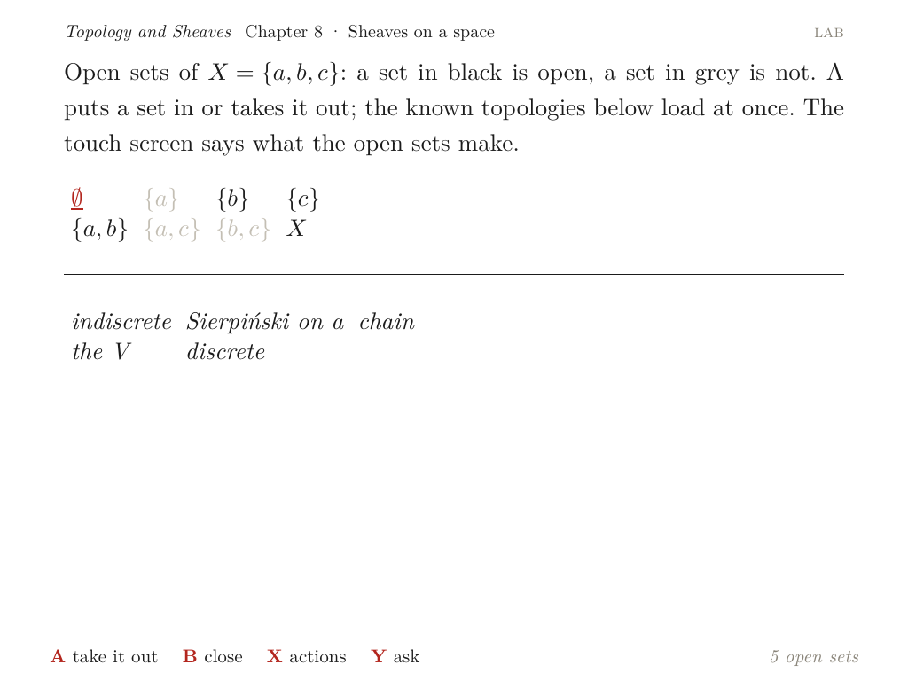
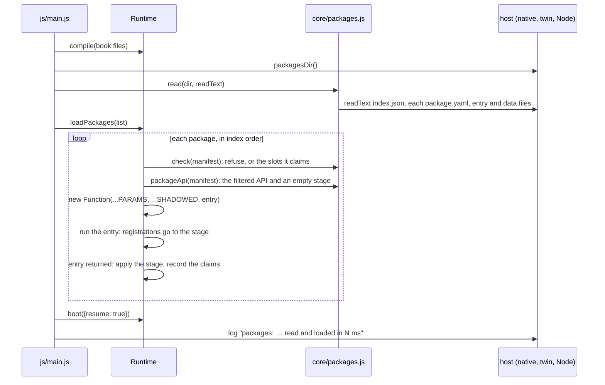
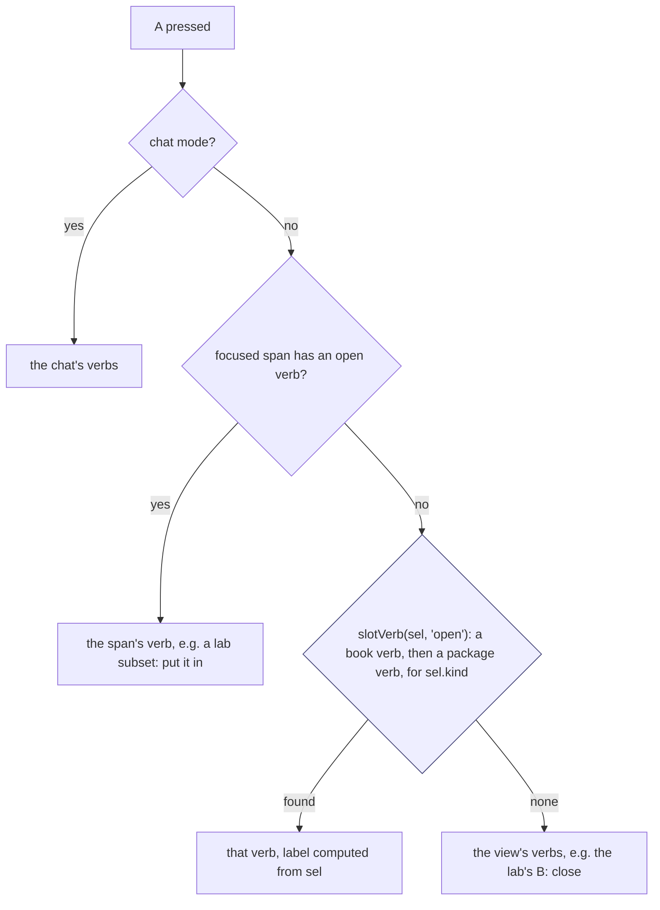
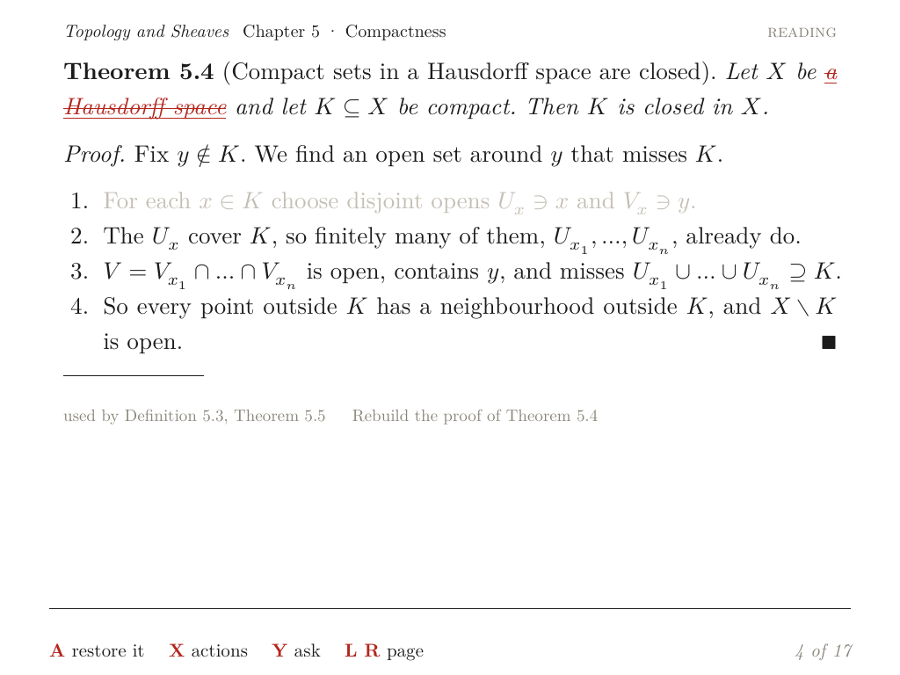
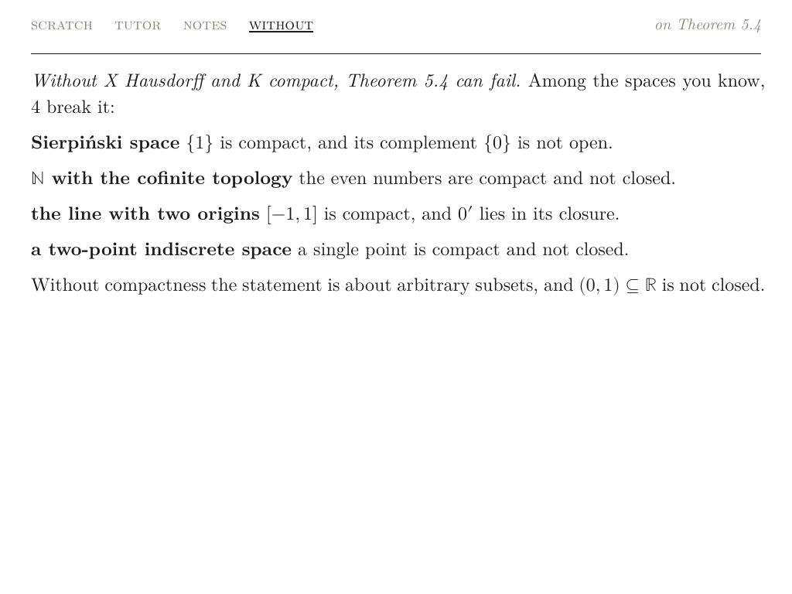
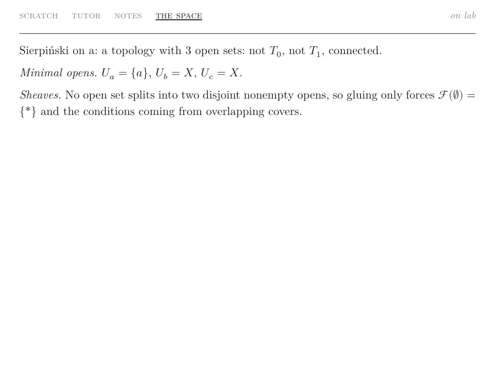
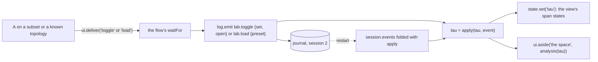
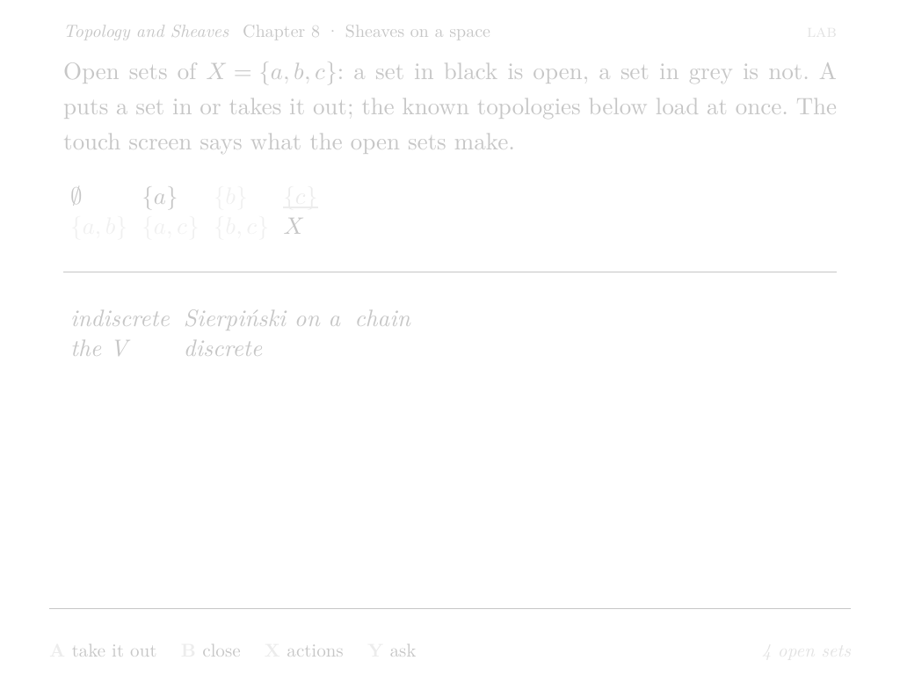
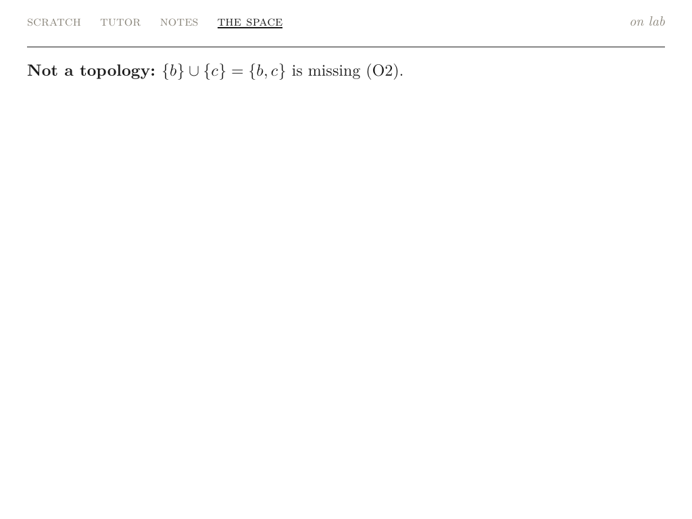

# Octavo, Part 8: Packages

**Octavo** is a reader for typeset mathematics on the Anbernic RG DS Plus. The RG DS Plus is a Linux handheld with two 1024 × 768 screens and a Mali-G52 GPU; the top screen only displays, and the bottom screen is a touch panel. Seven earlier reports cover Phases 0 to 6:

- [[PROJECT REPORT - Octavo, Part 1 - Typst on a Handheld - Display Lists, Span Ids as Colours and a Page Shader on the RG DS Plus|Part 1]] showed that Typst can lay out a page on the handheld and that one shader program draws it at book quality.
- [[PROJECT REPORT - Octavo, Part 2 - The Reading Loop on the Handheld - Element Trees from V8, Prebuilt Pages and a Main Loop That Sleeps|Part 2]] built the reading program. V8 runs the runtime, each screen is described as an element tree, and the GPU draws the laid-out page.
- [[PROJECT REPORT - Octavo, Part 3 - The Development Loop - A Server on the Handheld, a WebGL2 Twin and a Parity Check|Part 3]] connected a browser IDE to the handheld. It also added the twin, an exact rendering of the device inside the browser, and a parity check that compares the two.
- [[PROJECT REPORT - Octavo, Part 4 - Reading State - An Event Log, Folds and Type That Changes Without Layout|Part 4]] made reading state durable. It is derived from a journal and shown in the type of every card title.
- [[PROJECT REPORT - Octavo, Part 5 - Ink - A Layer per Surface, a Compass of Span States and the Card on the Touch Screen|Part 5]] added ink on the touch screen, the compass of actions on a selection, notes and the memo swap.
- [[PROJECT REPORT - Octavo, Part 6 - The Tutor - A Credential Kept in C++, Answers as Script Inputs and a Trial Layout per Paragraph|Part 6]] added the tutor: a language model reached from C++, answers that stream in as script inputs, and paragraphs typeset one at a time.
- [[PROJECT REPORT - Octavo, Part 7 - Flows - Sessions in the Event Log, Positions Rebuilt from Events and Book Views as Element Trees|Part 7]] added flows: multi-step activities whose position is rebuilt from their own events after a restart.

This report covers Phase 7, packages, the last phase of the design guide's plan. The guide describes it in one sentence: "The package manifest and capabilities; port the hypothesis toggle and the Finite Spaces Lab onto the package API to prove it is sufficient." The phase was built in six steps, 7a to 7f, each with commits and diary entries in the repository.

The guide sets no exit criteria for Phase 7. I set five, and all five hold:

- **A feature moves out of core with no visible change.** The hypothesis toggle is now a package. Its pages, span states, prompt line, bottom panel and journal are byte-identical to the built-in toggle's, step by step, on two books.
- **A tool with its own screen runs through the same API, without the runtime.** The Finite Spaces Lab, an HTML view in the IDE until now, is a package that defines a view and a resumable flow. No package function receives the runtime object.
- **A package that oversteps its manifest is refused.** Eleven kinds of bad manifest are refused before the entry script runs. A call outside the declared capabilities, or a registration outside `provides`, fails at the call, and a package that fails leaves nothing registered.
- **The twin and the handheld agree.** Parity passes for the toggle and the lab on the desktop and on the handheld, and the 13 earlier parity runs still pass.
- **The cost on the handheld is measured.** Reading and loading the two packages adds 32.4–35.3 ms to a start. Every press inside the lab, between opening and closing it, reaches the top screen in 4.7–15.7 ms with no page laid out by the helper, and the lab comes back as it was after a quit and after SIGKILL.



> [!summary]
> - **A package is a directory with a checked manifest.** `package.yaml` declares the core version, the capabilities, and what the package provides: views, flows, verbs, decorations, events and data files. The runtime refuses a bad manifest before any of the package's code runs.
> - **The API a package receives is the book's API, filtered by the manifest.**
>   - Capabilities (`aside`, `tutor`, `ink`, `notes`, `journal`, `library`) are checked at the call.
>   - Registrations are checked against `provides`, and staged until the entry script finishes.
>   - Views, flows and state are namespaced by the package's id; no function a package defines receives the runtime.
> - **Verbs go into empty slots only.** A and the compass's cardinals are core's. A package may bind a verb to one of them only where core leaves it empty: A and S on a hypothesis, and A, S and W on a selection kind core does not create. Diagonals are open to every package.
> - **Two features prove the API.** The hypothesis toggle left core and behaves byte for byte as before. The Finite Spaces Lab became a flow whose top page is one tree for all 256 sets of open sets: the open sets are span states, and the analysis goes to the bottom screen's aside.

## 1. Terms

Parts 1 to 7 defined cards, spans, span ids, span states, element trees, slots, page keys, prebuilt pages, the layout helper (`octavo-set`), the journal, folds, the snapshot, the twin, the parity check, the compass, the prompt line, the aside, flows and sessions. This part adds the following terms, in dependency order.

- **Selection.** The object that describes the focused span to the rest of the runtime, for example `{kind: 'hypothesis', card: 'compact-closed', key: 'T2', label: …}`. Its **kind** decides which verbs apply to it.
- **Slot.** A position a verb can occupy. **A** (`open`) is the button pressed on a focused span. The compass, opened with X, has four **cardinals**, N `ask`, E `keep`, S `transform` and W `find`, and up to four **diagonals** for further verbs.
- **Core.** The runtime in `js/core` and its views in `js/views`, the same JavaScript on the handheld and in the twin.
- **Core kind.** A selection kind that core's views create: `term`, `card`, `hypothesis`, `step`, `exercise`, `session`, `item`, `screen`, `ink-region` and `note`.
- **Package.** A directory `packages/<id>/` holding a manifest, an entry script and data files. It is installed next to the runtime, not inside a book.
- **Manifest.** The package's `package.yaml`. It says what the package needs (`needs`) and what it adds (`provides`).
- **Capability.** A named group of API calls that a package may use only if its manifest lists it under `needs.capabilities`.
- **Entry script.** The JavaScript file named by `entry`. It runs once, when the package loads, and registers what the package provides.
- **Decoration.** A function a package registers for a core span kind (`hypothesis` or `step`). Core calls it while it builds the page and uses the result as the span's state.
- **Staging.** Collecting a package's registrations in a separate object while its entry script runs, and applying them only when the script returns.

## 2. The problem

Before Phase 7, a book could already extend Octavo. Its `main.js` receives the scripting API (`lib, act, ui, ink, tutor, flow, log, state, keep, start, html, F, tex, parts`) and can define views, flows and verbs with it; the proof builder of Part 7 is such a book flow. That API is generous by design. A book is the reader's own content, its scripts run with the same rights as core, and some of the context objects they receive carry the runtime itself (`ctx.rt`), which the proof builder uses.

A package is a different unit. It is installed once and used with every book, it may come from someone other than the book's author, and two packages may want the same button. The formats document (`docs/formats-widgets-and-scripting-api.md`) states the rules a package should follow:

- "A fixed vocabulary. open, back, sibling and the four wheel cardinals (ask, keep, transform, find) are fixed. Packages add verbs only to diagonal slots, or implement a cardinal for a new selection kind."
- "State changes only by events."
- "Declared capabilities. A package lists `tutor`, `ink`, `fs:library` and so on in its manifest; there is no general network access."

It ends with the build order's last item: "The package format and sandbox. Port the hypothesis toggle and the lab as packages to prove the API is enough."

The porting is the test, and the reason is what each feature used before. The built-in hypothesis toggle was spread over four files of core. `runtime.js` held `toggleHyp` and `counterexamples` and kept the dropped hypotheses in `rt.hypOff`. `read.js` read `rt.hypOff` while it built a card's page, to strike a hypothesis and dim the proof steps that use it. `panel.js` drew the aside of counterexamples from a special `cex` node. `compass.js` special-cased S on a hypothesis. A package API that can express the same feature, from outside core and without the runtime object, can express at least that class of feature: one that changes how core's own spans look and what core's own buttons do.

The Finite Spaces Lab is the second class: a tool with its own screen. In the IDE it is a preset whose view returns HTML. Its state, the list of open sets, is view state (`state.set('tau', …)`), which a reload loses, and its analysis is part of the same HTML page. On the handheld, the second property matters as much as the first. Each different top page is a different tree, and a tree the device has not seen goes through the layout helper, which costs 10–57 ms per page on the handheld (Part 7). The IDE's lab has a different page for each of the 256 sets of open sets.

| Requirement | Consequence for the design |
| --- | --- |
| A package declares what it uses and adds | A manifest, checked before any package code runs |
| A package cannot use what it did not declare | Capabilities checked at each call; registrations checked against `provides` |
| A package that fails does not leave half a feature | Registrations staged and applied only when the entry script returns |
| Two packages, or a package and a book, may use the same names | Views, flows and state keys namespaced by package id |
| Core's buttons keep their meaning | Verbs only in slots core leaves empty, and one package per kind and slot |
| A package can change how a core span looks | Decorations that return a span state, called while core builds the page |
| A package does not depend on core's internals | No runtime object in any context a package receives |
| A tool's page must not need the helper at every press | What changes per press is span state and the aside, not the page's tree |
| Package code runs on the handheld, the twin and in Node | Each host can list and read the files of `packages/` |

## 3. The package format

### 3.1 Layout

A packages directory holds an index and one directory per package:

```text
packages/
├── index.json                 {"packages": ["hypothesis-toggle", "finite-spaces-lab"]}
├── hypothesis-toggle/
│   ├── package.yaml
│   └── index.js
└── finite-spaces-lab/
    ├── package.yaml
    ├── index.js
    └── lab.yaml
```

`index.json` lists the installed packages in load order. The order matters in two places: a later package's decoration overrides an earlier one's for the same span, and when two packages claim the same verb slot, the first one wins and the second is refused. `device/build.sh` copies the directory next to `js/` in the install tree, so on the handheld it is `/storage/apps/octavo/packages`.

### 3.2 The manifest

The toggle's manifest shows every field a package uses for core's own spans:

```yaml
id: hypothesis-toggle
version: 1.0.0
title: Drop a hypothesis
description: >
  A on a hypothesis, or the compass's S, drops it: the hypothesis is struck, the proof steps that use it are
  dimmed, and the aside lists the spaces in the book's data where the conclusion fails without it.
needs:
  core: '>=1.0'
  capabilities: [aside]
provides:
  verbs:
    - { verb: toggle, on: hypothesis, slot: open }        # A: core gives a hypothesis no open verb
    - { verb: drop, on: hypothesis, slot: transform }     # S: core leaves transform on a hypothesis empty
  decorations: [hypothesis, step]
  events: [hypothesis.toggle]
entry: index.js
```

The lab's manifest uses the fields for a package's own screen instead: `views: [lab]`, `flows: [lab]`, `events: [lab.toggle, lab.load]` and `data: [lab.yaml]`.

| Field | Meaning |
| --- | --- |
| `id` | lower case letters, digits and dashes; must equal the directory's name |
| `version` | MAJOR.MINOR.PATCH |
| `needs.core` | `>=1.0` or an exact version; this runtime is core 1.0.0 |
| `needs.capabilities` | any of `aside`, `tutor`, `ink`, `notes`, `journal`, `library` |
| `provides.views`, `provides.flows` | names the entry may register with `ui.view` and `flow.define` |
| `provides.verbs` | each verb with the selection kinds it applies to (`on`) and its slot |
| `provides.decorations` | core span kinds the package may decorate: `hypothesis`, `step` |
| `provides.events` | the only event names `log.emit` accepts from the package |
| `provides.data` | files read with the manifest; YAML and JSON are parsed and offered as `pkg.data(name)` |
| `entry` | the `.js` file that runs at load |

### 3.3 Checks before the entry script runs

`check(manifest, dirName, claims)` in `js/core/packages.js` runs on the parsed manifest alone. Nothing of the package's code has been compiled at that point, so a refused package has had no chance to run. The unit test builds one manifest per rule and checks that each is refused with its message, and that the entry script, which sets a global, never ran:

| Manifest | Refusal |
| --- | --- |
| `{id: a, extra: 1}` | `unknown field "extra"` |
| `{id: "A b"}` | `id "A b" must be lower case letters, digits and dashes` |
| `{version: "1"}` | `version "1" must be MAJOR.MINOR.PATCH` |
| `needs: {core: '>=2.0'}` | `needs core >=2.0; this is core 1.0.0` |
| `needs: {capabilities: [network]}` | `unknown capability "network"` |
| `provides: {events: [card.open]}` | `"card.open" is core's event` |
| `provides: {decorations: [term]}` | `core decorates only hypothesis and step spans, not "term"` |
| verb on `term`, slot `transform` | `core fills transform there` |
| verb on `card`, slot `open` | `core fills A there` |
| verb on `widget`, slot `ask` | `core fills ask there` |
| a second package with `drop` on `hypothesis`, slot `transform` | `drop on hypothesis (transform) is already one's` |

Core's own event names are reserved by one pattern, `/^(card|peek|screen|flow|quest|review|tutor|ink|note)\.|^(mastered|focus)$/`. These are the events the folds of Part 4 and Part 7 read. A package that could emit `card.open` could change what the reader has seen, and one that could emit `flow.end` could close another flow's session.

### 3.4 When and how a package loads

Packages load after the book's scripts and before the first screen. The order has two reasons. A package may look up the book's content at load time; the lab finds the card it belongs to with `lib.card`. And when a book and a package bind a verb to the same slot, the book's verb is found first, because a book is the reader's own content.



The core of `loadPackage` is short:

```js
const mine = check(m, p.id, this.claims);
const stage = { views: {}, flows: {}, meta: {}, verbs: [], decorators: [] };
const api = packageApi(this, m, p.files, stage);
const fn = new Function(...PARAMS, ...SHADOWED, `"use strict";\n${p.files[m.entry]}\n//# sourceURL=packages/${m.id}/${m.entry}`);
fn(...PARAMS.map(k => api[k]));
// the entry script finished: what it registered takes effect
Object.assign(this.views, stage.views);
Object.assign(this.flows, stage.flows);
Object.assign(this.flowMeta, stage.meta);
this.pkgVerbs.push(...stage.verbs);
for (const d of stage.decorators) (this.decorators[d.kind] = this.decorators[d.kind] || []).push(d);
for (const key of mine) this.claims.set(key, m.id);
```

If `check`, the compilation or the entry throws, the code after the call never runs, so the stage is dropped and the runtime holds nothing from the package. `loadPackages` catches the error, reports it as `package <id>: <message>` and continues with the next package; the book loads either way. The `sourceURL` comment makes a stack trace name the package's own file and line.

### 3.5 Hosts

Each place the runtime runs needs a way to find and read the packages:

| Host | How it reads packages |
| --- | --- |
| The app on the handheld (`native/`) | `--packages DIR`, by default `<js>/../packages`; `__native.packagesDir()` returns the directory, or `""` when it has no `index.json` |
| The twin in the browser (`ide/src/twin.js`) | `Twin.fetchPackages()` fetches `/packages/index.json`, each manifest and the files it names from octavo-dev, which serves `/packages/` from its root |
| Node (tests, prewarm) | `readPackages(dir)` in `js/node/load.js` |
| The install tree | `device/build.sh` copies `packages/` next to `js/` |

On the handheld, octavo-dev serves the installed `packages/` to the twin, and the app reads the same directory. The twin and the device therefore load the same package files, which the parity check (section 11.3) depends on.

## 4. The API a package receives

### 4.1 The parameters

The entry script is the body of a function whose parameters are the book's API plus one more, `pkg`. Each parameter is the book's object filtered by the manifest:

| Parameter | What a package gets |
| --- | --- |
| `pkg` | `{id, version, title, data(name)}`; `data('lab')` is the parsed `lab.yaml` |
| `lib` | the reads (`card`, `cards`, `data`, `graph`, `quests`); `lib.add` with `library` |
| `act` | `act.define`, for verbs declared in `provides.verbs` with the same `on` and `slot` |
| `ui` | `view` (declared names, element trees only), `show`, `waitFor`, `deliver`, `toast`, `back`, `decorate` (declared kinds); `aside` with `aside`; no `widget`, no `swap` |
| `flow` | `define` (declared names), `start` |
| `log` | `emit` (declared events); `events` and `fold` with `journal` |
| `state` | `get`, `set`, `toggle`, `has`, with every key stored under `<id>/` |
| `ink`, `tutor`, `keep` | each call checked against `ink`, `tutor` and `notes` |
| `F`, `tex`, `parts`, `html` | unchanged (Part 7's tree vocabulary) |
| `start` | throws: a book chooses its first screen, a package does not |

### 4.2 Capabilities are checked at the call

A capability is checked when the package calls the function, not when it loads. Each gated function is a wrapper:

```js
const need = (cap, what) => { if (!caps.has(cap)) fail(`${what} needs the capability "${cap}" (needs.capabilities in package.yaml)`); };
const gated = (cap, obj, prefix) => {
  const out = {};
  for (const k of Object.keys(obj)) out[k] = (...args) => { need(cap, `${prefix}.${k}`); return obj[k](...args); };
  return out;
};
```

Checking at load would require knowing which functions the script calls, which only running it reveals. Checking at the call catches the path that runs rarely, such as an error branch that writes a note, the first time it runs. The message names the manifest field to change, for example `finite-spaces-lab: ui.aside needs the capability "aside" (needs.capabilities in package.yaml)`.

The capabilities are the formats document's proposal, adjusted to what core has. `fs:library` became `library`, which gates `lib.add`; `aside`, `notes` and `journal` are new. `journal` gates reading the whole journal (`log.events`, `log.fold`). Part 4 measured a full read at 580 ms for a year of reading on the handheld, so a package that needs history should get it from its own flow's session, as the lab does.

### 4.3 Registrations are checked against `provides`

`ui.view`, `flow.define`, `act.define`, `ui.decorate` and `log.emit` each check that the name, verb, kind or event appears in the manifest. `act.define` also checks that the verb's `on` and `slot` match the declaration exactly. The manifest's verb declarations are what `check` used to decide whether the slot is free; a script that registered a different slot than it declared would bypass that decision.

### 4.4 Namespaces

A package's views and flows are registered as `<id>:<name>`. The lab's view is `finite-spaces-lab:lab`, and so is its flow. Inside the package, `ui.show('lab')` and `flow.start('lab')` find the package's own name first. Any other name is core's (`read`, `hub`, `map`) or the book's. `state` keys are stored under `<id>/`, so the toggle's `off` is `hypothesis-toggle/off` in the runtime's key–value state.

Events are not namespaced. The toggle's event was `hypothesis.toggle` when core emitted it, and it still is. A journal written before Phase 7 reads the same after it, and a fold that counts dropped hypotheses would not have to know which package emitted them. The manifest declares a package's events instead, and core's names are refused (section 3.3).

### 4.5 No runtime, and what that does not mean

Every function a package defines is wrapped before core calls it:

- **A view function** receives `{props, card, state, ui, lib, pkg}`, built from the package's own filtered objects. A book's view receives a context with `rt`; a package's never does.
- **A verb's `run`** receives the package's API plus `{sel}`, the selection it runs on.
- **A flow** receives the package's API plus `{args, session}`; `session.events` are its own session's events (Part 7).

The entry function's parameter list also shadows nine globals: `Octavo`, `__native`, `globalThis`, `window`, `self`, `document`, `fetch`, `XMLHttpRequest` and `WebSocket`. Each is a parameter passed as `undefined`, so `typeof globalThis` is `"undefined"` inside a package, and a package that reaches for the runtime's global or for the network fails at once.

This is not a sandbox, and the header of `packages.js` says so. The entry script runs in the runtime's own JavaScript realm, and `(0, eval)('this')` still returns the global object; I checked. The formats document asked for a "package format and sandbox". A sandbox would need a separate V8 context or isolate per package, with every API call copied across the boundary, and every press in a package's view would pay that copy. The contract checked at the API catches mistakes and makes a package's dependencies explicit. It does not stop a package written to escape it.

## 5. Verbs and the rule of empty slots

### 5.1 The rule

The formats document fixes core's vocabulary: "Packages add verbs only to diagonal slots, or implement a cardinal for a new selection kind." Its open questions also ask whether packages should ever claim a cardinal, and propose not. The rule Octavo implements is a single function, called for every verb a manifest declares:

```js
function coreFills(kind, slot) {
  if (slot === 'diagonal') return false;
  if (slot === 'ask' || slot === 'keep') return true;    // the tutor and notes take every selection
  if (!CORE_KINDS.includes(kind)) return false;           // a package's own kind: A, S and W are open
  if (kind === 'hypothesis') return slot === 'find';      // core gives a hypothesis no A and no S
  return true;
}
```

| Selection kind | A (`open`) | N `ask` | E `keep` | S `transform` | W `find` | diagonals |
| --- | --- | --- | --- | --- | --- | --- |
| a core kind other than hypothesis | core | core | core | core | core | open |
| `hypothesis` | **open** | core | core | **open** | core | open |
| a kind core does not create | **open** | core | core | **open** | **open** | open |

N and E are core's for every kind, because the tutor and notes accept any selection. The hypothesis row is the one place where a core kind has empty cardinals, and it has them because the toggle left core: core still makes a hypothesis focusable, but gives it no A and no S of its own. A second package that claims A or S on `hypothesis` is refused, so the toggle's verbs cannot be silently replaced.

The rule is narrower than the formats document's text on one point and wider on another. A package may take S on a hypothesis, which is a core kind, because core has left that slot empty. And it may take a cardinal on its own kind, which the document's open question proposed to forbid; the document's own sentence allows it ("implement a cardinal for a new selection kind").

### 5.2 How A finds a package's verb

A span carries its own verbs when its view gives it some, as every lab subset does. A hypothesis span carries none. `resolve('open')` therefore gained a step between the span's verbs and the view's:



```js
slotVerb(sel, slot) {
  const on = v => v.slot === slot && list(v.on).includes(sel.kind) && (!v.when || v.when(sel));
  return this.verbs.find(on) || this.pkgVerbs.find(on) || null;
},
```

The compass uses the same lookup for its cardinals, and draws its diagonals from the book's verbs followed by the packages'. When no verb fills S, the compass shows "transform" dimmed with the hint "nothing here to transform", as it already did for ink transcription, which needs a model that reads pictures.

A verb's label may be a function of the selection. The toggle's A reads "drop it" or "restore it", depending on whether that hypothesis is dropped:

```js
act.define({ verb: 'toggle', on: 'hypothesis', slot: 'open',
  label: sel => offOf(sel.card)[sel.key] ? 'restore it' : 'drop it',
  run: ({ sel }) => toggle(sel.card, sel.key) });
```

## 6. Decorations

A dropped hypothesis is struck and dimmed, and so are the proof steps that use it. Before Phase 7, `read.js` read `rt.hypOff` while building the card's page. A package cannot be read by core in that way, and it should not build the spans itself either: a hypothesis is part of the card's text, which core typesets, and a package that rendered the span would need its own copy of card rendering.

A decoration is the narrow interface between the two. Core asks, and the package answers with a state:

```js
// js/views/read.js, a hypothesis
const sel = { kind: 'hypothesis', card: card.id, key: k, target: card.id, label: …, text: raw };
const d = rt.decoration('hypothesis', sel);
return b.F(`${prefix}/h:${k}:${n++}`, { sel, state: d.state, bits: d.bits }, kids);

// packages/hypothesis-toggle/index.js
ui.decorate('hypothesis', sel => offOf(sel.card)[sel.key] ? { state: 'dimmed', struck: true } : null);
ui.decorate('step', step => step.uses.some(k => offOf(step.card)[k]) ? { state: 'dimmed' } : null);
```

`rt.decoration(kind, info)` calls every decorator registered for the kind in load order and returns `{state, bits}`: the last non-null answer's state, and `BIT.STRUCK` if any answer asked for it. The span state values are the renderer's (`js/core/elements.js`): `NORMAL 0, LINK 1, FOCUS 2, DIMMED 3, UNREAD 4`, with the bits `FOCUS 1, STRUCK 2, SHOWN 4`.

Decorations are allowed on `hypothesis` and `step` only. The restriction follows from what a decoration may change: span state, which the renderer applies to an already laid-out page. A decoration that could change a span's text would change the page's tree, and every press would cost a layout. With state only, dropping a hypothesis lays nothing out again, which is the guide's requirement for the toggle (section 9.6 of the guide) and which section 12 measures.

## 7. The hypothesis toggle as a package

### 7.1 What it does

A theorem card marks its hypotheses with `{{key|text}}`, names the property each one asserts and the property its conclusion asserts, and marks each proof step with the hypotheses it uses (`@uses(key)`). Dropping a hypothesis strikes it, dims the steps that use it, and sets the aside to the spaces of the book's data (`spaces.yaml`) in which the conclusion fails while every remaining hypothesis holds.





### 7.2 What left core

| File | Removed |
| --- | --- |
| `js/core/runtime.js` | `toggleHyp`, `counterexamples` (40 lines) and the `hypOff` map |
| `js/views/read.js` | the open verb on hypothesis spans; the `offKeys` dimming of steps |
| `js/views/panel.js` | the `cex` branch of the aside |
| `js/core/compass.js` | the special case of S on a hypothesis |

Core gained the generic pieces instead: `slotVerb`, `decoration`, an aside that accepts an array of blocks, and `F` with state names (`'dimmed'`) and `struck`. The package (`packages/hypothesis-toggle/index.js`, 76 lines) holds the same counterexample search and builds the aside as blocks, with the same text as core's `cex` branch:

```js
function toggle(cardId, key) {
  const all = Object.assign({}, state.get(OFF, {}));
  const off = all[cardId] = Object.assign({}, all[cardId]);
  off[key] = !off[key];
  state.set(OFF, all);
  log.emit({ ev: 'hypothesis.toggle', card: cardId, key, off: off[key] });
  const keys = Object.keys(off).filter(k => off[k]);
  if (!keys.length) { ui.aside('', null); return; }
  ui.aside('without', asideFor(lib.card(cardId), keys));
}
```

The counterexample search closes each space's known properties under the implications of `spaces.yaml` (true runs forwards along an implication, false backwards) and keeps the spaces where the conclusion's property is false and every assumed property is true.

### 7.3 Proof that nothing changed

Before changing any code, I recorded a trace of the built-in toggle with `scripts/31-hyp-port-trace.cjs`. The script boots the runtime in Node with a recording host, runs a fixed sequence, and writes one JSON line per step. Each line holds the top page's tree text, the span states, the prompt line's tree, the bottom panel's tree and the journal so far, without times. The sequence, on Theorem 5.4:

1. boot; focus "a Hausdorff space" (T2); A drops it;
2. focus "K ⊆ X be compact" (K); A drops it;
3. X opens the compass on T2; S is chosen and run, which restores T2;
4. A on K again, which restores it; the compass's S on K, chosen.

The span states of step 1's A show the format: `[[1, 2, 3], [3, 3, 0]]` is span 1 (T2) in state FOCUS with bits FOCUS and STRUCK, and span 3 (proof step 1) DIMMED.

I recorded the trace on two books, the compact-hausdorff preset and the device's own book, and again after the port with both packages loaded. `cmp` reports no difference: the ten lines of each trace are byte-identical, 32 380 bytes for the preset and 33 820 for the device book. Byte identity is the right test here because the device caches pages by the tree's text. A tree that differed in any byte, even the order of two keys, would be a different page, laid out again by the helper.

A third trace runs the preset with no packages. A hypothesis then has no A, the compass's S is dimmed, and no event is written. Core without the package is a reader without the toggle, not a broken one.

## 8. The Finite Spaces Lab as a package

### 8.1 One page for every topology

The lab builds a topology on X = {a, b, c}. Its subsets are numbered by bit masks, a = 1, b = 2, c = 4, so ∅ is 0, {a, b} is 3 and X is 7. A choice of open sets is a subset of these eight, so there are 2⁸ = 256 states.

The IDE's lab draws the eight subsets as cells with a CSS class for "in", and the analysis below them, all in one HTML page. On the handheld that page would be a new tree in each state. The package splits the screen differently:

- **The top page is the same tree in every state.** It holds an introduction, the eight subsets in a 4-column grid, a rule, and the five known topologies in a 3-column grid. Every subset is a focusable span whose state is `normal` (black) when it is open and `dimmed` (grey) when it is not.
- **The analysis goes to the aside** on the touch screen: whether the sets form a topology, and if they do, the separation axioms, connectedness, the minimal open sets U_x, and which products the sheaf condition forces.
- **The prompt line's status** counts the open sets.

```js
const subset = m => ({ c: [F('s' + m, {
  sel: { kind: 'subset', label: nm(m).replace(/\\/g, ''), text: `$${nm(m)}$` },
  state: tau.includes(m) ? 'normal' : 'dimmed',
  verbs: { open: { label: tau.includes(m) ? 'take it out' : 'put it in', run: () => ui.deliver('toggle', { set: m }) } },
}, [tex(nm(m))])] });
```

The subsets have the selection kind `subset`, and the known topologies `preset`. Neither is a core kind, so by the rule of section 5 the lab could also bind S or W on them; it binds A only, through each span's own `open` verb.



### 8.2 The lab as a flow

The lab's state is the list of open sets, and the lab must come back with it after a restart. Part 7's answer applies unchanged: the lab is a flow, every change is an event of its session, and the flow rebuilds the open sets from those events when it resumes.



```js
const apply = (tau, e) => e.ev === 'lab.load' ? sorted(PRESETS[e.preset] || tau)
  : e.ev === 'lab.toggle' ? sorted(e.open ? tau.filter(x => x !== e.set).concat([e.set]) : tau.filter(x => x !== e.set)) : tau;

flow.define('lab', function* ({ ui, log, state, session }) {
  let tau = sorted(PRESETS[L.start]);
  for (const e of (session && session.events) || []) tau = apply(tau, e);   // resumed
  state.set('tau', tau);
  ui.show('lab', {});
  while (true) {
    ui.aside('the space', analysis(tau));
    const ev = yield ui.waitFor(['toggle', 'load', 'leave']);
    if (ev.verb === 'leave') break;
    tau = apply(tau, ev.verb === 'load' ? log.emit({ ev: 'lab.load', preset: ev.preset })
      : log.emit({ ev: 'lab.toggle', set: ev.set, open: !tau.includes(ev.set) }));
    state.set('tau', tau);
  }
  ui.aside('', null);
  if (!ui.back()) ui.show('read', { card: (home || lib.cards()[0]).id }, { replace: true });
}, { title: 'Finite Spaces Lab', kind: 'tool', card: home && home.id });
```

The event records whether the set went in or out (`open`), not only which set was pressed. The flow's fold is then a function of the event alone, and a journal read by another program says what happened without replaying the lab. `state.set('tau', …)` is a copy of what the events give, kept so that the view, which runs on every update, does not fold the session each time.

`lab.yaml` holds the known topologies as lists of masks, the starting topology ("the V", {∅, {a}, {b}, {a, b}, X}), and the cards the lab belongs to. The flow's meta, `kind: 'tool'`, lists the lab under Sessions in the contents. The first of the cards in `lab.yaml` that the book has (Definition 8.3, Sheaf, in the device book) shows the lab in its line of cross-references.

### 8.3 How many pages the lab needs

Prewarm has to reach every page the lab can show. The top page is one. The aside depends on the state, but many states share it: a set of open sets that is not a topology shows only its first problem. A walk over all 256 states in Gray-code order, one subset changed per step, counts the distinct asides:

| States | Count | Distinct asides |
| --- | --- | --- |
| topologies on three points | 29 | 29 |
| ∅ and X both open, not a topology | 35 | 6 |
| ∅ or X missing | 192 | 2 |
| total | 256 | 37 |

29 is the number of topologies on a three-point set, which is a check on `analyse`. Prewarm's own walk of the lab, breadth-first through the flow's states, also finds 37 asides, so its walk is complete.

## 9. Prebuilt pages

The prewarm walk (`js/tools/prewarm.js`, Part 2) builds every tree a reader can reach and lays them out ahead of time. Phase 7 changed it in four ways:

- **It loads the packages**, from `packages/` or `OCTAVO_PACKAGES`, after each book, as the device does.
- **It closes a flow's screen with B.** A flow reached from a card's link and left with `rt.back()` keeps running. In the old walk, the lab kept its aside while the walk went on to the next card, and every later card's panel was walked with a "the space" tab that no reader sees there.
- **It keys its flow walk on both screens and the runtime's state**: `top.main + bottom.main + JSON.stringify(rt.kv)`, with a budget of 5000 runs. Keyed on the top page alone, the walk saw the lab's single page and stopped after one step. Two lab states with the same pages can lead to different pages one press later, and only the state tells them apart.
- **It walks every card twice**: as reached from the contents, and with an empty history, as the first screen of a start. The first screen has no "B back" in its prompt line, because there is nothing to go back to. The handheld found this (section 12.5).

| Prewarm, device book | Trees |
| --- | --- |
| Phase 6 | 499 |
| packages loaded, flow walk keyed on both screens and state | 600 |
| every card also walked as a first screen | 643 |

Among the trees the second row added are the lab's page, its 37 asides, 62 prompt lines, and new versions of the contents, of the Sheaf card with the lab's link and of three peeks at that card. The five earlier versions of those pages left the set. The walk takes 3.9 s on the desktop.

Prewarm still drops hypotheses one at a time, not in combinations. A card with *n* hypotheses has 2ⁿ combinations, of which the walk covers *n* + 1.

## 10. A focus defect found on the way

Testing the lab's entry in the contents showed that DOWN never reached the contents' Leitfaden row. The defect predates Phase 7: from the review row, DOWN skipped the Leitfaden row and went to the proof builder's row below it.

The cursor's cost for UP and DOWN (Part 2) is the distance along the direction plus 0.6 times the distance across it. "Across" was the distance between the two spans' horizontal centres. In a left-aligned list, a long row's centre is far to the right:

| Candidate below the review row | Gap below | Across (centres) | Cost |
| --- | --- | --- | --- |
| Leitfaden row, 450 px wide | 5 px | 0.6 × 68.5 | 46.1 |
| proof builder row, 353 px wide | 33 px | 0.6 × 20 | 45.0 |

The nearer row lost by 1.1 px. The fix measures "across" as the gap between the two spans' horizontal extents, which is 0 when they overlap:

```js
const across = Math.max(0, b.left - a.right, a.left - b.right);
if (dir === 'down') return dy > 2 ? Math.max(0, b.top - a.bottom) + across * 0.6 : Infinity;
return dy < -2 ? Math.max(0, a.top - b.bottom) + across * 0.6 : Infinity;
```

Both rows overlap the review row horizontally, so the costs become 5 and 33, and the Leitfaden row wins. A new test in `reading.test.js` presses DOWN through the contents and checks that it reaches every row; it fails on the old code and passes on the new.

The fix changes other walks too. On the device book's 17 cards and 2 Leitfaden pages, 4 of 19 DOWN walks changed. Each now reaches a link it used to skip, or takes an equally near span first. The contents' rows shifted by one: the proof builder is now 17 DOWN presses from the top, and the lab 18. In Part 7, the script's count of 17 for the proof builder included one DOWN that changed nothing. All 13 earlier parity runs pass after the fix.

## 11. Testing

### 11.1 Unit tests

`js/test/packages.test.js` adds six tests:

- **The repository's packages load,** with their views and flows under namespaced names.
- **Manifest checks** refuse eleven bad manifests before their scripts run (section 3.3), and accept the slots the rule leaves open.
- **Capabilities and `provides` are checked at the call,** and a package that throws in the middle of its entry leaves no view, flow, verb or decorator behind.
- **No runtime is visible:** view and verb contexts have no `rt`, and the shadowed globals are `undefined`.
- **The toggle with and without its package:** with it, A and S on a hypothesis are its verbs; without it, both are empty.
- **The lab:** one top page whatever the open sets, the aside, the events, the lab resumed after a restart with the same open sets, and B.

With the contents test of section 10, the runtime has 38 tests, all passing. The IDE's headless test (`ide/node/test.js`) reports 0 failures and `go test` in `dev/` passes.

### 11.2 Host runs

`scripts/33-host-packages.sh` runs the app under Xvfb on the device book. The toggle scenario drops T2 and K and restores K. The lab scenario enters from the contents, puts {c} in, loads Sierpiński on a and quits; started again, it resumes over Theorem 5.4 with `flow.resume#2`, takes ∅ out, and ends with B (`flow.end#2`). On the host, reading and loading the packages takes 7.0–8.1 ms, 2.1–3.0 ms per package.

### 11.3 Parity

`scripts/32-parity-packages.cjs` runs two sequences on the device and on the twin, and compares the message streams and the screens:

| Run | Inputs | Messages, device = twin | Host: beyond tolerance (top, bottom) | Handheld: beyond tolerance (top, bottom) |
| --- | --- | --- | --- | --- |
| toggle on compact-hausdorff | 7 | 31 | 0.000 %, 0.000 % | 0.000 %, 0.000 % |
| lab on the device book | 11 | 31 | 0.000 %, 0.000 % | 0.000 %, 0.000 % |

The device reads its packages from its install and the twin fetches them from octavo-dev, so the run also checks that both hosts read the same files. The 13 earlier parity runs (Parts 3, 5, 6 and 7) pass on the host.



## 12. Measurements on the handheld

### 12.1 Setup

`scripts/34-device-phase7.sh` runs the installed app with `--measure` on its own book. Its data directories are under `/storage/octavo/bench` and are removed at the end; the reader's journal is not touched. octavo-dev was stopped before the runs and started again after them. Three scenarios:

- **toggle.** Theorem 5.4, the first screen of a start: A drops T2, A drops K, and the compass's S restores K.
- **lab.** The contents, 18 DOWN presses, A: the lab. {c} put in, Sierpiński on a loaded, quit. Started again: the lab as it was. Then every subset taken out or put in once, a known topology loaded (indiscrete), and B.
- **kill.** The lab: {c} put in and {a} taken out, then `pkill -KILL -x octavo` right after the last press. Started again on the same data.

`scripts/35-phase7-analysis.py` labels every press by what it did. It replays each scenario's key sequence against the log's latency lines and asserts that the keys match.

### 12.2 The cost at start

| | Phase 6 | Phase 7 |
| --- | --- | --- |
| first page, new data directory | 680.6–701.9 ms (mean 692.1, n = 5) | 720.8–743.0 ms (mean 728.8, n = 3) |
| first page, same data started again | 449.7–466.0 ms (n = 4) | 481.1–498.4 ms (n = 2) |
| packages read and loaded | — | 32.4–35.3 ms |
| hypothesis-toggle | — | 10.3–13.1 ms |
| finite-spaces-lab | — | 9.9–13.0 ms |

The means differ by 36.7 ms on a new data directory, and the package load, 32.4–34.2 ms in those three starts, accounts for most of it. Each package's time covers its manifest check, compiling its entry and running it. The remaining 10–11 ms of the load is `read`: `index.json`, two YAML manifests and the files they name.

The handheld is about four times slower than the desktop here (2.1–3.0 ms per package), within the range of factors Part 7 measured for the runtime's other script work (1.5 to 5). The toggle, which registers two verbs and two decorations, takes as long to load as the lab, which defines a view and a flow and parses `lab.yaml`. I have not split the time into compilation and execution.

### 12.3 Presses

| Press | n | To the top screen | Both screens | Script | Pages by the helper |
| --- | --- | --- | --- | --- | --- |
| card: move | 2 | 10.3–14.0 ms | 15.4–19.4 ms | 10.2–16.4 ms | 0 |
| toggle: drop | 2 | 13.4–22.8 ms | 40.8–46.9 ms | 26.1–43.6 ms | 1 |
| compass: open | 1 | 23.7 ms | 63.8 ms | 58.6 ms | 2 |
| compass: choose | 1 | 6.9 ms | 6.9 ms | 4.9 ms | 0 |
| compass: S (restore) | 1 | 13.7 ms | 23.7 ms | 12.1 ms | 0 |
| contents: open | 2 | 46.1–47.5 ms | 55.6–57.9 ms | 38.5–40.3 ms | 0 |
| contents: move | 36 | 6.2–17.2 ms | 8.4–25.0 ms | 5.7–21.7 ms | 0 |
| lab: open | 2 | 28.6–34.0 ms | 34.9–38.9 ms | 25.4–30.3 ms | 0 |
| lab: move | 18 | 4.7–9.1 ms | 4.7–14.6 ms | 3.0–10.4 ms | 0 |
| lab: put in or take out | 11 | 6.0–15.7 ms | 6.6–21.0 ms | 4.2–13.5 ms | 0 |
| lab: load a topology | 2 | 7.7–7.8 ms | 15.4–16.8 ms | 7.2–12.1 ms | 0 |
| lab: close | 1 | 43.2 ms | 56.4 ms | 37.3 ms | 0 |


No press in the lab needed the helper; the statistics line of the lab's first pass counts 17 prebuilt pages and 0 from the helper. A press in the lab changes span states on a page already on the GPU, and the aside it sets is one of the 37 prewarm built. Putting a set in or taking it out reached the top screen within one frame at 60 Hz (16.7 ms) in all 11 presses.

The toggle's drop also reaches the top screen in 13.4–22.8 ms, because a dropped hypothesis changes span states only. Its "both screens" time is longer, 40.8–46.9 ms, because the aside of counterexamples is a new bottom page.

Closing the lab takes 43.2 ms to the top screen. It shows the card under the lab, Theorem 5.4, a full card page with its panel, and is mostly script time (37.3 ms), as is opening the contents (38.5–40.3 ms of script).

### 12.4 Resumption

- **After a quit.** The journal held `flow.start#2`, `lab.toggle#2 {set: 4, open: true}` and `lab.load#2 {preset: "Sierpiński on a"}`. The start after the quit wrote `flow.resume#2`, and the lab showed Sierpiński on a with its aside.
- **After SIGKILL.** The journal held both presses made before the kill, `lab.toggle#2 {set: 4, open: true}` and `lab.toggle#2 {set: 1, open: false}`. The start after the kill wrote `flow.resume#2` and showed five open sets, ∅, {b}, {c}, {a, b} and X, with the aside "Not a topology: {b} ∪ {c} = {b, c} is missing (O2)".



Nothing is lost on SIGKILL for the reason Part 7 gave: the native side writes and flushes each journal line before the screen changes, and only the `fdatasync` is grouped on a background thread.

### 12.5 The pages the helper laid out

The first device run had 5 pages by the helper over 79 presses: 1 on the toggle scenario's first RIGHT, 2 on its two A presses and 2 on the compass. The toggle scenario starts on Theorem 5.4 as the first screen, with no history, so its prompt lines have no "B back". Since Phase 6, the prewarm walk visits the contents first, and every card after that has a history. The first-screen prompt lines were missing from the prebuilt set. Walking every card a second time with an empty history (section 9) removed two of the five.

The final run had 3 pages by the helper, all in the toggle scenario: the aside for two hypotheses dropped together, and the compass over that state. These are combinations, which prewarm does not walk. The top screen did not wait for them. The second drop reached the top screen in 13.4 ms, and the helper's page arrived with the bottom screen, 46.9 ms after the press.

## 13. Results

| Measure | Value | Section |
| --- | --- | --- |
| Toggle before and after the port | byte-identical traces, 2 books × 10 steps | 7.3 |
| Bad manifests refused before their code runs | 11 of 11 | 3.3 |
| Pages for the lab's top screen | 1 for 256 states | 8.1 |
| Asides for the lab | 37 (29 topologies) | 8.3 |
| Package load at start, handheld / host | 32.4–35.3 ms / 7.0–8.1 ms | 12.2, 11.2 |
| First page on a new data directory, handheld | 728.8 ms mean (Phase 6: 692.1 ms) | 12.2 |
| A press in the lab, to the top screen, handheld | 4.7–15.7 ms; closing 43.2 ms | 12.3 |
| Pages by the helper, handheld, final run | 3 in 79 presses, none in the lab | 12.5 |
| Lab resumed after quit and after SIGKILL | yes, every press kept | 12.4 |
| Parity, host / handheld | 2 of 2 new and 13 of 13 earlier / 2 of 2 | 11.3 |
| Prebuilt trees, device book | 499 → 643 | 9 |
| JavaScript tests | 38 of 38 (7 new) | 11.1 |

## 14. Defects found on the way

Each of these is recorded in the diary with its diagnostic.

- **DOWN never reached the contents' Leitfaden row** (section 10). The defect predates Phase 7; it was hidden because no test pressed DOWN through the whole list.
- **A runtime test failed after the port:** `actual [ 'X', 'actions' ], expected [ 'A', 'drop it' ]`. It booted the runtime without packages, so a hypothesis had no A. The test now loads them, as every host does.
- **Prewarm found one lab page and no asides.** It keyed its flow walk on the top page, which is one page for the whole lab. Keying on both screens found the 37 asides.
- **A flow left with `rt.back()` kept its aside during the rest of the walk** (section 9).
- **The first device run had 5 pages by the helper** (section 12.5).
- **The lab's "Sheaves" line began in lower case** after its label, because the IDE preset's sentence followed a label without a full stop. Both of its sentences now begin with a capital.

## 15. Deviations from the guide and the formats document

| Guide or formats document | Implementation | Reason |
| --- | --- | --- |
| "The package format and sandbox" | a contract checked at the API; shadowed globals; no separate realm | a separate V8 context would copy every API call; the contract is documented as not a security boundary |
| "Packages add verbs only to diagonal slots, or implement a cardinal for a new selection kind"; open question: diagonals only | the empty-slot rule: diagonals, plus A, S and W on a package's own kind, plus A and S on a hypothesis | the toggle needs A and S on a core kind whose slots core no longer fills |
| capabilities `tutor`, `ink`, `fs:library` | `aside`, `tutor`, `ink`, `notes`, `journal`, `library` | named after core's API objects; reading the whole journal is costly on the handheld |
| "State changes only by events" | a package's `state` is writable, under its own prefix; the journal changes only by declared events | view state is per run and private to the package; the lab's state is a copy of what its events give |
| the lab with views `FiniteSpaceLab`, `OpenLattice`, `SectionEditor`, a `lab` screen, a lab quest and a review template | one view, one flow, `lab.yaml` | the phase's goal is the port of the existing lab; `screens` and `review_templates` are not manifest fields |
| the lab as an HTML view with the analysis on the page | a tree view with the open sets as span states and the analysis in the aside | one laid-out page for 256 states on the handheld |
| version 0.1.0 in the document's example | 1.0.0, checked against core 1.0.0 | the manifest's `needs.core` is checked |

## 16. What Phase 7 decides

- **A package is a declared unit.** What it may call and what it may add are in its manifest, and the runtime holds it to both. A reader of `package.yaml` knows what the package can touch without reading its code.
- **Core keeps its buttons.** A package fills an empty slot or a diagonal, and only one package may fill a given slot of a given kind. The reader's grammar of A, X, Y and B means the same with any set of packages installed.
- **Core asks packages about its own spans; packages do not render them.** Decorations return span state, so a package that changes how a card looks costs no layout.
- **Events are the journal's vocabulary, shared across core and packages.** They are declared, never namespaced, and core's own names are reserved.
- **A tool on the handheld puts its varying content in span states and the aside.** The lab's design gives one top page and 37 bottom pages for 256 states, all prebuilt. The same split applies to any tool whose state is a choice among a fixed set of things on the page.
- **The toggle's port shows the API is sufficient for both classes of feature tried.** A feature that changes core's spans and a tool with its own screen both run with no access to the runtime.

## 17. Limitations and open questions

- **Not a sandbox.** A package runs in the runtime's realm and can reach the global object through indirect `eval`. The guarantees hold for a package that uses the API as given, not for one written to escape it.
- **`CORE_KINDS` is a hand-written list.** A selection kind added to core later, and not to the list, becomes open to packages for A, S and W.
- **Package code runs while the prompt line is built.** The toggle's A label is a function of the selection, so it runs on every update while a hypothesis has the focus. An error in it goes through `resolve`, which the prompt line does not guard.
- **The lab's B ends its session.** A reader who closes the lab and opens it again starts from the V; only quitting the app keeps the open sets. This is the proof builder's behaviour too, but for a tool a reader may expect the lab to remember its last state.
- **Dropped hypotheses do not survive a restart.** The toggle keeps them in `state`, as core kept them in `hypOff` before. The events are in the journal, so a fold could restore them.
- **The IDE's React preview has its own toggle and its own lab.** `ide/src/runtime.js` keeps the built-in toggle, and the finite-lab preset keeps its HTML view; the preview does not load packages. The twin, which runs `js/core`, does. The two toggles can drift apart.
- **Each package adds about 16–18 ms to a start on the handheld**, its own 10–13 ms plus its share of reading the files. Two cost 36.7 ms; by linear extrapolation, ten would cost 160–180 ms. V8's code cache for package entries, which the runtime's own scripts use, or loading a package only when a reader first uses what it provides, would reduce this.
- **Combinations of dropped hypotheses are laid out by the helper** the first time they are seen (section 12.5).

## 18. Next steps

Phase 7 is the last phase of the guide's plan. The open threads it leaves are listed in section 17. The guide's decision records also keep packages and books in a content repository separate from the code; today `packages/` lives in the code repository, next to `js/`, and moving it is a change to `device/build.sh` and octavo-dev's root rather than to the runtime.

## 19. Reproducing

```bash
cd /home/manuel/code/wesen/2026-10-17--octavo
T=ttmp/2026/10/17/OCTAVO-001--octavo-on-the-rg-ds-plus-a-typeset-maths-reader-with-a-browser-ide-and-a-device-dev-server
# the runtime's tests (packages.test.js among them), the IDE page and its tests
(cd js && npm test) && /usr/bin/python3 ide/build.py && (cd ide/node && node test.js)
# the toggle's port: the trace after the port equals the one recorded before it
node $T/scripts/31-hyp-port-trace.cjs . ide/presets/compact-hausdorff /tmp/after.jsonl && \
  cmp $T/results/phase7/hyp-port/before-compact-hausdorff.jsonl /tmp/after.jsonl
# the device book and its prebuilt trees
device/book.sh /tmp/book && node js/tools/prewarm.js /tmp/book | wc -l     # 643
# the app under Xvfb: the toggle, the lab quit in the middle and started again
cmake --build build/native && $T/scripts/33-host-packages.sh OUT
# the handheld: build and deploy (nothing else may hold the display), the scenarios, the analysis
device/build.sh && device/deploy.sh
$T/scripts/34-device-phase7.sh OUT && python3 $T/scripts/35-phase7-analysis.py $T
# parity through octavo-dev (CODE on its screen; CHROME as in Part 3); BOOK_LAB is the device book
# with main.js = start('flow', 'finite-spaces-lab:lab');
node $T/scripts/32-parity-packages.cjs http://192.168.0.202:8170/ CODE OUT BOOK_LAB
```

## 20. Files

| Path (in `/home/manuel/code/wesen/2026-10-17--octavo`) | Role |
| --- | --- |
| `js/core/packages.js` | `read`, `check`, `coreFills`, `packageApi`, `loadPackage`; `decoration` and `slotVerb` on the runtime |
| `js/core/runtime.js` | `resolve` finds a package's A by selection kind; the toggle removed |
| `js/core/compass.js` | cardinals and diagonals from `slotVerb` and package verbs; S dimmed where nothing fills it |
| `js/views/read.js`, `js/views/panel.js` | hypotheses and steps decorated; the aside as blocks |
| `js/core/focus.js` | the UP and DOWN cost with the gap between extents |
| `packages/index.json`, `packages/hypothesis-toggle/`, `packages/finite-spaces-lab/` | the two packages |
| `native/src/app/main.cpp`, `native/src/js/script.cpp` | `--packages`, `__native.packagesDir()` |
| `js/main.js`, `ide/src/twin.js`, `js/node/load.js`, `dev/main.go`, `device/build.sh` | loading packages on each host; serving and installing them |
| `js/tools/prewarm.js` | packages loaded, B on flow screens, the flow walk's key, the first-screen walk |
| `js/test/packages.test.js`, `js/test/reading.test.js` | the package tests; the contents test |
| `ttmp/2026/10/17/OCTAVO-001--…/scripts/31-hyp-port-trace.cjs` … `35-phase7-analysis.py` | port trace, parity, host runs, handheld runs, analysis |
| `ttmp/2026/10/17/OCTAVO-001--…/reference/01-diary.md` | the working diary (Phase 7 is steps 31–32) |
| `ttmp/2026/10/17/OCTAVO-001--…/results/phase7/` | traces, host and handheld logs, journals, screens, parity reports, `device/summary.txt`, the figure |

## Related notes

- [[PROJECT REPORT - Octavo, Part 7 - Flows - Sessions in the Event Log, Positions Rebuilt from Events and Book Views as Element Trees]]: flows and sessions, which the lab is built on; `F`, `tex` and `parts`
- [[PROJECT REPORT - Octavo, Part 5 - Ink - A Layer per Surface, a Compass of Span States and the Card on the Touch Screen]]: the compass and its slots, which the verb rule divides between core and packages
- [[PROJECT REPORT - Octavo, Part 4 - Reading State - An Event Log, Folds and Type That Changes Without Layout]]: the journal and the folds whose event names are reserved; the cost of a full read
- [[PROJECT REPORT - Octavo, Part 3 - The Development Loop - A Server on the Handheld, a WebGL2 Twin and a Parity Check]]: the twin and the parity check, run here on packages
- [[PROJECT REPORT - Octavo, Part 2 - The Reading Loop on the Handheld - Element Trees from V8, Prebuilt Pages and a Main Loop That Sleeps]]: element trees, span states, the cursor's cost and the prewarm walk
